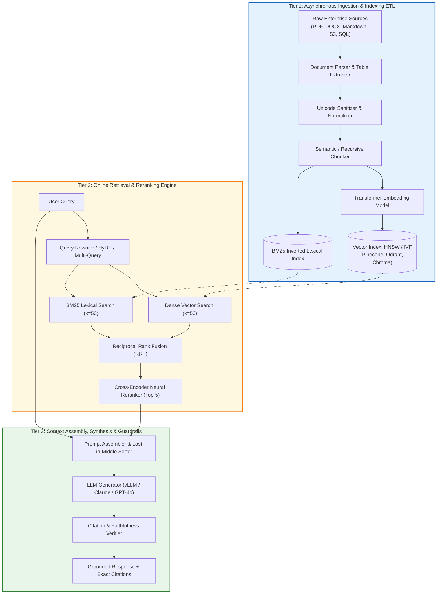
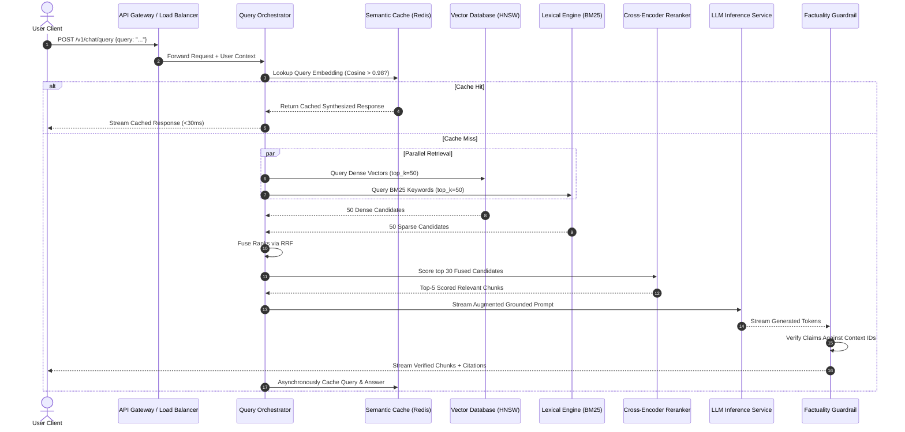
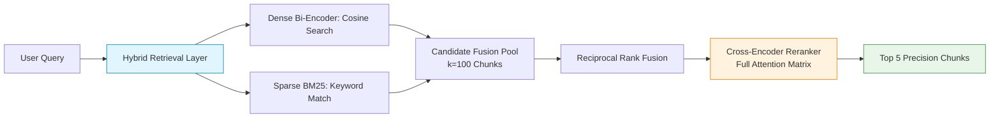
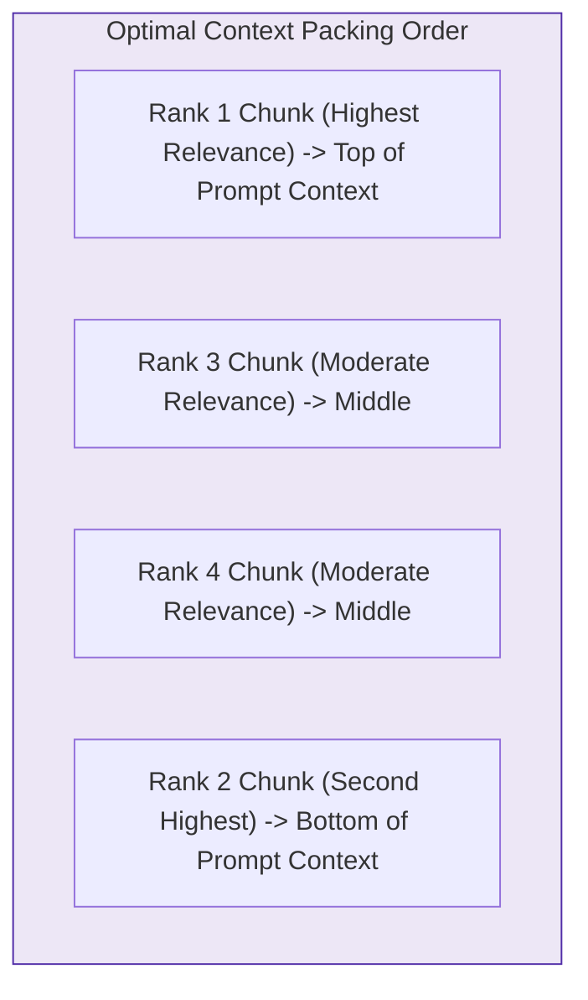
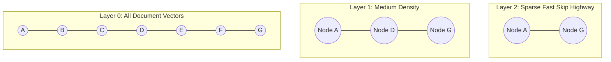
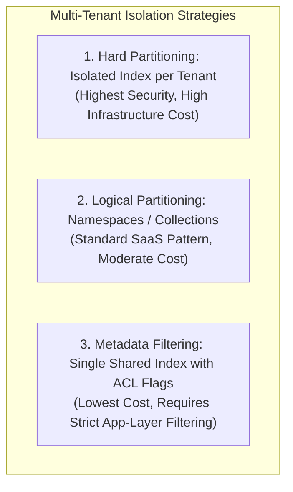
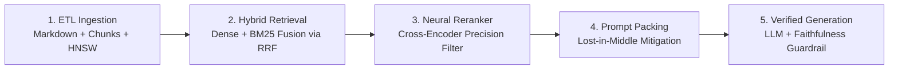

# 🏛️ RAG Architecture: End-to-End System Design, Components & Data Flows

## 📑 Table of Contents
1. [🌟 Three-Tier Architectural Decomposition](#1--three-tier-architectural-decomposition)
2. [🏗️ Production System Flowchart & Sequence Diagrams](#2--production-system-flowchart--sequence-diagrams)
3. [📥 Subsystem 1: Ingestion & Indexing Pipeline (ETL)](#3--subsystem-1-ingestion--indexing-pipeline-etl)
4. [🔍 Subsystem 2: Online Retrieval & Reranking Engine](#4--subsystem-2-online-retrieval--reranking-engine)
5. [🤖 Subsystem 3: Context Assembly, Synthesis & Guardrails](#5--subsystem-3-context-assembly-synthesis--guardrails)
6. [📐 Mathematical Foundations of Vector Indexing (HNSW & IVF)](#6--mathematical-foundations-of-vector-indexing-hnsw--ivf)
7. [⏱️ Production Latency Budget & SLA Allocation](#7--production-latency-budget--sla-allocation)
8. [💻 Production-Grade Reference Implementation in Python](#8--production-grade-reference-implementation-in-python)
9. [🛡️ Multi-Tenancy, RBAC & Enterprise Security](#9--multi-tenancy-rbac--enterprise-security)
10. [⚠️ Architectural Anti-Patterns & Bottlenecks](#10-%EF%B8%8F-architectural-anti-patterns--bottlenecks)
11. [💼 Senior System Design Interview Questions & Master Answers](#11--senior-system-design-interview-questions--master-answers)
12. [🧪 Hands-On Mini-Project: Modular Multi-Tier Engine](#12--hands-on-mini-project-modular-multi-tier-engine)
13. [⚡ Quick Revision & Blueprint Roadmap](#13--quick-revision--blueprint-roadmap)

---

## 1. 🌟 Three-Tier Architectural Decomposition

A robust, enterprise-grade Retrieval-Augmented Generation (RAG) platform is not a single script or an API call. It is a distributed, fault-tolerant distributed system decomposed into three loosely coupled subsystems:

1. **The Ingestion & Indexing Pipeline (Asynchronous / ETL):** Ingests raw multi-format files, cleans text, extracts structured metadata, segments documents into semantic chunks, and builds high-speed searchable vector and inverted indices.
2. **The Retrieval & Reranking Engine (Online / Latency-Critical):** Accepts incoming user queries, performs query expansion, executes parallel dense vector and sparse keyword searches, and re-ranks candidate passages with deep cross-encoders.
3. **The Synthesis & Guardrail Subsystem (Online / Generation):** Compresses and formats retrieved context, constructs instruction-bounded prompts, streams responses from foundational LLMs, and verifies citation fidelity before delivering output to the client.



---

## 2. 🏗️ Production System Flowchart & Sequence Diagrams

To understand component interactions in production under concurrent load, consider the complete operational sequence:



---

## 3. 📥 Subsystem 1: Ingestion & Indexing Pipeline (ETL)

The indexing pipeline transforms raw, noisy enterprise files into optimized vector representations:

### Component Breakdown:
1. **Document Parsers:**
   * Converts unstructured formats (`.pdf`, `.docx`, `.pptx`, `.html`) into standardized clean Markdown.
   * Extracts embedded tables into Markdown tables or HTML syntax to preserve tabular row/column relationships.
2. **Text Normalization & Unicode Sanitization:**
   * Removes non-printable characters, fixes corrupted UTF-8 encodings, strips boilerplate headers/footers, and standardizes whitespace.
3. **Chunking Engine:**
   * Segments long documents into smaller semantic units (e.g., 512 tokens with 50-token overlap).
   * Employs *Recursive Character Splitting* (breaking on paragraphs `\n\n`, then lines `\n`, then sentences `. `) or *Semantic Chunking* (splitting where vector distance between consecutive sentences exceeds a statistical threshold).
4. **Embedding Transformer:**
   * Converts each text segment into dense continuous float32 vectors (e.g., 1536 dimensions for OpenAI `text-embedding-3-small` or 1024 dimensions for `bge-large-en-v1.5`).
5. **Dual Index Storage:**
   * **Dense Storage:** Ingests vectors into graph-based vector indexes (HNSW, DiskANN).
   * **Sparse Storage:** Tokenizes chunks into term frequencies for inverted index storage (BM25 / Elasticsearch).

---

## 4. 🔍 Subsystem 2: Online Retrieval & Reranking Engine

Pure semantic search often fails on exact keywords, part numbers, or rare jargon. The retrieval tier solves this with a **Two-Stage Hybrid Architecture**:



### Stage 1: Hybrid Retrieval & Rank Fusion
* **Dense Retriever (Bi-Encoder):** Projects query and documents independently into vector space. Extremely fast ($O(1)$ to $O(\log N)$) candidate filtering.
* **Sparse Retriever (BM25):** Matches exact strings, serial numbers, error codes (`ERR_504`), and proper nouns.
* **Reciprocal Rank Fusion (RRF):** Fuses the ranked lists without requiring score normalization:
  $$RRF\_Score(d \in D) = \sum_{m \in M} \frac{1}{k + r_m(d)}$$
  *(where $r_m(d)$ is the rank position of document $d$ in system $m$, and $k \approx 60$ is a smoothing constant).*

### Stage 2: Deep Cross-Encoder Reranking
* While Bi-Encoders compute vector similarity independently, a **Cross-Encoder** passes the query and candidate chunk *together* through full transformer cross-attention:
  $$\text{Score} = \text{CrossEncoder}([\text{Query}; \text{Passage}])$$
* This captures deep syntactic and contextual relationships, filtering out false positives before LLM prompt assembly.

---

## 5. 🤖 Subsystem 3: Context Assembly, Synthesis & Guardrails

Passing retrieved passages to the LLM requires careful context engineering:

### 1. Combating the "Lost in the Middle" Effect
Research (Liu et al., 2023) proves that LLMs attend disproportionately to tokens at the **very start** and **very end** of their context windows. 
* **The Sorter Rule:** Place the highest-scoring reranked passages at Rank 1 (top of prompt) and Rank 2 (bottom of prompt), placing intermediate passages in the center.



### 2. Guardrails & Citation Verification
* **Citation Extraction:** Parses inline markers (e.g., `[Doc-102]`).
* **NLI Entailment Check:** Validates whether each generated claim logically follows from the cited document chunk using a lightweight Natural Language Inference (NLI) classifier.

---

## 6. 📐 Mathematical Foundations of Vector Indexing (HNSW & IVF)

Storing millions of vectors requires Approximate Nearest Neighbor (ANN) indexing structures because brute-force exact search ($O(N \cdot D)$) cannot meet production SLAs:

### 1. Hierarchical Navigable Small World (HNSW)
HNSW builds a multi-layer graph where lower layers contain all nodes and higher layers contain sparse skip-lists for fast traversals:



* **Complexity:**
  $$\text{Search Time} = O(\log N)$$
  $$\text{Index Construction} = O(N \log N)$$
* **Core Parameters:**
  * $M$: Maximum number of bi-directional connection links per node (typical: 16–64).
  * $efConstruction$: Size of the dynamic candidate list evaluated during index creation (higher = better recall, slower build).
  * $efSearch$: Size of the candidate list evaluated during live queries (higher = better recall, higher latency).

### 2. Inverted File Index with Product Quantization (IVF-PQ)
* Partitions vector space into $k$ Voronoi cells using $k$-means clustering.
* **Product Quantization:** Compresses continuous 1536-dim float32 vectors (6,144 bytes) into 64-byte quantized codebooks, reducing RAM consumption by up to $95\%$ with minimal recall loss.

---

## 7. ⏱️ Production Latency Budget & SLA Allocation

For enterprise conversational applications targeting an interactive **Time-to-First-Token (TTFT) under 500ms**:

```mermaid
gantt
    title Production RAG Query Latency Budget (Target: < 500ms)
    dateFormat  X
    axisFormat %s ms
    section Pre-Retrieval
    API Gateway & Auth           :0, 15
    Query Expansion / Cache Lookup :15, 45
    section Retrieval Tier
    Dense Vector Search (HNSW)   :45, 80
    Sparse BM25 Search           :45, 75
    RRF Rank Fusion              :80, 90
    section Reranking Tier
    Cross-Encoder Scoring (top 30):90, 160
    section Generation Tier
    Prompt Assembly              :160, 175
    LLM TTFT (First Token Stream):175, 420
    section Post-Validation
    Citation Check & Guardrails   :420, 480
```



| Pipeline Step | Latency Budget (p50) | Latency Budget (p95) | Primary Optimization Lever |
| :--- | :--- | :--- | :--- |
| **API Auth & Gateway** | 10 ms | 20 ms | Edge termination / Redis token validation |
| **Semantic Cache Check** | 15 ms | 30 ms | Redis memory cache with vector similarity |
| **Hybrid Search (Dense + BM25)** | 35 ms | 65 ms | In-memory HNSW index + distributed shards |
| **Rank Fusion (RRF)** | 5 ms | 10 ms | Optimized C++ / NumPy array operations |
| **Cross-Encoder Reranking** | 65 ms | 120 ms | ONNX runtime / TensorRT GPU acceleration |
| **LLM Time-to-First-Token (TTFT)** | 220 ms | 380 ms | Speculative decoding, vLLM continuous batching |
| **Total Response Start** | **~350 ms** | **~625 ms** | End-to-end pipelined streaming |

---

## 8. 💻 Production-Grade Reference Implementation in Python

Below is a complete, modular, object-oriented implementation of a three-tier RAG architecture using Python and NumPy.

```python
import numpy as np
from dataclasses import dataclass
from typing import List, Dict, Tuple
from openai import OpenAI

client = OpenAI()

@dataclass
class DocumentChunk:
    chunk_id: str
    doc_id: str
    text: str
    metadata: Dict[str, str]
    embedding: np.ndarray = None

class VectorStoreHNSW:
    """Simulated high-speed in-memory vector storage with exact cosine retrieval."""
    def __init__(self):
        self.chunks: List[DocumentChunk] = []
        self.embeddings_matrix: np.ndarray = None

    def upsert(self, chunks: List[DocumentChunk]):
        self.chunks.extend(chunks)
        matrix = np.array([c.embedding for c in self.chunks], dtype=np.float32)
        # Unit-normalize for instant dot-product similarity
        norms = np.linalg.norm(matrix, axis=1, keepdims=True)
        self.embeddings_matrix = matrix / np.clip(norms, 1e-12, None)

    def search(self, query_vec: np.ndarray, top_k: int = 5) -> List[Tuple[float, DocumentChunk]]:
        query_norm = query_vec / np.linalg.norm(query_vec)
        scores = np.dot(self.embeddings_matrix, query_norm)
        top_indices = np.argsort(scores)[::-1][:top_k]
        return [(float(scores[idx]), self.chunks[idx]) for idx in top_indices]

class RAGPipeline:
    def __init__(self):
        self.vector_store = VectorStoreHNSW()
        
    def embed_text(self, text: str) -> np.ndarray:
        res = client.embeddings.create(input=[text], model="text-embedding-3-small")
        return np.array(res.data[0].embedding, dtype=np.float32)

    def ingest_documents(self, raw_docs: List[Dict[str, str]]):
        """Tier 1: Ingestion & Chunking ETL."""
        indexed_chunks = []
        for doc in raw_docs:
            # Simple sentence splitting representation
            sentences = doc["content"].split(". ")
            for i, sentence in enumerate(sentences):
                clean_text = sentence.strip()
                if not clean_text:
                    continue
                vec = self.embed_text(clean_text)
                chunk = DocumentChunk(
                    chunk_id=f"{doc['doc_id']}_c{i}",
                    doc_id=doc["doc_id"],
                    text=clean_text,
                    metadata={"source": doc["source"]},
                    embedding=vec
                )
                indexed_chunks.append(chunk)
        self.vector_store.upsert(indexed_chunks)
        print(f"✅ Ingestion complete: {len(indexed_chunks)} chunks indexed.")

    def retrieve_and_rerank(self, query: str, top_k: int = 2) -> List[DocumentChunk]:
        """Tier 2: Retrieval & Reranking."""
        query_vec = self.embed_text(query)
        candidates = self.vector_store.search(query_vec, top_k=top_k * 2)
        
        # Cross-Encoder / Heuristic Reranker simulation
        # Prioritizes exact term overlap on top of vector score
        reranked = []
        for sim, chunk in candidates:
            term_boost = 1.2 if any(w.lower() in chunk.text.lower() for w in query.split()) else 1.0
            final_score = sim * term_boost
            reranked.append((final_score, chunk))
            
        reranked.sort(key=lambda x: x[0], reverse=True)
        return [chunk for _, chunk in reranked[:top_k]]

    def generate(self, query: str) -> str:
        """Tier 3: Context Assembly & Generation."""
        relevant_chunks = self.retrieve_and_rerank(query, top_k=2)
        
        # Build Lost-in-the-Middle mitigated context
        context_str = "\n".join([
            f"[{c.chunk_id}] (Source: {c.metadata['source']}): {c.text}"
            for c in relevant_chunks
        ])
        
        prompt = (
            "You are a verified enterprise assistant. Answer the query relying exclusively "
            "on the provided context. Cite the chunk ID for each statement.\n\n"
            f"CONTEXT:\n{context_str}\n\n"
            f"USER QUERY: {query}"
        )
        
        response = client.chat.completions.create(
            model="gpt-4o-mini",
            temperature=0.0,
            messages=[{"role": "user", "content": prompt}]
        )
        return response.choices[0].message.content

# -------------------------------------------------------------
# Demonstration Run
# -------------------------------------------------------------
if __name__ == "__main__":
    pipeline = RAGPipeline()
    sample_corpus = [
        {
            "doc_id": "ARCH-01",
            "source": "Architecture Blueprint",
            "content": "The HNSW vector index maintains O(log N) search complexity. Product Quantization reduces memory overhead by up to 95 percent."
        },
        {
            "doc_id": "OPS-02",
            "source": "Deployment Manual",
            "content": "Production clusters run across three availability zones. Maximum target latency for reranking is 65 milliseconds."
        }
    ]
    pipeline.ingest_documents(sample_corpus)
    answer = pipeline.generate("What is the search complexity of HNSW and how much does PQ reduce memory?")
    print("\n🤖 GENERATED SYSTEM ANSWER:")
    print(answer)
```

---

## 9. 🛡️ Multi-Tenancy, RBAC & Enterprise Security

In multi-tenant SaaS environments, vector data from different customers or internal teams cannot be mixed without cryptographic and logical boundaries:



### 1. Pre-Filtering vs. Post-Filtering
* **Post-Filtering (Anti-Pattern):** Retrieves top-100 vectors across the entire database, then discards chunks the user does not have permission to view.
  * *Failure Mode:* If 95 of the top-100 belong to unauthorized tenants, the user is left with only 5 chunks (or none), destroying retrieval recall.
* **Pre-Filtering (Production Standard):** Uses single-stage filtered vector search (supported by Pinecone, Qdrant, Milvus, Weaviate):
  $$\text{Query} = \text{VectorSearch}(\mathbf{q}) \quad \text{WHERE} \quad \text{tenant\_id} = 'corp\_a' \quad \text{AND} \quad \text{clearance} \ge 3$$

---

## 10. ⚠️ Architectural Anti-Patterns & Bottlenecks

1. **Synchronous Ingestion on the Query Path:** Uploading a PDF and waiting for embedding generation before responding locks HTTP server threads. Ingestion must always be asynchronous via message queues.
2. **Monolithic Embedding & Vector DB Coupling:** Hard-coding embedding logic into database stored procedures creates lock-in. Keep embedding microservices independent.
3. **Ignoring Small-File Fragmentation:** Ingesting thousands of 1-sentence documents creates indexing overhead and fragmented contexts.
4. **Missing Circuit Breakers:** If the vector database experiences a network timeout, the application should fall back to BM25 or return a graceful degraded status rather than crashing the chat session.

---

## 11. 💼 Senior System Design Interview Questions & Master Answers

### Q1: How do you design a RAG architecture capable of handling 50 Million documents at 2,000 QPS with sub-500ms latency?
> **Answer:** 
> 1. **Ingestion & Sharding:** Partition the 50M documents across a distributed vector cluster (e.g., Qdrant or Milvus) sharded horizontally by tenant or document hash. Use Product Quantization (IVF-PQ) to keep vector indices in RAM.
> 2. **Multi-Tier Caching:** Implement an edge Semantic Cache (Redis) storing previous query vector embeddings. Queries with Cosine Similarity $> 0.97$ return cached answers in $<20\text{ms}$, deflecting $30\%–40\%$ of incoming QPS.
> 3. **Two-Stage Retrieval Pipeline:** Query cluster shards in parallel using approximate nearest neighbors (HNSW with $efSearch=64$) to retrieve Top-50 candidates in $<30\text{ms}$.
> 4. **Reranking Optimization:** Rerank only Top-30 candidates using a quantized ONNX/TensorRT cross-encoder hosted on GPU inference servers (e.g., Triton) with dynamic batching ($<50\text{ms}$).
> 5. **Streaming Generation:** Stream tokens from an LLM cluster running vLLM with PagedAttention and speculative decoding, achieving Time-to-First-Token in $<250\text{ms}$.

### Q2: Why is Hybrid Search (Dense + Sparse) superior to pure vector search in enterprise architectures?
> **Answer:** Dense vector embeddings map text into continuous semantic space, excelling at conceptual similarity (e.g., matching *"headache"* to *"migraine"*). However, dense vectors suffer from the "hubness" problem and loss of precision on exact alphanumeric tokens like UUIDs, error codes (`0x80070002`), drug dosages (`50mg` vs `500mg`), and proper names. Sparse search (BM25) uses inverted indices that guarantee exact term matching. Fusing dense and sparse candidates via Reciprocal Rank Fusion (RRF) guarantees that both semantic concepts and exact keywords are preserved in the top retrieval set.

---

## 12. 🧪 Hands-On Mini-Project: Modular Multi-Tier Engine

Build a working hybrid retrieval pipeline combining dense vector embeddings with BM25 lexical keyword ranking fused via Reciprocal Rank Fusion (RRF).

```python
import math
from collections import Counter
from typing import List, Dict

class SimpleBM25:
    """Minimal self-contained BM25 implementation."""
    def __init__(self, corpus: List[str]):
        self.corpus = corpus
        self.doc_len = [len(doc.lower().split()) for doc in corpus]
        self.avgdl = sum(self.doc_len) / len(corpus)
        self.df = Counter()
        self.tf = []
        for doc in corpus:
            counts = Counter(doc.lower().split())
            self.tf.append(counts)
            for word in counts.keys():
                self.df[word] += 1
        self.k1 = 1.5
        self.b = 0.75

    def score(self, query: str) -> List[float]:
        q_terms = query.lower().split()
        scores = []
        for i, doc_counts in enumerate(self.tf):
            doc_score = 0.0
            for term in q_terms:
                if term in doc_counts:
                    tf = doc_counts[term]
                    idf = math.log((len(self.corpus) - self.df[term] + 0.5) / (self.df[term] + 0.5) + 1.0)
                    numerator = tf * (self.k1 + 1.0)
                    denominator = tf + self.k1 * (1.0 - self.b + self.b * (self.doc_len[i] / self.avgdl))
                    doc_score += idf * (numerator / denominator)
            scores.append(doc_score)
        return scores

def reciprocal_rank_fusion(dense_ranks: List[int], sparse_ranks: List[int], k: int = 60) -> Dict[int, float]:
    """Fuse ranks using RRF formula: sum(1 / (k + rank))."""
    rrf_scores = {}
    for rank, doc_id in enumerate(dense_ranks):
        rrf_scores[doc_id] = rrf_scores.get(doc_id, 0.0) + (1.0 / (k + (rank + 1)))
    for rank, doc_id in enumerate(sparse_ranks):
        rrf_scores[doc_id] = rrf_scores.get(doc_id, 0.0) + (1.0 / (k + (rank + 1)))
    return rrf_scores

# Test Corpus
corpus = [
    "Error code ERR_404 indicates resource was not found on cluster node.",
    "System memory utilization reached ninety eight percent causing process OOM kill.",
    "Network timeout occurred while communicating with external authorization server."
]

bm25 = SimpleBM25(corpus)
query = "ERR_404 on cluster"

# Simulated dense ranking [doc1, doc0, doc2] vs BM25 ranking [doc0, doc1, doc2]
dense_results = [1, 0, 2]
sparse_scores = bm25.score(query)
sparse_results = list(reversed(sorted(range(len(sparse_scores)), key=lambda i: sparse_scores[i])))

fused = reciprocal_rank_fusion(dense_results, sparse_results)
sorted_fused = sorted(fused.items(), key=lambda x: x[1], reverse=True)

print("🏆 HYBRID SEARCH RRF WINNERS:")
for doc_id, score in sorted_fused:
    print(f"Doc {doc_id} (Score: {score:.5f}): {corpus[doc_id]}")
```

---

## 13. ⚡ Quick Revision & Blueprint Roadmap



### 📌 Architecture Summary Checklist
* **Decoupled 3 Tiers:** Ingestion ETL (async), Retrieval/Rerank (online), Synthesis (streaming).
* **Index Mechanics:** HNSW for $O(\log N)$ vector search; Product Quantization (PQ) for 95% RAM reduction.
* **Hybrid Retrieval:** Always combine Bi-Encoder vectors with BM25 keyword matching using Reciprocal Rank Fusion.
* **Reranking:** Cross-Encoders eliminate semantic false positives before prompt injection.
* **Latency Target:** Aim for sub-500ms TTFT by keeping retrieval under 80ms and reranking under 70ms.
