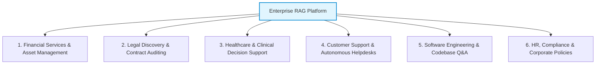
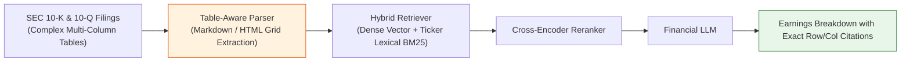
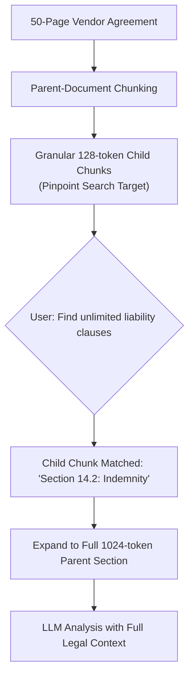
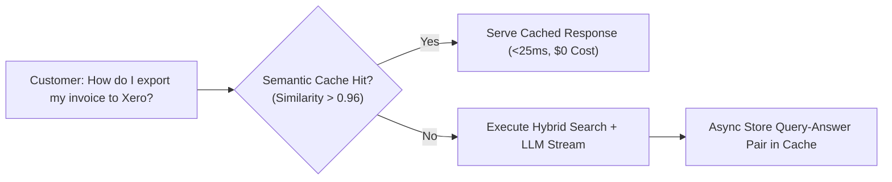
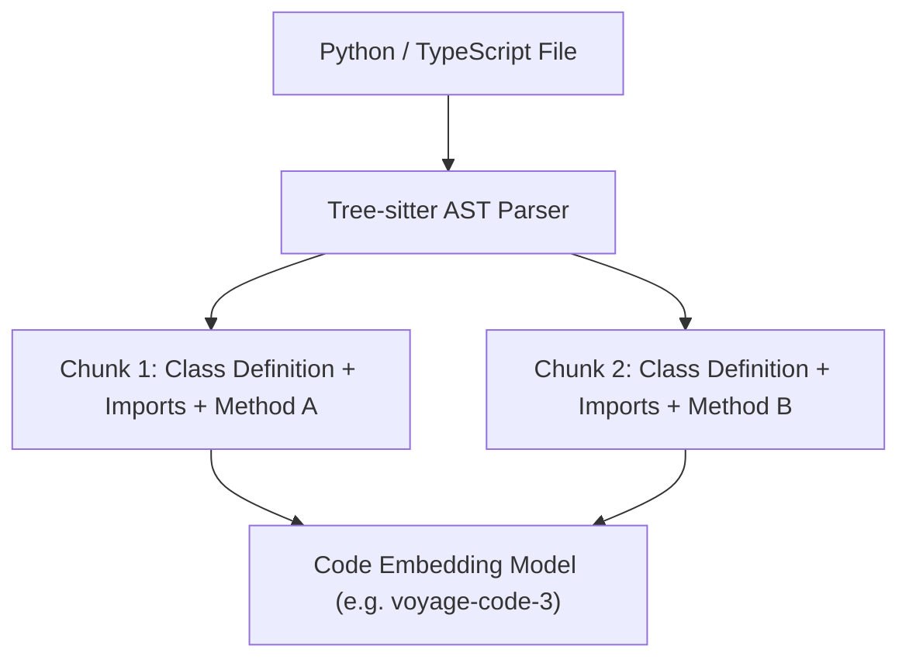
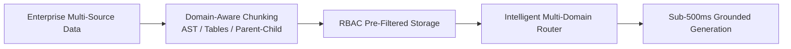

# 🏢 Enterprise RAG Use Cases: Industry Architectures, Blueprints & Implementations

## 📑 Table of Contents
1. [🌟 The Enterprise RAG Landscape & Market Drivers](#1--the-enterprise-rag-landscape--market-drivers)
2. [🏦 Use Case 1: Financial Services & Asset Management](#2--use-case-1-financial-services--asset-management)
3. [⚖️ Use Case 2: Legal Discovery & Contract Intelligence](#3--use-case-2-legal-discovery--contract-intelligence)
4. [🏥 Use Case 3: Healthcare & Clinical Decision Support](#4--use-case-3-healthcare--clinical-decision-support)
5. [🎧 Use Case 4: Customer Support & Autonomous Helpdesks](#5--use-case-4-customer-support--autonomous-helpdesks)
6. [💻 Use Case 5: Software Engineering & Codebase Q&A](#6--use-case-5-software-engineering--codebase-qa)
7. [🏛️ Use Case 6: Human Resources & Corporate Governance](#7--use-case-6-human-resources--corporate-governance)
8. [📊 Cross-Industry Architectural Decision Matrix](#8--cross-industry-architectural-decision-matrix)
9. [💻 Practical Implementation: Multi-Domain Enterprise Query Router in Python](#9--practical-implementation-multi-domain-enterprise-query-router-in-python)
10. [⚠️ Common Enterprise Deployment Pitfalls](#10-%EF%B8%8F-common-enterprise-deployment-pitfalls)
11. [💼 Senior Engineering Interview Questions & Master Answers](#11--senior-engineering-interview-questions--master-answers)
12. [🧪 Hands-On Mini-Project: Enterprise Policy Engine with RBAC Filtering](#12--hands-on-mini-project-enterprise-policy-engine-with-rbac-filtering)
13. [⚡ Quick Revision & Blueprint Roadmap](#13--quick-revision--blueprint-roadmap)

---

## 1. 🌟 The Enterprise RAG Landscape & Market Drivers

Retrieval-Augmented Generation has become the foundational enterprise architecture for generative AI. Unlike consumer chatbots that prioritize open-ended creativity, enterprise systems must satisfy three non-negotiable operational requirements:

1. **Zero Tolerance for Unverifiable Hallucination:** In legal, medical, and financial applications, a single fabricated metric or clause can cause severe regulatory penalties or catastrophic losses.
2. **Absolute Data Confidentiality & Access Control (RBAC):** An enterprise AI must guarantee that an intern querying the system cannot retrieve executive compensation records or unreleased M&A documents.
3. **Auditability & Traceability:** Every generated statement must carry a cryptographically secure, deterministic citation linking back to the source file, author, timestamp, and page number.



---

## 2. 🏦 Use Case 1: Financial Services & Asset Management

Financial analysts spend hundreds of hours manually dissecting quarterly SEC filings (10-K, 10-Q), earnings call transcripts, and macroeconomic reports.



### Key Technical Challenges & Solutions:
* **The Tabular Data Challenge:** Financial filings contain nested tables. Naive character chunking slices tables mid-row, destroying numerical relationships.
  * *Solution:* Use layout-aware visual parsers (e.g., Unstructured, LlamaParse) to convert balance sheets into structured Markdown tables or JSON key-value pairs before embedding.
* **Exact Ticker & Metric Sensitivity:** Searching for *"TSLA Q3 CapEx"* must match exact numbers, not generic automotive commentary.
  * *Solution:* Hybrid dense-sparse retrieval with high weight on BM25 lexical matching.

---

## 3. ⚖️ Use Case 2: Legal Discovery & Contract Intelligence

Corporate legal departments manage thousands of active Master Services Agreements (MSAs), Statements of Work (SOWs), and Non-Disclosure Agreements (NDAs).

### Primary Workflows:
1. **Clause Anomaly Detection:** Comparing an incoming vendor NDA against standard company templates to highlight non-standard indemnification liabilities.
2. **Regulatory Compliance Discovery:** Auditing historical contracts when new regulations (e.g., GDPR, EU AI Act, California Privacy Rights) are enacted.



* **Architectural Standard:** **Parent-Document Retrieval (Sentence-Window Retrieval).** The vector index stores small child chunks (e.g., single sentences) for high-precision retrieval, but retrieves and injects the entire surrounding contractual clause (parent chunk) into the LLM prompt to maintain legal context.

---

## 4. 🏥 Use Case 3: Healthcare & Clinical Decision Support

In medical environments, RAG systems assist physicians by querying peer-reviewed journals (PubMed), clinical practice guidelines, and patient Electronic Health Records (EHR).

### The "Zero-Hallucination" Clinical Architecture:
* **Strict Factuality Gatekeepers:** Every retrieved passage is verified through a biomedical ontology filter (UMLS / SNOMED-CT).
* **Negative Rejection Directive:** The system prompt explicitly dictates:
  > *"If the dosage or treatment protocol is not explicitly present in the provided clinical guidelines, you must decline to answer and prompt the physician to consult the institutional formulary."*
* **HIPAA Compliance:** Personal Health Information (PHI) is redacted or tokenized before entering the retrieval pipeline.

---

## 5. 🎧 Use Case 4: Customer Support & Autonomous Helpdesks

Modern customer support platforms (integrating with Zendesk, Intercom, and Jira Service Desk) use RAG to resolve tier-1 and tier-2 tickets autonomously.



### Business Impact & Operational Metrics:
* **Deflection Rate:** Percentage of incoming inquiries resolved without human agent intervention ($40\%–65\%$ industry average).
* **Semantic Caching with Redis:** Up to $30\%$ of customer support queries are identical or semantically equivalent. Semantic caching serves answers in $<25\text{ms}$ with zero LLM API cost.

---

## 6. 💻 Use Case 5: Software Engineering & Codebase Q&A

Engineering teams deploy RAG over private Git repositories to assist with developer onboarding, API documentation, and code reviews.

### AST-Aware Code Chunking:
Standard text splitters break code arbitrarily across lines, severing functions and loops. Engineering RAG pipelines employ **Abstract Syntax Tree (AST)** chunkers:
* Uses parsers (e.g., Tree-sitter) to break files by semantic programming constructs: `Class`, `Function`, or `Method`.
* Automatically prepends import statements and class definitions to every method chunk so the LLM understands variable scopes.



---

## 7. 🏛️ Use Case 6: Human Resources & Corporate Governance

Internal enterprise HR portals enable employees to ask questions regarding benefits, parental leave, expense policies, and performance cycles.

### The Role-Based Access Control (RBAC) Imperative:
In an enterprise portal, queries must enforce user authorization at the database index level:
$$\text{Filter} = (\text{department} == \text{user.dept}) \quad \text{AND} \quad (\text{security\_level} \le \text{user.clearance})$$

An employee in Marketing querying benefits cannot retrieve internal sales compensation quotas or engineering roadmaps.

---

## 8. 📊 Cross-Industry Architectural Decision Matrix

| Industry Domain | Primary Document Types | Optimal Chunking Strategy | Retrieval Paradigm | Critical Guardrail / SLA |
| :--- | :--- | :--- | :--- | :--- |
| **Financial Services** | 10-K, 10-Q, Earnings Calls | Table-aware Markdown / HTML | Hybrid (Dense + BM25) + Reranker | Exact numerical citation validation |
| **Legal Intelligence** | MSAs, NDAs, Court Filings | Parent-Child (Sentence-Window) | Dense Vector + Cross-Encoder | Verbatim quotation checking |
| **Healthcare** | Clinical Trials, PubMed, EHR | Semantic Chunking by Section | Dense Semantic Search | UMLS Clinical validation, Zero hallucination |
| **Customer Support** | Knowledge Base, Zendesk FAQs | Question/Answer pair chunking | Dense Search + Semantic Cache | Deflection rate, sub-500ms TTFT |
| **Codebase Search** | Python, TypeScript, YAML, SQL | Tree-sitter AST Structural | Code-tuned Bi-Encoder | Class and function scope retention |
| **HR & Policies** | Employee Handbooks, SOPs | Recursive Header Splitting (`#`, `##`)| Metadata-Filtered Dense Search | Strict RBAC permission enforcement |

---

## 9. 💻 Practical Implementation: Multi-Domain Enterprise Query Router in Python

In large enterprises, a single RAG pipeline cannot handle code, financial tables, and HR policies with the same settings. The modern architectural pattern is an **Intelligent Query Router** that classifies incoming queries and dispatches them to domain-optimized pipelines.

```python
import json
from openai import OpenAI

client = OpenAI()

# Domain metadata configurations
DOMAIN_CONFIGS = {
    "FINANCE": {
        "index_name": "financial_filings_hybrid",
        "retrieval_mode": "hybrid_dense_sparse",
        "system_directive": "You are a chartered financial analyst. Prioritize exact numerical figures and SEC citations."
    },
    "LEGAL": {
        "index_name": "contracts_parent_child",
        "retrieval_mode": "parent_document",
        "system_directive": "You are an enterprise legal counsel. Cite exact section clauses and provide conservative interpretations."
    },
    "ENGINEERING": {
        "index_name": "codebase_ast_index",
        "retrieval_mode": "ast_code_search",
        "system_directive": "You are a staff software architect. Provide idiomatic code examples and reference repository paths."
    },
    "HR_POLICIES": {
        "index_name": "corporate_handbook_rbac",
        "retrieval_mode": "rbac_metadata_filtered",
        "system_directive": "You are an internal HR advisor. Explain corporate policies clearly and verify employee eligibility."
    }
}

def route_enterprise_query(query: str) -> dict:
    """Classifies user query into the optimal domain pipeline using structured function calling."""
    classifier_prompt = f"""
    Analyze the user query and classify it into exactly ONE of the following enterprise domains:
    - FINANCE: For balance sheets, earnings reports, CapEx, stock, revenue, or SEC filings.
    - LEGAL: For contracts, NDAs, liability, indemnification, regulations, or compliance.
    - ENGINEERING: For APIs, software architecture, code snippets, database schemas, or bugs.
    - HR_POLICIES: For employee benefits, PTO, health insurance, parental leave, or remote work.

    QUERY: "{query}"
    """
    
    response = client.chat.completions.create(
        model="gpt-4o-mini",
        temperature=0.0,
        messages=[
            {"role": "system", "content": "You are a precise enterprise query classifier. Respond ONLY with valid JSON."},
            {"role": "user", "content": classifier_prompt}
        ],
        response_format={"type": "json_object"}
    )
    
    classification = json.loads(response.choices[0].message.content)
    domain_key = classification.get("domain", "HR_POLICIES").upper()
    return DOMAIN_CONFIGS.get(domain_key, DOMAIN_CONFIGS["HR_POLICIES"])

# -------------------------------------------------------------
# Test Enterprise Query Router
# -------------------------------------------------------------
if __name__ == "__main__":
    queries = [
        "What was our operating cash flow in Q3 2026?",
        "Do we have an indemnification cap on the Acme Corp vendor agreement?",
        "How do I configure the Redis connection pool in the auth-service repository?",
        "How many days of bereavement leave am I eligible for?"
    ]
    
    print("🚦 ENTERPRISE MULTI-DOMAIN ROUTER EXECUTION")
    print("=" * 70)
    for q in queries:
        routing = route_enterprise_query(q)
        print(f"Query: '{q}'")
        print(f"  ➡️ Target Index    : {routing['index_name']}")
        print(f"  ➡️ Retrieval Mode  : {routing['retrieval_mode']}")
        print(f"  ➡️ Directive       : {routing['system_directive'][:60]}...\n")
```

---

## 10. ⚠️ Common Enterprise Deployment Pitfalls

1. **The "Single Index for Everything" Fallacy:** Storing engineering code, PDF balance sheets, and HR handbooks in the same vector collection without metadata filtering ruins retrieval precision.
2. **Permission Leakage Across Tenants:** Passing all retrieved chunks to the LLM without validating whether the user's session token grants read access to each chunk's source document.
3. **Ignoring Document Invalidation / Deletion:** When a document is modified in SharePoint, leaving old chunks in the vector database causes the LLM to cite obsolete policies.

---

## 11. 💼 Senior Engineering Interview Questions & Master Answers

### Q1: How do you implement Role-Based Access Control (RBAC) in a production RAG system?
> **Answer:** RBAC must be implemented as **Single-Stage Pre-Filtering** in the vector database, never as post-filtering. 
> 1. During ingestion, each document chunk is stamped with metadata containing allowed security groups: `{"allowed_roles": ["finance_read", "executives"], "org_id": "corp"}`.
> 2. When a user queries the API, their authenticated JWT token is inspected to extract their verified security groups: `user_roles = ["finance_read"]`.
> 3. The vector search query executes a filtered search:
>    $$\text{Search}(\mathbf{q}) \quad \text{WHERE} \quad \text{allowed\_roles IN } [\text{'finance\_read'}] \quad \text{AND} \quad \text{org\_id} = 'corp'$$
> 4. Unauthorized chunks are physically excluded from distance calculation, making cross-tenant data leaks mathematically impossible.

### Q2: How do you solve tabular data extraction in financial 10-K filings for RAG?
> **Answer:** Standard text chunkers strip table borders and line breaks, causing numbers to detach from their column headers. The production solution involves:
> 1. **Layout-Aware OCR / Parser:** Using tools like Table Transformer, Unstructured, or LlamaParse to detect bounding boxes around financial tables.
> 2. **Structured Serialization:** Converting tables into structured Markdown (`| Column | Value |`) or HTML table syntax.
> 3. **Summary Prepending:** Generating a 1-sentence synthetic summary of the table (e.g., *"Consolidated Statements of Operations for FY 2026 showing Net Income of $4.2B"*) and prepending it to the serialized table before embedding, ensuring dense vector search can locate the table semantically.

---

## 12. 🧪 Hands-On Mini-Project: Enterprise Policy Engine with RBAC Filtering

This standalone script demonstrates how to build an enterprise RAG knowledge base with strict Role-Based Access Control (RBAC) filtering using NumPy.

```python
import numpy as np
from typing import List, Dict
from openai import OpenAI

client = OpenAI()

# Enterprise Documents with Security Group Metadata
ENTERPRISE_KB = [
    {
        "id": "HR-01",
        "title": "Standard PTO Guidelines",
        "text": "All full-time employees receive 20 days of annual paid leave.",
        "allowed_roles": ["employee", "manager", "executive"]
    },
    {
        "id": "EXEC-02",
        "title": "Executive Performance Bonus Formula",
        "text": "Tier-1 executive bonuses are calculated as 40 percent of base salary tied to EBITDA milestones.",
        "allowed_roles": ["executive"]
    },
    {
        "id": "ENG-03",
        "title": "AWS Production Root Password Protocol",
        "text": "Root credentials are encrypted in HashiCorp Vault requiring dual-approval from DevOps leads.",
        "allowed_roles": ["devops", "executive"]
    }
]

def get_embedding(text: str) -> np.ndarray:
    res = client.embeddings.create(input=[text], model="text-embedding-3-small")
    vec = np.array(res.data[0].embedding, dtype=np.float32)
    return vec / np.linalg.norm(vec)

# Pre-compute embeddings
for doc in ENTERPRISE_KB:
    doc["vector"] = get_embedding(doc["text"])

def secure_rag_query(query: str, user_role: str) -> str:
    """Executes RAG search strictly filtered by user's security clearance."""
    query_vec = get_embedding(query)
    
    # 1. Pre-Filtering by RBAC
    authorized_docs = [
        d for d in ENTERPRISE_KB
        if user_role in d["allowed_roles"]
    ]
    
    if not authorized_docs:
        return "Access Denied: You have no authorized documents matching this clearance."

    # 2. Vector Similarity over Authorized Subset
    scored = [
        (float(np.dot(query_vec, d["vector"])), d)
        for d in authorized_docs
    ]
    scored.sort(key=lambda x: x[0], reverse=True)
    top_doc = scored[0][1]

    # 3. Grounded Generation
    prompt = (
        f"You are a secure corporate assistant. Answer the query using only this authorized context:\n\n"
        f"[{top_doc['id']}]: {top_doc['text']}\n\n"
        f"QUESTION: {query}"
    )
    completion = client.chat.completions.create(
        model="gpt-4o-mini",
        temperature=0.0,
        messages=[{"role": "user", "content": prompt}]
    )
    return f"[{user_role.upper()} CLEARANCE] -> {completion.choices[0].message.content}"

# -------------------------------------------------------------
# Demonstration: Junior Employee vs Executive Querying Bonuses
# -------------------------------------------------------------
if __name__ == "__main__":
    sensitive_query = "How are executive performance bonuses calculated?"
    
    print("🔒 RBAC PERMISSION DEMONSTRATION")
    print("=" * 65)
    print(f"Query: '{sensitive_query}'\n")
    
    # Attempt 1: Junior Employee
    print("1. Query submitted by 'employee':")
    print(secure_rag_query(sensitive_query, user_role="employee"))
    print()
    
    # Attempt 2: Executive
    print("2. Query submitted by 'executive':")
    print(secure_rag_query(sensitive_query, user_role="executive"))
    print("=" * 65)
```

---

## 13. ⚡ Quick Revision & Blueprint Roadmap



### 📌 Summary Checklist
* **Finance:** Preserve balance sheets with table-aware parsers; prioritize hybrid BM25 for ticker numbers.
* **Legal:** Use Parent-Document Retrieval to match precise clauses while preserving surrounding contract context.
* **Healthcare:** Enforce strict zero-hallucination negative prompts and UMLS clinical validation.
* **Customer Support:** Deflect recurring tickets with Redis semantic caching in $<25\text{ms}$.
* **Engineering:** Parse codebases with Tree-sitter AST to preserve function and class boundaries.
* **Security & HR:** Always enforce RBAC pre-filtering at the database query layer.
