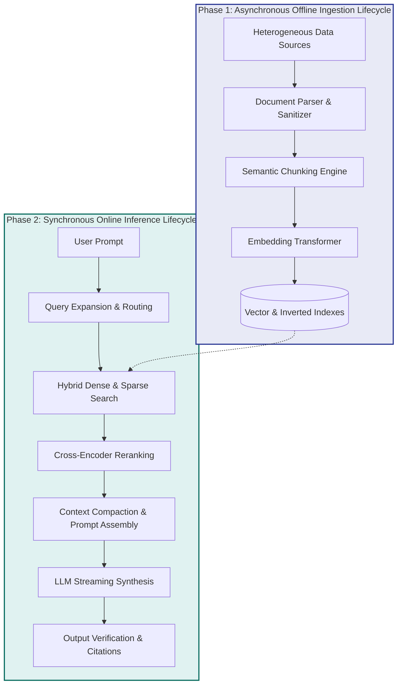
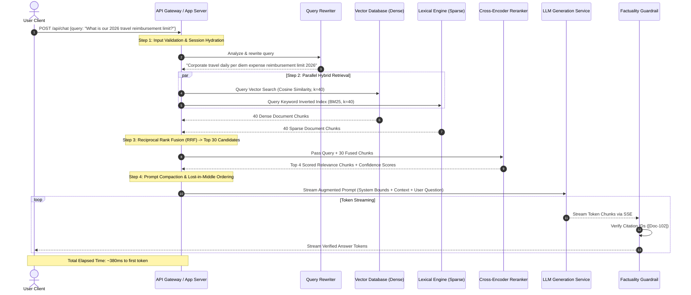
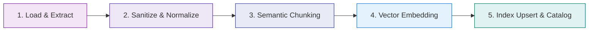
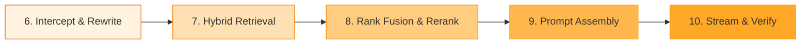
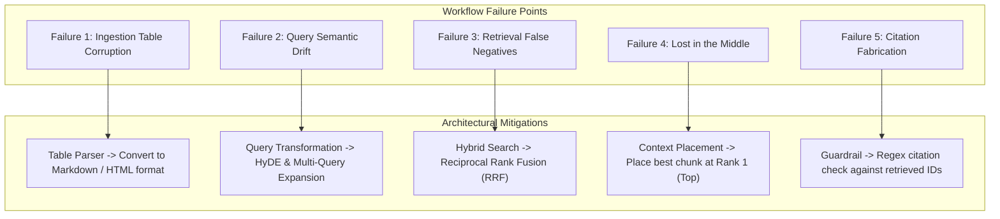

# 🔄 The RAG Workflow: End-to-End Execution Lifecycle & Component Interaction

## 📑 Table of Contents
1. [🌟 The Two Operational Lifecycles: Offline Ingestion vs. Online Inference](#1--the-two-operational-lifecycles-offline-ingestion-vs-online-inference)
2. [🪜 End-to-End Sequence & Data Flow Diagram](#2--end-to-end-sequence--data-flow-diagram)
3. [📥 Phase 1: The Ingestion Workflow (Steps 1–5)](#3--phase-1-the-ingestion-workflow-steps-15)
4. [⚡ Phase 2: The Inference & Generation Workflow (Steps 6–10)](#4--phase-2-the-inference--generation-workflow-steps-610)
5. [🔄 Asynchronous Data Pipelines & Change Data Capture (CDC)](#5--asynchronous-data-pipelines--change-data-capture-cdc)
6. [📐 Mathematical Foundations: Rank Fusion & Calibration Mechanics](#6--mathematical-foundations-rank-fusion--calibration-mechanics)
7. [⏱️ End-to-End Latency Tracing & Observability](#7--end-to-end-latency-tracing--observability)
8. [💻 Practical Implementation: Instrumented Observable Workflow in Python](#8--practical-implementation-instrumented-observable-workflow-in-python)
9. [🚨 Critical Workflow Failure Modes & Mitigations](#9--critical-workflow-failure-modes--mitigations)
10. [🛠️ Workflow Optimization Techniques](#10-%EF%B8%8F-workflow-optimization-techniques)
11. [💼 Senior Engineering Interview Questions & Master Answers](#11--senior-engineering-interview-questions--master-answers)
12. [🧪 Hands-On Mini-Project: Instrumented Latency Benchmarking Engine](#12--hands-on-mini-project-instrumented-latency-benchmarking-engine)
13. [⚡ Quick Revision & Workflow Cheat Sheet](#13--quick-revision--workflow-cheat-sheet)

---

## 1. 🌟 The Two Operational Lifecycles: Offline Ingestion vs. Online Inference

A production RAG system decouples operations into two fundamentally distinct lifecycles:

1. **The Asynchronous Offline Ingestion Lifecycle (Data Plane):** Operates in the background. It continuously monitors source repositories (S3, Confluence, Git, PostgreSQL), processes documents through extraction and chunking pipelines, computes mathematical embeddings, and maintains search indexes.
2. **The Synchronous Online Inference Lifecycle (Query Plane):** Operates on the latency-critical path. When a user submits a prompt, it intercepts the query, queries indexed stores in parallel, re-scores candidates, builds the augmented prompt, and streams grounded tokens from the LLM.



---

## 2. 🪜 End-to-End Sequence & Data Flow Diagram

Below is the complete sequence of network calls and component interactions during an active query execution:



---

## 3. 📥 Phase 1: The Ingestion Workflow (Steps 1–5)

The ingestion pipeline converts raw bytes into searchable, high-dimensional vector representations.



### Detailed Breakdown of Ingestion Steps:
1. **Step 1: Document Loading & Multimodal Extraction:**
   * Parsers extract raw text, tables, images, and formulas from heterogenous formats (`.pdf`, `.docx`, `.xlsx`, `.html`, Markdown).
   * Tables are converted into Markdown strings or JSON structures to preserve row-column semantics.
2. **Step 2: Text Normalization & Unicode Sanitization:**
   * Removes control characters (`\x00`), normalizes Unicode (NFC/NFKC), standardizes line breaks, and strips repetitive page headers/footers.
3. **Step 3: Semantic Chunking & Boundary Preservation:**
   * Splits text into manageable units (e.g., 512 tokens with 10% overlap).
   * Respects structural document boundaries: splits on Markdown headings (`#`, `##`), paragraph breaks, or code block fences rather than arbitrary character offsets.
4. **Step 4: Dense Vector Embedding & Sparse Tokenization:**
   * Generates dense vectors using transformer bi-encoders (`text-embedding-3-small`, `bge-large-en-v1.5`).
   * Tokenizes text and calculates term frequencies ($TF$) for inverted lexical index generation.
5. **Step 5: Index Upsert & Metadata Cataloging:**
   * Persists dense vectors into an HNSW or IVF-PQ index.
   * Stores rich metadata (document ID, URL, author, creation timestamp, ACL permissions) in primary storage.

---

## 4. ⚡ Phase 2: The Inference & Generation Workflow (Steps 6–10)

The online query lifecycle executes synchronously with strict sub-second latency constraints:



### Detailed Breakdown of Inference Steps:
6. **Step 6: Query Interception & Contextual Rewriting:**
   * Conversational queries (e.g., *"What about its battery life?"*) are rewritten into standalone search questions (e.g., *"What is the battery life of the 2026 Model X laptop?"*) using past conversation history.
7. **Step 7: Parallel Hybrid Retrieval:**
   * Dispatches concurrent asynchronous search requests to both the Dense Vector Index (semantic similarity) and the Sparse Inverted Index (BM25 keyword search).
8. **Step 8: Rank Fusion & Neural Cross-Encoder Reranking:**
   * Merges dense and sparse result lists via Reciprocal Rank Fusion (RRF).
   * Submits the Top-30 fused candidates to a Cross-Encoder transformer model that scores full query-document attention.
9. **Step 9: Prompt Assembly & Context Compaction:**
   * Selects Top-$K$ (e.g., 3 to 5) reranked chunks.
   * Arranges chunks according to the *Lost-in-the-Middle* pattern (most important chunk at the top, second most important at the bottom).
   * Attaches strict system instructions forbidding ungrounded speculation.
10. **Step 10: Streaming Generation & Citation Validation:**
    * Streams the generated answer token-by-token using Server-Sent Events (SSE).
    * Verifies that generated inline citations correspond to retrieved chunk IDs.

---

## 5. 🔄 Asynchronous Data Pipelines & Change Data Capture (CDC)

In production, source documents are updated, appended, or deleted continuously. Synchronizing the RAG knowledge base requires an event-driven **Change Data Capture (CDC)** architecture:

```mermaid
flowchart TD
    subgraph Enterprise_Sources [Enterprise Source Systems]
        DB[(PostgreSQL / MongoDB)] -->|Debezium CDC WAL Stream| Kafka[Apache Kafka Event Bus]
        S3[AWS S3 / Google Cloud Storage] -->|ObjectCreated / ObjectDeleted| Kafka
        Notion[Confluence / Notion API] -->|Webhook Notifications| Kafka
    end

    subgraph Streaming_ETL [Streaming Indexing Consumer]
        Kafka --> IngestionWorker[Distributed Ingestion Workers (Celery / Ray)]
        IngestionWorker --> EventRouter{Event Action}
        EventRouter -->|INSERT / UPDATE| ReindexPipeline[Re-Parse -> Chunk -> Re-Embed]
        EventRouter -->|DELETE| PurgePipeline[Purge Vector by ID]
        ReindexPipeline --> VectorDB[(Vector DB & BM25)]
        PurgePipeline --> VectorDB
    end

    style Enterprise_Sources fill:#f1f8e9,stroke:#558b2f
    style Streaming_ETL fill:#ede7f6,stroke:#4527a0
```

### CDC Event Contract Example:
```json
{
  "event_id": "evt_99812401",
  "action": "UPDATE",
  "document_id": "POLICY-HR-402",
  "timestamp": "2026-11-12T08:15:30Z",
  "source_uri": "s3://corp-legal-vault/policies/2026/travel_policy_v3.pdf",
  "author": "compliance-officer@corp.internal",
  "access_control_groups": ["all_employees", "contractors"]
}
```

---

## 6. 📐 Mathematical Foundations: Rank Fusion & Calibration Mechanics

When combining disparate retrieval mechanisms, raw similarity scores cannot be compared directly because vector cosine distances ($[0, 1]$ or $[-1, 1]$) and BM25 scores ($[0, \infty)$) follow completely different probability distributions.

### 1. Reciprocal Rank Fusion (RRF)
RRF discards raw numerical scores entirely and operates purely on ordinal rank positions:
$$RRF\_Score(d \in \mathcal{D}) = \sum_{m \in M} \frac{1}{k + r_m(d)}$$

Where:
* $\mathcal{D}$ is the union of all retrieved document candidates.
* $M$ is the set of retrievers (e.g., $M = \{\text{Dense Vector}, \text{BM25 Sparse}\}$).
* $r_m(d)$ is the 1-based rank position of document $d$ within retriever $m$.
* $k$ is a constant hyperparameter (empirically optimized around $k = 60$) that prevents high-ranking outliers from dominating the sum.

### 2. Weighted Convex Score Combination (Score Normalization)
If scores must be preserved, they are normalized into $[0, 1]$ via Min-Max scaling:
$$S_{\text{norm}}(d) = \frac{S(d) - S_{\min}}{S_{\max} - S_{\min}}$$
The combined score is calculated using parameter $\alpha \in [0, 1]$:
$$S_{\text{hybrid}}(d) = \alpha \cdot S_{\text{norm, dense}}(d) + (1 - \alpha) \cdot S_{\text{norm, sparse}}(d)$$

---

## 7. ⏱️ End-to-End Latency Tracing & Observability

To meet strict Service Level Objectives (SLOs), every stage of the workflow must emit distributed traces (OpenTelemetry / Jaeger).

```mermaid
gantt
    title Detailed Step Latency Profile (Target TTFT: 360ms)
    dateFormat  X
    axisFormat %s ms
    section Inbound
    Gateway & Token Auth     :0, 15
    section Stage A: Retrieval
    Query Embedding Encode   :15, 35
    Vector Search (HNSW)     :35, 75
    BM25 Sparse Search       :35, 65
    RRF Candidate Fusion     :75, 85
    section Stage B: Rerank
    Cross-Encoder Scoring    :85, 155
    section Stage C: Synthesis
    Prompt Assembly          :155, 170
    LLM TTFT Generation      :170, 360
```



### Production Monitoring Metrics (The 4 Golden Signals):
1. **Latency:** Time-to-First-Token (TTFT) and Total Response Time (TRT).
2. **Traffic:** Queries per second (QPS) and Ingestion documents processed per minute.
3. **Errors:** Retrieval timeouts, embedding API rate-limits, and citation validation failures.
4. **Saturation:** Vector DB index memory utilization, cross-encoder GPU memory, and LLM rate-limit headroom.

---

## 8. 💻 Practical Implementation: Instrumented Observable Workflow in Python

Below is an end-to-end Python implementation that executes the complete 10-step RAG workflow while logging structured timing telemetry for every component.

```python
import time
import numpy as np
from dataclasses import dataclass
from typing import List, Dict, Tuple
from openai import OpenAI

client = OpenAI()

@dataclass
class WorkflowTelemetry:
    step_timings: Dict[str, float]
    total_latency_ms: float
    retrieved_count: int
    reranked_count: int

class InstrumentedRAGWorkflow:
    def __init__(self):
        # Simulated In-Memory Store
        self.corpus = [
            {"id": "DOC-1", "title": "401k Match Policy", "text": "The company matches employee 401k contributions up to 6 percent of annual base salary."},
            {"id": "DOC-2", "title": "PTO Accrual", "text": "Employees accrue 2.5 days of paid time off per calendar month of active service."},
            {"id": "DOC-3", "title": "Health Insurance Tiers", "text": "Standard PPO coverage begins on the first day of employment with zero waiting period."},
            {"id": "DOC-4", "title": "Remote Equipment Stipend", "text": "New hires receive a one-time 1500 USD home office equipment reimbursement."}
        ]
        self.vectors = [self._embed(d["text"]) for d in self.corpus]

    def _embed(self, text: str) -> np.ndarray:
        res = client.embeddings.create(input=[text], model="text-embedding-3-small")
        vec = np.array(res.data[0].embedding, dtype=np.float32)
        return vec / np.linalg.norm(vec)

    def execute_query(self, user_query: str) -> Tuple[str, WorkflowTelemetry]:
        start_total = time.perf_counter()
        timings = {}

        # ---------------------------------------------------------
        # Step 6: Query Normalization / Rewriting
        # ---------------------------------------------------------
        t0 = time.perf_counter()
        normalized_query = user_query.strip()
        timings["query_normalization_ms"] = (time.perf_counter() - t0) * 1000

        # ---------------------------------------------------------
        # Step 7: Retrieval (Vector Similarity)
        # ---------------------------------------------------------
        t0 = time.perf_counter()
        q_vec = self._embed(normalized_query)
        scores = [float(np.dot(q_vec, d_vec)) for d_vec in self.vectors]
        ranked_indices = np.argsort(scores)[::-1]
        raw_candidates = [(scores[idx], self.corpus[idx]) for idx in ranked_indices]
        timings["retrieval_ms"] = (time.perf_counter() - t0) * 1000

        # ---------------------------------------------------------
        # Step 8: Reranking (Cross-Encoder / Lexical Boost)
        # ---------------------------------------------------------
        t0 = time.perf_counter()
        reranked = []
        for sim, doc in raw_candidates:
            # Add lexical boost for exact keyword matches
            overlap = sum(1 for w in normalized_query.lower().split() if w in doc["text"].lower())
            final_score = sim + (0.15 * overlap)
            reranked.append((final_score, doc))
        reranked.sort(key=lambda x: x[0], reverse=True)
        top_passages = reranked[:2]
        timings["reranking_ms"] = (time.perf_counter() - t0) * 1000

        # ---------------------------------------------------------
        # Step 9: Prompt Assembly
        # ---------------------------------------------------------
        t0 = time.perf_counter()
        context_str = "\n".join([
            f"[{doc['id']} - {doc['title']}]: {doc['text']}"
            for _, doc in top_passages
        ])
        prompt = (
            "You are an internal corporate advisor. Answer the question based strictly on the provided sources. "
            "Cite each source ID for every fact stated.\n\n"
            f"SOURCES:\n{context_str}\n\n"
            f"QUESTION: {normalized_query}"
        )
        timings["prompt_assembly_ms"] = (time.perf_counter() - t0) * 1000

        # ---------------------------------------------------------
        # Step 10: Generation & Streaming
        # ---------------------------------------------------------
        t0 = time.perf_counter()
        completion = client.chat.completions.create(
            model="gpt-4o-mini",
            temperature=0.0,
            messages=[{"role": "user", "content": prompt}]
        )
        answer = completion.choices[0].message.content
        timings["generation_ttft_ms"] = (time.perf_counter() - t0) * 1000

        total_elapsed_ms = (time.perf_counter() - start_total) * 1000
        telemetry = WorkflowTelemetry(
            step_timings=timings,
            total_latency_ms=total_elapsed_ms,
            retrieved_count=len(raw_candidates),
            reranked_count=len(top_passages)
        )
        return answer, telemetry

# -------------------------------------------------------------
# Run Workflow with Full Telemetry
# -------------------------------------------------------------
if __name__ == "__main__":
    workflow = InstrumentedRAGWorkflow()
    query = "How much does the company match for 401k retirement plans?"
    
    print(f"🚀 Executing Workflow for: '{query}'\n")
    answer, telemetry = workflow.execute_query(query)
    
    print("🤖 GENERATED ANSWER:")
    print(answer)
    print("\n📊 TELEMETRY TRACING REPORT:")
    for step, ms in telemetry.step_timings.items():
        print(f"  • {step:28s}: {ms:7.2f} ms")
    print(f"  ------------------------------------------")
    print(f"  • {'TOTAL END-TO-END LATENCY':28s}: {telemetry.total_latency_ms:7.2f} ms")
```

---

## 9. 🚨 Critical Workflow Failure Modes & Mitigations



---

## 10. 🛠️ Workflow Optimization Techniques

1. **Speculative Retrieval:** While the LLM is finishing conversational intent analysis, asynchronously fire a raw vector search with the original prompt. If the intent classifier agrees, reuse the in-flight vector search results to shave $50\text{ms}$ off the critical path.
2. **Context Compression (Selective Context):** Use lightweight classifiers to strip non-informative sentences, filler words, and boilerplate legal disclaimers from chunks before prompt assembly, reducing token usage by up to $35\%$.
3. **Chunk-Level Caching:** Cache vector embeddings for recurring documents. When updating an updated document version, compute hashes for individual chunks: only re-embed chunks whose text hashes have changed.

---

## 11. 💼 Senior Engineering Interview Questions & Master Answers

### Q1: Walk me through the exact life of a request in a RAG system from the millisecond the user presses 'Enter' to the first rendered token.
> **Answer:** 
> 1. **Transport & Gateway ($0–15\text{ms}$):** HTTPS POST hits the API gateway; JWT authentication and rate-limiting are verified.
> 2. **Cache & Rewrite ($15–40\text{ms}$):** The query is checked against a Redis semantic cache. Concurrently, a lightweight model resolves pronouns and expands acronyms.
> 3. **Hybrid Retrieval ($40–80\text{ms}$):** The query is converted into an embedding vector (`text-embedding-3-small`) while an asynchronous coroutine sends the text to an Elasticsearch/BM25 cluster. Both queries return Top-50 candidates.
> 4. **Fusion & Cross-Encoder ($80–150\text{ms}$):** Candidates are merged using Reciprocal Rank Fusion (RRF). The top 30 are scored by a cross-encoder model running on GPU via ONNX Runtime, outputting the Top-5 passages.
> 5. **Assembly ($150–165\text{ms}$):** Passages are arranged with Rank 1 at the top and Rank 2 at the bottom, packed into an instruction prompt with citation requirements.
> 6. **Generation ($165–350\text{ms}$):** The prompt is dispatched to an LLM via Server-Sent Events (SSE). The first output token arrives around $350\text{ms}$ and streams to the client browser.

### Q2: How do you handle atomic updates and deletions in a RAG pipeline without taking the system offline?
> **Answer:** We decouple ingestion from querying using a **Blue-Green Collection Swap** or **Partitioned Segment Updates**. In vector stores like Qdrant or Pinecone, documents have deterministic UUIDs. An update is performed as an idempotent atomic upsert (`upsert(id, vector, metadata)`). Deletions execute an atomic `delete(id)`. For massive re-indexing (e.g., migrating to a new embedding model), we build an isolated "Green" index in the background. Once the Green index completes validation, a router alias is updated to point incoming queries to the Green index with zero downtime.

---

## 12. 🧪 Hands-On Mini-Project: Instrumented Latency Benchmarking Engine

Run this benchmark script to measure real-world performance differences between naive sequential execution and parallelized retrieval.

```python
import time
import concurrent.futures

def simulate_dense_vector_search(query: str) -> list:
    time.sleep(0.045)  # 45ms simulation
    return [f"dense_chunk_{i}" for i in range(5)]

def simulate_sparse_bm25_search(query: str) -> list:
    time.sleep(0.035)  # 35ms simulation
    return [f"sparse_chunk_{i}" for i in range(5)]

query = "enterprise security protocols 2026"

# Test A: Sequential Execution
t_seq_start = time.perf_counter()
res_dense_seq = simulate_dense_vector_search(query)
res_sparse_seq = simulate_sparse_bm25_search(query)
t_seq_elapsed = (time.perf_counter() - t_seq_start) * 1000

# Test B: Parallel Asynchronous Execution
t_par_start = time.perf_counter()
with concurrent.futures.ThreadPoolExecutor(max_workers=2) as executor:
    future_dense = executor.submit(simulate_dense_vector_search, query)
    future_sparse = executor.submit(simulate_sparse_bm25_search, query)
    res_dense_par = future_dense.result()
    res_sparse_par = future_sparse.result()
t_par_elapsed = (time.perf_counter() - t_par_start) * 1000

print("⏱️ RETRIEVAL PIPELINE LATENCY COMPARISON")
print("-" * 50)
print(f"Sequential Retrieval Time : {t_seq_elapsed:6.2f} ms")
print(f"Parallel Retrieval Time   : {t_par_elapsed:6.2f} ms")
print(f"Latency Reduction         : {((t_seq_elapsed - t_par_elapsed) / t_seq_elapsed) * 100:5.1f}%")
```

---

## 13. ⚡ Quick Revision & Workflow Cheat Sheet

### 📌 Summary Reference
* **Two Planes:** Offline Ingestion (Async ETL) and Online Inference (Sync, $<500\text{ms}$).
* **10 Workflow Steps:** Load $\rightarrow$ Clean $\rightarrow$ Chunk $\rightarrow$ Embed $\rightarrow$ Upsert $\rightarrow$ Query Intercept $\rightarrow$ Hybrid Search $\rightarrow$ Rerank $\rightarrow$ Context Assemble $\rightarrow$ Stream & Guard.
* **Hybrid Fusion:** Always use RRF to combine non-comparable scores from dense and sparse engines.
* **Lost in the Middle:** Place your highest-ranked passage at the top and second-highest at the bottom of the prompt context block.
* **Observability:** Instrument every step with OpenTelemetry spans tracking latency, candidate count, and token consumption.
