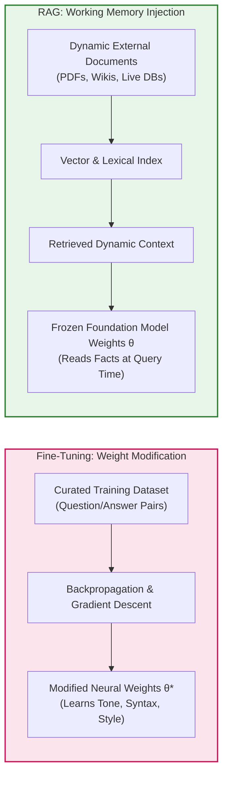
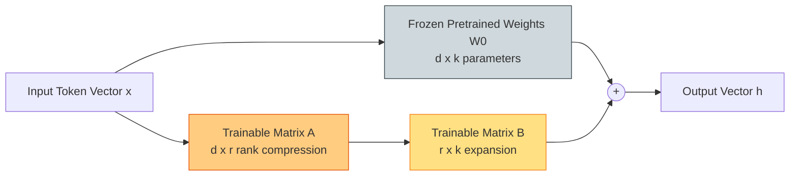
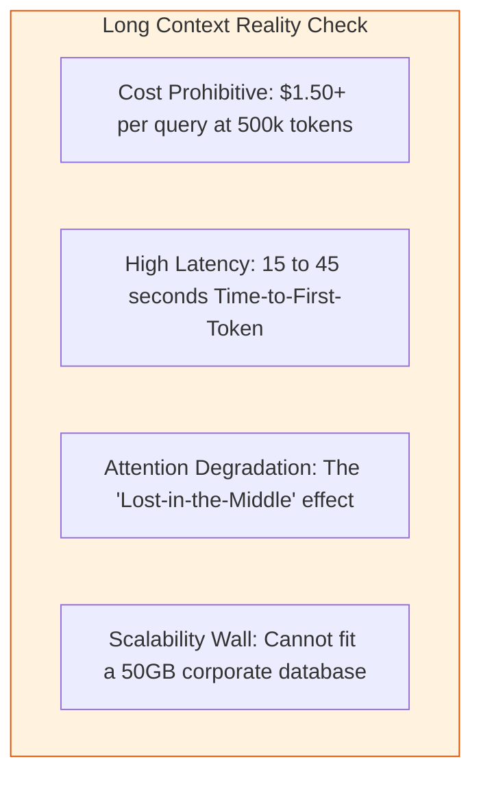
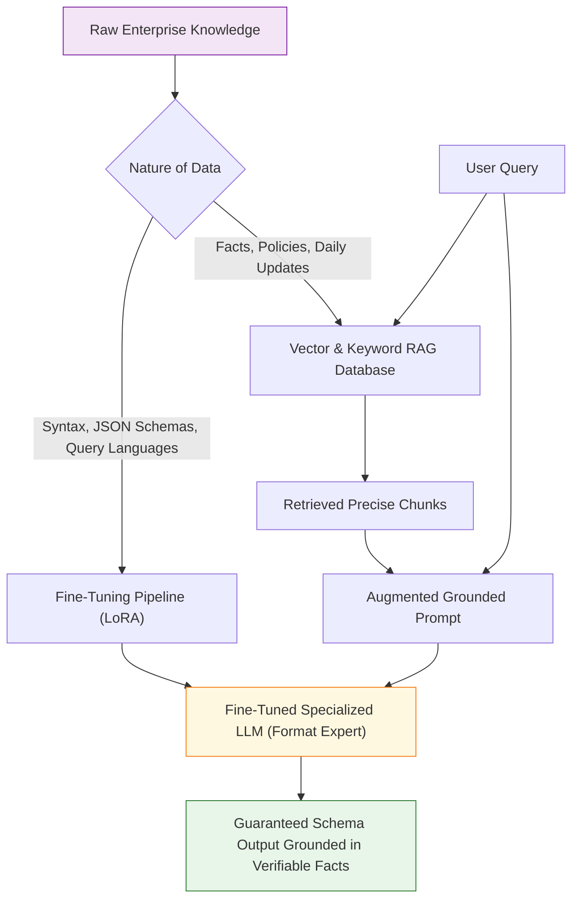
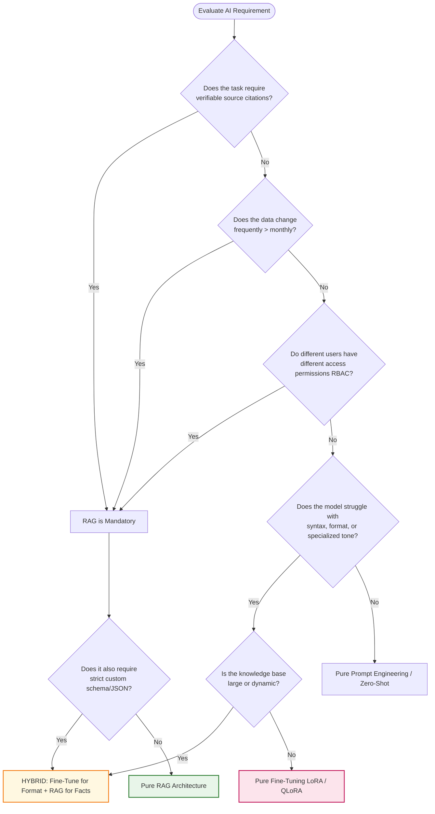

# ⚖️ RAG vs. Fine-Tuning: Architectural Decision Matrix, Trade-offs & Hybrid Patterns

## 📑 Table of Contents
1. [🌟 The Core Dilemma: "What to Say" vs. "How to Say It"](#1--the-core-dilemma-what-to-say-vs-how-to-say-it)
2. [📊 Master Multi-Dimensional Comparison Matrix](#2--master-multi-dimensional-comparison-matrix)
3. [🔬 Deep Dive: Supervised Fine-Tuning (SFT, LoRA, QLoRA)](#3--deep-dive-supervised-fine-tuning-sft-lora-qlora)
4. [🔬 Deep Dive: Retrieval-Augmented Generation (RAG)](#4--deep-dive-retrieval-augmented-generation-rag)
5. [📜 The Third Contender: Ultra-Long Context Windows (1M+ Tokens)](#5--the-third-contender-ultra-long-context-windows-1m-tokens)
6. [🔀 The Hybrid Architecture: Combining RAG and Fine-Tuning](#6--the-hybrid-architecture-combining-rag-and-fine-tuning)
7. [📐 Mathematical Foundations: Parameter Capacity vs. Information Entropy](#7--mathematical-foundations-parameter-capacity-vs-information-entropy)
8. [💻 Practical Implementation: Architectural Decision & Cost Calculator in Python](#8--practical-implementation-architectural-decision--cost-calculator-in-python)
9. [🏢 Real-World Enterprise Case Studies](#9--real-world-enterprise-case-studies)
10. [🎯 The Senior Architect Decision Flowchart](#10--the-senior-architect-decision-flowchart)
11. [💼 Senior Engineering Interview Questions & Master Answers](#11--senior-engineering-interview-questions--master-answers)
12. [🧪 Hands-On Mini-Project: Side-by-Side Benchmark Script](#12--hands-on-mini-project-side-by-side-benchmark-script)
13. [⚡ Quick Revision & Summary Reference](#13--quick-revision--summary-reference)

---

## 1. 🌟 The Core Dilemma: "What to Say" vs. "How to Say It"

AI architects frequently face the strategic dilemma: *Should we fine-tune a model on our internal corpus, or should we build a Retrieval-Augmented Generation (RAG) system?*

To make the right technical choice, remember the foundational distinction:
* **Fine-Tuning modifies the model's weights ($\theta$):** It teaches the model **how to act**, speak, format, reason, or emulate a specialized syntactic style.
* **RAG provides non-parametric context in the prompt ($C$):** It teaches the model **what facts to know**, providing real-time, verifiable, and dynamic truth.



> 💡 **Core Analogy:** **Fine-Tuning** is like sending a medical doctor to specialized surgical residency for 3 years so they intuitively master the physical instincts and precise jargon of open-heart surgery. **RAG** is handing that surgeon the specific patient's updated lab tests, allergy chart, and surgical notes right before they step into the operating room. A surgeon needs both; one cannot replace the other.

---

## 2. 📊 Master Multi-Dimensional Comparison Matrix

| Evaluation Dimension | Retrieval-Augmented Generation (RAG) | Supervised Fine-Tuning (SFT / LoRA) | Ultra-Long Context Windows |
| :--- | :--- | :--- | :--- |
| **Primary Goal** | Knowledge injection, factual grounding, citation | Style, tone, syntax, schema, task adaptation | On-the-fly analysis of large document sets |
| **Data Dynamics** | **Real-Time** (Index updates in milliseconds) | **Static** (Requires GPU retraining to update) | **Real-Time** (Included directly in prompt) |
| **Hallucination Control** | **Very High** (Constrained to retrieved chunks) | **Low to Moderate** (Still relies on probabilistic recall) | **Moderate** (Prone to *"Lost-in-the-Middle"*)|
| **Source Attribution** | **Deterministic** (Direct chunk, page, line citations) | **None** (Knowledge is buried in latent weights) | **Moderate** (Can extract references from prompt)|
| **Catastrophic Forgetting**| **Zero** (Foundation model weights untouched) | **High Risk** (Drifts on general reasoning) | **Zero** (Model parameters unchanged) |
| **Data Privacy & RBAC** | **Granular** (Metadata filtering per user query) | **None** (All fine-tuned weights exposed to all users)| **Session-bound** (Limited to active context) |
| **GDPR "Right to be Forgotten"**| **Trivial** (`index.delete(doc_id)`) | **Impossible** without machine unlearning / retraining| **Instantaneous** (Ephemeral session state) |
| **Upfront Engineering Cost** | Moderate (Parser, vector DB, hybrid retrieval) | High (Data collection, clean Q&A, GPU compute) | Very Low (No infrastructure required) |
| **Inference Cost** | **Low to Moderate** (Passes Top-$K$ relevant chunks) | **Lowest** (Short, compact system prompt) | **Extremely High** ($0.50–$3.00+ per query) |
| **Inference Latency** | Extra 50ms–150ms for retrieval + reranking | Native baseline LLM inference speed | High (10s to 30s TTFT for 1M tokens) |

---

## 3. 🔬 Deep Dive: Supervised Fine-Tuning (SFT, LoRA, QLoRA)

Fine-Tuning updates the internal parameter matrix $W \in \mathbb{R}^{d \times k}$ of an existing model:

### Parameter-Efficient Fine-Tuning (PEFT / LoRA)
Full parameter fine-tuning is computationally prohibitive. Low-Rank Adaptation (LoRA) freezes the pre-trained weights $W_0$ and injects trainable rank-decomposition matrices:
$$W = W_0 + \Delta W = W_0 + B \cdot A$$
Where $B \in \mathbb{R}^{d \times r}$, $A \in \mathbb{R}^{r \times k}$, with rank $r \ll \min(d, k)$ (typically $r \in [8, 64]$).



### When Fine-Tuning Excels:
1. **Teaching Output Formats:** Emitting guaranteed valid JSON, YAML, or Cypher graph queries without syntax errors.
2. **Domain Dialects:** Teaching an LLM medical ontology (SNOMED-CT), legal phrasing, or proprietary code APIs.
3. **Tone & Personality:** Emulating a company's specific brand voice or compliance persona.

### Why Fine-Tuning Fails as a Knowledge Base:
* **The "Reversal Curse":** A model trained on *"George Washington's mother was Mary Ball Washington"* cannot reliably answer *"Who was Mary Ball Washington's son?"* because knowledge in weights is unidirectional.
* **Weight Drift:** Continually fine-tuning causes the model to hallucinate previously mastered facts (Catastrophic Forgetting).

---

## 4. 🔬 Deep Dive: Retrieval-Augmented Generation (RAG)

RAG decouples knowledge storage from parametric memory. By using an external index, RAG avoids modifying model weights:

### Key Advantages:
* **Zero Model Retraining:** Adding, revising, or removing corporate policies takes milliseconds via database upsert.
* **Auditability & Traceability:** When an enterprise assistant gives an answer, legal and compliance teams can inspect the exact document chunk ID and page number used.
* **Role-Based Access Control:** Documents can be tagged with access control lists (ACLs). A junior employee and a C-level executive querying the same RAG system will receive answers conditioned only on documents they are cleared to view.

---

## 5. 📜 The Third Contender: Ultra-Long Context Windows (1M+ Tokens)

Recent advancements (e.g., Gemini 1.5/2.0 Pro with 2M+ tokens, Claude 3.5 Sonnet with 200k tokens) prompt the question: *Why not pass the entire documentation corpus directly into the context window?*



### Quantitative Reality:
* **Economic Scaling:** Processing 500,000 input tokens per query for 10,000 queries per day costs over **$75,000 per month** in API billing alone! An optimized RAG query passing 2,000 tokens costs **~$300 per month**.
* **Attention Diffusion:** In needle-in-a-haystack benchmarks, retrieval accuracy degrades when reasoning requires aggregating multiple subtle clues distributed across hundreds of pages.

---

## 6. 🔀 The Hybrid Architecture: Combining RAG and Fine-Tuning

In advanced production deployments, RAG and Fine-Tuning are **complementary partners**:



### Industry Case Examples of the Hybrid Pattern:
1. **Text-to-SQL Engine:** Fine-tune a 14B parameter model on your proprietary SQL dialect, table naming schemas, and join syntax. Use RAG to dynamically retrieve current table schemas, column descriptions, and sample row values at query time.
2. **Clinical Healthcare Assistant:** Fine-tune the model to understand medical abbreviations and write in soap-note format. Use RAG to retrieve real-time patient lab vitals and updated FDA drug interaction bulletins.

---

## 7. 📐 Mathematical Foundations: Parameter Capacity vs. Information Entropy

Why can't an LLM simply memorize all facts in its weights?

### Parametric Capacity Bound (Information Theory)
Let an LLM have $N$ parameters with precision $b$ bits. The maximum theoretical information capacity $C$ stored in the weights is bounded by:
$$C_{\text{weights}} \le N \cdot b \text{ bits}$$
In practice, neural networks can compress factual knowledge at an empirical rate of only $\sim 1–2$ bits per parameter (Geva et al., 2021). Thus, a 7-Billion parameter model cannot memorize more than a few gigabytes of clean facts without catastrophic interference with its reasoning capacity.

### Non-Parametric Memory Scaling
In contrast, external RAG storage scales with disk capacity:
$$C_{\text{RAG}} = O(M \cdot D)$$
Where $M$ is the number of document chunks and $D$ is vector dimensionality. Scaling knowledge is linear in storage cost, which is $1,000\times$ cheaper than scaling GPU neural parameters.

---

## 8. 💻 Practical Implementation: Architectural Decision & Cost Calculator in Python

Use this interactive Python decision engine to quantitatively determine whether a project should use RAG, Fine-Tuning, or a Hybrid approach, complete with monthly TCO calculations.

```python
from dataclasses import dataclass

@dataclass
class ProjectRequirements:
    data_update_frequency_days: float  # How often data changes (e.g., 0.1 for hourly, 30 for monthly)
    requires_citations: bool           # Is auditability / source linking mandatory?
    requires_strict_rbac: bool         # Does access depend on user permissions?
    needs_custom_syntax_format: bool   # Does it output a rare syntax / strict JSON schema?
    monthly_queries: int               # Expected monthly query volume
    corpus_token_size: int             # Total size of documents in tokens

def evaluate_architecture(req: ProjectRequirements) -> dict:
    rag_score = 0
    sft_score = 0
    recommendations = []

    # 1. Evaluate Data Dynamics
    if req.data_update_frequency_days < 7:
        rag_score += 4
        recommendations.append("High data velocity strongly favors RAG (retraining weights is too slow).")
    else:
        sft_score += 1

    # 2. Evaluate Provenance & Compliance
    if req.requires_citations:
        rag_score += 5
        recommendations.append("Mandatory citations necessitate RAG (weights cannot provide reliable URLs/pages).")

    # 3. Evaluate Access Control
    if req.requires_strict_rbac:
        rag_score += 5
        recommendations.append("Strict RBAC requires RAG metadata filtering (fine-tuned models expose all weights).")

    # 4. Evaluate Syntax and Style Requirements
    if req.needs_custom_syntax_format:
        sft_score += 5
        recommendations.append("Custom syntax/format requires Fine-Tuning (prompting alone is brittle).")

    # 5. Financial Cost Estimation
    # Model assumptions: GPT-4o-mini rates ($0.15/1M input, $0.60/1M output)
    rag_prompt_tokens = 2000
    long_ctx_prompt_tokens = min(req.corpus_token_size, 500000)

    rag_monthly_cost = (req.monthly_queries * (rag_prompt_tokens / 1_000_000) * 0.15) + 50.0  # +$50 DB
    long_ctx_monthly_cost = req.monthly_queries * (long_ctx_prompt_tokens / 1_000_000) * 0.15
    sft_one_time_train = 350.0  # Approx LoRA training cost on cloud GPUs

    # Decision Matrix Synthesis
    if rag_score >= 8 and sft_score >= 4:
        decision = "HYBRID (RAG for dynamic facts + LoRA for syntax formatting)"
    elif rag_score >= sft_score:
        decision = "PURE RAG (Vector + Hybrid Retrieval)"
    else:
        decision = "SUPERVISED FINE-TUNING (LoRA / QLoRA)"

    return {
        "recommended_architecture": decision,
        "rag_score": rag_score,
        "sft_score": sft_score,
        "estimated_monthly_rag_cost_usd": round(rag_monthly_cost, 2),
        "estimated_monthly_long_ctx_cost_usd": round(long_ctx_monthly_cost, 2),
        "rationale": recommendations
    }

# -------------------------------------------------------------
# Demonstration Scenario: Enterprise Legal & Compliance Portal
# -------------------------------------------------------------
if __name__ == "__main__":
    scenario = ProjectRequirements(
        data_update_frequency_days=1.0,     # New policy updates daily
        requires_citations=True,             # Lawyers require page/clause citations
        requires_strict_rbac=True,           # Partner vs Associate access controls
        needs_custom_syntax_format=False,    # Standard natural language answers
        monthly_queries=25000,
        corpus_token_size=2_000_000          # 2 Million tokens of internal legal docs
    )
    result = evaluate_architecture(scenario)
    print("=" * 70)
    print(f"🎯 RECOMMENDED ARCHITECTURE: {result['recommended_architecture']}")
    print(f"📊 RAG Confidence Score    : {result['rag_score']} | SFT Score: {result['sft_score']}")
    print(f"💰 Estimated Monthly RAG Cost: ${result['estimated_monthly_rag_cost_usd']}")
    print(f"💸 Equivalent Long Context Cost: ${result['estimated_monthly_long_ctx_cost_usd']}")
    print("\n🔍 KEY DECISION DRIVERS:")
    for r in result["rationale"]:
        print(f"  • {r}")
    print("=" * 70)
```

---

## 9. 🏢 Real-World Enterprise Case Studies

### 1. BloombergGPT vs. Modern Financial RAG
* **The Attempt (BloombergGPT, 2023):** Built a 50B parameter model trained from scratch on 363B tokens of financial data ($ millions in compute).
* **The Outcome:** While impressive at financial terminology, the model's knowledge became stale immediately after training cutoff. Financial institutions now pair smaller foundation models with **RAG pipelines** querying real-time Bloomberg terminal feeds and SEC filings.

### 2. Specialized Code Generation: SQL-Coder
* **The Problem:** Generic LLMs struggle with complex PostgreSQL window functions and specific dialect queries.
* **The Hybrid Solution:** Defog's SQL-Coder fine-tuned a model on 20,000 schema-to-SQL pairs (mastering syntax), while using RAG to dynamically fetch table schemas and column definitions at execution time. Result: outperformed GPT-4 on SQL generation benchmarks at $1/10\text{th}$ the inference cost.

---

## 10. 🎯 The Senior Architect Decision Flowchart



---

## 11. 💼 Senior Engineering Interview Questions & Master Answers

### Q1: In what specific scenarios is Fine-Tuning strictly superior to RAG?
> **Answer:** Fine-Tuning is strictly superior when the objective is **behavioral, syntactic, or stylistic alignment** rather than factual memorization. Specific scenarios include:
> 1. **Strict Format Conformance:** Generating output that must adhere without fail to complex nested schemas (e.g., HL7 medical formats, specialized Cypher graph queries, or domain-specific AST code).
> 2. **Low-Latency Edge Inference:** In edge or robotics environments with strict bandwidth and memory constraints where hosting a vector database and performing multi-pass retrieval is too slow or impossible.
> 3. **Tone and Voice Replication:** Replicating a specific human persona, literary style, or brand voice that cannot be captured effectively in a few-shot prompt.

### Q2: Why is fine-tuning ineffective for factual memorization?
> **Answer:** Fine-tuning adjusts weights via gradient descent, which diffuses information across millions of shared matrix parameters. This introduces three fatal flaws for facts:
> 1. **Probabilistic Recall:** Neural networks approximate distributions; they do not guarantee deterministic lookup. A model will frequently confuse dates, numbers, or names.
> 2. **Unidirectional Conditioning (The Reversal Curse):** Learning that $A$ is related to $B$ does not automatically teach the inverse conditional probability $P(B \mid A)$.
> 3. **Catastrophic Forgetting:** Overfitting to new facts distorts previously learned orthogonal feature representations, degrading general reasoning abilities.

---

## 12. 🧪 Hands-On Mini-Project: Side-by-Side Benchmark Script

Run this test to evaluate the accuracy difference between a generic prompt and a grounded context injection on a private domain question.

```python
from openai import OpenAI

client = OpenAI()

private_company_fact = (
    "In fiscal year 2026, NexusCorp transitioned all customer clusters from "
    "Kubernetes to Nomad-v2, reducing idle compute waste by 34.2 percent."
)

test_query = "How much did NexusCorp reduce idle compute waste in 2026 and what tool did they migrate to?"

# Benchmark 1: Un-grounded Model (Relying purely on weights)
res_ungrounded = client.chat.completions.create(
    model="gpt-4o-mini",
    temperature=0.0,
    messages=[
        {"role": "system", "content": "You are a corporate researcher. Answer accurately."},
        {"role": "user", "content": test_query}
    ]
).choices[0].message.content

# Benchmark 2: Grounded RAG Prompt
res_grounded = client.chat.completions.create(
    model="gpt-4o-mini",
    temperature=0.0,
    messages=[
        {"role": "system", "content": f"Context:\n{private_company_fact}\nAnswer the question strictly from context:"},
        {"role": "user", "content": test_query}
    ]
).choices[0].message.content

print("🥊 BENCHMARK RESULTS")
print("=" * 60)
print(f"1. Ungrounded Foundation Model:\n{res_ungrounded}\n")
print(f"2. Grounded RAG Simulation:\n{res_grounded}\n")
print("=" * 60)
```

---

## 13. ⚡ Quick Revision & Summary Reference

### 📌 Summary Rule of Thumb
* **RAG = What to say** (Dynamic facts, citations, data privacy, real-time updates).
* **Fine-Tuning = How to say it** (Dialect, format, style, specialized syntax).
* **Hybrid = The Gold Standard** (LoRA for format mastery + RAG for ground-truth facts).
* **Ultra-Long Context:** Ideal for ad-hoc, single-document analysis; financially and latency-prohibitive for large-scale enterprise knowledge bases.
