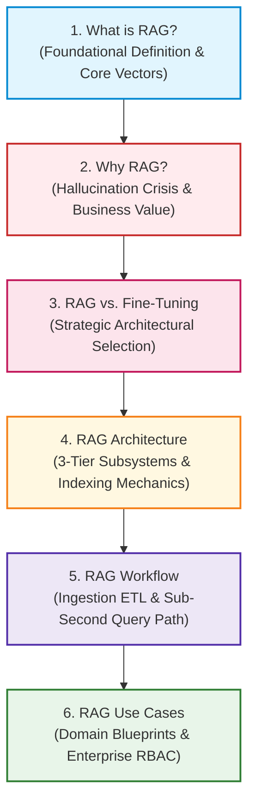

# 🧠 Module 00: Introduction to Retrieval-Augmented Generation (RAG)

Welcome to **Module 00: Introduction to RAG** of the enterprise RAG Engineering curriculum. This module establishes the foundational theory, business motivations, system architectures, operational workflows, and strategic trade-offs of Retrieval-Augmented Generation.

---

## 📑 Module Curriculum & Guide Index

| Document | Focus Area | Key Concepts Covered |
| :--- | :--- | :--- |
| [**What is RAG?**](What-is-RAG.md) *(or [what_is_rag.md](what_is_rag.md))* | **Core Foundations** | Pillars of RAG, vector similarity math, Naive vs. Advanced RAG, starter Python pipeline, hands-on ChromaDB lab. |
| [**Why RAG?**](Why-RAG.md) | **Problem & Strategic Value** | Failure modes of standalone LLMs, hallucination suppression, GDPR compliance, TCO/ROI analysis, Faithfulness metrics. |
| [**RAG Architecture**](RAG-Architecture.md) | **System Design & Components** | 3-Tier decomposition (ETL, Retrieval, Generation), HNSW vs IVF indexing, latency budgets, hybrid search, RBAC security. |
| [**RAG Workflow**](RAG-Workflow.md) | **Execution Lifecycles** | Offline Ingestion vs. Online Inference, 10-step sequence, CDC streaming pipelines, Reciprocal Rank Fusion math, telemetry tracing. |
| [**RAG vs. Fine-Tuning**](RAG-vs-Fine-Tuning.md) | **Architectural Decision Matrix** | "What to say" vs. "How to say it", LoRA/PEFT, Ultra-long context windows, hybrid architectural patterns, cost calculator. |
| [**RAG Use Cases**](RAG-Use-Cases.md) | **Enterprise Deployments** | Production blueprints across Finance, Legal, Healthcare, Customer Support, AST Codebase Search, and Multi-Domain routing. |

---

## 🗺️ Module Learning Roadmap



---

## 🎯 What You Will Master in This Module

1. **Theoretical Foundations:** Understand how dual-encoders project textual semantics into high-dimensional geometric spaces, and how probabilistic generation is conditioned on retrieved non-parametric evidence.
2. **System Decomposition:** Master the decoupled design of offline document ingestion (parsers, chunkers, embedders) and online latency-critical inference (hybrid search, cross-encoders, LLM streaming).
3. **Strategic Trade-offs:** Articulate exactly when to choose RAG, when to apply Supervised Fine-Tuning (SFT / LoRA), when to leverage ultra-long context models, and how to combine them into hybrid systems.
4. **Production Engineering:** Build end-to-end pipelines in Python featuring HNSW vector indexing, BM25 keyword matching, Reciprocal Rank Fusion (RRF), latency tracing, and Role-Based Access Control (RBAC).

---

## 🛠️ Prerequisites & Environment Setup

All code examples in this module are production-ready Python 3.10+ implementations.

### 1. Install Required Libraries
```bash
pip install numpy openai chromadb sentence-transformers
```

### 2. Configure Environment Variables
Ensure your OpenAI API key (or compatible local LLM endpoint) is available in your shell:
```bash
# Windows PowerShell
$env:OPENAI_API_KEY="your-api-key-here"

# Linux / macOS
export OPENAI_API_KEY="your-api-key-here"
```

---

## ⚡ Self-Assessment Checklist

Before advancing to [**Module 01: RAG Fundamentals**](../01-RAG-Fundamentals/README.md), verify your understanding of these core questions:
- [ ] Can you explain the difference between parametric and non-parametric memory?
- [ ] Why does increasing model parameter size (e.g., to 405B) fail to eliminate the need for RAG?
- [ ] What is the "Lost-in-the-Middle" phenomenon, and how do you structure prompt context to mitigate it?
- [ ] Why is Reciprocal Rank Fusion (RRF) preferred over raw score addition in hybrid search?
- [ ] How does RAG enable single-step compliance with GDPR's "Right to be Forgotten"?
- [ ] How do you enforce Role-Based Access Control (RBAC) at the vector database layer?

---

👉 **Next Step:** Begin your journey with [**What is RAG? (Complete Guide)**](What-is-RAG.md) or explore the architectural blueprints in [**RAG Architecture**](RAG-Architecture.md).
