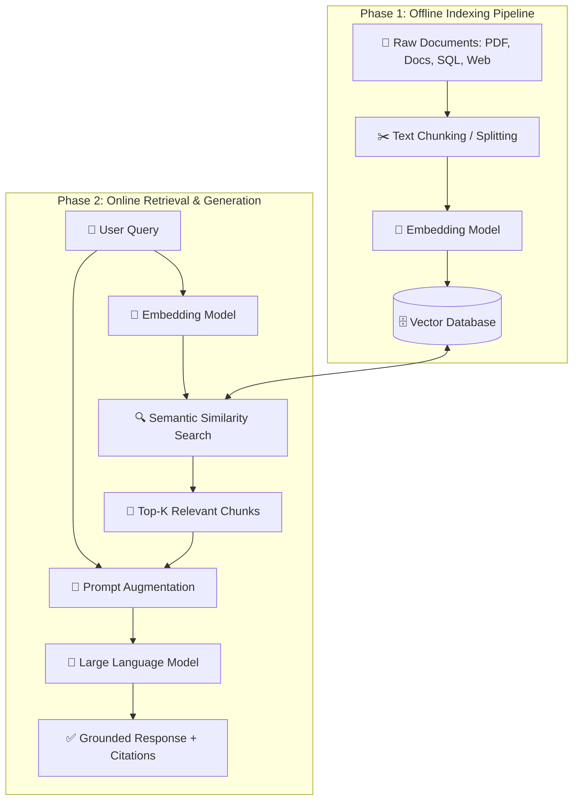
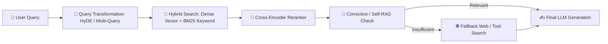
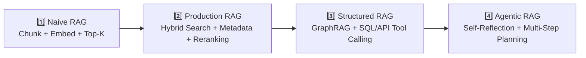

# 🧠 Retrieval-Augmented Generation (RAG): Complete Learning Guide

## 📑 Table of Contents
1. [🌟 Fundamentals & Core Definition](#1--fundamentals--core-definition)
2. [❓ Why Do We Need RAG? (The Problem with Standalone LLMs)](#2--why-do-we-need-rag-the-problem-with-standalone-llms)
3. [🏗️ How RAG Works: End-to-End Architecture](#3--how-rag-works-end-to-end-architecture)
4. [📖 Essential Terminology & Mathematical Foundations](#4--essential-terminology--mathematical-foundations)
5. [⚖️ RAG vs. Fine-Tuning vs. Long Context Windows](#5--rag-vs-fine-tuning-vs-long-context-windows)
6. [💻 Practical Implementation: Code Example](#6--practical-implementation-code-example)
7. [🚀 Advanced RAG Paradigms](#7--advanced-rag-paradigms)
8. [🌍 Real-World Use Cases](#8--real-world-use-cases)
9. [✅ Advantages & ⚠️ Limitations](#9--advantages--%EF%B8%8F-limitations)
10. [🛠️ Best Practices & ❌ Common Mistakes](#10-%EF%B8%8F-best-practices--%E2%9D%8C-common-mistakes)
11. [💼 Interview Preparation & Key Questions](#11--interview-preparation--key-questions)
12. [🧪 Hands-On Mini-Project: Document Q&A System](#12--hands-on-mini-project-document-qa-system)
13. [⚡ Quick Revision & Summary Roadmap](#13--quick-revision--summary-roadmap)

---

## 1. 🌟 Fundamentals & Core Definition

**Retrieval-Augmented Generation (RAG)** is an AI framework that enhances the accuracy, reliability, and factual grounding of Large Language Models (LLMs) by connecting them to external, authoritative knowledge bases before generating a response.

> 💡 **Core Analogy:** Think of a standard LLM as a brilliant student taking a **closed-book exam**—they rely entirely on what they memorized during training. **RAG** turns that exam into an **open-book exam**, allowing the model to look up exact facts in a curated reference library before writing its answer.

### 🔑 Key Pillars of RAG
* **🔍 Retrieval:** Searching and fetching relevant information from external data sources (PDFs, databases, APIs, wikis) based on the user's query.
* **➕ Augmentation:** Combining the retrieved context with the user's original prompt to create an enriched, context-aware prompt.
* **✍️ Generation:** Passing the augmented prompt to an LLM to synthesize a coherent, accurate, and grounded answer.

---

## 2. ❓ Why Do We Need RAG? (The Problem with Standalone LLMs)

Standalone LLMs are trained on massive static datasets up to a specific cutoff date. While powerful at reasoning and language generation, they suffer from critical limitations in enterprise and real-world applications:

| Limitation | Description | How RAG Solves It |
| :--- | :--- | :--- |
| **Knowledge Cutoff** | Models do not know events or data created after their training stopped. | Connects the LLM to live, continuously updated data sources. |
| **Hallucinations** | LLMs confidently generate plausible-sounding but factually incorrect statements. | Grounds responses strictly in retrieved, verifiable source documents. |
| **Lack of Private Data** | Public LLMs have zero access to proprietary company docs, emails, or databases. | Retrieves internal organizational data securely at query time without retraining. |
| **No Source Attribution** | Standard LLMs struggle to cite exact pages or documents for their claims. | Enables verifiable citations by linking answers directly to retrieved chunks. |
| **High Retraining Cost** | Updating an LLM's weights with new facts via pre-training is computationally expensive. | Updating knowledge is as simple as adding/updating rows in a database. |

---

## 3. 🏗️ How RAG Works: End-to-End Architecture

A standard RAG pipeline operates in two distinct phases: **Offline Indexing (Data Ingestion)** and **Online Inference (Retrieval & Generation)**.



### 🔄 Step-by-Step Breakdown

#### Phase 1: Indexing (Preparing the Knowledge Base)
1. **Load:** Ingest raw documents from various formats (`.pdf`, `.md`, `.html`, Notion, Confluence, SQL).
2. **Split (Chunking):** Break large documents into smaller, semantically meaningful pieces (e.g., 500–1,000 tokens) so they fit within context limits and improve search precision.
3. **Embed:** Pass each chunk through an **Embedding Model** to convert text into dense numerical vectors that capture semantic meaning.
4. **Store:** Save the vectors alongside their original text and metadata (author, date, page number) inside a **Vector Database**.

#### Phase 2: Retrieval & Generation (Answering Queries)
1. **Query Embedding:** Convert the user's incoming question into a vector using the *exact same* embedding model used during indexing.
2. **Vector Search:** Perform a similarity search in the Vector Database to find the **Top-$K$** chunks closest in meaning to the query vector.
3. **Prompt Construction:** Inject the retrieved chunks into a system prompt template alongside the user's question.
4. **Generation:** The LLM reads the provided context and generates an answer, instructed to rely *only* on the retrieved facts.

---

## 4. 📖 Essential Terminology & Mathematical Foundations

### 📚 Core Glossary
* **Embeddings:** Dense vector representations of text (e.g., a list of 1,536 floating-point numbers) where semantically similar texts lie close together in high-dimensional space.
* **Vector Database:** Specialized databases (e.g., Pinecone, Milvus, Qdrant, Chroma, pgvector) optimized for storing and querying high-dimensional vectors using Approximate Nearest Neighbor (ANN) algorithms like **HNSW**.
* **Chunking:** The strategy of dividing text into smaller segments. Includes *Fixed-size chunking*, *Recursive character splitting*, and *Semantic chunking*.
* **Context Window:** The maximum number of tokens (input + output) an LLM can process in a single pass.
* **Top-$K$:** The number of most relevant document chunks retrieved from the vector database for a single query.
* **Reranking:** A second-stage filtering step using a Cross-Encoder model to re-score and reorder retrieved documents for higher precision before passing them to the LLM.

### 📐 Mathematical Foundations of Similarity Search

To find which document chunk $\mathbf{B}$ is closest to a query vector $\mathbf{A}$, vector databases commonly use **Cosine Similarity**, **Euclidean Distance**, or **Dot Product**.

#### 1. Cosine Similarity
Measures the cosine of the angle between two non-zero vectors, focusing on orientation (meaning) rather than magnitude:

$$\text{Cosine Similarity}(\mathbf{A}, \mathbf{B}) = \frac{\mathbf{A} \cdot \mathbf{B}}{\|\mathbf{A}\| \|\mathbf{B}\|} = \frac{\sum_{i=1}^{n} A_i B_i}{\sqrt{\sum_{i=1}^{n} A_i^2} \sqrt{\sum_{i=1}^{n} B_i^2}}$$

* **Range:** $-1$ (opposite) to $+1$ (identical meaning).

#### 2. Euclidean Distance ($L_2$ Norm)
Measures the straight-line distance between two vector endpoints in space:

$$d(\mathbf{A}, \mathbf{B}) = \|\mathbf{A} - \mathbf{B}\|_2 = \sqrt{\sum_{i=1}^{n} (A_i - B_i)^2}$$

* **Interpretation:** Smaller distance means higher similarity.

#### 3. RAG Probabilistic Formulation
Formally, RAG models the probability of generating output sequence $y$ given input $x$ by marginalizing over retrieved latent documents $z$:

$$P(y \mid x) \approx \sum_{z \in \text{Top-}K} P_\eta(z \mid x) \, P_\theta(y \mid x, z)$$

Where:
* $P_\eta(z \mid x)$ is the **Retriever** probability of selecting document $z$ given query $x$.
* $P_\theta(y \mid x, z)$ is the **Generator** probability of producing answer $y$ given both query $x$ and document $z$.

---

## 5. ⚖️ RAG vs. Fine-Tuning vs. Long Context Windows

Choosing the right technique depends on whether your problem requires **new knowledge**, **new behavior**, or **ad-hoc document analysis**.

| Feature / Dimension | 🔍 RAG | 🎛️ Fine-Tuning | 📜 Long Context LLM |
| :--- | :--- | :--- | :--- |
| **Primary Purpose** | Injecting dynamic, external, or private knowledge. | Teaching specific style, tone, format, or domain jargon. | Analyzing a small set of large documents on the fly. |
| **Data Freshness** | Real-time (updates immediately when DB updates). | Static (requires retraining to learn new facts). | Real-time (passed directly in the prompt). |
| **Hallucination Control** | High (grounded in explicit retrieved citations). | Low–Moderate (still relies on parametric memory). | Moderate–High (can suffer from *"Lost in the Middle"*). |
| **Upfront Cost & Effort** | Low–Moderate (requires data pipeline & vector DB). | High (requires curated datasets & GPU compute). | Very Low (no indexing infrastructure needed). |
| **Inference Latency & Cost** | Low–Moderate (only passes Top-$K$ relevant chunks). | Low (compact prompt, fast generation). | High (processing 100k+ tokens per query is slow & costly). |
| **Interpretability** | High (shows exact source documents used). | Low (knowledge is baked into black-box weights). | Moderate (harder to trace across massive prompts). |

> 🏆 **Pro Tip:** RAG and Fine-Tuning are **complementary, not mutually exclusive**. Use **Fine-Tuning** to teach the model *how* to speak and format outputs, and **RAG** to give the model *what* facts to talk about.

---

## 6. 💻 Practical Implementation: Code Example

Below is a clean, self-contained Python example demonstrating the core mechanics of RAG from scratch using `numpy` and OpenAI-compatible APIs (no heavy abstractions hiding how it works).

```python
import numpy as np
from openai import OpenAI

# Initialize client (assumes OPENAI_API_KEY is set in environment)
client = OpenAI()

# 1. Sample Knowledge Base
documents = [
    "Project Apollo-X launches on November 15, 2026, from Sriharikota.",
    "The maximum payload capacity of Apollo-X is 4,500 kg to Low Earth Orbit.",
    "Employee remote work policy allows up to 3 days per week from home.",
    "Expense reports must be submitted within 14 days of travel completion."
]

def get_embedding(text: str, model: str = "text-embedding-3-small") -> np.ndarray:
    """Convert a string into a normalized embedding vector."""
    response = client.embeddings.create(input=[text], model=model)
    return np.array(response.data[0].embedding)

def cosine_similarity(vec_a: np.ndarray, vec_b: np.ndarray) -> float:
    """Compute cosine similarity between two vectors."""
    return np.dot(vec_a, vec_b) / (np.linalg.norm(vec_a) * np.linalg.norm(vec_b))

# 2. Offline Indexing: Embed all documents
doc_embeddings = [get_embedding(doc) for doc in documents]

def rag_query(user_question: str, top_k: int = 2) -> str:
    """Retrieve top-k relevant docs and generate a grounded answer."""
    # Step A: Embed user query
    query_vec = get_embedding(user_question)
    
    # Step B: Score and retrieve top-k documents
    scored_docs = [
        (cosine_similarity(query_vec, doc_vec), doc)
        for doc_vec, doc in zip(doc_embeddings, documents)
    ]
    scored_docs.sort(key=lambda x: x[0], reverse=True)
    retrieved_context = "\n".join([f"- {doc}" for _, doc in scored_docs[:top_k]])
    
    # Step C: Augment prompt
    system_prompt = (
        "You are a precise assistant. Answer the user's question using ONLY "
        "the provided context. If the answer is not in the context, say 'I do not know.'\n\n"
        f"Context:\n{retrieved_context}"
    )
    
    # Step D: Generate response
    completion = client.chat.completions.create(
        model="gpt-4o-mini",
        temperature=0.0,  # Low temperature reduces creativity/hallucination
        messages=[
            {"role": "system", "content": system_prompt},
            {"role": "user", "content": user_question}
        ]
    )
    return completion.choices[0].message.content

# 3. Test the Pipeline
if __name__ == "__main__":
    question = "What is the payload capacity of Apollo-X and when does it launch?"
    print("Answer:", rag_query(question))
```

### 🔍 Code Explanation
* **`get_embedding()`**: Transforms plain text into dense numerical vectors.
* **`cosine_similarity()`**: Ranks every document chunk against the user's question.
* **`temperature=0.0`**: Ensures deterministic, faithful adherence to the retrieved context.

---

## 7. 🚀 Advanced RAG Paradigms

Basic ("Naive") RAG often struggles with complex queries, poor chunk boundaries, or keyword mismatches. Modern production systems use **Advanced RAG** and **Agentic RAG** techniques:



### 🧠 Key Advanced Techniques
1. **Hybrid Search (Dense + Sparse):** Combines **Vector Search** (semantic meaning) with **BM25 Keyword Search** (exact matches for acronyms, product IDs, and rare terms) fused via **Reciprocal Rank Fusion (RRF)**.
2. **Query Transformation:**
   * *Multi-Query Expansion:* Uses an LLM to rewrite 1 user question into 3–5 variations to improve retrieval recall.
   * *HyDE (Hypothetical Document Embeddings):* Generates a hypothetical ideal answer first, embeds that answer, and searches for real documents similar to it.
3. **Two-Stage Retrieval with Reranking:** Retrieves Top-50 candidates quickly via vector search, then uses a specialized **Cross-Encoder Reranker** (e.g., Cohere Rerank, BGE-Reranker) to accurately score and select the Top-5.
4. **Parent-Document / Sentence-Window Retrieval:** Embeds small, granular sentences for sharp search accuracy, but passes the surrounding larger paragraph ("parent chunk") to the LLM so it doesn't lose context.
5. **GraphRAG:** Combines vector search with **Knowledge Graphs** to answer multi-hop reasoning questions across connected entities (e.g., *"How are Company A's suppliers affected by Regulation B?"*).
6. **Agentic RAG:** Equips an AI agent with retrieval tools so it can iteratively plan, query multiple databases, evaluate whether retrieved evidence is sufficient, and self-correct before answering.

---

## 8. 🌍 Real-World Use Cases

* **🏢 Enterprise Internal Knowledge Assistants:** Employees query HR policies, engineering runbooks, and Slack/Confluence archives with role-based access control (RBAC).
* **🎧 Automated Customer Support:** Chatbots resolve tier-1 and tier-2 tickets using up-to-date product manuals, changelogs, and troubleshooting guides.
* **⚖️ Legal & Compliance Contract Analysis:** Lawyers search thousands of NDAs and regulatory filings to verify clauses with exact page-level citations.
* **🏥 Clinical Decision Support:** Doctors query peer-reviewed medical journals and drug interaction databases for evidence-based treatment options.
* **💻 Codebase Q&A & Developer Copilots:** IDEs index local repositories to answer architecture questions and suggest context-aware code patches.

---

## 9. ✅ Advantages & ⚠️ Limitations

### ✅ Advantages
* **Verifiable & Trustworthy:** Citations allow users to audit the exact source of every claim.
* **Cost-Effective Updates:** No expensive GPU fine-tuning required when data changes.
* **Data Privacy & Security:** Proprietary data stays inside your vector database; permissions can be enforced at retrieval time.
* **Reduced Hallucinations:** Constrains the LLM's output space to grounded evidence.

### ⚠️ Limitations
* **Garbage In, Garbage Out:** Poorly parsed PDFs, broken tables, or bad chunking directly ruin answer quality.
* **Retrieval Bottleneck:** If the retriever misses the right document, the LLM cannot answer correctly—even if the answer exists in the database.
* **Added Latency:** Embedding + Vector Search + Reranking adds $200\text{ms}–1,500\text{ms}$ overhead per request.
* **Multi-Hop Reasoning Limits:** Standard RAG struggles to synthesize facts scattered across dozens of unrelated documents without GraphRAG or Agentic loops.

---

## 10. 🛠️ Best Practices & ❌ Common Mistakes

### 🛠️ Production Best Practices
* **Preserve Document Structure:** Parse tables into Markdown/HTML and split by structural headers (`#`, `##`) rather than blindly slicing mid-sentence.
* **Enrich Chunks with Metadata:** Attach `source_url`, `created_at`, `department`, and `access_level` to every chunk for pre-filtering.
* **Evaluate Continuously (The RAG Triad):** Measure system health using frameworks like **RAGAS** across three core metrics:
  1. *Context Relevance:* Are the retrieved chunks actually useful for the query?
  2. *Groundedness (Faithfulness):* Is the answer derived strictly from the retrieved context without fabrication?
  3. *Answer Relevance:* Does the final response directly address the user's question?
* **Enforce Access Control (ACL):** Filter vectors by user permissions *before* or *during* retrieval—never let unauthorized chunks reach the LLM prompt.

### ❌ Common Mistakes to Avoid
* **Mismatched Embedding Models:** Using one model to index documents and a different model to embed queries (their vector spaces are incompatible).
* **Ignoring Chunk Overlap:** Setting `chunk_overlap = 0`, which severs sentences and ideas right at chunk boundaries (always use $10\%–20\%$ overlap).
* **Stuffing Too Many Chunks:** Passing Top-20 noisy chunks into the prompt degrades LLM reasoning and increases token costs.
* **Skipping Reranking:** Relying solely on raw cosine similarity without a reranker often surfaces superficially similar but irrelevant text.

---

## 11. 💼 Interview Preparation & Key Questions

### 🎯 High-Yield Interview Questions & Answers

**Q1: How do you decide the optimal chunk size in a RAG pipeline?**
> **Answer:** Chunk size is a trade-off between **granularity** and **context**. Small chunks (e.g., 256 tokens) yield sharper, more specific embeddings, while larger chunks (e.g., 1,024 tokens) preserve surrounding context. Best practice is empirical testing on a golden evaluation dataset, using recursive splitting with $10\%–20\%$ overlap, or decoupling retrieval chunks from generation chunks via *Parent-Document Retrieval*.

**Q2: Why might pure vector search fail, and how do you fix it?**
> **Answer:** Dense vector embeddings compress text into fixed-size vectors, causing them to lose exact lexical details like serial numbers, error codes (`ERR_504`), acronyms, or proper nouns. We fix this using **Hybrid Search**—combining dense semantic search with sparse keyword search (BM25) via Reciprocal Rank Fusion (RRF).

**Q3: What is the "Lost in the Middle" phenomenon?**
> **Answer:** Research shows LLMs pay highest attention to information at the **beginning** and **end** of a prompt, often overlooking crucial facts buried in the middle of long contexts. In RAG, placing the highest-scoring reranked chunks at the very top and bottom of the context block improves recall.

**Q4: How do you handle hallucinations even when using RAG?**
> **Answer:** Use low LLM temperature (`0.0`), instruct the model explicitly to say *"I don't know"* when evidence is missing, require inline citations (`[Doc 1]`), and add a post-generation **faithfulness check** (NLI model or LLM-as-a-Judge) to verify every claim against retrieved sources.

---

## 12. 🧪 Hands-On Mini-Project: Document Q&A System

Build a complete, local **Markdown & Text Knowledge Base Q&A CLI** using Python, `chromadb` (local vector DB), and `sentence-transformers` (free local embeddings)—zero API keys required for retrieval!

### 📦 Step 1: Install Dependencies
```bash
pip install chromadb sentence-transformers
```

### 💻 Step 2: Create `local_rag.py`
```python
import chromadb
from chromadb.utils import embedding_functions

# 1. Initialize local persistent ChromaDB & open-source embedding model
client = chromadb.Client()
embed_fn = embedding_functions.SentenceTransformerEmbeddingFunction(
    model_name="all-MiniLM-L6-v2"
)

collection = client.create_collection(
    name="engineering_wiki",
    embedding_function=embed_fn
)

# 2. Sample Documentation Chunks with Metadata
docs = [
    "To reset your VPN token, visit idp.internal.corp and click 'Re-enroll MFA'.",
    "Production deployments happen every Tuesday and Thursday at 10:00 UTC.",
    "Database backups run every 6 hours and are retained for 30 days in S3.",
    "For SEV-1 incidents, page the on-call SRE lead via PagerDuty immediately."
]
metadatas = [
    {"category": "IT", "doc_id": "IT-101"},
    {"category": "DevOps", "doc_id": "OPS-202"},
    {"category": "DevOps", "doc_id": "OPS-205"},
    {"category": "Security", "doc_id": "SEC-301"}
]
ids = ["chunk_1", "chunk_2", "chunk_3", "chunk_4"]

# 3. Index documents into Vector DB
collection.add(documents=docs, metadatas=metadatas, ids=ids)

# 4. Query with Metadata Filtering + Semantic Search
def retrieve_context(query: str, category_filter: str = None, n_results: int = 2):
    where_clause = {"category": category_filter} if category_filter else None
    results = collection.query(
        query_texts=[query],
        n_results=n_results,
        where=where_clause
    )
    
    print(f"\n🔎 Query: '{query}'")
    for doc, meta, dist in zip(
        results["documents"][0],
        results["metadatas"][0],
        results["distances"][0]
    ):
        print(f"  📄 [{meta['doc_id']} | {meta['category']}] (Distance: {dist:.4f}): {doc}")

# 5. Run Sample Queries
if __name__ == "__main__":
    retrieve_context("How do I fix my MFA or VPN access?")
    retrieve_context("When do we deploy code?", category_filter="DevOps")
```

### 🚀 Extension Challenge
Connect `retrieve_context()` to a local LLM via **Ollama** (`ollama run llama3.2`) or an API endpoint to turn this retriever into a full end-to-end offline RAG assistant!

---

## 13. ⚡ Quick Revision & Summary Roadmap

### 📌 Key Takeaways Cheat Sheet
* **Definition:** $\text{RAG} = \text{Information Retrieval} + \text{LLM Generation}$.
* **Two Phases:** Offline **Indexing** (Load $\rightarrow$ Chunk $\rightarrow$ Embed $\rightarrow$ Store) & Online **Inference** (Embed Query $\rightarrow$ Search $\rightarrow$ Augment Prompt $\rightarrow$ Generate).
* **Best Use Case:** Dynamic, private, or rapidly changing factual knowledge where citations matter.
* **Gold Standard Stack:** Hybrid Search (Vector + BM25) $\rightarrow$ Cross-Encoder Reranking $\rightarrow$ Grounded Prompting $\rightarrow$ RAGAS Evaluation.

### 🧮 Essential Formulas Summary
* **Cosine Similarity:**
  $$\text{sim}(\mathbf{A}, \mathbf{B}) = \frac{\mathbf{A} \cdot \mathbf{B}}{\|\mathbf{A}\| \|\mathbf{B}\|}$$
* **Reciprocal Rank Fusion (RRF) for Hybrid Search:**
  $$\text{RRF}(d) = \sum_{r \in R} \frac{1}{k + r(d)}$$
  *(where $r(d)$ is the rank of document $d$ in retriever $r$, and $k \approx 60$ is a smoothing constant).*

### 🗺️ RAG Mastery Roadmap

