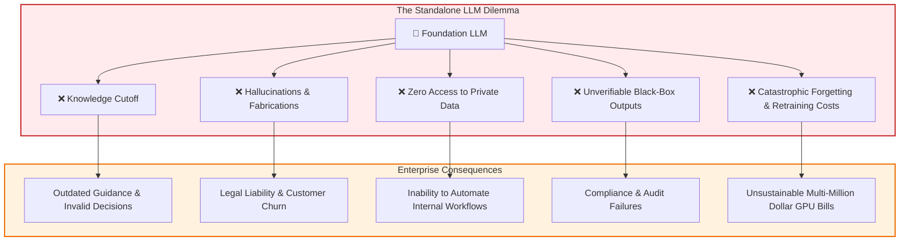
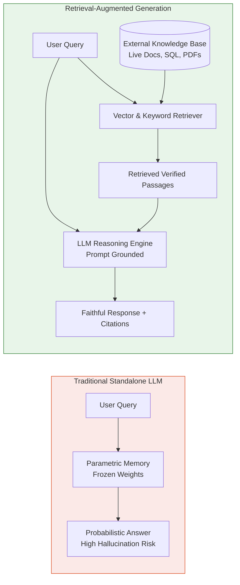
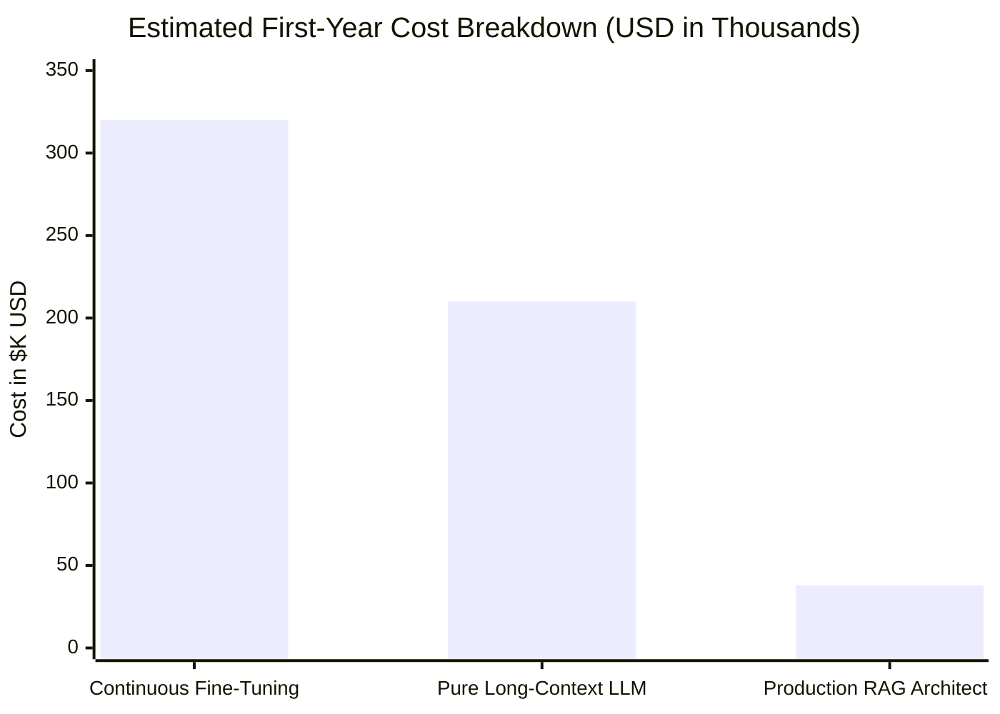
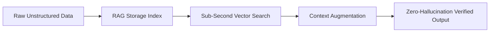

# 🚀 Why RAG? Root Problems, Failures of Standalone LLMs, and Strategic Value

## 📑 Table of Contents
1. [🌟 The Knowledge Crisis in Standalone LLMs](#1--the-knowledge-crisis-in-standalone-llms)
2. [🔬 Anatomy of LLM Failure Modes](#2--anatomy-of-llm-failure-modes)
3. [🛡️ The RAG Value Proposition & Strategic Advantages](#3--the-rag-value-proposition--strategic-advantages)
4. [📊 Comprehensive Quantitative Comparison: RAG vs. Continual Retraining](#4--comprehensive-quantitative-comparison-rag-vs-continual-retraining)
5. [📐 Mathematical Foundations: Parametric vs. Non-Parametric Memory](#5--mathematical-foundations-parametric-vs-non-parametric-memory)
6. [💻 Practical Demonstration: Hallucination vs. Grounded RAG in Python](#6--practical-demonstration-hallucination-vs-grounded-rag-in-python)
7. [🏢 Real-World Enterprise Failure Scenarios & RAG Triumphs](#7--real-world-enterprise-failure-scenarios--rag-triumphs)
8. [💰 Total Cost of Ownership (TCO) & ROI Analysis](#8--total-cost-of-ownership-tco--roi-analysis)
9. [⚠️ When NOT to Use RAG](#9--when-not-to-use-rag)
10. [🛠️ Best Practices & Common Anti-Patterns](#10-%EF%B8%8F-best-practices--common-anti-patterns)
11. [💼 Senior Engineering Interview Questions & Master Answers](#11--senior-engineering-interview-questions--master-answers)
12. [🧪 Hands-On Mini-Project: Measuring Hallucination Reduction](#12--hands-on-mini-project-measuring-hallucination-reduction)
13. [⚡ Quick Revision & Strategic Summary Roadmap](#13--quick-revision--strategic-summary-roadmap)

---

## 1. 🌟 The Knowledge Crisis in Standalone LLMs

Large Language Models (LLMs) such as GPT-4, Claude 3.5, and Llama 3 represent one of the most significant breakthroughs in computer science. They possess remarkable abilities in natural language synthesis, logical reasoning, multi-step problem solving, and zero-shot code generation.

However, when organizations deploy pure, standalone LLMs directly into mission-critical production environments, they encounter a hard operational reality: **LLMs are general-purpose reasoning engines, not deterministic enterprise databases.**



> 💡 **Core Analogy:** Deploying a standalone LLM for internal company support is like hiring a genius consultant with photographic memory who graduated 3 years ago, locked themselves in a room without internet or company access, and answers questions about your internal 2026 systems based on guesswork. **RAG** gives that consultant direct real-time access to your company's live internal wiki, contracts, and codebases before they say a single word.

---

## 2. 🔬 Anatomy of LLM Failure Modes

Understanding *why* LLMs fail in enterprise settings requires examining their underlying probabilistic mechanics:

### 1. Stochastic Parrots & Hallucination
An LLM predicts the next most likely token according to a conditional probability distribution:
$$P(w_t \mid w_1, w_2, \dots, w_{t-1})$$
The model does not know what is "true" or "false"; it only knows what sequence of characters is statistically probable given its training weights. When queried about specialized internal protocols, confidential APIs, or post-training events, it maximizes fluency rather than factual truth, generating plausible-sounding hallucinations with supreme confidence.

### 2. The Knowledge Cutoff Cliff
The pre-training phase of an LLM is frozen in time. Once training weights are materialized, the model's parametric knowledge is static:
* New product releases, security CVEs, updated tax codes, and fresh SEC filings are completely invisible.
* Attempting to keep weights fresh by continual retraining introduces latency of weeks or months, rendering real-time business agility impossible.

### 3. The Private & Proprietary Data Void
Over 85% of valuable enterprise information resides behind secure firewalls:
* Internal Jira tickets, Confluence spaces, proprietary Git repositories, Google Drive documents, and customer CRM notes.
* Foundation models have never seen these documents during training.
* Sending proprietary data into third-party public models for retraining creates severe regulatory and confidentiality violations (SOC2, HIPAA, GDPR).

### 4. Zero Factual Provenance & Auditability
When a standalone LLM outputs: *"Our return policy allows refunds within 45 days,"* it cannot produce a verifiable link to the contract clause or document version supporting that claim. In healthcare, finance, and law, unverifiable assertions cannot pass compliance audits.

---

## 3. 🛡️ The RAG Value Proposition & Strategic Advantages

Retrieval-Augmented Generation decouples **knowledge storage** from **language reasoning**:



### Strategic Capabilities Provided by RAG:
* **Strict Groundedness:** Constrains the LLM to synthesize answers solely from explicitly provided source chunks.
* **Instantaneous Knowledge Updates:** Adding or updating documents takes milliseconds (vector upsert) without retraining a single parameter.
* **Role-Based Access Control (RBAC):** Chunks can be filtered by user identity, clearance level, or department before being passed to the LLM.
* **Verifiable Source Attribution:** Every sentence can be referenced directly back to a file, page number, and paragraph ID.
* **Cost Efficiency:** Offloads knowledge representation to affordable storage (SSD/RAM) rather than multi-billion parameter GPU memory.

---

## 4. 📊 Comprehensive Quantitative Comparison: RAG vs. Continual Retraining

Engineers often consider whether they should fine-tune a model continually or build a RAG pipeline. Here is the architectural reality:

| Evaluation Dimension | Continuous Pre-training / SFT | Retrieval-Augmented Generation (RAG) |
| :--- | :--- | :--- |
| **Ingestion Latency** | Hours to Days (GPU pipeline, validation runs) | **Milliseconds to Seconds** (ETL + Vector Upsert) |
| **Compute Cost per Ingestion** | Thousands of dollars in GPU clusters | **Fractions of a cent** in embedding API / CPU compute |
| **Data Freshness** | High latency (batch retraining schedule) | **Real-time** (stream changes directly into vector index) |
| **Risk of Catastrophic Forgetting**| Severe (Weights drift, general logic degrades) | **Zero** (Foundation model weights remain pristine) |
| **GDPR "Right to be Forgotten"** | Nearly impossible (requires machine unlearning) | **Instantaneous** (Single `collection.delete(doc_id)`) |
| **Source Citation & Provenance** | None (Weights cannot reference URLs or pages) | **100% Deterministic** (File, chunk offset, page citation) |
| **Access Control & Permissions** | Impossible (Weights are accessible to all users) | **Granular Metadata Filtering** (Enforced at query time) |
| **Domain-Specific Vocabulary** | Exceptional (learns internal syntax and style) | Good (can be paired with hybrid lexical BM25 search) |

> 🏆 **Senior Architect Rule:** Use **Fine-Tuning** to teach a model *how to communicate, format, or reason* in a specific dialect. Use **RAG** to give the model *the factual knowledge* it must talk about.

---

## 5. 📐 Mathematical Foundations: Parametric vs. Non-Parametric Memory

Modern AI architecture divides intelligence into two distinct memory types:
1. **Parametric Memory ($\theta$):** Knowledge compressed into neural network weights during pre-training.
2. **Non-Parametric Memory ($\mathcal{D}$):** External knowledge stored in an indexable corpus of documents $\mathcal{D} = \{d_1, d_2, \dots, d_N\}$.

### Formal Probabilistic Framing
In a standalone LLM, the probability of generating token sequence $y$ given input $x$ relies purely on learned parameters $\theta$:
$$P_\theta(y \mid x) = \prod_{t=1}^{T} P_\theta(y_t \mid y_{<t}, x)$$

In a RAG framework (Lewis et al., NeurIPS 2020), generation is conditioned on retrieved latent documents $z \in \mathcal{D}$:
$$P(y \mid x) = \sum_{z \in \text{Top-}K(\mathcal{D})} P_\eta(z \mid x) \cdot P_\theta(y \mid x, z)$$

Where:
* $P_\eta(z \mid x)$ represents the **Retriever distribution**, typically parameterized by dual-encoder dot products:
  $$P_\eta(z \mid x) \propto \exp\left(\mathbf{E}_q(x)^\top \mathbf{E}_d(z)\right)$$
* $P_\theta(y \mid x, z)$ represents the **Generator distribution**, where the LLM conditions its output tokens on both the original query $x$ and the retrieved evidence passage $z$.

### Minimizing Expected Information Loss
Let $y^*$ be the ground-truth factual answer. Standalone LLMs suffer from high epistemic uncertainty when $x$ falls outside the training distribution $\mathcal{X}_{\text{train}}$:
$$\mathcal{L}_{\text{standalone}} = \mathbb{E}_{x \sim \mathcal{X}_{\text{private}}} \left[ -\log P_\theta(y^* \mid x) \right] \gg 0$$
By conditioning on external evidence $z$, RAG dramatically tightens the lower bound on mutual information:
$$I(Y; X, Z) \ge I(Y; X)$$
This mathematical guarantee is why RAG systematically suppresses hallucinations.

---

## 6. 💻 Practical Demonstration: Hallucination vs. Grounded RAG in Python

The following script proves the value proposition of RAG by executing two queries:
1. A **pure ungrounded query** asking for private enterprise data (guaranteed hallucination or rejection).
2. A **grounded RAG query** leveraging vector retrieval to produce an accurate, cited answer.

```python
import numpy as np
from openai import OpenAI

# Initialize client (Ensure OPENAI_API_KEY is configured in your environment)
client = OpenAI()

# -------------------------------------------------------------
# 1. Private Enterprise Knowledge Corpus (Not present in GPT weights)
# -------------------------------------------------------------
enterprise_knowledge_base = [
    {
        "id": "SEC-POL-042",
        "title": "Corporate Cryptographic Key Rotation Policy",
        "content": "All production Ed25519 service tokens must be rotated every 45 days. Emergency rotations must be completed within 90 minutes of CVE disclosure.",
        "updated": "2026-10-14"
    },
    {
        "id": "HR-BEN-109",
        "title": "Parental Wellness Leave Entitlement",
        "content": "Full-time employees with 12+ months tenure are entitled to 16 weeks fully paid parental leave, stackable with standard PTO.",
        "updated": "2026-09-01"
    },
    {
        "id": "FIN-SLA-881",
        "title": "Enterprise Cloud SLA Reimbursement Guidelines",
        "content": "If monthly API uptime falls below 99.95%, enterprise tier customers receive an automatic 15% billing credit applied to next billing cycle.",
        "updated": "2026-11-02"
    }
]

# -------------------------------------------------------------
# 2. Embedding & Vector Search Helpers
# -------------------------------------------------------------
def get_embedding(text: str) -> np.ndarray:
    """Compute dense 1536-dim normalized vector via text-embedding-3-small."""
    res = client.embeddings.create(input=[text], model="text-embedding-3-small")
    vec = np.array(res.data[0].embedding, dtype=np.float32)
    return vec / np.linalg.norm(vec)

# Pre-compute document embeddings (Offline Indexing)
doc_vectors = [get_embedding(doc["content"]) for doc in enterprise_knowledge_base]

def cosine_similarity(a: np.ndarray, b: np.ndarray) -> float:
    return float(np.dot(a, b))

# -------------------------------------------------------------
# 3. Execution: Standalone LLM vs Grounded RAG
# -------------------------------------------------------------
user_query = "What is the mandatory rotation period for Ed25519 tokens and the SLA credit for <99.95% uptime?"

print("=" * 80)
print(f"QUERY: {user_query}")
print("=" * 80)

# A. Standalone LLM Query (Zero Context)
print("\n🤖 [1. STANDALONE UNGROUNDED LLM RESPONSE]:")
standalone_completion = client.chat.completions.create(
    model="gpt-4o-mini",
    temperature=0.7,
    messages=[
        {"role": "system", "content": "You are a helpful assistant."},
        {"role": "user", "content": user_query}
    ]
)
print(standalone_completion.choices[0].message.content)

# B. Grounded RAG Pipeline
print("\n🛡️ [2. GROUNDED RAG RESPONSE WITH SOURCE ATTRIBUTION]:")
query_vector = get_embedding(user_query)

# Score all documents
scores = [
    (cosine_similarity(query_vector, doc_vec), doc)
    for doc_vec, doc in zip(doc_vectors, enterprise_knowledge_base)
]
scores.sort(key=lambda x: x[0], reverse=True)

# Select Top-2 candidates
top_k_chunks = scores[:2]
context_blocks = "\n\n".join([
    f"Source [{doc['id']} - {doc['title']}]:\n{doc['content']}"
    for _, doc in top_k_chunks
])

rag_system_prompt = (
    "You are an enterprise AI assistant. Answer the user question STRICTLY using "
    "the provided context blocks below. For every claim you make, append the source ID citation. "
    "If the information is not contained in the context, state 'I do not possess sufficient verified records.'\n\n"
    f"VERIFIED CONTEXT:\n{context_blocks}"
)

rag_completion = client.chat.completions.create(
    model="gpt-4o-mini",
    temperature=0.0,  # Zero temperature for maximum factual determinism
    messages=[
        {"role": "system", "content": rag_system_prompt},
        {"role": "user", "content": user_query}
    ]
)
print(rag_completion.choices[0].message.content)
print("=" * 80)
```

---

## 7. 🏢 Real-World Enterprise Failure Scenarios & RAG Triumphs

```mermaid
flowchart TD
    subgraph Failures [Without RAG: Catastrophic Hallucinations]
        F1[Financial Analyst queries Q3 debt covenants] --> F2[LLM invents a 4.2x ratio from training weights]
        F2 --> F3[Compliance breach & inaccurate investor filing]
        
        M1[Clinician queries chemotherapy dosage adjustments] --> M2[LLM combines two unrelated drug regimens]
        M2 --> M3[Patient toxicity risk & regulatory investigation]
    end

    subgraph Triumphs [With RAG: Grounded Auditability]
        R1[Financial Analyst queries Q3 debt covenants] --> R2[RAG fetches 10-Q filing Page 48 Section 7.1]
        R2 --> R3[Answers: '3.85x ratio [10-Q_Q3_Page48]' with verifiable link]

        MR1[Clinician queries chemotherapy dosage adjustments] --> MR2[RAG fetches current hospital oncology protocol]
        MR2 --> MR3[Answers with exact milligram/m2 formula and protocol ID]
    end

    style Failures fill:#ffebee,stroke:#c62828
    style Triumphs fill:#e8f5e9,stroke:#2e7d32
```

### Detailed Case Analyses:
1. **The Air Canada Chatbot Incident (2024):**
   * *Problem:* A standalone chatbot promised a passenger a retroactive bereavement discount that contradicted company policy.
   * *Outcome:* The tribunal ruled Air Canada liable for negligent misrepresentation.
   * *RAG Solution:* Restricting generation to the official bereavement tariff rules with strict negative rejection (`"If conditions are not met, explain bereavement refunds cannot be claimed retroactively [Rule 4.1]"`).
2. **Multi-Tenant SaaS Policy Enforcement:**
   * *Problem:* A cloud provider deployed an LLM assistant that answered engineering questions by inadvertently blending code snippets from different enterprise tenants.
   * *RAG Solution:* Partitioned vector namespaces where queries inject strict tenant metadata filters (`tenant_id == session.tenant_id`), guaranteeing zero cross-tenant contamination.

---

## 8. 💰 Total Cost of Ownership (TCO) & ROI Analysis

When presenting architecture proposals to executive leadership, technical decisions must be justified through Total Cost of Ownership (TCO).

### Comparative Annual Cost Breakdown (Corpus of 500,000 Documents)



1. **Continuous Fine-Tuning Stack:**
   * GPU Compute: 8x H100 instances for periodic retraining cycles (~$180,000/yr).
   * Data Engineering: Specialized dataset curation and alignment teams (~$140,000/yr).
   * *Total:* **~$320,000 / year**.
2. **Pure Long-Context Prompt Stuffing (Passing 200k tokens per prompt):**
   * Input token costs ($2.50 per 1M tokens) at 5,000 queries/day: $2.50 * 0.2M * 5,000 * 365 = **~$912,500 / year**.
   * Extreme latency (10–25 seconds per query).
3. **Optimized Modular RAG Architecture:**
   * Embedding Generation (one-time + incremental): ~$150.
   * Managed Vector DB (Pinecone / Qdrant Serverless): ~$2,400/yr.
   * Compact Grounded LLM Prompt (2,000 tokens per query): ~$3,650/yr.
   * Infrastructure & Maintenance: ~$32,000/yr.
   * *Total:* **~$38,200 / year** (Over **88% cost reduction** with sub-second response times).

---

## 9. ⚠️ When NOT to Use RAG

RAG is a specialized architecture. It is NOT the optimal tool for every natural language task:

| Scenario | Why RAG is Inappropriate | Recommended Alternative |
| :--- | :--- | :--- |
| **Pure Creative Ideation** | RAG forces factual adherence and discourages novel linguistic generation. | Unconstrained LLM with high temperature (`0.8 - 1.0`). |
| **Complex Syntax / Dialect Mastery** | If the model cannot generate valid COBOL or rare SQL dialects, retrieval cannot teach it syntax rules. | Supervised Fine-Tuning (SFT) or LoRA adapters. |
| **Deterministic Numerical Calculations** | Vector search cannot compute sums, rolling averages, or variances across 100,000 spreadsheet rows. | Code Interpreter / SQL Agent (Text-to-SQL). |
| **Short Static Prompts** | General grammar correction, translation, or sentiment classification require no external search. | Zero-shot prompting with standard foundation models. |

---

## 10. 🛠️ Best Practices & Common Anti-Patterns

### ✅ Production Best Practices
* **Enforce Negative Prompts:** Always instruct the LLM: *"If the provided context does not contain the answer, explicitly state that the information is unavailable. Do not attempt to guess."*
* **Keep Embedding Spaces Synchronized:** Never query an index generated with `text-embedding-3-small` using vectors generated from `all-MiniLM-L6-v2`.
* **Implement Asynchronous Ingestion:** Decouple document parsing and embedding generation from the user-facing web tier using message queues (Kafka, Celery, SQS).
* **Track Factual Drift:** Re-embed documents whenever source data undergoes significant semantic edits.

### ❌ Common Anti-Patterns
* **The "Stuff-It-All" Trap:** Passing 50 chunks into the prompt hoping the LLM will find the needle. This triggers the *"Lost in the Middle"* syndrome and multiplies token billing.
* **Naive Lexical Omission:** Relying 100% on vector embeddings while ignoring exact keyword matches for SKUs, error codes, and employee IDs. (Always use Hybrid Search).
* **Missing Metadata:** Embedding text without saving document title, page number, creation date, and authorization tags.

---

## 11. 💼 Senior Engineering Interview Questions & Master Answers

### Q1: Why doesn't scaling model parameters from 70B to 405B eliminate the need for RAG?
> **Answer:** Parameter scaling improves **reasoning capability and language fluency**, but it does not alter the fundamental nature of parametric memory. First, scaling cannot solve the **knowledge cutoff**—events occurring after pre-training remain unknown. Second, internal proprietary enterprise data is absent from public pre-training corpora regardless of parameter count. Third, larger models still suffer from hallucination because their objective is cross-entropy loss minimization (token probability) rather than deterministic truth verification. RAG provides the non-parametric working memory that grounds any model, regardless of size.

### Q2: How does RAG solve compliance with GDPR Article 17 ("The Right to be Forgotten")?
> **Answer:** In a fine-tuned or pre-trained model, personal user data is compressed nonlinearly across billions of floating-point weights. Removing that individual's data requires complex "Machine Unlearning" algorithms or full retraining from scratch, which is technically uncertain and commercially prohibitive. In RAG, personal data resides in external databases as discrete rows or vectors. Deleting a user's data is an instantaneous, deterministic operation: `DELETE FROM vectors WHERE user_id = 'user_123'`. The underlying LLM never absorbed the data into its weights, ensuring immediate GDPR compliance.

### Q3: What is "Catastrophic Forgetting" and how does RAG protect against it?
> **Answer:** Catastrophic Forgetting occurs during continual fine-tuning when backpropagation updates neural weights to accommodate new factual samples, inadvertently overwriting the weight configurations that encoded prior general knowledge, reasoning, and mathematical skills. RAG completely bypasses weight modification: the foundation model's weights remain frozen and read-only, while all new knowledge is ingested into an external retrieval layer.

---

## 12. 🧪 Hands-On Mini-Project: Measuring Hallucination Reduction

This runnable standalone script compares the factual accuracy of an ungrounded LLM against a grounded RAG prompt and calculates a numerical **Faithfulness Score** using LLM-as-a-Judge.

```python
import os
from openai import OpenAI

client = OpenAI()

# Target factual record
reference_record = (
    "Project Titan-9 was completed on August 12, 2026. "
    "The total budget consumed was $4.12 Million USD. "
    "The primary contractor was Hyperion Aero Systems."
)

query = "What was the final budget for Project Titan-9 and who was the contractor?"

def evaluate_faithfulness(question: str, context: str, answer: str) -> float:
    """Uses LLM-as-a-judge to grade answer faithfulness against reference context (0.0 to 1.0)."""
    judge_prompt = f"""
    You are an objective evaluation auditor.
    Evaluate whether the ANSWER is completely faithful to and grounded in the CONTEXT.
    If the answer invents facts not present in the context, penalize heavily.
    Output ONLY a single floating-point number between 0.0 and 1.0.

    CONTEXT: {context}
    QUESTION: {question}
    ANSWER: {answer}
    """
    res = client.chat.completions.create(
        model="gpt-4o-mini",
        temperature=0.0,
        messages=[{"role": "user", "content": judge_prompt}]
    )
    try:
        return float(res.choices[0].message.content.strip())
    except ValueError:
        return 0.5

# Test 1: Ungrounded Baseline
ungrounded_res = client.chat.completions.create(
    model="gpt-4o-mini",
    temperature=0.7,
    messages=[{"role": "user", "content": query}]
).choices[0].message.content

# Test 2: Grounded RAG Prompt
grounded_prompt = f"Context:\n{reference_record}\n\nQuestion: {query}\nAnswer strictly using the context:"
grounded_res = client.chat.completions.create(
    model="gpt-4o-mini",
    temperature=0.0,
    messages=[{"role": "user", "content": grounded_prompt}]
).choices[0].message.content

# Grade both
score_ungrounded = evaluate_faithfulness(query, reference_record, ungrounded_res)
score_grounded = evaluate_faithfulness(query, reference_record, grounded_res)

print("🧪 FAITHFULNESS EVALUATION BENCHMARK")
print("-" * 50)
print(f"Ungrounded Response:\n{ungrounded_res}\nFaithfulness Score: {score_ungrounded:.2f}\n")
print(f"Grounded RAG Response:\n{grounded_res}\nFaithfulness Score: {score_grounded:.2f}\n")
```

---

## 13. ⚡ Quick Revision & Strategic Summary Roadmap

### 📌 Core Takeaways
* **The Root Problem:** Standalone LLMs hallucinate, have static cutoffs, lack private data, and cannot cite evidence.
* **The Strategic Fix:** RAG marries the reasoning agility of LLMs with the deterministic precision of external searchable indices.
* **Key Metric:** Groundedness / Faithfulness increases from near-zero on private data to $>98\%$ with an optimized RAG pipeline.
* **Cost Efficiency:** RAG delivers up to an order-of-magnitude lower TCO compared to continual LLM retraining or massive prompt-stuffing.


