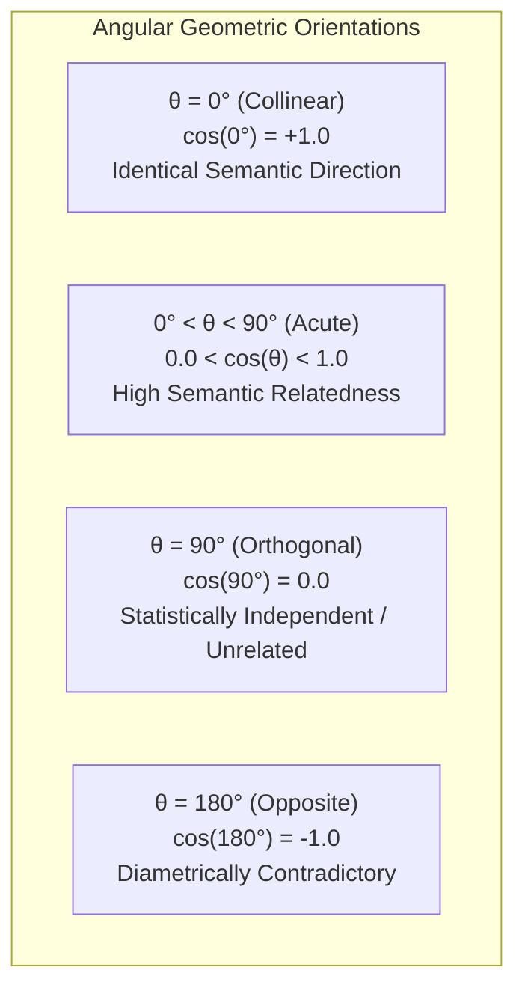
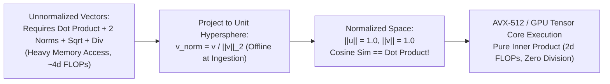
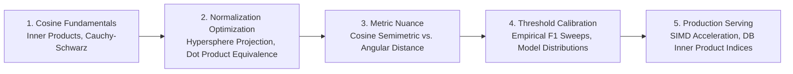

# 📐 Deep Dive: Cosine Similarity, Unit-Normalization Optimization, and Angular Distances

## 📑 Table of Contents
1. [🌟 Mathematical Anatomy of Cosine Similarity](#1--mathematical-anatomy-of-cosine-similarity)
2. [⚡ The Unit-Normalization Transformation & Computational Proof](#2-️-the-unit-normalization-transformation--computational-proof)
3. [📐 Cosine Distance vs. Angular Distance: The Semimetric Dilemma](#3--cosine-distance-vs-angular-distance-the-semimetric-dilemma)
4. [📊 Behavioral Comparison: Cosine vs. Dot Product vs. Euclidean](#4--behavioral-comparison-cosine-vs-dot-product-vs-euclidean)
5. [💻 Practical Implementation: High-Throughput Batch Cosine Matrix Operations](#5--practical-implementation-high-throughput-batch-cosine-matrix-operations)
6. [🎛️ Score Calibration & The Myth of the "0.8 Cosine Cutoff"](#6-️-score-calibration--the-myth-of-the-08-cosine-cutoff)
7. [🚀 Production Optimization: Vector DB Index Configurations](#7-️-production-optimization-vector-db-index-configurations)
8. [🌍 Real-World Enterprise Case Studies](#8--real-world-enterprise-case-studies)
9. [✅ Advantages & ⚠️ Limitations of Cosine Geometry](#9--advantages--️-limitations-of-cosine-geometry)
10. [🛠️ Production Best Practices & ❌ Common Traps](#10-️-production-best-practices---common-traps)
11. [💼 Senior Interview Preparation: High-Yield Questions](#11--senior-interview-preparation-high-yield-questions)
12. [🧪 Hands-On Mini-Project: Dynamic Similarity Threshold & F1 Calibrator](#12--hands-on-mini-project-dynamic-similarity-threshold--f1-calibrator)
13. [⚡ Quick Revision & Summary Roadmap](#13--quick-revision--summary-roadmap)

---

## 1. 🌟 Mathematical Anatomy of Cosine Similarity

In natural language processing and dense retrieval, **Cosine Similarity** evaluates the semantic alignment between two non-zero vectors $\mathbf{u}, \mathbf{v} \in \mathbb{R}^d$ by calculating the cosine of the angle $\theta$ between them:

### # Cosine Similarity Formula
$$
\text{Cosine Similarity}(\mathbf{u}, \mathbf{v}) = \cos(\theta) = \frac{\mathbf{u} \cdot \mathbf{v}}{\|\mathbf{u}\|_2 \|\mathbf{v}\|_2} = \frac{\sum_{i=1}^d u_i v_i}{\sqrt{\sum_{i=1}^d u_i^2} \sqrt{\sum_{i=1}^d v_i^2}}
$$



### 📐 The Cauchy-Schwarz Inequality Proof
The foundational guarantee that cosine similarity remains strictly bounded within $[-1.0, 1.0]$ is established by the **Cauchy-Schwarz Inequality**:

### # Cauchy-Schwarz Boundedness
$$
|\mathbf{u} \cdot \mathbf{v}| \le \|\mathbf{u}\|_2 \|\mathbf{v}\|_2 \implies -1.0 \le \frac{\mathbf{u} \cdot \mathbf{v}}{\|\mathbf{u}\|_2 \|\mathbf{v}\|_2} \le 1.0
$$

### ❓ Why Text Embeddings Rarely Yield Negative Cosine Values
While mathematically defined over $[-1.0, 1.0]$, empirical cosine scores between modern text embeddings (e.g., OpenAI, BGE, Cohere) virtually always land in the positive range $[0.0, 1.0]$ (often between $0.3$ and $0.95$). This occurs because:
1. Neural networks utilize non-negative activation functions (ReLU, GELU).
2. Contrastive language pre-training embeds shared linguistic tokens (punctuation, stop words, common English grammar) within a positive subspace.

---

## 2. ⚡ The Unit-Normalization Transformation & Computational Proof

In production vector search, computing square roots and floating-point divisions for millions of candidate chunks introduces massive CPU/GPU latency bottlenecks.



### 🧮 Mathematical Derivation: Cosine to Dot Product Identity
Let $\mathbf{u}$ and $\mathbf{v}$ be arbitrary vectors. We define their unit-normalized counterparts as:
$$\hat{\mathbf{u}} = \frac{\mathbf{u}}{\|\mathbf{u}\|_2}, \quad \hat{\mathbf{v}} = \frac{\mathbf{v}}{\|\mathbf{v}\|_2}$$

By definition, $\|\hat{\mathbf{u}}\|_2 = 1.0$ and $\|\hat{\mathbf{v}}\|_2 = 1.0$. Now compute the dot product of the normalized vectors:

### # Normalized Dot Product Identity
$$
\hat{\mathbf{u}} \cdot \hat{\mathbf{v}} = \left(\frac{\mathbf{u}}{\|\mathbf{u}\|_2}\right) \cdot \left(\frac{\mathbf{v}}{\|\mathbf{v}\|_2}\right) = \frac{\mathbf{u} \cdot \mathbf{v}}{\|\mathbf{u}\|_2 \|\mathbf{v}\|_2} = \text{Cosine Similarity}(\mathbf{u}, \mathbf{v})
$$

### ⏱️ Hardware Complexity Savings
* **Raw Cosine Similarity:** $2d$ multiplications, $2d$ additions, $2$ square roots, $2$ vector norm divisions $\to \mathbf{\approx 4d + \mathcal{O}(1)}$ operations.
* **Unit-Normalized Dot Product:** $d$ multiplications, $d$ additions $\to \mathbf{2d}$ operations.
* **Throughput Acceleration:** Pre-normalizing vectors offline cuts online search compute in half and fits directly into fused multiply-add (FMA) vector pipelines on x86 and ARM processors.

---

## 3. 📐 Cosine Distance vs. Angular Distance: The Semimetric Dilemma

When vector databases require a distance metric (where $0.0$ represents identical items and larger values represent dissimilarity), engineers convert Cosine Similarity using:

### # Cosine Distance Definition
$$
d_{\text{cos}}(\mathbf{u}, \mathbf{v}) = 1 - \text{Cosine Similarity}(\mathbf{u}, \mathbf{v}) = 1 - \cos(\theta)
$$

### ⚠️ The Triangle Inequality Violation (Semimetric Proof)
A true mathematical metric space must satisfy the **Triangle Inequality**:
$$d(\mathbf{u}, \mathbf{w}) \le d(\mathbf{u}, \mathbf{v}) + d(\mathbf{v}, \mathbf{w})$$

Cosine distance fails this requirement. Consider three 2D unit vectors separated by $60^\circ$ increments:
* $\mathbf{u} = [1, 0]$ ($0^\circ$)
* $\mathbf{v} = [\cos(60^\circ), \sin(60^\circ)] = [0.5, \frac{\sqrt{3}}{2}]$
* $\mathbf{w} = [\cos(120^\circ), \sin(120^\circ)] = [-0.5, \frac{\sqrt{3}}{2}]$

Compute pairwise cosine distances:
* $d_{\text{cos}}(\mathbf{u}, \mathbf{v}) = 1 - \cos(60^\circ) = 1 - 0.5 = 0.5$
* $d_{\text{cos}}(\mathbf{v}, \mathbf{w}) = 1 - \cos(60^\circ) = 1 - 0.5 = 0.5$
* $d_{\text{cos}}(\mathbf{u}, \mathbf{w}) = 1 - \cos(120^\circ) = 1 - (-0.5) = 1.5$

Testing the inequality:
$$1.5 \le 0.5 + 0.5 = 1.0 \quad \text{❌ (VIOLATED!)}$$
Because it violates the triangle inequality, Cosine Distance is a **semimetric**.

### # Angular Distance (The True Metric)
To perform tree-based partitioning (e.g., Cover Trees, Ball Trees) without algorithmic failure, the angle itself must be normalized:

$$
d_{\text{angular}}(\mathbf{u}, \mathbf{v}) = \frac{\arccos(\cos(\theta))}{\pi} = \frac{\theta}{\pi} \in [0.0, 1.0]
$$
Angular distance satisfies all metric axioms, including the triangle inequality.

---

## 4. 📊 Behavioral Comparison: Cosine vs. Dot Product vs. Euclidean

To understand why Cosine Similarity dominates NLP retrieval, consider how metrics react to changes in text length (vector magnitude):

| Test Scenario | Vector Setup | Cosine Similarity | Raw Dot Product | Euclidean Distance ($L_2$) | Explanation & Implication |
| :--- | :--- | :---: | :---: | :---: | :--- |
| **Identical Text** | $\mathbf{u} = [1, 2]$, $\mathbf{v} = [1, 2]$ | **$1.0$** | $5.0$ | **$0.0$** | All metrics confirm identical orientation and position. |
| **Document Duplicated $3\times$** | $\mathbf{u} = [1, 2]$, $\mathbf{v} = [3, 6]$ | **$1.0$** | $15.0$ ($3\times$ jump) | $4.47$ (Distant!) | **Cosine is invariant to repetition**; Dot Product artificially triples; $L_2$ treats them as distant. |
| **Off-Topic Long Document** | $\mathbf{u} = [1, 0]$, $\mathbf{v} = [0.1, 10.0]$ | **$0.01$** | $0.1$ | $10.04$ | Cosine correctly flags as irrelevant; un-normalized dot product can be misled by huge values. |
| **Orthogonal Concepts** | $\mathbf{u} = [1, 0]$, $\mathbf{v} = [0, 1]$ | **$0.0$** | $0.0$ | $1.414$ | Cosine indicates zero semantic overlap ($90^\circ$ angle). |

---

## 5. 💻 Practical Implementation: High-Throughput Batch Cosine Matrix Operations

Below is an enterprise-grade Python module demonstrating vectorized batch pairwise cosine similarity matrix computations, in-place unit normalization, and an empirical performance comparison using `numpy`.

```python
"""
High-Throughput Cosine Similarity Engine:
1. Batch Matrix Cosine Similarity computation.
2. In-place L2 Unit Normalization.
3. Latency benchmark: Raw Cosine vs. Pre-normalized Dot Product.
"""

import time
from typing import Tuple
import numpy as np

class CosineEngine:
    @staticmethod
    def batch_cosine_similarity(query_matrix: np.ndarray, doc_matrix: np.ndarray) -> np.ndarray:
        """Computes pairwise cosine similarity between Q queries and D documents.
        
        Args:
            query_matrix: Array of shape (Q, d)
            doc_matrix: Array of shape (D, d)
            
        Returns:
            Similarity matrix of shape (Q, D)
        """
        # Step 1: Compute dot products (Q, D)
        dot_products = np.dot(query_matrix, doc_matrix.T)
        
        # Step 2: Compute L2 norms
        q_norms = np.linalg.norm(query_matrix, axis=1, keepdims=True)  # (Q, 1)
        d_norms = np.linalg.norm(doc_matrix, axis=1, keepdims=True)    # (D, 1)
        
        # Step 3: Compute norm outer product and divide
        norm_matrix = np.dot(q_norms, d_norms.T)
        return dot_products / np.clip(norm_matrix, a_min=1e-12, a_max=None)

    @staticmethod
    def fast_normalized_dot_product(q_normed: np.ndarray, d_normed: np.ndarray) -> np.ndarray:
        """Fast dot product for pre-normalized vectors."""
        return np.dot(q_normed, d_normed.T)


# --- Benchmark & Verification ---
if __name__ == "__main__":
    np.random.seed(42)
    num_queries = 50
    num_docs = 20000
    dim = 768

    print(f"Generating synthetic embeddings: {num_queries} queries, {num_docs} docs, dim={dim}...")
    queries = np.random.randn(num_queries, dim).astype(np.float32)
    docs = np.random.randn(num_docs, dim).astype(np.float32)

    # 1. Benchmark Raw Un-Normalized Cosine
    t0 = time.perf_counter()
    raw_sim_matrix = CosineEngine.batch_cosine_similarity(queries, docs)
    t_raw = time.perf_counter() - t0
    print(f"⏱️ Raw Batch Cosine Time:           {t_raw * 1000:.2f} ms")

    # 2. Benchmark Pre-Normalized Dot Product
    # Pre-normalize offline
    q_normed = queries / np.linalg.norm(queries, axis=1, keepdims=True)
    d_normed = docs / np.linalg.norm(docs, axis=1, keepdims=True)

    t0 = time.perf_counter()
    fast_sim_matrix = CosineEngine.fast_normalized_dot_product(q_normed, d_normed)
    t_fast = time.perf_counter() - t0
    print(f"⚡ Pre-Normalized Dot Product Time: {t_fast * 1000:.2f} ms")
    print(f"🚀 Speedup Factor:                  {t_raw / t_fast:.2f}x faster")

    # 3. Precision Check
    max_diff = np.max(np.abs(raw_sim_matrix - fast_sim_matrix))
    print(f"Maximum Numerical Difference:       {max_diff:.2e} (Equivalence confirmed!)")
```

---

## 6. 🎛️ Score Calibration & The Myth of the "0.8 Cosine Cutoff"

A pervasive mistake in naive RAG implementations is hardcoding an arbitrary similarity cutoff threshold, such as:

```python
# ❌ DANGEROUS ANTI-PATTERN:
if cosine_score < 0.80:
    discard_chunk()
```

### 🔬 Why Fixed Thresholds Fail
Every embedding model maps concepts to an idiosyncratic angular distribution in latent space:

```
OpenAI text-embedding-3-small:
  [0.0] ────────────── [0.35: Unrelated] ────── [0.65: Related] ────── [0.85: Identical] ── [1.0]

BAAI bge-large-en-v1.5:
  [0.0] ──────────────────────────────── [0.60: Unrelated] ── [0.78: Related] ─ [0.92] ──── [1.0]

Cohere embed-english-v3.0:
  [0.0] ───────── [0.25: Unrelated] ────────── [0.55: Related] ──────── [0.80: Identical] ── [1.0]
```

* In **BGE**, an irrelevant document frequently scores $0.62$, while a relevant document scores $0.81$.
* In **Cohere**, an authoritative passage might score $0.58$. A hardcoded $0.80$ cutoff would discard the correct answer $100\%$ of the time!

### 🛡️ Production Threshold Calibration Strategies
1. **Dynamic Top-$K$ with Margin Cutoff:** Always retrieve Top-$K$ (e.g., $K=5$), but discard chunk $i$ if its score drops by more than $\Delta = 0.15$ compared to chunk $1$.
2. **Empirical Quantile Calibration:** Run your evaluation benchmark (golden query-chunk set) to calculate the precision-recall curve and pick the exact threshold that maximizes the F1 score.
3. **Never Discard Without Fallback:** If all chunks fall below the cutoff, fall back to returning the single highest-scoring chunk or route the query to an agentic web search tool.

---

## 7. 🚀 Production Optimization: Vector DB Index Configurations

Different vector databases use distinct naming conventions for distance and similarity metrics:

| Vector Database | Cosine Metric Name | Normalized Inner Product Name | Recommended Production Setting |
| :--- | :--- | :--- | :--- |
| **Pinecone** | `"cosine"` | `"dotproduct"` | Pre-normalize embeddings $\to$ use `"dotproduct"`. |
| **Qdrant** | `Distance.COSINE` | `Distance.DOT` | Pre-normalize embeddings $\to$ use `Distance.DOT`. |
| **Weaviate** | `"cosine"` | `"dot"` | `"cosine"` (handles normalization automatically). |
| **Milvus / Zilliz**| `"COSINE"` | `"IP"` (Inner Product) | Use `"IP"` with pre-normalized vectors. |
| **ChromaDB** | `"cosine"` | `"ip"` | `"cosine"` default. |
| **pgvector** | `<=>` (Cosine distance) | `<#>` (Negative inner product) | Use `<#>` with normalized vectors for indexed HNSW. |

---

## 8. 🌍 Real-World Enterprise Case Studies

* **📑 Enterprise Documentation Deduplication Engine:** A cloud provider scraped millions of pages across 40 developer documentation portals. They observed that near-identical runbooks were indexed repeatedly. Using a **Cosine Similarity threshold of $\ge 0.94$**, they identified and merged duplicate passages, shrinking vector index storage by $38\%$ and eliminating duplicate search results.
* **💬 Conversational Context Compaction:** A medical assistant maintained multi-turn chat history. When users asked clarifying questions, earlier retrieved chunks were being sent redundantly to the LLM. By calculating pairwise cosine similarities between new and existing chunks, the system automatically suppressed any new chunk with $\cos(\theta) \ge 0.88$ against already-injected chunks, saving 4,000 prompt tokens per turn.

---

## 9. ✅ Advantages & ⚠️ Limitations of Cosine Geometry

### ✅ Advantages
* **Length Invariant:** Documents of varying length (10 words vs 300 words) are judged on conceptual alignment rather than verbosity.
* **Bounded Output:** Strict $[-1.0, 1.0]$ output allows for intuitive thresholding and ranking.
* **Hardware Friendly:** Reduces to an inner product on unit hyperspheres.

### ⚠️ Limitations
* **Semimetric Nature:** $1 - \cos(\theta)$ violates the triangle inequality, which can cause subtle indexing anomalies in tree-based ANN structures.
* **Sensitivity to Dense Noise:** Short queries matched against long passages can experience score dilution if the passage covers multiple distinct topics.

---

## 10. 🛠️ Production Best Practices & ❌ Common Traps

### 🛠️ Production Best Practices
1. **Handle the Zero-Vector Edge Case:** Empty strings or corrupted inputs can produce an all-zero vector ($\|\mathbf{u}\|_2 = 0$), causing a fatal `ZeroDivisionError`. Always clamp norms to $\epsilon = 10^{-12}$.
2. **Re-Normalize After Vector Math:** If you perform vector arithmetic (e.g., query expansion $\mathbf{q}_{\text{new}} = \mathbf{q} + 0.5 \mathbf{d}^+$), the resulting vector is **no longer unit length**. You must re-normalize before issuing the search query.
3. **Store Pre-Normalized Vectors in DB:** Perform normalization once during chunk ingestion. Never re-calculate norms on millions of records at query time.

### ❌ Common Traps
* **Mixing Inner Product on Unnormalized Vectors:** Storing raw vectors and configuring the DB for `dotproduct` will cause large, verbose chunks to dominate search results.
* **Assuming Cosine Scores Represent True Probabilities:** A cosine score of $0.85$ does **not** mean the model is $85\%$ confident. It is purely a geometric angle measurement.

---

## 11. 💼 Senior Interview Preparation: High-Yield Questions

### 🎯 High-Yield Architectural Interview Questions

#### Q1: If Cosine Similarity is length-invariant, why does chunk size still matter so much in RAG retrieval?
> **Answer:** While cosine similarity ignores the raw mathematical magnitude of the resulting vector, the **underlying embedding model's pooling operation does not**. Transformer pooling (e.g., mean pooling) averages the hidden states of all tokens in the chunk. 
> If a chunk is excessively large (e.g., 2,000 tokens) and covers three different subjects, the mean pooling step averages those diverse conceptual representations together. This dilutes the vector toward the center of the latent space, reducing its cosine similarity with any specific, focused query. Therefore, chunking preserves **semantic purity**, ensuring the vector points sharply in the intended direction.

#### Q2: How do you mathematically prove that maximizing Cosine Similarity is equivalent to minimizing Euclidean Distance for unit vectors?
> **Answer:** Expand the squared Euclidean distance between two unit vectors $\mathbf{u}$ and $\mathbf{v}$ where $\|\mathbf{u}\|_2 = 1$ and $\|\mathbf{v}\|_2 = 1$:
> $$\|\mathbf{u} - \mathbf{v}\|_2^2 = (\mathbf{u} - \mathbf{v}) \cdot (\mathbf{u} - \mathbf{v}) = \|\mathbf{u}\|_2^2 + \|\mathbf{v}\|_2^2 - 2(\mathbf{u} \cdot \mathbf{v}) = 1 + 1 - 2(\mathbf{u} \cdot \mathbf{v}) = 2 - 2\cos(\theta)$$
> Since $2$ is a constant, minimizing $\|\mathbf{u} - \mathbf{v}\|_2^2$ directly requires maximizing $\mathbf{u} \cdot \mathbf{v} = \cos(\theta)$. Because the square root function is strictly monotonic for non-negative values, minimizing Euclidean distance $\|\mathbf{u} - \mathbf{v}\|_2$ is mathematically guaranteed to produce the exact same candidate ranking as maximizing Cosine Similarity.

#### Q3: Why does pgvector offer both `<=>` (cosine distance) and `<#>` (negative inner product), and which should an architect specify in high-throughput PostgreSQL RAG schemas?
> **Answer:** 
> - `<=>` computes true cosine distance by calculating the dot product and dividing by vector norms at query execution time.
> - `<#>` computes negative inner product ($-\mathbf{u} \cdot \mathbf{v}$). The negative sign is used because PostgreSQL index operators sort in ascending order (smallest first), so maximizing inner product corresponds to finding the minimum negative inner product.
> - **Architectural Recommendation:** In high-throughput RAG systems, ensure all application embeddings are $L_2$ normalized before being written to PostgreSQL. Then, build an **HNSW index over `<#>`**. This bypasses real-time vector norm computations, allowing PostgreSQL to use SIMD inner product instructions and delivering up to $3\times - 4\times$ faster indexing and query speeds.

#### Q4: How does the presence of stop words and common syntactic tokens impact the angular distribution of text embeddings, and how can an engineer inspect this?
> **Answer:** Natural language text shares a high proportion of universal grammatical tokens ("the", "is", "at", commas, periods). In pre-trained transformer representations, these shared tokens induce a shared positive baseline in the attention layers, dragging the overall vector representations toward a shared direction in latent space. Consequently, the minimum cosine similarity between any two English paragraphs is rarely $0.0$, typically hovering around $0.35 - 0.50$.
> An engineer can inspect this by taking a random sample of $10,000$ unrelated document pairs and plotting the histogram of their pairwise cosine similarities. If the distribution is skewed tightly between $0.6$ and $0.8$ (anisotropy), applying centering ($\mathbf{v} - \mu$) or PCA whitening can spread the vectors isotropically across the hypersphere.

---

## 12. 🧪 Hands-On Mini-Project: Dynamic Similarity Threshold & F1 Calibrator

Build a standalone Python tool that sweeps cosine similarity cutoffs across a synthetic evaluation set to determine the optimal threshold that maximizes the retrieval F1-score.

```python
"""
Hands-On Mini-Project: Dynamic Similarity Threshold & F1 Calibrator
Finds the optimal cosine similarity threshold for a specific embedding model distribution.
"""

from typing import Dict, List, Tuple
import numpy as np

def generate_synthetic_eval_dataset(n_samples: int = 1000) -> List[Tuple[float, bool]]:
    """Generates synthetic cosine scores for relevant (True) and irrelevant (False) pairs."""
    np.random.seed(42)
    dataset = []
    
    # Relevant pairs: Gaussian centered at 0.78 with std 0.08
    for _ in range(n_samples // 2):
        score = float(np.clip(np.random.normal(0.78, 0.08), 0.0, 1.0))
        dataset.append((score, True))
        
    # Irrelevant pairs: Gaussian centered at 0.52 with std 0.10
    for _ in range(n_samples // 2):
        score = float(np.clip(np.random.normal(0.52, 0.10), 0.0, 1.0))
        dataset.append((score, False))
        
    return dataset

def calibrate_threshold(eval_data: List[Tuple[float, bool]]) -> Dict[str, float]:
    best_threshold = 0.0
    best_f1 = 0.0
    best_precision = 0.0
    best_recall = 0.0
    
    thresholds = np.linspace(0.40, 0.90, 51)
    
    for th in thresholds:
        tp, fp, fn = 0, 0, 0
        for score, is_relevant in eval_data:
            predicted = (score >= th)
            if predicted and is_relevant:
                tp += 1
            elif predicted and not is_relevant:
                fp += 1
            elif not predicted and is_relevant:
                fn += 1
                
        precision = tp / max(tp + fp, 1)
        recall = tp / max(tp + fn, 1)
        f1 = (2 * precision * recall) / max(precision + recall, 1e-9)
        
        if f1 > best_f1:
            best_f1 = f1
            best_threshold = float(th)
            best_precision = precision
            best_recall = recall
            
    return {
        "optimal_threshold": round(best_threshold, 3),
        "f1_score": round(best_f1, 4),
        "precision": round(best_precision, 4),
        "recall": round(best_recall, 4)
    }

if __name__ == "__main__":
    eval_set = generate_synthetic_eval_dataset(n_samples=2000)
    calibration_results = calibrate_threshold(eval_set)
    
    print("=== Cosine Similarity Threshold Calibration Results ===")
    for metric, val in calibration_results.items():
        print(f"  {metric}: {val}")
    print("\n💡 Recommendation: Set vector retrieval cutoff to", calibration_results["optimal_threshold"])
```

---

## 13. ⚡ Quick Revision & Summary Roadmap

### 📌 Core Takeaways
* **Angular Measurement:** Cosine similarity measures direction and orientation, completely ignoring vector length.
* **The Normalization Shortcut:** When $\|\mathbf{u}\|_2 = \|\mathbf{v}\|_2 = 1.0$, Cosine Similarity simplifies to an inner dot product ($\mathbf{u} \cdot \mathbf{v}$).
* **Semimetric Warning:** Cosine distance ($1 - \cos\theta$) violates the triangle inequality; use Angular Distance ($\frac{\theta}{\pi}$) if formal metric properties are required.
* **Never Hardcode 0.8:** Optimal similarity thresholds differ across embedding models; always calibrate using empirical evaluation datasets.
* **Vector DB Config:** In production, pre-normalize vectors and configure indices for `dotproduct` / `IP` for maximum throughput.

### # Core Identity Summary
$$
\mathbf{u}_{\text{norm}} \cdot \mathbf{v}_{\text{norm}} = \frac{\mathbf{u} \cdot \mathbf{v}}{\|\mathbf{u}\|_2 \|\mathbf{v}\|_2} = \cos(\theta)
$$

### 🗺️ Cosine Geometry Engineering Roadmap


