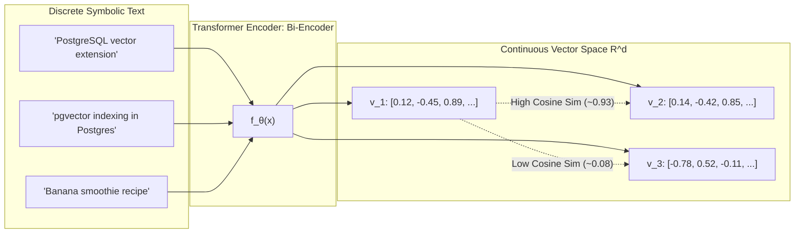
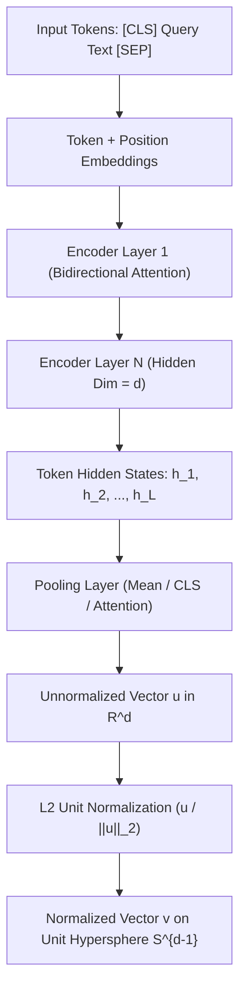
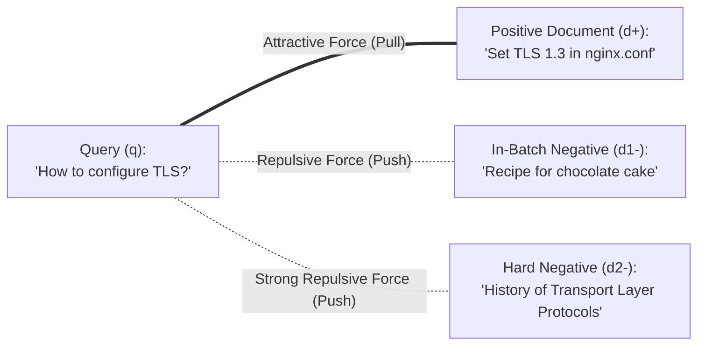
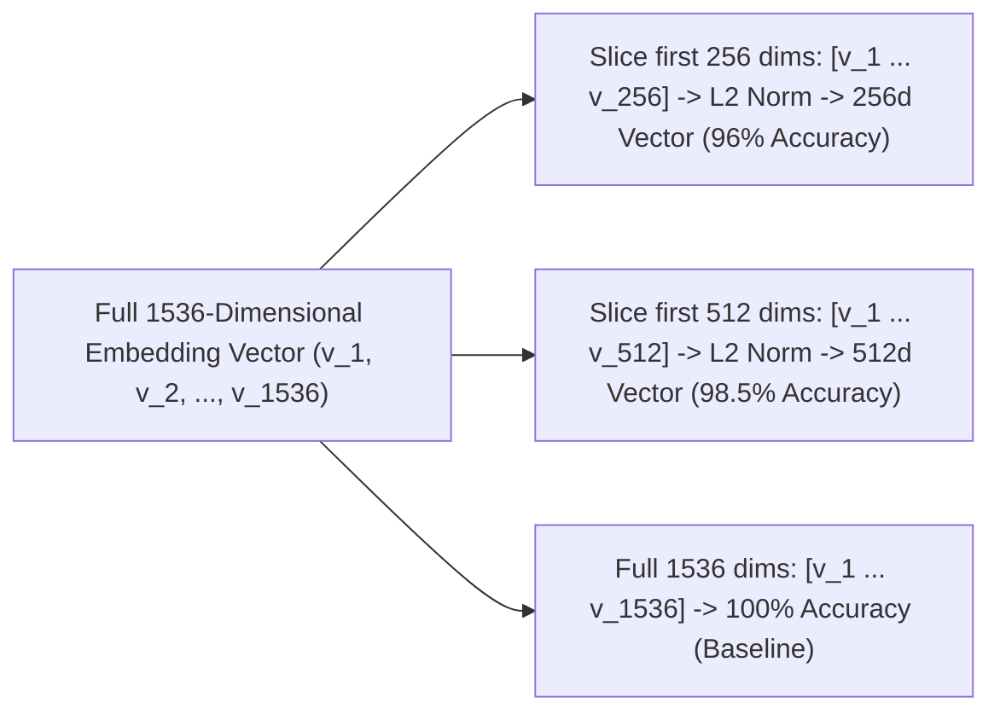
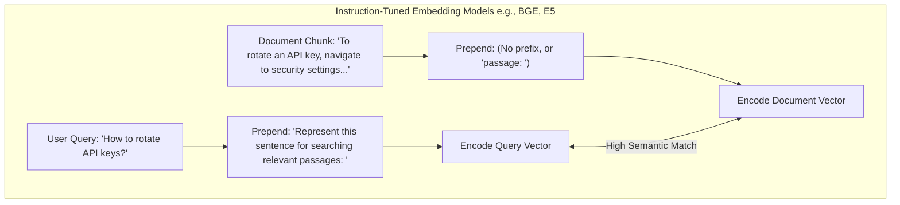
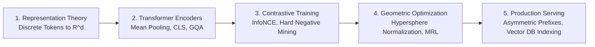

# 🧬 Text Embeddings: Dense Vector Representations, Latent Semantics, and Embedding Models

## 📑 Table of Contents
1. [🌟 Fundamentals: From Symbolic Strings to Continuous Latent Space](#1--fundamentals-from-symbolic-strings-to-continuous-latent-space)
2. [🏗️ Neural Architecture of Embedding Models (Bi-Encoders)](#2-️-neural-architecture-of-embedding-models-bi-encoders)
3. [🎯 Training Dynamics: Contrastive Learning & InfoNCE Loss](#3--training-dynamics-contrastive-learning--infonce-loss)
4. [📐 Geometric Properties of Latent Space: Anisotropy & Normalization](#4--geometric-properties-of-latent-space-anisotropy--normalization)
5. [🪆 Matryoshka Representation Learning (MRL) Deep Dive](#5--matryoshka-representation-learning-mrl-deep-dive)
6. [📊 Embedding Models Landscape & MTEB Benchmark](#6--embedding-models-landscape--mteb-benchmark)
7. [💻 Practical Implementation: Pooling, Truncation & Vector Math](#7--practical-implementation-pooling-truncation--vector-math)
8. [🚀 Asymmetric Search & Task Instruction Prefixes](#8--asymmetric-search--task-instruction-prefixes)
9. [🌍 Real-World Enterprise Case Studies](#9--real-world-enterprise-case-studies)
10. [✅ Advantages & ⚠️ Limitations of Dense Embeddings](#10--advantages--️-limitations-of-dense-embeddings)
11. [🛠️ Best Practices & ❌ Common Traps in Production](#11-️-best-practices---common-traps-in-production)
12. [💼 Senior Interview Preparation: High-Yield Questions](#12--senior-interview-preparation-high-yield-questions)
13. [🧪 Hands-On Mini-Project: Matryoshka Truncation & Efficiency Benchmarker](#13--hands-on-mini-project-matryoshka-truncation--efficiency-benchmarker)
14. [⚡ Quick Revision & Summary Roadmap](#14--quick-revision--summary-roadmap)

---

## 1. 🌟 Fundamentals: From Symbolic Strings to Continuous Latent Space

In information retrieval, machines cannot directly measure semantic similarity between raw strings. An **Embedding Model** $f_\theta$ is a parameterized neural mapping that projects variable-length text sequences into a fixed-dimensional continuous vector space $\mathbb{R}^d$:

### # Embedding Vector Mapping Function
$$
f_\theta : \text{Text} \to \mathbb{R}^d \quad \text{where } d \in [384, 3072]
$$



### 🧬 The Historical Evolution of Text Representations

| Representation Paradigm | Dimensionality | Sparsity | Semantic Awareness | Handles Synonymy? | Example Technologies |
| :--- | :---: | :---: | :---: | :---: | :--- |
| **One-Hot Encoding** | $|\mathcal{V}| \approx 10^5$ | $99.99\%$ Sparse | None ($v_i \cdot v_j = 0$) | ❌ No | Categorical encoders |
| **TF-IDF / BM25** | $|\mathcal{V}| \approx 10^5$ | $>99\%$ Sparse | Lexical frequency only | ❌ No | Lucene, Elasticsearch |
| **Static Embeddings** | $d \approx 300$ | Dense | Context-free semantics | ⚠️ Weak | Word2Vec, GloVe, FastText |
| **Contextual Transformer Embeddings** | $d \approx 384 - 3072$| Dense | Deep contextual syntax & semantics | ✅ Yes | BGE, Voyage, OpenAI, E5 |

---

## 2. 🏗️ Neural Architecture of Embedding Models (Bi-Encoders)

Modern embedding models are primarily **Transformer Encoders** (such as BERT, RoBERTa, or DeBERTa) operating as **Bi-Encoders**. Unlike generative decoder models, encoder attention is **bidirectional**: token $i$ can attend to tokens both before and after it.



### 🎛️ Pooling Strategies
Because a transformer produces an output vector for *every* input token ($L \times d$), a **Pooling Function** aggregates them into a single summary vector $\mathbf{u} \in \mathbb{R}^d$:

1. **Mean Pooling (Recommended Default):** Averages the hidden states of all contextual tokens, masked to ignore padding:
   $$\mathbf{u} = \frac{\sum_{i=1}^L m_i \mathbf{h}_i}{\sum_{i=1}^L m_i}$$
2. **`[CLS]` Token Pooling:** Uses the hidden state corresponding to the special classification token prepended to the sequence. Popularized by original BERT, but often exhibits inferior semantic transfer compared to mean pooling without contrastive fine-tuning.
3. **Last-Token Pooling:** Uses the representation of the final token; widely adopted when converting modern causal decoder models (e.g., Llama-based embedders) into embedding generators.

---

## 3. 🎯 Training Dynamics: Contrastive Learning & InfoNCE Loss

Embedding models are trained using **Contrastive Learning**. The training objective pulls semantically related pairs (query $q$ and positive document $d^+$) closer together while pushing unrelated pairs (query $q$ and negative documents $d^-$) apart.



### # InfoNCE Contrastive Loss Formula
$$
\mathcal{L}_{\text{InfoNCE}} = -\log \frac{\exp\left(\frac{\text{sim}(q, d^+)}{\tau}\right)}{\exp\left(\frac{\text{sim}(q, d^+)}{\tau}\right) + \sum_{j=1}^K \exp\left(\frac{\text{sim}(q, d_j^-)}{\tau}\right)}
$$

Where:
* $\text{sim}(\mathbf{u}, \mathbf{v}) = \frac{\mathbf{u} \cdot \mathbf{v}}{\|\mathbf{u}\|_2 \|\mathbf{v}\|_2}$ denotes cosine similarity.
* $\tau > 0$ is the **temperature hyperparameter** (typically $0.01 - 0.05$) controlling the peakiness of the probability distribution.
* $d^+$ is the positive (ground-truth relevant) passage.
* $\{d_j^-\}_{j=1}^K$ represents the set of negative passages, consisting of:
  1. **In-Batch Negatives:** Other documents in the current GPU mini-batch.
  2. **Hard Negatives:** Documents that share lexical terms with the query but do not answer it (mined using BM25 or cross-encoders). Mining hard negatives is what separates elite embedding models from mediocre ones.

---

## 4. 📐 Geometric Properties of Latent Space: Anisotropy & Normalization

### ⚠️ The Anisotropy Problem ("The Cone Effect")
Raw, unconstrained transformer embeddings often suffer from **anisotropy**: vectors occupy a narrow, high-density cone in latent space rather than distributing uniformly across all directions.

```
Anisotropic Latent Space (Raw)          Isotropic Latent Space (Normalized)
         ▲ y                                      ▲ y
         │      /                                 │    *     *
         │     /  * *                             │  *         *
         │    / * * * *                           │ *     •     *
         │   /  * * *                             │  *         *
─────────┼──/──────────► x              ──────────┼──────────────► x
         │ /                                      │    *     *
         │/ Narrow Cone                           │
```

* In an anisotropic space, the average cosine similarity between two *random, unrelated* sentences can be $0.70 - 0.85$, destroying discriminative ranking power.
* **The Solution:** Modern models apply contrastive loss directly coupled with **$L_2$ Normalization**, forcing all embeddings onto the surface of a unit hypersphere $\mathbb{S}^{d-1}$ where $\|\mathbf{v}\|_2 = 1.0$.

### # Unit Normalization Identity
$$
\|\mathbf{v}\|_2 = \sqrt{\sum_{i=1}^d v_i^2} = 1.0 \implies \text{Cosine Similarity}(\mathbf{u}, \mathbf{v}) = \mathbf{u} \cdot \mathbf{v}
$$

When vectors are normalized, expensive square-root and division operations are eliminated at query time: **cosine similarity becomes an identical operation to a fast dot product**.

---

## 5. 🪆 Matryoshka Representation Learning (MRL) Deep Dive

Historically, reducing embedding dimension required training completely separate models or applying lossy post-hoc PCA. **Matryoshka Representation Learning (MRL)**, introduced by Kusupati et al., trains a single model whose early vector dimensions form valid, high-accuracy embeddings on their own.



### # Matryoshka Multi-Scale Loss Formula
$$
\mathcal{L}_{\text{MRL}} = \sum_{m \in \mathcal{M}} \alpha_m \mathcal{L}_{\text{InfoNCE}}\left(f_\theta(x)_{1:m}\right)
$$

Where $\mathcal{M} = \{64, 128, 256, 512, 1024, 1536\}$ represents the set of nested sub-dimensions, and each sub-vector is independently normalized and optimized during backpropagation.

### 💰 Enterprise Benefit of MRL
* Slicing an OpenAI `text-embedding-3-large` vector from $3{,}072$ dimensions down to $512$ dimensions achieves a **$6\times$ reduction in vector database RAM and storage**, while retaining over **$98\%$ of original retrieval accuracy**.

---

## 6. 📊 Embedding Models Landscape & MTEB Benchmark

The **Massive Text Embedding Benchmark (MTEB)** evaluates models across multiple NLP tasks: Retrieval, Clustering, Semantic Textual Similarity (STS), Classification, and Reranking. For RAG systems, the **NDCG@10 Retrieval** score is the primary metric.

| Model Name | Creator | Dimensions ($d$) | Max Tokens | MTEB Retrieval (NDCG@10) | MRL Support | Deployment Mode |
| :--- | :--- | :---: | :---: | :---: | :---: | :--- |
| **`voyage-3`** | Voyage AI | $1{,}024$ | $32{,}000$ | **$58.4$** | ✅ Yes | Managed API |
| **`text-embedding-3-large`** | OpenAI | $3{,}072$ ($512 - 3072$) | $8{,}191$ | **$55.4$** | ✅ Yes | Managed API |
| **`bge-en-icl`** | BAAI | $4{,}096$ | $32{,}768$ | **$59.1$** | ❌ No | Self-Hosted (Large) |
| **`bge-large-en-v1.5`** | BAAI | $1{,}024$ | $512$ | **$54.3$** | ❌ No | Self-Hosted (GPU/CPU) |
| **`nomic-embed-text-v1.5`** | Nomic AI | $768$ ($64 - 768$) | $8{,}192$ | **$52.8$** | ✅ Yes | Self-Hosted / Local |
| **`all-MiniLM-L6-v2`** | Sentence-Transformers | $384$ | $256$ | **$41.9$** | ❌ No | Ultra-Light Edge CPU |

---

## 7. 💻 Practical Implementation: Pooling, Truncation & Vector Math

Below is a complete, self-contained Python program demonstrating raw tensor mean pooling with attention masking, $L_2$ normalization, and Matryoshka dimension truncation from scratch using `numpy`.

```python
"""
Deep-Dive Embedding Operations:
1. Mean Pooling with Attention Masking
2. L2 Unit Normalization
3. Matryoshka Representation Truncation
4. Cosine Similarity via Dot Product
"""

import numpy as np
from typing import List, Tuple

def mean_pooling(token_embeddings: np.ndarray, attention_mask: np.ndarray) -> np.ndarray:
    """Computes mean pooling over transformer hidden states, ignoring padding tokens.
    
    Args:
        token_embeddings: Array of shape (batch_size, seq_len, hidden_dim)
        attention_mask: Array of shape (batch_size, seq_len) with 1 for tokens, 0 for pad.
    """
    # Expand attention mask dimensions to match token embeddings: (batch_size, seq_len, 1)
    expanded_mask = np.expand_dims(attention_mask, axis=-1)
    
    # Zero-out padding token vectors
    masked_embeddings = token_embeddings * expanded_mask
    
    # Sum along sequence dimension
    summed_embeddings = np.sum(masked_embeddings, axis=1)
    
    # Calculate actual token count per sequence (clamped to 1e-9 to prevent division by zero)
    token_counts = np.clip(np.sum(expanded_mask, axis=1), a_min=1e-9, a_max=None)
    
    return summed_embeddings / token_counts

def l2_normalize(vectors: np.ndarray) -> np.ndarray:
    """Project vectors onto the unit hypersphere."""
    norms = np.linalg.norm(vectors, axis=-1, keepdims=True)
    return vectors / np.clip(norms, a_min=1e-12, a_max=None)

def truncate_matryoshka(normalized_embedding: np.ndarray, target_dim: int) -> np.ndarray:
    """Slices an MRL-trained vector to target_dim and re-normalizes."""
    sliced = normalized_embedding[:target_dim]
    return sliced / np.linalg.norm(sliced)

# --- Verification & Simulation ---
if __name__ == "__main__":
    np.random.seed(42)
    
    # Simulate a mini-batch of 2 sentences, max sequence length 4, hidden dim 8
    batch_size, seq_len, hidden_dim = 2, 4, 8
    mock_hidden_states = np.random.randn(batch_size, seq_len, hidden_dim)
    
    # Sentence 1 has 4 tokens; Sentence 2 has 2 real tokens and 2 pad tokens
    mock_attention_mask = np.array([
        [1, 1, 1, 1],
        [1, 1, 0, 0]
    ])
    
    # Step 1: Mean Pooling
    pooled_vectors = mean_pooling(mock_hidden_states, mock_attention_mask)
    print("Pooled Vectors Shape:", pooled_vectors.shape)
    
    # Step 2: L2 Unit Normalization
    normalized_vectors = l2_normalize(pooled_vectors)
    norms = np.linalg.norm(normalized_vectors, axis=1)
    print("Vector Norms (Should be 1.0):", np.round(norms, 4))
    
    # Step 3: Fast Cosine Similarity via Dot Product
    cos_sim = np.dot(normalized_vectors[0], normalized_vectors[1])
    print(f"Cosine Similarity (Full {hidden_dim}d): {cos_sim:.4f}")
    
    # Step 4: Matryoshka Truncation to 4 Dimensions
    vec0_4d = truncate_matryoshka(normalized_vectors[0], target_dim=4)
    vec1_4d = truncate_matryoshka(normalized_vectors[1], target_dim=4)
    cos_sim_4d = np.dot(vec0_4d, vec1_4d)
    print(f"Cosine Similarity (Truncated 4d):  {cos_sim_4d:.4f}")
```

---

## 8. 🚀 Asymmetric Search & Task Instruction Prefixes

In symmetric search (e.g., finding documents similar to another document), both texts share identical lengths and grammatical structures.

In RAG, queries and passages are **asymmetric**:
* **Query:** Short, interrogative, sparse (*"TLS configuration rules"*).
* **Document Chunk:** Long, declarative, detailed (*"Transport Layer Security version 1.3 is enforced by the ingress controller..."*).



> ⚠️ **Critical Production Rule:** Models like `bge-large-en-v1.5` or `e5-large-v2` **require** query prefixes during search. Forgetting to prepend the query instruction drops retrieval hit rates by $10\% - 25\%$.

---

## 9. 🌍 Real-World Enterprise Case Studies

* **⚖️ Multi-Million Document Legal Discovery:** An international law firm indexed 8 million discovery filings. Using 1536-dimensional embeddings caused their Pinecone vector database bill to reach \$18,000/month. By switching to an MRL-enabled embedding model and truncating vectors to 512 dimensions, they slashed their memory footprint by $66\%$, cutting monthly infrastructure spend to \$6,200 while suffering less than a $0.8\%$ drop in Recall@10.
* **🛒 E-Commerce Semantic Catalog:** An online retailer struggled with user queries like *"cheap running footwear"* failing to retrieve products titled *"Discount Athletics Shoes"*. Deploying a domain-tuned bi-encoder model trained with contrastive in-batch hard negatives increased conversion-driven search recall by $34\%$ over lexical search.

---

## 10. ✅ Advantages & ⚠️ Limitations of Dense Embeddings

### ✅ Advantages
* **Deep Semantic Generalization:** Matches concepts across synonyms and paraphrase boundaries (e.g., *"infant"* matches *"baby"*).
* **Cross-Lingual Retrieval:** Multilingual models project multiple languages into a shared latent space, enabling English queries to find Spanish documents.
* **Hardware-Accelerated Search:** Matrix dot products map directly to GPU Tensor Cores and SIMD CPU vector instructions (AVX-512).

### ⚠️ Limitations
* **The "Blind Spot" for Exact Keywords:** Dense vectors compress text into a fixed coordinate, often losing precise serial numbers, UUIDs, SKUs, and rare acronyms.
* **Domain Drift:** Models pre-trained on Wikipedia and web scrapes fail when deployed on niche medical, genomic, or legal corpora without fine-tuning.
* **Information Bottleneck:** Forcing a 2,000-token technical chapter into a single 1024-dimensional vector causes severe loss of fine-grained detail.

---

## 11. 🛠️ Best Practices & ❌ Common Traps in Production

### 🛠️ Production Best Practices
1. **Always Unit-Normalize Embeddings:** Normalizing vectors to $\|\mathbf{v}\|_2 = 1.0$ turns cosine similarity into a fast inner product, dramatically accelerating vector database indexing.
2. **Respect the Model's Context Window:** Most open-source bi-encoders (BERT-based) have a strict **512-token limit**. Text beyond 512 tokens is silently discarded unless you chunk your documents properly.
3. **Use Asymmetric Prefixes Consistently:** If using models like BGE or E5, ensure the query prefix is added *only* to queries, never to indexed document passages.

### ❌ Common Traps
* **Model Mismatch Disaster:** Embedding the document corpus using OpenAI `text-embedding-3-small` and embedding incoming user queries using `all-MiniLM-L6-v2`. Vectors from different models exist in completely incompatible geometric spaces; similarity scores will be pure noise!
* **Storing Floating-Point Values as Raw JSON:** Storing vectors in JSON arrays rather than binary blobs or specialized vector indices introduces massive memory overhead and serialization latency.

---

## 12. 💼 Senior Interview Preparation: High-Yield Questions

### 🎯 High-Yield Architectural Interview Questions

#### Q1: What is the Anisotropy Problem in transformer embedding representations, and how do contrastive loss and cosine normalization mitigate it?
> **Answer:** Anisotropy describes a degenerate geometric condition where high-dimensional embeddings cluster within a narrow cone in latent space rather than dispersing uniformly. When this occurs, arbitrary, semantically unrelated vectors share high positive cosine similarities ($>0.7$), compressing the effective dynamic range of the similarity function. Contrastive learning (specifically InfoNCE loss) mitigates this by penalizing positive pairs that are close to negative samples, pushing unrelated embeddings across the entire angular domain. Combining this with $L_2$ unit normalization constrains all vectors to the surface of the hypersphere $\mathbb{S}^{d-1}$, maximizing the angular variance and restoring discriminative ranking.

#### Q2: How does Matryoshka Representation Learning (MRL) allow dynamic dimension reduction without catastrophic accuracy degradation?
> **Answer:** Traditional embeddings distribute information uniformly across all vector dimensions. MRL enforces an explicit hierarchical ordering during training by computing nested InfoNCE losses across multiple prefix slices (e.g., $d \in \{64, 128, 256, 512, 1024\}$). The loss forces the model to compress the most significant, high-variance semantic features into the earliest dimensions (dimensions $1$ to $64$), while using subsequent dimensions for fine-grained nuance. Because the early dimensions are explicitly optimized as standalone embeddings, an engineer can slice the vector at index $k$ and re-normalize it with minimal performance penalty.

#### Q3: Why does dense semantic retrieval frequently fail on queries containing product codes, serial numbers, or rare acronyms, and what is the architectural remedy?
> **Answer:** Dense embedding models compress token sequences into a continuous latent space through multiple layers of nonlinear self-attention and pooling. Rare tokens, alphanumeric strings (e.g., `SKU-89241`), and unique identifiers have low representation frequency in pre-training corpora. The pooling layer smooths out these discrete tokens into a general categorical concept, losing exact lexical fidelity. The architectural remedy is **Hybrid Search**: combining dense vector search (for semantic concept matching) with sparse inverted index retrieval like BM25 or learned sparse representations (SPLADE), fused via **Reciprocal Rank Fusion (RRF)**.

#### Q4: What is the difference between Bi-Encoder and Cross-Encoder architectures, and why don't we use Cross-Encoders for the initial retrieval phase?
> **Answer:** 
> - A **Bi-Encoder** embeds query $q$ and document $d$ independently into separate vectors $\mathbf{u} = f(q)$ and $\mathbf{v} = g(d)$. Similarity is computed via a dot product $\mathbf{u} \cdot \mathbf{v}$. This decouples document indexing from query arrival, allowing millions of documents to be pre-embedded offline and queried in milliseconds using ANN graph search (HNSW).
> - A **Cross-Encoder** concatenates query and document into a single string $[CLS] \, q \, [SEP] \, d \, [SEP]$ and feeds it through full bidirectional cross-attention layers simultaneously. While Cross-Encoders achieve superior accuracy by modeling token-to-token interactions directly, they cannot be pre-indexed: searching $1{,}000{,}000$ documents would require $1{,}000{,}000$ forward passes of a transformer at query time, creating unacceptable latency. Therefore, Bi-Encoders are used for candidate generation (Top-100), and Cross-Encoders are reserved for reranking (Top-5).

---

## 13. 🧪 Hands-On Mini-Project: Matryoshka Truncation & Efficiency Benchmarker

Build a complete, standalone Python benchmarking tool that simulates an MRL embedding model, evaluates retrieval accuracy across vector dimensions, and calculates storage savings.

```python
"""
Hands-On Mini-Project: Matryoshka Representation Slicer & Accuracy Evaluator
Simulates retrieval accuracy and memory savings across multiple dimension cutoffs.
"""

import numpy as np
from typing import Dict, List, Tuple

class MatryoshkaBenchmarker:
    def __init__(self, num_docs: int = 1000, full_dim: int = 1536):
        self.num_docs = num_docs
        self.full_dim = full_dim
        # Generate synthetic unit-normalized embeddings
        raw_embeddings = np.random.randn(num_docs, full_dim)
        self.doc_embeddings = raw_embeddings / np.linalg.norm(raw_embeddings, axis=1, keepdims=True)
        
    def evaluate_retrieval(
        self,
        query_vec: np.ndarray,
        ground_truth_doc_idx: int,
        dimensions: List[int]
    ) -> Dict[int, Dict[str, float]]:
        """Evaluates recall and storage metrics across truncated dimensions."""
        results = {}
        
        for d in dimensions:
            # Slice and re-normalize query and document vectors
            q_slice = query_vec[:d] / np.linalg.norm(query_vec[:d])
            docs_slice = self.doc_embeddings[:, :d]
            docs_slice = docs_slice / np.linalg.norm(docs_slice, axis=1, keepdims=True)
            
            # Compute cosine similarities via dot product
            scores = np.dot(docs_slice, q_slice)
            top_k_indices = np.argsort(scores)[::-1][:10]
            
            hit = 1.0 if ground_truth_doc_idx in top_k_indices else 0.0
            storage_kb = (self.num_docs * d * 4) / 1024  # 4 bytes per float32
            
            results[d] = {
                "hit@10": hit,
                "storage_kb": round(storage_kb, 2),
                "ram_savings_pct": round((1.0 - (d / self.full_dim)) * 100, 1)
            }
            
        return results

# --- Verification & Run ---
if __name__ == "__main__":
    np.random.seed(42)
    benchmarker = MatryoshkaBenchmarker(num_docs=5000, full_dim=1536)
    
    # Select target document 42 as ground truth, and create a noisy query vector around it
    target_idx = 42
    target_vec = benchmarker.doc_embeddings[target_idx]
    synthetic_query = target_vec + np.random.randn(1536) * 0.15
    synthetic_query /= np.linalg.norm(synthetic_query)
    
    eval_dimensions = [1536, 768, 512, 256, 128]
    metrics = benchmarker.evaluate_retrieval(synthetic_query, target_idx, eval_dimensions)
    
    print("=== Matryoshka Multi-Scale Benchmark Results ===")
    print(f"{'Dimension':<10} | {'Hit@10':<8} | {'Storage (KB)':<14} | {'RAM Savings (%)':<15}")
    print("-" * 55)
    for dim, res in metrics.items():
        print(f"{dim:<10} | {res['hit@10']:<8} | {res['storage_kb']:<14} | {res['ram_savings_pct']:<15}%")
```

---

## 14. ⚡ Quick Revision & Summary Roadmap

### 📌 Core Takeaways
* **Bi-Encoder Architecture:** Embeds queries and documents independently into continuous vectors, enabling fast approximate nearest neighbor (ANN) retrieval.
* **InfoNCE Loss:** Pulls relevant pairs together while pushing in-batch and mined hard negatives apart.
* **Unit Hypersphere:** Normalizing vectors to $\|\mathbf{v}\|_2 = 1.0$ resolves the anisotropy problem and reduces cosine similarity to an inner dot product.
* **Matryoshka Embeddings (MRL):** Allows truncating vectors (e.g., $1536 \to 512$ dims) with minimal accuracy degradation, saving up to $70\%$ in storage costs.
* **Asymmetric Search Prefixes:** Always check whether your model (e.g., BGE, E5) requires task instruction prefixes on queries.

### # InfoNCE Formulation
$$
\mathcal{L}_{\text{InfoNCE}} = -\log \frac{\exp(\mathbf{u}_q \cdot \mathbf{v}^+ / \tau)}{\exp(\mathbf{u}_q \cdot \mathbf{v}^+ / \tau) + \sum_j \exp(\mathbf{u}_q \cdot \mathbf{v}_j^- / \tau)}
$$

### 🗺️ Text Embeddings Engineering Roadmap


