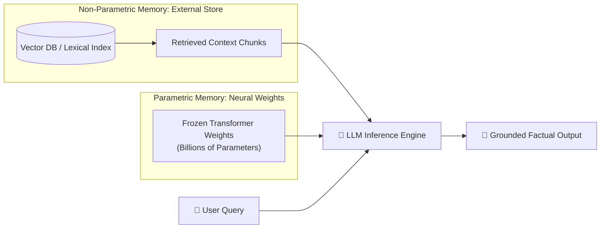
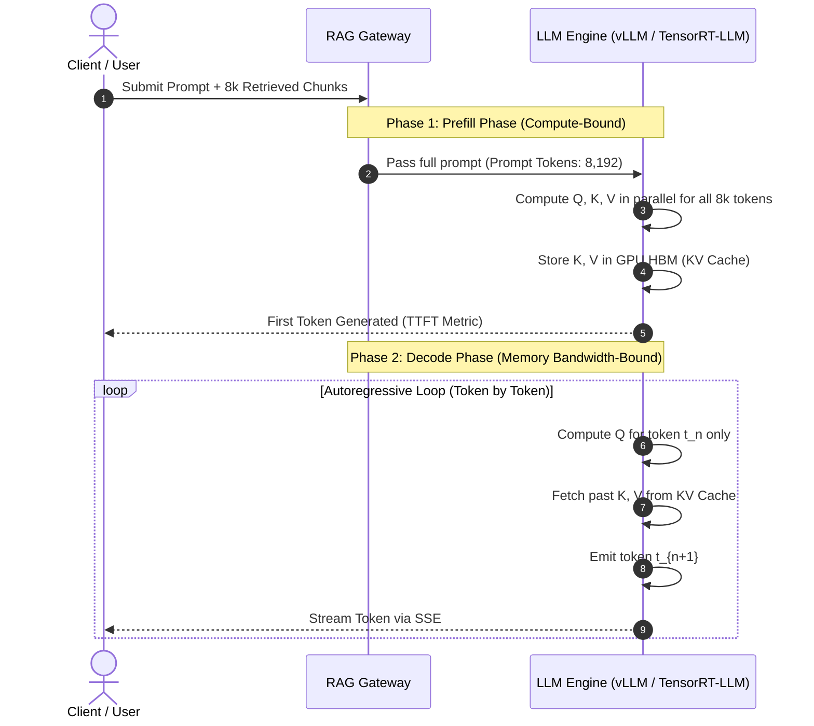
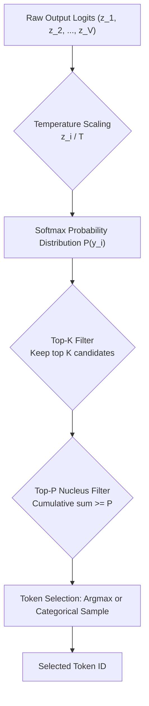
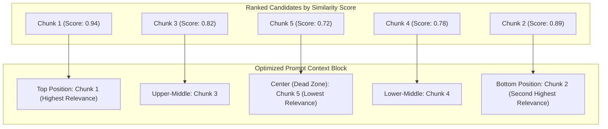
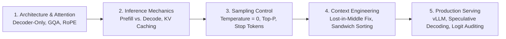

# 🧠 Large Language Model (LLM) Fundamentals for RAG Engineers

## 📑 Table of Contents
1. [🌟 Introduction to Large Language Models in RAG](#1--introduction-to-large-language-models-in-rag)
2. [🏗️ Transformer Architecture & Attention Deep Dive](#2-️-transformer-architecture--attention-deep-dive)
3. [⚡ Inference Lifecycle: Prefill vs. Decode & KV Cache](#3-️-inference-lifecycle-prefill-vs-decode--kv-cache)
4. [🎛️ Generation Mechanics & Sampling Hyperparameters](#4-️-generation-mechanics--sampling-hyperparameters)
5. [🧠 LLM Attention Vulnerabilities: The "Lost-in-the-Middle" Phenomenon](#5--llm-attention-vulnerabilities-the-lost-in-the-middle-phenomenon)
6. [⚖️ Model Landscape: Proprietary Frontier vs. Open-Weight Models](#6-️-model-landscape-proprietary-frontier-vs-open-weight-models)
7. [💻 Practical Implementation: Token Sampling & Logit Analysis](#7--practical-implementation-token-sampling--logit-analysis)
8. [🚀 Context Optimization & Grounded Prompt Assembly](#8--context-optimization--grounded-prompt-assembly)
9. [🌍 Real-World Enterprise Use Cases](#9--real-world-enterprise-use-cases)
10. [✅ Advantages & ⚠️ Limitations of LLMs as RAG Generators](#10--advantages--️-limitations-of-llms-as-rag-generators)
11. [🛠️ Best Practices & ❌ Common Architectural Traps](#11-️-best-practices---common-architectural-traps)
12. [💼 Senior Interview Preparation: System Design & Deep Theory](#12--senior-interview-preparation-system-design--deep-theory)
13. [🧪 Hands-On Mini-Project: Logit Inspector & Perplexity Auditor](#13--hands-on-mini-project-logit-inspector--perplexity-auditor)
14. [⚡ Quick Revision & Summary Roadmap](#14--quick-revision--summary-roadmap)

---

## 1. 🌟 Introduction to Large Language Models in RAG

In a Retrieval-Augmented Generation (RAG) system, the **Large Language Model (LLM)** functions as the **reasoning and synthesis engine**. While the retrieval layer gathers relevant facts from an external vector index or search engine, the LLM reads those retrieved fragments, reconciles conflicting facts, extracts actionable insights, and composes an answer conditioned on the provided context.



### 🧠 Parametric vs. Non-Parametric Memory
* **Parametric Memory:** Knowledge encoded directly inside the model's weights during pre-training and fine-tuning. It is static, frozen at training cutoff, opaque, and susceptible to hallucinations when predicting rare facts.
* **Non-Parametric Memory:** Knowledge provided at query time via external documents, vector stores, or APIs. It is dynamically editable, auditable, permission-governed, and cheap to update without re-training.

### 🎭 The Triad of LLM Roles in Enterprise RAG
1. **The Generator:** Synthesizes the final answer using retrieved passages while adhering to constraints ("Only answer using the context below").
2. **The Query Reformulator / Router:** Analyzes conversational history, resolves ambiguous pronouns, expands search keywords, or decides whether to route the request to SQL, vector search, or an external API.
3. **The Self-Reflection Judge:** Evaluates candidate chunks for relevance or evaluates the final response for factual hallucinations (e.g., in Self-RAG, Corrective RAG, and RAGAS).

---

## 2. 🏗️ Transformer Architecture & Attention Deep Dive

Virtually all modern LLMs powering RAG systems (GPT-4o, Claude 3.5, Gemini 1.5, Llama 3.3, Mistral, Qwen 2.5) are built on the **Transformer** architecture, specifically the **Decoder-Only Autoregressive** variant.

```mermaid
flowchart TD
    subgraph TransformerDecoderBlock [Decoder Block (Repeated N Times)]
        Input["Input Token Embeddings + Positional Encodings (RoPE)"] --> RMSNorm1["RMSNorm"]
        RMSNorm1 --> MHA["Grouped-Query Attention (GQA)"]
        MHA --> Residual1["➕ Residual Connection"]
        Input --> Residual1
        Residual1 --> RMSNorm2["RMSNorm"]
        RMSNorm2 --> FFN["SwiGLU Feed-Forward Network"]
        FFN --> Residual2["➕ Residual Connection"]
        Residual1 --> Residual2
    end
    Residual2 --> FinalNorm["RMSNorm"]
    FinalNorm --> LMHead["Linear Projection (LM Head)"]
    LMHead --> Logits["Token Logits (Vocabulary Distribution)"]
```

### 🔍 The Self-Attention Mechanism
Self-attention allows every token in the input context to dynamically compute an affinity score with every other token. This allows words to update their contextual representation based on their syntactic and semantic environment.

Given an input sequence represented by matrix $X$, the transformer projects it into three distinct spaces:
* **Query ($Q$):** What a token is looking for.
* **Key ($K$):** What a token contains or advertises.
* **Value ($V$):** The actual informational content passed along.

### # Scaled Dot-Product Attention Formula
$$
\text{Attention}(Q, K, V) = \text{softmax}\left(\frac{QK^T}{\sqrt{d_k}} + M\right)V
$$

Where:
* $Q, K \in \mathbb{R}^{N \times d_k}$ and $V \in \mathbb{R}^{N \times d_v}$, where $N$ is sequence length and $d_k$ is key dimension.
* $\sqrt{d_k}$ is the scaling factor that prevents dot products from growing excessively large in high dimensions, which would push the softmax into vanishing gradient regions.
* $M$ is the causal mask (upper triangular matrix of $-\infty$) ensuring token $i$ cannot attend to future tokens $j > i$.

### # Multi-Head Attention Formula
$$
\text{MultiHead}(Q, K, V) = \text{Concat}(\text{head}_1, \dots, \text{head}_h)W^O
$$
$$
\text{where } \text{head}_i = \text{Attention}(QW_i^Q, KW_i^K, VW_i^V)
$$

### 📈 Attention Variants: MHA, MQA, and GQA
As RAG context lengths expanded from 4,000 tokens to 128,000+ tokens, memory bandwidth during inference became the primary bottleneck:

| Attention Mechanism | Query Heads ($H_Q$) | Key/Value Heads ($H_{KV}$) | Memory Footprint (KV Cache) | Used In |
| :--- | :---: | :---: | :--- | :--- |
| **Multi-Head Attention (MHA)** | $H$ | $H$ | $1.0\times$ (High, $2 \cdot B \cdot L \cdot H \cdot d$) | GPT-3, Original Transformer |
| **Multi-Query Attention (MQA)** | $H$ | $1$ | Extremely Low ($1/H$ of MHA) | Falcon, PaLM |
| **Grouped-Query Attention (GQA)** | $H$ | $G$ (e.g., $H/8$) | Low ($G/H$ of MHA, optimal trade-off) | Llama 3, Mistral, Qwen 2.5 |

---

## 3. ⚡ Inference Lifecycle: Prefill vs. Decode & KV Cache

Understanding LLM inference phases is essential for optimizing RAG latency, Time-to-First-Token (TTFT), and token generation throughput.



### 1. Prefill Phase (Prompt Processing)
* The model ingests the entire prompt (system instructions + retrieved document chunks + query).
* Since all tokens are already known, matrix multiplications run in parallel across GPU Tensor Cores.
* **Bottleneck:** Compute bound (FLOPs).
* **Metric:** Time to First Token (TTFT). High chunk counts directly inflate TTFT.

### 2. Decode Phase (Autoregressive Token Generation)
* The model generates one token at a time. Each new token becomes an input for the next forward pass.
* Calculating attention over past tokens from scratch would require $\mathcal{O}(N^2)$ repeated compute per token.
* **The Solution: KV Caching.** Key and Value states of past tokens are cached in GPU High Bandwidth Memory (HBM). Only the single new Query vector is calculated.
* **Bottleneck:** Memory bandwidth bound. Moving gigabytes of cached tensors from GPU memory to compute cores limits generation speed (tokens/sec).

### # KV Cache Memory Footprint Formula
$$
\text{Memory}_{\text{KV}} = 2 \times 2 \times n_{\text{layers}} \times n_{\text{kv\_heads}} \times d_{\text{head}} \times L_{\text{ctx}} \times B \quad \text{[Bytes in FP16]}
$$

Where:
* $2$ represents Key and Value tensors.
* $2$ represents bytes per FP16 parameter (or $1$ byte for FP8 / INT8 quantization).
* $n_{\text{layers}}$ is the number of transformer layers.
* $n_{\text{kv\_heads}}$ is the number of Key/Value heads.
* $d_{\text{head}}$ is head dimension ($d_{\text{model}} / n_{\text{heads}}$).
* $L_{\text{ctx}}$ is total sequence length (prompt + completion).
* $B$ is batch size.

> 💡 **Takeaway for RAG:** Ingesting 20 large document chunks into the context window consumes massive GPU KV-cache memory, limiting concurrent user requests on self-hosted inference engines (vLLM, TGI). Pruning retrieved chunks via reranking saves precious KV memory.

---

## 4. 🎛️ Generation Mechanics & Sampling Hyperparameters

Once the model's final linear projection layer outputs raw unnormalized log-probabilities (**logits** $z \in \mathbb{R}^{V}$) across the vocabulary $V$, sampling algorithms determine how the next token is picked.



### # Temperature-Scaled Softmax Formula
$$
P(y_i \mid y_{<t}, x) = \frac{\exp(z_i / T)}{\sum_{j=1}^{|V|} \exp(z_j / T)}
$$

* **$T \to 0$ (Greedy Decoding / Argmax):** The highest logit dominates with probability approaching $1.0$. Deterministic, factual, and reproducible. Essential for strictly grounded RAG extraction.
* **$T = 1.0$:** Standard softmax over the trained distribution.
* **$T > 1.0$:** Flattens the distribution, giving lower-probability tokens a higher chance of being chosen (creative writing, but introduces hallucinations).

### # Nucleus Sampling (Top-p) Formula
Rather than keeping a fixed number of tokens, Top-$p$ truncates the tail dynamically, selecting the smallest set of tokens $V^{(p)}$ whose cumulative probability meets or exceeds $p$:

$$
\sum_{i \in V^{(p)}} P(y_i) \ge p
$$

### 📊 Recommended Hyperparameter Settings for RAG Architectures

| Hyperparameter | RAG Factual Extraction | Semantic Synthesis / Summary | Creative Exploration | Impact on Hallucinations |
| :--- | :---: | :---: | :---: | :--- |
| **Temperature ($T$)** | `0.0` – `0.1` | `0.2` – `0.3` | `0.7` – `0.9` | Higher values dramatically increase hallucinations. |
| **Top-$p$ (Nucleus)** | `1.0` (with $T=0$) or `0.85` | `0.90` | `0.95` | Eliminates the long tail of implausible tokens. |
| **Frequency Penalty** | `0.0` | `0.1` | `0.5` | Penalizes tokens based on frequency. Setting high breaks entity names. |
| **Presence Penalty** | `0.0` | `0.1` | `0.4` | Encourages introducing new topics; dangerous in strict RAG. |
| **Stop Sequences** | `["\n\nObservation:", "###"]` | `["User:"]` | None | Halts generation immediately when hitting sentinel tokens. |

---

## 5. 🧠 LLM Attention Vulnerabilities: The "Lost-in-the-Middle" Phenomenon

A critical insight for any RAG practitioner is that an LLM's effective attention is **not uniformly distributed** across its advertised context window.

Foundational research (*Liu et al., "Lost in the Middle: How Language Models Use Long Contexts"*) demonstrated that language models exhibit an **U-shaped attention curve**:

```
Model Accuracy
  ▲
1.0│  ████                                      ████
   │  ██████                                  ██████
0.5│    ██████                              ██████
   │      ████████                      ████████
0.0└──┬──────────────┬──────────────┬──────────────┬────►
    Beginning      Context       Middle        End
  (Primacy Bias)   Position    (Dead Zone)  (Recency Bias)
```

### 🔬 Anatomy of the U-Shaped Attention Curve
1. **Primacy Bias (Beginning of Context):** Tokens at the very start receive intense attention because causal attention layers accumulate early information, and the system prompt resides here.
2. **Recency Bias (End of Context):** Tokens near the end of the context (just before the output generation starts) stay fresh in the residual stream and final attention layers.
3. **The Dead Zone (Middle of Context):** Information placed in the middle $40\%–70\%$ of the context window is frequently ignored or overlooked during retrieval evaluation.

### 🛡️ The Context-Ordering Rule for RAG Engineers
When injecting Top-$K$ retrieved chunks into the prompt context block, **never** sort them linearly by descending score ($1, 2, 3, 4, 5$). Instead, use **Alternating Edge Placement (Sandwich Ordering)**:



---

## 6. ⚖️ Model Landscape: Proprietary Frontier vs. Open-Weight Models

Selecting the generator model is a foundational system design choice balancing latency, privacy, accuracy, and operational cost.

| Metric / Attribute | OpenAI GPT-4o | Anthropic Claude 3.5 Sonnet | Google Gemini 1.5 Pro | Meta Llama 3.3 70B | Mistral Nemo 12B |
| :--- | :--- | :--- | :--- | :--- | :--- |
| **Model Type** | Proprietary API | Proprietary API | Proprietary API | Open Weights | Open Weights |
| **Native Context** | $128\text{K}$ tokens | $200\text{K}$ tokens | $2{,}000\text{K}$ tokens | $128\text{K}$ tokens | $128\text{K}$ tokens |
| **Retrieval Needle Recall** | $>99\%$ up to $64\text{K}$ | $>99.5\%$ up to $200\text{K}$ | $>99.7\%$ up to $1\text{M}$ | $>98\%$ up to $64\text{K}$ | $>96\%$ up to $32\text{K}$ |
| **Structured Output Support** | Native JSON Schema | Tool Calling Mode | Structured Outputs | Via outlines / guidance | Native JSON Mode |
| **Self-Hosting Capability** | ❌ No | ❌ No | ❌ No | ✅ Yes (vLLM, Ollama) | ✅ Yes (Consumer GPU) |
| **Deployment Footprint** | Cloud API | Cloud API | Cloud API | 2x A100 (4-bit: 1x RTX 4090) | 1x RTX 4090 (24GB VRAM) |
| **Blended Cost per 1M Tokens** | $\approx \$2.50 - \$10.00$ | $\approx \$3.00 - \$15.00$ | $\approx \$1.25 - \$5.00$ | Compute infra only | Compute infra only |
| **Primary Strength in RAG** | High reasoning, tool use | Nuanced synthesis, low refusal | Massive context ingestion | Data sovereignty, no vendor lock | Ultra-low latency, edge RAG |

---

## 7. 💻 Practical Implementation: Token Sampling & Logit Analysis

The following self-contained Python program demonstrates the inner workings of token logit manipulation, temperature scaling, Top-$p$ nucleus filtering, and token extraction from scratch using pure `numpy`.

```python
import numpy as np
from typing import List, Tuple

def softmax(logits: np.ndarray) -> np.ndarray:
    """Compute numerically stable softmax over a 1D logit array."""
    exp_logits = np.exp(logits - np.max(logits))
    return exp_logits / np.sum(exp_logits)

def apply_temperature(logits: np.ndarray, temperature: float) -> np.ndarray:
    """Scale logits by temperature parameter.
    
    T -> 0 behaves as greedy argmax.
    T > 1 flattens distribution.
    """
    if temperature <= 1e-5:
        # Near-zero temperature: return one-hot vector on maximum logit
        one_hot = np.zeros_like(logits)
        one_hot[np.argmax(logits)] = 1.0
        return one_hot
    return logits / temperature

def top_p_filtering(probabilities: np.ndarray, top_p: float = 0.9) -> np.ndarray:
    """Filter tokens outside cumulative probability mass top_p."""
    if top_p >= 1.0:
        return probabilities
    
    # Sort indices by descending probability
    sorted_indices = np.argsort(probabilities)[::-1]
    sorted_probs = probabilities[sorted_indices]
    
    # Compute cumulative probabilities
    cumulative_probs = np.cumsum(sorted_probs)
    
    # Identify indices exceeding top_p threshold (shifted by 1 to keep boundary token)
    cutoff_index = np.searchsorted(cumulative_probs, top_p) + 1
    
    filtered_indices = sorted_indices[:cutoff_index]
    filtered_probs = np.zeros_like(probabilities)
    filtered_probs[filtered_indices] = probabilities[filtered_indices]
    
    # Renormalize to sum to 1.0
    return filtered_probs / np.sum(filtered_probs)

def simulate_sampling_step(
    vocab: List[str],
    raw_logits: np.ndarray,
    temperature: float = 0.7,
    top_p: float = 0.9,
    seed: int = 42
) -> Tuple[str, float]:
    """Execute one complete sampling step from raw logits."""
    np.random.seed(seed)
    
    # Step 1: Scale logits with Temperature
    scaled_logits = apply_temperature(raw_logits, temperature)
    
    # Step 2: Compute initial probabilities
    probs = softmax(scaled_logits)
    
    # Step 3: Apply Top-p Nucleus filtering
    filtered_probs = top_p_filtering(probs, top_p)
    
    # Step 4: Sample next token index
    sampled_idx = np.random.choice(len(vocab), p=filtered_probs)
    return vocab[sampled_idx], filtered_probs[sampled_idx]

# --- Verification & Execution ---
if __name__ == "__main__":
    vocabulary = ["quantum", "database", "neural", "retrieval", "banana", "galaxy"]
    # Simulated model output logits for the next word
    mock_logits = np.array([6.2, 5.8, 5.5, 4.2, 0.1, 1.2])

    print("--- 1. Deterministic RAG Mode (Temperature = 0.0) ---")
    token_det, prob_det = simulate_sampling_step(vocabulary, mock_logits, temperature=0.0)
    print(f"Sampled Token: '{token_det}' | Probability: {prob_det:.4f}")

    print("\n--- 2. Balanced RAG Synthesis (Temperature = 0.3, Top-P = 0.85) ---")
    token_syn, prob_syn = simulate_sampling_step(vocabulary, mock_logits, temperature=0.3, top_p=0.85)
    print(f"Sampled Token: '{token_syn}' | Probability: {prob_syn:.4f}")

    print("\n--- 3. High Temperature Mode (Temperature = 1.8, Hallucination-Prone) ---")
    token_rnd, prob_rnd = simulate_sampling_step(vocabulary, mock_logits, temperature=1.8, top_p=1.0)
    print(f"Sampled Token: '{token_rnd}' | Probability: {prob_rnd:.4f}")
```

---

## 8. 🚀 Context Optimization & Grounded Prompt Assembly

The way an augmented prompt is constructed directly controls how reliably the LLM adheres to the retrieved context.

### 📐 Prompt Template Architecture
An enterprise RAG prompt must contain four isolated, clearly delimited sections:

```markdown
<|im_start|>system
You are an expert technical assistant. Your task is to answer the user query based ONLY on the provided context fragments below.

CONSTRAINTS:
1. Ground every statement strictly in the context.
2. If the context does not provide sufficient evidence to answer, state: "The provided context does not contain sufficient information to answer this question." Do NOT extrapolate.
3. Every factual claim MUST cite the source chunk identifier in brackets, e.g., [Source-1].
<|im_end|>
<|im_start|>context
[Source-1 | Department: DevOps | Updated: 2026-09-12]
Kubernetes cluster upgrades are scheduled for maintenance windows on Sundays at 02:00 UTC.

[Source-2 | Department: Security | Updated: 2026-10-01]
All ingress traffic must pass through the Web Application Firewall (WAF) with TLS 1.3 enforced.
<|im_end|>
<|im_start|>user
What security protocols are enforced for external ingress traffic?
<|im_end|>
<|im_start|>assistant
```

### 🔀 Lost-in-the-Middle Mitigator (Python Helper)
```python
def reorder_chunks_sandwich(chunks: list) -> list:
    """Reorders scored chunks [best ... worst] to place the highest
    scoring chunks at the beginning and end of the prompt context.
    """
    sorted_chunks = sorted(chunks, key=lambda x: x["score"], reverse=True)
    reordered = [None] * len(sorted_chunks)
    
    left = 0
    right = len(sorted_chunks) - 1
    
    for i, chunk in enumerate(sorted_chunks):
        if i % 2 == 0:
            reordered[left] = chunk
            left += 1
        else:
            reordered[right] = chunk
            right -= 1
            
    return reordered
```

---

## 9. 🌍 Real-World Enterprise Use Cases

* **🏛️ Regulatory Compliance in Banking:** An enterprise financial model ingests Basel III filings and internal loan guidelines. Running at `temperature=0.0` with strict JSON Schema output, it flags credit non-compliance with exact regulatory clause citations.
* **🏥 Medical Diagnosis Advisory:** A clinical decision assistant retrieves patient EHR histories alongside PubMed clinical trials. Using Claude 3.5 Sonnet, it synthesizes treatment options while refusing to prescribe dosages without physician sign-off.
* **🔧 Microservice Incident Remediation:** An on-call SRE copilot queries Prometheus alerts and GitHub commit history using Llama 3.3 70B, reconstructing incident root causes across disparate logs.

---

## 10. ✅ Advantages & ⚠️ Limitations of LLMs as RAG Generators

### ✅ Advantages
* **Natural Language Coherence:** Transforms fragmented, disjointed search chunks into fluent, readable explanations.
* **Multi-Source Synthesis:** Synthesizes information scattered across 5 different PDFs into a unified comparative table.
* **Strict Constraint Adherence:** Modern frontier models can be steered to follow negative constraints ("never mention competitor X").

### ⚠️ Limitations
* **Parametric Leakage:** When the retrieved context contradicts the model's pre-trained beliefs, the model often defaults to its parametric training memory over the provided context.
* **Context Budget Costs:** Passing 20,000 tokens of context on every single query accumulates huge latency and operational API costs.
* **Stochastic Degradation:** Even with low temperature, minor changes in whitespace or chunk order can flip the output logic.

---

## 11. 🛠️ Best Practices & ❌ Common Architectural Traps

### 🛠️ Production Best Practices
1. **Always Clamp Temperature to Zero for Extraction:** When asking the model to extract numbers, dates, or boolean checks, set $T = 0.0$.
2. **Explicitly Model Absence of Information:** Include an unambiguous "fallback escape hatch" in your system prompt instructing the model what to say if context is missing.
3. **Use Structured Outputs (JSON Mode / Function Calling):** Enforce strict Pydantic schemas for the generator response to guarantee clean downstream parsing.
4. **Audit Token Usage:** Count prompt tokens before submission using `tiktoken` or model-specific tokenizers to prevent truncation errors.

### ❌ Common Architectural Traps
* **Assuming Infinite Context Solves Retrieval:** Dumping an entire 500-page manual into Gemini 1.5 Pro or Claude 3.5 leads to high latency, high costs, and degraded retrieval precision compared to a targeted Top-5 RAG pipeline.
* **Leaving Default Temperature ($0.7$):** Using framework defaults often causes the model to fabricate plausible citations that do not exist in the retrieved texts.
* **Truncating the Prompt from the Left:** Naively slicing a prompt when it exceeds context limits can clip the system prompt or crucial instructions.

---

## 12. 💼 Senior Interview Preparation: System Design & Deep Theory

### 🎯 High-Yield Architectural Interview Questions

#### Q1: Why does a decoder-only LLM struggle with factual recall in long contexts despite achieving 100% on the Needle-in-a-Haystack benchmark?
> **Answer:** The synthetic Needle-in-a-Haystack (NIAH) benchmark places a distinct, highly unique sentence (e.g., *"The special magic word is 'Blueberry'"*) into arbitrary text. Because the needle has very high semantic contrast with the background distractor text, self-attention readily picks it out. In real-world enterprise RAG, however, the target fact shares terminology, semantic vectors, and formatting with dozens of similar distractor chunks. When semantic collision occurs, attention weights get diluted across the distractors, triggering the "Lost-in-the-Middle" failure mode and parametric leakage.

#### Q2: What is the architectural difference between Prefill and Decode phases, and how does it dictate RAG caching strategies?
> **Answer:** Prefill processes all prompt tokens simultaneously; it is compute-bound and can fully utilize GPU Tensor Cores. Decode generates one token at a time autoregressively; it is memory-bandwidth bound because it must read the entire Key-Value (KV) cache from GPU HBM for every token generated. In a multi-turn RAG chatbot where retrieved context chunks remain constant across conversation turns, enterprise systems employ **Prompt Caching** (e.g., vLLM Chunked Prefill, Anthropic Prompt Caching). This preserves the KV cache of the retrieved document chunks, reducing TTFT by up to $80\%$ and cutting API costs.

#### Q3: How do Grouped-Query Attention (GQA) and Multi-Query Attention (MQA) affect memory scalability in enterprise RAG?
> **Answer:** In standard Multi-Head Attention (MHA), each query head has its own Key and Value heads, causing the KV cache to scale linearly with the number of heads. For 128k context windows with high concurrency, GPU memory runs out rapidly. MQA shares a single Key and Value head across all Query heads, slashing KV cache memory by $H$-fold but sometimes degrading fine-grained associative recall. GQA strikes an optimal balance by partitioning query heads into groups (e.g., 8 groups) that share Key/Value heads. This yields an $8\times$ reduction in KV cache footprint while matching MHA quality, allowing significantly larger batch sizes and context lengths for RAG serving.

#### Q4: If an LLM is given retrieved context that explicitly contradicts its pre-trained parametric knowledge (e.g., Context: "Paris is the capital of Canada"), how does it resolve the conflict, and how can an engineer enforce context priority?
> **Answer:** The model experiences an attention tug-of-war between its parametric weights (associating Paris with France) and in-context attention weights. If the system prompt is weak, parametric memory wins (parametric override). To ensure in-context primacy, engineers use:
> 1. Explicit counterfactual framing: *"You are in a counterfactual sandbox where the context overrides all prior world knowledge."*
> 2. High semantic separation using delimiting tags (`<context>...</context>`).
> 3. Zero temperature ($T=0.0$).
> 4. In extreme cases, synthetic fine-tuning (e.g., context-aware DPO) penalizing the model when it outputs facts not attested in the prompt.

---

## 13. 🧪 Hands-On Mini-Project: Logit Inspector & Perplexity Auditor

Build an end-to-end Python script that calculates the **Confidence & Perplexity** of an LLM's generated response to evaluate whether the model was grounded in the retrieved context or hallucinating.

```python
"""
Logit Inspector & Response Grounding Evaluator
Measures the mean log-likelihood and perplexity of generated tokens to detect hallucinations.
"""

import math
from typing import Dict, List

def calculate_token_metrics(tokens_with_logprobs: List[Dict[str, float]]) -> Dict[str, float]:
    """Calculates factual confidence metrics from token log-probabilities.
    
    Args:
        tokens_with_logprobs: List of dicts with 'token' and 'logprob'
        
    Returns:
        Dictionary containing Mean Log-Prob, Perplexity, and Low Confidence Ratio
    """
    if not tokens_with_logprobs:
        return {"mean_logprob": 0.0, "perplexity": 0.0, "low_confidence_ratio": 0.0}
    
    total_logprob = sum(t["logprob"] for t in tokens_with_logprobs)
    n_tokens = len(tokens_with_logprobs)
    mean_logprob = total_logprob / n_tokens
    
    # Perplexity = exp(-mean_logprob)
    perplexity = math.exp(-mean_logprob)
    
    # Measure fraction of tokens with logprob < -1.2 (prob < 30%)
    low_confidence_count = sum(1 for t in tokens_with_logprobs if t["logprob"] < -1.204)
    low_conf_ratio = low_confidence_count / n_tokens
    
    return {
        "token_count": n_tokens,
        "mean_logprob": round(mean_logprob, 4),
        "perplexity": round(perplexity, 4),
        "low_confidence_ratio": round(low_conf_ratio, 4)
    }

# --- Simulated Production Logprob Telemetry ---
grounded_generation = [
    {"token": "Kubernetes", "logprob": -0.05},
    {"token": " upgrades", "logprob": -0.12},
    {"token": " occur", "logprob": -0.08},
    {"token": " on", "logprob": -0.02},
    {"token": " Sundays", "logprob": -0.04},
    {"token": " at", "logprob": -0.01},
    {"token": " 02", "logprob": -0.03},
    {"token": ":00", "logprob": -0.01},
    {"token": " UTC", "logprob": -0.06}
]

hallucinated_generation = [
    {"token": "The", "logprob": -0.45},
    {"token": " secret", "logprob": -2.85},
    {"token": " passcode", "logprob": -3.42},
    {"token": " is", "logprob": -1.10},
    {"token": " definitely", "logprob": -2.90},
    {"token": " Blue", "logprob": -3.80},
    {"token": "Sky", "logprob": -4.10}
]

if __name__ == "__main__":
    print("=== Evaluating Grounded Generation (From Context) ===")
    metrics_grounded = calculate_token_metrics(grounded_generation)
    for k, v in metrics_grounded.items():
        print(f"  {k}: {v}")
        
    print("\n=== Evaluating Hallucinated Generation (Extrapolated) ===")
    metrics_hallucinated = calculate_token_metrics(hallucinated_generation)
    for k, v in metrics_hallucinated.items():
        print(f"  {k}: {v}")
        
    print("\n--- Decision Rule ---")
    if metrics_hallucinated["perplexity"] > 3.0 or metrics_hallucinated["low_confidence_ratio"] > 0.3:
        print("⚠️ Flagged: High hallucination probability! Route to human reviewer.")
```

---

## 14. ⚡ Quick Revision & Summary Roadmap

### 📌 Core Takeaways
* **LLM as Engine:** The LLM is the reasoning layer; its job in RAG is factual extraction and synthesis, not memorized recall.
* **Temperature Rule:** Set $T = 0.0$ for factual extraction and deterministic structured output; never rely on creative sampling ($T > 0.7$) for compliance or data retrieval.
* **Attention Bias:** Combat the "Lost-in-the-Middle" trap by sorting retrieved context using sandwich ordering (best chunks at head and tail).
* **Inference Bottlenecks:** Prefill is compute-bound; Decode is memory-bandwidth bound. KV caching enables fast generation but demands careful memory budgeting.
* **GQA Efficiency:** Grouped-Query Attention is the industry standard for open-weight models, drastically shrinking KV cache size without sacrificing context reasoning.

### # Attention Scaling Summary
$$
\text{Scaled Attention} = \text{softmax}\left(\frac{QK^T}{\sqrt{d_k}}\right)V
$$

### 🗺️ RAG LLM Engineering Roadmap


