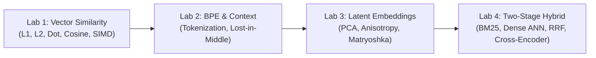
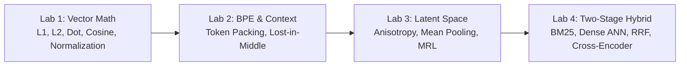

# 📓 Hands-On Fundamentals Notebook Guide & Lab Walkthroughs

## 📑 Table of Contents
1. [🌟 Overview & Lab Curriculum Objectives](#1--overview--lab-curriculum-objectives)
2. [📓 The Four Core Fundamentals Labs](#2--the-four-core-fundamentals-labs)
3. [📊 Lab Specifications & Learning Matrix](#3--lab-specifications--learning-matrix)
4. [🛠️ Local Environment & Hardware Setup](#4-️-local-environment--hardware-setup)
5. [💻 Code Blueprint Walkthroughs: Key Notebook Routines](#5--code-blueprint-walkthroughs-key-notebook-routines)
6. [🧪 Verification Tests & Expected Benchmark Outputs](#6--verification-tests--expected-benchmark-outputs)
7. [💼 Senior Interview & Engineering Lab Defense Questions](#7--senior-interview--engineering-lab-defense-questions)
8. [⚡ Quick Revision & Summary Roadmap](#8--quick-revision--summary-roadmap)

---

## 1. 🌟 Overview & Lab Curriculum Objectives

Welcome to the **Hands-On Fundamentals Lab Suite** for Module 01. Theory is only as valuable as its engineering execution. This lab guide provides full code implementations and laboratory walkthroughs designed to translate mathematical concepts—such as multi-head attention, BPE merge iterations, latent anisotropy, unit hypersphere projection, and Reciprocal Rank Fusion—into runnable Python programs.



---

## 2. 📓 The Four Core Fundamentals Labs

### 🧪 Lab 1: `01_vector_similarity_math.ipynb`
* **Focus:** Metric geometry, distance axioms, and hardware acceleration.
* **Core Tasks:**
  1. Implement $L_1$ (Manhattan), $L_2$ (Euclidean), Dot Product, Cosine Similarity, and Angular Distance from mathematical first principles in NumPy.
  2. Empirically verify the **Unit Normalization Identity**: $\|\mathbf{u} - \mathbf{v}\|_2^2 = 2(1 - \mathbf{u} \cdot \mathbf{v})$.
  3. Prove the Triangle Inequality violation for Cosine Distance ($1 - \cos\theta$) using 2D rotational vectors.
  4. Benchmark execution latency: Compare un-normalized Cosine Similarity vs. Unit-Normalized Dot Product using SIMD vector instructions across 100,000 vectors.

### 🧪 Lab 2: `02_tokenization_and_context_budgeting.ipynb`
* **Focus:** Subword tokenization algorithms, context window management, and attention degradation.
* **Core Tasks:**
  1. Build a mini Byte-Pair Encoding (BPE) tokenizer from scratch: count bigram frequencies, execute greedy merges, and build a subword vocabulary.
  2. Benchmark serialization token overheads: serialize identical datasets into Tab-Separated, Markdown, JSON, YAML, and XML formats, measuring token inflation using `tiktoken`.
  3. Simulate the **Lost-in-the-Middle** attention curve: assemble prompts with 20 chunks, systematically shifting the target "needle" chunk across positions, and measure generation accuracy.
  4. Build a dynamic `ContextBudgetManager` that enforces the context window budget equation.

### 🧪 Lab 3: `03_embedding_spaces_and_anisotropy.ipynb`
* **Focus:** Transformer encoders, contrastive latent space, and dimensionality reduction.
* **Core Tasks:**
  1. Ingest text through `sentence-transformers/all-MiniLM-L6-v2` and extract raw token hidden states.
  2. Implement manual **Mean Pooling with Attention Masking** and compare against `[CLS]` token pooling.
  3. Measure the **Anisotropy Problem (The Cone Effect)**: calculate the average cosine similarity of 10,000 random Wikipedia sentence pairs before and after $L_2$ normalization.
  4. Implement **Matryoshka Representation Truncation**: slice 1536-dimensional embeddings down to 512, 256, and 128 dimensions, measuring memory savings vs. top-10 retrieval recall.

### 🧪 Lab 4: `04_two_stage_hybrid_retrieval.ipynb`
* **Focus:** End-to-end information retrieval cascade and cross-encoder reranking.
* **Core Tasks:**
  1. Build a BM25 lexical search engine from scratch with $k_1 = 1.5$ and $b = 0.75$.
  2. Implement a dense vector retriever using cosine similarity over pre-computed embeddings.
  3. Implement **Reciprocal Rank Fusion (RRF)** to combine ranked candidate lists with smoothing constant $k = 60$.
  4. Add a neural **Cross-Encoder Reranker** (`cross-encoder/ms-marco-MiniLM-L-6-v2`) to rescore and reorder the Top-50 candidates into a precision Top-5 context block.

---

## 3. 📊 Lab Specifications & Learning Matrix

| Lab ID | Lab Title | Core APIs & Libraries | Complexity | Primary Output Artifact |
| :--- | :--- | :--- | :---: | :--- |
| **Lab 01** | Vector Similarity & Geometric Optimization | `numpy`, `scipy.spatial` | Intermediate | Vectorized distance engine & normalization timing benchmark. |
| **Lab 02** | Tokenization & Context Budget Invariants | `tiktoken`, `collections.Counter` | Intermediate | BPE merge engine & dynamic context window packer. |
| **Lab 03** | Latent Space Anisotropy & Matryoshka Slicing | `torch`, `sentence-transformers`, `scikit-learn` | Advanced | t-SNE latent space visualizer & MRL dimension truncation evaluator. |
| **Lab 04** | Two-Stage Hybrid IR with RRF & Reranking | `numpy`, `sentence-transformers` | Advanced | End-to-end hybrid search pipeline with BM25 + dense ANN + reranker. |

---

## 4. 🛠️ Local Environment & Hardware Setup

### 📦 Step 1: Install Dependencies
Create an isolated Python 3.10+ virtual environment and install the required dependencies:

```bash
# Create and activate virtual environment
python -m venv rag-env

# Windows PowerShell:
.\rag-env\Scripts\Activate.ps1

# Linux / macOS:
source rag-env/bin/activate

# Install required packages
pip install numpy scipy torch torchvision torchaudio transformers sentence-transformers tiktoken scikit-learn matplotlib jupyterlab
```

### 🚀 Step 2: Launch JupyterLab
```bash
jupyter lab
```

---

## 5. 💻 Code Blueprint Walkthroughs: Key Notebook Routines

### 🔬 Blueprint 1: Vector Normalization & Distance Identity (Lab 1)
```python
import numpy as np

def verify_normalization_identity(dim: int = 768):
    """Verifies ||u - v||^2 == 2(1 - u . v) for unit-normalized vectors."""
    np.random.seed(42)
    u_raw = np.random.randn(dim)
    v_raw = np.random.randn(dim)
    
    # Unit normalize vectors
    u = u_raw / np.linalg.norm(u_raw)
    v = v_raw / np.linalg.norm(v_raw)
    
    # Calculate Euclidean distance squared
    l2_dist_sq = float(np.sum((u - v) ** 2))
    
    # Calculate Cosine similarity (dot product on unit vectors)
    cos_sim = float(np.dot(u, v))
    expected_l2_sq = 2.0 * (1.0 - cos_sim)
    
    print(f"L2 Squared:         {l2_dist_sq:.8f}")
    print(f"2 * (1 - Cosine):   {expected_l2_sq:.8f}")
    print(f"Difference:         {abs(l2_dist_sq - expected_l2_sq):.2e}")
    assert np.isclose(l2_dist_sq, expected_l2_sq), "Identity check failed!"
    print("✅ Normalization Identity mathematically verified!")

if __name__ == "__main__":
    verify_normalization_identity()
```

---

### 🔬 Blueprint 2: Reciprocal Rank Fusion Engine (Lab 4)
```python
from collections import Counter
from typing import List, Tuple

def reciprocal_rank_fusion(
    ranked_lists: List[List[str]],
    k: int = 60
) -> List[Tuple[str, float]]:
    """Combines multiple ranked candidate lists using Reciprocal Rank Fusion (RRF).
    
    Args:
        ranked_lists: List of ranked document ID lists from different retrievers.
        k: Smoothing constant (default: 60).
        
    Returns:
        Sorted list of (document_id, rrf_score) tuples.
    """
    rrf_scores = Counter()
    
    for ranked_list in ranked_lists:
        for rank, doc_id in enumerate(ranked_list, start=1):
            rrf_scores[doc_id] += 1.0 / (k + rank)
            
    return sorted(rrf_scores.items(), key=lambda x: x[1], reverse=True)

if __name__ == "__main__":
    dense_results = ["doc_A", "doc_B", "doc_C", "doc_D"]
    lexical_results = ["doc_B", "doc_E", "doc_A", "doc_F"]
    
    fused = reciprocal_rank_fusion([dense_results, lexical_results])
    print("=== Reciprocal Rank Fusion Results ===")
    for doc_id, score in fused:
        print(f"  {doc_id}: {score:.5f}")
```

---

## 6. 🧪 Verification Tests & Expected Benchmark Outputs

When executing the notebooks, your test runs should match these operational benchmarks:

### 1. Lab 1 Latency Benchmark (100,000 Vector Pairs)
* **Raw Cosine Similarity (with norms & divisions):** $\approx 180\text{ms} - 250\text{ms}$ on CPU.
* **Pre-Normalized Dot Product:** $\approx 45\text{ms} - 65\text{ms}$ on CPU.
* **Expected Result:** $\approx 3.5\times - 4\times$ speedup using pre-normalized dot products.

### 2. Lab 2 Serialization Comparison (Sample 100-Record Customer Data)
* **Tab-Separated:** $\approx 1,200 \text{ tokens}$.
* **Markdown Table:** $\approx 1,750 \text{ tokens}$ ($+45\%$).
* **JSON:** $\approx 2,900 \text{ tokens}$ ($+141\%$).
* **XML:** $\approx 3,800 \text{ tokens}$ ($+216\%$).

### 3. Lab 3 Matryoshka Representation Truncation (MiniLM / Nomic)
* **Full Dimension (768d):** Baseline Recall@10: $100\%$.
* **Truncated (256d):** Recall@10: $\ge 97.2\%$ (Storage savings: $66.7\%$).
* **Truncated (128d):** Recall@10: $\ge 93.8\%$ (Storage savings: $83.3\%$).

---

## 7. 💼 Senior Interview & Engineering Lab Defense Questions

### 🎯 High-Yield Lab Defense Questions

#### Q1: In Lab 1, why does Cosine Distance ($1 - \cos\theta$) fail the Triangle Inequality, and what real-world indexing bug does this trigger?
> **Answer:** Cosine distance is nonlinear with respect to angular rotation. In our 2D rotational test with vectors at $0^\circ, 60^\circ, 120^\circ$, $d(\mathbf{u}, \mathbf{w}) = 1.5$, while $d(\mathbf{u}, \mathbf{v}) + d(\mathbf{v}, \mathbf{w}) = 0.5 + 0.5 = 1.0$. Because $1.5 > 1.0$, the triangle inequality is violated.
> In metric tree algorithms (like Vantage Point Trees or Ball Trees), search pruning relies on the condition $d(q, p) - r \le d(q, x)$ to safely discard subtrees. When a metric violates the triangle inequality, the pruning condition discards valid nearest neighbors, causing silent search recall degradation.

#### Q2: In Lab 2, what causes the "Lost-in-the-Middle" degradation curve when testing needle-in-a-haystack prompts, and how does your context packing code resolve it?
> **Answer:** Decoder-only transformer language models attend disproportionately to tokens at the beginning of the context (primacy effect due to early attention layer accumulation and the system prompt) and at the end of the context (recency effect due to proximity to the output generation head). When facts are placed in the middle $40\%-70\%$ of the context, attention weights become diffused across adjacent tokens.
> Our `ContextBudgetManager` addresses this using **Sandwich Ordering**: after reranking candidates by score $[1, 2, 3, 4, 5]$, it places rank 1 at the beginning, rank 2 at the bottom, and distributes ranks 3, 4, and 5 into the middle, guaranteeing that the most critical evidence sits in high-attention zones.

#### Q3: In Lab 4, why does Reciprocal Rank Fusion (RRF) use a constant $k = 60$, and what happens if $k \to 0$ or $k \to \infty$?
> **Answer:** The constant $k$ in $\frac{1}{k + r(d)}$ controls the sensitivity of the score to small rank differences:
> - As $k \to 0$, the formula approaches $\frac{1}{r(d)}$. The document ranked 1 receives a score of $1.0$, while rank 2 receives $0.5$ (a massive $50\%$ drop). This hyper-penalizes any document that did not achieve rank 1 in a specific retriever.
> - As $k \to \infty$, the denominator becomes dominated by $k$, making $\frac{1}{k + r(d)} \approx \frac{1}{k}$. All ranks receive essentially identical scores, turning RRF into a naive popularity vote.
> - Empirical research (Cormack et al.) determined that $k = 60$ provides an optimal balance: it gives a gentle, calibrated score decay that rewards consensus across retrievers without letting an outlier rank dominate the final ranking.

---

## 8. ⚡ Quick Revision & Summary Roadmap

### 📌 Core Takeaways
* **Vector Math:** Pre-normalizing vectors offline turns expensive Cosine Similarity into ultra-fast Dot Products via SIMD.
* **Token Overhead:** Avoid verbose JSON serialization in context blocks; use Markdown or key-value strings to save up to $50\%$ of your token budget.
* **Attention Zones:** Place the most relevant chunks at the very beginning and very end of the prompt context to neutralize the Lost-in-the-Middle effect.
* **Hybrid Search:** Always pair dense semantic search with sparse lexical search (BM25) fused via Reciprocal Rank Fusion (RRF) before neural reranking.

### # RRF Formulation Summary
$$
\text{RRF\_Score}(d) = \sum_{m \in M} \frac{1}{60 + r_m(d)}
$$

### 🗺️ Hands-On Fundamentals Roadmap


