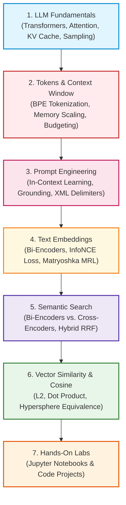

# 🧠 Module 01: RAG Fundamentals Curriculum & Module Guide

Welcome to **Module 01: RAG Fundamentals** of the enterprise RAG Engineering curriculum. This module bridges high-level architectural intuition and deep mathematical and systems implementation. You will explore how transformer attention operates, how subword tokenization defines context budgets, how prompts condition token distributions, how dense embeddings represent latent semantics, and how vector metric geometry powers sub-second information retrieval.

---

## 📑 Module Curriculum & Guide Index

| Document | Focus Area | Key Concepts Covered |
| :--- | :--- | :--- |
| [**LLM Fundamentals**](LLM-Fundamentals.md) | **Inference & Attention Mechanics** | Decoder-only transformers, scaled dot-product attention, GQA, Prefill vs. Decode phases, KV-caching, sampling hyperparameters ($T=0$), and the Lost-in-the-Middle fix. |
| [**Tokens & Context Window**](Tokens-and-Context-Window.md) | **Sequence Limits & Economics** | Subword tokenization (BPE, WordPiece), FlashAttention, quadratic memory bottlenecks, prompt budgeting equations, serialization overhead, and prompt caching. |
| [**Prompt Engineering**](Prompt-Engineering.md) | **Grounded System Design** | In-Context Learning (ICL), XML structural delimiters, indirect prompt injection defense, dynamic few-shot retrieval, strict anti-hallucination constraints, and citation auditing. |
| [**Text Embeddings**](Embeddings.md) | **Latent Space & Encoders** | Bi-Encoder architecture, contrastive InfoNCE loss, in-batch hard negative mining, the anisotropy cone problem, unit hypersphere projection, and Matryoshka (MRL) scaling. |
| [**Semantic Search**](Semantic-Search.md) | **Information Retrieval Funnel** | Vocabulary mismatch, Bi-Encoders vs. Cross-Encoders, Two-Stage Cascade retrieval, BM25 lexical fusion, Reciprocal Rank Fusion (RRF), and ColBERT late interaction (MaxSim). |
| [**Vector Similarity**](Vector-Similarity.md) | **Geometric Distance Metrics** | Metric axioms, Euclidean ($L_2$), Manhattan ($L_1$), Dot Product, Cosine similarity, unit-sphere equivalence proofs, and hardware SIMD acceleration. |
| [**Cosine Similarity Deep Dive**](Cosine-Similarity.md) | **Angular Optimization** | Cauchy-Schwarz inequality, the unit-normalization shortcut, why cosine distance is a semimetric, angular distance ($d_{\text{angular}}$), and dynamic threshold calibration. |
| [**Interactive Notebooks**](Notebook/README.md) | **Hands-On Code Labs** | Jupyter notebooks implementing BPE tokenizers, custom embedding generators, vector distance engines, and hybrid reranking pipelines from scratch. |

---

## 🗺️ Module Learning Roadmap



---

## 🎯 What You Will Master in This Module

1. **Transformer Attention & Inference Dynamics:** Deconstruct the differences between the compute-bound Prefill phase and memory-bound Decode phase, and configure KV caches and sampling hyperparameters ($T=0.0$, Top-$p$) for deterministic factual extraction.
2. **Token Economics & Context Budget Invariants:** Calculate exact subword token counts using BPE, optimize serialization formats (Markdown vs. JSON) to save up to $50\%$ token overhead, and implement dynamic context packing algorithms.
3. **Hardened Grounded Prompt Engineering:** Defend against indirect prompt injection using strict XML tags, implement dynamic few-shot exemplar injection, and build programmatic regex and NLI citation verification layers.
4. **Dense Latent Space & Embedding Encoders:** Understand how contrastive InfoNCE loss shapes semantic spaces, mitigate the anisotropy cone problem via unit normalization, and leverage Matryoshka Representation Learning (MRL) to truncate vectors with minimal accuracy loss.
5. **Two-Stage Information Retrieval:** Architect high-throughput retrieval pipelines combining dense bi-encoders and sparse BM25 keyword matching via Reciprocal Rank Fusion (RRF), followed by neural Cross-Encoder reranking.
6. **Metric Space Equivalence & Hardware Acceleration:** Prove mathematically why Euclidean distance, Cosine similarity, and Dot product are geometrically identical on unit spheres, and configure vector databases for sub-millisecond inner product execution.

---

## 🛠️ Prerequisites & Environment Setup

All code examples in this module are production-ready Python 3.10+ implementations.

### 1. Install Required Python Packages
```bash
pip install numpy scipy torch transformers sentence-transformers tiktoken
```

### 2. Verify Your Environment
Run this verification command in your terminal to ensure hardware vector acceleration and tokenizers are ready:
```bash
python -c "import numpy as np, tiktoken, torch; print('PyTorch CUDA:', torch.cuda.is_available()); enc = tiktoken.get_encoding('cl100k_base'); print('Tokenizer OK, vocab size:', enc.n_vocab)"
```

---

## ⚡ Self-Assessment Checklist

Before advancing to [**Module 02: Document Processing**](../02-Document-Processing/README.md), verify your mastery of these core concepts:
- [ ] Can you derive the mathematical equivalence of Cosine Similarity and Dot Product for unit vectors?
- [ ] Why is standard Cosine Distance ($1 - \cos\theta$) considered a semimetric rather than a true metric?
- [ ] How does Grouped-Query Attention (GQA) reduce KV cache memory consumption compared to Multi-Head Attention (MHA)?
- [ ] Why do alphanumeric product codes and serial numbers fail in pure dense semantic search, and how does hybrid search resolve this?
- [ ] What is the "Lost-in-the-Middle" phenomenon, and how does sandwich ordering in prompt assembly mitigate it?
- [ ] How does Matryoshka Representation Learning (MRL) allow vector databases to reduce RAM usage by up to $70\%$?
- [ ] What are the 4 metric space axioms, and which one fails in Cosine Distance?

---

👉 **Next Step:** Begin with [**LLM Fundamentals for RAG Engineers**](LLM-Fundamentals.md) or explore token economics in [**Tokens and Context Window**](Tokens-and-Context-Window.md).
