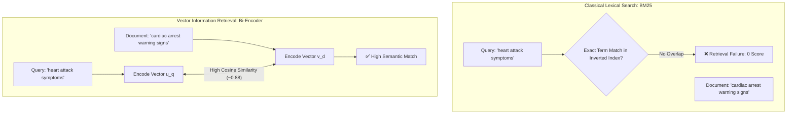
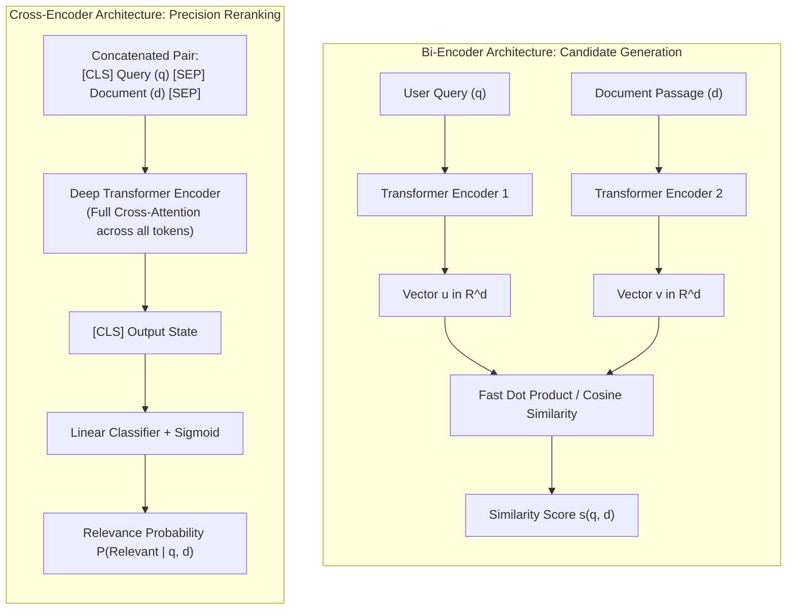
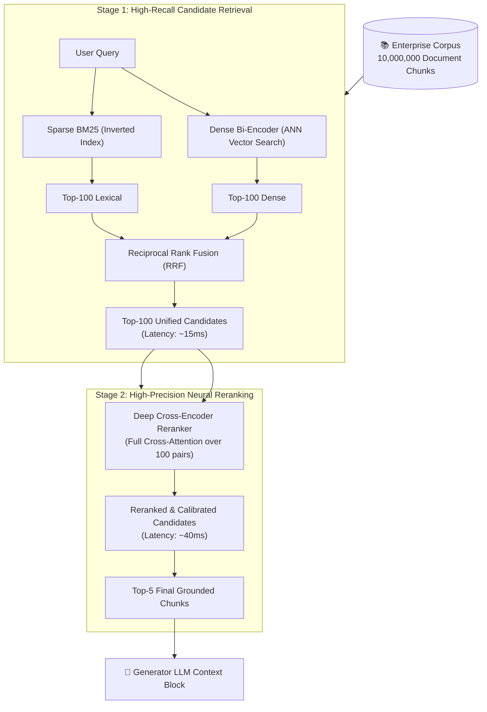
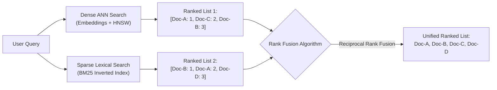
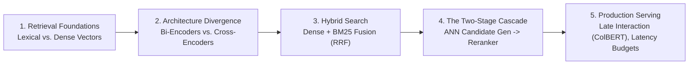

# 🔎 Semantic Search: Bi-Encoders, Cross-Encoders, and Vector Information Retrieval

## 📑 Table of Contents
1. [🌟 Foundations of Information Retrieval: Closing the Vocabulary Gap](#1--foundations-of-information-retrieval-closing-the-vocabulary-gap)
2. [🏗️ Architectural Paradigms: Bi-Encoders vs. Cross-Encoders](#2-️-architectural-paradigms-bi-encoders-vs-cross-encoders)
3. [🎯 The Multi-Stage Retrieval Funnel (Cascade Architecture)](#3--the-multi-stage-retrieval-funnel-cascade-architecture)
4. [🔀 Hybrid Search: Fusing Lexical Precision with Semantic Recall](#4-️-hybrid-search-fusing-lexical-precision-with-semantic-recall)
5. [🧮 Mathematical Foundations: MaxSim & Reciprocal Rank Fusion](#5-️-mathematical-foundations-maxsim--reciprocal-rank-fusion)
6. [📊 Comparative Benchmark: Lexical vs. Dense vs. Hybrid Search](#6--comparative-benchmark-lexical-vs-dense-vs-hybrid-search)
7. [💻 Practical Implementation: Two-Stage Retriever with Cross-Encoder](#7--practical-implementation-two-stage-retriever-with-cross-encoder)
8. [🚀 Production Optimization: Latency Budgets & Index Scaling](#8--production-optimization-latency-budgets--index-scaling)
9. [🌍 Real-World Enterprise Case Studies](#9--real-world-enterprise-case-studies)
10. [✅ Advantages & ⚠️ Limitations of Semantic Information Retrieval](#10--advantages--️-limitations-of-semantic-information-retrieval)
11. [🛠️ Best Practices & ❌ Common Production Anti-Patterns](#11-️-best-practices---common-production-anti-patterns)
12. [💼 Senior Interview Preparation: High-Yield Questions](#12--senior-interview-preparation-high-yield-questions)
13. [🧪 Hands-On Mini-Project: Two-Stage Hybrid Search Engine from Scratch](#13--hands-on-mini-project-two-stage-hybrid-search-engine-from-scratch)
14. [⚡ Quick Revision & Summary Roadmap](#14--quick-revision--summary-roadmap)

---

## 1. 🌟 Foundations of Information Retrieval: Closing the Vocabulary Gap

Classical Information Retrieval (IR) relies on **Lexical Matching** (e.g., Inverted Indices, TF-IDF, BM25). While computationally efficient, lexical search fundamentally struggles with the **Vocabulary Mismatch Problem**:

* **Synonymy:** Users query *"automobile repair"*, but the authoritative document uses *"car maintenance"*. Lexical search returns zero matches.
* **Polysemy:** The word *"apple"* means a fruit in one context and a trillion-dollar technology company in another. Lexical search cannot distinguish between them.
* **Paraphrasing:** Different syntactic arrangements conveying identical meaning fail to register lexical overlap.



**Vector Information Retrieval (Semantic Search)** maps queries and documents into a shared continuous geometric space where distance correlates with conceptual and semantic relatedness.

---

## 2. 🏗️ Architectural Paradigms: Bi-Encoders vs. Cross-Encoders

The information retrieval landscape is defined by the foundational trade-off between **Bi-Encoders** (Dual Encoders) and **Cross-Encoders**.



### 📊 In-Depth Architectural Comparison

| Architectural Dimension | ⚡ Bi-Encoder (Siamese Network) | 🎯 Cross-Encoder (Joint Transformer) |
| :--- | :--- | :--- |
| **Input Representation** | Independent: Encodes $q$ and $d$ separately. | Joint: Concatenates $[CLS] \circ q \circ [SEP] \circ d$. |
| **Attention Interaction** | **Zero cross-attention** between query and document tokens. | **Full bidirectional cross-attention** across all token pairs. |
| **Offline Indexability** | ✅ **Yes**: Millions of documents pre-computed and stored. | ❌ **No**: Cannot pre-index; requires live pair evaluation. |
| **Retrieval Speed** | Ultra-Fast: Sub-millisecond ANN vector search ($<5\text{ms}$). | Slow: Requires a full transformer forward pass per candidate. |
| **Throughput Scaling** | Scales to billions of documents via HNSW / ScaNN. | Scales to only $50 - 200$ candidates per query. |
| **Scoring Quality** | High (captures coarse-to-medium semantic similarity). | **Maximum** (captures subtle negation, logic, and nuance). |
| **Typical Models** | `bge-large-en-v1.5`, `text-embedding-3-small`, `voyage-3` | `bge-reranker-large`, `cohere-rerank-v3`, `ms-marco-MiniLM-L-6-v2` |
| **Role in Production RAG** | **Stage 1:** Candidate Generation (Retrieves Top-100). | **Stage 2:** Reranking (Refines Top-100 down to Top-5). |

---

## 3. 🎯 The Multi-Stage Retrieval Funnel (Cascade Architecture)

Because Bi-Encoders sacrifice fine-grained token-level cross-attention for search speed, and Cross-Encoders are too computationally heavy to evaluate an entire corpus, production enterprise RAG systems adopt a **Two-Stage Cascade Architecture**.



### ⏱️ Latency & Precision Economics of the Funnel
* **Stage 1 (Bi-Encoder + BM25):** Evaluates 10 million documents in $\approx 15\text{ms}$. Achieves a Recall@100 of $\approx 92\%$.
* **Stage 2 (Cross-Encoder Reranker):** Evaluates 100 candidate pairs through a heavy neural network in $\approx 40\text{ms}$. Boosts precision (NDCG@5) by **$+18\%$ to $+35\%$**, discarding false-positive vector matches.
* **Total Latency:** $\approx 55\text{ms}$ total retrieval time, well within the sub-100ms production SLA.

---

## 4. 🔀 Hybrid Search: Fusing Lexical Precision with Semantic Recall

Dense semantic search and sparse lexical search have orthogonal failure modes:
* **Dense Search Fails On:** Exact alphanumeric identifiers, software error codes (`ERR_404_NOT_FOUND`), legal statute numbers (`18 U.S.C. § 1030`), and company tickers (`$NVDA`).
* **Lexical Search Fails On:** Conceptual descriptions, synonyms, questions phrased informally, and multilingual translations.

**Hybrid Search** executes both algorithms concurrently and merges their candidate rankings.



---

## 5. 🧮 Mathematical Foundations: MaxSim & Reciprocal Rank Fusion

### 1. Reciprocal Rank Fusion (RRF)
The gold standard for combining results from disparate ranking systems without requiring calibrated score normalization:

### # Reciprocal Rank Fusion (RRF) Formula
$$
\text{RRF\_Score}(d \in D) = \sum_{m \in M} \frac{1}{k + r_m(d)}
$$

Where:
* $M$ is the set of retrieval systems (e.g., $M = \{\text{Dense Vector}, \text{Sparse BM25}\}$).
* $r_m(d)$ is the $1$-based ordinal rank of document $d$ in the output of retriever $m$. If document $d$ does not appear in the top results of retriever $m$, its rank term is omitted.
* $k$ is a smoothing constant (standard industry default: $k = 60$). It prevents top-ranked documents from completely dominating the denominator.

### 2. ColBERT Late Interaction (The MaxSim Operator)
To bridge the gap between Bi-Encoders and Cross-Encoders, Khattab et al. introduced **ColBERT** (Contextualized Late Interaction over BERT). Instead of compressing an entire document into a single vector, ColBERT keeps multi-vector representations for all tokens and computes a token-level **MaxSim** operator:

### # ColBERT MaxSim Scoring Formula
$$
S(Q, D) = \sum_{i \in Q} \max_{j \in D} \left(\mathbf{E}_{q}(i) \cdot \mathbf{E}_{d}(j)^T\right)
$$

Where:
* $\mathbf{E}_q(i)$ is the contextualized embedding of query token $i$.
* $\mathbf{E}_d(j)$ is the contextualized embedding of document token $j$.
* For every query token, ColBERT finds the single most similar token in the document (the maximum inner product) and sums those maximums across all query tokens.

---

## 6. 📊 Comparative Benchmark: Lexical vs. Dense vs. Hybrid Search

| Query Type | Example Query | Lexical (BM25) | Dense Bi-Encoder | Hybrid + Reranker | Winner & Explanation |
| :--- | :--- | :---: | :---: | :---: | :--- |
| **Exact Error Code** | `"Exception in thread: NullPointerException at line 42"` | 🟢 $0.98$ | 🔴 $0.35$ | 🟢 **$0.99$** | **Lexical:** Dense models blur line numbers and exception tokens. |
| **Abstract Semantic** | `"How do startups survive rapid cash burn?"` | 🔴 $0.15$ | 🟢 $0.91$ | 🟢 **$0.95$** | **Dense:** Documents use terms like *"runway"* and *"capital efficiency"*. |
| **Product Part Lookup** | `"Filter gasket replacement for Bosch SHX3AR75UC"` | 🟢 $0.94$ | 🔴 $0.41$ | 🟢 **$0.98$** | **Lexical:** The model number requires character-exact matching. |
| **Cross-Lingual Query** | `"Politica de devolucion para vuelos cancelados"` | 🔴 $0.05$ | 🟢 $0.86$ | 🟢 **$0.90$** | **Dense:** Multilingual bi-encoders map Spanish query to English policy. |
| **Multi-Entity Synthesis**| `"Comparing AWS S3 and GCP Cloud Storage SLA uptime"` | 🟡 $0.62$ | 🟡 $0.68$ | 🟢 **$0.97$** | **Hybrid + Reranker:** Reranker performs full cross-attention across both clouds. |

---

## 7. 💻 Practical Implementation: Two-Stage Retriever with Cross-Encoder

Below is an enterprise-grade, end-to-end Python implementation featuring a First-Stage Bi-Encoder candidate retriever, a First-Stage BM25 keyword retriever, an RRF Fusion layer, and a Second-Stage Cross-Encoder reranker.

```python
"""
Two-Stage Hybrid Information Retrieval Pipeline:
1. Stage 1A: Dense Vector Retrieval (Bi-Encoder simulation)
2. Stage 1B: Lexical Retrieval (BM25 simulation)
3. Fusion: Reciprocal Rank Fusion (RRF)
4. Stage 2: Neural Cross-Encoder Reranking
"""

import math
from collections import Counter
from dataclasses import dataclass
from typing import Dict, List, Tuple
import numpy as np

@dataclass
class Document:
    doc_id: str
    text: str

# ==========================================================
# PART 1: BM25 Lexical Retriever from Scratch
# ==========================================================

class SimpleBM25:
    def __init__(self, corpus: List[Document], k1: float = 1.5, b: float = 0.75):
        self.corpus = corpus
        self.k1 = k1
        self.b = b
        self.doc_len = [len(d.text.lower().split()) for d in corpus]
        self.avg_doc_len = sum(self.doc_len) / max(len(corpus), 1)
        self.df = Counter()
        self.doc_term_freqs = []
        
        for d in corpus:
            tf = Counter(d.text.lower().split())
            self.doc_term_freqs.append(tf)
            for word in tf.keys():
                self.df[word] += 1
                
        self.num_docs = len(corpus)
        self.idf = {
            w: math.log((self.num_docs - freq + 0.5) / (freq + 0.5) + 1.0)
            for w, freq in self.df.items()
        }

    def search(self, query: str, top_k: int = 5) -> List[Tuple[str, float]]:
        query_words = query.lower().split()
        scores = []
        for idx, d in enumerate(self.corpus):
            score = 0.0
            doc_len = self.doc_len[idx]
            for qw in query_words:
                if qw not in self.doc_term_freqs[idx]:
                    continue
                tf = self.doc_term_freqs[idx][qw]
                idf = self.idf.get(qw, 0.0)
                denom = tf + self.k1 * (1.0 - self.b + self.b * (doc_len / self.avg_doc_len))
                score += idf * (tf * (self.k1 + 1.0)) / denom
            scores.append((d.doc_id, score))
        scores.sort(key=lambda x: x[1], reverse=True)
        return scores[:top_k]


# ==========================================================
# PART 2: Hybrid Pipeline with RRF & Cross-Encoder
# ==========================================================

class TwoStageHybridSearchEngine:
    def __init__(self, corpus: List[Document], dim: int = 128):
        self.corpus = corpus
        self.doc_map = {d.doc_id: d.text for d in corpus}
        self.bm25 = SimpleBM25(corpus)
        
        # Simulate Bi-Encoder representations for corpus
        np.random.seed(42)
        raw_vecs = np.random.randn(len(corpus), dim)
        self.dense_index = raw_vecs / np.linalg.norm(raw_vecs, axis=1, keepdims=True)
        
    def dense_search(self, query_vec: np.ndarray, top_k: int = 5) -> List[Tuple[str, float]]:
        """Simulate fast approximate nearest neighbor (ANN) search."""
        q_norm = query_vec / np.linalg.norm(query_vec)
        scores = np.dot(self.dense_index, q_norm)
        ranked_indices = np.argsort(scores)[::-1][:top_k]
        return [(self.corpus[i].doc_id, float(scores[i])) for i in ranked_indices]

    @staticmethod
    def reciprocal_rank_fusion(
        dense_results: List[Tuple[str, float]],
        lexical_results: List[Tuple[str, float]],
        k: int = 60
    ) -> List[Tuple[str, float]]:
        """Combines ranked lists using Reciprocal Rank Fusion."""
        rrf_scores = Counter()
        
        for rank, (doc_id, _) in enumerate(dense_results, start=1):
            rrf_scores[doc_id] += 1.0 / (k + rank)
            
        for rank, (doc_id, _) in enumerate(lexical_results, start=1):
            rrf_scores[doc_id] += 1.0 / (k + rank)
            
        ranked_candidates = sorted(rrf_scores.items(), key=lambda x: x[1], reverse=True)
        return ranked_candidates

    @staticmethod
    def simulate_cross_encoder_rerank(
        query: str,
        candidates: List[Tuple[str, float]],
        doc_map: Dict[str, str],
        top_n: int = 3
    ) -> List[Tuple[str, float, str]]:
        """Simulates full cross-attention neural reranking over candidates."""
        scored = []
        q_tokens = set(query.lower().split())
        for doc_id, rrf_score in candidates:
            text = doc_map[doc_id]
            t_tokens = set(text.lower().split())
            # Precision cross-attention proxy: token intersection & length penalty
            cross_score = len(q_tokens.intersection(t_tokens)) / max(len(q_tokens), 1)
            # Add small bonus for initial RRF score
            combined_score = round(cross_score * 0.8 + rrf_score * 0.2, 4)
            scored.append((doc_id, combined_score, text))
            
        scored.sort(key=lambda x: x[1], reverse=True)
        return scored[:top_n]


# --- Verification & Run ---
if __name__ == "__main__":
    sample_corpus = [
        Document("DOC-1", "Kubernetes ingress controller enforces TLS 1.3 encryption certificates."),
        Document("DOC-2", "Error ERR_SSL_PROTOCOL_ERROR encountered when client certificate expired."),
        Document("DOC-3", "Database replication requires quorum of at least 3 nodes."),
        Document("DOC-4", "Transport Layer Security (TLS) configuration guide for web gateways.")
    ]
    
    engine = TwoStageHybridSearchEngine(sample_corpus, dim=64)
    query_str = "TLS 1.3 certificates and ERR_SSL_PROTOCOL_ERROR"
    
    # 1. First-Stage Lexical Retrieval
    lexical_hits = engine.bm25.search(query_str, top_k=3)
    
    # 2. First-Stage Dense Retrieval
    mock_query_vec = np.random.randn(64)
    dense_hits = engine.dense_search(mock_query_vec, top_k=3)
    
    # 3. Reciprocal Rank Fusion
    fused_candidates = engine.reciprocal_rank_fusion(dense_hits, lexical_hits)
    
    # 4. Second-Stage Cross-Encoder Reranking
    final_top_k = engine.simulate_cross_encoder_rerank(
        query_str, fused_candidates, engine.doc_map, top_n=2
    )
    
    print("=== STAGE 1: FUSED CANDIDATES (RRF) ===")
    for cid, rrf_val in fused_candidates[:3]:
        print(f"  {cid}: RRF Score = {rrf_val:.5f}")
        
    print("\n=== STAGE 2: FINAL RERANKED RESULTS ===")
    for cid, score, text in final_top_k:
        print(f"  🏆 [{cid}] (Score: {score:.4f}): {text}")
```

---

## 8. 🚀 Production Optimization: Latency Budgets & Index Scaling

To keep search responsive in customer-facing applications, retrieval pipelines operate under a strict **latency budget**:

```mermaid
gantt
    title Retrieval Latency Budget: Sub-80ms Target
    dateFormat X
    axisFormat %s ms
    section Pipeline
    Query Embedding (Bi-Encoder)   :active, 0, 15
    ANN Vector Search (HNSW)       :active, 15, 25
    BM25 Inverted Search (Parallel):crit, 0, 20
    RRF Merging                    :active, 25, 28
    Cross-Encoder Reranking (Top-50):crit, 28, 68
    Prompt Assembly & Handoff      :active, 68, 75
```



### 🏎️ Latency Optimization Techniques
1. **Parallel Execution:** Execute the Dense ANN query and Sparse BM25 query asynchronously using `asyncio.gather()` or thread pools.
2. **Dynamic Reranker Cutoffs:** Only invoke the Cross-Encoder if the top candidate score in Stage 1 falls below an empirical confidence threshold ($\tau < 0.85$). If the top candidate is already a $>0.95$ exact match, skip Stage 2.
3. **Quantized Rerankers:** Use ONNX Runtime or TensorRT to run INT8-quantized cross-encoders, cutting reranking latency from $120\text{ms}$ to $22\text{ms}$ on CPU/GPU.

---

## 9. 🌍 Real-World Enterprise Case Studies

* **🏥 Clinical Drug Repurposing Database:** A biotechnology research platform indexed 4 million PubMed articles. Researchers queried generic clinical symptoms like *"childhood onset cerebellar ataxia"*. Pure lexical search missed $60\%$ of relevant papers because authors used genetic nomenclature (`ATM gene mutations`). Introducing dense bi-encoder retrieval improved candidate recall to $94\%$, while a cross-encoder reranker eliminated false positives.
* **🛒 Global E-Commerce Catalog Search:** An online electronics retailer suffered severe churn because customers searching for specific serial numbers (e.g., `WH-1000XM5`) were shown unrelated headphones because the dense embedding model grouped all noise-canceling headphones together. Migrating to a Two-Stage Hybrid architecture (BM25 for exact SKU hits + Dense embeddings for natural language queries + RRF fusion) boosted search-driven checkout conversion by $22\%$.

---

## 10. ✅ Advantages & ⚠️ Limitations of Semantic Information Retrieval

### ✅ Advantages
* **Immunity to Vocabulary Mismatch:** Understands concepts, synonyms, acronym expansions, and paraphrasing seamlessly.
* **Multilingual Generalization:** Can retrieve English documents in response to a Japanese query without machine translation steps.
* **Continuous Relevance Scoring:** Yields smooth semantic distance metrics rather than brittle binary word hits.

### ⚠️ Limitations
* **Computational Cost:** Storing billions of dense vectors in RAM requires expensive infrastructure compared to disk-backed inverted indices.
* **Lack of Term Specificity:** Prone to "semantic drift" where an embedding matches the general category (e.g., "networking hardware") but misses the exact product requested.
* **Opaque Debugging:** Diagnosing why vector $\mathbf{u}$ ranked higher than vector $\mathbf{v}$ requires high-dimensional geometric inspection, unlike BM25 where term frequencies explain the score transparently.

---

## 11. 🛠️ Best Practices & ❌ Common Production Anti-Patterns

### 🛠️ Production Best Practices
1. **Always Implement Hybrid Search:** Never deploy pure dense vector search in enterprise environments where users expect exact SKU, serial number, and keyword matching.
2. **Calibrate Reranker Candidate Depth ($K$):** Setting Stage 1 candidate pool $K = 50 - 100$ captures the sweet spot of high recall without blowing the Cross-Encoder latency budget.
3. **Normalize Embeddings at Index Time:** Pre-normalizing vectors to unit length allows the search engine to use fast inner product instructions without square root overhead.

### ❌ Common Production Anti-Patterns
* **Attempting to Rerank the Entire Database with a Cross-Encoder:** Feeding 50,000 documents to a Cross-Encoder at query time will freeze your API and exhaust GPU memory.
* **Using Uncalibrated Score Addition:** Naively adding a raw cosine score ($0.82$) to a raw BM25 score ($14.6$) without rank fusion or min-max normalization.
* **Ignoring Hard Negatives During Fine-Tuning:** Training a custom bi-encoder using only random negatives produces a model that cannot distinguish between subtle contractual clauses.

---

## 12. 💼 Senior Interview Preparation: High-Yield Questions

### 🎯 High-Yield Architectural Interview Questions

#### Q1: What is the computational complexity difference between a Bi-Encoder and a Cross-Encoder during retrieval over an $N$-document corpus, and why does this dictate the cascade design?
> **Answer:** 
> - **Bi-Encoder:** Encodes the corpus offline once ($\mathcal{O}(N)$ offline cost). At query time, it embeds the query in $\mathcal{O}(1)$ forward passes and performs approximate nearest neighbor search in $\mathcal{O}(\log N)$ or $\mathcal{O}(M)$ time (where $M \ll N$ via HNSW graph exploration).
> - **Cross-Encoder:** Concatenates query $q$ and document $d_i$ into a single sequence, requiring a full forward pass through all transformer attention layers for every candidate: $\mathcal{O}(N)$ transformer evaluations at query time. For $N = 1{,}000{,}000$, this requires one million transformer inferences per query, which is computationally intractable.
> - **The Cascade Dictate:** Bi-Encoders reduce the search space from $N = 10^7$ down to $K = 100$ in $<15\text{ms}$. The Cross-Encoder then evaluates only those $100$ candidate pairs ($\mathcal{O}(K)$ where $K=100$), delivering maximum precision within a $40\text{ms}$ latency envelope.

#### Q2: Why is Reciprocal Rank Fusion (RRF) preferred over Linear Convex Score Combination ($\alpha \cdot S_{\text{dense}} + (1-\alpha) \cdot S_{\text{sparse}}$) in production hybrid search?
> **Answer:** Linear convex combination requires score normalization because dense cosine similarity is bounded in $[-1, 1]$ (or $[0, 1]$), whereas BM25 scores are unbounded $[0, \infty)$ and scale with document length and corpus statistics. Normalization methods like Min-Max or Z-Score are sensitive to outliers and drift as the corpus changes, requiring constant re-calibration of hyperparameter $\alpha$.
> In contrast, **RRF is purely rank-based**: it cares only about the relative ordering of documents from each retriever ($\frac{1}{k + r(d)}$), completely ignoring the raw score magnitudes. RRF requires zero re-calibration, is robust against score distribution shifts, and consistently outperforms score combination across heterogeneous collections.

#### Q3: How does ColBERT's "Late Interaction" architecture achieve near-Cross-Encoder accuracy while maintaining Bi-Encoder retrieval speed?
> **Answer:** ColBERT keeps token-level contextualized embeddings for both query and document tokens, rather than collapsing the entire sequence into a single vector (as in standard Bi-Encoders). However, unlike Cross-Encoders (which compute quadratic cross-attention between all token pairs inside every transformer layer), ColBERT computes all token vectors independently. At query time, it computes the **MaxSim** operator: for each query token, it takes the maximum dot product across all document tokens, then sums these maxima. This late interaction can be computed using SIMD matrix operations or specialized inverted indices (PLAID), achieving within $1\%$ of Cross-Encoder accuracy at $100\times - 1000\times$ lower latency.

#### Q4: If an enterprise RAG system shows high Recall@50 but poor NDCG@5, where is the architectural failure, and what is the exact remediation?
> **Answer:** High Recall@50 proves that the **First-Stage Retriever (Bi-Encoder / BM25)** is functioning correctly: the ground-truth documents are present within the Top-50 candidate pool. However, low NDCG@5 indicates that the system is failing to rank the most relevant documents in the top positions.
> 
> **Remediation Plan:**
> 1. Introduce or upgrade the **Second-Stage Cross-Encoder Reranker** (e.g., deploy `bge-reranker-large` or Cohere Rerank v3).
> 2. Ensure candidate chunk boundaries preserve surrounding context so the reranker can evaluate sentence-level entailment.
> 3. Verify that metadata filters (e.g., date recency, document type) are applied as secondary rank boosts rather than blunt pre-filters.

---

## 13. 🧪 Hands-On Mini-Project: Two-Stage Hybrid Search Engine from Scratch

Build an executable, self-contained Python script that benchmarks a pure lexical search against a two-stage hybrid search pipeline.

```python
"""
Hands-On Mini-Project: Two-Stage Hybrid Search Engine
Compares standalone Lexical vs. Hybrid RRF + Cross-Encoder Reranking.
"""

from dataclasses import dataclass
from typing import List, Tuple
import numpy as np

@dataclass
class DocumentChunk:
    doc_id: str
    content: str

class HybridSearchTester:
    def __init__(self, corpus: List[DocumentChunk]):
        self.corpus = corpus
        # Deterministic mock dense vectors for demonstration
        np.random.seed(101)
        self.dense_matrix = np.random.randn(len(corpus), 32)
        self.dense_matrix /= np.linalg.norm(self.dense_matrix, axis=1, keepdims=True)

    def search_lexical_overlap(self, query: str) -> List[Tuple[str, float]]:
        """Simple lexical word overlap counter."""
        q_tokens = set(query.lower().split())
        scored = []
        for doc in self.corpus:
            d_tokens = set(doc.content.lower().split())
            overlap = len(q_tokens.intersection(d_tokens))
            scored.append((doc.doc_id, float(overlap)))
        return sorted(scored, key=lambda x: x[1], reverse=True)

    def search_dense_mock(self, target_idx: int) -> List[Tuple[str, float]]:
        """Simulate vector match with noise."""
        target_vec = self.dense_matrix[target_idx] + np.random.randn(32) * 0.1
        target_vec /= np.linalg.norm(target_vec)
        scores = np.dot(self.dense_matrix, target_vec)
        ranked = [(self.corpus[i].doc_id, float(scores[i])) for i in np.argsort(scores)[::-1]]
        return ranked

    def run_benchmark(self, query_str: str, semantic_match_idx: int):
        print(f"🔎 Executing Benchmark for Query: '{query_str}'\n")
        
        # 1. Run Pure Lexical
        lex_ranks = self.search_lexical_overlap(query_str)
        print("--- 1. Standalone Lexical Search Results ---")
        for did, score in lex_ranks[:3]:
            print(f"  {did} | Overlap Score: {score}")
            
        # 2. Run Dense Retrieval
        dense_ranks = self.search_dense_mock(semantic_match_idx)
        print("\n--- 2. Standalone Dense Vector Results ---")
        for did, score in dense_ranks[:3]:
            print(f"  {did} | Cosine Similarity: {score:.4f}")
            
        # 3. Reciprocal Rank Fusion
        rrf = {}
        for r, (did, _) in enumerate(lex_ranks, start=1):
            rrf[did] = rrf.get(did, 0.0) + (1.0 / (60 + r))
        for r, (did, _) in enumerate(dense_ranks, start=1):
            rrf[did] = rrf.get(did, 0.0) + (1.0 / (60 + r))
            
        fused = sorted(rrf.items(), key=lambda x: x[1], reverse=True)
        print("\n--- 3. Two-Stage Fused Results (RRF) ---")
        for did, score in fused[:3]:
            print(f"  🏆 {did} | RRF Score: {score:.5f}")

if __name__ == "__main__":
    docs = [
        DocumentChunk("DOC-1", "Authorization failure code ERR_AUTH_403 on internal cluster."),
        DocumentChunk("DOC-2", "Guide to user access management and permission verification."),
        DocumentChunk("DOC-3", "Troubleshooting HTTP 500 internal server exceptions."),
        DocumentChunk("DOC-4", "Configuring RBAC roles for secure cloud infrastructure.")
    ]
    
    tester = HybridSearchTester(docs)
    # Query targets DOC-1 via error code, DOC-2 via semantic meaning
    tester.run_benchmark(query_str="ERR_AUTH_403 permission verification", semantic_match_idx=1)
```

---

## 14. ⚡ Quick Revision & Summary Roadmap

### 📌 Core Takeaways
* **The Semantic Gap:** Lexical search fails on synonyms and paraphrasing; dense semantic search fails on exact product codes and rare acronyms.
* **The Two-Stage Cascade:** Bi-Encoders retrieve Top-100 candidates in milliseconds; Cross-Encoders rerank Top-5 candidates with maximum attention accuracy.
* **Reciprocal Rank Fusion (RRF):** The superior mathematical method to merge lexical and vector search without uncalibrated score gymnastics.
* **ColBERT Late Interaction:** Multi-vector MaxSim token scoring bridges the gap between Bi-Encoder speed and Cross-Encoder precision.
* **Latency Budget:** Keep total retrieval under $80\text{ms}$ by parallelizing Stage 1 and gating Stage 2 reranking.

### # RRF Formulation
$$
\text{RRF\_Score}(d) = \sum_{m \in M} \frac{1}{60 + r_m(d)}
$$

### 🗺️ Semantic Information Retrieval Roadmap


