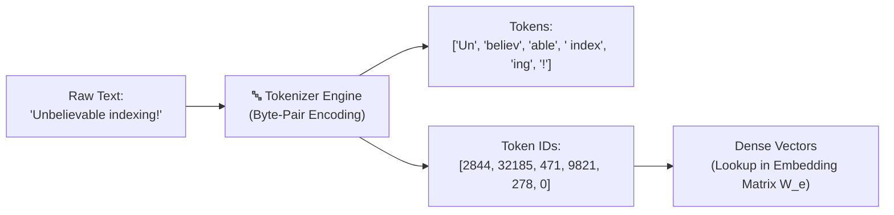
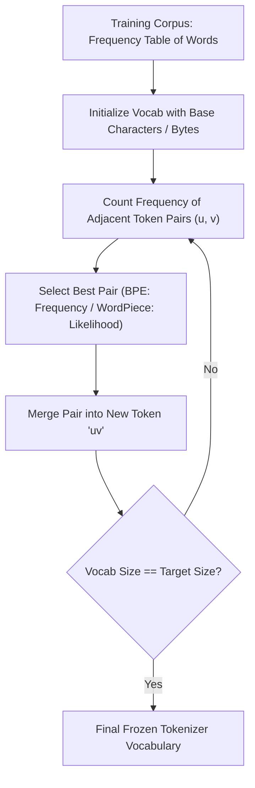
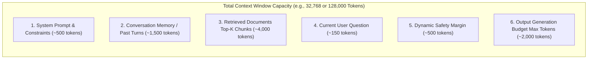
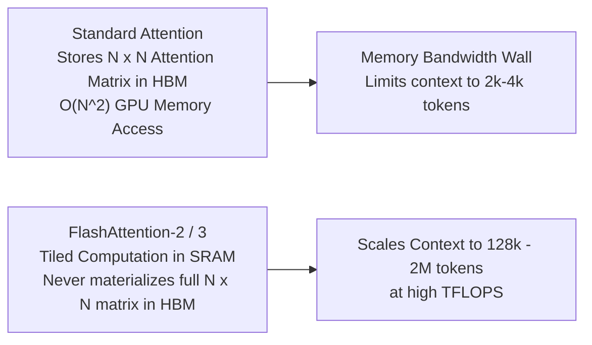
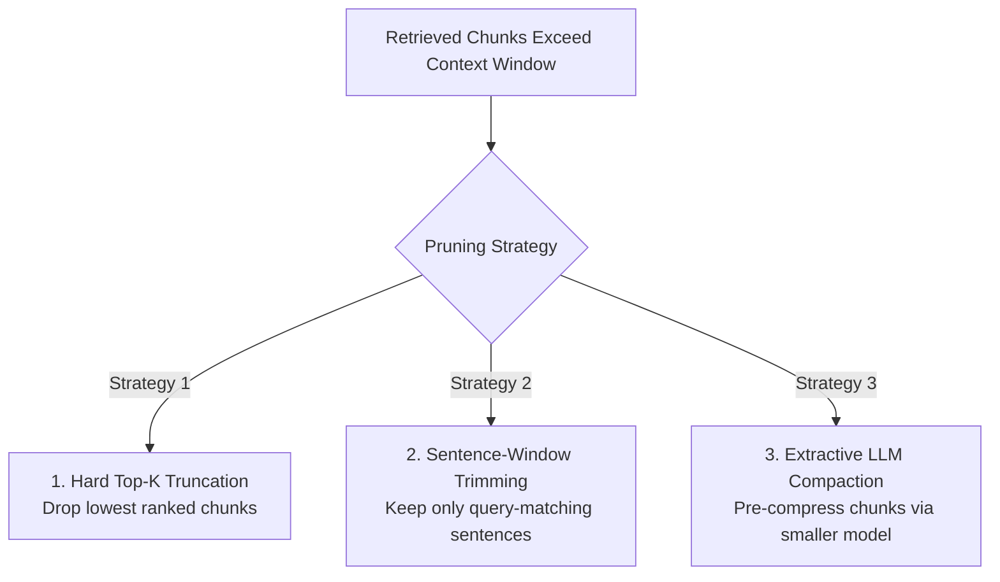
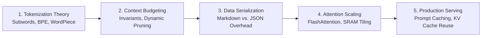

# 🔢 Tokens, Tokenization Algorithms, and Context Window Mechanics

## 📑 Table of Contents
1. [🌟 Fundamentals: What is a Token?](#1--fundamentals-what-is-a-token)
2. [⚙️ Tokenization Algorithms: BPE, WordPiece & Unigram](#2-️-tokenization-algorithms-bpe-wordpiece--unigram)
3. [🪟 Context Window Architecture & Budget Allocation](#3--context-window-architecture--budget-allocation)
4. [⚡ Computational Scaling: $O(N^2)$ Bottlenecks & FlashAttention](#4--computational-scaling-on2-bottlenecks--flashattention)
5. [💸 Token Economics, Serialization Overhead & Prompt Caching](#5--token-economics-serialization-overhead--prompt-caching)
6. [💻 Practical Implementation: BPE From Scratch & Token Budgeting](#6--practical-implementation-bpe-from-scratch--token-budgeting)
7. [🚀 Context Pruning & Dynamic Chunk Slicing Patterns](#7--context-pruning--dynamic-chunk-slicing-patterns)
8. [🌍 Real-World Case Studies](#8--real-world-case-studies)
9. [⚖️ Massive Context Windows vs. Modular RAG: Architectural Trade-Offs](#9-️-massive-context-windows-vs-modular-rag-architectural-trade-offs)
10. [🛠️ Best Practices & ❌ Common Pitfalls](#10-️-best-practices---common-pitfalls)
11. [💼 Senior Interview Preparation: High-Yield Questions](#11--senior-interview-preparation-high-yield-questions)
12. [🧪 Hands-On Mini-Project: Production Token Budget Manager](#12--hands-on-mini-project-production-token-budget-manager)
13. [⚡ Quick Revision & Summary Roadmap](#13--quick-revision--summary-roadmap)

---

## 1. 🌟 Fundamentals: What is a Token?

Large Language Models do not read text character-by-character or word-by-word. Instead, they operate on **tokens**—discrete sub-word fragments mapped to integer identifiers in a fixed vocabulary $\mathcal{V}$.



### ❓ Why Not Character-Level or Word-Level Processing?

| Approach | Vocabulary Size $|\mathcal{V}|$ | Sequence Length | Out-of-Vocabulary (OOV) Risk | Semantic Density |
| :--- | :---: | :---: | :---: | :---: |
| **Character-Level** | Tiny ($\sim 256$ bytes) | Extremely Long ($4\times - 8\times$ longer) | Zero (any byte represented) | Very low (letters carry no standalone meaning) |
| **Word-Level** | Massive ($>1{,}000{,}000$) | Compact | Extreme (misspellings, slang, URLs fail) | High, but memory footprint explodes |
| **Subword-Level (BPE/WordPiece)** | Optimal ($32\text{K} - 200\text{K}$) | Balanced | Zero (falls back to single bytes/subwords) | High (frequent words intact, rare words split) |

### 📏 General Heuristics for RAG Engineers
* **English Prose:** $1 \text{ token} \approx 0.75 \text{ words}$ (or $100 \text{ tokens} \approx 75 \text{ words}$).
* **Character Ratio:** $1 \text{ token} \approx 4 \text{ characters}$ of standard English text.
* **Code / JSON / YAML:** $1 \text{ token} \approx 2 - 3 \text{ characters}$ due to whitespace, punctuation, brackets, and indentation.
* **Non-Latin Scripts (Hindi, Arabic, Japanese):** Can require $2\times - 5\times$ more tokens per word if the tokenizer vocabulary was predominantly trained on English corpora (the "token tax").

---

## 2. ⚙️ Tokenization Algorithms: BPE, WordPiece & Unigram

Every modern foundation model relies on one of three core statistical subword tokenization algorithms.



### 1. Byte-Pair Encoding (BPE)
BPE iteratively merges the most frequently co-occurring pair of symbols in the corpus until the vocabulary reaches a predetermined size $|\mathcal{V}|$.

### # BPE Merge Frequency Objective
$$
\text{pair}^* = \arg\max_{(u, v) \in \mathcal{V} \times \mathcal{V}} \text{Freq}(u, v)
$$

* **Byte-Level BPE (BBPE):** Instead of starting from Unicode characters (which creates thousands of base characters), BBPE starts from the 256 possible byte values ($0\text{x}00$ to $0\text{xFF}$). Used by **GPT-2, GPT-4 (`cl100k_base`, `o200k_base`), and Llama 3**.

### 2. WordPiece
Used by **BERT** and **DistilBERT**. Instead of picking the pair with the raw highest frequency, WordPiece selects the pair that maximizes the likelihood of the training data according to a unigram language model.

### # WordPiece Likelihood Maximization Score
$$
\text{Score}(u, v) = \frac{\text{Count}(uv)}{\text{Count}(u) \times \text{Count}(v)}
$$
* Intuitively, WordPiece normalizes by the individual occurrences of $u$ and $v$, penalizing components that are already extremely common on their own unless they form an exceptionally strong collocation.

### 3. Unigram Language Model
Used by **SentencePiece** (T5, ALBERT). Unlike BPE (which starts with base characters and grows upward), Unigram starts with a massive vocabulary and iteratively removes tokens that minimize the increase in overall corpus loss until the target vocabulary size is reached.

### 📊 Tokenizer Ecosystem Comparison

| Tokenizer Family | Vocabulary Size | Base Units | Used By Models | Key Feature for RAG |
| :--- | :---: | :--- | :--- | :--- |
| **OpenAI `o200k_base`** | $200{,}000$ | Bytes | GPT-4o, GPT-4o-mini | $20\%$ more efficient for non-English and code. |
| **OpenAI `cl100k_base`** | $100{,}000$ | Bytes | GPT-4, GPT-3.5, `text-embedding-3-*` | Industry standard baseline for OpenAI RAG pipelines. |
| **Llama-3 Tokenizer** | $128{,}256$ | Bytes | Llama 3, 3.1, 3.2, 3.3 | Greatly reduced token inflation on multilingual data. |
| **Mistral / Llama-2** | $32{,}000$ | Bytes | Llama 2, Mistral 7B | Smaller vocabulary; higher token-per-word count. |
| **HuggingFace BERT** | $30{,}522$ | Unicode Chars | BERT, MiniLM, Cross-Encoders | Fast, but sensitive to out-of-vocabulary technical jargon. |

---

## 3. 🪟 Context Window Architecture & Budget Allocation

An LLM's **Context Window** ($C_{\text{Total}}$) is the strict upper bound on the total sequence length (input prompt + generated completion) that the model can process in a single forward pass.



### # Context Budget Allocation Formula
To prevent runtime `ContextWindowExceededError` or silent text truncation, a production RAG application must enforce this mathematical invariant:

$$
C_{\text{Total}} \ge T_{\text{System}} + T_{\text{Query}} + \sum_{i=1}^K T_{\text{Chunk}_i} + T_{\text{History}} + T_{\text{Safety}} + T_{\text{MaxOutput}}
$$

Where:
* $C_{\text{Total}}$: Hard limit of the foundation model (e.g., 128,000 for GPT-4o, 8,192 for Llama 3 8B).
* $T_{\text{System}}$: System instruction template, security guidelines, and formatting directives.
* $T_{\text{Query}}$: User prompt, including any rewritten or expanded query text.
* $\sum_{i=1}^K T_{\text{Chunk}_i}$: Sum of all $K$ retrieved document chunks injected into the prompt.
* $T_{\text{History}}$: Multi-turn chat history (often trimmed with a rolling buffer or summary).
* $T_{\text{Safety}}$: Safety margin (typically $50 - 200$ tokens) to account for special separator tokens.
* $T_{\text{MaxOutput}}$: Tokens reserved for the model's completion (`max_tokens` parameter).

---

## 4. ⚡ Computational Scaling: $O(N^2)$ Bottlenecks & FlashAttention

The primary historical limitation on context window size was the computational complexity of the standard self-attention mechanism.



### 📐 The Quadratic Scaling Problem
In standard self-attention, computing $QK^T$ generates an intermediate attention matrix of dimensions $N \times N$, where $N$ is sequence length:

* For $N = 2{,}048$ tokens: $N^2 \approx 4.19 \times 10^6$ values.
* For $N = 32{,}768$ tokens: $N^2 \approx 1.07 \times 10^9$ values ($256\times$ increase!).
* For $N = 128{,}000$ tokens: $N^2 \approx 1.63 \times 10^{10}$ values ($3{,}900\times$ increase!).

Reading and writing this matrix to GPU High Bandwidth Memory (HBM) creates a catastrophic memory bandwidth bottleneck.

### 🚀 FlashAttention Optimization
* **Tiling (Kernel Fusion):** FlashAttention partitions the input matrices into blocks that fit entirely inside the GPU's ultra-fast **SRAM** (on-chip cache).
* **Online Softmax:** It computes attention without ever materializing the full $N \times N$ attention matrix into global HBM.
* **Result:** Achieves an $8\times$ reduction in memory access, transforming the physical bottleneck and making 128k+ token windows feasible in production.

---

## 5. 💸 Token Economics, Serialization Overhead & Prompt Caching

In RAG pipelines, how data is serialized before injection into the prompt dramatically impacts both token consumption and API billing.

### 📊 Benchmark: Token Overhead Across Data Serialization Formats

Let us serialize a sample employee record containing 5 fields:

| Format | Raw String Representation | Token Count (`cl100k_base`) | Overhead vs. Flat Text |
| :--- | :--- | :---: | :---: |
| **Raw Tab-Separated** | `101\tAlice Chen\tDevOps\tLead\tSan Francisco` | **15 tokens** | Baseline ($0\%$) |
| **Markdown Table** | `\| ID \| Name \| Dept \| Title \| City \| ...` | **22 tokens** | $+46\%$ |
| **JSON** | `{"id": 101, "name": "Alice Chen", ...}` | **36 tokens** | $+140\%$ |
| **YAML** | `id: 101\nname: Alice Chen\ndept: DevOps ...` | **28 tokens** | $+86\%$ |
| **XML** | `<record><id>101</id><name>Alice Chen</name>...</record>` | **48 tokens** | $+220\%$ |

> 💡 **RAG Architecture Recommendation:** Avoid verbose JSON serialization inside prompt context blocks. Use concise Markdown tables or delimited key-value formats (`Key: Value`) to save up to $50\%$ of your context token budget.

### 💰 Prompt Caching Economics
Modern LLM API providers (OpenAI, Anthropic, Google) offer **Automatic Prompt Caching** for static prompt prefixes:
* If the beginning of your prompt (System Prompt + Static Retrieved Documents) matches an earlier request, the provider reuses the existing KV cache.
* **Cost Discount:** Ingested cached prompt tokens are discounted by **$50\% - 90\%$**.
* **Latency Benefit:** Time-to-First-Token (TTFT) drops from seconds to under 200ms.
* **Design Rule:** Keep static content (system prompt, evergreen knowledge) at the **very top** of the prompt, and place dynamic variables (user question, timestamp) at the **bottom**.

---

## 6. 💻 Practical Implementation: BPE From Scratch & Token Budgeting

Below is an end-to-end Python implementation demonstrating the core BPE merge algorithm and a production-grade token budget validator using `tiktoken`.

```python
"""
Tokenization Algorithms & Context Budget Engine
1. Implements core Byte-Pair Encoding (BPE) from first principles.
2. Implements a production ContextBudgetManager for RAG.
"""

from collections import Counter
from typing import Dict, List, Tuple
import tiktoken


# ==========================================================
# PART 1: BPE Merge Algorithm from First Principles
# ==========================================================

def get_stats(vocab: Dict[Tuple[str, ...], int]) -> Counter:
    """Count frequency of adjacent symbol pairs across the vocabulary."""
    pairs = Counter()
    for word_tuple, freq in vocab.items():
        for i in range(len(word_tuple) - 1):
            pairs[(word_tuple[i], word_tuple[i + 1])] += freq
    return pairs

def merge_vocab(pair: Tuple[str, str], vocab_in: Dict[Tuple[str, ...], int]) -> Dict[Tuple[str, ...], int]:
    """Merge all occurrences of the target pair into a single subword unit."""
    vocab_out = {}
    bigram = pair
    for word_tuple in vocab_in:
        new_word = []
        i = 0
        while i < len(word_tuple):
            if i < len(word_tuple) - 1 and (word_tuple[i], word_tuple[i + 1]) == bigram:
                new_word.append(bigram[0] + bigram[1])
                i += 2
            else:
                new_word.append(word_tuple[i])
                i += 1
        vocab_out[tuple(new_word)] = vocab_in[word_tuple]
    return vocab_out

def train_toy_bpe(corpus: List[str], num_merges: int = 5) -> List[Tuple[str, str]]:
    """Simulate BPE training on a small text corpus."""
    # Split words into character tuples followed by end-of-word marker '</w>'
    vocab = Counter()
    for sentence in corpus:
        for word in sentence.strip().split():
            chars = tuple(list(word) + ["</w>"])
            vocab[chars] += 1
            
    merges = []
    print("Initial Vocabulary State:")
    for w, f in vocab.items():
        print(f"  {w}: {f}")

    for step in range(num_merges):
        pairs = get_stats(vocab)
        if not pairs:
            break
        best_pair = pairs.most_common(1)[0][0]
        merges.append(best_pair)
        vocab = merge_vocab(best_pair, vocab)
        print(f"\nStep {step + 1}: Merged pair {best_pair} -> '{best_pair[0] + best_pair[1]}'")
        
    return merges


# ==========================================================
# PART 2: Production RAG Context Budget Manager
# ==========================================================

class RAGContextBudgetManager:
    """Manages prompt token limits to prevent context overflow."""
    
    def __init__(self, model_name: str = "gpt-4o", max_context_limit: int = 128000):
        self.model_name = model_name
        self.max_context = max_context_limit
        self.tokenizer = tiktoken.encoding_for_model(model_name)
        
    def count_tokens(self, text: str) -> int:
        """Count exact tokens using model-specific BPE encoding."""
        return len(self.tokenizer.encode(text))
    
    def fit_chunks_within_budget(
        self,
        system_prompt: str,
        user_query: str,
        candidate_chunks: List[Dict[str, str]],
        reserved_output_tokens: int = 2048,
        safety_margin: int = 200
    ) -> Tuple[List[Dict[str, str]], int]:
        """Prunes candidate chunks dynamically to guarantee context compliance."""
        system_tokens = self.count_tokens(system_prompt)
        query_tokens = self.count_tokens(user_query)
        
        fixed_tokens = system_tokens + query_tokens + reserved_output_tokens + safety_margin
        available_for_context = self.max_context - fixed_tokens
        
        if available_for_context <= 0:
            raise ValueError("Fixed prompt components exceed total context window!")
            
        accepted_chunks = []
        accumulated_tokens = 0
        
        for chunk in candidate_chunks:
            chunk_tokens = self.count_tokens(chunk["content"])
            if accumulated_tokens + chunk_tokens <= available_for_context:
                accepted_chunks.append(chunk)
                accumulated_tokens += chunk_tokens
            else:
                # Context limit reached, discard remaining lower-ranked chunks
                break
                
        return accepted_chunks, accumulated_tokens


# --- Verification & Demo ---
if __name__ == "__main__":
    print("=== 1. Demonstrating BPE Training ===")
    sample_corpus = [
        "low low lower lowest",
        "new newer newest",
        "wide wider widest"
    ]
    learned_merges = train_toy_bpe(sample_corpus, num_merges=4)

    print("\n=== 2. Demonstrating Production Token Budgeting ===")
    budget_mgr = RAGContextBudgetManager(model_name="gpt-4o", max_context_limit=4096)
    
    sys_prompt = "You are an enterprise knowledge assistant. Answer based only on context."
    query = "What are the failover procedures for Redis clusters?"
    
    mock_chunks = [
        {"id": "doc_1", "content": "Redis Sentinel provides high availability with automatic failover.", "score": 0.95},
        {"id": "doc_2", "content": "If master goes down, Sentinel initiates election with quorum >= 2.", "score": 0.91},
        {"id": "doc_3", "content": "Cluster configuration epoch updates during manual promotion.", "score": 0.84}
    ]
    
    selected_chunks, total_chunk_tokens = budget_mgr.fit_chunks_within_budget(
        system_prompt=sys_prompt,
        user_query=query,
        candidate_chunks=mock_chunks,
        reserved_output_tokens=1000
    )
    
    print(f"Accepted {len(selected_chunks)} chunks consuming {total_chunk_tokens} tokens.")
    for c in selected_chunks:
        print(f"  - [{c['id']}] {c['content'][:50]}...")
```

---

## 7. 🚀 Context Pruning & Dynamic Chunk Slicing Patterns

When retrieved documents exceed the available context budget, production systems deploy one of three pruning strategies:



1. **Rank-Cutoff Truncation (Fastest):** Sort chunks by reranker score and drop chunks beyond the cumulative token budget limit.
2. **Sentence-Window Trimming:** Tokenize each chunk into sentences and retain only the sentences that share high lexical or semantic similarity with the query.
3. **LLM Compaction (LLMLingua / Compact):** Use a lightweight model (e.g., Llama-3-8B) to compress retrieved text, stripping out non-essential syntactic tokens while preserving semantic entities.

---

## 8. 🌍 Real-World Case Studies

* **🌍 Multilingual Financial Terminal:** A multinational bank discovered their Tokyo team was hitting context window limits twice as fast as their London team for identical questions. The root cause was token inflation: Japanese kanji and katakana were being split into multiple byte-level tokens by the older `cl100k_base` tokenizer. Upgrading to the `o200k_base` tokenizer reduced Japanese token counts by $35\%$, eliminating context errors.
* **💻 Enterprise Monorepo Code Q&A:** A software firm built a code copilot that injected entire Python files into the context window. Indentation whitespace and bracket punctuation consumed $45\%$ of their tokens. By pre-processing code through an AST-aware parser that stripped comments and normalized 4-space indentation to tabs before tokenization, they fit $1.8\times$ more functions into the prompt.

---

## 9. ⚖️ Massive Context Windows vs. Modular RAG: Architectural Trade-Offs

With foundation models offering context windows of 1 Million to 2 Million tokens (e.g., Gemini 1.5 Pro), a frequent question arises: **Do we still need RAG?**

| Evaluation Dimension | 📜 Pure Massive Context (Brute-Force Prompting) | 🔍 Modular RAG (Top-5 Retrieval) |
| :--- | :--- | :--- |
| **Ingestion Latency (TTFT)** | $5 - 25 \text{ seconds}$ (processing 1M tokens) | $\mathbf{0.2 - 0.8 \text{ seconds}}$ |
| **Inference Cost per Query** | $\$1.50 - \$5.00$ per query | $\mathbf{\$0.002 - \$0.01}$ per query ($500\times$ cheaper) |
| **Multi-Hop Reasoning** | Strong across connected sections | Requires GraphRAG or iterative agents |
| **Data Freshness & Updates** | High (must re-send files every request) | Instantaneous (DB upsert takes milliseconds) |
| **Enterprise RBAC / Security** | Impossible (all data must be visible to prompt) | Native (ACL filters vector search per user) |
| **Hallucination Rate** | Higher (lost in the middle on complex tasks) | Lower (strictly bounded evidence chunks) |

> 🏆 **Strategic Verdict:** Large context windows and RAG are **complementary**. Use RAG to filter 100,000 documents down to the 20 most relevant documents (e.g., 30k tokens), and use a large-context model to deeply reason across those 20 documents.

---

## 10. 🛠️ Best Practices & ❌ Common Pitfalls

### 🛠️ Production Best Practices
1. **Always Count Tokens with the Model's Exact Tokenizer:** Never estimate token counts using `len(text.split()) * 1.3` in production. Always use `tiktoken` for OpenAI, `tokenizers` for HuggingFace, or official vendor SDKs.
2. **Account for Special Delimiter Tokens:** Every chat message adds structural tokens (`<|im_start|>assistant\n`). Budget an extra $4 - 10$ tokens per message in multi-turn chats.
3. **Pin Output Budget (`max_tokens`):** Always explicitly pass `max_tokens` (or `max_completion_tokens`). If omitted, some APIs allow the model to consume the entire remaining context window.

### ❌ Common Pitfalls
* **The "One-Size-Fits-All" Tokenizer Trap:** Using `tiktoken` (OpenAI BPE) to calculate chunk boundaries for a pipeline that embeds into a Hugging Face BERT model (`WordPiece`). The chunk lengths will not match BERT's 512-token limit!
* **Tokenizing After Chunking:** Splitting raw text at character counts (e.g., every 1,000 characters) often splits a multi-byte Unicode character or token right down the middle, causing corrupted token strings. Always split by token count or use token-aware text splitters.

---

## 11. 💼 Senior Interview Preparation: High-Yield Questions

### 🎯 High-Yield Architectural Interview Questions

#### Q1: Why do numbers, source code, and non-English text produce significant token bloat in standard BPE tokenizers?
> **Answer:** BPE merges are driven by statistical frequency in the training corpus. Because pre-training datasets are predominantly composed of English natural language, multi-character English subwords (e.g., `"ing"`, `"ation"`, `"vector"`) appear frequently and are merged into single token IDs. Conversely, arbitrary numbers (e.g., `849204`), indentation whitespace, variable naming conventions (`snake_case`, `camelCase`), and non-Latin scripts (Cyrillic, Devanagari) appear with lower statistical regularity. Consequently, the tokenizer cannot merge them into larger subwords and must represent them as individual digits or single byte tokens, causing $2\times - 5\times$ token bloat.

#### Q2: How does Prompt Caching work at the GPU hardware level, and what prompt construction patterns maximize cache hit rates?
> **Answer:** During the Prefill phase, the GPU computes Key and Value (KV) tensor projections for each token and stores them in High Bandwidth Memory (HBM). With Prompt Caching, the inference engine hashes the token IDs of prefix sequences. When an incoming request shares an identical prefix with a cached entry, the engine skips matrix multiplications for those tokens and directly loads the pre-computed KV tensors from HBM. 
> To maximize cache hit rates:
> 1. Organize prompts hierarchically from most static to most dynamic: `[System Prompt] -> [Reference Documentation] -> [Few-Shot Examples] -> [User Query]`.
> 2. Avoid injecting volatile timestamps or random seed IDs into the system prompt.
> 3. Ensure context chunks are appended in deterministic, sorted order.

#### Q3: What is the mathematical and operational difference between WordPiece and Byte-Pair Encoding (BPE)?
> **Answer:** While both are greedy subword tokenization algorithms, their merge selection criteria differ:
> - **BPE** selects the symbol pair $(u, v)$ with the highest raw co-occurrence frequency in the corpus ($\arg\max \text{Freq}(u, v)$).
> - **WordPiece** selects the pair that maximizes the mutual information or likelihood ratio: $\frac{\text{Count}(uv)}{\text{Count}(u) \times \text{Count}(v)}$.
> Operationally, WordPiece avoids merging two individually common tokens unless their joint occurrence is significantly more probable than chance. Furthermore, modern BPE (like GPT-4's BBPE) operates directly on raw UTF-8 bytes to guarantee zero out-of-vocabulary tokens, whereas traditional WordPiece requires a special `[UNK]` token for unrepresented characters.

#### Q4: If an engineer observes high Time-To-First-Token (TTFT) in their RAG pipeline, how can token and context analysis diagnose whether the issue is network, retrieval, or LLM prefill?
> **Answer:** The engineer should record granular telemetry spans:
> 1. $T_{\text{retrieval}}$: Vector DB query latency + reranker latency.
> 2. $T_{\text{network}}$: Time to transmit payload to the inference endpoint.
> 3. $T_{\text{prefill}}$: Time spent by the LLM processing the prompt tokens before emitting token 1.
> If $T_{\text{prefill}}$ is the culprit, check the total prompt token count ($N_{\text{prompt}}$). Since prefill compute scales with prompt length, ingesting 30 unranked chunks (e.g., 25,000 tokens) forces the GPU to compute attention over large matrices. The resolution is to introduce aggressive reranking to prune down to Top-5 chunks (e.g., 3,000 tokens) or enable prompt caching.

---

## 12. 🧪 Hands-On Mini-Project: Production Token Budget Manager

Build a production-ready, thread-safe token budget manager that dynamically validates, prioritizes, and packs context chunks with strict token limits.

```python
"""
Hands-On Mini-Project: Production Token Budget Manager
Validates, prioritizes, and packs context chunks to prevent context overflow.
"""

from dataclasses import dataclass
from typing import List, Optional
import tiktoken

@dataclass
class RetrievedChunk:
    chunk_id: str
    text: str
    relevance_score: float
    token_count: Optional[int] = None

class ContextWindowOverflowError(Exception):
    """Raised when mandatory prompt components exceed total context limit."""
    pass

class ProductionContextPacker:
    def __init__(self, model_name: str = "gpt-4o", max_window: int = 8192):
        self.model_name = model_name
        self.max_window = max_window
        self.encoder = tiktoken.encoding_for_model(model_name)
        
    def count_tokens(self, text: str) -> int:
        return len(self.encoder.encode(text))
    
    def pack_context(
        self,
        system_prompt: str,
        user_query: str,
        chunks: List[RetrievedChunk],
        reserved_output_tokens: int = 1024,
        safety_buffer: int = 150
    ) -> str:
        # Step 1: Pre-calculate fixed token overheads
        sys_tokens = self.count_tokens(system_prompt)
        query_tokens = self.count_tokens(user_query)
        fixed_tokens = sys_tokens + query_tokens + reserved_output_tokens + safety_buffer
        
        available_budget = self.max_window - fixed_tokens
        if available_budget <= 0:
            raise ContextWindowOverflowError(
                f"Mandatory tokens ({fixed_tokens}) exceed model context window ({self.max_window})!"
            )
            
        # Step 2: Pre-compute token length for every chunk
        for c in chunks:
            if c.token_count is None:
                c.token_count = self.count_tokens(c.text)
                
        # Step 3: Sort chunks by relevance score (descending)
        sorted_chunks = sorted(chunks, key=lambda x: x.relevance_score, reverse=True)
        
        # Step 4: Greedily pack chunks into available budget
        packed_chunks: List[RetrievedChunk] = []
        current_budget_used = 0
        
        for chunk in sorted_chunks:
            # Add delimiter overhead (~6 tokens for tags and newlines)
            chunk_cost = chunk.token_count + 6
            if current_budget_used + chunk_cost <= available_budget:
                packed_chunks.append(chunk)
                current_budget_used += chunk_cost
            else:
                continue  # Skip chunks that don't fit
                
        # Step 5: Format context block
        context_str = "\n\n".join(
            [f"<chunk id='{c.chunk_id}' score='{c.relevance_score:.2f}'>\n{c.text}\n</chunk>" 
             for c in packed_chunks]
        )
        
        final_prompt = (
            f"<system>\n{system_prompt}\n</system>\n\n"
            f"<context>\n{context_str}\n</context>\n\n"
            f"<user>\n{user_query}\n</user>\n\n"
            f"<assistant>\n"
        )
        
        total_prompt_tokens = self.count_tokens(final_prompt)
        print(f"✅ Packed {len(packed_chunks)}/{len(chunks)} chunks.")
        print(f"📊 Prompt Tokens: {total_prompt_tokens} | Reserved Output: {reserved_output_tokens} | Total: {total_prompt_tokens + reserved_output_tokens}/{self.max_window}")
        
        return final_prompt

# --- Execution Test ---
if __name__ == "__main__":
    packer = ProductionContextPacker(model_name="gpt-4o", max_window=1000)
    
    mock_system = "You are an enterprise compliance auditor. Ground every claim in citations."
    mock_query = "What are the data retention requirements for audited financial reports?"
    
    raw_chunks = [
        RetrievedChunk("DOC-1", "Financial records must be stored for 7 years under SOX section 802.", 0.96),
        RetrievedChunk("DOC-2", "Routine email logs may be scrubbed after 90 days unless subject to legal hold.", 0.72),
        RetrievedChunk("DOC-3", "Tax returns and audited balance sheets must be retained indefinitely in cold storage.", 0.91),
        RetrievedChunk("DOC-4", "Lunch room refrigerator cleaning policy occurs every Friday at 16:00.", 0.12)
    ]
    
    assembled_prompt = packer.pack_context(
        system_prompt=mock_system,
        user_query=mock_query,
        chunks=raw_chunks,
        reserved_output_tokens=300
    )
    print("\n--- Generated Prompt Preview ---\n")
    print(assembled_prompt[:400] + "\n...[truncated]...")
```

---

## 13. ⚡ Quick Revision & Summary Roadmap

### 📌 Core Takeaways
* **Subword Tokens:** Modern LLMs process statistical subwords via BPE (OpenAI, Llama) or WordPiece (BERT), striking an optimal balance between vocabulary size and sequence length.
* **The Token Tax:** Non-Latin scripts, code, and verbosely serialized JSON incur higher token counts per character, inflating costs and draining context budgets.
* **Context Budget Invariant:** Always enforce $C_{\text{Total}} \ge T_{\text{System}} + T_{\text{Query}} + \sum T_{\text{Chunk}} + T_{\text{History}} + T_{\text{MaxOutput}}$ before invoking LLM APIs.
* **FlashAttention:** Changed modern AI by computing attention in GPU SRAM, breaking the quadratic memory wall and unlocking 128k+ token windows.
* **Prompt Caching:** Placing static documents at the top of the prompt allows LLM providers to reuse precomputed KV caches, reducing costs by up to $90\%$ and slashing latency.

### # Context Budget Formula Summary
$$
C_{\text{Total}} \ge T_{\text{System}} + T_{\text{Query}} + \sum_{i=1}^K T_{\text{Chunk}_i} + T_{\text{History}} + T_{\text{Safety}} + T_{\text{MaxOutput}}
$$

### 🗺️ Context Window Engineering Roadmap


