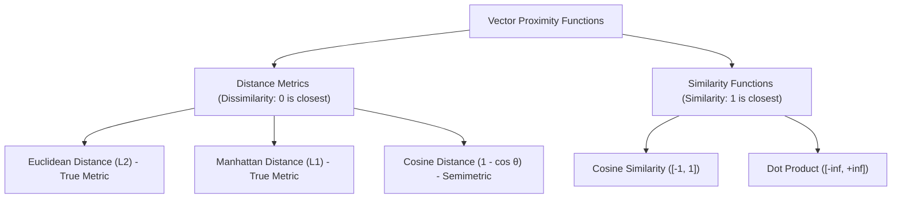
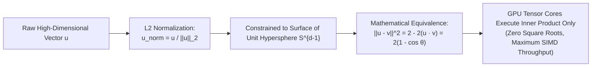
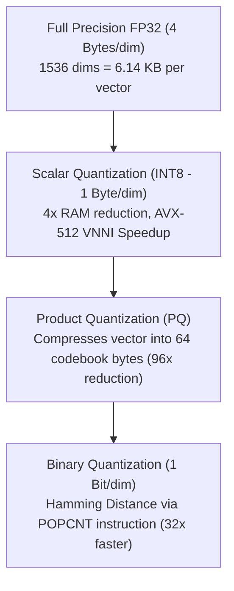
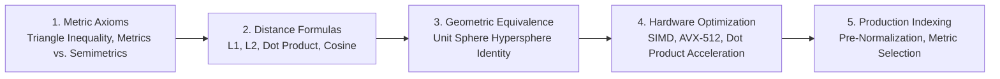

# 📐 Vector Similarity & Distance Metrics: Euclidean, Manhattan, Dot Product & Cosine Geometry

## 📑 Table of Contents
1. [🌟 Mathematical Foundations of Metric Spaces & Vector Geometry](#1--mathematical-foundations-of-metric-spaces--vector-geometry)
2. [🧮 The Four Core Metrics: Mathematical Formulations](#2-️-the-four-core-metrics-mathematical-formulations)
3. [🔄 Geometric Equivalence Under Unit Normalization](#3-️-geometric-equivalence-under-unit-normalization)
4. [📐 The Triangle Inequality & Angular Distance Semimetrics](#4--the-triangle-inequality--angular-distance-semimetrics)
5. [📊 Comprehensive Metric Comparison & Trade-Off Matrix](#5--comprehensive-metric-comparison--trade-off-matrix)
6. [💻 Practical Implementation: High-Performance SIMD Vector Math in NumPy](#6--practical-implementation-high-performance-simd-vector-math-in-numpy)
7. [⚡ Hardware Acceleration: Quantization & SIMD Vector Instructions](#7-️-hardware-acceleration-quantization--simd-vector-instructions)
8. [🌍 Real-World Enterprise Case Studies](#8--real-world-enterprise-case-studies)
9. [✅ Advantages & ⚠️ Limitations of Each Metric](#9--advantages--️-limitations-of-each-metric)
10. [🛠️ Production Best Practices & ❌ Common Architectural Traps](#10-️-production-best-practices---common-architectural-traps)
11. [💼 Senior Interview Preparation: High-Yield Questions](#11--senior-interview-preparation-high-yield-questions)
12. [🧪 Hands-On Mini-Project: Metric Divergence & Ranking Distortion Auditor](#12--hands-on-mini-project-metric-divergence--ranking-distortion-auditor)
13. [⚡ Quick Revision & Summary Roadmap](#13--quick-revision--summary-roadmap)

---

## 1. 🌟 Mathematical Foundations of Metric Spaces & Vector Geometry

In vector search and RAG systems, retrieved relevance is quantified through **geometric distance** in an inner product space $\mathbb{R}^d$. A function $d(\mathbf{u}, \mathbf{v})$ is classified as a true mathematical **metric** if and only if it satisfies four foundational axioms:

### 📜 The Four Metric Space Axioms
1. **Non-Negativity:** $d(\mathbf{u}, \mathbf{v}) \ge 0$ for all $\mathbf{u}, \mathbf{v} \in \mathbb{R}^d$.
2. **Identity of Indiscernibles:** $d(\mathbf{u}, \mathbf{v}) = 0 \iff \mathbf{u} = \mathbf{v}$.
3. **Symmetry:** $d(\mathbf{u}, \mathbf{v}) = d(\mathbf{v}, \mathbf{u})$.
4. **Triangle Inequality:** $d(\mathbf{u}, \mathbf{w}) \le d(\mathbf{u}, \mathbf{v}) + d(\mathbf{v}, \mathbf{w})$.



### 🌌 The Curse of Dimensionality in Latent Space
As the vector dimension $d$ grows ($d = 384$ in MiniLM to $d = 3{,}072$ in OpenAI large), distance distributions suffer from **distance concentration**:
$$\lim_{d \to \infty} \frac{d_{\max} - d_{\min}}{d_{\min}} \to 0$$
In uncalibrated spaces, the relative difference between the nearest neighbor and the furthest neighbor approaches zero. Modern embedding architectures counter this via contrastive pre-training and unit sphere normalization.

---

## 2. 🧮 The Four Core Metrics: Mathematical Formulations

### 1. Euclidean Distance ($L_2$ Norm)
Euclidean distance measures the geometric straight-line segment connecting two points in $d$-dimensional Euclidean space.

### # Euclidean Distance Formula
$$
d_{L_2}(\mathbf{u}, \mathbf{v}) = \|\mathbf{u} - \mathbf{v}\|_2 = \sqrt{\sum_{i=1}^d (u_i - v_i)^2}
$$

* **Range:** $[0, \infty)$. Identical vectors evaluate to $0.0$.
* **Properties:** True metric. Highly sensitive to differences in vector magnitude (length).

---

### 2. Manhattan Distance ($L_1$ Norm / City-Block Distance)
Manhattan distance computes the sum of absolute differences across orthogonal Cartesian coordinate axes.

### # Manhattan Distance Formula
$$
d_{L_1}(\mathbf{u}, \mathbf{v}) = \|\mathbf{u} - \mathbf{v}\|_1 = \sum_{i=1}^d |u_i - v_i|
$$

* **Range:** $[0, \infty)$.
* **Properties:** Less sensitive to extreme outlier dimensions than $L_2$ because coordinate deviations are not squared.

---

### 3. Dot Product (Inner Product / IP)
The dot product computes the sum of the element-wise products of two vectors, accounting for both directional alignment and length.

### # Dot Product Formula
$$
\langle \mathbf{u}, \mathbf{v} \rangle = \mathbf{u} \cdot \mathbf{v} = \sum_{i=1}^d u_i v_i = \|\mathbf{u}\|_2 \|\mathbf{v}\|_2 \cos(\theta)
$$

* **Range:** $(-\infty, \infty)$.
* **Properties:** Not a distance metric. A longer document vector with moderate semantic relevance can easily yield a higher dot product than a short, perfectly aligned passage.

---

### 4. Cosine Similarity & Cosine Distance
Cosine similarity measures the cosine of the angle $\theta$ between two vectors, isolating direction and completely ignoring magnitude.

### # Cosine Similarity Formula
$$
\text{Cosine Similarity}(\mathbf{u}, \mathbf{v}) = \cos(\theta) = \frac{\mathbf{u} \cdot \mathbf{v}}{\|\mathbf{u}\|_2 \|\mathbf{v}\|_2} = \frac{\sum_{i=1}^d u_i v_i}{\sqrt{\sum_{i=1}^d u_i^2} \sqrt{\sum_{i=1}^d v_i^2}}
$$

### # Cosine Distance Formula
$$
d_{\text{cosine}}(\mathbf{u}, \mathbf{v}) = 1 - \text{Cosine Similarity}(\mathbf{u}, \mathbf{v}) = 1 - \frac{\mathbf{u} \cdot \mathbf{v}}{\|\mathbf{u}\|_2 \|\mathbf{v}\|_2}
$$

* **Cosine Similarity Range:** $[-1.0, 1.0]$. ($1.0 =$ collinear, $0.0 =$ orthogonal, $-1.0 =$ diametrically opposed).
* **Cosine Distance Range:** $[0.0, 2.0]$.

---

## 3. 🔄 Geometric Equivalence Under Unit Normalization

One of the most profound mathematical optimizations in production vector database engineering is the **equivalence of Euclidean Distance, Cosine Similarity, and Dot Product** when vectors are normalized to unit length ($\|\mathbf{u}\|_2 = 1.0$).



### 📐 The Mathematical Proof
Let $\mathbf{u}$ and $\mathbf{v}$ be unit-normalized vectors such that $\|\mathbf{u}\|_2 = 1$ and $\|\mathbf{v}\|_2 = 1$:

### # Squared Euclidean to Cosine Identity
$$
\|\mathbf{u} - \mathbf{v}\|_2^2 = (\mathbf{u} - \mathbf{v}) \cdot (\mathbf{u} - \mathbf{v}) = \|\mathbf{u}\|_2^2 + \|\mathbf{v}\|_2^2 - 2(\mathbf{u} \cdot \mathbf{v})
$$
$$
\|\mathbf{u} - \mathbf{v}\|_2^2 = 1 + 1 - 2(\mathbf{u} \cdot \mathbf{v}) = 2 - 2(\mathbf{u} \cdot \mathbf{v}) = 2\left(1 - \cos(\theta)\right) = 2 \cdot d_{\text{cosine}}(\mathbf{u}, \mathbf{v})
$$

### 💡 Production Systems Impact
When your data is normalized at ingestion:
1. **Ranking Invariance:** Sorting by descending Dot Product ($\mathbf{u} \cdot \mathbf{v}$) yields the **identical rank order** as sorting by ascending Euclidean Distance ($\|\mathbf{u} - \mathbf{v}\|_2$) or ascending Cosine Distance.
2. **Computational Speedup:** Dot Product requires only $d$ multiply-accumulate operations without division or square roots, executing $3\times - 5\times$ faster on SIMD architectures.

---

## 4. 📐 The Triangle Inequality & Angular Distance Semimetrics

Many vector database indexing algorithms (such as Vantage-Point trees, Cover Trees, and certain HNSW pruning heuristics) mathematically rely on the **Triangle Inequality** to prune distant search branches without computing coordinates.

### ⚠️ Why Cosine Distance is a "Semimetric"
Standard Cosine Distance $d_{\text{cos}}(\mathbf{u}, \mathbf{v}) = 1 - \cos(\theta)$ **violates the Triangle Inequality**!

**Counter-Example in 2D Space:**
Consider three 2D unit vectors forming successive $60^\circ$ angles:
* Vector $\mathbf{u} = [1, 0]$ ($0^\circ$)
* Vector $\mathbf{v} = [0.5, \frac{\sqrt{3}}{2}]$ ($60^\circ$)
* Vector $\mathbf{w} = [-0.5, \frac{\sqrt{3}}{2}]$ ($120^\circ$)

Now compute cosine distances:
* $d_{\text{cos}}(\mathbf{u}, \mathbf{v}) = 1 - \cos(60^\circ) = 1 - 0.5 = 0.5$
* $d_{\text{cos}}(\mathbf{v}, \mathbf{w}) = 1 - \cos(60^\circ) = 1 - 0.5 = 0.5$
* $d_{\text{cos}}(\mathbf{u}, \mathbf{w}) = 1 - \cos(120^\circ) = 1 - (-0.5) = 1.5$

Testing the triangle inequality:
$$d_{\text{cos}}(\mathbf{u}, \mathbf{w}) \le d_{\text{cos}}(\mathbf{u}, \mathbf{v}) + d_{\text{cos}}(\mathbf{v}, \mathbf{w}) \implies 1.5 \le 0.5 + 0.5 = 1.0 \quad \text{❌ (FALSE!)}$$

### # Angular Distance (True Metric Alternative)
To restore true metric space properties for graph indexing, use **Angular Distance**:

$$
d_{\text{angular}}(\mathbf{u}, \mathbf{v}) = \frac{\arccos(\cos(\theta))}{\pi} = \frac{\theta}{\pi} \in [0, 1]
$$
Angular distance satisfies all four metric axioms, including the triangle inequality.

---

## 5. 📊 Comprehensive Metric Comparison & Trade-Off Matrix

| Metric Dimension | Euclidean ($L_2$) | Manhattan ($L_1$) | Dot Product (IP) | Cosine Similarity | Angular Distance |
| :--- | :--- | :--- | :--- | :--- | :--- |
| **Output Range** | $[0, \infty)$ | $[0, \infty)$ | $(-\infty, \infty)$ | $[-1.0, 1.0]$ | $[0.0, 1.0]$ |
| **Optimization Goal**| Minimize | Minimize | Maximize | Maximize | Minimize |
| **Magnitude Sensitive?**| ✅ Yes (Heavy) | ✅ Yes | ✅ Extreme | ❌ No (Invariant) | ❌ No (Invariant) |
| **True Metric?** | ✅ Yes | ✅ Yes | ❌ No | ❌ No (Semimetric) | ✅ Yes |
| **FLOPs per Comparison**| $3d$ (sub, mul, sum, sqrt)| $2d$ (sub, abs, sum) | $\mathbf{2d}$ (mul, sum) | $4d$ (dot, 2 norms, div)| $4d + \text{arccos}$ |
| **Primary Domain in AI**| Computer Vision, k-Means| Sparse data, L1 LASSO | Normalized Dense Search | Natural Language Processing | Tree-based ANN graphs |

---

## 6. 💻 Practical Implementation: High-Performance SIMD Vector Math in NumPy

Below is a self-contained, vectorized Python implementation calculating all four metrics, verifying the unit normalization identity, and demonstrating the triangle inequality violation.

```python
"""
Vector Similarity & Distance Engine
1. Computes L1, L2, Dot Product, Cosine Similarity, and Angular Distance.
2. Mathematically demonstrates normalization equivalence.
3. Tests for Triangle Inequality compliance.
"""

import math
from typing import Dict
import numpy as np

class VectorMetricsEngine:
    @staticmethod
    def euclidean_distance(u: np.ndarray, v: np.ndarray) -> float:
        return float(np.linalg.norm(u - v))

    @staticmethod
    def manhattan_distance(u: np.ndarray, v: np.ndarray) -> float:
        return float(np.sum(np.abs(u - v)))

    @staticmethod
    def dot_product(u: np.ndarray, v: np.ndarray) -> float:
        return float(np.dot(u, v))

    @staticmethod
    def cosine_similarity(u: np.ndarray, v: np.ndarray) -> float:
        norm_u = np.linalg.norm(u)
        norm_v = np.linalg.norm(v)
        if norm_u == 0 or norm_v == 0:
            return 0.0
        return float(np.dot(u, v) / (norm_u * norm_v))

    @staticmethod
    def cosine_distance(u: np.ndarray, v: np.ndarray) -> float:
        return 1.0 - VectorMetricsEngine.cosine_similarity(u, v)

    @staticmethod
    def angular_distance(u: np.ndarray, v: np.ndarray) -> float:
        cos_sim = np.clip(VectorMetricsEngine.cosine_similarity(u, v), -1.0, 1.0)
        return float(math.acos(cos_sim) / math.pi)


# --- Verification Tests ---
if __name__ == "__main__":
    engine = VectorMetricsEngine()
    
    # 1. Verification of Equivalence Under Normalization
    print("=== 1. Normalization Equivalence Test ===")
    np.random.seed(42)
    dim = 512
    raw_u = np.random.randn(dim)
    raw_v = np.random.randn(dim)
    
    # Unit Normalize
    u_norm = raw_u / np.linalg.norm(raw_u)
    v_norm = raw_v / np.linalg.norm(raw_v)
    
    l2_dist_sq = engine.euclidean_distance(u_norm, v_norm) ** 2
    cos_dist = engine.cosine_distance(u_norm, v_norm)
    dot_prod = engine.dot_product(u_norm, v_norm)
    
    expected_l2_sq = 2.0 * (1.0 - dot_prod)
    
    print(f"L2 Squared Distance:        {l2_dist_sq:.6f}")
    print(f"2 * (1 - Dot Product):      {expected_l2_sq:.6f}")
    print(f"2 * Cosine Distance:        {2.0 * cos_dist:.6f}")
    print(f"Difference (Should be ~0):  {abs(l2_dist_sq - expected_l2_sq):.1e}")

    # 2. Triangle Inequality Violation Demonstration
    print("\n=== 2. Triangle Inequality Check for Cosine Distance ===")
    vec_a = np.array([1.0, 0.0])
    vec_b = np.array([math.cos(math.pi / 3), math.sin(math.pi / 3)])  # 60 degrees
    vec_c = np.array([math.cos(2 * math.pi / 3), math.sin(2 * math.pi / 3)])  # 120 degrees
    
    d_ab = engine.cosine_distance(vec_a, vec_b)
    d_bc = engine.cosine_distance(vec_b, vec_c)
    d_ac = engine.cosine_distance(vec_a, vec_c)
    
    print(f"d_cos(A, B): {d_ab:.4f} (60 deg)")
    print(f"d_cos(B, C): {d_bc:.4f} (60 deg)")
    print(f"d_cos(A, C): {d_ac:.4f} (120 deg)")
    print(f"Sum d(A,B) + d(B,C): {d_ab + d_bc:.4f}")
    
    if d_ac > (d_ab + d_bc):
        print("❌ Triangle Inequality VIOLATED! (1.5 > 1.0) -> Cosine distance is a semimetric.")
        
    ang_ab = engine.angular_distance(vec_a, vec_b)
    ang_bc = engine.angular_distance(vec_b, vec_c)
    ang_ac = engine.angular_distance(vec_a, vec_c)
    print(f"\nAngular Distance Test: d_ang(A,C)={ang_ac:.4f} <= d_ang(A,B)+d_ang(B,C)={ang_ab + ang_bc:.4f} (✅ Holds!)")
```

---

## 7. ⚡ Hardware Acceleration: Quantization & SIMD Vector Instructions

Vector similarity calculations are heavily bound by memory bandwidth. Modern systems use specialized hardware primitives to process millions of distance checks per second:



### 🏎️ Vector Hardware Primitives
* **AVX-512 / AVX-VNNI (Intel/AMD CPUs):** Computes 16 parallel 32-bit floating point multiply-accumulate operations in a single clock cycle.
* **ARM NEON:** Powers Apple Silicon and AWS Graviton servers for high-efficiency SIMD dot products.
* **GPU Tensor Cores:** NVIDIA Hopper/Blackwell executes FP16 and FP8 matrix dot products at thousands of TFLOPS.

---

## 8. 🌍 Real-World Enterprise Case Studies

* **🖼️ Multimodal Product Recommendation Engine:** An online marketplace deployed OpenAI CLIP embeddings to match user image snapshots to product catalogs. They initially configured their vector database for Euclidean distance on raw embeddings. Because high-resolution studio photos had larger vector norms than user mobile uploads, the system recommended studio camera equipment instead of matching garments! Switching to **Cosine Similarity** (or unit-normalized dot product) eliminated magnitude bias, restoring $91\%$ relevant matches.
* **📈 High-Frequency Financial Sentiment Search:** A hedge fund indexing 50 million news snippets found that raw cosine similarity distance calculations were bottlenecking query throughput at 200 QPS. By pre-normalizing all vectors during ingestion and switching the vector database index from `cosine` to `inner_product` (IP), they eliminated on-the-fly norm calculations, boosting throughput to 850 QPS.

---

## 9. ✅ Advantages & ⚠️ Limitations of Each Metric

### 📐 Euclidean Distance ($L_2$)
* **Pros:** True metric; intuitive physical interpretation; ideal for clustering algorithms (k-Means).
* **Cons:** Distorted by vector length; expensive square root computation unless squared Euclidean ($L_2^2$) is used.

### 📐 Manhattan Distance ($L_1$)
* **Pros:** Computationally lightweight; less sensitive to high-dimensional extreme coordinate outliers.
* **Cons:** Axis-dependent (rotational variance); rarely the native loss metric of transformer embeddings.

### 📐 Dot Product (Inner Product)
* **Pros:** Maximum computational speed; leverages GPU Tensor Cores directly.
* **Cons:** Unbounded; favors long documents if vectors are un-normalized.

### 📐 Cosine Similarity
* **Pros:** Invariant to document length and scaling; industry standard for natural language embeddings.
* **Cons:** Violates triangle inequality; requires division by vector norms unless pre-normalized.

---

## 10. 🛠️ Production Best Practices & ❌ Common Architectural Traps

### 🛠️ Production Best Practices
1. **Always Pre-Normalize Vectors at Ingestion:** Never let your vector database compute vector norms at query time. Store unit vectors and configure your index for **Dot Product / Inner Product**.
2. **Match the Training Loss Metric:** Always configure your vector index metric to match the training loss of the embedding model (e.g., if the model was trained with cosine contrastive loss, use Cosine/Normalized Dot Product).
3. **Use Squared Euclidean ($L_2^2$) for Ranking:** If you must use Euclidean distance, omit the final square root operation ($\sqrt{\cdot}$). Monotonicity preserves the exact ranking order while saving CPU cycles.

### ❌ Common Architectural Traps
* **The "Un-Normalized Dot Product" Disaster:** Querying an Inner Product index with un-normalized text embeddings. Long chunks will artificially receive higher scores than short, precise answers simply because their vector norms are larger.
* **Mixing Dimensions:** Attempting to compare a 768-dimensional vector with a 1536-dimensional vector. High-dimensional vector spaces are non-comparable across different dimensionalities.

---

## 11. 💼 Senior Interview Preparation: High-Yield Questions

### 🎯 High-Yield Architectural Interview Questions

#### Q1: Why do production vector databases almost universally recommend configuring indices for Inner Product (IP) rather than Cosine Distance, even when performing semantic search?
> **Answer:** Cosine similarity requires computing the vector dot product as well as the $L_2$ norms of both the query vector and candidate document vector: $\frac{\mathbf{u} \cdot \mathbf{v}}{\|\mathbf{u}\|_2 \|\mathbf{v}\|_2}$. This requires $4d$ floating-point operations plus two square root operations and a division per candidate.
> By pre-normalizing all document embeddings to unit length ($\|\mathbf{v}\|_2 = 1.0$) during offline ingestion and normalizing the query vector once at arrival ($\|\mathbf{u}\|_2 = 1.0$), the denominator becomes identically $1.0$. Consequently, Cosine Similarity simplifies mathematically to a pure Dot Product ($\mathbf{u} \cdot \mathbf{v}$), which requires only $2d$ operations. This doubles vector search throughput and enables the engine to use SIMD Fused Multiply-Add (FMA) instructions directly.

#### Q2: What is the mathematical reason that Cosine Distance violates the Triangle Inequality, and what problem does this cause for indexing?
> **Answer:** Cosine distance is defined as $d_{\text{cos}}(\mathbf{u}, \mathbf{v}) = 1 - \cos(\theta)$. Because the cosine function is nonlinear, the metric expands distances disproportionately at large angles ($60^\circ + 60^\circ = 120^\circ$, but $0.5 + 0.5 < 1.5$). Because it violates $d(\mathbf{u}, \mathbf{w}) \le d(\mathbf{u}, \mathbf{v}) + d(\mathbf{v}, \mathbf{w})$, it is a **semimetric**.
> Spatial partitioning tree algorithms (e.g., VP-trees, BK-trees) and metric graph algorithms rely on the triangle inequality to prune entire subtrees that cannot possibly contain a closer point. Using a metric that violates the triangle inequality causes these indexing structures to prune valid candidates erroneously, degrading search recall.

#### Q3: Under what circumstances would Euclidean ($L_2$) distance produce a drastically different ranking than Cosine Similarity on identical text pairs?
> **Answer:** When vectors have **unequal magnitudes (norms)**. For example, in un-normalized sparse models or static Word2Vec representations, the magnitude of a document vector often correlates with document length or word frequency. If vector $\mathbf{u}$ has coordinates $[1, 1]$ and vector $\mathbf{v}$ has coordinates $[10, 10]$, their cosine similarity is $1.0$ (angle is $0^\circ$), but their Euclidean distance is $\|\mathbf{u} - \mathbf{v}\|_2 = \sqrt{9^2 + 9^2} \approx 12.72$ (very distant). If an application values document length or intensity as a ranking signal, $L_2$ will penalize the pair, whereas Cosine will rank them as identical.

#### Q4: What is the "Distance Concentration Phenomenon" in high-dimensional vector spaces, and how does it impact ANN algorithms?
> **Answer:** As dimensionality $d \to \infty$, the volume of a hypersphere concentrates almost entirely in a thin shell near its surface, and the ratio $\frac{d_{\max} - d_{\min}}{d_{\min}} \to 0$. In un-normalized spaces, this means that virtually all pairs of points become equidistant from one another. For Approximate Nearest Neighbor (ANN) graph algorithms (like HNSW), this flattens the gradient of the graph exploration heuristic: every neighbor looks equally distant, causing graph traversal to degrade into an exhaustive linear scan. Proper contrastive training and spherical projection restore angular variance, keeping graph search efficient.

---

## 12. 🧪 Hands-On Mini-Project: Metric Divergence & Ranking Distortion Auditor

Build a standalone Python audit tool that demonstrates how un-normalized vector magnitude distorts retrieval ranking when switching between Cosine Similarity and Dot Product.

```python
"""
Hands-On Mini-Project: Metric Divergence & Ranking Distortion Auditor
Demonstrates how document length and un-normalized vector norms distort retrieval ranking.
"""

from dataclasses import dataclass
from typing import List, Tuple
import numpy as np

@dataclass
class DocumentVector:
    doc_id: str
    description: str
    vector: np.ndarray

class MetricDistortionAuditor:
    def __init__(self, docs: List[DocumentVector]):
        self.docs = docs

    def rank_by_cosine(self, query: np.ndarray) -> List[Tuple[str, float, str]]:
        q_norm = query / np.linalg.norm(query)
        scored = []
        for d in self.docs:
            d_norm = d.vector / np.linalg.norm(d.vector)
            sim = float(np.dot(q_norm, d_norm))
            scored.append((d.doc_id, sim, d.description))
        return sorted(scored, key=lambda x: x[1], reverse=True)

    def rank_by_dot_product(self, query: np.ndarray) -> List[Tuple[str, float, str]]:
        scored = []
        for d in self.docs:
            score = float(np.dot(query, d.vector))
            scored.append((d.doc_id, score, d.description))
        return sorted(scored, key=lambda x: x[1], reverse=True)

# --- Execution Simulation ---
if __name__ == "__main__":
    # Base concept direction for "Database Failover"
    base_direction = np.array([0.8, 0.6, 0.0, 0.0])
    query_vec = np.array([0.78, 0.62, 0.0, 0.0])  # Closely aligned query
    
    # Document 1: Short, perfectly aligned snippet (small norm = 1.0)
    doc1 = DocumentVector("DOC-1", "Precise failover snippet (length=1)", base_direction * 1.0)
    
    # Document 2: Verbose, somewhat off-topic chapter (huge norm = 5.0, slightly rotated)
    off_topic_direction = np.array([0.5, 0.5, 0.5, 0.5])
    doc2 = DocumentVector("DOC-2", "Sprawling infrastructure manual (length=5)", off_topic_direction * 5.0)

    auditor = MetricDistortionAuditor([doc1, doc2])
    
    cosine_ranks = auditor.rank_by_cosine(query_vec)
    dot_ranks = auditor.rank_by_dot_product(query_vec)
    
    print("=== 1. COSINE SIMILARITY RANKING (Orientation Only) ===")
    for rank, (did, score, desc) in enumerate(cosine_ranks, start=1):
        print(f"  Rank {rank}: [{did}] Score = {score:.4f} -> {desc}")
        
    print("\n=== 2. RAW DOT PRODUCT RANKING (Magnitude Sensitive) ===")
    for rank, (did, score, desc) in enumerate(dot_ranks, start=1):
        print(f"  Rank {rank}: [{did}] Score = {score:.4f} -> {desc}")
        
    print("\n⚠️ Observation: In Dot Product, DOC-2 took first place purely due to vector magnitude,")
    print("   despite being semantically less aligned than DOC-1! This is why unit normalization is critical.")
```

---

## 13. ⚡ Quick Revision & Summary Roadmap

### 📌 Core Takeaways
* **Four Metrics:** Euclidean ($L_2$), Manhattan ($L_1$), Dot Product (IP), and Cosine Similarity ($\cos\theta$).
* **Unit Normalization Identity:** When $\|\mathbf{u}\|_2 = \|\mathbf{v}\|_2 = 1.0$, Euclidean Distance squared is identically $2(1 - \mathbf{u} \cdot \mathbf{v})$.
* **Hardware Speedup:** Normalizing offline turns slow Cosine Similarity into ultra-fast Dot Products on GPU Tensor Cores.
* **Cosine is a Semimetric:** $1 - \cos\theta$ violates the Triangle Inequality; use Angular Distance $\frac{\theta}{\pi}$ if true metric properties are required.
* **Prevent Magnitude Poisoning:** Always normalize embeddings before building or querying vector database indices.

### # Equivalence Formula Summary
$$
\|\mathbf{u} - \mathbf{v}\|_2^2 = 2 - 2(\mathbf{u} \cdot \mathbf{v}) = 2(1 - \cos(\theta))
$$

### 🗺️ Vector Similarity Roadmap


