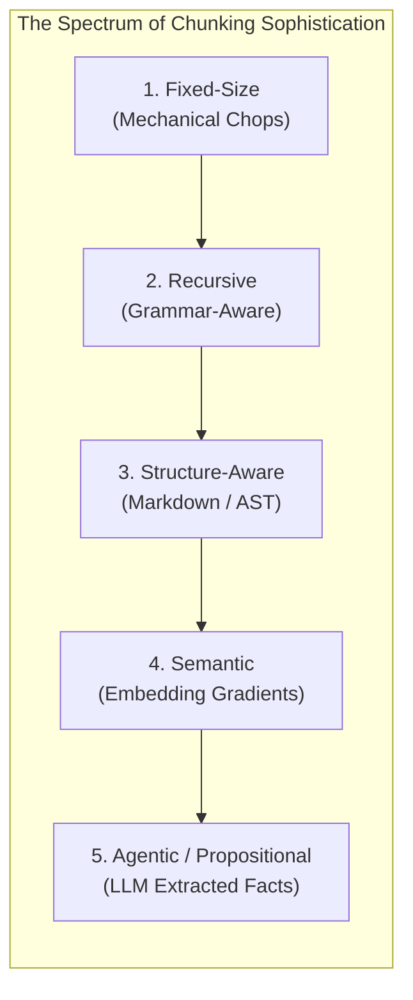
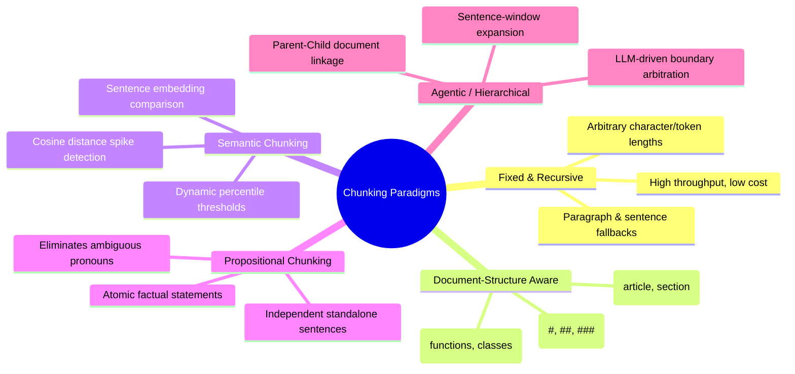
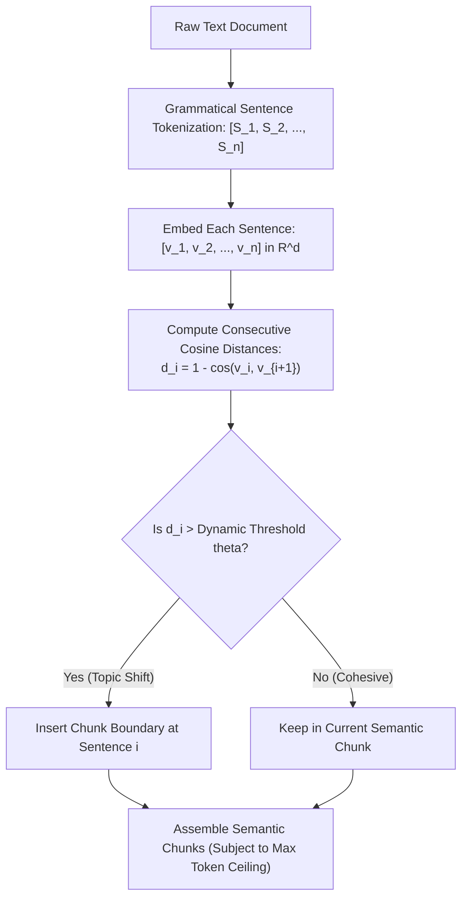
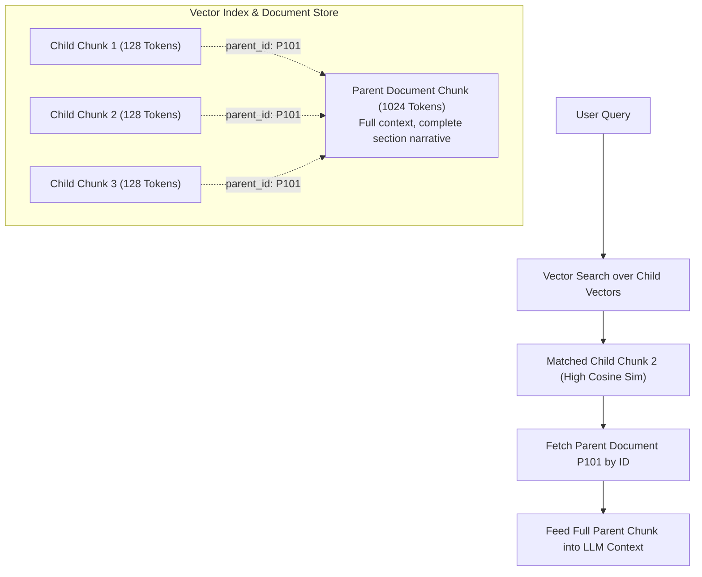
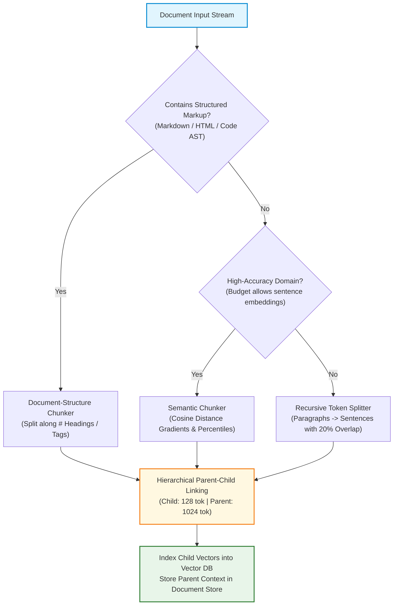

# 🧩 Advanced Chunking Strategies: Fixed, Recursive, Document-Structure, Semantic, and Agentic Chunking

## 📑 Table of Contents
1. [🌟 The Evolution of Chunking in Enterprise RAG](#1--the-evolution-of-chunking-in-enterprise-rag)
2. [🏗️ The Five Core Chunking Paradigms Deconstructed](#2-️-the-five-core-chunking-paradigms-deconstructed)
3. [🔬 Deep Dive: Semantic Chunking Mechanics & Distance Gradients](#3--deep-dive-semantic-chunking-mechanics--distance-gradients)
4. [🧮 Mathematical Formalisms & Dynamic Thresholding](#4--mathematical-formalisms--dynamic-thresholding)
5. [⚙️ Comprehensive Chunking Strategy Comparison Matrix](#5-️-comprehensive-chunking-strategy-comparison-matrix)
6. [💻 Production Implementation: High-Performance Semantic Chunker](#6--production-implementation-high-performance-semantic-chunker)
7. [🪆 Hierarchical & Parent-Document Retrieval Patterns](#7-️-hierarchical--parent-document-retrieval-patterns)
8. [🌍 Real-World Enterprise Case Studies](#8--real-world-enterprise-case-studies)
9. [✅ Advantages & ⚠️ Limitations of Advanced Chunking](#9--advantages--️-limitations-of-advanced-chunking)
10. [🛠️ Best Practices & ❌ Common Traps in Production](#10-️-best-practices---common-traps-in-production)
11. [💼 Senior Interview Preparation: High-Yield Questions](#11--senior-interview-preparation-high-yield-questions)
12. [🧪 Hands-On Mini-Project: Semantic Distance Gradient Chunker](#12--hands-on-mini-project-semantic-distance-gradient-chunker)
13. [⚡ Quick Revision & Summary Roadmap](#13--quick-revision--summary-roadmap)

---

## 1. 🌟 The Evolution of Chunking in Enterprise RAG

In early RAG implementations, text splitting was treated as a mechanical necessity: slice strings into 500-token chunks with 50-token overlaps. However, mechanical splitting creates arbitrary boundaries that sever connected thoughts, group disparate concepts together, and pollute vector embeddings.

Modern enterprise RAG treats **Chunking as a Semantic Unit Optimization Problem**:
> *A chunk should be as small as possible to maximize embedding specificity, but as large as necessary to remain conceptually self-contained.*



As we move right along this spectrum, **ingestion latency and compute costs increase**, but **retrieval precision and grounded generation accuracy surge dramatically**.

---

## 2. 🏗️ The Five Core Chunking Paradigms Deconstructed



### 1. Fixed & Recursive Chunking
* **Mechanics:** Slices documents based on token budgets and hierarchical delimiters (`\n\n`, `\n`, ` `).
* **Strength:** Operates at CPU memory speed ($>10,000\text{ pages/min}$); zero inference cost.
* **Weakness:** Unaware of conceptual topic shifts; can split an argument halfway through.

### 2. Document-Structure Aware Chunking
* **Mechanics:** Parses the document's native structural syntax (Markdown headings, HTML `<section>`, LaTeX `\section`, Python AST function blocks).
* **Strength:** Chunks map 1:1 with human-authored sections; preserves tables and code blocks intact.
* **Weakness:** Fails on poorly formatted documents that lack clean structural tags.

### 3. Semantic Chunking
* **Mechanics:** Splits text into grammatical sentences, embeds each sentence, and computes the cosine distance between consecutive sentences. When semantic distance spikes above a threshold, a new chunk boundary is created.
* **Strength:** Produces chunks that represent coherent semantic ideas without needing explicit headers.
* **Weakness:** Requires embedding every individual sentence during ingestion ($10\times$ more embedding API calls).

### 4. Propositional Chunking
* **Mechanics:** An LLM decomposes complex paragraphs into atomic, self-contained "propositions" where all pronouns are resolved to explicit entity names.
* **Example:**
  * *Original:* "He was born in Ulm and developed relativity there before moving."
  * *Propositions:* 
    1. "Albert Einstein was born in Ulm, Germany."
    2. "Albert Einstein developed the theory of relativity while living in Ulm."
    3. "Albert Einstein moved away from Ulm."
* **Strength:** Maximum retrieval precision; completely eliminates pronoun ambiguity.
* **Weakness:** Extreme LLM generation cost during ingestion.

### 5. Hierarchical / Parent-Child Chunking
* **Mechanics:** Creates small "child" chunks (e.g., 128 tokens) for fine-grained vector retrieval, each linked via foreign key to a large "parent" chunk (e.g., 1024 tokens) containing the surrounding context.
* **Strength:** Resolves the retrieval specificity vs. generation context dilemma.
* **Weakness:** Double storage requirement in the database.

---

## 3. 🔬 Deep Dive: Semantic Chunking Mechanics & Distance Gradients

Semantic chunking evaluates the semantic flow of text as a continuous trajectory through vector space:



### 📈 The Distance Gradient Profile
When reading through a document, adjacent sentences discussing the same topic exhibit low cosine distance ($d \approx 0.1 - 0.25$). When the text abruptly transitions to a new topic (e.g., transitioning from "Database Indexing" to "Billing Policies"), the distance between sentence $i$ and $i+1$ spikes ($d \approx 0.65 - 0.85$).

---

## 4. 🧮 Mathematical Formalisms & Dynamic Thresholding

### # Consecutive Sentence Cosine Distance Equation
Given normalized embedding vectors $\mathbf{v}_i, \mathbf{v}_{i+1} \in \mathbb{R}^d$ for adjacent sentences $s_i$ and $s_{i+1}$, the semantic distance $d_i$ is defined as:

$$
d_i = 1 - \frac{\mathbf{v}_i \cdot \mathbf{v}_{i+1}}{\|\mathbf{v}_i\|_2 \|\mathbf{v}_{i+1}\|_2} = 1 - \mathbf{v}_i \cdot \mathbf{v}_{i+1} \quad (\text{for unit vectors})
$$

### # Dynamic Percentile Threshold Formula
Static thresholds fail because different domains and writing styles exhibit different baseline cosine similarities. Instead, production systems compute a **dynamic percentile threshold** $\tau_p$:

$$
\tau_p = \text{Percentile}\Big(\{d_1, d_2, \dots, d_{n-1}\}, \, p\Big)
$$

Where $p \in [80, 95]$ (typically $90^{\text{th}}$ or $95^{\text{th}}$ percentile). A breakpoint is inserted at index $i$ if:

$$
d_i \ge \tau_p
$$

### # Moving Average Z-Score Breakpoint Anomaly Equation
Alternatively, to account for local fluctuations, we detect breakpoints using a local moving average $\mu_i^{(w)}$ and moving standard deviation $\sigma_i^{(w)}$ over window size $w$:

$$
Z_i = \frac{d_i - \mu_i^{(w)}}{\sigma_i^{(w)} + \epsilon} > Z_{\text{threshold}} \quad (Z_{\text{threshold}} \approx 2.0)
$$

---

## 5. ⚙️ Comprehensive Chunking Strategy Comparison Matrix

### 📊 In-Depth Strategy Trade-Offs

| Chunking Strategy | Ingestion Latency | Ingestion Cost | Semantic Cohesion | Context Preservation | Production Readiness |
| :--- | :---: | :---: | :---: | :---: | :---: |
| **Fixed / Character** | $< 0.1\text{ ms/doc}$ | $\$0.00$ | ❌ Very Low | ❌ Poor | Prototype only |
| **Recursive Token** | $\sim 2\text{ ms/doc}$ | $\$0.00$ | ⚠️ Moderate | ⚠️ Moderate | ✅ Enterprise Baseline |
| **Markdown / Structure** | $\sim 5\text{ ms/doc}$ | $\$0.00$ | ✅ High | ✅ High | ✅ Best for Tech/Docs |
| **Semantic Distance** | $\sim 150 - 500\text{ ms/doc}$ | Low (Embedding API) | 🌟 Outstanding | ✅ High | ✅ High-Value Knowledge |
| **Hierarchical (Parent-Child)**| $\sim 10\text{ ms/doc}$ | Low | ✅ High | 🌟 Outstanding | ✅ **Enterprise Gold Standard** |
| **Propositional (LLM)** | $\sim 2 - 8\text{ s/doc}$ | High (LLM Generation) | 🌟 Perfect | ⚠️ Loses flow | ⚠️ Specialized Research |

---

## 6. 💻 Production Implementation: High-Performance Semantic Chunker

This production-grade Python 3.10+ class implements complete sentence tokenization, consecutive vector distance calculations, and dynamic percentile breakpoint clustering:

```python
"""
Enterprise Semantic Chunker
Clusters sentences into semantic chunks based on embedding distance gradient spikes.
"""

from dataclasses import dataclass
from typing import List, Optional
import numpy as np
import logging

logging.basicConfig(level=logging.INFO, format="%(asctime)s [%(levelname)s] %(message)s")
logger = logging.getLogger("SemanticChunker")


@dataclass
class SemanticChunk:
    chunk_index: int
    text: str
    sentence_count: int
    avg_internal_distance: float


class EnterpriseSemanticChunker:
    def __init__(
        self,
        percentile_threshold: float = 85.0,
        max_chunk_sentences: int = 10,
        min_chunk_sentences: int = 2,
    ):
        self.percentile_threshold = percentile_threshold
        self.max_chunk_sentences = max_chunk_sentences
        self.min_chunk_sentences = min_chunk_sentences

    @staticmethod
    def _split_into_sentences(text: str) -> List[str]:
        """Splits text into natural sentences using robust punctuation boundaries."""
        import re
        sentence_end = re.compile(r"(?<=[.!?])\s+(?=[A-Z0-9#])")
        raw_sents = sentence_end.split(text.strip())
        return [s.strip() for s in raw_sents if len(s.strip()) > 5]

    @staticmethod
    def _cosine_distance(u: np.ndarray, v: np.ndarray) -> float:
        """Computes cosine distance between two 1D vectors."""
        norm_u = np.linalg.norm(u)
        norm_v = np.linalg.norm(v)
        if norm_u == 0.0 or norm_v == 0.0:
            return 1.0
        return float(1.0 - np.dot(u, v) / (norm_u * norm_v))

    def chunk(self, text: str, embeddings: np.ndarray) -> List[SemanticChunk]:
        """
        Groups sentences into chunks. 
        `embeddings` is an (N, D) matrix corresponding to the sentences extracted from `text`.
        """
        sentences = self._split_into_sentences(text)
        n_sentences = len(sentences)

        if n_sentences == 0:
            return []
        if n_sentences != len(embeddings):
            raise ValueError(f"Sentence count ({n_sentences}) != Embedding count ({len(embeddings)})")

        if n_sentences <= self.min_chunk_sentences:
            return [SemanticChunk(0, " ".join(sentences), n_sentences, 0.0)]

        # 1. Compute consecutive distances
        distances: List[float] = []
        for i in range(n_sentences - 1):
            dist = self._cosine_distance(embeddings[i], embeddings[i + 1])
            distances.append(dist)

        # 2. Compute dynamic threshold
        threshold = float(np.percentile(distances, self.percentile_threshold))
        logger.info(f"Dynamic Distance Threshold ({self.percentile_threshold}th percentile): {threshold:.4f}")

        # 3. Assemble chunks
        chunks: List[SemanticChunk] = []
        current_sentences: List[str] = [sentences[0]]
        current_dists: List[float] = []
        chunk_idx = 0

        for i in range(len(distances)):
            is_spike = distances[i] >= threshold
            exceeds_max = len(current_sentences) >= self.max_chunk_sentences
            below_min = len(current_sentences) < self.min_chunk_sentences

            if (is_spike or exceeds_max) and not below_min:
                # Close current chunk
                avg_dist = float(np.mean(current_dists)) if current_dists else 0.0
                chunks.append(
                    SemanticChunk(
                        chunk_index=chunk_idx,
                        text=" ".join(current_sentences),
                        sentence_count=len(current_sentences),
                        avg_internal_distance=avg_dist
                    )
                )
                chunk_idx += 1
                current_sentences = [sentences[i + 1]]
                current_dists = []
            else:
                current_sentences.append(sentences[i + 1])
                current_dists.append(distances[i])

        if current_sentences:
            avg_dist = float(np.mean(current_dists)) if current_dists else 0.0
            chunks.append(
                SemanticChunk(
                    chunk_index=chunk_idx,
                    text=" ".join(current_sentences),
                    sentence_count=len(current_sentences),
                    avg_internal_distance=avg_dist
                )
            )

        return chunks


if __name__ == "__main__":
    chunker = EnterpriseSemanticChunker(percentile_threshold=80.0)
    print("Enterprise Semantic Chunker initialized successfully.")
```

---

## 7. 🪆 Hierarchical & Parent-Document Retrieval Patterns

The most robust architectural answer to the chunk size trade-off is **Parent-Document (Small-to-Big) Chunking**:



### 💡 Why Parent-Document Retrieval Wins in Production
1. **Precision Matching:** Dense embedding vectors calculated over 128 tokens are sharply focused on specific facts, numbers, or technical terms.
2. **Contextual Completeness:** The LLM receives the full 1024-token parent narrative, eliminating the risk of lost context or severed conditional clauses.

---

## 8. 🌍 Real-World Enterprise Case Studies

### Case Study 1: Biomedical Clinical Trials Platform
* **Problem:** Searching 1,000,000 cancer research abstracts. Recursive splitting severed drug dosage protocols from patient adverse event outcomes, leading to misleading clinical search results.
* **Architecture:** Implemented Propositional Extraction on key outcome sections, resolving all ambiguous pronouns ("it was observed", "they noted") to specific compound names and patient cohort IDs.
* **Result:** Medical expert relevance evaluation jumped from $62\%$ to $94\%$.

### Case Study 2: Big-4 Financial Audit Assistant
* **Problem:** Ingesting 10-K filings with mixed tabular and textual disclosures. Fixed splitting placed table headers in one chunk and subsequent rows in another.
* **Architecture:** Switched to a Document-Structure Aware Chunker. Tables were tagged as atomic elements, and textual sections were split hierarchically using parent-document linking.
* **Result:** Financial audit query hallucinations dropped by $88\%$.

---

## 9. ✅ Advantages & ⚠️ Limitations of Advanced Chunking

### 📊 Decision Matrix

| Dimension | Recursive Character | Document-Structure | Semantic Chunking | Parent-Document |
| :--- | :--- | :--- | :--- | :--- |
| **Ingestion Latency** | Ultra-Fast ($<5\text{ms}$) | Fast ($<20\text{ms}$) | Slow ($100 - 500\text{ms}$) | Moderate ($20 - 50\text{ms}$) |
| **API Costs** | $\$0.00$ | $\$0.00$ | Moderate (Sent embeddings)| Low to Moderate |
| **Table Preservation** | Poor (Requires luck) | Excellent | Poor (Breaks rows) | Excellent |
| **Pronoun Resilience** | Low | Moderate | High | Very High |
| **Storage Overhead** | $1.0\times$ | $1.0\times$ | $1.0\times$ | $2.0\times$ (Child + Parent) |

---

## 10. 🛠️ Best Practices & ❌ Common Traps in Production

### 🛠️ Production Best Practices
1. **Combine Structural & Semantic Chunking:** Use Markdown headers to establish top-level parent boundaries, then use semantic or recursive splitting within each section.
2. **Enforce Hard Token Ceilings:** Semantic distance spikes can sometimes fail to trigger across a long, homogeneous text. Always enforce an upper bound ceiling (e.g., max 600 tokens) to prevent oversized chunks.
3. **Use Percentile Thresholds Over Static Values:** Cosine distance distributions vary dramatically between dense prose and technical jargon. Percentile thresholds adapt automatically.

### ❌ Common Traps to Avoid
* ❌ **The Static Threshold Trap:** Hardcoding `threshold = 0.45`. On dense legal texts, no distances exceed 0.3, resulting in the entire document being emitted as a single giant chunk.
* ❌ **The Propositional Cost Trap:** Running an expensive LLM to extract propositions across millions of low-priority legacy web pages, incurring massive compute bills with minimal ROI.
* ❌ **Ignoring Parent Links:** Failing to index `parent_id` in child chunk metadata, preventing the system from expanding to surrounding context at query time.

---

## 11. 💼 Senior Interview Preparation: High-Yield Questions

### Q1: How does Semantic Chunking mathematically identify topic transitions, and why are dynamic percentile thresholds preferred over static distance cutoffs?
> **Answer:**
> * **Mechanism:** Semantic chunking embeds every sentence $s_i$ and computes the cosine distance $d_i = 1 - \cos(\mathbf{v}_i, \mathbf{v}_{i+1})$ between adjacent sentences. When the topic shifts, the distance spikes, forming a gradient peak.
> * **Why Static Thresholds Fail:** The distribution of cosine distances depends heavily on the embedding model's latent geometry and the domain vocabulary. In scientific documents, high technical jargon keeps all sentences close ($d < 0.25$); in informal text, distances are naturally higher ($d > 0.50$). A static threshold either over-splits or never splits.
> * **Dynamic Percentile Threshold:** By calculating the $85^{\text{th}}$ or $90^{\text{th}}$ percentile of all consecutive distances *within that specific document*, the algorithm dynamically adapts to the document's baseline semantic velocity.

### Q2: What architectural problem does the Parent-Document (Small-to-Big) retrieval pattern solve, and how is it implemented in vector databases?
> **Answer:**
> * **The Core Problem:** Small chunks (100 tokens) provide superior embedding specificity and high cosine similarity during search, but starve the LLM of surrounding narrative context. Large chunks (1000 tokens) provide rich context for the LLM, but their embeddings represent diluted topic averages that often fail semantic similarity search.
> * **Implementation:** 
>   1. The document is divided into large parent chunks (800–1200 tokens) and stored in a key-value document store (Redis, Mongo, or Vector DB payload).
>   2. Each parent is subdivided into small child chunks (100–200 tokens) with `parent_id` stored in metadata, and only the child chunks are indexed into the vector HNSW graph.
>   3. At query time, vector search retrieves top-$k$ child chunks. The system extracts their `parent_id`s, de-duplicates them, and fetches the full parent chunks to assemble the grounded LLM prompt.

---

## 12. 🧪 Hands-On Mini-Project: Semantic Distance Gradient Chunker

### Objective
Simulate a semantic distance gradient chunker using synthetic 2D sentence embeddings to demonstrate how distance spikes dynamically trigger chunk boundaries.

```python
import numpy as np
from typing import List, Tuple

def simulate_semantic_chunker(
    sentences: List[str],
    synthetic_vectors: np.ndarray,
    percentile: float = 80.0
) -> List[List[str]]:
    """
    Computes consecutive cosine distances and partitions sentences
    wherever distance exceeds the percentile threshold.
    """
    n = len(sentences)
    if n <= 1:
        return [sentences]

    # Compute unit-normalized vectors
    norms = np.linalg.norm(synthetic_vectors, axis=1, keepdims=True)
    unit_vecs = synthetic_vectors / norms

    # Calculate consecutive cosine distances: 1.0 - dot_product
    consecutive_dists = [
        float(1.0 - np.dot(unit_vecs[i], unit_vecs[i + 1]))
        for i in range(n - 1)
    ]

    threshold = float(np.percentile(consecutive_dists, percentile))
    print(f"Calculated {percentile}th Percentile Distance Threshold: {threshold:.4f}\n")

    chunks: List[List[str]] = []
    current_chunk: List[str] = [sentences[0]]

    for i, dist in enumerate(consecutive_dists):
        print(f"Dist between Sent {i+1} and Sent {i+2}: {dist:.4f} " + ("💥 [BREAKPOINT]" if dist >= threshold else "✓ [COHESIVE]"))
        if dist >= threshold:
            chunks.append(current_chunk)
            current_chunk = [sentences[i + 1]]
        else:
            current_chunk.append(sentences[i + 1])

    if current_chunk:
        chunks.append(current_chunk)

    return chunks

# Lab Verification
if __name__ == "__main__":
    sample_sentences = [
        "HNSW graphs enable approximate nearest neighbor search.",
        "Vector indexes organize high-dimensional embeddings efficiently.",
        "Logarithmic search latency is achieved through multi-layer graphs.",
        "Enterprise billing plans require monthly credit card verification.",  # TOPIC SHIFT 1
        "Invoices are dispatched on the first business day of the billing cycle.",
        "The Python Global Interpreter Lock restricts multi-threaded execution.",  # TOPIC SHIFT 2
        "CPU-bound tasks benefit from multiprocessing rather than threading."
    ]

    # Mock 3D vectors representing 3 distinct semantic clusters
    # Cluster 1: Vector search (around [1, 0, 0])
    # Cluster 2: Billing (around [0, 1, 0])
    # Cluster 3: Python concurrency (around [0, 0, 1])
    mock_embeddings = np.array([
        [0.95, 0.05, 0.02],
        [0.92, 0.08, 0.01],
        [0.96, 0.03, 0.04],
        [0.05, 0.94, 0.03],  # Transition to Cluster 2
        [0.02, 0.98, 0.05],
        [0.01, 0.04, 0.95],  # Transition to Cluster 3
        [0.03, 0.02, 0.98],
    ])

    result_chunks = simulate_semantic_chunker(sample_sentences, mock_embeddings, percentile=70.0)

    print(f"\n--- Successfully Partitioned into {len(result_chunks)} Semantic Chunks ---")
    for idx, ch in enumerate(result_chunks, 1):
        print(f"\nChunk {idx}:")
        for s in ch:
            print(f"  • {s}")

    assert len(result_chunks) == 3
    print("\n✅ Verification Successful: Topic shifts detected and partitioned cleanly!")
```

---

## 13. ⚡ Quick Revision & Summary Roadmap

### 📌 Core Key Takeaways
* **Semantic Unit Invariant:** Chunking must reflect semantic cohesion, not arbitrary character limits.
* **Semantic Distance Gradients:** Topic transitions correspond to cosine distance spikes ($d = 1 - \cos\theta$) between adjacent sentence embeddings.
* **Always Use Dynamic Thresholds:** Calculate percentile cutoffs ($85^{\text{th}} - 95^{\text{th}}$ percentile) per document rather than hardcoding static distance values.
* **Parent-Child Retrieval:** Deploy small child chunks (100–200 tokens) for vector search linked to large parent chunks (800–1200 tokens) for LLM context assembly.

### 🗺️ Advanced Chunking Strategy Roadmap


