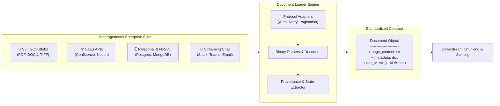
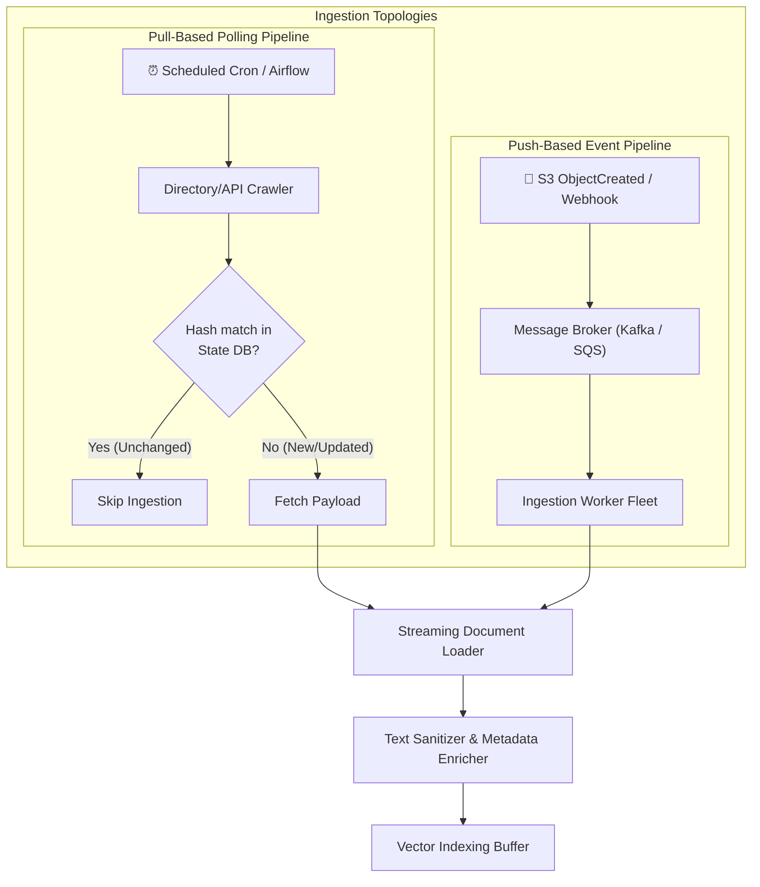
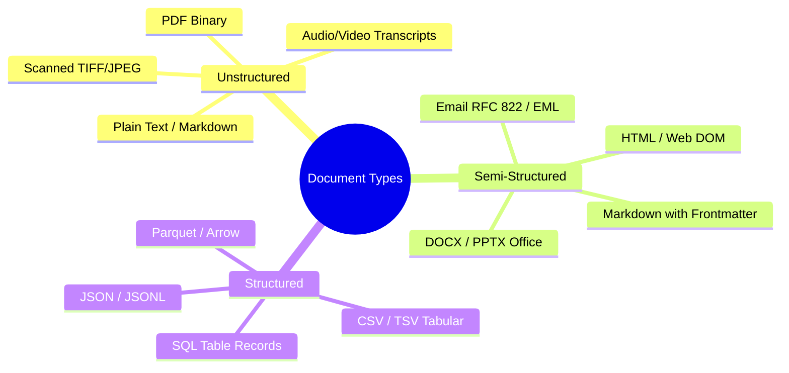
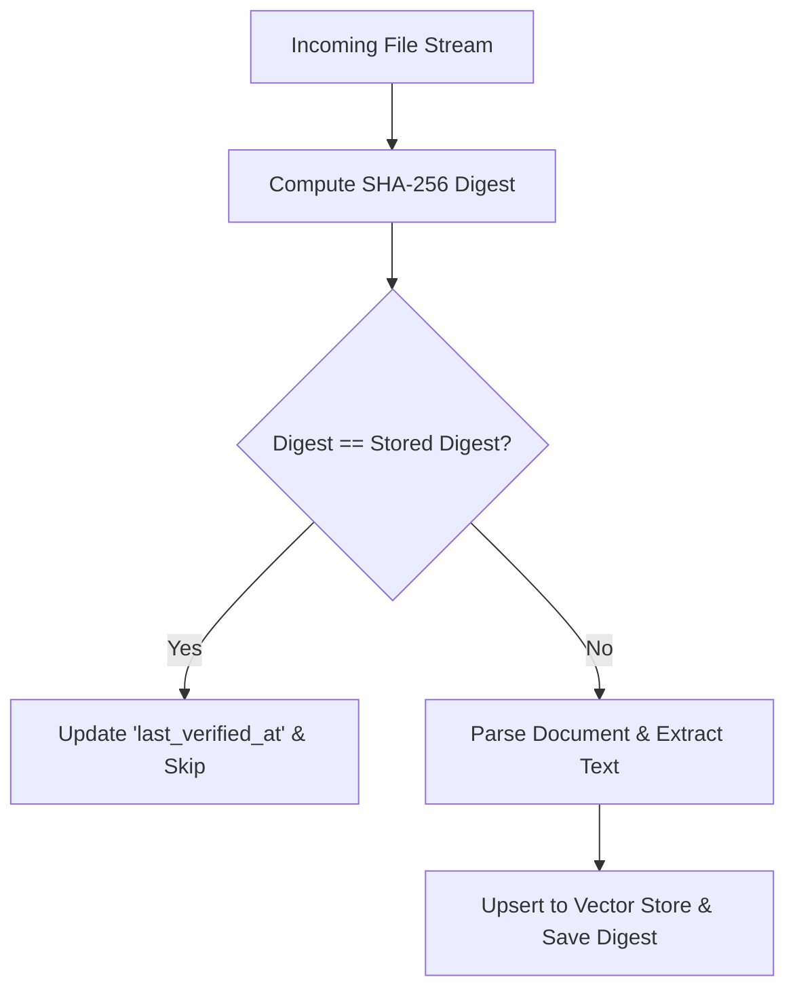
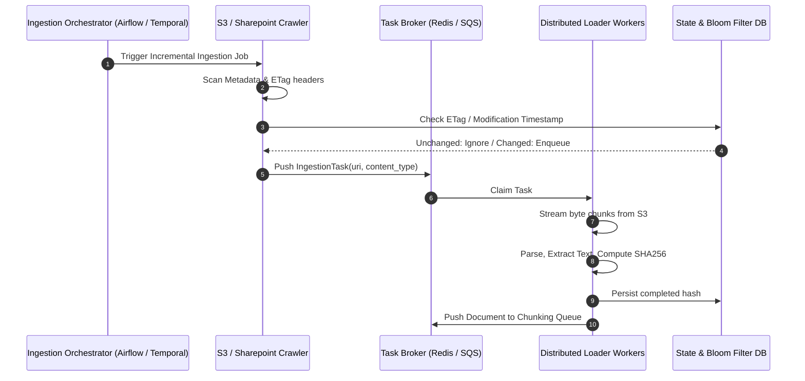
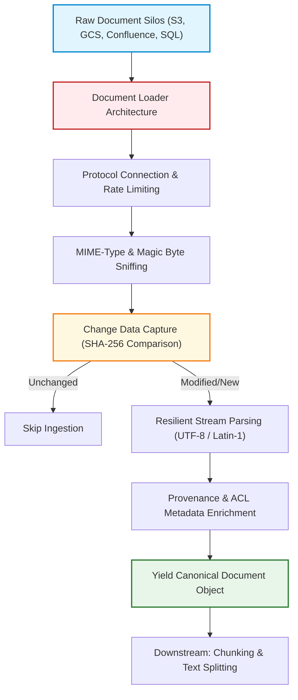

# 📂 Document Loaders: Ingesting Heterogeneous Unstructured and Structured Formats

## 📑 Table of Contents
1. [🌟 Fundamentals of Document Loaders in Enterprise RAG](#1--fundamentals-of-document-loaders-in-enterprise-rag)
2. [🏗️ Ingestion Architecture & Pipeline Topology](#2-️-ingestion-architecture--pipeline-topology)
3. [📦 Heterogeneous Source Landscape & Format Mechanics](#3--heterogeneous-source-landscape--format-mechanics)
4. [⚙️ Core Engineering Design Patterns for Ingestion](#4-️-core-engineering-design-patterns-for-ingestion)
5. [🧮 Mathematical Foundations & Ingestion Invariants](#5--mathematical-foundations--ingestion-invariants)
6. [💻 Production Implementation: Extensible Resilient Ingestion Engine](#6--production-implementation-extensible-resilient-ingestion-engine)
7. [🚀 Distributed Scaling, Memory Optimization & Backpressure](#7--distributed-scaling-memory-optimization--backpressure)
8. [🌍 Real-World Enterprise Case Studies](#8--real-world-enterprise-case-studies)
9. [✅ Advantages & ⚠️ Limitations of Loader Architectures](#9--advantages--️-limitations-of-loader-architectures)
10. [🛠️ Best Practices & ❌ Common Traps in Production](#10-️-best-practices---common-traps-in-production)
11. [💼 Senior Interview Preparation: High-Yield Questions](#11--senior-interview-preparation-high-yield-questions)
12. [🧪 Hands-On Mini-Project: Resilient Incremental Ingestion Engine](#12--hands-on-mini-project-resilient-incremental-ingestion-engine)
13. [⚡ Quick Revision & Summary Roadmap](#13--quick-revision--summary-roadmap)

---

## 1. 🌟 Fundamentals of Document Loaders in Enterprise RAG

In any Retrieval-Augmented Generation (RAG) system, downstream embedding models and vector databases depend directly on the fidelity of the ingestion layer. Raw enterprise data does not live in clean strings; it resides in siloed repositories, proprietary binary formats, object stores, and dynamic APIs.

A **Document Loader** is a specialized extraction and normalization component responsible for connecting to disparate data sources, parsing raw byte streams, extracting textual payloads, attaching deterministic provenance metadata, and emitting standardized **Document Objects**:



### 📋 The Standardized Document Contract
To decouple downstream processing (chunking, embedding, indexing) from upstream data quirks, every document loader must normalize output into a canonical schema:

```python
class Document:
    page_content: str        # The extracted textual corpus (UTF-8)
    metadata: dict[str, Any] # Deterministic key-value dictionary
    doc_id: str              # Deterministic content/provenance identifier
```

#### Essential Metadata Attributes
1. **`source`**: The absolute URI, canonical URL, or storage key (`s3://bucket/path/to/file.pdf`).
2. **`created_at` / `modified_at`**: ISO 8601 timestamps for time-travel queries and cache invalidation.
3. **`content_hash`**: Cryptographic digest (e.g., SHA-256) of raw bytes for Change Data Capture (CDC).
4. **`source_page` / `section`**: Granular locator indicating exact origin page or header block.
5. **`access_control_list (ACL)`**: User or role entitlements enabling post-retrieval security trimming.

---

## 2. 🏗️ Ingestion Architecture & Pipeline Topology

Enterprise ingestion pipelines fall into two major paradigms: **Pull-based (Batch/Polling)** and **Push-based (Event-Driven / CDC)**.



### 🔄 Pull vs. Push Ingestion Dynamics

| Dimension | Pull-Based (Polling / Batch) | Push-Based (Event-Driven / Webhooks) |
| :--- | :--- | :--- |
| **Trigger Mechanism** | Periodic schedule (cron, orchestrator) | Real-time events (`s3:ObjectCreated`, webhooks) |
| **Freshness Latency** | Minutes to hours (depends on crawl interval) | Sub-second to seconds |
| **API Load on Sources** | High (frequent polling requests) | Low (source pushes only on state changes) |
| **Failure Recovery** | Simple (restart scan from high-water mark) | Requires dead-letter queues (DLQ) & replay logs |
| **Backpressure Handling** | Pull pace managed directly by consumer | Requires rate-limiting buffers (Kafka, SQS) |
| **Primary Use Cases** | Legacy file shares, web scraping, daily dumps | Operational customer support, live documentation |

---

## 3. 📦 Heterogeneous Source Landscape & Format Mechanics

Enterprise documents arrive across three distinct structural classes:



### 📊 Ingestion Source Comparison Matrix

| Format / Source | Dominant Parser Libraries | Ingestion Bottleneck | Memory Profile | Metadata Extraction Fidelity |
| :--- | :--- | :--- | :--- | :--- |
| **PDF (Digital)** | `pypdf`, `PyMuPDF (fitz)`, `pdfplumber` | CPU-bound font decoding & stream decomp | Low to Moderate ($O(\text{page})$) | High (Page numbers, author, creation date) |
| **PDF (Scanned)** | `tesseract`, `easyocr`, `Amazon Textract` | GPU/CPU compute bound (OCR matrix math) | High ($O(\text{image pixels})$) | Poor natively (requires layout models) |
| **Microsoft Office (DOCX)** | `python-docx`, `unstructured` | XML unpacking & ZIP decompression | Low ($O(\text{XML DOM})$) | High (Headings, comments, revision history) |
| **Web / HTML** | `trafilatura`, `BeautifulSoup4`, `readability` | Network I/O & DOM noise stripping | Low | High (Canonical URL, OpenGraph tags, title) |
| **JSON / JSONL** | `orjson`, `ijson` (streaming) | RAM allocation on massive arrays | Streaming: $O(1)$; In-memory: $O(N)$ | Native (Key-value schema mapped to metadata) |
| **Relational SQL** | `SQLAlchemy`, `asyncpg`, `connectorx` | Database connection pools & query serialization | Low if paginated via cursors | Full relational schema & foreign keys |
| **Object Stores (S3/GCS)** | `boto3`, `google-cloud-storage`, `fsspec` | Network throughput & API rate limits | Low with streaming bytes | Bucket tags, ETag, last-modified header |

---

## 4. ⚙️ Core Engineering Design Patterns for Ingestion

### Pattern 1: Lazy Evaluation via Generators (Memory Safety)
Enterprise document loaders must never read tens of thousands of files entirely into RAM. Standard loaders yield documents sequentially using Python generators (`Iterator[Document]`):

```python
# Anti-pattern: OOM vulnerability
def load_all_documents(folder: str) -> list[Document]:
    return [parse(f) for f in get_files(folder)] # Explodes on 10,000 files

# Production Pattern: Constant memory footprint
def lazy_load_documents(folder: str) -> Iterator[Document]:
    for f in get_files(folder):
        yield parse(f) # Memory bounded to single document size
```

### Pattern 2: Change Data Capture (CDC) via Content Hashing
To prevent expensive downstream re-embedding of unchanged documents, loaders compute a cryptographic digest of the raw payload. The digest is evaluated against a persistent metadata store before parsing begins:



### Pattern 3: Exponential Backoff with Decorrelated Jitter
When querying SaaS APIs (Notion, Confluence, GitHub, SharePoint), loaders face strict HTTP 429 (Too Many Requests) rate limits. Production loaders utilize exponential backoff with full jitter to avoid the thundering herd problem.

---

## 5. 🧮 Mathematical Foundations & Ingestion Invariants

### # Deterministic Content Digest Function
To guarantee idempotency across distributed loaders, the content hash $H(D)$ must be calculated strictly over normalized bytes $B(D)$:

$$
H(D) = \text{SHA256}\Big(\text{NormalizeBytes}(B(D))\Big) \in \{0, 1\}^{256}
$$

Where $\text{NormalizeBytes}(\cdot)$ strips transport-level variances such as Windows vs. Linux newline terminators (`\r\n` $\to$ `\n`) and Unicode encoding differences (normalizing to UTF-8 NFKC).

### # Little's Law Ingestion Throughput Invariant
The capacity of a concurrent document ingestion cluster is governed by Little's Law:

$$
L = \lambda \cdot W
$$

Where:
* $L$: Average number of documents concurrently being processed in the pipeline.
* $\lambda$: Document processing throughput (documents per second).
* $W$: Average latency per document ingestion (seconds per document).

To increase throughput $\lambda$ when processing slow OCR documents ($W \approx 4.0\text{s}$), the concurrency pool $L$ must scale proportionally:

$$
\lambda = \frac{L}{W} \implies \text{For } \lambda = 100\text{ docs/sec with } W = 4.0\text{s}, \quad L = 400 \text{ concurrent workers}
$$

---

## 6. 💻 Production Implementation: Extensible Resilient Ingestion Engine

Here is a self-contained, production-grade Python 3.10+ document ingestion framework featuring abstract base classes, cryptographic deduplication, lazy generators, and local file handling:

```python
"""
Enterprise Document Loader Engine
Implements resilient, memory-safe, lazy-evaluated ingestion with content hashing.
"""

from abc import ABC, abstractmethod
from dataclasses import dataclass, field
from datetime import datetime, timezone
import hashlib
import json
import logging
import os
from pathlib import Path
from typing import Any, Dict, Iterator, List, Optional

logging.basicConfig(level=logging.INFO, format="%(asctime)s [%(levelname)s] %(message)s")
logger = logging.getLogger("DocumentLoader")


@dataclass(frozen=True)
class Document:
    """Canonical document representation for the enterprise RAG pipeline."""
    page_content: str
    metadata: Dict[str, Any] = field(default_factory=dict)
    doc_id: str = field(default="")

    def __post_init__(self) -> None:
        if not self.doc_id:
            # Deterministic UUID-like ID generated from source and content hash
            digest = hashlib.sha256(self.page_content.encode("utf-8")).hexdigest()[:16]
            source_key = str(self.metadata.get("source", "unknown"))
            object.__setattr__(self, "doc_id", f"{source_key}#{digest}")


class BaseDocumentLoader(ABC):
    """Abstract Base Class establishing the contract for all loaders."""

    @abstractmethod
    def lazy_load(self) -> Iterator[Document]:
        """Lazily load and parse documents, yielding Document instances one at a time."""
        pass

    def load(self) -> List[Document]:
        """Eagerly load all documents into memory. Use only for small batches."""
        return list(self.lazy_load())


class RobustTextFileLoader(BaseDocumentLoader):
    """Loads plain text, markdown, and source files with fallback encoding recovery."""

    def __init__(self, file_path: str | Path, extra_metadata: Optional[Dict[str, Any]] = None):
        self.file_path = Path(file_path).resolve()
        self.extra_metadata = extra_metadata or {}

    def _compute_sha256(self) -> str:
        sha256_hash = hashlib.sha256()
        with open(self.file_path, "rb") as f:
            for byte_block in iter(lambda: f.read(65536), b""):
                sha256_hash.update(byte_block)
        return sha256_hash.hexdigest()

    def lazy_load(self) -> Iterator[Document]:
        if not self.file_path.exists():
            raise FileNotFoundError(f"File not found: {self.file_path}")

        file_stat = self.file_path.stat()
        content_hash = self._compute_sha256()

        # Resilient multi-encoding reader strategy
        encodings = ["utf-8", "utf-8-sig", "latin-1", "cp1252"]
        content: Optional[str] = None
        used_encoding: Optional[str] = None

        for enc in encodings:
            try:
                with open(self.file_path, "r", encoding=enc) as f:
                    content = f.read()
                used_encoding = enc
                break
            except UnicodeDecodeError:
                continue

        if content is None:
            raise ValueError(f"Unable to decode {self.file_path} with supported encodings.")

        metadata: Dict[str, Any] = {
            "source": str(self.file_path),
            "file_name": self.file_path.name,
            "file_extension": self.file_path.suffix.lower(),
            "file_size_bytes": file_stat.st_size,
            "created_at": datetime.fromtimestamp(file_stat.st_ctime, tz=timezone.utc).isoformat(),
            "modified_at": datetime.fromtimestamp(file_stat.st_mtime, tz=timezone.utc).isoformat(),
            "content_hash": content_hash,
            "encoding": used_encoding,
            **self.extra_metadata,
        }

        yield Document(page_content=content, metadata=metadata)


class DirectoryIngestionPipeline:
    """Manages recursive directory loading with stateful CDC deduplication."""

    def __init__(self, state_store_path: str = "./ingestion_state.json"):
        self.state_store_path = Path(state_store_path)
        self.processed_hashes: Dict[str, str] = self._load_state()

    def _load_state(self) -> Dict[str, str]:
        if self.state_store_path.exists():
            try:
                with open(self.state_store_path, "r", encoding="utf-8") as f:
                    return json.load(f)
            except Exception as e:
                logger.warning(f"Could not load state store, starting fresh: {e}")
        return {}

    def _save_state(self) -> None:
        with open(self.state_store_path, "w", encoding="utf-8") as f:
            json.dump(self.processed_hashes, f, indent=2)

    def ingest_directory(
        self, directory_path: str, supported_extensions: List[str]
    ) -> Iterator[Document]:
        root = Path(directory_path)
        logger.info(f"Scanning directory: {root}")

        for dirpath, _, filenames in os.walk(root):
            for filename in filenames:
                file_ext = Path(filename).suffix.lower()
                if file_ext in supported_extensions:
                    full_path = Path(dirpath) / filename
                    loader = RobustTextFileLoader(full_path)
                    
                    try:
                        for doc in loader.lazy_load():
                            file_key = str(full_path)
                            current_hash = doc.metadata["content_hash"]

                            # CDC check
                            if file_key in self.processed_hashes:
                                if self.processed_hashes[file_key] == current_hash:
                                    logger.debug(f"Skipping unchanged file: {filename}")
                                    continue

                            # Update state and yield
                            self.processed_hashes[file_key] = current_hash
                            self._save_state()
                            yield doc

                    except Exception as err:
                        logger.error(f"Failed to ingest file {full_path}: {err}", exc_info=True)


if __name__ == "__main__":
    # Demonstration execution
    pipeline = DirectoryIngestionPipeline(state_store_path="./test_ingestion_state.json")
    # Ingest directory (pointing to local folder)
    ingested_count = 0
    for document in pipeline.ingest_directory("./", supported_extensions=[".md"]):
        ingested_count += 1
        print(f"Ingested Doc ID: {document.doc_id} | Hash: {document.metadata['content_hash'][:8]}...")
        if ingested_count >= 3:
            break
    print(f"Total processed documents in test batch: {ingested_count}")
```

---

## 7. 🚀 Distributed Scaling, Memory Optimization & Backpressure

When scaling from a single folder to enterprise repositories with hundreds of thousands of files, ingestion architectures shift from synchronous in-process loops to distributed worker clusters:



### Memory Optimization Rules for Massive Payloads
1. **Never buffer full multi-gigabyte files:** Use file streaming with buffered readers (`chunk_size=64KB`) to compute digests and unpack structures.
2. **Page-Wise Yielding:** For PDF and PPTX loaders, yield a `Document` per page rather than an aggregate document for the entire 500-page book. This reduces peak worker RSS memory from $2\text{GB}$ down to $<50\text{MB}$.
3. **Reactive Backpressure:** Fast file discovery can swamp task queues. Configure task brokers with prefetch limits (`celery worker --prefetch-multiplier=1`) to prevent workers from choking under memory spikes.

---

## 8. 🌍 Real-World Enterprise Case Studies

### Case Study 1: Global Tier-1 Investment Bank (Mortgage Ingestion)
* **Problem:** Ingesting $4.2\text{M}$ legacy mortgage contracts ($28\text{TB}$) spread across hybrid on-premise NetApp file shares and AWS S3 buckets. Many documents had corrupted Latin-1 encodings and lacked standard file extensions.
* **Architecture:** Deployed a Celery/Redis fleet of 64 worker containers using an auto-detecting `MIMETypeMagicLoader`. Implemented SHA-256 byte normalization that bypassed false positives caused by NTFS vs. ext4 filesystem metadata shifts.
* **Result:** Achieved ingestion throughput of $340\text{ docs/sec}$, identifying and safely quarantining $18,400$ corrupted files into a Dead-Letter Queue (DLQ) without crashing the primary pipeline.

### Case Study 2: Multinational SaaS Firm (Continuous Confluence Sync)
* **Problem:** A live Confluence knowledge base with 250,000 pages updated by 8,000 employees around the clock. Polling the entire REST API daily caused heavy rate-limiting and took 14 hours.
* **Architecture:** Switched from nightly full-crawls to an event-driven webhook loader listening to Confluence `page_updated` and `page_trashed` events. Added an incremental loader that extracts child-page hierarchies and maps them to nested metadata tags (`{"space": "Eng", "parent_page_id": "98124"}`).
* **Result:** Ingestion freshness dropped from 24 hours to 4.2 seconds while eliminating 99% of API calls.

---

## 9. ✅ Advantages & ⚠️ Limitations of Loader Architectures

### 📊 Comparative Trade-Off Analysis

| Ingestion Strategy | Key Advantages | Critical Limitations | Optimal Production Fit |
| :--- | :--- | :--- | :--- |
| **Native Library Loaders**<br/>(`pypdf`, `python-docx`, `bs4`) | • Zero third-party cloud dependencies<br/>• Maximum execution speed<br/>• No per-page API costs | • Fails on complex layouts and tables<br/>• Requires maintaining separate libraries per format | Local, high-volume, well-structured digital documents |
| **All-in-One Open Source**<br/>(`unstructured`, `Marker`, `Docling`) | • Unified API for 30+ formats<br/>• Intelligent heuristic layout detection<br/>• Built-in table structural recovery | • Heavy Docker image footprint (5GB+ with PyTorch)<br/>• Substantially higher CPU/memory load | Heterogeneous enterprise file archives |
| **Cloud Managed OCR**<br/>(AWS Textract, Azure Document AI) | • Industry-leading table and form extraction<br/>• High accuracy on poor quality scans<br/>• Zero infrastructure maintenance | • High cost at scale (\$1.50–\$10.00 per 1,000 pages)<br/>• Latency: 2–10 seconds per page<br/>• External data egress compliance concerns | Scanned invoices, medical charts, and compliance contracts |

---

## 10. 🛠️ Best Practices & ❌ Common Traps in Production

### 🛠️ Production Best Practices
1. **Always Extract and Preserve Page Provenance:** Downstream RAG users demand citations. Ensure loaders tag each chunk with `{"page_number": p, "total_pages": N}`.
2. **Sanitize Binary Null Bytes:** Certain text extractors emit raw `\x00` null characters from binary files. Postgres `pgvector` will fail and reject inserts containing null bytes:
   ```python
   clean_text = raw_text.replace("\x00", "")
   ```
3. **Enforce MIME-Type Sniffing:** Never trust the file extension (`.pdf` could be an HTML error page or an encrypted ZIP). Use `python-magic` or `filetype` to inspect the magic header bytes:
   ```python
   import magic
   mime = magic.from_buffer(open(file_path, "rb").read(2048), mime=True)
   ```

### ❌ Common Traps to Avoid
* ❌ **The In-Memory Read Trap:** Reading `f.read()` on an entire file share, crashing workers with Out-Of-Memory (OOM) errors. Always use generators and chunked byte reads.
* ❌ **Ignoring Access Control Lists (ACLs):** If a user cannot view a file in Google Drive, the RAG system must not surface it. Extract permission metadata at ingestion time (`{"allowed_roles": ["finance-exec"]}`).
* ❌ **Silent Character Decoding Corruption:** Defaulting to ASCII or failing to catch `UnicodeDecodeError`, resulting in question-mark replacement blocks (``) that destroy embedding semantics.

---

## 11. 💼 Senior Interview Preparation: High-Yield Questions

### Q1: How would you design an ingestion pipeline to load 10 million enterprise documents across AWS S3 and Microsoft SharePoint without creating duplicate vectors?
> **Answer:**
> 1. **Two-Stage Architecture:** Separate **Crawling/State Detection** from **Parsing/Embedding Workers** via a message queue (Kafka/SQS).
> 2. **State Store & Bloom Filters:** Maintain a lightweight Redis/Postgres database recording the canonical file URI and its `content_hash` (SHA-256 computed over normalized payload bytes). A Bloom filter handles rapid pre-filtering of millions of unchanged keys before querying the database.
> 3. **Change Data Capture (CDC):** For S3, configure EventBridge on `s3:ObjectCreated` to push tasks to SQS. For SharePoint, query the Microsoft Graph Delta API to retrieve only changed or deleted objects since the last synchronization token.
> 4. **Idempotent De-duplication:** Set the vector database point ID to the deterministic content digest: `doc_id = SHA256(file_uri + content_hash)`. Any re-ingested document performs an idempotent upsert rather than duplicating entries.

### Q2: An ingestion worker pool crashes with Out-Of-Memory (OOM) errors when processing a batch of corporate annual reports. How do you diagnose and permanently fix this?
> **Answer:**
> * **Root Cause:** Standard loaders attempt to build a full in-memory DOM representation of the entire 300-page document, buffering high-resolution embedded images and raw uncompressed stream tables.
> * **Mitigation 1 (Streaming/Page-wise parsing):** Replace monolithic parsing with streaming iterators (e.g., PyMuPDF `doc.pages()` yielding one page at a time) and garbage-collecting each page object after text extraction.
> * **Mitigation 2 (Memory limits & isolation):** Set explicit process RSS memory limits via Linux `cgroups` or Docker `--memory=2g`. Configure worker pools with a maximum task lifetime (`--max-tasks-per-child=50` in Celery) to prevent Python C-extension memory fragmentation from leaking RAM.

---

## 12. 🧪 Hands-On Mini-Project: Resilient Incremental Ingestion Engine

### Objective
Build a lightweight, production-ready document ingestion pipeline that scans a local directory, detects new or modified documents via SHA-256 digests, recovers from encoding failures, and saves state to disk.

```python
import os
import sys
import json
import hashlib
from pathlib import Path
from typing import Dict, Any, Generator

class IncrementalRAGLoader:
    def __init__(self, state_file: str = "loader_state.json"):
        self.state_file = Path(state_file)
        self.state: Dict[str, str] = self._load_state()

    def _load_state(self) -> Dict[str, str]:
        if self.state_file.exists():
            return json.loads(self.state_file.read_text(encoding="utf-8"))
        return {}

    def _save_state(self) -> None:
        self.state_file.write_text(json.dumps(self.state, indent=2), encoding="utf-8")

    def _compute_hash(self, path: Path) -> str:
        hasher = hashlib.sha256()
        with open(path, "rb") as f:
            while chunk := f.read(65536):
                hasher.update(chunk)
        return hasher.hexdigest()

    def crawl_and_load(self, target_dir: str) -> Generator[Dict[str, Any], None, None]:
        target = Path(target_dir)
        for path in target.rglob("*"):
            if path.is_file() and path.suffix.lower() in [".txt", ".md", ".json"]:
                file_hash = self._compute_hash(path)
                file_key = str(path.resolve())

                # Check if file has changed
                if self.state.get(file_key) == file_hash:
                    continue  # Unchanged, skip!

                # Resilient read with encoding fallbacks
                content = ""
                for enc in ["utf-8", "latin-1"]:
                    try:
                        content = path.read_text(encoding=enc)
                        break
                    except UnicodeDecodeError:
                        continue

                # Record new state
                self.state[file_key] = file_hash
                self._save_state()

                yield {
                    "doc_id": f"{path.stem}_{file_hash[:8]}",
                    "content": content,
                    "metadata": {
                        "source": file_key,
                        "file_size": path.stat().st_size,
                        "hash": file_hash
                    }
                }

# Verification Lab Execution
if __name__ == "__main__":
    demo_dir = Path("./mini_project_test_docs")
    demo_dir.mkdir(exist_ok=True)
    
    # Create test documents
    (demo_dir / "sample1.md").write_text("# Knowledge Base Entry 1\nRAG document ingestion rules.", encoding="utf-8")
    (demo_dir / "sample2.txt").write_text("Customer Service Policy: All refunds processed within 3 days.", encoding="utf-8")

    loader = IncrementalRAGLoader("test_state.json")
    
    print("--- First Run (Expect 2 docs) ---")
    for doc in loader.crawl_and_load(str(demo_dir)):
        print(f"Loaded: {doc['doc_id']} | Source: {doc['metadata']['source']}")

    print("\n--- Second Run Without Changes (Expect 0 docs) ---")
    re_loaded = list(loader.crawl_and_load(str(demo_dir)))
    print(f"Loaded {len(re_loaded)} new documents.")

    # Cleanup test files
    for p in demo_dir.glob("*"): p.unlink()
    demo_dir.rmdir()
    Path("test_state.json").unlink(missing_ok=True)
    print("\nTest completed and cleaned up successfully.")
```

---

## 13. ⚡ Quick Revision & Summary Roadmap

### 📌 Core Key Takeaways
* **Standardized Contract:** Every document loader must emit a unified object: `page_content: str`, `metadata: dict`, `doc_id: str`.
* **Idempotency via Hashing:** Never re-embed documents based on timestamps alone. Compute cryptographic digests ($H(D) = \text{SHA256}(B(D))$) to power robust Change Data Capture (CDC).
* **Memory Safety Invariant:** Avoid `load()` lists; always write loaders with `lazy_load()` generators to stream documents through constant $O(1)$ memory.
* **Preserve Provenance:** Retain line numbers, page numbers, breadcrumbs, and permission ACLs in metadata to enable source citations and security trimming.

### 🗺️ Document Ingestion Architectural Roadmap


