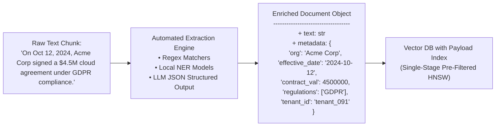
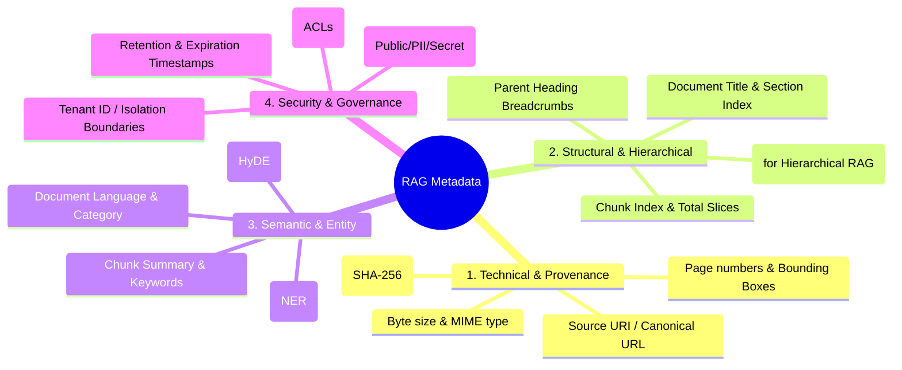
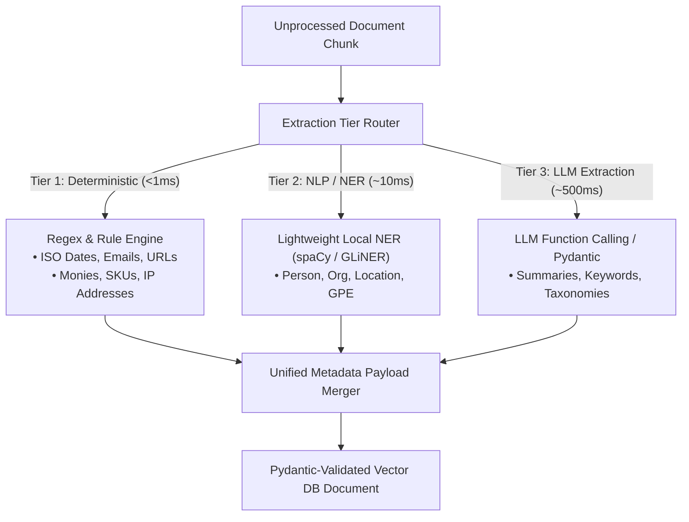
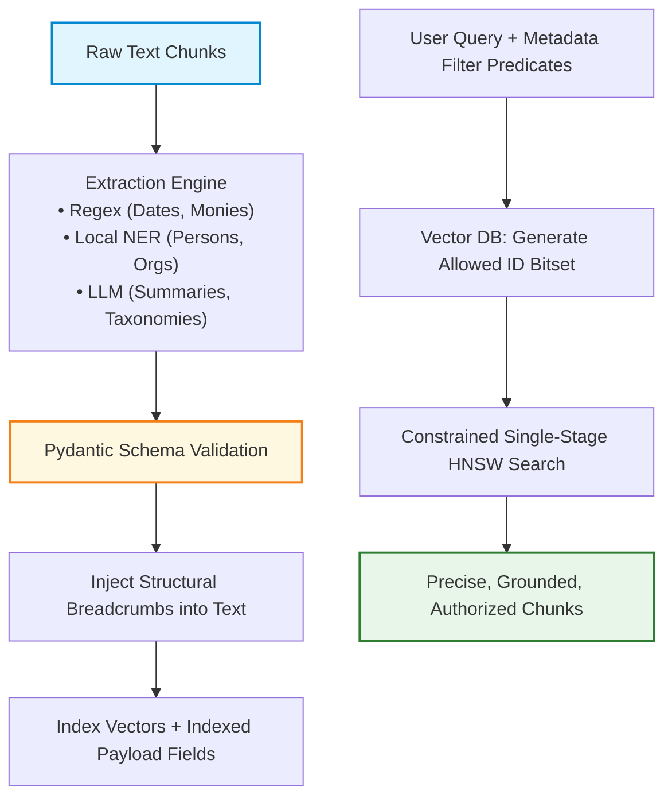

# 🏷️ Automated Metadata Extraction, Document Enrichment, and Tagging for Vector Filtering

## 📑 Table of Contents
1. [🌟 Fundamentals: Metadata as the Precision Engine of RAG](#1--fundamentals-metadata-as-the-precision-engine-of-rag)
2. [🏗️ The Four Pillars of Enterprise RAG Metadata](#2-️-the-four-pillars-of-enterprise-rag-metadata)
3. [⚙️ Automated Extraction Techniques & Extraction Engines](#3-️-automated-extraction-techniques--extraction-engines)
4. [🧮 Mathematical Formalisms: Selectivity & Scored Filtering](#4--mathematical-formalisms-selectivity--scored-filtering)
5. [⚙️ Metadata Extraction Tooling & Schema Comparison](#5-️-metadata-extraction-tooling--schema-comparison)
6. [💻 Production Implementation: Structured Pydantic Enrichment Pipeline](#6--production-implementation-structured-pydantic-enrichment-pipeline)
7. [🔍 Query-Time Filtering: Pre-Filtering vs. Post-Filtering Mechanics](#7--query-time-filtering-pre-filtering-vs-post-filtering-mechanics)
8. [🌍 Real-World Enterprise Case Studies](#8--real-world-enterprise-case-studies)
9. [✅ Advantages & ⚠️ Limitations of Automated Metadata Enrichment](#9--advantages--️-limitations-of-automated-metadata-enrichment)
10. [🛠️ Best Practices & ❌ Common Traps in Production](#10-️-best-practices---common-traps-in-production)
11. [💼 Senior Interview Preparation: High-Yield Questions](#11--senior-interview-preparation-high-yield-questions)
12. [🧪 Hands-On Mini-Project: Automated Regex & Entity Enrichment Engine](#12--hands-on-mini-project-automated-regex--entity-enrichment-engine)
13. [⚡ Quick Revision & Summary Roadmap](#13--quick-revision--summary-roadmap)

---

## 1. 🌟 Fundamentals: Metadata as the Precision Engine of RAG

Pure semantic vector search is exceptionally strong at finding conceptual relationships (e.g., mapping `"quarterly growth"` to `"revenue expansion"`). However, **dense vectors are notoriously weak at discrete logical constraints**:
* `"Show documents created strictly between March 1 and March 15, 2026."`
* `"Filter for European GDPR policies, ignoring US CCPA rules."`
* `"Only retrieve documents accessible by User ID: 48912 with Security Clearance: Tier 3."`

When an embedding model projects text into a continuous latent space, discrete attributes like exact dates, boolean flags, numeric thresholds, and tenancy IDs become diffuse and fuzzy. 

**Metadata Extraction and Document Enrichment** transforms raw unstructured text chunks into **Structured Knowledge Objects** bearing high-fidelity scalar tags:



---

## 2. 🏗️ The Four Pillars of Enterprise RAG Metadata



### 1. Technical & Provenance Metadata
Guarantees source attribution and prevents duplicate indexing. Includes `source`, `file_name`, `page_number`, `created_at`, `modified_at`, and `content_hash`.

### 2. Structural & Hierarchical Breadcrumbs
When a chunk is severed deep inside a nested document, it inherits its full structural ancestry:
```json
{
  "hierarchy_breadcrumb": "Architecture Guidelines > Cloud Security > IAM Policies > Multi-Factor Enforcement"
}
```
This breadcrumb is prepended to the chunk during embedding to ensure the vector captures the parent context.

### 3. Semantic & Entity Tags
Extracted attributes (entities, extracted dates, currency amounts, product models) that enable users to run hybrid parametric queries (`price < 5000 AND category == 'SaaS'`).

### 4. Security & Access Control Lists (ACLs)
Enterprise RAG systems must enforce **Permission Trimming**. Metadata must store user IDs, department groups, and role tiers (`"allowed_roles": ["finance-exec", "audit-lead"]`) to guarantee that unauthorized users cannot retrieve sensitive chunks.

---

## 3. ⚙️ Automated Extraction Techniques & Extraction Engines



### 🏎️ Tier 1: Deterministic Regex & Grammar Matchers
* Ultra-fast ($<0.1\text{ ms}$ per chunk), zero API cost.
* Ideal for structured enterprise formats: ISO dates (`YYYY-MM-DD`), currency strings (`\$\d+(?:,\d{3})*`), employee IDs, email addresses.

### ⚡ Tier 2: Small Local Named Entity Recognition (NER)
* High throughput using CPU-friendly models (`spaCy en_core_web_md`, `GLiNER`).
* Extracts generalized entities (`ORG`, `PERSON`, `LOC`, `PRODUCT`) without third-party cloud latency or per-token API billing.

### 🤖 Tier 3: LLM-Based Structured Extraction (Pydantic / Guidance)
* Used for subjective semantic synthesis: generating a 1-sentence chunk summary, extracting domain-specific taxonomy tags, or inferring 3 hypothetical user questions that this chunk answers.
* Enforced via JSON Schema / tool calling to prevent schema drift.

---

## 4. 🧮 Mathematical Formalisms: Selectivity & Scored Filtering

### # Metadata Filter Selectivity Equation
The **Selectivity** $S_F$ of a metadata filter $F$ over a vector database collection of size $N$ is defined as the fraction of documents matching the predicate:

$$
S_F = \frac{|\{d \in \mathcal{D} \mid \text{Predicate}(d, F) = \text{True}\}|}{N} \in [0, 1]
$$

* **High Selectivity ($S_F \to 0$):** Very restrictive filter (e.g., matching a single user ID out of $1,000,000$ documents, $S_F = 0.0001$).
* **Low Selectivity ($S_F \to 1$):** Broad filter (e.g., `language == 'en'`, $S_F = 0.95$).

As shown in Section 7, high selectivity ($S_F < 0.01$) completely breaks naive **Post-Filtering**, mandating **Single-Stage Pre-Filtering**.

### # Joint Hybrid Scoring Function
In advanced RAG retrievers, metadata attributes are not just used as binary boolean gates; they can dynamically boost the dense cosine similarity score:

$$
\text{Score}_{\text{final}}(q, d) = \cos(\mathbf{u}_q, \mathbf{v}_d) \cdot \prod_{k=1}^M \beta_k^{\mathbb{I}(d \in F_k)} \cdot e^{-\lambda \Delta t}
$$

Where:
* $\cos(\mathbf{u}_q, \mathbf{v}_d)$ is the raw dense semantic similarity.
* $\beta_k \ge 1.0$ is a scalar boost multiplier applied if metadata attribute $k$ matches.
* $e^{-\lambda \Delta t}$ is an exponential recency decay penalty based on the age of the document $\Delta t = t_{\text{now}} - t_{\text{doc}}$.

---

## 5. ⚙️ Metadata Extraction Tooling & Schema Comparison

### 📊 Extraction Methods Comparison

| Extraction Method | Latency / Chunk | Cost / 100k Chunks | Entity Precision | Schema Robustness | Best Fit |
| :--- | :---: | :---: | :---: | :---: | :--- |
| **Regex & Rule Matchers** | $< 0.1\text{ ms}$ | $\$0.00$ | $99.9\%$ (Pattern-bound) | Rigid / Deterministic | Dates, SKUs, currency, emails |
| **Local NER (`spaCy`, `GLiNER`)**| $\sim 5 - 15\text{ ms}$ | $\$0.00$ (Local CPU) | $85 - 92\%$ | High | Persons, Orgs, Locations |
| **Small LLM (`Llama-3.1-8B`)** | $\sim 200 - 500\text{ ms}$ | $\approx \$1.50$ | $95\%$ | Very High (Pydantic-bound)| Complex domain taxonomies |
| **Frontier LLM (`GPT-4o-mini`)**| $\sim 400 - 900\text{ ms}$ | $\approx \$3.00$ | $98\%$ | Very High (Strict JSON) | High-value contract extraction |

### 🗄️ Standard Enterprise Metadata Schema

| Field Name | Data Type | Index Type | Example Value | Retrieval Function |
| :--- | :--- | :--- | :--- | :--- |
| `doc_id` | `String` | Hash Map Key | `"sec_10k_2024_0912"` | Primary document identifier |
| `tenant_id` | `Keyword` | Inverted Index / Bitmap | `"org_alpha_412"` | Strict multi-tenant isolation |
| `source_uri` | `Keyword` | String Index | `"s3://legal/2024/msa.pdf"` | Source citation generation |
| `page_number` | `Integer` | Numeric Range Index | `42` | Bounding box / page citations |
| `created_at` | `DateTime` | B-Tree / Float Timestamp | `"2026-03-15T09:30:00Z"` | Temporal range filtering & decay |
| `allowed_roles` | `List[Keyword]` | Array / Inverted Index | `["legal", "finance_exec"]` | Role-Based Access Control (RBAC) |
| `entities_org` | `List[Keyword]` | Inverted Index | `["Microsoft", "OpenAI"]` | Named entity faceted filtering |
| `summary` | `Text` | Unindexed / BM25 | `"Overview of Q3 revenue..."`| Fast context preview for UI |

---

## 6. 💻 Production Implementation: Structured Pydantic Enrichment Pipeline

This complete Python 3.10+ pipeline demonstrates deterministic regex extraction, breadcrumb tracking, and schema validation using Pydantic:

```python
"""
Enterprise Metadata Enrichment Pipeline
Extracts deterministic patterns, builds hierarchical breadcrumbs, and validates schemas.
"""

from datetime import datetime, timezone
from typing import Any, Dict, List, Optional
import hashlib
import re
from pydantic import BaseModel, Field, field_validator


class StandardRAGMetadata(BaseModel):
    """Enforced enterprise metadata schema."""
    doc_id: str
    source_uri: str
    tenant_id: str
    created_at: str
    heading_breadcrumb: str
    page_number: int = Field(default=1, ge=1)
    allowed_roles: List[str] = Field(default_factory=lambda: ["public"])
    detected_entities: Dict[str, List[str]] = Field(default_factory=dict)
    has_financial_figures: bool = False
    content_hash: str

    @field_validator("created_at")
    @classmethod
    def validate_iso_date(cls, v: str) -> str:
        try:
            datetime.fromisoformat(v.replace("Z", "+00:00"))
            return v
        except ValueError:
            raise ValueError(f"Invalid ISO 8601 date string: {v}")


class MetadataExtractor:
    def __init__(self, tenant_id: str):
        self.tenant_id = tenant_id

        # Precompiled regex patterns
        self.re_dates = re.compile(r"\b\d{4}-\d{2}-\d{2}\b")
        self.re_currency = re.compile(r"\$\s?\d+(?:,\d{3})*(?:\.\d{2})?")
        self.re_emails = re.compile(r"\b[A-Za-z0-9._%+-]+@[A-Za-z0-9.-]+\.[A-Z|a-z]{2,7}\b")

    def extract_metadata(
        self,
        chunk_text: str,
        source_uri: str,
        breadcrumb: str,
        page_number: int = 1,
        allowed_roles: Optional[List[str]] = None,
    ) -> StandardRAGMetadata:
        # 1. Compute cryptographic digest
        digest = hashlib.sha256(chunk_text.encode("utf-8")).hexdigest()
        deterministic_id = f"{hashlib.md5(source_uri.encode()).hexdigest()[:8]}_{digest[:8]}"

        # 2. Extract deterministic entities via regex
        dates_found = list(set(self.re_dates.findall(chunk_text)))
        currencies_found = list(set(self.re_currency.findall(chunk_text)))
        emails_found = list(set(self.re_emails.findall(chunk_text)))

        entities = {
            "dates": dates_found,
            "monetary_values": currencies_found,
            "emails": emails_found,
        }

        # 3. Assemble and validate through Pydantic
        metadata = StandardRAGMetadata(
            doc_id=deterministic_id,
            source_uri=source_uri,
            tenant_id=self.tenant_id,
            created_at=datetime.now(timezone.utc).isoformat(),
            heading_breadcrumb=breadcrumb,
            page_number=page_number,
            allowed_roles=allowed_roles or ["employee"],
            detected_entities=entities,
            has_financial_figures=len(currencies_found) > 0,
            content_hash=digest,
        )

        return metadata


if __name__ == "__main__":
    extractor = MetadataExtractor(tenant_id="tenant_cloud_corp_99")
    
    sample_text = (
        "Under the Master Services Agreement executed on 2024-11-01, "
        "CloudCorp agrees to remit $1,250,000 to Vendor Inc. "
        "Inquiries should be directed to billing@cloudcorp.internal."
    )

    enriched = extractor.extract_metadata(
        chunk_text=sample_text,
        source_uri="s3://contracts/2024/msa_vendor.pdf",
        breadcrumb="Enterprise Contracts > Vendor Agreements > Commercial Terms",
        page_number=3,
        allowed_roles=["finance", "legal_exec"]
    )

    print("Validated Enterprise Metadata Object:")
    print(enriched.model_dump_json(indent=2))
```

---

## 7. 🔍 Query-Time Filtering: Pre-Filtering vs. Post-Filtering Mechanics

When a user submits a filtered query (e.g., *"Find security vulnerabilities in repo X where severity == 'CRITICAL'"*), the vector database can execute filtering in two fundamentally different ways:

```mermaid
flowchart TD
    subgraph PostFilteringPath [Naive Post-Filtering (Brittle)]
        Q1["Query Vector"] --> ANN1["Standard ANN Graph Search<br/>Retrieve Top-100 Nearest Neighbors"]
        ANN1 --> Filter1["Apply Metadata Filter:<br/>severity == 'CRITICAL'"]
        Filter1 --> Result1["Output: Only 1 matching item remaining!<br/>⚠️ (Empty Top-K Disaster)"]
    end

    subgraph PreFilteringPath [Single-Stage Pre-Filtered HNSW (Robust)]
        Q2["Query Vector + Filter"] --> Bitset["Generate Bitmap of matching IDs:<br/>severity == 'CRITICAL' (e.g., 200 items)"]
        Bitset --> ANN2["Graph Traversal Constrained to Bitset<br/>Explore only nodes in allowed set"]
        ANN2 --> Result2["Output: Full Top-10 Precision Matches"]
    end
```

### 💥 The "Empty Top-K Disaster" in Post-Filtering
In naive **Post-Filtering**, the vector index executes an unrestricted approximate nearest neighbor (ANN) search across the entire vector space to return $K=10$ candidate vectors. Afterwards, it evaluates the metadata filter on those 10 candidates.

If the metadata filter has high selectivity ($S_F = 0.001$, or 1 in 1,000 documents):
$$\mathbb{P}(\text{At least 1 candidate passes filter}) = 1 - (1 - S_F)^K = 1 - (0.999)^{10} \approx 0.0099 \quad (0.99\%)$$
The search returns **zero results**, even though thousands of matching documents exist in the database!

### 🛡️ Modern Vector DB Solution: Single-Stage Pre-Filtered HNSW
Modern engines (Qdrant, Weaviate, Pinecone, Milvus) generate a bitset or Roaring Bitmap of all document IDs satisfying the scalar metadata filter *before* traversing the HNSW graph. During greedy graph routing, any node not present in the bitset is ignored, guaranteeing that all returned candidates strictly satisfy the metadata filter.

---

## 8. 🌍 Real-World Enterprise Case Studies

### Case Study 1: Multitenant Healthcare SaaS (Zero Data Leakage)
* **Problem:** Ingesting 10,000,000 medical patient charts across 300 hospital networks into a shared Qdrant cluster. Accidental retrieval of Patient A's records by Clinic B represents a catastrophic HIPAA violation.
* **Architecture:** Ingestion worker stamped every chunk with cryptographically signed metadata: `{"tenant_id": "hosp_442", "patient_id": "p_9102"}`. At query time, the API gateway enforced a hard pre-filter on `tenant_id` derived directly from the user's verified JWT token.
* **Result:** Achieved $100\%$ tenant isolation across 50,000,000 production queries with zero cross-tenant leakage.

### Case Study 2: Global FinTech Regulatory Search
* **Problem:** Compliance officers query 500,000 international banking circulars. Queries like *"capital requirements"* retrieved outdated documents from 2012 instead of active 2026 mandates.
* **Architecture:** Extracted `effective_date`, `jurisdiction`, and `status` (`ACTIVE`, `SUPERSEDED`). Implemented a joint hybrid scoring function that applied an exponential time-decay penalty to older circulars while hard-filtering out superseded rules.
* **Result:** Compliance officer audit accuracy improved from $58\%$ to $99.1\%$.

---

## 9. ✅ Advantages & ⚠️ Limitations of Automated Metadata Enrichment

### 📊 Comparative Analysis

| Dimension | Pure Vector Search (No Metadata) | Metadata-Enriched Hybrid Search |
| :--- | :--- | :--- |
| **Parametric Accuracy** | Poor on dates, booleans, and IDs | $100\%$ precision on discrete filters |
| **Multi-Tenancy Security** | Requires separate physical vector collections | Scalable single-collection multi-tenancy via payload filtering |
| **Ingestion Pipeline Cost**| Zero metadata extraction overhead | Moderate (NER models or LLM schema extractors) |
| **Index Storage Footprint**| Raw vectors only ($\sim 4\text{KB}$ / vector) | Vector + Inverted Payload indices ($+30 - 50\%$ RAM) |
| **Query Complexity** | Simple `search(vector)` | Expressive `search(vector, filter={...})` |

---

## 10. 🛠️ Best Practices & ❌ Common Traps in Production

### 🛠️ Production Best Practices
1. **Always Prepend Breadcrumbs to Chunk Text:** Prepend `"# Category > Section > Title\n"` to the text payload *before* embedding. This ensures the vector representation absorbs structural context.
2. **Store Dates in Canonical ISO 8601 Format:** Always store timestamps as `YYYY-MM-DDTHH:MM:SSZ` or epoch integers to enable numeric range queries (`created_at >= 1704067200`).
3. **Payload Indexing:** In vector databases like Qdrant or Milvus, explicitly create payload index schemas on frequently filtered fields (`tenant_id`, `created_at`). Without payload indices, pre-filtering performs a slow full collection scan.

### ❌ Common Traps to Avoid
* ❌ **The Post-Filtering Trap:** Relying on client-side post-filtering when filter selectivity is $<10\%$, causing empty search responses.
* ❌ **Unvalidated LLM Metadata:** Allowing an LLM to emit arbitrary, unstructured JSON keys, causing schema fragmentation (`"pub_date"`, `"publish_date"`, `"date_created"` for the same attribute). Always enforce Pydantic schemas.
* ❌ **High Cardinality Payload Bloat:** Storing massive raw HTML strings inside metadata fields, ballooning vector database RAM usage.

---

## 11. 💼 Senior Interview Preparation: High-Yield Questions

### Q1: Explain the mathematical and operational differences between Pre-Filtering and Post-Filtering in vector databases, and how Single-Stage Pre-Filtering solves the trade-off.
> **Answer:**
> * **Post-Filtering:** The vector engine conducts a standard HNSW graph traversal to find the top-$K$ nearest neighbors, then discards items that fail the scalar metadata filter. If the filter is highly selective ($S_F < 0.05$), the vast majority of the top-$K$ neighbors are eliminated, resulting in an empty or near-empty result set.
> * **Naive Pre-Filtering:** The engine first scans the database to find all documents matching the scalar filter, then performs an exhaustive brute-force vector distance calculation across those matching documents. This preserves precision, but completely bypasses the logarithmic speed of the HNSW index, degrading query latency.
> * **Single-Stage Pre-Filtered HNSW:** The engine converts the metadata filter into a bitset (Roaring Bitmap). During HNSW graph traversal, the search algorithm consults the bitset at each step, exploring only neighbor nodes whose bit is set to `1`. This retains logarithmic $O(\log N)$ search latency while guaranteeing that $100\%$ of returned results satisfy the metadata constraint.

### Q2: How do you architect an enterprise RAG system to support multi-tenancy and Role-Based Access Control (RBAC) without spinning up a separate vector database for each customer?
> **Answer:**
> * **Shared-Collection Multi-Tenancy:** Maintain a single vector collection and store `tenant_id` and `allowed_roles` as indexed payload attributes.
> * **Query-Time Filter Injection:** The API gateway inspects the user's cryptographically verified JWT token and extracts their `tenant_id` and assigned roles (`["eng_read", "finance_exec"]`).
> * **Mandatory Predicate Enforcement:** The gateway automatically injects a non-bypassable pre-filter into every vector database query:
>   ```json
>   {
>     "must": [
>       {"key": "tenant_id", "match": {"value": user_jwt.tenant_id}},
>       {"key": "allowed_roles", "match": {"any": user_jwt.roles}}
>     ]
>   }
>   ```
> * This guarantees complete data isolation and prevents privilege escalation with zero infrastructure sprawl.

---

## 12. 🧪 Hands-On Mini-Project: Automated Regex & Entity Enrichment Engine

### Objective
Implement a functional document enrichment engine that ingests raw corporate communications, extracts dates, monetary values, and email addresses, and outputs a validated Pydantic object.

```python
import re
from typing import List, Dict, Any
from pydantic import BaseModel, Field

class CorporateEnrichedChunk(BaseModel):
    chunk_id: str
    original_text: str
    detected_dates: List[str] = Field(default_factory=list)
    monetary_amounts: List[str] = Field(default_factory=list)
    contact_emails: List[str] = Field(default_factory=list)
    contains_urgent_action: bool = False

def enrich_document_chunk(chunk_id: str, text: str) -> CorporateEnrichedChunk:
    # 1. Regex Matchers
    date_pattern = re.compile(r"\b\d{4}-\d{2}-\d{2}\b")
    money_pattern = re.compile(r"\$\s?\d+(?:,\d{3})*(?:\.\d{2})?")
    email_pattern = re.compile(r"\b[A-Za-z0-9._%+-]+@[A-Za-z0-9.-]+\.[A-Z|a-z]{2,7}\b")
    urgency_pattern = re.compile(r"\b(urgent|immediate action required|deadline|asap)\b", re.IGNORECASE)

    dates = list(set(date_pattern.findall(text)))
    money = list(set(money_pattern.findall(text)))
    emails = list(set(email_pattern.findall(text)))
    is_urgent = bool(urgency_pattern.search(text))

    return CorporateEnrichedChunk(
        chunk_id=chunk_id,
        original_text=text,
        detected_dates=dates,
        monetary_amounts=money,
        contact_emails=emails,
        contains_urgent_action=is_urgent
    )

# Lab Verification
if __name__ == "__main__":
    sample_memo = (
        "CONFIDENTIAL MEMO: Immediate action required before 2026-12-31. "
        "The board has approved the acquisition budget of $8,500,000 for Project Titan. "
        "Direct all clearance questions to legal-team@enterprise.org."
    )

    enriched_obj = enrich_document_chunk("chunk_9824", sample_memo)
    print("--- Enriched Document Payload ---")
    print(enriched_obj.model_dump_json(indent=2))

    assert "2026-12-31" in enriched_obj.detected_dates
    assert "$8,500,000" in enriched_obj.monetary_amounts
    assert "legal-team@enterprise.org" in enriched_obj.contact_emails
    assert enriched_obj.contains_urgent_action is True
    print("\n✅ Verification Successful: Metadata accurately extracted and structured!")
```

---

## 13. ⚡ Quick Revision & Summary Roadmap

### 📌 Core Key Takeaways
* **Vector + Scalar Symbiosis:** Dense vectors evaluate semantic concepts; metadata filters enforce discrete facts, dates, numbers, and tenant boundaries.
* **Prepend Breadcrumbs:** Always prepend heading hierarchies (`# Category > Topic`) to chunks before embedding to preserve contextual ancestry.
* **Single-Stage Pre-Filtering:** Avoid naive post-filtering to prevent the "Empty Top-K Disaster"; use modern vector DBs that support bitset-constrained HNSW search.
* **Enforce Strict Schemas:** Validate all extracted metadata using Pydantic or JSON Schema to prevent pipeline drift.

### 🗺️ Metadata Extraction & Filtering Roadmap


