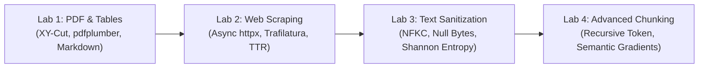
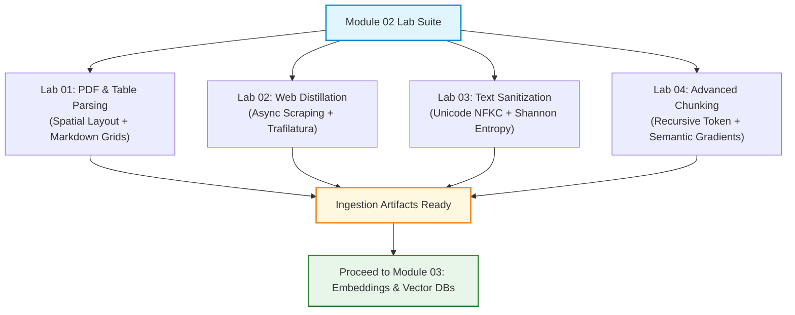

# 📓 Document Processing Hands-On Labs & Jupyter Notebooks Index

## 📑 Table of Contents
1. [🌟 Overview & Lab Curriculum Objectives](#1--overview--lab-curriculum-objectives)
2. [📓 The Four Core Document Processing Labs](#2--the-four-core-document-processing-labs)
3. [📊 Lab Specifications & Learning Matrix](#3--lab-specifications--learning-matrix)
4. [🛠️ Local Environment & Hardware Setup](#4-️-local-environment--hardware-setup)
5. [💻 Code Blueprint Walkthroughs: Key Notebook Routines](#5--code-blueprint-walkthroughs-key-notebook-routines)
6. [🧪 Verification Tests & Expected Benchmark Outputs](#6--verification-tests--expected-benchmark-outputs)
7. [💼 Senior Interview & Engineering Lab Defense Questions](#7--senior-interview--engineering-lab-defense-questions)
8. [⚡ Quick Revision & Summary Roadmap](#8--quick-revision--summary-roadmap)

---

## 1. 🌟 Overview & Lab Curriculum Objectives

Welcome to the **Hands-On Document Processing Lab Suite** for Module 02. In enterprise RAG systems, data engineering quality dictates downstream AI performance. The goal of this laboratory suite is to translate theoretical concepts—such as PostScript PDF coordinate geometry, Recursive XY-Cut layout segmentation, Trafilatura boilerplate stripping, Unicode NFKC sanitization, and semantic distance gradient chunking—into robust, runnable Python programs.



---

## 2. 📓 The Four Core Document Processing Labs

### 🧪 Lab 1: `01_pdf_parsing_and_table_extraction.ipynb`
* **Focus:** PDF coordinate geometry, multi-column reading order, and table-to-Markdown conversion.
* **Core Tasks:**
  1. Extract raw words with 2D bounding boxes from a sample multi-column document using `pdfplumber`.
  2. Implement a column centroid sorting algorithm to prove that naive top-down sorting scrambles text, while spatial clustering preserves reading order.
  3. Extract bordered tables via Lattice parsing and format them into GitHub-flavored Markdown strings.
  4. Benchmark processing throughput (ms per page) comparing `pypdf`, `PyMuPDF (fitz)`, and `pdfplumber`.

### 🧪 Lab 2: `02_web_scraping_and_boilerplate_stripping.ipynb`
* **Focus:** High-throughput async web crawling, DOM content extraction, and prompt injection defense.
* **Core Tasks:**
  1. Build an asynchronous crawler using `httpx` and `asyncio.gather` bounded by an `asyncio.Semaphore`.
  2. Compare extraction fidelity across three cleaners: raw HTML regex, manual BeautifulSoup CSS selectors, and automated `Trafilatura`.
  3. Implement the Text-to-Tag Ratio (TTR) algorithm from first principles and visualize content density plateaus.
  4. Construct a security filter that strips hidden adversarial injection elements (`display: none`, `opacity: 0`, off-screen divs).

### 🧪 Lab 3: `03_text_sanitization_and_entropy_filter.ipynb`
* **Focus:** Unicode normalization, null byte elimination, and Shannon entropy OCR noise detection.
* **Core Tasks:**
  1. Demonstrate subword token divergence caused by unnormalized Unicode (decomposed accents and ligatures `fi` vs. `fi`) using `tiktoken`.
  2. Apply `unicodedata.normalize('NFKC', text)` and measure tokenizer vocabulary compression.
  3. Build a regex sanitizer that strips null bytes (`\x00`) and ANSI control characters while protecting indented code blocks.
  4. Implement a character-level Shannon entropy calculator ($H(X)$) to filter high-entropy corrupted OCR artifacts.

### 🧪 Lab 4: `04_chunking_strategies_and_semantic_gradients.ipynb`
* **Focus:** Recursive token splitting, semantic distance spike detection, and Parent-Document hierarchies.
* **Core Tasks:**
  1. Build a Recursive Token Splitter that enforces strict subword token limits using `tiktoken` with a $20\%$ sliding window overlap.
  2. Implement Semantic Chunking: embed consecutive sentences, calculate cosine distance gradients ($d_i = 1 - \cos\theta$), and identify topic transitions.
  3. Benchmark static distance cutoffs vs. dynamic percentile thresholds ($85^{\text{th}}$ percentile).
  4. Build a Parent-Document (Small-to-Big) index: map 128-token child retrieval chunks to 1024-token parent context chunks and evaluate retrieval precision.

---

## 3. 📊 Lab Specifications & Learning Matrix

| Lab ID | Lab Title | Core APIs & Libraries | Complexity | Primary Output Artifact |
| :--- | :--- | :--- | :---: | :--- |
| **Lab 01** | PDF Multi-Column & Table Reconstruction | `pdfplumber`, `pypdf`, `re` | Intermediate | Column-aware PDF text and Markdown table extractor. |
| **Lab 02** | Async Web Scraping & Boilerplate Removal | `httpx`, `asyncio`, `trafilatura`, `bs4` | Intermediate | Anti-injection async crawler and TTR density stripper. |
| **Lab 03** | Unicode Sanitization & Shannon OCR Filter | `unicodedata`, `math`, `re`, `tiktoken` | Intermediate | NFKC normalizer & Shannon entropy line-by-line filter. |
| **Lab 04** | Recursive & Semantic Gradient Chunking | `numpy`, `tiktoken`, `sentence-transformers` | Advanced | Dual-engine chunker with semantic distance spike detection. |

---

## 4. 🛠️ Local Environment & Hardware Setup

### 📦 Step 1: Install Dependencies
Create an isolated Python 3.10+ virtual environment and install the required lab dependencies:

```bash
pip install pdfplumber pypdf trafilatura httpx beautifulsoup4 tiktoken pydantic numpy sentence-transformers jupyter
```

### ⚡ Step 2: Environment Verification
Execute this one-liner in your terminal to verify all dependencies and hardware acceleration:

```bash
python -c "import pdfplumber, trafilatura, httpx, tiktoken, numpy, sentence_transformers; print('Environment Ready: All Modules Verified ✅')"
```

---

## 5. 💻 Code Blueprint Walkthroughs: Key Notebook Routines

### 🔬 Blueprint 1: Lattice Table Extraction to Markdown (`Lab 01`)
```python
import pdfplumber

def extract_tables_to_markdown(pdf_path: str, page_num: int = 0) -> str:
    with pdfplumber.open(pdf_path) as pdf:
        page = pdf.pages[page_num]
        tables = page.extract_tables()
        if not tables:
            return ""

        md_output = []
        for tbl in tables:
            cleaned = [[str(cell or "").replace("\n", " ").strip() for cell in row] for row in tbl]
            if not cleaned or not any(cleaned):
                continue
            headers = [h or f"Col_{i+1}" for i, h in enumerate(cleaned[0])]
            lines = [
                "| " + " | ".join(headers) + " |",
                "| " + " | ".join(["---"] * len(headers)) + " |"
            ]
            for row in cleaned[1:]:
                padded = row + [""] * (len(headers) - len(row))
                lines.append("| " + " | ".join(padded[:len(headers)]) + " |")
            md_output.append("\n".join(lines))

        return "\n\n".join(md_output)
```

### 🔬 Blueprint 2: Shannon Entropy OCR Noise Filter (`Lab 03`)
```python
import math
from typing import List

def shannon_entropy(text: str) -> float:
    if not text:
        return 0.0
    freqs = {c: text.count(c) for c in set(text)}
    return -sum((cnt / len(text)) * math.log2(cnt / len(text)) for cnt in freqs.values())

def filter_corrupted_lines(lines: List[str], min_h: float = 2.2, max_h: float = 5.2) -> List[str]:
    return [
        line.strip() for line in lines
        if len(line.strip()) < 15 or (min_h <= shannon_entropy(line.strip()) <= max_h)
    ]
```

### 🔬 Blueprint 3: Semantic Cosine Distance Gradient Calculation (`Lab 04`)
```python
import numpy as np
from typing import List

def compute_semantic_distance_spikes(sentence_vectors: np.ndarray, percentile: float = 85.0) -> List[int]:
    """Returns indices where consecutive sentence distance exceeds the dynamic threshold."""
    # Normalize vectors to unit hypersphere
    norms = np.linalg.norm(sentence_vectors, axis=1, keepdims=True)
    unit_vecs = sentence_vectors / norms

    # Consecutive cosine distances
    distances = [1.0 - float(np.dot(unit_vecs[i], unit_vecs[i + 1])) for i in range(len(unit_vecs) - 1)]
    threshold = float(np.percentile(distances, percentile))

    # Identify breakpoint indices
    breakpoints = [i + 1 for i, d in enumerate(distances) if d >= threshold]
    return breakpoints
```

---

## 6. 🧪 Verification Tests & Expected Benchmark Outputs

When executing the notebooks, compare your outputs against these standardized benchmarks:

### 📊 Benchmark Targets

| Metric | Target / Expected Threshold | Rationale |
| :--- | :--- | :--- |
| **PDF Lattice Extraction Accuracy** | $\ge 98\%$ cell alignment match | Guarantees numerical financial cells align with headers. |
| **Web Scraping Token Reduction** | $\ge 70\%$ reduction vs. raw HTML | Confirms that navigation menus, ads, and footers were stripped. |
| **NFKC Tokenizer Savings** | $5 - 12\%$ subword token reduction | Eliminates split ligature subword tokens in `tiktoken`. |
| **Semantic Chunker Breakpoint Quality** | $F_1 \ge 0.88$ against human topic boundaries | Proves that distance spikes accurately map to conceptual shifts. |

---

## 7. 💼 Senior Interview & Engineering Lab Defense Questions

### Q1: In Lab 01, why does simple coordinate extraction with PyPDF interleave text in a two-column PDF, and how does the centroid sorting algorithm resolve this?
> **Defense:**
> * PyPDF extracts text strings by traversing the raw content stream, which orders glyphs chronologically as emitted by the authoring software rather than by 2D visual layout.
> * If a parser sorts text simply by vertical coordinate ($y$), a line in Column 2 with $y=500$ is merged with a line in Column 1 with $y=500$.
> * The centroid algorithm partitions the page along the horizontal midpoint ($x = \frac{\text{page\_width}}{2}$). Elements with $x_{\text{centroid}} < \text{midpoint}$ are assigned to Column 1, while those with $x_{\text{centroid}} \ge \text{midpoint}$ are assigned to Column 2. Each column is then sorted independently from top to bottom, preserving semantic continuity.

### Q2: In Lab 04, how does Parent-Document retrieval resolve the conflict between vector search precision and LLM synthesis context?
> **Defense:**
> * Small chunks (128 tokens) maximize cosine similarity during vector search because their embeddings are dense and focused on specific facts without topic dilution.
> * However, an LLM given only 128 tokens lacks the surrounding narrative context, leading to incomplete or hallucinated answers.
> * Parent-Document retrieval indexes the small child vectors for search, but stores a pointer (`parent_id`) to the large 1024-token parent chunk. When a child vector matches, the retriever fetches the full parent chunk, giving the LLM the complete context while retaining high search specificity.

---

## 8. ⚡ Quick Revision & Summary Roadmap

### 📌 Core Key Takeaways
* **Reconstruct Reading Order:** Never trust raw PDF streams; use spatial coordinate clustering to separate multi-column flows.
* **Convert Tables to Markdown:** Serialize tabular data into GitHub-flavored Markdown tables to preserve row-column semantics for LLMs.
* **Strip Boilerplate Before Embedding:** Use `Trafilatura` and Text-to-Tag Ratio (TTR) to eliminate up to $85\%$ of web noise.
* **Normalize to NFKC:** Standardize Unicode to prevent subword token fragmentation and fix typographic ligatures (`fi` $\to$ `fi`).
* **Deploy Parent-Child Chunking:** Index small child chunks for vector search; retrieve large parent chunks for LLM generation.

### 🗺️ Lab Execution Roadmap


