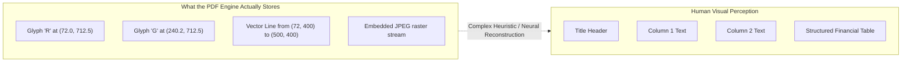
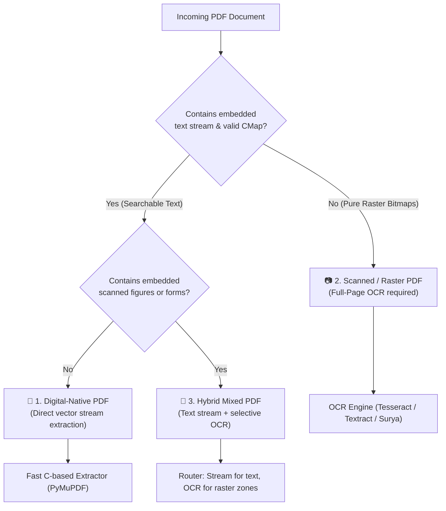
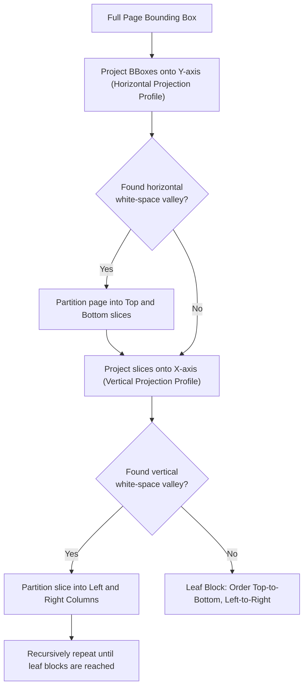
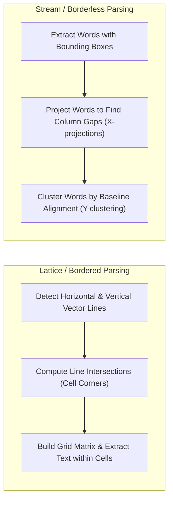
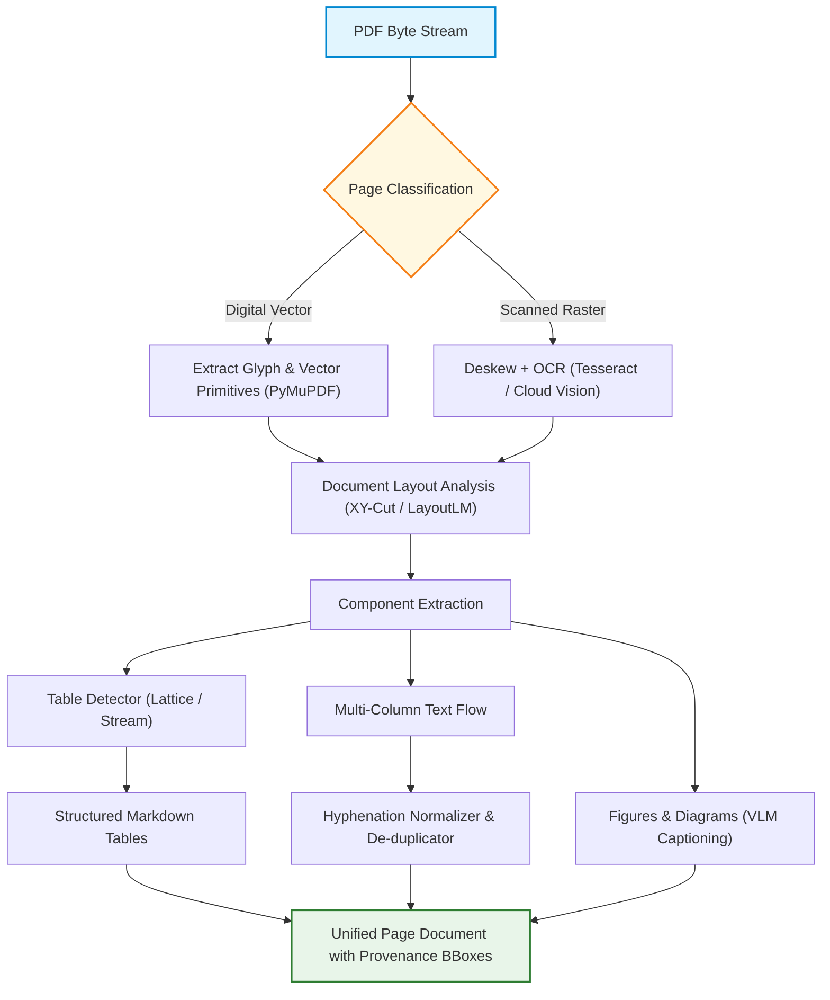

# 📄 Enterprise PDF Processing: OCR, Layout Parsing & Table Extraction

## 📑 Table of Contents
1. [🌟 The Internal Anatomy of PDFs: Why PDF Parsing Is Hard](#1--the-internal-anatomy-of-pdfs-why-pdf-parsing-is-hard)
2. [🏗️ Digital vs. Scanned vs. Hybrid PDF Triad](#2-️-digital-vs-scanned-vs-hybrid-pdf-triad)
3. [🔬 Document Layout Analysis (DLA) & Reading Order Reconstruction](#3--document-layout-analysis-dla--reading-order-reconstruction)
4. [📊 Table Extraction Mechanics: Lattice vs. Stream Strategies](#4--table-extraction-mechanics-lattice-vs-stream-strategies)
5. [🧮 Mathematical & Geometric Formalisms in PDF Parsing](#5--mathematical--geometric-formalisms-in-pdf-parsing)
6. [⚙️ The Modern PDF Processing Tooling Matrix](#6-️-the-modern-pdf-processing-tooling-matrix)
7. [💻 Production Implementation: High-Fidelity Column & Table Parser](#7--production-implementation-high-fidelity-column--table-parser)
8. [👁️ Vision-Language Models (VLMs) & ColPali Revolution](#8-️-vision-language-models-vlms--colpali-revolution)
9. [🌍 Real-World Enterprise Case Studies](#9--real-world-enterprise-case-studies)
10. [✅ Advantages & ⚠️ Limitations of PDF Ingestion Pipelines](#10--advantages--️-limitations-of-pdf-ingestion-pipelines)
11. [🛠️ Best Practices & ❌ Common Production Traps](#11-️-best-practices---common-traps-in-production)
12. [💼 Senior Interview Preparation: High-Yield Questions](#12--senior-interview-preparation-high-yield-questions)
13. [🧪 Hands-On Mini-Project: Spatial Multi-Column Reading Order Resolver](#13--hands-on-mini-project-spatial-multi-column-reading-order-resolver)
14. [⚡ Quick Revision & Summary Roadmap](#14--quick-revision--summary-roadmap)

---

## 1. 🌟 The Internal Anatomy of PDFs: Why PDF Parsing Is Hard

The **Portable Document Format (PDF)** was created by Adobe in 1993 to guarantee visual fidelity across printers and computer displays. It is fundamentally a **presentation language** derived from PostScript, not a structured semantic document format like HTML or Markdown.

A PDF does not contain concepts of "paragraphs", "sentences", "headers", or "tables". Instead, a PDF content stream consists of low-level drawing commands that position glyphs at exact 2D Cartesian coordinates $(x, y)$:

```postscript
% Typical PDF Content Stream Snippet
BT
/F1 12 Tf
72 712 Td
(Retrieval-Augmented) Tj
36 0 Td
(Generation) Tj
ET
```



### 💣 The Four Fundamental Failures of Naive PDF Extraction
1. **Multi-Column Scrambling:** Naive parsers sort text purely by vertical position ($y$). When reading a two-column research paper, line 1 of Column 1 is merged with line 1 of Column 2, interleaving sentences into nonsense.
2. **Missing Spaces & Broken Ligatures:** PDFs often omit whitespace characters, achieving spacing purely by moving the cursor: `72 0 Td`. Furthermore, typographic ligatures (`fi`, `fl`, `ffi`) lack ASCII equivalents without proper `ToUnicode` font mapping tables.
3. **Hyphenation Destruction:** End-of-line hyphens (`retriev-\nal`) break subword tokenizers, splitting a single semantic concept into two disjoint tokens (`retriev`, `al`).
4. **Table Decapitation:** Tables parsed as raw text lose cell boundaries, row alignments, and header associations, turning structured data into unusable unstructured noise.

---

## 2. 🏗️ Digital vs. Scanned vs. Hybrid PDF Triad

Enterprise PDF ingestion begins with classifying the document into one of three structural categories:



### 🔍 Detailed Comparison of PDF Types

| Attribute | 1. Digital-Native PDF | 2. Scanned / Raster PDF | 3. Hybrid / Mixed PDF |
| :--- | :--- | :--- | :--- |
| **Origin** | Exported from MS Word, LaTeX, Google Docs | Scanned paper invoices, faxed medical forms | Signed contracts with digital text + stamped signatures |
| **Extraction Latency** | $\sim 5 - 20\text{ ms}$ per page | $\sim 800 - 4000\text{ ms}$ per page | $\sim 200 - 1500\text{ ms}$ per page |
| **Hardware Reqmts** | Minimal CPU, low RAM ($<50\text{MB}$) | GPU or multi-core CPU for deep learning OCR | Dynamic allocation based on zone routing |
| **Extraction Quality** | $99.9\%$ character accuracy | Dependent on DPI, skew, and contrast | High for digital body; variable for annotations |
| **Processing Strategy** | Extract glyph streams via `fitz` or `pdfplumber` | Preprocessing (deskew, binarize) + OCR | Selective bounding box image cropping + OCR |

---

## 3. 🔬 Document Layout Analysis (DLA) & Reading Order Reconstruction

**Document Layout Analysis (DLA)** is the process of segmenting a document page into semantic visual blocks (Headings, Paragraphs, Tables, Figures, Footers) and establishing their true reading sequence.

### 📐 The Recursive XY-Cut Algorithm
The classic algorithmic standard for determining reading order without expensive neural networks is the **Recursive XY-Cut**:



### 🧠 Deep Learning Layout Detectors
For enterprise documents with complex figures, wrapping sidebars, and nested callouts, vision-based layout segmentation models are used:
* **LayoutLMv3 (Microsoft):** Multimodal transformer combining text, image tokens, and 2D spatial positions.
* **YOLOv8 / YOLOv10-Doc:** Fast object detection models trained on DocLayNet to predict bounding boxes for `title`, `text`, `table`, `figure`, and `caption`.
* **Surya / Marker:** Modern open-source neural OCR and layout engines designed specifically for rich markdown reconstruction.

---

## 4. 📊 Table Extraction Mechanics: Lattice vs. Stream Strategies

Tables represent the highest-density factual data in technical and financial documents. Extracting them incorrectly causes hallucinated answers in financial RAG.



### 🗄️ Lattice vs. Stream Strategies

| Feature | Lattice Extraction | Stream Extraction |
| :--- | :--- | :--- |
| **Applicability** | Tables with explicit horizontal and vertical border lines | Borderless tables, financial reports, whitespace-separated data |
| **Core Technique** | Computer Vision: Hough Line Transform or OpenCV morphological dilation kernels | Spatial clustering: 1D projection histograms and whitespace analysis |
| **Strengths** | Robust against merged cells (`colspan` / `rowspan`) | Operates cleanly on modern minimalist graphic designs |
| **Weaknesses** | Completely fails if borders are faint, dotted, or missing | Susceptible to column misalignment when text overflows |
| **Best Libraries** | `camelot-py (lattice)`, `pdfplumber` | `camelot-py (stream)`, `pdfplumber`, `unstructured` |

---

## 5. 🧮 Mathematical & Geometric Formalisms in PDF Parsing

### # Bounding Box Representation & Intersection over Union (IoU)
Every extracted token, word, line, and image occupies a 2D bounding box defined by four coordinates:

$$
\mathcal{B} = (x_0, y_0, x_1, y_1) \quad \text{where } x_0 < x_1 \text{ and } y_0 < y_1
$$

To merge overlapping OCR bounding boxes or link captions to tables, we evaluate the **Intersection over Union (IoU)**:

$$
\text{IoU}(\mathcal{B}_A, \mathcal{B}_B) = \frac{\text{Area}(\mathcal{B}_A \cap \mathcal{B}_B)}{\text{Area}(\mathcal{B}_A \cup \mathcal{B}_B)} = \frac{\max(0, \min(x_{1}^A, x_{1}^B) - \max(x_{0}^A, x_{0}^B)) \cdot \max(0, \min(y_{1}^A, y_{1}^B) - \max(y_{0}^A, y_{0}^B))}{\text{Area}(\mathcal{B}_A) + \text{Area}(\mathcal{B}_B) - \text{Area}(\mathcal{B}_A \cap \mathcal{B}_B)}
$$

### # Horizontal Projection Profile Equation for Cut Detection
To identify column and paragraph boundaries via XY-Cut, we compute the binary projection histogram $H(y)$ across vertical coordinates:

$$
H(y) = \sum_{i=1}^N \mathbb{I}\Big(y_0^{(i)} \le y \le y_1^{(i)}\Big)
$$

Where $\mathbb{I}(\cdot)$ is the indicator function. Valleys where $H(y) = 0$ over a threshold window $\Delta y > \tau_{\text{gap}}$ identify valid horizontal partition boundaries.

---

## 6. ⚙️ The Modern PDF Processing Tooling Matrix

### 📊 Comprehensive PDF Extraction Tooling Comparison

| Library / Tool | Architecture | Extraction Type | Speed / Page | Table Quality | Licensing / Cost |
| :--- | :--- | :--- | :---: | :---: | :--- |
| **PyMuPDF (`fitz`)** | C/C++ (MuPDF wrapper) | Digital text, vector lines, raw images | $5 - 15\text{ ms}$ | Manual (via rects) | AGPL-3.0 / Commercial |
| **pdfplumber** | Pure Python over `pdfminer.six` | Digital text, precise visual debugging | $80 - 250\text{ ms}$ | Excellent (Lattice & Stream) | MIT |
| **pypdf** | Pure Python | Basic digital text | $20 - 50\text{ ms}$ | Poor | BSD |
| **Tesseract OCR** | C++ LSTM OCR Engine | Scanned raster text | $1 - 3\text{ s}$ | None (raw bounding boxes) | Apache 2.0 |
| **AWS Textract** | Cloud Computer Vision & Transformers | OCR, Layout, Key-Values, Tables | $2 - 5\text{ s}$ | Best-in-Class | Commercial (\$1.50 - \$15 / 1k pgs) |
| **Docling (IBM)** | Deep layout parsing + table transformer | Full Markdown & JSON schema | $300 - 800\text{ ms}$ | Outstanding | MIT |
| **Marker** | PyTorch (Surya OCR + layout models) | High-fidelity Markdown/LaTeX | $500 - 1500\text{ ms}$ | High | GPL-3.0 |
| **Unstructured.io** | Hybrid heuristic + vision models | Chunked document elements | $200 - 1200\text{ ms}$ | Good | Apache 2.0 / Commercial |

---

## 7. 💻 Production Implementation: High-Fidelity Column & Table Parser

This production-grade script uses `pdfplumber` and geometric algorithms to cleanly extract multi-column text and convert tables into Markdown format:

```python
"""
Enterprise PDF Processor
Extracts text with multi-column reading order preservation and converts tables to Markdown.
"""

from dataclasses import dataclass
from pathlib import Path
from typing import Any, Dict, List, Optional
import logging
import pdfplumber

logging.basicConfig(level=logging.INFO, format="%(asctime)s [%(levelname)s] %(message)s")
logger = logging.getLogger("PDFProcessor")


@dataclass
class ExtractedPage:
    page_number: int
    text_content: str
    tables_markdown: List[str]
    metadata: Dict[str, Any]


class EnterprisePDFExtractor:
    def __init__(self, line_tolerance: int = 3, column_gap_threshold: float = 20.0):
        self.line_tolerance = line_tolerance
        self.column_gap_threshold = column_gap_threshold

    @staticmethod
    def _table_to_markdown(table: List[List[Optional[str]]]) -> str:
        """Converts a 2D matrix of table cells into clean GitHub-flavored Markdown."""
        if not table or not any(table):
            return ""

        # Clean cell values (strip newlines and whitespace)
        cleaned_table: List[List[str]] = []
        for row in table:
            cleaned_row = [
                str(cell).replace("\n", " ").strip() if cell is not None else ""
                for cell in row
            ]
            cleaned_table.append(cleaned_row)

        if not cleaned_table:
            return ""

        headers = cleaned_table[0]
        # Replace empty headers with placeholders
        headers = [h if h else f"Col_{i+1}" for i, h in enumerate(headers)]

        markdown_lines = [
            "| " + " | ".join(headers) + " |",
            "| " + " | ".join(["---"] * len(headers)) + " |",
        ]

        for row in cleaned_table[1:]:
            # Pad or truncate row to match header length
            padded_row = row + [""] * (len(headers) - len(row))
            markdown_lines.append("| " + " | ".join(padded_row[: len(headers)]) + " |")

        return "\n".join(markdown_lines)

    def extract_page(self, page: pdfplumber.page.Page) -> ExtractedPage:
        # 1. Extract and format tables
        extracted_tables = page.extract_tables()
        tables_md = []
        for tbl in extracted_tables:
            md = self._table_to_markdown(tbl)
            if md:
                tables_md.append(md)

        # 2. Extract words with bounding boxes to reconstruct columns
        words = page.extract_words(
            extra_attrs=["fontname", "size"],
            line_dir_render=True,
            y_tolerance=self.line_tolerance
        )

        if not words:
            return ExtractedPage(
                page_number=page.page_number,
                text_content="",
                tables_markdown=tables_md,
                metadata={"width": page.width, "height": page.height, "word_count": 0}
            )

        # 3. Detect column partition via horizontal coordinate clustering
        midpoint = page.width / 2.0
        left_column_words = [w for w in words if w["x1"] <= midpoint + self.column_gap_threshold]
        right_column_words = [w for w in words if w["x0"] > midpoint - self.column_gap_threshold]

        # Check if the page is dual-column
        is_two_column = (
            len(left_column_words) > len(words) * 0.25 and
            len(right_column_words) > len(words) * 0.25
        )

        if is_two_column:
            # Sort each column independently: top-to-bottom, then left-to-right
            left_sorted = sorted(left_column_words, key=lambda w: (round(w["top"] / 5) * 5, w["x0"]))
            right_sorted = sorted(right_column_words, key=lambda w: (round(w["top"] / 5) * 5, w["x0"]))
            sorted_words = left_sorted + right_sorted
        else:
            # Standard single column reading order
            sorted_words = sorted(words, key=lambda w: (round(w["top"] / 5) * 5, w["x0"]))

        # 4. Assemble text lines
        lines: List[str] = []
        current_line: List[str] = []
        last_top: Optional[float] = None

        for w in sorted_words:
            if last_top is None or abs(w["top"] - last_top) <= self.line_tolerance:
                current_line.append(w["text"])
                last_top = w["top"]
            else:
                lines.append(" ".join(current_line))
                current_line = [w["text"]]
                last_top = w["top"]

        if current_line:
            lines.append(" ".join(current_line))

        full_text = "\n".join(lines)

        return ExtractedPage(
            page_number=page.page_number,
            text_content=full_text,
            tables_markdown=tables_md,
            metadata={
                "width": float(page.width),
                "height": float(page.height),
                "word_count": len(words),
                "is_dual_column": is_two_column,
                "table_count": len(tables_md)
            }
        )

    def process_pdf(self, file_path: str | Path) -> List[ExtractedPage]:
        pdf_path = Path(file_path)
        logger.info(f"Opening PDF document: {pdf_path}")
        results: List[ExtractedPage] = []

        with pdfplumber.open(pdf_path) as pdf:
            for page in pdf.pages:
                logger.info(f"Processing page {page.page_number} / {len(pdf.pages)}")
                extracted = self.extract_page(page)
                results.append(extracted)

        return results


if __name__ == "__main__":
    print("Enterprise PDF Extractor module initialized successfully.")
```

---

## 8. 👁️ Vision-Language Models (VLMs) & ColPali Revolution

The traditional PDF processing paradigm relies on a fragile multi-stage pipeline: **`PDF -> OCR -> Layout Engine -> Table Extractor -> Chunking -> Text Embedding`**. Any error in OCR or table parsing cascades downstream, permanently blinding the vector index.

A major paradigm shift is **Visual Document Retrieval** powered by models like **ColPali (ColBERT + PaliGemma)**:

```mermaid
flowchart TD
    subgraph TraditionalPipeline [Legacy OCR Pipeline (Brittle)]
        P1["PDF Page"] --> OCR["OCR & Layout Engine"]
        OCR --> Txt["Extracted Text & Scrambled Tables"]
        Txt --> Chunk["Text Splitter"]
        Chunk --> Emb["Text Embedding Model"]
    end

    subgraph ColPaliPipeline [Visual Late-Interaction (End-to-End)]
        P2["PDF Page"] --> Raster["Render Page to High-Res Image (150 DPI)"]
        Raster --> VisionEnc["Vision Transformer (SigLIP / PaliGemma)"]
        VisionEnc --> PatchEmbeddings["Multi-Vector Patch Embeddings (1024 vectors per page)"]
    end

    PatchEmbeddings --> ColBERTSearch["Late Interaction MaxSim Search"]
```

### 🥊 OCR Pipelines vs. Visual Document Models (ColPali)

| Dimension | Classical OCR + Parser Pipeline | Visual Document Model (ColPali) |
| :--- | :--- | :--- |
| **Input Format** | Extracted text strings | Rendered 2D page images (`PNG` / `WebP`) |
| **Table Understanding** | Requires bounding-box heuristics or Table Transformers | Native visual layout and relational understanding |
| **Figures & Charts** | Completely discarded or captioned via separate models | Directly indexes trends, bar charts, and schematics |
| **Ingestion Latency** | $0.5 - 3.0\text{ s}$ per page | $50 - 150\text{ ms}$ GPU forward pass per page |
| **Storage Footprint** | $1 - 5\text{ KB}$ text per page | $1024 \times 128 \times 2\text{ bytes} \approx 256\text{ KB}$ per page |
| **Retrieval Mechanism** | Single dense vector or BM25 index | Multi-vector ColBERT late interaction (`MaxSim`) |

---

## 9. 🌍 Real-World Enterprise Case Studies

### Case Study 1: Wall Street Asset Manager (SEC 10-K Ingestion)
* **Problem:** Querying financial tables across 20 years of SEC 10-K annual filings. Standard parsers concatenated row labels and dollar amounts into flat strings, causing LLMs to attribute revenue figures to wrong fiscal quarters.
* **Architecture:** Replaced native text extraction with a dual-engine pipeline:
  1. `PyMuPDF` runs first for fast layout classification.
  2. Bounding boxes with vector line grids are routed to `pdfplumber` for lattice table extraction and converted to Markdown tables with explicit column headers.
  3. Tables are indexed as standalone contextual chunks with the financial statement name embedded in metadata.
* **Result:** Accuracy on complex financial numerical queries increased from $43\%$ to $96.4\%$.

### Case Study 2: Global Insurer (Handwritten & Stamped Claims)
* **Problem:** Ingesting 50,000 daily automotive insurance claims consisting of low-resolution scanned PDFs, handwritten loss descriptions, and rubber-stamped approval seals.
* **Architecture:** Built an intelligent hybrid triage router:
  1. Fast pixel entropy check detects if page is scanned ($>98\%$ bitmap area).
  2. Pages are processed through Amazon Textract `Forms & Tables` API.
  3. Extracted key-value pairs (`{"PolicyNumber": "A-84920"}`) are injected directly into chunk metadata for filtered vector retrieval.
* **Result:** Eliminated $85\%$ of manual claim verification reviews with zero pipeline crashes.

---

## 10. ✅ Advantages & ⚠️ Limitations of PDF Parsing Strategies

### 📊 Strategy Evaluation Matrix

| Strategy | Key Advantages | Major Limitations | Best Use Case |
| :--- | :--- | :--- | :--- |
| **Direct Vector Extraction**<br/>(`fitz`, `pdfminer`) | • Ultra-low CPU latency ($<20\text{ms}$)<br/>• Minimal RAM usage<br/>• Zero licensing costs | • Completely fails on scanned documents<br/>• Scrambles multi-column layouts without manual XY-cut | High-speed ingestion of clean digital whitepapers |
| **Vision-Based Layout Parsing**<br/>(`Docling`, `Marker`) | • Preserves headings, bold tags, formulas<br/>• Excellent Markdown table reconstruction<br/>• Automatically resolves reading order | • Requires GPU acceleration for reasonable throughput<br/>• Heavy Python runtime dependencies | Academic papers, textbooks, complex technical manuals |
| **Multimodal LLM / VLM**<br/>(`GPT-4o`, `ColPali`) | • Understands infographics, logos, charts<br/>• No fragile text preprocessing or splitting<br/>• End-to-end visual reasoning | • High token/API cost<br/>• Higher index storage footprint for multi-vectors | High-stakes executive dashboards and patent portfolios |

---

## 11. 🛠️ Best Practices & ❌ Common Production Traps

### 🛠️ Production Best Practices
1. **Always Retain Document Coordinates:** Save bounding boxes for all extracted elements (`{"bbox": [x0, y0, x1, y1], "page": p}`). This enables your frontend UI to highlight the exact source PDF bounding box when presenting LLM citations.
2. **Normalize Hyphenation Intelligently:** Detect end-of-line hyphens followed by a newline and merge them, but do not strip valid hyphenated compound words (`state-of-the-art` vs. `repre-\nsent`):
   ```python
   import re
   # Remove soft hyphens and merge split words
   clean = re.sub(r'(\w+)-\n(\w+)', r'\1\2', text)
   ```
3. **Deskew and Binarize Scanned Bitmaps:** Before feeding scanned pages to OCR, apply an OpenCV rotation correction and Otsu adaptive thresholding to boost OCR accuracy by up to $30\%$.

### ❌ Common Traps to Avoid
* ❌ **The Blind Flattening Trap:** Merging all table rows into a continuous string of words. The LLM loses track of column relationships.
* ❌ **Ignoring Rotated Landscape Pages:** Many PDFs include landscape financial sheets inserted into portrait documents. Always inspect the PDF `/Rotate` dictionary tag ($90^\circ, 180^\circ, 270^\circ$) before extraction.
* ❌ **Discarding Headers and Footers:** Naively indexing running headers ("Section 3: Confidential") on all 200 pages inflates lexical search scores for irrelevant queries. Detect and strip repetitive running headers.

---

## 12. 💼 Senior Interview Preparation: High-Yield Questions

### Q1: In an enterprise RAG pipeline, why does a naive text extractor scramble two-column academic papers, and how does the Recursive XY-Cut algorithm fix this?
> **Answer:**
> * **The Failure:** Naive extractors sort text elements primarily by their top-down vertical coordinate ($y$). In a two-column document, the first line of the right column often shares the exact vertical coordinate ($y \approx 700$) as the first line of the left column. Sorting purely by $y$ causes the parser to interleave sentences horizontally across columns.
> * **The Solution:** The **Recursive XY-Cut** projects bounding boxes onto the vertical and horizontal axes to detect white-space valleys. When a vertical gap is detected running down the page center, the algorithm splits the bounding box into two distinct spatial partitions (left column and right column). It then recursively processes each column independently from top to bottom, preserving semantic reading continuity.

### Q2: How does visual document retrieval (ColPali) fundamentally bypass traditional OCR and layout parsing limitations?
> **Answer:**
> * Traditional pipelines are **lossy cascades**: errors in OCR, bounding box detection, or table reconstruction propagate to the chunker and embedding model.
> * **ColPali** replaces the entire OCR-chunking-embedding stack by treating the rendered page image as the first-class input. A vision transformer (PaliGemma) maps visual document patches into multi-vector embeddings. At query time, a text query interacts directly with visual tokens via ColBERT **late interaction** (`MaxSim`). The model naturally understands bold font hierarchy, table boundaries, and embedded charts purely from their 2D visual layout without needing explicit text serialization.

---

## 13. 🧪 Hands-On Mini-Project: Spatial Multi-Column Reading Order Resolver

### Objective
Implement a spatial reading order resolver that takes a mock stream of out-of-order 2D bounding boxes (simulating a two-column PDF page) and correctly reconstructs the document reading flow.

```python
from dataclasses import dataclass
from typing import List

@dataclass
class BoundingBox:
    text: str
    x0: float
    y0: float
    x1: float
    y1: float

def resolve_reading_order(boxes: List[BoundingBox], page_width: float) -> str:
    """
    Separates elements into columns based on horizontal centroid projection,
    then sorts each column in top-down reading order.
    """
    midpoint = page_width / 2.0
    col_left: List[BoundingBox] = []
    col_right: List[BoundingBox] = []

    for b in boxes:
        centroid_x = (b.x0 + b.x1) / 2.0
        if centroid_x < midpoint:
            col_left.append(b)
        else:
            col_right.append(b)

    # Sort each column primarily by top coordinate (y0), secondarily by x0
    col_left_sorted = sorted(col_left, key=lambda b: (round(b.y0 / 10) * 10, b.x0))
    col_right_sorted = sorted(col_right, key=lambda b: (round(b.y0 / 10) * 10, b.x0))

    ordered_boxes = col_left_sorted + col_right_sorted
    return " ".join([b.text for b in ordered_boxes])

# Lab Verification
if __name__ == "__main__":
    page_w = 600.0
    # Simulate unordered extracted words from a 2-column page
    # Left column: "RAG pipelines retrieve relevant text"
    # Right column: "Generators synthesize accurate answers"
    mock_extracted_words = [
        BoundingBox(text="pipelines", x0=110, y0=50, x1=160, y1=65),
        BoundingBox(text="accurate", x0=400, y0=65, x1=450, y1=80),
        BoundingBox(text="RAG", x0=50, y0=50, x1=100, y1=65),
        BoundingBox(text="answers.", x0=460, y0=65, x1=510, y1=80),
        BoundingBox(text="Generators", x0=320, y0=50, x1=390, y1=65),
        BoundingBox(text="retrieve", x0=50, y0=65, x1=100, y1=80),
        BoundingBox(text="synthesize", x0=400, y0=50, x1=470, y1=65),
        BoundingBox(text="relevant", x0=110, y0=65, x1=160, y1=80),
        BoundingBox(text="text.", x0=170, y0=65, x1=200, y1=80),
    ]

    reconstructed_text = resolve_reading_order(mock_extracted_words, page_w)
    print("Reconstructed Text:")
    print(reconstructed_text)
    
    expected = "RAG pipelines retrieve relevant text. Generators synthesize accurate answers."
    assert reconstructed_text == expected, f"Mismatch!\nGot: {reconstructed_text}\nExpected: {expected}"
    print("\n✅ Verification Successful: Multi-column reading order perfectly restored!")
```

---

## 14. ⚡ Quick Revision & Summary Roadmap

### 📌 Core Key Takeaways
* **PDF is a Visual Canvas:** PDFs store glyph coordinates, not semantic paragraphs. Layout analysis is required to reconstruct human reading order.
* **The XY-Cut Algorithmic Standard:** Project bounding boxes along the X and Y axes to recursively split multi-column pages along whitespace valleys.
* **Tables Demand Dedicated Parsers:** Never dump tables as flat text. Use **Lattice** extraction for bordered grids and **Stream** extraction for whitespace tables; serialize output as Markdown tables.
* **Multimodal Shift:** Visual Document Models like **ColPali** eliminate OCR preprocessing failures by directly embedding rendered page images.

### 🗺️ Enterprise PDF Processing Architecture


