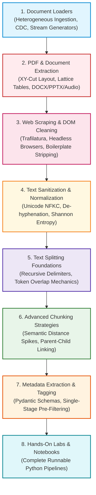
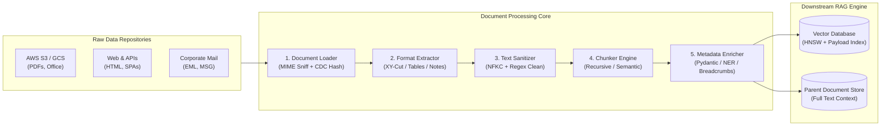

# 📑 Module 02: Document Processing Curriculum & Architecture Navigator

Welcome to **Module 02: Document Processing** of the enterprise RAG Engineering curriculum. This module covers the data engineering and ETL foundation of modern Retrieval-Augmented Generation. 

Downstream vector databases, neural rerankers, and frontier LLMs cannot retrieve or synthesize knowledge that was corrupted, severed, or drowned in boilerplate during ingestion. In this module, you will master the engineering disciplines required to ingest heterogeneous file types, parse complex PDF layouts and tables, strip web noise, sanitize Unicode artifacts, implement recursive and semantic chunking, and enrich text with structured metadata for precision filtering.

---

## 📑 Module Curriculum & Guide Index

| Document | Focus Area | Key Concepts Covered |
| :--- | :--- | :--- |
| [**Document Loaders**](Document-Loaders.md) | **Multi-Source Ingestion** | Unified Document schema, push vs. pull ingestion, streaming generators, SHA-256 Change Data Capture (CDC), Little's Law throughput, and retry dynamics. |
| [**Enterprise PDF Processing**](PDF-Processing.md) | **Layout & Table Parsing** | PDF internal PostScript anatomy, multi-column Recursive XY-Cut, Lattice vs. Stream table extraction, Markdown tables, OCR pipelines, and the ColPali VLM paradigm. |
| [**Web Scraping & HTML Cleaning**](Web-Scraping.md) | **DOM Parsing & Noise Stripping** | SSR vs. CSR architectures, async HTTP vs. Playwright headless browsers, Trafilatura boilerplate extraction, Text-to-Tag Ratio (TTR), link density, and prompt injection defense. |
| [**Text Extraction from Enterprise Formats**](Text-Extraction.md) | **Office & Multimodal Suites** | OpenXML ZIP parsing, Word (`.docx`) style hierarchies, PowerPoint (`.pptx`) speaker notes extraction, Excel (`.xlsx`) data grids to Markdown, and Whisper audio timestamps. |
| [**Text Cleaning & Sanitization**](Text-Cleaning.md) | **Unicode & Noise Reduction** | Unicode NFKC compatibility normalization, control and null byte (`\x00`) elimination, de-hyphenation, character-level Shannon entropy OCR filtering, and code block protection. |
| [**Text Splitting Foundations**](Text-Splitting.md) | **Mechanical Chunking & Budgets** | Token vs. character counting discrepancies, recursive separator hierarchies, sliding window overlap calibration (10-20%), index inflation multipliers, and Markdown table integrity. |
| [**Advanced Chunking Strategies**](Chunking-Strategies.md) | **Semantic & Hierarchical Methods** | Document-structure awareness, Semantic Chunking via cosine distance gradients, dynamic percentile thresholding, Propositional Chunking, and Parent-Document (small-to-big) retrieval. |
| [**Metadata Extraction & Enrichment**](Metadata-Extraction.md) | **Structured Faceted Retrieval** | The four metadata pillars, deterministic regex vs. local NER vs. LLM extraction, Pydantic validation, filter selectivity, and Single-Stage Pre-Filtered HNSW in vector databases. |
| [**Interactive Notebooks**](Notebook/README.md) | **Hands-On Code Labs** | Jupyter notebooks implementing multi-column PDF reconstruction, Trafilatura web scraping, NFKC text sanitizers, and semantic gradient chunkers. |

---

## 🗺️ Module Learning Roadmap



---

## 🎯 What You Will Master in This Module

1. **Enterprise Ingestion Topology & CDC:** Architect scalable, memory-safe data pipelines using Python generators and cryptographic SHA-256 digests to ensure zero duplicate embeddings across millions of documents.
2. **High-Fidelity PDF & Table Reconstruction:** Overcome the presentation limitations of PostScript PDFs using the Recursive XY-Cut algorithm for multi-column documents and Lattice/Stream table parsers to emit clean Markdown tables.
3. **Robust Web Distillation:** Build resilient, anti-injection web crawlers that strip navigation boilerplate, advertising scripts, and hidden prompt injections using Trafilatura and Text-to-Tag Ratio (TTR) algorithms.
4. **Multimodal Office Extraction:** Parse OpenXML architectures to extract Word headings, PowerPoint speaker notes, and Excel numerical grids while linking child documents to parent emails.
5. **Unicode Normalization & Noise Pruning:** Standardize text to Unicode NFKC, resolve typographic ligatures (`fi` $\to$ `fi`), eliminate null bytes (`\x00`) that crash databases, and filter OCR corruption using Shannon entropy.
6. **Token-Exact Recursive Splitting:** Calibrate sliding window overlaps ($10 - 20\%$) and calculate exact subword token bounds using `tiktoken` to prevent context severance without causing index inflation.
7. **Semantic & Hierarchical Chunking:** Detect conceptual topic shifts using cosine distance gradients between sentence embeddings, and deploy Parent-Document retrieval architectures to optimize retrieval specificity and synthesis context.
8. **Structured Metadata Engineering:** Enrich chunks with Pydantic-validated entity tags, temporal timestamps, and security ACLs to power single-stage pre-filtered vector search.

---

## 🏗️ The End-to-End Document Ingestion Pipeline



---

## 🛠️ Prerequisites & Environment Setup

All code implementations in this module require Python 3.10+ and standard enterprise document processing libraries.

### 1. Install Required Python Packages
```bash
pip install pypdf pdfplumber python-docx python-pptx openpyxl trafilatura httpx beautifulsoup4 tiktoken pydantic numpy
```

### 2. Verify Your Environment
Run this verification script to ensure all parsing engines and tokenizers are ready:
```bash
python -c "import pdfplumber, docx, pptx, openpyxl, trafilatura, tiktoken, pydantic, numpy; print('Document Processing Stack: OK')"
```

---

## ⚡ Self-Assessment Checklist

Before proceeding to [**Module 03: Embeddings and Vector Databases**](../03-Embeddings-and-Vector-Databases/README.md), verify your command of these document processing fundamentals:
- [ ] Can you explain why the Recursive XY-Cut algorithm is necessary for two-column academic papers?
- [ ] What is the difference between Lattice and Stream table extraction in PDFs?
- [ ] Why does Unicode NFKC normalization resolve search failures that NFC cannot fix?
- [ ] How does subword token count differ from character count across code, non-English scripts, and prose?
- [ ] Why is naive Post-Filtering susceptible to the "Empty Top-K Disaster" when metadata filters have high selectivity?
- [ ] How does Semantic Chunking use consecutive sentence embedding distances to detect topic transitions?
- [ ] Why are PowerPoint speaker notes often more valuable for RAG than visual slide bullet points?
- [ ] How does the Parent-Document (Small-to-Big) retrieval pattern resolve the conflict between embedding specificity and LLM context?
