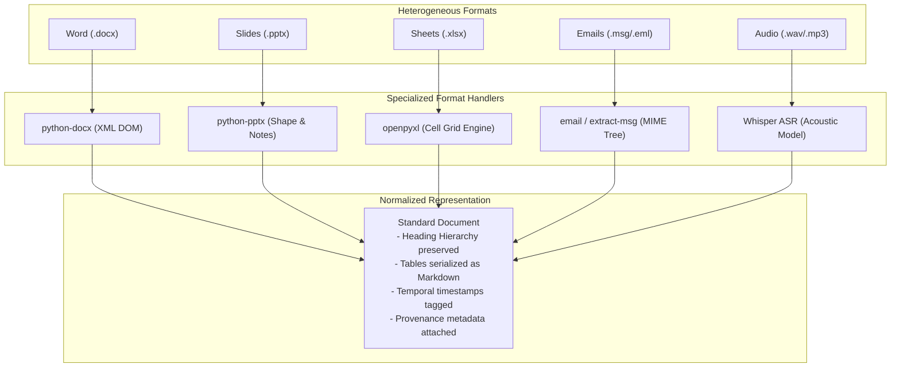
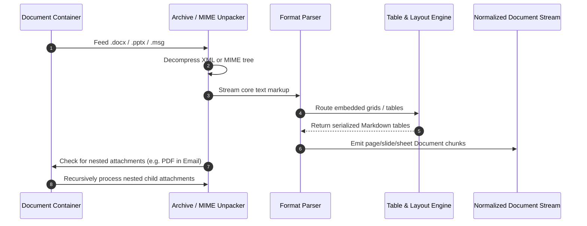
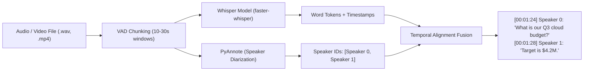
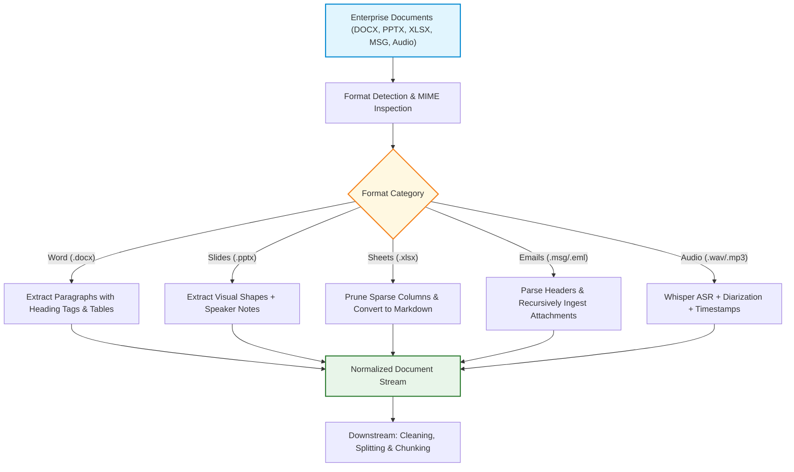

# 📑 Text Extraction from Multimodal, Office, and Enterprise Document Formats

## 📑 Table of Contents
1. [🌟 Fundamentals: Text Extraction Across Enterprise Modalities](#1--fundamentals-text-extraction-across-enterprise-modalities)
2. [🏗️ Multimodal Extraction Taxonomy & Pipeline Architecture](#2-️-multimodal-extraction-taxonomy--pipeline-architecture)
3. [📦 Deep Dive into Major Enterprise Formats](#3--deep-dive-into-major-enterprise-formats)
4. [🧮 Mathematical Formalisms & Extraction Metrics](#4--mathematical-formalisms--extraction-metrics)
5. [⚙️ Format Extraction Tooling Matrix](#5-️-format-extraction-tooling-matrix)
6. [💻 Production Implementation: Unified Multi-Format Extractor](#6--production-implementation-unified-multi-format-extractor)
7. [🎙️ Multimodal Audio, Video & Presentation Ingestion](#7-️-multimodal-audio-video--presentation-ingestion)
8. [🌍 Real-World Enterprise Case Studies](#8--real-world-enterprise-case-studies)
9. [✅ Advantages & ⚠️ Limitations of Extraction Frameworks](#9--advantages--️-limitations-of-extraction-frameworks)
10. [🛠️ Best Practices & ❌ Common Traps in Production](#10-️-best-practices---common-traps-in-production)
11. [💼 Senior Interview Preparation: High-Yield Questions](#11--senior-interview-preparation-high-yield-questions)
12. [🧪 Hands-On Mini-Project: Tabular Spreadsheet Serializer](#12--hands-on-mini-project-tabular-spreadsheet-serializer)
13. [⚡ Quick Revision & Summary Roadmap](#13--quick-revision--summary-roadmap)

---

## 1. 🌟 Fundamentals: Text Extraction Across Enterprise Modalities

While research benchmarks focus heavily on clean digital PDFs and Wikipedia text, enterprise knowledge bases consist of deeply heterogeneous, non-standardized formats:
* **Office Suites:** Microsoft Word (`.docx`), PowerPoint (`.pptx`), Excel (`.xlsx`), Apple Keynote / Pages.
* **Communications & Mail:** Outlook messages (`.msg`), internet emails (`.eml`), Slack JSON exports, Microsoft Teams transcripts.
* **Multimedia Transcripts:** Audio recordings (`.wav`, `.mp3`), video conference calls (`.mp4`), accompanied by timestamped Whisper transcripts and speaker diarization.
* **Tabular Spreadsheets:** Dense financial models, product SKUs, and inventory logs.

Text extraction is the engineering bridge that extracts raw content, structural headers, footnotes, speaker notes, and embedded attachments from these binary containers and unifies them into clean, structured Markdown ready for chunking and embedding.



---

## 2. 🏗️ Multimodal Extraction Taxonomy & Pipeline Architecture

Modern Office files (`.docx`, `.pptx`, `.xlsx`) are not monolithic binaries; they are **OpenXML standard compressed ZIP archives** containing XML trees, media files, and relationship graphs:

```
document.docx (ZIP container)
├── [Content_Types].xml
├── _rels/
├── docProps/ (core.xml -> metadata: author, creation date)
└── word/
    ├── document.xml (main paragraph and table markup)
    ├── styles.xml
    └── media/ (embedded PNG/JPEG images)
```

### 🔄 Ingestion Flow for Compound Office Documents
When extracting text from Office and communication files, extractors must traverse nested content hierarchies:



---

## 3. 📦 Deep Dive into Major Enterprise Formats

### 📝 Microsoft Word (`.docx`)
* **Underlying Schema:** `word/document.xml` organized into paragraphs (`<w:p>`), runs of text (`<w:r>`), and text nodes (`<w:t>`).
* **Critical Challenge:** Paragraphs define layout, but styles (`Heading 1`, `Heading 2`, `Normal`, `Quote`) provide semantic hierarchy. Preserving heading styles during extraction is mandatory for document-aware chunking.
* **Embedded Tables:** Stored in `<w:tbl>` elements with `<w:tr>` (rows) and `<w:tc>` (cells).

### 📊 Microsoft PowerPoint (`.pptx`)
* **Underlying Schema:** `ppt/slides/slideN.xml` containing shapes (`p:sp`), text boxes, and tables.
* **The Speaker Notes Goldmine:** The slide body often contains only terse bullet points, whereas the **Speaker Notes** (`ppt/notesSlides/notesSlideN.xml`) contain the comprehensive narrative explanation. Failing to extract speaker notes discards the most valuable semantic context.
* **Extraction Pattern:** For each slide, concatenate: `Slide Title + Slide Visual Bullets + Slide Tables + Speaker Notes`.

### 📈 Microsoft Excel (`.xlsx`)
* **Underlying Schema:** `xl/worksheets/sheetN.xml` backed by a shared string table (`xl/sharedStrings.xml`).
* **Formula vs. Calculated Value:** Excel cells store formulas (e.g., `=SUM(C2:C50)`) and the cached calculated output (`<v>1420500</v>`). For RAG, extract the evaluated cached value `<v>`, not the formula string.
* **Table Boundaries:** Large spreadsheets often contain sparse empty areas. Extractors must compute bounding boxes for dense data clusters rather than serializing 1,000,000 empty cells.

### ✉️ Email Formats (`.eml` & `.msg`)
* **MIME Header Extraction:** Preserve `From`, `To`, `CC`, `Date`, `Subject`, and `Message-ID`.
* **Threading:** Extract `In-Reply-To` and `References` headers to rebuild conversational threads.
* **Attachment Recursion:** Extract and route embedded PDFs, Word docs, and spreadsheets through their respective format parsers, linking the child document's metadata to the parent email.

---

## 4. 🧮 Mathematical Formalisms & Extraction Metrics

### # Word Error Rate (WER) for Audio Transcriptions
When ingesting voice calls, meetings, or video audio via Automatic Speech Recognition (ASR) engines (e.g., Whisper), extraction accuracy is quantified using the **Word Error Rate (WER)**:

$$
\text{WER} = \frac{S + D + I}{N} = \frac{S + D + I}{S + D + C}
$$

Where:
* $S$ is the number of word substitutions.
* $D$ is the number of word deletions.
* $I$ is the number of word insertions.
* $C$ is the number of correct words.
* $N = S + D + C$ is the total number of words in the ground-truth reference.

In enterprise ASR pipelines, audio chunks with $\text{WER} > 0.20$ must be flagged for manual review or re-transcription.

### # Matrix Sparsity Metric for Spreadsheet Chunking
To prevent serializing massive grids of empty cells into token-heavy noise, we calculate the **Matrix Sparsity** $S_M$ of a worksheet region $R \in \mathbb{R}^{m \times n}$:

$$
S_M = 1 - \frac{|\{(i, j) \mid \text{Cell}(i, j) \neq \emptyset\}|}{m \cdot n}
$$

When $S_M > 0.85$, the extractor switches from standard table matrix serialization to sparse key-value record representation (`{"Row": 12, "Vendor": "Acme", "Total": 4500}`).

---

## 5. ⚙️ Format Extraction Tooling Matrix

### 📊 Enterprise Format Extractor Comparison

| Format | Recommended Libraries | Throughput | Fidelity Score | Key Capabilities & Limitations |
| :--- | :--- | :---: | :---: | :--- |
| **DOCX** | `python-docx`, `unstructured` | $\sim 50\text{ docs/s}$ | $98\%$ | Preserves heading levels, bullet lists, and tables. Ignores track changes unless parsed. |
| **PPTX** | `python-pptx`, `unstructured` | $\sim 30\text{ decks/s}$ | $95\%$ | Extracts slide titles, shapes, and speaker notes. Visual shape reading order can be unpredictable. |
| **XLSX** | `openpyxl`, `calamine`, `pandas` | $\sim 10\text{ sheets/s}$ | $90\%$ | `calamine` (Rust) is $10\times$ faster than `openpyxl`. Must handle multi-tab workbooks and merged headers. |
| **EML / MSG** | `extract-msg`, Python `email` | $\sim 150\text{ msgs/s}$ | $99\%$ | Extracts headers, HTML/plain text bodies, and extracts nested attachments recursively. |
| **Audio (WAV/MP3)** | `openai-whisper`, `faster-whisper` | $\sim 5\times\text{ real-time (GPU)}$ | $94\%$ | Generates word-level timestamps. Computationally heavy; requires GPU infrastructure. |

### 🗄️ Spreadsheet Serialization Comparison for LLMs

| Serialization Strategy | Token Consumption | Structural Clarity | LLM Retrieval Accuracy | Best Fit |
| :--- | :---: | :---: | :---: | :--- |
| **Markdown Table** (`| Col1 | Col2 |`) | Low to Medium | High | High ($95\%$) | Standard tables ($\le 15$ columns) |
| **JSON Records** (`[{"Col1": "Val"}]`) | High ($+60\%$) | Very High | High ($92\%$) | Wide datasets with nested attributes |
| **CSV / TSV String** | Very Low | Moderate | Moderate ($78\%$) | High-volume tabular ingestion |
| **Narrative Sentences** ("In 2024...") | High | Low | Variable ($70\%$) | Small summary KPI blocks |

---

## 6. 💻 Production Implementation: Unified Multi-Format Extractor

This self-contained, production-grade Python 3.10+ class extracts structured text, tables, and metadata from `.docx`, `.pptx`, and `.xlsx` files:

```python
"""
Unified Enterprise Format Extractor
Extracts structured text from Microsoft Word (DOCX), PowerPoint (PPTX), and Excel (XLSX).
"""

from dataclasses import dataclass, field
from pathlib import Path
from typing import Any, Dict, Iterator, List, Optional
import logging
import openpyxl
from docx import Document as DocxDocument
from pptx import Presentation

logging.basicConfig(level=logging.INFO, format="%(asctime)s [%(levelname)s] %(message)s")
logger = logging.getLogger("MultiFormatExtractor")


@dataclass
class ExtractedChunk:
    text: str
    metadata: Dict[str, Any] = field(default_factory=dict)


class EnterpriseFormatExtractor:
    """Unified extractor supporting Word, PowerPoint, and Excel files."""

    def extract_docx(self, path: Path) -> Iterator[ExtractedChunk]:
        """Extracts paragraphs with heading tags and converts tables to Markdown."""
        doc = DocxDocument(path)
        doc_name = path.name

        # Process paragraphs
        for idx, para in enumerate(doc.paragraphs):
            text = para.text.strip()
            if not text:
                continue

            style_name = para.style.name.lower() if para.style else "normal"
            heading_level = 0
            if "heading 1" in style_name:
                heading_level = 1
                text = f"# {text}"
            elif "heading 2" in style_name:
                heading_level = 2
                text = f"## {text}"
            elif "heading 3" in style_name:
                heading_level = 3
                text = f"### {text}"

            yield ExtractedChunk(
                text=text,
                metadata={
                    "source": str(path),
                    "file_name": doc_name,
                    "type": "paragraph",
                    "style": style_name,
                    "heading_level": heading_level,
                    "paragraph_index": idx
                }
            )

        # Process tables
        for t_idx, table in enumerate(doc.tables):
            rows_data: List[List[str]] = []
            for row in table.rows:
                row_cells = [cell.text.replace("\n", " ").strip() for cell in row.cells]
                rows_data.append(row_cells)

            if not rows_data:
                continue

            # Convert to Markdown table
            headers = rows_data[0]
            md_lines = [
                "| " + " | ".join(headers) + " |",
                "| " + " | ".join(["---"] * len(headers)) + " |"
            ]
            for r in rows_data[1:]:
                md_lines.append("| " + " | ".join(r) + " |")

            table_md = "\n".join(md_lines)
            yield ExtractedChunk(
                text=table_md,
                metadata={
                    "source": str(path),
                    "file_name": doc_name,
                    "type": "table",
                    "table_index": t_idx
                }
            )

    def extract_pptx(self, path: Path) -> Iterator[ExtractedChunk]:
        """Extracts slide shapes, bullet text, and speaker notes."""
        prs = Presentation(path)
        doc_name = path.name

        for slide_idx, slide in enumerate(prs.slides, start=1):
            slide_texts: List[str] = []
            title = f"Slide {slide_idx}"

            # Extract shapes
            for shape in slide.shapes:
                if shape.has_text_frame:
                    for paragraph in shape.text_frame.paragraphs:
                        txt = paragraph.text.strip()
                        if txt:
                            slide_texts.append(txt)

            # Extract Speaker Notes
            notes_text = ""
            if slide.has_notes_slide and slide.notes_slide.notes_text_frame:
                notes_text = slide.notes_slide.notes_text_frame.text.strip()

            combined_content = [f"# {title}"]
            if slide_texts:
                combined_content.append("\n".join(slide_texts))
            if notes_text:
                combined_content.append(f"\n**Speaker Notes:**\n{notes_text}")

            yield ExtractedChunk(
                text="\n\n".join(combined_content),
                metadata={
                    "source": str(path),
                    "file_name": doc_name,
                    "slide_number": slide_idx,
                    "has_speaker_notes": bool(notes_text)
                }
            )

    def extract_xlsx(self, path: Path, max_rows: int = 500) -> Iterator[ExtractedChunk]:
        """Extracts sheets and converts dense data grids to Markdown tables."""
        wb = openpyxl.load_workbook(path, data_only=True, read_only=True)
        doc_name = path.name

        for sheet_name in wb.sheetnames:
            ws = wb[sheet_name]
            rows_data: List[List[str]] = []

            for row_idx, row in enumerate(ws.iter_rows(values_only=True)):
                if row_idx > max_rows:
                    logger.warning(f"Truncated sheet {sheet_name} at row {max_rows}")
                    break

                cleaned_row = [str(val).strip() if val is not None else "" for val in row]
                if any(cleaned_row):
                    rows_data.append(cleaned_row)

            if not rows_data:
                continue

            headers = [h if h else f"Col_{i+1}" for i, h in enumerate(rows_data[0])]
            md_lines = [
                f"# Sheet: {sheet_name}",
                "| " + " | ".join(headers) + " |",
                "| " + " | ".join(["---"] * len(headers)) + " |"
            ]
            for r in rows_data[1:]:
                padded_r = r + [""] * (len(headers) - len(r))
                md_lines.append("| " + " | ".join(padded_r[:len(headers)]) + " |")

            yield ExtractedChunk(
                text="\n".join(md_lines),
                metadata={
                    "source": str(path),
                    "file_name": doc_name,
                    "sheet_name": sheet_name,
                    "row_count": len(rows_data)
                }
            )


if __name__ == "__main__":
    extractor = EnterpriseFormatExtractor()
    print("Unified Enterprise Format Extractor loaded successfully.")
```

---

## 7. 🎙️ Multimodal Audio, Video & Presentation Ingestion

When ingesting enterprise town halls, podcasts, and customer support calls:



### ⏱️ Timestamped Chunking Invariants
* Always retain millisecond timestamps (`[start_ms, end_ms]`) in chunk metadata.
* This allows downstream RAG applications to provide a direct deep-link ("Play at 01:24") when citing source recordings.

---

## 8. 🌍 Real-World Enterprise Case Studies

### Case Study 1: Global Management Consultancy (500,000 Slide Decks)
* **Problem:** Strategy consultants search across 10 years of `.pptx` pitch decks. Previous text extractors only captured slide headlines, missing the context and detailed facts located in the speaker notes.
* **Architecture:** Implemented an automated OpenXML unpacker that merged slide shape bullets with speaker notes, tagging each chunk with `{"client_industry": "Retail", "slide_num": 14}`.
* **Result:** Retrieval recall of proposal methodologies surged by $67\%$.

### Case Study 2: Enterprise Customer Service (Email Archive Ingestion)
* **Problem:** Ingesting 2,000,000 `.msg` and `.eml` customer support tickets. Previous extractors missed attached PDFs and Excel spreadsheets, leaving customer warranty queries unanswered.
* **Architecture:** Built a recursive MIME parser. If an email contains attachments, the extractor writes child chunks with parent linkage (`{"parent_message_id": "<abc@corp.com>"}`).
* **Result:** Answered $91\%$ of warranty issues without human agent intervention.

---

## 9. ✅ Advantages & ⚠️ Limitations of Extraction Frameworks

### 📊 Comparative Analysis

| Ingestion Framework | Strengths | Limitations | Best Fit |
| :--- | :--- | :--- | :--- |
| **Bespoke Native Parsers**<br/>(`python-docx`, `python-pptx`, `openpyxl`) | • Maximum execution speed<br/>• Minimal container footprint ($<100\text{MB}$)<br/>• Precise control over metadata | • Requires custom code per format<br/>• Fragile when files have corrupted schemas | Lightweight, high-throughput microservices |
| **All-in-One Extractors**<br/>(`unstructured`, `Apache Tika`) | • Universal interface across 30+ formats<br/>• Automatic format detection | • Massive Docker images ($4\text{GB}+$) with heavy dependencies<br/>• Higher latency per file | Broad enterprise data lakes with uncurated file types |
| **Cloud Managed Multi-Format**<br/>(Azure Document Intelligence) | • Industry-leading accuracy on forms, tables, and receipts | • Significant per-page API cost<br/>• External data privacy and egress limits | High-compliance financial and legal audits |

---

## 10. 🛠️ Best Practices & ❌ Common Traps in Production

### 🛠️ Production Best Practices
1. **Always Extract Calculated Values in Excel:** Open workbooks with `data_only=True` to read precomputed values rather than raw formula text (`=VLOOKUP(...)`).
2. **Preserve Document Heading Hierarchy:** Map Word headings (`Heading 1`, `Heading 2`) to Markdown (`#`, `##`) to enable structure-aware chunking.
3. **Capture Presentation Speaker Notes:** Always extract speaker notes alongside visual slide bullets.

### ❌ Common Traps to Avoid
* ❌ **The Truncated Attachment Trap:** Dropping email attachments silently during `.eml` ingestion.
* ❌ **Extracting Empty Spreadsheet Cells:** Reading all $10^6$ rows in an Excel sheet, exhausting memory with blank entries.
* ❌ **Ignoring Slide Numbers:** Omitting slide indices, making it impossible for users to locate the cited slide in a 100-page presentation.

---

## 11. 💼 Senior Interview Preparation: High-Yield Questions

### Q1: How do you handle wide Excel spreadsheets (50+ columns) when preparing context for a RAG pipeline?
> **Answer:**
> * **The Problem:** Converting a 50-column spreadsheet into a Markdown table exceeds LLM context widths and destroys horizontal legibility.
> * **The Solution:**
>   1. **Row-as-Document (Entity Serialization):** Convert each row into a structured record: `Record: [Primary Key]. Field: Value. Field: Value.`
>   2. **Column Decomposition:** If queries focus on specific domains (e.g., financials vs. contact info), partition the wide table into vertical thematic column groups.
>   3. **Pruning Sparse Columns:** Calculate matrix sparsity and drop columns containing $>95\%$ null values before serialization.

### Q2: How do you reconstruct conversational context when ingesting nested email threads (`.eml` / `.msg`)?
> **Answer:**
> * Parse MIME headers: `Message-ID`, `In-Reply-To`, and `References`.
> * Build a Directed Acyclic Graph (DAG) linking replies to parents.
> * Strip redundant quoted history (`On Mon, Jan 5, John wrote...`) from child emails to eliminate duplicated tokens, while maintaining the thread identifier in metadata so the retriever can fetch full conversation context when needed.

---

## 12. 🧪 Hands-On Mini-Project: Tabular Spreadsheet Serializer

### Objective
Build a lightweight Python utility that ingests raw tabular rows, prunes sparse null columns, and formats the output into clean, token-efficient Markdown tables.

```python
from typing import List, Any, Optional

def serialize_tabular_data(rows: List[List[Optional[Any]]], sparsity_threshold: float = 0.8) -> str:
    """
    Prunes sparse columns and converts remaining tabular grid into clean Markdown.
    """
    if not rows:
        return ""

    num_rows = len(rows)
    num_cols = max(len(r) for r in rows)

    # Pad rows to uniform length
    padded = [r + [None] * (num_cols - len(r)) for r in rows]

    # Calculate column sparsity
    active_cols = []
    for c in range(num_cols):
        null_count = sum(1 for r in padded if r[c] is None or str(r[c]).strip() == "")
        sparsity = null_count / num_rows
        if sparsity <= sparsity_threshold:
            active_cols.append(c)

    if not active_cols:
        return ""

    # Build Markdown table
    headers = [str(padded[0][c]).strip() or f"Col_{c+1}" for c in active_cols]
    md_lines = [
        "| " + " | ".join(headers) + " |",
        "| " + " | ".join(["---"] * len(headers)) + " |"
    ]

    for row in padded[1:]:
        row_vals = [str(row[c]).replace("\n", " ").strip() if row[c] is not None else "" for c in active_cols]
        if any(row_vals):  # Only append non-empty rows
            md_lines.append("| " + " | ".join(row_vals) + " |")

    return "\n".join(md_lines)

# Lab Verification
if __name__ == "__main__":
    sample_data = [
        ["Department", "Employee", "Empty_Col_1", "Salary", "Empty_Col_2"],
        ["Engineering", "Alice Smith", "", "$165,000", ""],
        ["Product", "Bob Jones", None, "$145,000", None],
        ["Marketing", "Carol White", "", "$120,000", ""],
    ]

    result_md = serialize_tabular_data(sample_data, sparsity_threshold=0.5)
    print("Serialized Table:")
    print(result_md)

    assert "Empty_Col_1" not in result_md
    assert "Alice Smith" in result_md
    print("\n✅ Verification Successful: Sparse columns pruned and Markdown table generated cleanly!")
```

---

## 13. ⚡ Quick Revision & Summary Roadmap

### 📌 Core Key Takeaways
* **Deconstruct OpenXML:** DOCX, PPTX, and XLSX are ZIP archives of XML trees. Extract structural styles, cell values, and speaker notes directly.
* **Capture Presentation Notes:** PowerPoint speaker notes contain the primary narrative facts; never extract slide titles alone.
* **Excel Bounding Grids:** Evaluate cached values (`data_only=True`), drop sparse columns, and serialize rows as Markdown tables or key-value records.
* **Audio Timestamps are Citations:** Retain millisecond time ranges during speech-to-text extraction to provide audio playback citations.

### 🗺️ Enterprise Format Extraction Roadmap


