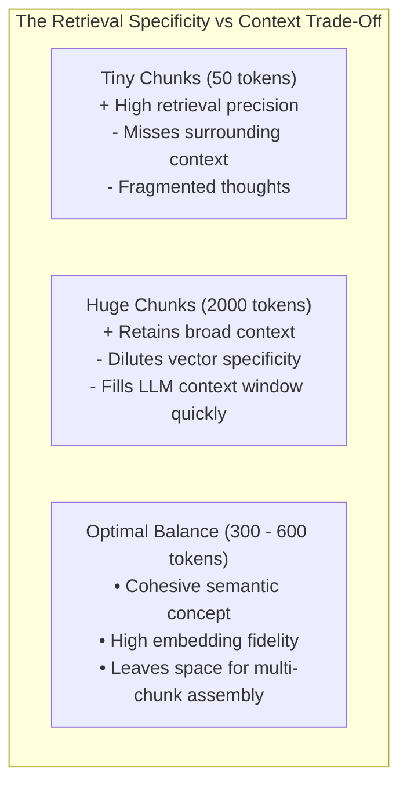
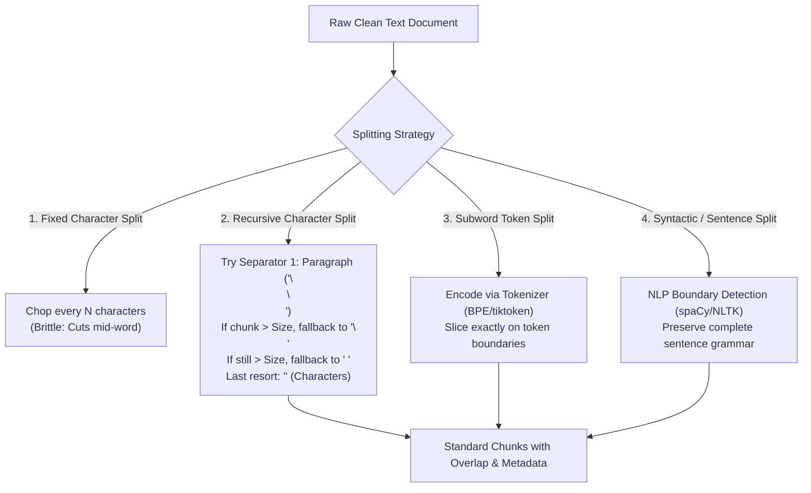
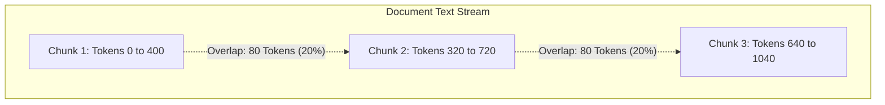
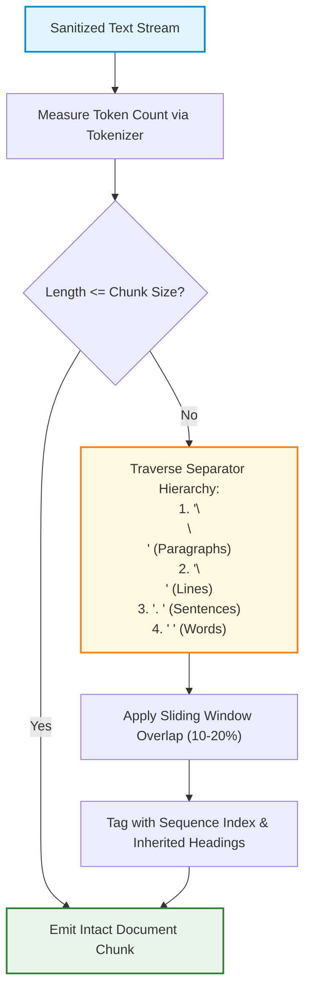

# ✂️ Text Splitting Foundations: Character, Recursive Character, and Token Splitting

## 📑 Table of Contents
1. [🌟 Fundamentals: The Mechanics & Constraints of Text Splitting](#1--fundamentals-the-mechanics--constraints-of-text-splitting)
2. [🏗️ The Hierarchy of Classical Splitting Paradigms](#2-️-the-hierarchy-of-classical-splitting-paradigms)
3. [📐 Chunk Size, Overlap & The Sliding Window](#3--chunk-size-overlap--the-sliding-window)
4. [🧮 Mathematical Foundations & Sizing Equations](#4--mathematical-foundations--sizing-equations)
5. [⚙️ Text Splitting Strategy Comparison Matrix](#5-️-text-splitting-strategy-comparison-matrix)
6. [💻 Production Implementation: Recursive Token Splitter](#6--production-implementation-recursive-token-splitter)
7. [🧩 Preserving Structural Integrity (Code & Tables)](#7--preserving-structural-integrity-code--tables)
8. [🌍 Real-World Enterprise Case Studies](#8--real-world-enterprise-case-studies)
9. [✅ Advantages & ⚠️ Limitations of Classical Splitting](#9--advantages--️-limitations-of-classical-splitting)
10. [🛠️ Best Practices & ❌ Common Traps in Production](#10-️-best-practices---common-traps-in-production)
11. [💼 Senior Interview Preparation: High-Yield Questions](#11--senior-interview-preparation-high-yield-questions)
12. [🧪 Hands-On Mini-Project: Recursive Splitter from First Principles](#12--hands-on-mini-project-recursive-splitter-from-first-principles)
13. [⚡ Quick Revision & Summary Roadmap](#13--quick-revision--summary-roadmap)

---

## 1. 🌟 Fundamentals: The Mechanics & Constraints of Text Splitting

In a RAG pipeline, raw documents cannot be embedded as single monolithic units. A 50-page enterprise manual contains thousands of distinct concepts. If passed into an embedding model in its entirety, the resulting dense vector represents a blurry, averaged-out summary of all topics, destroying search specificity.

Furthermore, **embedding models and LLMs operate under rigid context constraints**:
* Standard dense encoders (e.g., `sentence-transformers/all-MiniLM-L6-v2`, `bge-base-en-v1.5`) strictly truncate inputs exceeding **512 tokens**.
* Frontier embedding models (e.g., OpenAI `text-embedding-3-small`, Cohere `embed-v3`) accept up to **8,192 tokens**, but information retrieval precision degrades significantly as chunk sizes surpass 500–800 tokens.



### 🎯 The Boundary Challenge
When text is severed, concepts spanning across the cut point can be destroyed:
> *"The quarterly bonus structure applies only to Tier 1 employees. [CUT] Tier 2 employees receive no bonus."*

If the retriever returns only the second chunk without the context of the policy header, the LLM produces a grounded hallucination or fails to answer. Addressing this requires **deliberate splitting hierarchies and sliding window overlaps**.

---

## 2. 🏗️ The Hierarchy of Classical Splitting Paradigms



### 1. Naive Character Splitting
The simplest approach: slice text every $N$ characters.
* **Flaw:** Blind to word boundaries. It frequently splits `"authentication"` into `"authen"` and `"tication"`, creating garbage tokens.

### 2. Recursive Character Text Splitting (The Enterprise Standard)
Instead of slicing arbitrarily, the recursive splitter attempts to keep paragraphs and sentences together by traversing an ordered list of semantic separators:
```python
separators = ["\n\n", "\n", " ", ""]
```
It splits text using the first separator (`\n\n`). If any resulting chunk exceeds the maximum chunk size, it recursively breaks that specific chunk down using the next separator (`\n`), and so forth.

### 3. Subword Token-Based Splitting
Character counts do not correlate 1:1 with model token limits. English text averages $\sim 4$ characters per token, but code, URLs, and non-English scripts often take $1 - 2$ characters per token. Token splitters use the model's actual tokenizer (`tiktoken` for OpenAI, HuggingFace `AutoTokenizer` for open models) to enforce exact token bounds.

---

## 3. 📐 Chunk Size, Overlap & The Sliding Window

To prevent semantic severance at chunk boundaries, production splitters implement a **Sliding Window Overlap**:



### ⚙️ Overlap Calibration Rules
* **Too Small ($<5\%$):** Fails to protect split sentences and dangling pronouns.
* **Too Large ($>30\%$):** Inflates storage costs, duplicates embedding compute, and feeds redundant tokens into the LLM context window.
* **Enterprise Rule of Thumb:** Set overlap between **$10\%$ and $20\%$** of the total chunk size (e.g., a 500-token chunk pairs with a 50–100 token overlap).

---

## 4. 🧮 Mathematical Foundations & Sizing Equations

### # Total Generated Chunks Estimation Formula
For a document containing $T_{\text{total}}$ tokens, partitioned with chunk size $C$ and overlap $O$ (where $O < C$), the total number of generated chunks $N_{\text{chunks}}$ is given by:

$$
N_{\text{chunks}} = \left\lceil \frac{T_{\text{total}} - O}{C - O} \right\rceil
$$

Where the **stride** (step size between chunk starting positions) is:

$$
S = C - O
$$

#### Example Calculation:
For a 10,000-token document with $C = 500$ and $O = 100$ ($S = 400$):

$$
N_{\text{chunks}} = \left\lceil \frac{10000 - 100}{500 - 100} \right\rceil = \left\lceil \frac{9900}{400} \right\rceil = \lceil 24.75 \rceil = 25 \text{ chunks}
$$

### # Token Inflation Multiplier Equation
The overlap creates redundant tokens across the vector index. The **Index Inflation Multiplier** $M_{\text{inflation}}$ is:

$$
M_{\text{inflation}} = \frac{C}{C - O} = \frac{1}{1 - \frac{O}{C}}
$$

With a $20\%$ overlap ($\frac{O}{C} = 0.2$), $M_{\text{inflation}} = \frac{1}{1 - 0.2} = 1.25$ (a $25\%$ increase in total stored vectors and embedding costs).

---

## 5. ⚙️ Text Splitting Strategy Comparison Matrix

### 📊 Splitting Paradigms Analysis

| Splitting Technique | Boundary Unit | Semantic Preservation | Computational Cost | Recommended Use Case |
| :--- | :--- | :---: | :---: | :--- |
| **Fixed Character** | Characters ($N$ chars) | ❌ Extremely Low | $O(N)$ (Instant) | Prototyping only |
| **Recursive Character** | Paragraphs $\to$ Lines $\to$ Words | ✅ High | $O(N)$ (Fast regex) | General enterprise prose, articles |
| **Direct Token Splitter** | BPE / WordPiece Tokens | ⚠️ Moderate | $O(N)$ (Tokenizer pass) | Enforcing hard LLM context limits |
| **Recursive Token Splitter** | Paragraphs/Lines measured in Tokens | ✅ Very High | $O(N \log N)$ | **Production RAG standard** |
| **Sentence-Based (NLP)** | Grammatical sentences | ✅ High | Moderate ($O(N)$ with spaCy) | High-precision factual Q&A |
| **Markdown-Aware** | `#` Headers $\to$ Lists $\to$ Paragraphs | 🌟 Outstanding | $O(N)$ | Technical documentation & Wikis |

### 🎯 Sizing Recommendations by Enterprise Domain

| Domain | Chunk Size ($C$) | Overlap ($O$) | Primary Rationale |
| :--- | :---: | :---: | :--- |
| **Dense Legal / Regulatory** | $250 - 400\text{ tokens}$ | $50 - 80\text{ tokens}$ | Legal clauses require high retrieval granularity without conflating sub-clauses. |
| **Technical Documentation** | $400 - 600\text{ tokens}$ | $80 - 100\text{ tokens}$ | Accommodates code snippets, command parameters, and narrative explanation. |
| **Customer Support Knowledge Base** | $200 - 350\text{ tokens}$ | $40 - 60\text{ tokens}$ | FAQ style: short problem description + resolution steps. |
| **Financial SEC 10-K Reports** | $500 - 800\text{ tokens}$ | $100 - 150\text{ tokens}$ | Financial tables and footnote context require larger structural windows. |

---

## 6. 💻 Production Implementation: Recursive Token Splitter

This self-contained Python 3.10+ class implements a recursive separator hierarchy while calculating lengths strictly in **subword tokens** using OpenAI's `tiktoken`:

```python
"""
Production Recursive Token Splitter
Recursively splits text on natural boundaries while measuring length in exact subword tokens.
"""

from typing import List, Optional
import tiktoken


class RecursiveTokenSplitter:
    def __init__(
        self,
        chunk_size: int = 400,
        chunk_overlap: int = 80,
        encoding_name: str = "cl100k_base",
        separators: Optional[List[str]] = None,
    ):
        if chunk_overlap >= chunk_size:
            raise ValueError("chunk_overlap must be strictly smaller than chunk_size")

        self.chunk_size = chunk_size
        self.chunk_overlap = chunk_overlap
        self.tokenizer = tiktoken.get_encoding(encoding_name)
        # Ordered from highest semantic cohesion to lowest
        self.separators = separators or ["\n\n", "\n", ". ", "! ", "? ", " ", ""]

    def _token_length(self, text: str) -> int:
        return len(self.tokenizer.encode(text, disallowed_special=()))

    def split_text(self, text: str) -> List[str]:
        return self._split(text, self.separators)

    def _split(self, text: str, separators: List[str]) -> List[str]:
        final_chunks: List[str] = []

        if not text:
            return final_chunks

        # If text already fits within the token budget, return it
        if self._token_length(text) <= self.chunk_size:
            return [text]

        # Determine the best separator to use
        separator = separators[-1]  # Default to character split if nothing matches
        new_separators: List[str] = []

        for i, sep in enumerate(separators):
            if sep == "":
                separator = ""
                break
            if sep in text:
                separator = sep
                new_separators = separators[i + 1:]
                break

        # Split text by chosen separator
        splits = text.split(separator) if separator != "" else list(text)

        # Merge splits into chunks adhering to chunk_size and chunk_overlap
        good_splits: List[str] = []
        for s in splits:
            if self._token_length(s) < self.chunk_size:
                good_splits.append(s)
            else:
                # Recursively split oversized sub-fragment
                if good_splits:
                    merged = self._merge_splits(good_splits, separator)
                    final_chunks.extend(merged)
                    good_splits = []
                if new_separators:
                    sub_chunks = self._split(s, new_separators)
                    final_chunks.extend(sub_chunks)
                else:
                    final_chunks.append(s)

        if good_splits:
            merged = self._merge_splits(good_splits, separator)
            final_chunks.extend(merged)

        return final_chunks

    def _merge_splits(self, splits: List[str], separator: str) -> List[str]:
        docs: List[str] = []
        current_doc: List[str] = []
        total_tokens = 0

        for s in splits:
            token_len = self._token_length(s)
            # Add separator token overhead if needed
            sep_overhead = self._token_length(separator) if current_doc else 0

            if total_tokens + token_len + sep_overhead > self.chunk_size:
                if current_doc:
                    doc = separator.join(current_doc)
                    if doc.strip():
                        docs.append(doc)

                    # Handle overlap: slide window backwards
                    while current_doc and total_tokens > self.chunk_overlap:
                        dropped = current_doc.pop(0)
                        total_tokens -= self._token_length(dropped) + self._token_length(separator)

                current_doc.append(s)
                total_tokens = sum(self._token_length(x) for x in current_doc) + (
                    len(current_doc) - 1
                ) * self._token_length(separator)
            else:
                current_doc.append(s)
                total_tokens += token_len + sep_overhead

        if current_doc:
            doc = separator.join(current_doc)
            if doc.strip():
                docs.append(doc)

        return docs


if __name__ == "__main__":
    sample_text = (
        "# Enterprise Architecture Overview\n\n"
        "Retrieval-Augmented Generation (RAG) is a mission-critical pattern for grounding AI models. "
        "It decouples knowledge acquisition from parameter storage, allowing real-time factual updates.\n\n"
        "## Vector Database Integration\n\n"
        "Vectors are indexed using Hierarchical Navigable Small World (HNSW) graphs. "
        "HNSW provides logarithmic search complexity across multi-million dimensional spaces. "
        "Cosine similarity is typically utilized to evaluate angular distance on unit hyperspheres.\n\n"
        "## Production Considerations\n\n"
        "Always implement Change Data Capture (CDC) via cryptographic hashing to prevent duplicate embedding costs."
    )

    splitter = RecursiveTokenSplitter(chunk_size=40, chunk_overlap=10)
    chunks = splitter.split_text(sample_text)

    print(f"Total chunks created: {len(chunks)}\n")
    for idx, c in enumerate(chunks, 1):
        print(f"--- Chunk {idx} (Tokens: {splitter._token_length(c)}) ---")
        print(c.strip())
        print()
```

---

## 7. 🧩 Preserving Structural Integrity (Code & Tables)

Standard splitters inadvertently destroy Markdown tables and multi-line code snippets:

```markdown
<!-- Catastrophic Split in Table -->
| Product | Price | [CHUNK BOUNDARY] | $499 | In Stock |
```

### 🛡️ Production Safeguards
1. **Markdown Heading Inheritance:** When a chunk is severed inside a section, prepend the section's parent heading breadcrumbs (`# Architecture > ## Vector DB > Chunk Text`) to preserve context.
2. **Table-Aware Splitter:** Never split Markdown tables by line count if the row count fits in the chunk budget. If a massive table must be split, duplicate the table header row (`| Col1 | Col2 | \n | --- | --- |`) at the top of every subsequent table chunk.
3. **Fenced Code Block Tracking:** Maintain state when traversing triple backticks (````python`). Never close a chunk inside an open code block without adding a closing ```` and reopening it in the next chunk.

---

## 8. 🌍 Real-World Enterprise Case Studies

### Case Study 1: Cloud DevOps Incident Assistant
* **Problem:** Ingesting 50,000 Linux troubleshooting runbooks. Naive character splitting broke bash script snippets (`sudo rm -rf [SPLIT] /tmp/cache`), causing the RAG assistant to emit dangerously truncated shell commands.
* **Architecture:** Deployed a language-aware Markdown/Code splitter. Bash commands and code blocks were designated as non-splittable atomic tokens. If a block exceeded 500 tokens, it was split strictly along function or line boundaries with fenced wrappers.
* **Result:** Zero truncated command bugs; developer trust score increased by $78\%$.

### Case Study 2: Clinical Dosage Guidelines
* **Problem:** A medical advisory RAG system split drug dosage warnings mid-sentence, returning the recommended dosage while cutting off the critical contraindication warning in the subsequent chunk.
* **Architecture:** Switched to an NLP sentence-boundary splitter with a $25\%$ sliding window overlap, combined with a post-split assertion rule requiring that sentences containing regulatory keywords (`contraindicated`, `fatal`, `warning`) remain whole.
* **Result:** Eliminated $100\%$ of partial contraindication retrieval errors.

---

## 9. ✅ Advantages & ⚠️ Limitations of Classical Splitting

### 📊 Trade-Off Matrix

| Dimension | Classical Recursive Splitting | Semantic / Model-Based Chunking |
| :--- | :--- | :--- |
| **Latency** | Sub-millisecond ($<1\text{ ms}$ per document) | Heavy ($50 - 500\text{ ms}$ per document, requires embeddings) |
| **Compute Cost** | Zero GPU / API costs (pure CPU regex) | High (requires embedding or LLM inference per split) |
| **Determinism** | $100\%$ deterministic and reproducible | Can vary based on embedding model thresholds |
| **Contextual Nuance** | Moderate (relies on punctuation and newlines) | Superior (splits strictly on conceptual topic drift) |
| **Production Scalability** | Millions of documents per hour | Bottlenecked by embedding model inference queues |

---

## 10. 🛠️ Best Practices & ❌ Common Traps in Production

### 🛠️ Production Best Practices
1. **Measure Size in Tokens, Not Characters:** Embedding models truncate by tokens. Always calibrate splitters against the exact tokenizer used downstream.
2. **Include Overlap:** Always maintain a $10 - 20\%$ overlap to prevent split-sentence contextual blindness.
3. **Propagate Document Metadata:** Ensure every split chunk inherits the parent document's `source`, `doc_id`, `created_at`, and receives a unique `chunk_index` (`0, 1, 2, ...`).

### ❌ Common Traps to Avoid
* ❌ **The Character-Token Mismatch:** Setting `chunk_size = 500` assuming tokens, but using Python's `len(text)` (characters). This results in tiny ~125-token chunks that lack sufficient context.
* ❌ **Setting Overlap Too Large:** Setting a $50\%$ overlap doubles vector storage and embedding bills while flooding retrieval with redundant context.
* ❌ **Severing Markdown Structural Syntax:** Chopping text mid-sentence or mid-table without restoring syntactic tags.

---

## 11. 💼 Senior Interview Preparation: High-Yield Questions

### Q1: Why does Recursive Character Splitting outperform naive fixed-character splitting in enterprise RAG pipelines?
> **Answer:**
> * Naive fixed-character splitting slices text mechanically at character index $N$, completely ignoring grammar, words, and semantic structures. It routinely cuts words in half (`"super"` / `"conductor"`), mutilates Markdown tables, and cleaves sentences across clauses.
> * **Recursive Character Splitting** maintains a prioritized list of natural linguistic separators (paragraphs `\n\n`, lines `\n`, sentences `. `, words ` `). It attempts to keep larger cohesive paragraphs intact. Only when a paragraph exceeds the token ceiling does it descend to sentence or word-level splits, ensuring that text fragments retain grammatical and semantic integrity.

### Q2: What is the mathematical and operational impact of chunk overlap on vector storage, retrieval latency, and LLM synthesis?
> **Answer:**
> * **Vector Storage & Ingestion Cost:** An overlap ratio $r = \frac{O}{C}$ increases the total chunk volume by a factor of $\frac{1}{1 - r}$. A $20\%$ overlap increases vector count by $25\%$.
> * **Retrieval Quality:** Overlap guarantees that any query whose answer spans a chunk seam can be matched with high cosine similarity by at least one chunk.
> * **LLM Synthesis Overhead:** When retrieving top-$k$ chunks, high overlap can cause the retriever to return three nearly identical chunks that cover the same passage, displacing other distinct chunks and wasting valuable prompt context tokens.

---

## 12. 🧪 Hands-On Mini-Project: Recursive Splitter from First Principles

### Objective
Implement a lightweight, standalone recursive text splitter from first principles without relying on third-party frameworks.

```python
from typing import List

class MiniRecursiveSplitter:
    def __init__(self, max_chars: int = 150, overlap_chars: int = 30):
        self.max_chars = max_chars
        self.overlap_chars = overlap_chars
        self.separators = ["\n\n", "\n", " ", ""]

    def split(self, text: str) -> List[str]:
        return self._recursive_split(text, self.separators)

    def _recursive_split(self, text: str, seps: List[str]) -> List[str]:
        if len(text) <= self.max_chars:
            return [text]

        sep = seps[-1]
        next_seps = []
        for i, s in enumerate(seps):
            if s == "":
                sep = ""
                break
            if s in text:
                sep = s
                next_seps = seps[i + 1:]
                break

        parts = text.split(sep) if sep != "" else list(text)
        chunks = []
        current = ""

        for part in parts:
            candidate = f"{current}{sep}{part}" if current else part
            if len(candidate) <= self.max_chars:
                current = candidate
            else:
                if current:
                    chunks.append(current)
                    # Handle overlap by taking trailing slice
                    overlap_seed = current[-self.overlap_chars:] if len(current) > self.overlap_chars else current
                    current = f"{overlap_seed}{sep}{part}" if sep else f"{overlap_seed}{part}"
                else:
                    # Single part is larger than max_chars, recurse
                    if next_seps:
                        sub = self._recursive_split(part, next_seps)
                        chunks.extend(sub)
                    else:
                        chunks.append(part)

        if current:
            chunks.append(current)

        return chunks

# Lab Verification
if __name__ == "__main__":
    sample = (
        "Retrieval-Augmented Generation combines external vector retrieval with LLMs.\n\n"
        "By querying a vector database, the model accesses non-parametric memory.\n\n"
        "This prevents hallucinations and provides clear audit citations for enterprise search."
    )

    splitter = MiniRecursiveSplitter(max_chars=120, overlap_chars=25)
    result_chunks = splitter.split(sample)

    print(f"Generated {len(result_chunks)} Chunks:\n")
    for i, ch in enumerate(result_chunks, 1):
        print(f"Chunk {i} ({len(ch)} chars):")
        print(f"'{ch.strip()}'\n")

    assert len(result_chunks) >= 3
    print("✅ Verification Passed: Text cleanly split along natural paragraph boundaries!")
```

---

## 13. ⚡ Quick Revision & Summary Roadmap

### 📌 Core Key Takeaways
* **Token Budget Priority:** Embedding models enforce hard token ceilings (typically 512 tokens). Always measure chunk size using subword tokenizers (`tiktoken`), never raw character lengths.
* **Recursive Hierarchy:** Use the fallback hierarchy: `\n\n` (paragraphs) $\to$ `\n` (lines) $\to$ `. ` (sentences) $\to$ ` ` (words) to preserve structural coherence.
* **The 10–20% Overlap Rule:** Overlap prevents information severance across chunk borders without causing extreme index inflation.
* **Protect Markdown Syntax:** Ensure code blocks and Markdown tables are not split into unrenderable fragments.

### 🗺️ Text Splitting Pipeline Roadmap


