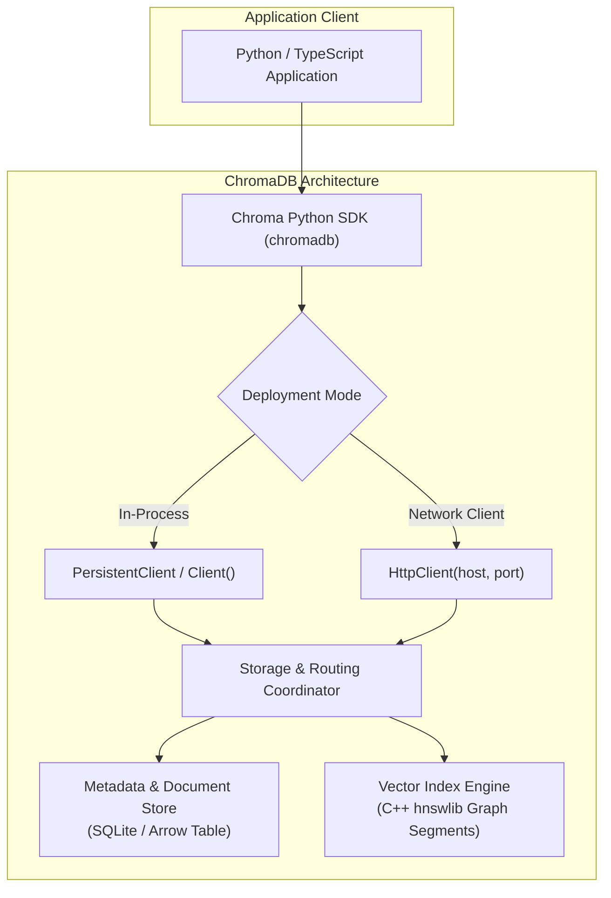
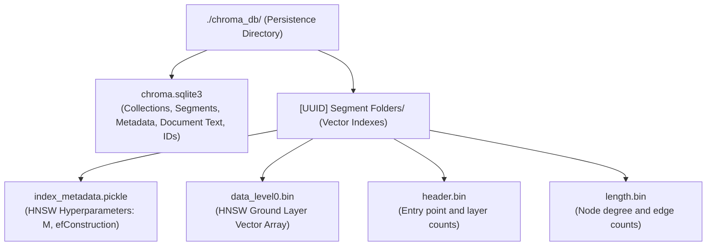
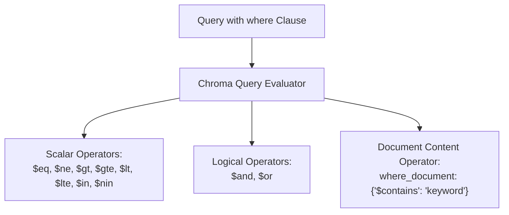
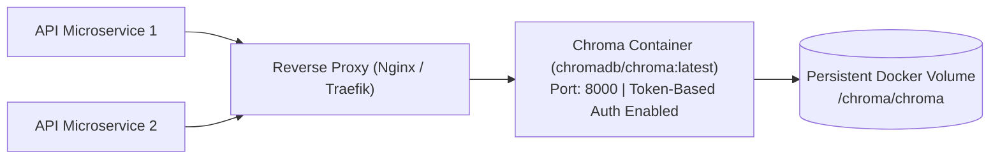
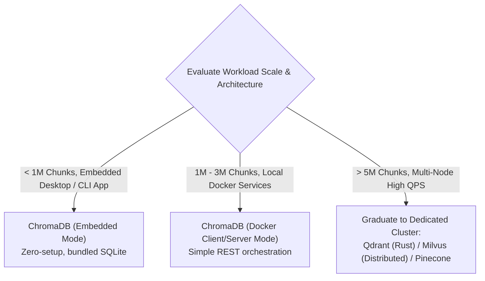
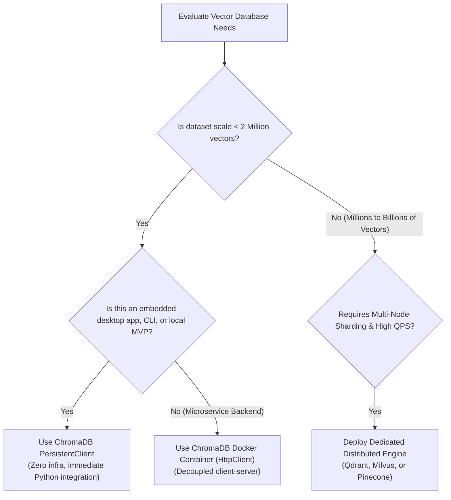

# 🎨 ChromaDB Deep Dive: Architecture, Persistent Collections, and Local Production Deployment

## 📑 Table of Contents
1. [🌟 Fundamentals: Architecture & Design Philosophy](#1--fundamentals-architecture--design-philosophy)
2. [🏗️ Internal Storage Engine Anatomy](#2-️-internal-storage-engine-anatomy)
3. [💾 Persistent Collections & CRUD Operations](#3--persistent-collections--crud-operations)
4. [🎯 Advanced Querying & Metadata Filtering Syntax](#4--advanced-querying--metadata-filtering-syntax)
5. [⚖️ Architectural Decision Matrix: ChromaDB vs. Alternatives](#5-️-architectural-decision-matrix-chromadb-vs-alternatives)
6. [💻 Practical Implementation: Production-Grade Chroma Client](#6--practical-implementation-production-grade-chroma-client)
7. [🚀 Production Deployment: Docker Microservice & Security](#7--production-deployment-docker-microservice--security)
8. [🌍 Enterprise Use Cases & Scaling Boundaries](#8--enterprise-use-cases--scaling-boundaries)
9. [🛠️ Best Practices & ❌ Common Production Pitfalls](#9-️-best-practices---common-production-pitfalls)
10. [💼 Senior Interview Questions & System Design Scenarios](#10--senior-interview-questions--system-design-scenarios)
11. [🧪 Hands-On Mini-Project: Multi-Collection Enterprise Knowledge Store](#11--hands-on-mini-project-multi-collection-enterprise-knowledge-store)
12. [⚡ Quick Revision & Architectural Decision Roadmap](#12--quick-revision--architectural-decision-roadmap)

---

## 1. 🌟 Fundamentals: Architecture & Design Philosophy

**ChromaDB** is an open-source, AI-native vector database designed with a primary emphasis on **developer ergonomics, minimal operational overhead, and rapid local iteration**.

While enterprise databases like Milvus or Pinecone require distributed clusters, ZooKeeper, or Kubernetes orchestration, ChromaDB provides a frictionless "battery-included" experience: it operates both as an **in-process embedded library** (similar to SQLite) and as a **standalone client-server microservice**.



### 🏛️ The Three Pillars of ChromaDB
1. **Zero-Configuration Ingestion:** Automatically manages embedding generation, document storage, and vector indexing within a single unified API call.
2. **Pluggable Embedding Functions:** Out-of-the-box adapters for SentenceTransformers, OpenAI, Cohere, Google PaLM/Gemini, HuggingFace, and Ollama.
3. **Dual Deployment Topology:** Seamless migration from local prototyping (in-memory or SQLite file) to containerized client-server production deployment without changing client application code.

---

## 2. 🏗️ Internal Storage Engine Anatomy

When ChromaDB initializes with disk persistence (`PersistentClient(path="./chroma_db")`), it creates an engineered on-disk file hierarchy partitioning relational metadata from vector graph files.



### 🔬 Core Storage Subsystems

1. **Relational Metadata Store (`chroma.sqlite3`):** Holds collection schemas, record IDs, document string chunks, and user-defined JSON metadata attributes. Uses standard SQLite B-Trees for structured filtering.
2. **C++ Index Engine (`hnswlib`):** Chroma utilizes Malkov's optimized `hnswlib` C++ library for Approximate Nearest Neighbor search. Each collection segment compiles its own set of binary files (`data_level0.bin`, `header.bin`) that are memory-mapped into the host process.
3. **Segment Manager:** Chroma partitions collections into logical segments. New records are staged in an unindexed segment and periodically compiled into the underlying `hnswlib` graph structure.

---

## 3. 💾 Persistent Collections & CRUD Operations

### 🎛️ Initializing Clients

```python
import chromadb

# 1. Ephemeral Client (In-Memory Only, wiped on process exit)
mem_client = chromadb.Client()

# 2. Persistent Embedded Client (Disk-backed SQLite + binary files)
disk_client = chromadb.PersistentClient(path="./production_chroma_db")

# 3. Client-Server Mode (Connects to standalone Chroma Docker container)
http_client = chromadb.HttpClient(host="localhost", port=8000)
```

### ⚙️ Configuring Collection HNSW Parameters

When creating a collection, HNSW graph parameters can be tuned via the `metadata` dictionary:

```python
collection = disk_client.create_collection(
    name="enterprise_knowledge",
    metadata={
        "hnsw:space": "cosine",            # Metric: "cosine", "l2", or "ip"
        "hnsw:construction_ef": 128,        # Candidate queue size during build
        "hnsw:M": 32,                      # Max bidirectional edges per node
        "hnsw:search_ef": 64               # Priority queue size during query
    }
)
```

### 🔄 Comprehensive CRUD Operations Matrix

| Operation | Method Signature | Behavior & Idempotency |
| :--- | :--- | :--- |
| **Create** | `client.create_collection(name, ...)` | Creates new collection; raises `ValueError` if name exists. |
| **Get or Create** | `client.get_or_create_collection(name, ...)` | **Production Pattern:** Safe idempotent collection initialization. |
| **Add** | `collection.add(ids, documents, ...)` | Inserts new points; raises error on duplicate ID. |
| **Upsert** | `collection.upsert(ids, documents, ...)` | **Production Pattern:** Updates existing IDs or inserts new records. |
| **Update** | `collection.update(ids, metadatas, ...)` | Updates metadata or documents for existing IDs; fails if ID missing. |
| **Delete** | `collection.delete(ids=[...], where={...})`| Deletes points matching ID list or metadata filter. |
| **Query** | `collection.query(query_texts=[...], ...)` | Nearest neighbor search with optional metadata/text filtering. |

---

## 4. 🎯 Advanced Querying & Metadata Filtering Syntax

ChromaDB provides a structured JSON query filter language that matches SQL `WHERE` clauses.



### 📋 Filter Syntax Reference

```python
# 1. Exact Match and Numerical Range
results = collection.query(
    query_texts=["quarterly balance sheet"],
    n_results=5,
    where={
        "$and": [
            {"department": {"$eq": "finance"}},
            {"fiscal_year": {"$gte": 2023}},
            {"confidential": {"$ne": True}}
        ]
    }
)

# 2. Set Membership ($in) and Text Content ($contains)
results = collection.query(
    query_texts=["API authentication error"],
    n_results=3,
    where={"env": {"$in": ["staging", "production"]}},
    where_document={"$contains": "Bearer Token"}
)
```

---

## 5. ⚖️ Architectural Decision Matrix: ChromaDB vs. Alternatives

| Architectural Dimension | ChromaDB | SQLite-vec | Qdrant | PostgreSQL (`pgvector`) |
| :--- | :--- | :--- | :--- | :--- |
| **Core Architecture** | Python/Rust + C++ `hnswlib` | Pure C SQLite extension | Rust Vector Search Engine | C extension in Postgres |
| **Deployment Mode** | Embedded or Microservice | Embedded (inside SQLite) | Standalone Microservice / Cloud | Full Relational RDBMS |
| **Max Practical Scale** | $1\text{M} - 3\text{M}$ vectors | $< 1\text{M}$ vectors | **$100\text{M}+$ vectors** | $10\text{M} - 50\text{M}$ vectors |
| **Indexing Engine** | HNSW (`hnswlib`) | Brute-force / Simple IVF | Native HNSW + Payload Index | HNSW / IVFFlat |
| **Metadata Filtering** | Pre-filtering via SQLite | Relational SQL `WHERE` | Single-stage filtered HNSW | Relational SQL + HNSW scan |
| **Built-in Embeddings** | ✅ Yes (Auto-tokenization) | ❌ No (Raw vectors only) | ❌ No (Vectors or FastEmbed) | ❌ No (Raw vectors only) |
| **Best Suited For** | Fast MVPs, local RAG, desktop apps | Edge devices, mobile apps | High-scale, latency-critical RAG | Unified transactional apps |

---

## 6. 💻 Practical Implementation: Production-Grade Chroma Client

The following complete, standalone Python module implements a production-grade wrapper around ChromaDB, featuring error handling, custom embedding injection, idempotent collection initialization, and batch upserts.

```python
"""
Production Architectural Blueprint: Enterprise ChromaDB Client Wrapper
Author: Enterprise RAG Curriculum
Requirements: pip install chromadb sentence-transformers tabulate
"""

import os
import shutil
from typing import Any, Dict, List, Optional
import chromadb
from chromadb.utils import embedding_functions
from tabulate import tabulate

class ProductionChromaManager:
    """Enterprise wrapper managing persistent Chroma collections and filtered retrieval."""

    def __init__(self, persist_dir: str = "./chroma_production_db", collection_name: str = "enterprise_kb"):
        self.persist_dir = persist_dir
        self.collection_name = collection_name
        
        # 1. Initialize persistent disk client
        self.client = chromadb.PersistentClient(path=self.persist_dir)
        
        # 2. Configure embedding function (SentenceTransformers BGE-small)
        self.embedding_fn = embedding_functions.SentenceTransformerEmbeddingFunction(
            model_name="BAAI/bge-small-en-v1.5",
            normalize_embeddings=True
        )
        
        # 3. Idempotently get or create collection with custom HNSW hyperparameters
        self.collection = self.client.get_or_create_collection(
            name=self.collection_name,
            embedding_function=self.embedding_fn,
            metadata={
                "hnsw:space": "cosine",
                "hnsw:construction_ef": 128,
                "hnsw:M": 24,
                "hnsw:search_ef": 64
            }
        )

    def upsert_documents(
        self, 
        doc_ids: List[str], 
        documents: List[str], 
        metadatas: List[Dict[str, Any]], 
        batch_size: int = 256
    ) -> None:
        """Batch upserts documents to minimize SQLite transaction overhead."""
        total = len(doc_ids)
        for i in range(0, total, batch_size):
            b_ids = doc_ids[i:i + batch_size]
            b_docs = documents[i:i + batch_size]
            b_meta = metadatas[i:i + batch_size]
            
            self.collection.upsert(
                ids=b_ids,
                documents=b_docs,
                metadatas=b_meta
            )
        print(f"[+] Successfully upserted {total} documents into '{self.collection_name}'.")

    def semantic_search(
        self, 
        query: str, 
        top_k: int = 3, 
        where_filter: Optional[Dict[str, Any]] = None
    ) -> List[Dict[str, Any]]:
        """Queries the collection with optional structured metadata filters."""
        query_kwargs: Dict[str, Any] = {
            "query_texts": [query],
            "n_results": top_k
        }
        if where_filter:
            query_kwargs["where"] = where_filter

        results = self.collection.query(**query_kwargs)

        formatted_hits = []
        if results and results["ids"] and results["ids"][0]:
            for rank in range(len(results["ids"][0])):
                # Chroma cosine distance: Cosine_Distance = 1.0 - Cosine_Similarity
                distance = results["distances"][0][rank] if results.get("distances") else 0.0
                similarity = round(1.0 - distance, 4)
                formatted_hits.append({
                    "id": results["ids"][0][rank],
                    "similarity": similarity,
                    "document": results["documents"][0][rank],
                    "metadata": results["metadatas"][0][rank]
                })
        return formatted_hits


# Demonstration Execution
if __name__ == "__main__":
    db_path = "./chroma_demo_store"
    if os.path.exists(db_path):
        shutil.rmtree(db_path)

    print("--- 1. Initializing Enterprise ChromaDB Manager ---")
    manager = ProductionChromaManager(persist_dir=db_path, collection_name="security_policies")

    # Sample corporate knowledge base
    ids = ["sec-01", "sec-02", "ops-01", "hr-01"]
    passages = [
        "All engineers must rotate production SSH keys every 90 days via HashiCorp Vault.",
        "Production database access requires Multi-Factor Authentication and approval from SecOps.",
        "Kubernetes worker nodes are patched automatically every Sunday during the maintenance window.",
        "Employees accrue 20 days of paid annual vacation each calendar year."
    ]
    meta = [
        {"department": "security", "role_required": "engineer", "year": 2024},
        {"department": "security", "role_required": "admin", "year": 2024},
        {"department": "devops", "role_required": "engineer", "year": 2023},
        {"department": "hr", "role_required": "all", "year": 2024}
    ]

    manager.upsert_documents(ids, passages, meta)

    # Search with Filter
    search_q = "How often should production credentials be rotated?"
    filter_predicate = {
        "$and": [
            {"department": {"$eq": "security"}},
            {"year": {"$gte": 2024}}
        ]
    }

    print(f"\n--- 2. Executing Filtered Search for: '{search_q}' ---")
    hits = manager.semantic_search(search_q, top_k=2, where_filter=filter_predicate)

    table_rows = []
    for rank, hit in enumerate(hits, start=1):
        table_rows.append([
            rank,
            hit["id"],
            f"{hit['similarity']:.4f}",
            hit["metadata"]["department"],
            hit["document"][:65] + "..."
        ])

    print(tabulate(table_rows, headers=["Rank", "Doc ID", "Cosine Sim", "Department", "Passage Snippet"], tablefmt="github"))

    if os.path.exists(db_path):
        shutil.rmtree(db_path)
```

---

## 7. 🚀 Production Deployment: Docker Microservice & Security

While embedded mode is ideal for local desktop apps, production backend services deploy ChromaDB as an independent containerized microservice.



### 🐳 Production Docker Compose Setup

```yaml
version: '3.9'

services:
  chroma:
    image: chromadb/chroma:0.5.0
    container_name: chroma_production_engine
    restart: always
    ports:
      - "8000:8000"
    environment:
      - IS_PERSISTENT=TRUE
      - PERSISTENCE_DIRECTORY=/chroma/chroma
      - ANONYMIZED_TELEMETRY=FALSE
      - CHROMA_SERVER_AUTH_PROVIDER=chromadb.auth.token.TokenServerAuthCredentialsProvider
      - CHROMA_SERVER_AUTH_CREDENTIALS_FILE=/chroma/auth/server_tokens.json
    volumes:
      - ./chroma_data:/chroma/chroma
      - ./auth_config:/chroma/auth
    healthcheck:
      test: ["CMD", "curl", "-f", "http://localhost:8000/api/v1/heartbeat"]
      interval: 15s
      timeout: 5s
      retries: 3
```

---

## 8. 🌍 Enterprise Use Cases & Scaling Boundaries



### The ChromaDB Scaling Ceiling
* **Memory Limits:** Because `hnswlib` loads graphs into host process RAM, holding more than 2-3 million 1536-dimensional vectors requires substantial server memory.
* **Concurrency Locking:** In embedded mode, SQLite write-locks can cause bottlenecks under concurrent multi-process writes (`sqlite3.OperationalError: database is locked`).
* **When to Migrate:** If your application requires **distributed sharding, zero-downtime rolling upgrades, or sub-5ms p99 latency across 10M+ documents**, migrate to Qdrant or Milvus.

---

## 9. 🛠️ Best Practices & ❌ Common Production Pitfalls

### ✅ Best Practices
1. **Always Use `chromadb.PersistentClient`:** Never use `chromadb.Client()` in production; the default client is in-memory only and destroys all data upon application termination.
2. **Explicitly Specify the Embedding Function:** If you omit the `embedding_function` parameter, Chroma silently downloads and runs `all-MiniLM-L6-v2` locally on CPU. If you meant to use OpenAI or Voyage embeddings, your vectors will be completely wrong.
3. **Execute Batch Upserts:** Insert documents in chunks of $256 - 512$ items. Individual `collection.add()` calls trigger separate SQLite disk write transactions, reducing ingestion throughput by $90\%$.

### ❌ Common Production Pitfalls
* **Multi-Process SQLite Lock Collisions:** Pointing multiple separate Python worker processes (e.g., Gunicorn or Celery workers) at the same local `PersistentClient` path will cause SQLite database corruption or locking timeouts. Run Chroma in client-server mode instead.
* **Assuming Distances are Similarities:** In Chroma, `results["distances"]` returns Cosine Distance ($1 - \cos(\theta)$), where **$0.0$ means identical and $2.0$ means opposite**. Forgetting to convert distance to similarity ($1.0 - \text{distance}$) causes downstream ranking logic to invert.
* **Omitting HNSW Space Configuration:** Creating a collection without setting `"hnsw:space": "cosine"` defaults to squared $L_2$ distance (`l2`), which may degrade retrieval accuracy for normalized text embeddings.

---

## 10. 💼 Senior Interview Questions & System Design Scenarios

### Q1: Why does ChromaDB's embedded mode experience database locking issues under high-concurrency write workloads, and how do you resolve it?
> **Expert Answer:**  
> ChromaDB's embedded mode uses SQLite as its primary metadata storage engine. SQLite uses file-level locking mechanisms. While SQLite supports concurrent readers, it enforces exclusive locks during write transactions.  
> If an application deploys multiple web workers (e.g., multiple Gunicorn or FastAPI Uvicorn worker processes) that all write vectors simultaneously to the same `PersistentClient` directory, workers will encounter `sqlite3.OperationalError: database is locked` exceptions due to lock contention.  
> **Resolution:**
> 1. In embedded mode, route all write operations through a single background task queue (e.g., Celery or an async queue with a single dedicated writer).
> 2. For multi-process web applications, decouple Chroma from the application process entirely: deploy Chroma in **Client/Server mode** (`chromadb.HttpClient`) running inside a standalone Docker container, which manages internal queue serialization cleanly.

### Q2: What is the underlying index library used by ChromaDB, and what are its memory implications?
> **Expert Answer:**  
> ChromaDB uses **`hnswlib`**, a high-performance C++ implementation of the Hierarchical Navigable Small World graph algorithm.  
> Memory implications:
> * `hnswlib` constructs an in-memory graph where every vector requires $(d \times 4)$ bytes for Float32 coordinates, plus $(M \times 8)$ bytes for graph edge pointers.
> * For a collection of 1,000,000 vectors at $d = 1536$ with $M = 32$, the memory footprint is approximately $6.14 \text{ GB}$ (vectors) $+ 2.05 \text{ GB}$ (edges) $\approx \mathbf{8.2 \text{ GB RAM}}$.
> * Because `hnswlib` in Chroma lacks automatic disk-based scalar quantization (unlike Qdrant or Milvus), collections exceeding several million vectors will quickly exhaust available system RAM, requiring a migration to an engine with native disk offloading or product quantization.

### Q3: How does ChromaDB handle document text and metadata during search queries?
> **Expert Answer:**  
> Chroma maintains a decoupled query execution pipeline:
> 1. When a query is issued with a metadata filter (`where={"category": "tech"}`), Chroma queries the SQLite database or internal segment filter to identify matching candidate IDs.
> 2. The filtered candidate IDs are passed as a mask to the `hnswlib` graph search routine.
> 3. Once `hnswlib` returns the nearest vector IDs and their corresponding distances, Chroma executes a secondary SQLite `SELECT` query to fetch the raw text chunks and JSON metadata dictionaries for those specific IDs.
> 4. The unified result payload (IDs, distances, documents, metadatas) is packaged and returned to the caller.

---

## 11. 🧪 Hands-On Mini-Project: Multi-Collection Enterprise Knowledge Store

This self-contained Python script builds a multi-collection RAG knowledge router that initializes two separate persistent Chroma collections (Technical Documentation vs. HR Policies), ingests data, and routes queries with strict metadata filtering.

```python
"""
Hands-On Lab: Multi-Collection Knowledge Router with ChromaDB
Run directly: python chroma_multi_collection.py
Requires: pip install chromadb sentence-transformers tabulate
"""

import os
import shutil
from typing import Dict, List
import chromadb
from chromadb.utils import embedding_functions
from tabulate import tabulate

DB_DIR = "./chroma_multi_col_lab"

def run_multi_collection_lab():
    if os.path.exists(DB_DIR):
        shutil.rmtree(DB_DIR)

    client = chromadb.PersistentClient(path=DB_DIR)
    embed_fn = embedding_functions.SentenceTransformerEmbeddingFunction(
        model_name="BAAI/bge-small-en-v1.5"
    )

    print("--- 1. Provisioning Dual Specialized Collections ---")
    tech_col = client.get_or_create_collection(name="tech_kb", embedding_function=embed_fn)
    hr_col = client.get_or_create_collection(name="hr_kb", embedding_function=embed_fn)

    # Ingest Technical Knowledge
    tech_col.add(
        ids=["t1", "t2", "t3"],
        documents=[
            "PostgreSQL WAL logs ensure ACID durability across ungraceful crashes.",
            "Deploying Docker containers using Kubernetes pods and Helm charts.",
            "Redis Sentinel provides high availability and automatic failover."
        ],
        metadatas=[{"tier": "backend"}, {"tier": "devops"}, {"tier": "backend"}]
    )

    # Ingest HR Knowledge
    hr_col.add(
        ids=["h1", "h2"],
        documents=[
            "Employees are eligible for standard medical, dental, and vision health coverage.",
            "Parental leave provides up to 16 weeks of fully paid leave for new parents."
        ],
        metadatas=[{"benefit_type": "health"}, {"benefit_type": "family"}]
    )
    print("[+] Tech and HR collections successfully populated.")

    # Query Routing Simulation
    queries = [
        {"q": "How does PostgreSQL guarantee data durability on crash?", "target": "tech_kb", "filter": {"tier": "backend"}},
        {"q": "How much paid leave do new mothers or fathers receive?", "target": "hr_kb", "filter": {"benefit_type": "family"}}
    ]

    print("\n--- 2. Executing Routed Knowledge Retrieval ---")
    benchmark_table = []
    
    for item in queries:
        col = tech_col if item["target"] == "tech_kb" else hr_col
        res = col.query(query_texts=[item["q"]], n_results=1, where=item["filter"])
        
        doc_id = res["ids"][0][0]
        text = res["documents"][0][0]
        dist = res["distances"][0][0]
        sim = 1.0 - dist
        
        benchmark_table.append([
            item["target"],
            item["q"][:40] + "...",
            doc_id,
            f"{sim:.4f}",
            text[:50] + "..."
        ])

    print(tabulate(benchmark_table, headers=["Collection", "Query", "Match ID", "Similarity", "Snippet"], tablefmt="github"))

    if os.path.exists(DB_DIR):
        shutil.rmtree(DB_DIR)

if __name__ == "__main__":
    run_multi_collection_lab()
```

---

## 12. ⚡ Quick Revision & Architectural Decision Roadmap

### 📋 Key Takeaways Cheat-Sheet
* **ChromaDB Maximizes Developer Speed:** Excellent for MVPs, hackathons, and local desktop applications with under 1 million vectors.
* **PersistentClient is Mandatory for Durability:** Standard `chromadb.Client()` runs in-memory only and wipes data upon process exit.
* **Under the Hood: SQLite + `hnswlib`:** Stores structured metadata and text in SQLite, with vector graphs compiled into C++ `hnswlib` binary files.
* **Chroma Distances are Cosine Distances:** Remember that `distance = 1.0 - cosine_similarity`; a distance of $0.05$ indicates an exceptional match ($95\%$ similarity).
* **Migrate at High Scale:** When datasets exceed 3-5 million vectors, or when distributed sharding and multi-node high availability are required, graduate to Qdrant or Milvus.

### 🧭 Visual Decision Tree: When to Use ChromaDB


