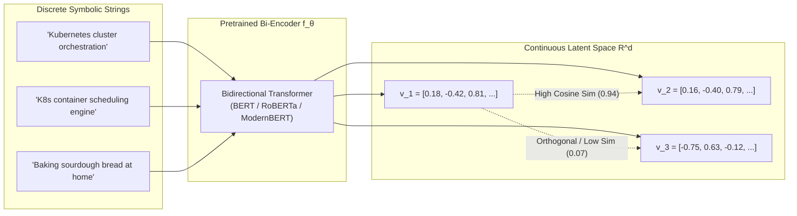
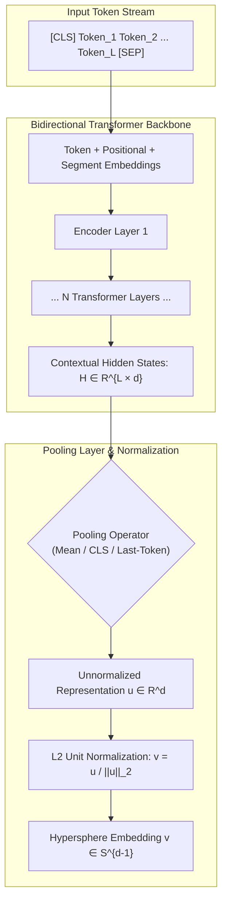
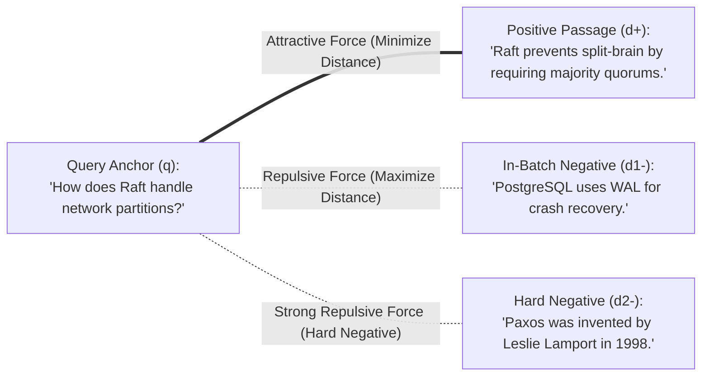
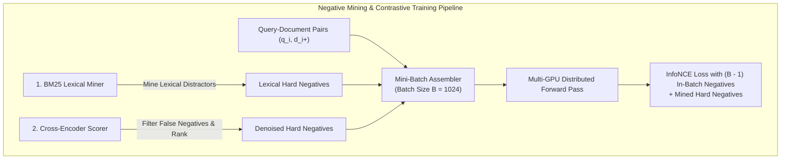
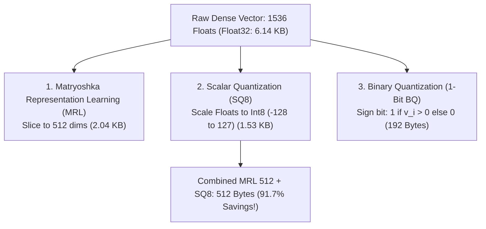
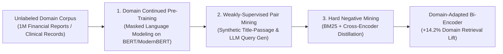
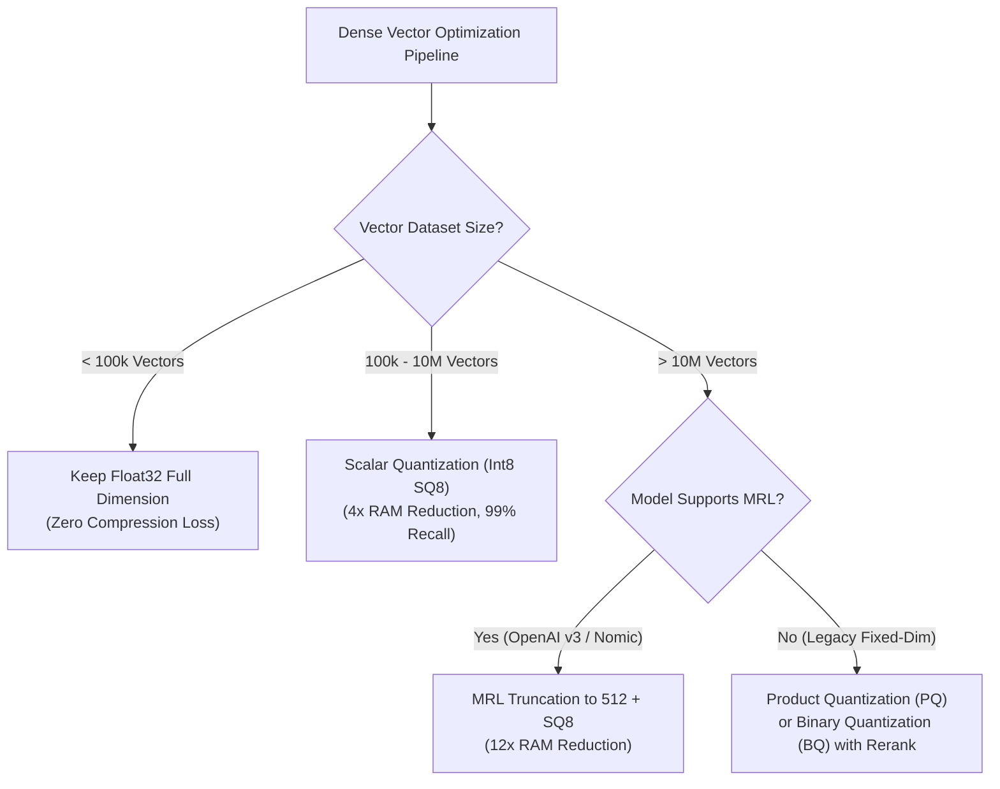

# 🧬 Dense Vector Embeddings: Architecture, Contrastive Learning, and Latent Space Topology

## 📑 Table of Contents
1. [🌟 Fundamentals: Continuous Latent Space Representation](#1--fundamentals-continuous-latent-space-representation)
2. [🏗️ Neural Architecture of Bi-Encoders](#2-️-neural-architecture-of-bi-encoders)
3. [🎯 Contrastive Learning Objectives & Loss Formulations](#3--contrastive-learning-objectives--loss-formulations)
4. [⛏️ Negative Mining Dynamics: In-Batch vs. Hard Negatives](#4-️-negative-mining-dynamics-in-batch-vs-hard-negatives)
5. [📐 Latent Space Topology: The Anisotropy Dilemma](#5--latent-space-topology-the-anisotropy-dilemma)
6. [🗜️ Dense Vector Compression: Quantization & MRL](#6-️-dense-vector-compression-quantization--mrl)
7. [💻 Practical Implementation: Bi-Encoder Pooling & InfoNCE Engine](#7--practical-implementation-bi-encoder-pooling--infonce-engine)
8. [🌍 Enterprise Case Studies & Domain Adaptations](#8--enterprise-case-studies--domain-adaptations)
9. [⚖️ Dense vs. Sparse vs. Multi-Vector (ColBERT) Comparison](#9-️-dense-vs-sparse-vs-multi-vector-colbert-comparison)
10. [🛠️ Best Practices & ❌ Common Production Pitfalls](#10-️-best-practices---common-production-pitfalls)
11. [💼 Senior Interview Questions & System Design Scenarios](#11--senior-interview-questions--system-design-scenarios)
12. [🧪 Hands-On Mini-Project: Latent Space Isotropy & Drift Analyzer](#12--hands-on-mini-project-latent-space-isotropy--drift-analyzer)
13. [⚡ Quick Revision & Architectural Decision Roadmap](#13--quick-revision--architectural-decision-roadmap)

---

## 1. 🌟 Fundamentals: Continuous Latent Space Representation

In traditional information retrieval, text representations relied upon discrete, symbolic indices (such as inverted token dictionaries in TF-IDF and BM25). While effective for exact keyword matching, symbolic systems suffer from the **vocabulary mismatch problem**: the inability to recognize semantic equivalence between syntactically disjoint phrases (e.g., *"myocardial infarction"* vs. *"heart attack"*).

**Dense Vector Embeddings** overcome this fundamental boundary by mapping variable-length discrete token sequences into fixed-dimensional continuous vector spaces $\mathbb{R}^d$, where every coordinate contains an informative real-valued float:

### # Continuous Vector Embedding Mapping
$$
f_\theta : \mathcal{X}^* \to \mathbb{R}^d \quad (d \in [256, 4096])
$$



In this continuous metric space, semantic relatedness is formalized as geometric proximity. Synonyms, contextual connotations, and conceptual analogies naturally cluster together, establishing the foundation for modern neural retrieval in RAG.

---

## 2. 🏗️ Neural Architecture of Bi-Encoders

The primary architectural backbone for dense retrieval is the **Bi-Encoder**. Unlike cross-encoders (which concatenate query and document into a single transformer, resulting in quadratic $O((L_q + L_d)^2)$ compute latency), bi-encoders process queries and documents independently:



### 🎛️ Hidden State Pooling Mechanisms

Because a transformer outputs a matrix of hidden states $\mathbf{H} \in \mathbb{R}^{L \times d}$ for a sequence of length $L$, an aggregation function is required to compress $\mathbf{H}$ into a single representation $\mathbf{u} \in \mathbb{R}^d$:

#### 1. Masked Mean Pooling (Industry Standard)
Averages token vectors across the non-padded tokens using the boolean attention mask $m_i \in \{0, 1\}$:

### # Masked Mean Pooling Formula
$$
\mathbf{u}_{\text{mean}} = \frac{\sum_{i=1}^L m_i \mathbf{h}_i}{\sum_{i=1}^L m_i}
$$

#### 2. `[CLS]` Token Pooling
Extracts the vector corresponding to index $0$ (the special classification token). While common in BERT pretraining, un-fine-tuned `[CLS]` vectors exhibit high anisotropy and inferior semantic clustering compared to mean pooling.

#### 3. Last-Token Pooling
Extracts the final contextual token state $\mathbf{h}_L$. This is the standard mechanism when utilizing modern **Causal Decoder LLMs** (e.g., Mistral-7B, Qwen2, Llama-3) as bi-encoder feature extractors.

### 🌐 Unit Hypersphere Normalization
To decouple vector length from semantic content, dense vectors are projected onto the unit hypersphere $\mathcal{S}^{d-1}$:

### # Unit L2 Normalization Formula
$$
\mathbf{v} = \frac{\mathbf{u}}{\|\mathbf{u}\|_2} = \frac{\mathbf{u}}{\sqrt{\sum_{j=1}^d u_j^2}}
$$

Once normalized, Euclidean distance $D_{L_2}(\mathbf{u}, \mathbf{v})$ and Cosine Similarity $\cos(\theta)$ become strictly monotonic functions of one another:

### # Cosine to L2 Metric Identity
$$
\|\mathbf{u} - \mathbf{v}\|_2^2 = \|\mathbf{u}\|_2^2 + \|\mathbf{v}\|_2^2 - 2(\mathbf{u} \cdot \mathbf{v}) = 2 - 2 \cos(\mathbf{u}, \mathbf{v})
$$

---

## 3. 🎯 Contrastive Learning Objectives & Loss Formulations

Dense embedding models are trained using **Contrastive Learning**, an optimization paradigm that pulls semantically related pairs together while simultaneously repelling irrelevant or misleading distractors.



### 1. Triplet Loss (Historical Baseline)
Forces the anchor-positive distance to be smaller than the anchor-negative distance by a margin $\alpha$:

### # Triplet Margin Loss Formula
$$
\mathcal{L}_{\text{Triplet}} = \max\left(0, \|\mathbf{q} - \mathbf{d}^+\|_2^2 - \|\mathbf{q} - \mathbf{d}^-\|_2^2 + \alpha\right)
$$

### 2. InfoNCE / Multiple Negatives Ranking (MNR) Loss (Modern Standard)
InfoNCE generalizes contrastive learning to a categorical cross-entropy formulation over one positive passage and $K$ negative passages:

### # InfoNCE Loss Formula
$$
\mathcal{L}_{\text{InfoNCE}} = -\log \frac{\exp\left(\frac{\mathbf{q} \cdot \mathbf{d}^+}{\tau}\right)}{\exp\left(\frac{\mathbf{q} \cdot \mathbf{d}^+}{\tau}\right) + \sum_{j=1}^K \exp\left(\frac{\mathbf{q} \cdot \mathbf{d}_j^-}{\tau}\right)}
$$

Where:
* $\mathbf{q} \cdot \mathbf{d}^+$ denotes the inner product between unit-normalized vectors (cosine similarity).
* $\tau > 0$ is the **temperature scaling parameter** (typically $0.01 \le \tau \le 0.05$).
* The temperature $\tau$ acts as a hardness amplifier: smaller $\tau$ values penalize hard negatives with high gradient magnitude, driving fine-grained separation in dense space.

---

## 4. ⛏️ Negative Mining Dynamics: In-Batch vs. Hard Negatives

The discriminative power of a dense embedding model is bounded by the quality and difficulty of the negative passages encountered during training.



### 📊 Comparison of Negative Mining Paradigms

| Negative Mining Paradigm | Mechanism | Sample Efficiency | Risk of False Negatives | Computational Cost |
| :--- | :--- | :---: | :---: | :---: |
| **Random Negatives** | Sample random passages from corpus. | Very Low | Negligible ($< 0.01\%$) | Zero |
| **In-Batch Negatives** | All other $(B - 1)$ documents in the GPU mini-batch serve as negatives for $q_i$. | Moderate | Extremely Low ($< 0.1\%$) | Zero additional compute |
| **BM25 Hard Negatives** | Top BM25 results that share keywords but are not marked as relevant. | High | Moderate ($2 - 5\%$) | Low (one-time indexing) |
| **Cross-Encoder Mined Negatives** | Top bi-encoder results re-scored by a powerful cross-encoder (e.g., MiniLM reranker). | **State-of-the-Art** | Controlled via thresholding | High (offline GPU inference) |

---

## 5. 📐 Latent Space Topology: The Anisotropy Dilemma

Un-fine-tuned transformer language models suffer from **Representation Degeneration**, widely known as **Anisotropy**.

In an anisotropic vector space, embeddings do not occupy the full hypersphere uniformly; instead, they collapse into a narrow, highly conical cone. Consequently, arbitrary, unrelated sentences exhibit high positive cosine similarity ($0.75 - 0.90$), severely reducing semantic discriminability.

```mermaid
flowchart LR
    subgraph AnisotropicSpace [Anisotropic Latent Space (Narrow Cone)]
        C1["Collapsed Cone: Vectors clustered in narrow sector"]
        V_A["v_arbitrary_1"] --- V_B["v_arbitrary_2"]
        Note1["Cos Sim between unrelated sentences: 0.82!"]
    end

    subgraph IsotropicSpace [Isotropic Latent Space (Uniformly Dispersed)]
        Circle["Full Unit Hypersphere S^{d-1}"]
        V_X["v_topic_1"] -.->|"Orthogonal (Sim ≈ 0.0)"| V_Y["v_topic_2"]
        Note2["Unrelated sentences are orthogonal; high variance."]
    end

    AnisotropicSpace -->|"Contrastive InfoNCE / Whitening"| IsotropicSpace
```

### 🔬 Mathematical Properties of Isotropy

A representation space is strictly isotropic if the vector distribution has zero mean and an identity covariance matrix:

### # Isotropic Covariance Condition
$$
\mathbb{E}[\mathbf{v}] = \mathbf{0}, \quad \text{Cov}(\mathbf{v}) = \mathbb{E}\left[\mathbf{v} \mathbf{v}^\top\right] = \sigma^2 \mathbf{I}_d
$$

When anisotropy strikes:
1. The dominant singular values of the embedding matrix $\mathbf{V} \in \mathbb{R}^{N \times d}$ decay exponentially: the first 2-3 principal components account for $>70\%$ of the total variance.
2. Low-frequency words and token positional biases dominate the coordinate space.
3. **The Solution:** Contrastive learning with InfoNCE loss directly restores isotropy because the denominator pushes negative pairs across the entire hypersphere, forcing vectors to disperse uniformly (optimizing the **Uniformity Loss**).

---

## 6. 🗜️ Dense Vector Compression: Quantization & MRL

Deploying dense embeddings across hundreds of millions of enterprise passages introduces severe RAM and latency bottlenecks:

* $100,000,000 \text{ vectors} \times 1536 \text{ dimensions} \times 4 \text{ bytes (Float32)} = \mathbf{614.4 \text{ GB RAM}}$.

To reduce memory consumption, vector databases employ three primary compression strategies:



### 📊 Quantization Trade-Off Matrix

| Quantization Method | Compression Ratio | Memory Footprint per Vector ($d=1536$) | Relative Recall@10 | Compute Engine |
| :--- | :---: | :---: | :---: | :--- |
| **Float32 (Uncompressed)** | $1.0\times$ | 6,144 Bytes | 100.0% (Baseline) | Standard BLAS / AVX-512 |
| **Float16 / Bfloat16** | $2.0\times$ | 3,072 Bytes | 99.9% | Half-precision GPU/ARM |
| **Scalar Quantization (Int8)** | $4.0\times$ | 1,536 Bytes | 98.8% | Int8 AVX-VNNI SIMD |
| **Matryoshka Truncation ($d=512$)** | $3.0\times$ | 2,048 Bytes | 98.5% | Standard BLAS |
| **MRL 512 + SQ8** | **$12.0\times$** | **512 Bytes** | **97.2%** | Int8 SIMD |
| **Binary Quantization (1-Bit)** | **$32.0\times$** | **192 Bytes** | **91.5%** | Hardware Hamming Distance (POPCNT) |

---

## 7. 💻 Practical Implementation: Bi-Encoder Pooling & InfoNCE Engine

The following complete, standalone Python implementation demonstrates the foundational mathematical operations of dense vector representations: masked mean pooling, $L_2$ unit normalization, InfoNCE loss computation, and cosine similarity batch ranking.

```python
"""
Production Dense Vector Engine: Masked Mean Pooling and Contrastive InfoNCE Loss
Author: Enterprise RAG Curriculum
Requirements: pip install torch numpy
"""

from typing import Tuple
import torch
import torch.nn as nn
import torch.nn.functional as F

class DenseBiEncoderEngine(nn.Module):
    """Production PyTorch module implementing masked mean pooling and InfoNCE loss."""

    def __init__(self, temperature: float = 0.05):
        super().__init__()
        self.temperature = temperature

    @staticmethod
    def masked_mean_pooling(
        hidden_states: torch.Tensor, 
        attention_mask: torch.Tensor
    ) -> torch.Tensor:
        """
        Calculates masked mean pooling, ignoring padding tokens.
        
        Args:
            hidden_states: Tensor of shape (Batch_Size, Sequence_Length, Hidden_Dim)
            attention_mask: Tensor of shape (Batch_Size, Sequence_Length), 1=valid, 0=padding
            
        Returns:
            Pooled tensor of shape (Batch_Size, Hidden_Dim)
        """
        # Expand mask dimensions: (B, L) -> (B, L, 1)
        expanded_mask = attention_mask.unsqueeze(-1).expand_as(hidden_states).float()
        
        # Sum hidden states of non-padding tokens
        sum_embeddings = torch.sum(hidden_states * expanded_mask, dim=1)
        
        # Compute count of valid tokens, clamped to prevent division by zero
        sum_mask = torch.clamp(expanded_mask.sum(dim=1), min=1e-9)
        
        return sum_embeddings / sum_mask

    @staticmethod
    def l2_normalize(vectors: torch.Tensor) -> torch.Tensor:
        """Normalize dense vectors to lie on the unit hypersphere."""
        return F.normalize(vectors, p=2, dim=1)

    def compute_infonce_loss(
        self, 
        query_embeddings: torch.Tensor, 
        positive_doc_embeddings: torch.Tensor
    ) -> Tuple[torch.Tensor, torch.Tensor]:
        """
        Computes Multiple Negatives Ranking (InfoNCE) Loss over in-batch negatives.
        
        Args:
            query_embeddings: Unit-normalized query vectors (B, D)
            positive_doc_embeddings: Unit-normalized positive doc vectors (B, D)
            
        Returns:
            Tuple of (loss_scalar, similarity_matrix)
        """
        # Similarity matrix: (B, B) representing inner product of unit vectors
        similarity_matrix = torch.matmul(query_embeddings, positive_doc_embeddings.T)
        
        # Scale similarities by temperature parameter
        scaled_logits = similarity_matrix / self.temperature
        
        # Target labels: ground truth positive is on the diagonal (index i matches i)
        batch_size = query_embeddings.size(0)
        labels = torch.arange(batch_size, device=query_embeddings.device)
        
        # Categorical Cross-Entropy over logits
        loss = F.cross_entropy(scaled_logits, labels)
        return loss, similarity_matrix


# Demonstration and Verification
if __name__ == "__main__":
    torch.manual_seed(42)
    
    batch_size = 4
    seq_len = 8
    hidden_dim = 16  # Scaled down for clarity
    
    # 1. Simulate transformer outputs and attention masks
    simulated_hidden_states = torch.randn(batch_size, seq_len, hidden_dim)
    simulated_attention_mask = torch.tensor([
        [1, 1, 1, 1, 1, 0, 0, 0],  # 5 tokens
        [1, 1, 1, 1, 1, 1, 1, 0],  # 7 tokens
        [1, 1, 1, 1, 0, 0, 0, 0],  # 4 tokens
        [1, 1, 1, 1, 1, 1, 1, 1],  # 8 tokens
    ])
    
    engine = DenseBiEncoderEngine(temperature=0.05)
    
    # 2. Perform Masked Mean Pooling and L2 Normalization
    pooled = engine.masked_mean_pooling(simulated_hidden_states, simulated_attention_mask)
    normalized_queries = engine.l2_normalize(pooled)
    
    # Generate synthetic matching positive documents
    simulated_positives = pooled + torch.randn_like(pooled) * 0.1
    normalized_docs = engine.l2_normalize(simulated_positives)
    
    # 3. Calculate Contrastive InfoNCE Loss
    loss, sim_matrix = engine.compute_infonce_loss(normalized_queries, normalized_docs)
    
    print("--- Dense Bi-Encoder Pooling & InfoNCE Verification ---")
    print(f"Normalized Query Vectors Norm: {torch.norm(normalized_queries, dim=1).tolist()}")
    print(f"Computed InfoNCE Loss: {loss.item():.4f}")
    print("\nCosine Similarity Matrix (Diagonal represents Positive Pairs):")
    print(torch.round(sim_matrix * 100) / 100)
```

---

## 8. 🌍 Enterprise Case Studies & Domain Adaptations



### Case Study: High-Precision Biomedical Patent Search
* **Context:** An international intellectual property firm required semantic search across 4.5 million chemical and pharmaceutical patent abstracts.
* **Problem:** General-purpose embedding models (`text-embedding-3-small`, `bge-base-en-v1.5`) failed to distinguish between chemical isomers and specific receptor bindings, returning general medical documents instead of actionable prior art.
* **Solution:**
  1. Initialized from `BAAI/bge-large-en-v1.5`.
  2. Applied **Domain-Adaptive Pre-Training (DAPT)** on 500,000 patent descriptions using Masked Language Modeling (MLM).
  3. Mined 1.2 million hard negatives using a 3-way ensemble: BM25 on chemical formula fields + Cross-Encoder reranker score filtering.
  4. Trained using InfoNCE loss with a low temperature ($\tau = 0.02$).
* **Results:** $\text{NDCG}@10$ increased from $48.2\%$ to **$62.7\%$** on domain-specific patent test benchmarks; search latency remained unchanged at 12ms per query.

---

## 9. ⚖️ Dense vs. Sparse vs. Multi-Vector (ColBERT) Comparison

| Architectural Attribute | Dense Embeddings (Single-Vector Bi-Encoder) | Sparse Embeddings (BM25 / SPLADE) | Multi-Vector Embeddings (ColBERT / Late Interaction) |
| :--- | :--- | :--- | :--- |
| **Representation Format** | Single continuous float vector $\mathbf{v} \in \mathbb{R}^d$ ($d \approx 768 - 1536$). | High-dimensional sparse vector $\mathbf{s} \in \mathbb{R}^{|\mathcal{V}|}$ ($|\mathcal{V}| \approx 30,000$). | Matrix of token vectors $\mathbf{M} \in \mathbb{R}^{L \times d}$ ($d \approx 128$). |
| **Index Storage Structure** | Vector DB Graph (HNSW) or Inverted File (IVF). | Inverted Index (Postings lists). | Multi-vector token index with residual compression. |
| **Storage per Passage** | Low ($1.5 - 6 \text{ KB}$). | Very Low ($0.2 - 1 \text{ KB}$). | High ($30 - 80 \text{ KB}$). |
| **Semantic Generalization**| **Exceptional:** Understands synonyms, context, and intent. | **Weak:** Dependent on shared lexical vocabulary. | **Maximum:** Deep token-to-token semantic interaction. |
| **Exact Keyword Matching** | ⚠️ **Vulnerable:** Fails on exact serial numbers, SKU codes, IDs. | ✅ **Flawless:** Exact token inverted index lookups. | ✅ **Strong:** Aligns query tokens to exact document tokens. |
| **Query Latency (p95)** | Fast ($5 - 15 \text{ ms}$ on HNSW). | Extremely Fast ($1 - 5 \text{ ms}$). | Moderate ($25 - 60 \text{ ms}$ MaxSim operator). |

---

## 10. 🛠️ Best Practices & ❌ Common Production Pitfalls

### ✅ Best Practices
1. **Always Implement Masked Mean Pooling:** Never simply call `torch.mean(hidden_states, dim=1)` without masking. Zero-padded tokens carry residual positional and attention values that pollute the semantic vector.
2. **Explicitly Store Document Length in Payload:** Chunks that are too short ($< 20$ tokens) often produce biased, high-norm embeddings that falsely match broad queries.
3. **Calibrate the Contrastive Temperature $\tau$:** In domain fine-tuning, setting $\tau > 0.1$ causes gradients to diffuse, resulting in poorly separated clusters. Setting $\tau < 0.01$ causes training instability and exploding gradients.

### ❌ Common Production Pitfalls
* **Padding Mask Omission:** Failing to mask out `[PAD]` tokens during mean pooling causes the resulting embedding to drift toward the centroid of padding tokens.
* **Assuming Dot Product Equals Cosine Similarity:** In vector databases, configuring an index for Inner Product (IP) while inserting unnormalized vectors causes longer documents with larger vector magnitudes to dominate search results regardless of relevance.
* **Neglecting Domain Discrepancies:** Deploying general-domain models (trained on Wikipedia and web scrapes) onto internal financial ledgers or medical diagnostic notes without domain testing.

---

## 11. 💼 Senior Interview Questions & System Design Scenarios

### Q1: What is the Anisotropy Problem in transformer embeddings, and how does contrastive learning remediate it?
> **Expert Answer:**  
> Anisotropy refers to the geometric degeneration of dense representations where embedding vectors occupy an extremely narrow cone in vector space rather than dispersing uniformly across the hypersphere. In raw pretrained transformers, word frequency distributions and layer norm biases cause hidden states to share a large common average vector.  
> Contrastive learning with InfoNCE loss remedies this through its denominator objective: by maximizing the distance between an anchor and negative samples randomly or hard-mined across the corpus, the loss function acts as a repulsive electrostatic force. This forces the vectors to expand and distribute isotropically over the entire unit hypersphere $\mathcal{S}^{d-1}$, maximizing representational entropy and semantic discriminability.

### Q2: Why does Bi-Encoder retrieval scale to billions of documents, whereas Cross-Encoder retrieval cannot?
> **Expert Answer:**  
> A Bi-Encoder enforces strict structural independence between the query encoding function $f_\theta(q)$ and the document encoding function $g_\phi(d)$. Because document representations $\mathbf{v}_d = g_\phi(d)$ do not depend on the query, they can be pre-computed offline and indexed into sub-linear approximate nearest neighbor (ANN) data structures like HNSW graphs ($O(\log N)$ search complexity).  
> Conversely, a Cross-Encoder passes the concatenated pair $[q; d]$ through all $L$ self-attention layers simultaneously, capturing fine-grained all-to-all token interactions ($O((L_q + L_d)^2)$). Because compute cannot be decoupled, evaluating a query against $N$ candidate documents requires $N$ full forward passes through a multi-layer transformer, rendering real-time search across millions of documents computationally intractable.

### Q3: In a high-throughput RAG system, how does Scalar Quantization (SQ8) impact memory bandwidth and CPU cache locality?
> **Expert Answer:**  
> During nearest-neighbor graph traversal, distance computation is typically memory-bandwidth bound rather than compute bound. Converting 32-bit floats to 8-bit integers reduces vector footprint by $75\%$ (from 6,144 bytes to 1,536 bytes for $d=1536$). This $4\times$ reduction allows modern CPU L3 caches to hold significantly more vectors simultaneously, dramatically reducing cache misses. Furthermore, modern x86 architectures (AVX-512 VNNI) and ARM processors (NEON) execute dot products of 8-bit integers using dedicated vector instructions that process 32 to 64 operations per clock cycle, yielding a $3 - 5\times$ acceleration in query throughput.

---

## 12. 🧪 Hands-On Mini-Project: Latent Space Isotropy & Drift Analyzer

This runnable diagnostic script measures the degree of **isotropy vs. anisotropy** in dense vector sets by calculating average pairwise cosine similarity and singular value distribution.

```python
"""
Hands-On Diagnostic: Latent Space Isotropy & Variance Analyzer
Run directly: python isotropy_analyzer.py
Requires: pip install numpy tabulate
"""

from typing import Tuple
import numpy as np
from tabulate import tabulate

def generate_synthetic_latent_spaces(n_samples: int = 500, dim: int = 128) -> Tuple[np.ndarray, np.ndarray]:
    """
    Generates two synthetic embedding spaces:
    1. Anisotropic Space: Vectors clustered within a narrow cone.
    2. Isotropic Space: Vectors distributed uniformly over the unit hypersphere.
    """
    # 1. Generate Isotropic Vectors: Standard Gaussian projected to S^{d-1}
    isotropic = np.random.randn(n_samples, dim)
    isotropic /= np.linalg.norm(isotropic, axis=1, keepdims=True)
    
    # 2. Generate Anisotropic Vectors: Shared dominant centroid + small noise
    shared_centroid = np.ones(dim) / np.sqrt(dim)
    noise = np.random.randn(n_samples, dim) * 0.15
    anisotropic = shared_centroid + noise
    anisotropic /= np.linalg.norm(anisotropic, axis=1, keepdims=True)
    
    return isotropic, anisotropic

def analyze_latent_topology(vectors: np.ndarray, name: str) -> dict:
    """Analyzes geometric variance, average cosine similarity, and singular values."""
    n_samples = vectors.shape[0]
    
    # Sample random pairwise cosine similarities (Inner products of unit vectors)
    indices_a = np.random.randint(0, n_samples, size=1000)
    indices_b = np.random.randint(0, n_samples, size=1000)
    # Mask identical pairs
    valid_mask = indices_a != indices_b
    idx_a, idx_b = indices_a[valid_mask], indices_b[valid_mask]
    
    pairwise_cosines = np.sum(vectors[idx_a] * vectors[idx_b], axis=1)
    
    # Singular Value Decomposition (SVD)
    _, s, _ = np.linalg.svd(vectors, full_matrices=False)
    variance_explained_top3 = np.sum(s[:3]**2) / np.sum(s**2) * 100.0
    
    return {
        "Space Name": name,
        "Mean Cosine Sim": f"{np.mean(pairwise_cosines):.4f}",
        "Std Cosine Sim": f"{np.std(pairwise_cosines):.4f}",
        "Max Cosine Sim": f"{np.max(pairwise_cosines):.4f}",
        "Min Cosine Sim": f"{np.min(pairwise_cosines):.4f}",
        "Top-3 SVD Variance": f"{variance_explained_top3:.1f}%",
        "Topology Diagnosis": "Healthy / Isotropic" if np.mean(pairwise_cosines) < 0.2 else "Degenerate / Anisotropic"
    }

if __name__ == "__main__":
    np.random.seed(42)
    iso_vecs, aniso_vecs = generate_synthetic_latent_spaces(n_samples=1000, dim=256)
    
    report_iso = analyze_latent_topology(iso_vecs, "Isotropic Space (Post-Contrastive)")
    report_aniso = analyze_latent_topology(aniso_vecs, "Anisotropic Space (Raw Un-tuned)")
    
    table_data = [list(report_iso.values()), list(report_aniso.values())]
    headers = list(report_iso.keys())
    
    print("\n" + tabulate(table_data, headers=headers, tablefmt="github"))
```

---

## 13. ⚡ Quick Revision & Architectural Decision Roadmap

### 📋 Key Takeaways Cheat-Sheet
* **Dense Vectors Map Semantics, Not Keywords:** Dense embeddings excel at finding conceptual intent and semantic synonyms, but struggle with exact numbers, IDs, and alphanumeric strings.
* **Masked Mean Pooling is Non-Negotiable:** When aggregating contextual token representations, always apply the attention mask to eliminate padding token noise.
* **InfoNCE Directly Enforces Isotropy:** The contrastive denominator acts as a geometric repulsive force, preventing representation degeneration into narrow anisotropic cones.
* **Unit Normalization Accelerates Search:** Projecting embeddings onto $\mathcal{S}^{d-1}$ makes Cosine Similarity mathematically identical to Dot Product, enabling ultra-fast hardware SIMD dot-product routines.
* **Quantization is Essential for Scale:** Combining Matryoshka dimension truncation (MRL) with 8-bit Scalar Quantization (SQ8) yields up to $12\times$ memory reduction with under $3\%$ loss in retrieval recall.

### 🧭 Visual Decision Tree: Latent Encoding Topology


