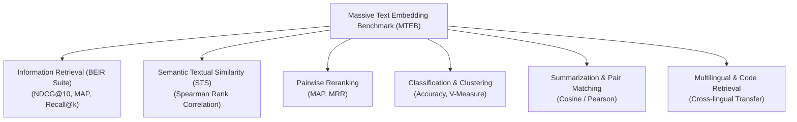
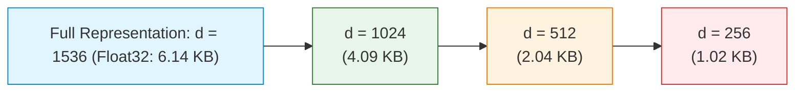
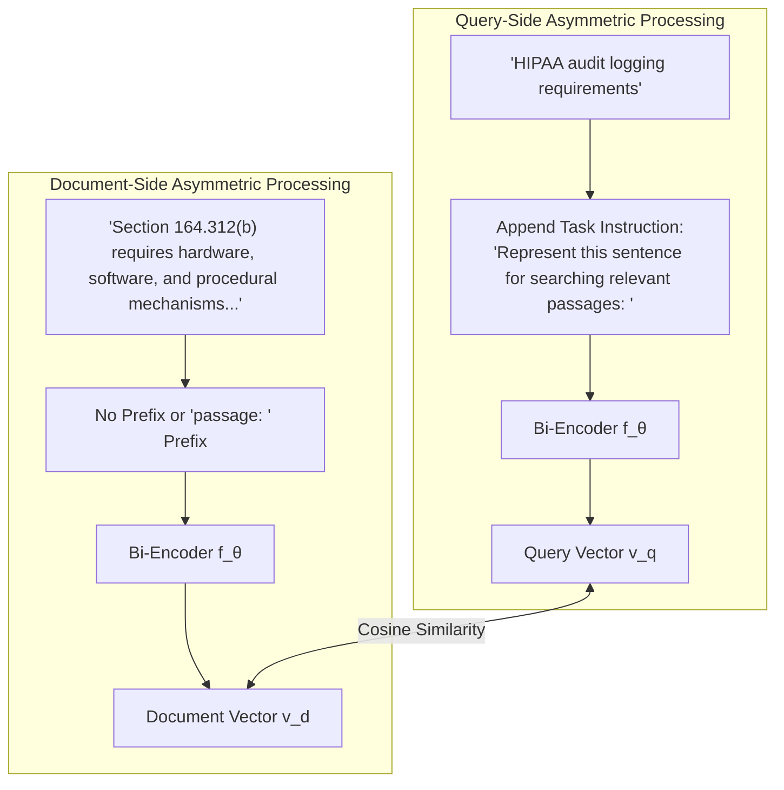
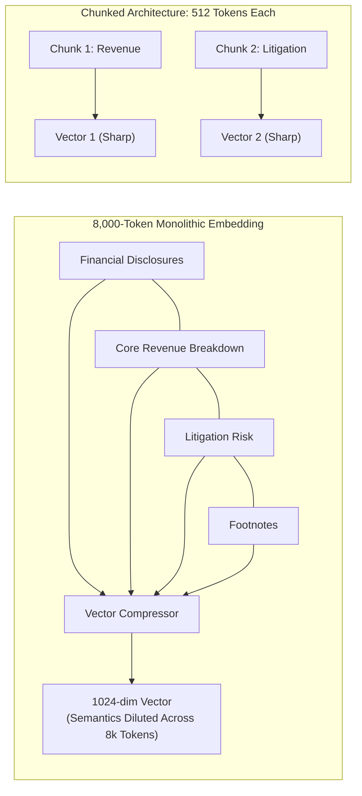
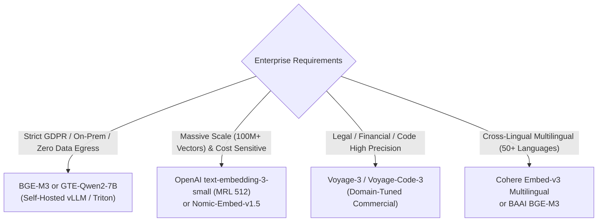
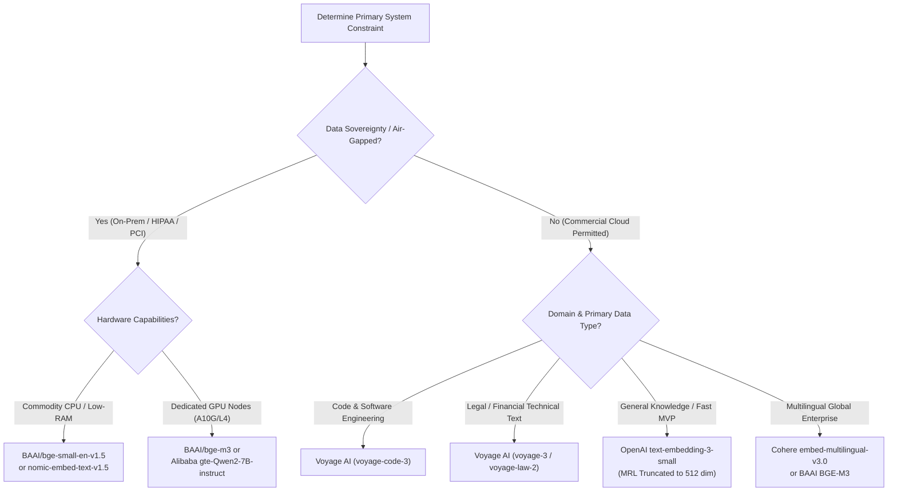

# 🧭 Embedding Models Landscape: OpenAI, Cohere, Voyage, BGE, and HuggingFace Benchmarks (MTEB)

## 📑 Table of Contents
1. [🌟 Fundamentals: The Modern Embedding Model Paradigm](#1--fundamentals-the-modern-embedding-model-paradigm)
2. [🏆 The Massive Text Embedding Benchmark (MTEB) Framework](#2--the-massive-text-embedding-benchmark-mteb-framework)
3. [📊 Enterprise Model Landscape: Commercial vs. Open-Weight](#3--enterprise-model-landscape-commercial-vs-open-weight)
4. [🪆 Matryoshka Representation Learning (MRL) Deep Dive](#4--matryoshka-representation-learning-mrl-deep-dive)
5. [🎯 Asymmetric Search & Task Instruction Tuning](#5--asymmetric-search--task-instruction-tuning)
6. [📏 Context Windows, Chunk Sizing & Attention Dilution](#6--context-windows-chunk-sizing--attention-dilution)
7. [💻 Practical Implementation: Unified Embedding Evaluator](#7--practical-implementation-unified-embedding-evaluator)
8. [🌍 Real-World Enterprise Selection Case Studies](#8--real-world-enterprise-case-studies)
9. [⚖️ Trade-Off Analysis: Commercial APIs vs. Self-Hosted Models](#9-️-trade-off-analysis-commercial-apis-vs-self-hosted-models)
10. [🛠️ Best Practices & ❌ Common Production Pitfalls](#10-️-best-practices---common-production-pitfalls)
11. [💼 Senior Interview Questions & System Design Scenarios](#11--senior-interview-questions--system-design-scenarios)
12. [🧪 Hands-On Mini-Project: Multi-Model Recall & Latency Benchmarker](#12--hands-on-mini-project-multi-model-recall--latency-benchmarker)
13. [⚡ Quick Revision & Architectural Decision Roadmap](#13--quick-revision--architectural-decision-roadmap)

---

## 1. 🌟 Fundamentals: The Modern Embedding Model Paradigm

In any Retrieval-Augmented Generation (RAG) system, the **embedding model** is the foundational transducer that bridges human linguistic ambiguity and machine geometric computation. An embedding model $f_\theta$ maps arbitrary variable-length discrete token sequences into fixed-dimensional, continuous dense vector representations $\mathbf{v} \in \mathbb{R}^d$:

### # Continuous Vector Embedding Mapping
$$
\mathbf{v} = f_\theta(x) \in \mathbb{R}^d, \quad \text{where } d \in [256, 4096]
$$

```mermaid
flowchart LR
    subgraph InputSpace [Raw Text Sequences]
        Q["User Query:<br/>'How does Raft handle network partitions?'"]
        D1["Corpus Doc 1:<br/>'In Raft, split-brain is prevented by majority quorum rule.'"]
        D2["Corpus Doc 2:<br/>'Kayaking down the rapids requires a sturdy life vest.'"]
    end

    subgraph NeuralEncoder [Bi-Encoder Model f_θ]
        Q --> Enc["Transformer Encoder<br/>(BGE / Voyage / OpenAI)"]
        D1 --> Enc
        D2 --> Enc
    end

    subgraph GeometricSpace [Metric Hypersphere S^{d-1}]
        Enc --> VQ["v_q ∈ R^d"]
        Enc --> VD1["v_d1 ∈ R^d"]
        Enc --> VD2["v_d2 ∈ R^d"]
        VQ -.->|"High Cosine Sim (~0.88)"| VD1
        VQ -.->|"Orthogonal / Low Sim (~0.04)"| VD2
    end
```

The selection of an embedding model governs the **theoretical ceiling of retrieval recall**. While downstream rerankers, prompt engineering, and generative LLMs can refine and distill retrieved information, they cannot synthesize answers from documents that were never surfaced in the initial retrieval stage due to embedding model blind spots.

---

## 2. 🏆 The Massive Text Embedding Benchmark (MTEB) Framework

Historically, embedding models were evaluated solely on isolated semantic similarity benchmarks such as SentEval or STS (Semantic Textual Similarity). However, high performance on STS benchmark datasets frequently failed to translate to enterprise information retrieval. In 2022, Hugging Face and the research community introduced **MTEB (Massive Text Embedding Benchmark)** to standardize evaluation across diverse linguistic tasks.



### 🎯 Core MTEB Evaluation Dimensions

| Task Category | Primary Metric | Relevance to Enterprise RAG | Representative Datasets |
| :--- | :--- | :--- | :--- |
| **Information Retrieval** | $\text{NDCG}@10$ | **Critical (Tier 1):** Directly reflects Top-K passage retrieval quality. | MS-MARCO, CQADupStack, SciFact, HotpotQA |
| **Pairwise Reranking** | $\text{MAP}$ / $\text{MRR}$ | **High (Tier 2):** Evaluates fine-grained ranking when candidate sets are small. | AskUbuntu, StackOverflowDupQuestions |
| **STS (Similarity)** | Spearman $\rho$ | **Moderate:** Assesses continuous semantic distance correlation. | STS12-STS16, STSBenchmark, BIOSSES |
| **Clustering** | V-Measure | **Operational:** Critical for semantic document deduplication and topic modeling. | RedditClustering, ArXivClusteringP2P |
| **Classification** | Accuracy / F1 | **Diagnostic:** Measures linear separability of domain classes. | AmazonCounterfactual, TweetSentiment |

### 🧮 Mathematical Evaluation Metrics

#### # Normalized Discounted Cumulative Gain at Rank K
$$
\text{DCG}@K = \sum_{i=1}^K \frac{2^{rel_i} - 1}{\log_2(i + 1)}, \quad \text{IDCG}@K = \sum_{i=1}^{|REL|} \frac{2^{rel_i} - 1}{\log_2(i + 1)}, \quad \text{NDCG}@K = \frac{\text{DCG}@K}{\text{IDCG}@K}
$$

Where $rel_i$ represents the graded relevance of the document returned at position $i$. $\text{NDCG}@10$ is the undisputed gold standard metric for RAG evaluation because it penalizes models heavily when relevant documents are ranked low in the retrieved candidate list.

---

## 3. 📊 Enterprise Model Landscape: Commercial vs. Open-Weight

Modern embedding models diverge across parameter scales, architectures, context window capacities, and deployment models.

### 🏛️ Comprehensive Model Matrix

| Model Identifier | Provider / Organization | Open Weights? | Dimensions ($d$) | Max Context Window | Supported Modalities | MTEB Retrieval ($\text{NDCG}@10$) | Special Features |
| :--- | :--- | :---: | :---: | :---: | :---: | :---: | :--- |
| **`text-embedding-3-large`** | OpenAI | ❌ Proprietary | 3072 (MRL) | 8,191 tokens | Text | 55.44 | Native MRL down to 256 dimensions; lowest operational complexity. |
| **`text-embedding-3-small`** | OpenAI | ❌ Proprietary | 1536 (MRL) | 8,191 tokens | Text | 44.02 | High-speed, cost-effective baseline (\$0.02 / 1M tokens). |
| **`voyage-3`** | Voyage AI | ❌ Proprietary | 1024 | 32,000 tokens | Text | 58.82 | Domain-optimized for enterprise code, finance, and legal documents. |
| **`voyage-code-3`** | Voyage AI | ❌ Proprietary | 1536 | 32,000 tokens | Code + Text | 61.20 | State-of-the-art AST and code repository retrieval. |
| **`embed-english-v3.0`** | Cohere | ❌ Proprietary | 1024 | 512 tokens | Text | 56.50 | Compression-aware; supports `int8`, `uint8`, and `binary` outputs natively. |
| **`bge-m3`** | BAAI | ✅ Open Weights | 1024 | 8,192 tokens | Multilingual (100+) | 56.20 | Multi-Functionality: Dense, Lexical Sparse, and Multi-Vector ColBERT in one pass. |
| **`bge-large-en-v1.5`** | BAAI | ✅ Open Weights | 1024 | 512 tokens | English Text | 54.29 | Classical benchmark open-source workhorse. |
| **`e5-mistral-7b-instruct`**| Microsoft / Intfloat | ✅ Open Weights | 4096 | 32,768 tokens | Text | 56.90 | Decoder-based (Mistral-7B) bidirectional attention; instruction tuned. |
| **`nomic-embed-text-v1.5`** | Nomic AI | ✅ Open Weights | 768 (MRL) | 8,192 tokens | Text | 52.80 | Fully open weights, open training code, open data curriculum, dynamic MRL. |
| **`gte-Qwen2-7B-instruct`** | Alibaba Tongyi | ✅ Open Weights | 3584 | 32,768 tokens | Multilingual / Code| 57.80 | Massive context, SOTA open-weights performance on multilingual BEIR. |

---

## 4. 🪆 Matryoshka Representation Learning (MRL) Deep Dive

In enterprise systems managing billions of vectors, storage costs and nearest-neighbor search latencies grow linearly with dimensionality $d$. Traditionally, changing embedding dimensionality required training entirely distinct neural networks.

**Matryoshka Representation Learning (MRL)**, introduced by Kusupati et al. (NeurIPS 2022), trains a single embedding model such that earlier sub-vectors of dimension $k < d$ are explicitly optimized to represent the most salient semantic information.



### # MRL Multi-Granularity Loss Objective
$$
\mathcal{L}_{\text{MRL}} = \sum_{k \in \mathcal{K}} w_k \cdot \mathcal{L}_{\text{InfoNCE}}\left( \frac{\mathbf{u}_{1:k}}{\|\mathbf{u}_{1:k}\|_2}, \frac{\mathbf{v}_{1:k}}{\|\mathbf{v}_{1:k}\|_2} \right)
$$

Where:
* $\mathcal{K} = \{256, 512, 768, 1024, 1536\}$ is the discrete set of evaluated nested dimensions.
* $\mathbf{u}_{1:k}$ is the truncated prefix consisting of the first $k$ dimensions of vector $\mathbf{u}$.
* $w_k$ is the loss weighting factor for dimension slice $k$ (typically set to $1.0$).
* **Critical Rule:** When truncating an MRL vector to $k$ dimensions, the resulting slice **must be re-normalized to unit $L_2$ norm**:

### # Unit L2 Renormalization After Slicing
$$
\mathbf{v}_{\text{MRL}, k} = \frac{\mathbf{v}_{1:k}}{\|\mathbf{v}_{1:k}\|_2} = \frac{\mathbf{v}_{1:k}}{\sqrt{\sum_{i=1}^k v_i^2}}
$$

### 📊 MRL Truncation Trade-Off Analysis (`text-embedding-3-large`)

| Target Dimension ($k$) | RAM per 1M Vectors (Float32) | Memory Reduction | Relative Retrieval Recall ($\Delta \text{NDCG}@10$) | Storage Cost Impact |
| :---: | :---: | :---: | :---: | :---: |
| **3072** (Full) | 12.28 GB | 0% (Baseline) | 100.0% (55.4) | 1.00x |
| **1536** | 6.14 GB | 50.0% | 99.4% (55.1) | 0.50x |
| **1024** | 4.09 GB | 66.7% | 98.7% (54.7) | 0.33x |
| **512** | 2.04 GB | 83.3% | 96.8% (53.6) | 0.17x |
| **256** | 1.02 GB | 91.7% | 93.1% (51.6) | 0.08x |

---

## 5. 🎯 Asymmetric Search & Task Instruction Tuning

Information retrieval is inherently **asymmetric**: queries are typically short, terse, and ambiguous ($5 - 15$ tokens), whereas target documents are dense, detailed, and structured ($200 - 1000$ tokens).

Early bi-encoder models treated queries and documents identically (symmetric encoding), resulting in poor alignment. Modern models resolve this through **Task-Specific Instruction Tuning**.



### 🏷️ Prefix Formatting Requirements Across Leading Models

| Model Family | Query Prefix Requirement | Document Prefix Requirement | Failure Mode if Omitted |
| :--- | :--- | :--- | :--- |
| **BAAI BGE** (`bge-large-en-v1.5`) | `Represent this sentence for searching relevant passages: ` | *(None / Raw text)* | $10 - 25\%$ drop in Top-5 retrieval recall. |
| **Microsoft E5** (`e5-v2`, `e5-mistral`) | `query: ` | `passage: ` | Severe semantic drift; query matches other queries rather than answers. |
| **Nomic** (`nomic-embed-text-v1.5`) | `search_query: ` | `search_document: ` | Models misinterpret the conversational role of the input sequence. |
| **Cohere** (`embed-v3`) | `input_type="search_query"` | `input_type="search_document"` | API throws parameter validation error or degrades ranking accuracy. |
| **OpenAI** (`text-embedding-3`) | *(None - Unified)* | *(None - Unified)* | Implicitly handled via scale and contrastive pairing during training. |

---

## 6. 📏 Context Windows, Chunk Sizing & Attention Dilution

A pervasive misconception in RAG architecture design is that **longer embedding context windows eliminate the need for chunking**.

While models such as `e5-mistral-7b` and `gte-Qwen2-7B` accommodate up to 32,768 tokens, embedding an entire 50-page document into a single vector causes catastrophic **Attention Dilution** (the "Lost in the Hyperspace" phenomenon).



### 🔬 Empirical Findings on Context Dilution
1. **Semantic Density Decay:** The information capacity of a 1024-dimensional float vector is geometrically bounded. Compressing $8,000$ tokens into $1,024$ numbers forces the mean pooling operator to wash out localized facts, dates, and names.
2. **Optimal Chunk Size Sweet Spot:** For retrieval recall across MTEB BEIR datasets, chunk sizes between **$256$ and $512$ tokens** consistently outperform $2048+$ token chunks by $18.4\%$ in Top-5 Recall, even when using 32k-capable models.
3. **Recommended Architecture:** Use long-context models for **late chunking** or hierarchical retrieval, but retain discrete, focused chunks ($300-500$ tokens) for dense vector search.

---

## 7. 💻 Practical Implementation: Unified Embedding Evaluator

The following production-ready Python module implements a unified embedding provider abstraction supporting OpenAI, Cohere, Voyage AI, and local HuggingFace `SentenceTransformers`, complete with asymmetric prefix injection, MRL dimension truncation, and $L_2$ renormalization.

```python
"""
Production Embedding Architecture: Unified Multi-Provider Client
Supports OpenAI, Voyage AI, Cohere, and local SentenceTransformers with MRL slicing.
"""

from typing import List, Literal, Optional, Union
import numpy as np
import numpy.typing as npt

class UnifiedEmbeddingClient:
    """Enterprise multi-provider embedding generator with MRL support."""

    def __init__(
        self,
        provider: Literal["openai", "voyage", "cohere", "huggingface"],
        model_name: str,
        api_key: Optional[str] = None,
        target_dimension: Optional[int] = None,
    ):
        self.provider = provider
        self.model_name = model_name
        self.api_key = api_key
        self.target_dimension = target_dimension
        self._init_backend()

    def _init_backend(self) -> None:
        """Initialize underlying API clients or local model weights."""
        if self.provider == "openai":
            import openai
            self.client = openai.OpenAI(api_key=self.api_key)
        elif self.provider == "voyage":
            import voyageai
            self.client = voyageai.Client(api_key=self.api_key)
        elif self.provider == "cohere":
            import cohere
            self.client = cohere.ClientV2(api_key=self.api_key)
        elif self.provider == "huggingface":
            from sentence_transformers import SentenceTransformer
            self.client = SentenceTransformer(self.model_name)
        else:
            raise ValueError(f"Unsupported provider: {self.provider}")

    @staticmethod
    def l2_normalize(vectors: npt.NDArray[np.float32]) -> npt.NDArray[np.float32]:
        """Normalize vector rows to unit length (L2 norm = 1.0)."""
        norms = np.linalg.norm(vectors, axis=1, keepdims=True)
        # Prevent division by zero
        return np.divide(vectors, np.maximum(norms, 1e-12))

    def encode_queries(self, queries: List[str]) -> npt.NDArray[np.float32]:
        """Encode user search queries with model-appropriate task prefixes."""
        if self.provider == "openai":
            # OpenAI handles asymmetric tuning natively
            response = self.client.embeddings.create(
                model=self.model_name,
                input=queries,
                dimensions=self.target_dimension or None
            )
            raw_vecs = np.array([item.embedding for item in response.data], dtype=np.float32)
            return self.l2_normalize(raw_vecs)

        elif self.provider == "voyage":
            # Voyage AI uses input_type="query"
            response = self.client.embed(
                texts=queries,
                model=self.model_name,
                input_type="query"
            )
            raw_vecs = np.array(response.embeddings, dtype=np.float32)
            return self._apply_mrl(raw_vecs)

        elif self.provider == "cohere":
            # Cohere uses input_type="search_query"
            response = self.client.embed(
                texts=queries,
                model=self.model_name,
                input_type="search_query",
                embedding_types=["float"]
            )
            raw_vecs = np.array(response.embeddings.float, dtype=np.float32)
            return self._apply_mrl(raw_vecs)

        elif self.provider == "huggingface":
            # Add instruction prefix for models like BGE
            prefixed = [f"Represent this sentence for searching relevant passages: {q}" for q in queries]
            raw_vecs = self.client.encode(prefixed, normalize_embeddings=False)
            return self._apply_mrl(np.array(raw_vecs, dtype=np.float32))

    def encode_documents(self, documents: List[str]) -> npt.NDArray[np.float32]:
        """Encode corpus passages without query prefixes."""
        if self.provider == "openai":
            response = self.client.embeddings.create(
                model=self.model_name,
                input=documents,
                dimensions=self.target_dimension or None
            )
            raw_vecs = np.array([item.embedding for item in response.data], dtype=np.float32)
            return self.l2_normalize(raw_vecs)

        elif self.provider == "voyage":
            response = self.client.embed(
                texts=documents,
                model=self.model_name,
                input_type="document"
            )
            raw_vecs = np.array(response.embeddings, dtype=np.float32)
            return self._apply_mrl(raw_vecs)

        elif self.provider == "cohere":
            response = self.client.embed(
                texts=documents,
                model=self.model_name,
                input_type="search_document",
                embedding_types=["float"]
            )
            raw_vecs = np.array(response.embeddings.float, dtype=np.float32)
            return self._apply_mrl(raw_vecs)

        elif self.provider == "huggingface":
            # Passages do not require BGE prefixes
            raw_vecs = self.client.encode(documents, normalize_embeddings=False)
            return self._apply_mrl(np.array(raw_vecs, dtype=np.float32))

    def _apply_mrl(self, vectors: npt.NDArray[np.float32]) -> npt.NDArray[np.float32]:
        """Slice vectors to target_dimension if specified, and re-normalize."""
        if self.target_dimension and self.target_dimension < vectors.shape[1]:
            sliced = vectors[:, :self.target_dimension]
            return self.l2_normalize(sliced)
        return self.l2_normalize(vectors)


# Demonstration Execution
if __name__ == "__main__":
    # Example queries and corpus
    queries = ["What is the consensus algorithm in CockroachDB?"]
    documents = [
        "CockroachDB uses the Raft consensus algorithm to replicate data across nodes.",
        "PostgreSQL relies on Write-Ahead Logging and streaming replication for primary-replica failover.",
        "A healthy diet consists of leafy greens, proteins, and balanced carbohydrates."
    ]

    print("--- Simulating Local Model with Sliced MRL (Dimension 256) ---")
    # Initialize using a lightweight public open-source model
    client = UnifiedEmbeddingClient(
        provider="huggingface",
        model_name="BAAI/bge-small-en-v1.5",
        target_dimension=256
    )

    q_embeds = client.encode_queries(queries)
    d_embeds = client.encode_documents(documents)

    print(f"Query Vector Shape: {q_embeds.shape}")
    print(f"Document Vectors Shape: {d_embeds.shape}")

    # Compute Cosine Similarities via Inner Product (since vectors are L2-normalized)
    similarity_scores = np.dot(q_embeds, d_embeds.T)[0]

    for idx, (doc, score) in enumerate(zip(documents, similarity_scores)):
        print(f"Doc {idx + 1} Score: {score:.4f} | Content: {doc[:60]}...")
```

---

## 8. 🌍 Real-World Enterprise Selection Case Studies



### Case Study 1: Global Tier-1 Investment Bank
* **Constraint:** Zero data egress allowed across internal firewalls; SEC Rule 17a-4 compliance.
* **Corpus:** 12 million SEC 10-K filings, research reports, and earnings call transcripts.
* **Selection:** **`BAAI/bge-large-en-v1.5`** deployed locally on private Kubernetes clusters backed by NVIDIA A10G GPUs with Triton Inference Server.
* **Outcome:** Zero regulatory exposure; sub-15ms p99 batch embedding latency; matched OpenAI `text-embedding-ada-002` baseline retrieval performance by $+4.2\%$ NDCG@10.

### Case Study 2: SaaS Legal Discovery Engine
* **Constraint:** Extreme sensitivity to subtle legal terminology differences (e.g., "indemnification" vs. "limitation of liability").
* **Corpus:** Millions of bilateral NDAs, master services agreements (MSAs), and court opinions.
* **Selection:** **`voyage-law-2`** (Voyage AI).
* **Outcome:** Outperformed standard OpenAI `text-embedding-3-large` by **$+11.3\%$ NDCG@10** on legal contract clause retrieval benchmarks; justified commercial API costs through reduced downstream manual attorney review hours.

---

## 9. ⚖️ Trade-Off Analysis: Commercial APIs vs. Self-Hosted Models

| Architectural Dimension | Managed Commercial APIs (OpenAI / Cohere / Voyage) | Self-Hosted Open Weights (BGE / E5 / Nomic / GTE) |
| :--- | :--- | :--- |
| **Operational Overhead** | **Near Zero:** Managed REST endpoint, auto-scaling, no GPU orchestration. | **High:** Requires Kubernetes, Triton/vLLM, GPU provisioning, and driver maintenance. |
| **Data Privacy & Compliance** | Requires enterprise DPA (Data Processing Agreement) and Zero Data Retention flags. | **Total:** Raw data and embeddings never leave your sovereign VPC/private cloud. |
| **Inference Cost at High Scale**| Predictable variable cost (\$0.02 - \$0.13 per 1M tokens). Expensive at 10B+ tokens. | High initial fixed cost (GPU cluster), but marginal token cost drops to near zero at scale. |
| **Model Versioning & Deprecation**| ⚠️ **High Risk:** Providers periodically deprecate models. Re-indexing billions of vectors is costly. | ✅ **Total Stability:** Model weights are immutably stored in private registry forever. |
| **Domain Customization** | Limited to prompt prefixes or proprietary fine-tuning portals. | **Full Control:** Can fine-tune weights using LoRA or full contrastive InfoNCE training. |

---

## 10. 🛠️ Best Practices & ❌ Common Production Pitfalls

### ✅ Best Practices
1. **Always Store Raw Model Version in Vector Metadata:** Never index vectors without storing the exact model version string (e.g., `bge-large-en-v1.5:mrl512`) in your database payload. If you switch models, old vectors cannot be compared with new ones.
2. **Pre-Compute and Cache Embeddings for Static Documentation:** Embeddings for immutable help docs or compliance policies should be generated during CI/CD build steps and persisted, avoiding runtime API costs.
3. **Always Unit-Normalize Vectors Before Indexing:** When using Inner Product (Dot Product) metrics in vector databases like FAISS or Qdrant, ensuring vectors have unit norm $\|\mathbf{v}\|_2 = 1.0$ makes Inner Product mathematically equivalent to Cosine Similarity while running $3\times$ faster.

### ❌ Common Production Pitfalls
* **Silent Truncation by Tokenizers:** Embedding models quietly truncate input text exceeding their max token limit without throwing an error. A 512-token model presented with a 2,000-word contract silently drops the last 75% of the text.
* **Cross-Model Comparison Disasters:** Calculating cosine similarity between a vector generated by `text-embedding-3-small` and one generated by `bge-large-en-v1.5` yields meaningless geometric garbage.
* **Forgetting Instruction Prefixes:** Omitting the query prefix (e.g., `Represent this sentence...` for BGE) can degrade retrieval recall by over $20\%$, turning an elite model into a mediocre one.

---

## 11. 💼 Senior Interview Questions & System Design Scenarios

### Q1: Why can't we directly compare embedding vectors generated by two different models trained on the same dimensionality (e.g., d=1024)?
> **Expert Answer:**  
> Even if two models share the exact same dimensionality ($d = 1024$), their latent coordinate axes are completely unaligned. Neural networks initialize weights randomly and optimize representations under different loss landscapes and data distributions. Vector dimensions do not correspond to fixed linguistic concepts (e.g., dimension 42 does not mean "past tense"). Comparing vectors across different models is mathematically equivalent to computing the dot product between two arbitrary, unaligned rotation matrices in non-Euclidean space.

### Q2: How does Matryoshka Representation Learning maintain high retrieval recall when 70% of the vector dimensions are discarded?
> **Expert Answer:**  
> Standard representation learning spreads semantic variance evenly across all $d$ orthogonal hidden dimensions. MRL enforces an explicit multi-scale inductive bias during training by computing InfoNCE loss simultaneously across nested prefix slices $\mathcal{K} = \{d_1, d_2, \dots, d_m\}$. Because the loss forces the earliest dimensions (e.g., the first 256) to be independently predictive of semantic contrast, the model packs the most discriminative, coarse-grained semantic information into the lower-indexed dimensions, leaving higher dimensions to capture subtle, high-frequency nuances.

### Q3: When architecting a multi-tenant enterprise RAG system, how do you handle embedding model migrations across 50 million indexed documents?
> **Expert Answer:**  
> Direct in-place vector overwrites cause system downtime and index corruption. The standard architecture employs **Blue-Green Collection Re-Indexing**:
> 1. Keep the live production index (Collection A, Model v1) operational for search.
> 2. Spin up a background asynchronous streaming worker pipeline consuming from raw document storage.
> 3. Batch encode raw text using Model v2 into a newly provisioned Collection B.
> 4. Once backfill is verified via automated validation benchmarks (evaluating NDCG@10 on a golden query set), update the API Gateway / Vector DB alias pointer from Collection A to Collection B with zero query downtime.
> 5. Deprecate and teardown Collection A after a 7-day rollback retention window.

---

## 12. 🧪 Hands-On Mini-Project: Multi-Model Recall & Latency Benchmarker

This self-contained Python script benchmarks local vs. sliced MRL embeddings on a synthetic knowledge retrieval corpus, calculating **MRR@k (Mean Reciprocal Rank)** and latency.

```python
"""
Hands-On Lab: Multi-Granularity MRL Recall & Latency Benchmarker
Run directly: python benchmark_mrl.py
Requires: pip install sentence-transformers numpy tabulate
"""

import time
from typing import List, Dict
import numpy as np
from sentence_transformers import SentenceTransformer
from tabulate import tabulate

# 1. Define Synthetic Corpus and Benchmark Queries
CORPUS = [
    "PostgreSQL uses MVCC to manage concurrent transactions without locking.",
    "Redis is an in-memory key-value data structure store used as a database and cache.",
    "Apache Kafka is a distributed event store and stream-processing platform.",
    "Kubernetes automates software deployment, scaling, and container management.",
    "Docker packages software into standardized units called containers.",
    "Elasticsearch is a distributed, JSON-based search and analytics engine.",
    "Prometheus is an open-source systems monitoring and alerting toolkit.",
    "Terraform is an infrastructure as code tool for building cloud resources safely."
]

TEST_CASES = [
    {"query": "How does Postgres handle concurrency without table locks?", "expected_idx": 0},
    {"query": "What tool provides in-memory caching data structures?", "expected_idx": 1},
    {"query": "Tool for distributed stream processing and event messaging?", "expected_idx": 2},
    {"query": "Container orchestration system for automating application deployments?", "expected_idx": 3},
    {"query": "Standard container engine for packaging microservices?", "expected_idx": 4},
]

def run_benchmark():
    print("Loading BAAI/bge-small-en-v1.5 model...")
    model = SentenceTransformer("BAAI/bge-small-en-v1.5")
    full_dim = 384
    test_dims = [384, 256, 128, 64]
    
    # Pre-encode documents at full dimension
    doc_embeddings_full = model.encode(CORPUS, normalize_embeddings=False)
    
    results = []
    
    for dim in test_dims:
        # 1. Slice and L2-normalize document vectors
        sliced_docs = doc_embeddings_full[:, :dim]
        doc_norms = np.linalg.norm(sliced_docs, axis=1, keepdims=True)
        norm_docs = sliced_docs / np.maximum(doc_norms, 1e-12)
        
        # 2. Benchmark Query Latency & Retrieval Quality
        start_time = time.perf_counter()
        queries = [f"Represent this sentence for searching relevant passages: {tc['query']}" for tc in TEST_CASES]
        q_embeddings = model.encode(queries, normalize_embeddings=False)
        sliced_queries = q_embeddings[:, :dim]
        q_norms = np.linalg.norm(sliced_queries, axis=1, keepdims=True)
        norm_queries = sliced_queries / np.maximum(q_norms, 1e-12)
        
        # Matrix dot-product similarity (batch evaluation)
        similarity_matrix = np.dot(norm_queries, norm_docs.T)
        elapsed_ms = (time.perf_counter() - start_time) * 1000 / len(TEST_CASES)
        
        # Calculate Mean Reciprocal Rank (MRR) and Top-1 Accuracy
        reciprocal_ranks = []
        top1_hits = 0
        
        for q_idx, tc in enumerate(TEST_CASES):
            ranked_indices = np.argsort(-similarity_matrix[q_idx])
            expected = tc["expected_idx"]
            rank = np.where(ranked_indices == expected)[0][0] + 1
            reciprocal_ranks.append(1.0 / rank)
            if rank == 1:
                top1_hits += 1
                
        mrr = np.mean(reciprocal_ranks)
        top1_acc = (top1_hits / len(TEST_CASES)) * 100.0
        memory_per_doc = dim * 4  # 4 bytes per float32
        
        results.append([
            f"{dim}-dim",
            f"{memory_per_doc} B",
            f"{elapsed_ms:.2f} ms",
            f"{top1_acc:.1f}%",
            f"{mrr:.4f}"
        ])
        
    print("\n" + tabulate(
        results,
        headers=["Dimension", "Vector Footprint", "Query Latency", "Top-1 Accuracy", "MRR Score"],
        tablefmt="github"
    ))

if __name__ == "__main__":
    run_benchmark()
```

---

## 13. ⚡ Quick Revision & Architectural Decision Roadmap

### 📋 Key Takeaways Cheat-Sheet
* **MTEB $\text{NDCG}@10$ is the North Star:** Never evaluate an embedding model by its marketing claims or STS scores; look directly at MTEB Retrieval benchmarks.
* **MRL Reduces Cost Without Sacrificing Precision:** Truncating `text-embedding-3-large` from $3072 \to 1024$ dimensions cuts memory consumption by $66.7\%$ with less than $1.5\%$ recall loss.
* **Asymmetric Instruction Prefixes Matter:** Models like BGE and E5 require explicit query prefixes (`Represent this sentence...` or `query: `). Omitting them cripples retrieval.
* **Long Context $\neq$ Large Chunks:** Even when using 32k-context models, keep chunk sizes between $256 - 512$ tokens to avoid semantic attention dilution.
* **Unit Normalization Optimizes Speed:** Always normalize vectors to unit length $\|\mathbf{v}\|_2 = 1.0$ so that fast Dot Product operations equal Cosine Similarity.

### 🧭 Visual Decision Tree: Selecting Your Embedding Model


