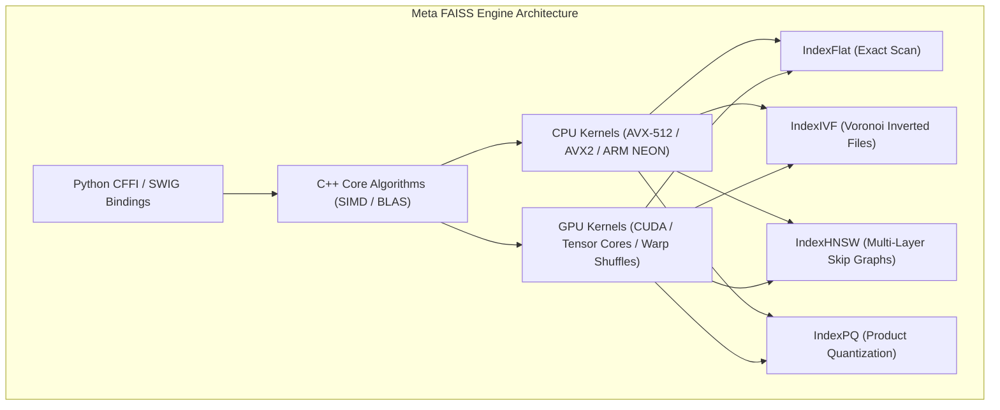
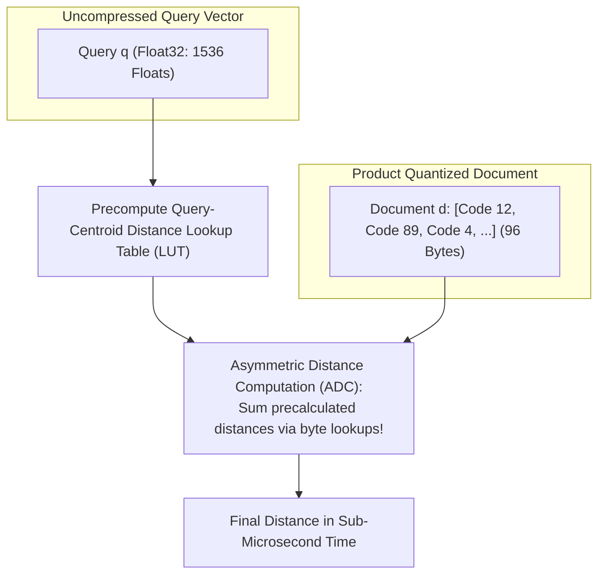
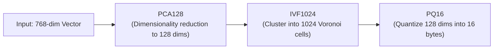
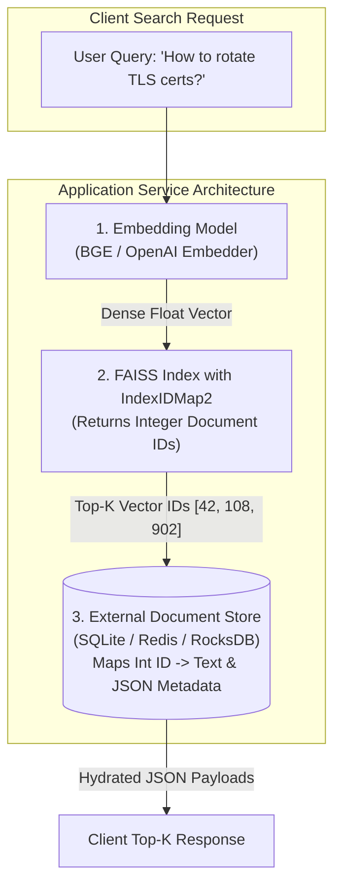
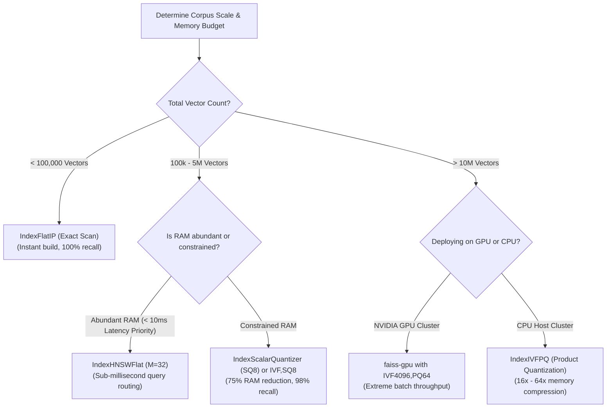

# 🔬 Meta FAISS Deep Dive: GPU Acceleration, IndexIVFFlat, IndexHNSW, and Quantization

## 📑 Table of Contents
1. [🌟 Fundamentals: What is Meta FAISS?](#1--fundamentals-what-is-meta-faiss)
2. [🏗️ The FAISS Index Hierarchy & Core Architectures](#2-️-the-faiss-index-hierarchy--core-architectures)
3. [⚡ GPU Acceleration & Hardware Architecture](#3--gpu-acceleration--hardware-architecture)
4. [🗜️ Product Quantization & Asymmetric Distance Computation (ADC)](#4-️-product-quantization--asymmetric-distance-computation-adc)
5. [🏭 The Index Factory Paradigm](#5--the-index-factory-paradigm)
6. [⚖️ Comprehensive FAISS Index Selection Matrix](#6-️-comprehensive-faiss-index-selection-matrix)
7. [💻 Practical Implementation: Multi-Index Benchmark & Serialization](#7--practical-implementation-multi-index-benchmark--serialization)
8. [🗄️ Bridging the Gap: Turning FAISS into a Production System](#8-️-bridging-the-gap-turning-faiss-into-a-production-system)
9. [🛠️ Best Practices & ❌ Common Production Pitfalls](#9-️-best-practices---common-production-pitfalls)
10. [💼 Senior Interview Questions & System Design Scenarios](#10--senior-interview-questions--system-design-scenarios)
11. [🧪 Hands-On Mini-Project: Index Comparison & Memory Profiler](#11--hands-on-mini-project-index-comparison--memory-profiler)
12. [⚡ Quick Revision & Architectural Decision Roadmap](#12--quick-revision--architectural-decision-roadmap)

---

## 1. 🌟 Fundamentals: What is Meta FAISS?

Developed by Meta AI Research (Johnson, Douze, Jégou, 2017), **FAISS (Facebook AI Similarity Search)** is the foundational, high-performance C++ library with Python bindings that powers modern dense vector similarity search at global scale.

> [!IMPORTANT]
> **FAISS is a Library, NOT a Database:**  
> FAISS provides low-level mathematical indexing data structures and GPU kernels. It does **not** provide a Write-Ahead Log (WAL), ACID guarantees, network API daemons, payload storage, or distributed replication. Enterprise vector databases (such as early Milvus, Chroma, and specialized cloud services) are frequently built on top of FAISS algorithms.



---

## 2. 🏗️ The FAISS Index Hierarchy & Core Architectures

FAISS organizes its vector search capabilities into modular, composable index classes:

### 1. `IndexFlatL2` and `IndexFlatIP` (Exact Brute Force)
* Computes exact distances across all $N$ vectors.
* Requires zero training (`index.is_trained == True` immediately).
* Serves as the **ground truth benchmark** for measuring recall of approximate indices.

### 2. `IndexIVFFlat` (Inverted File with Flat Storage)
Partitions space into $K$ Voronoi cells using $K$-Means clustering:
* **Training Required:** Must call `index.train(training_vectors)` to compute the $K$ centroid locations.
* **`nlist`:** The number of Voronoi centroids (typically $4\sqrt{N} - 16\sqrt{N}$).
* **`nprobe`:** The number of neighboring Voronoi cells to search at query time.

### 3. `IndexHNSWFlat` (Hierarchical Navigable Small World)
Constructs a multi-layer geometric navigation graph:
* Delivers sub-millisecond query latencies with $>98\%$ recall.
* Does not require training (builds incrementally as points are added).
* High memory footprint: Graph edge pointers add $M \times 8$ bytes per vector.

### 4. `IndexIVFPQ` (Inverted File with Product Quantization)
Combines space partitioning with aggressive vector quantization:
* Decomposes each high-dimensional vector into $M$ sub-vectors and quantizes each into an 8-bit codebook ID.
* Achieves **$16\times - 64\times$ memory compression**, allowing hundreds of millions of vectors to fit into GPU VRAM or host RAM.

---

## 3. ⚡ GPU Acceleration & Hardware Architecture

FAISS is renowned for its CUDA acceleration, executing vector comparisons orders of magnitude faster than CPU implementations by leveraging GPU hardware parallelism:


### 🏎️ Why FAISS GPU Outperforms Standard Implementations
1. **Parallel Distance Computation:** Millions of inner products execute simultaneously across thousands of CUDA cores.
2. **Registers & Shared Memory Tiling:** FAISS stores frequent cluster centroids in fast on-chip shared memory, eliminating global VRAM access latency.
3. **Hardware Bitonic Sorting:** Instead of standard quicksort, FAISS employs GPU-native bitonic sorting networks in CUDA registers to maintain the Top-$K$ candidate list without CPU synchronization.

### 🔄 Multi-GPU Scaling in Python

```python
import faiss

# 1. Initialize standard CPU index
cpu_index = faiss.IndexFlatIP(768)

# 2. Transfer to a single GPU
res = faiss.StandardGpuResources()
gpu_index = faiss.index_cpu_to_gpu(res, 0, cpu_index)

# 3. Shard across all available GPUs on the server
multi_gpu_index = faiss.index_cpu_to_all_gpus(cpu_index)
```

---

## 4. 🗜️ Product Quantization & Asymmetric Distance Computation (ADC)

When querying an `IndexIVFPQ`, FAISS uses **Asymmetric Distance Computation (ADC)**. 

Rather than quantizing the user query (which would introduce dual approximation errors), the query vector $\mathbf{q}$ remains uncompressed in high-precision Float32, while document vectors $\mathbf{d}$ are stored as quantized byte codes:



### # Asymmetric Distance Computation Formula
$$
D_{\text{ADC}}(\mathbf{q}, \tilde{\mathbf{d}}) = \sum_{m=1}^M \|\mathbf{q}^m - \mathbf{c}_{i_m}^m\|_2^2
$$

Where:
* $\mathbf{q}^m$ is the $m$-th sub-vector slice of the continuous query.
* $\mathbf{c}_{i_m}^m$ is the centroid corresponding to the discrete code stored in the document.
* **The Performance Miracle:** Calculating distances between query $\mathbf{q}$ and millions of quantized documents requires **zero floating-point multiplications** during the dataset scan; it consists purely of memory table lookups from the precomputed distance array (`LUT`).

---

## 5. 🏭 The Index Factory Paradigm

FAISS provides a concise domain-specific configuration string language called the **Index Factory**, allowing engineers to assemble complex, composite index pipelines with a single string command:

```python
import faiss

dimension = 768

# String Pattern: [Preprocessing],[Space Partitioning],[Encoding/Quantization]
index = faiss.index_factory(dimension, "PCA128,IVF1024,PQ16", faiss.METRIC_L2)
```



### 📋 Common Index Factory Formats

| Index Factory String | Pipeline Architecture | Memory per Vector | Best Suited For |
| :--- | :--- | :---: | :--- |
| **`"Flat"`** | Exact brute-force scan. | $d \times 4$ Bytes | Small datasets ($<100\text{k}$), golden evals. |
| **`"IVF1024,Flat"`** | 1024 Voronoi cells with uncompressed vectors. | $d \times 4$ Bytes | Rapidly updated datasets with high recall. |
| **`"HNSW32"`** | HNSW graph with $M=32$ edges per node. | $(d \times 4) + 256$ Bytes | Sub-millisecond latency on high-RAM servers. |
| **`"IVF4096,SQ8"`** | 4096 Voronoi cells with 8-bit scalar quantization. | $d \times 1$ Byte | High-scale, balanced production RAG. |
| **`"IVF4096,PQ64"`** | 4096 Voronoi cells with 64-byte product quantization. | $64$ Bytes | Massive-scale collections ($100\text{M}+$ vectors). |
| **`"OPQ32_128,IVF2048,PQ32"`** | Optimized rotation (OPQ) + IVF + 32-byte PQ. | $32$ Bytes | Maximum recall under aggressive quantization. |

---

## 6. ⚖️ Comprehensive FAISS Index Selection Matrix

| FAISS Index Type | Training Required? | Relative Search Latency | Recall@10 | Memory per 1M Vectors ($d=768$) | Build Speed | Production Verdict |
| :--- | :---: | :---: | :---: | :---: | :---: | :--- |
| **`IndexFlatL2`** | ❌ No | $100\times$ (Slow) | **100% (Exact)** | $3.07 \text{ GB}$ | Instant | Baseline testing only |
| **`IndexIVFFlat`** | ✅ Yes | $10\times$ | $92\% - 97\%$ | $3.07 \text{ GB}$ | Fast | Fast build, moderate scale |
| **`IndexHNSWFlat`**| ❌ No | **$1\times$ (Fastest)**| **$98\% - 99.8\%$** | $5.53 \text{ GB}$ | Moderate | Latency-critical RAG |
| **`IndexScalarQuantizer` (SQ8)** | ✅ Yes | $2\times$ | $96\% - 99\%$ | **$0.77 \text{ GB}$** | Fast | Balanced memory & speed |
| **`IndexIVFPQ`** | ✅ Yes | $2\times$ | $88\% - 94\%$ | **$0.06 \text{ GB}$** | Slow (K-Means) | Extreme scale ($>50\text{M}$) |

---

## 7. 💻 Practical Implementation: Multi-Index Benchmark & Serialization

The following complete, standalone Python module builds, trains, benchmarks, and serializes multiple FAISS index variants on synthetic data, measuring build time, memory footprint, and query latency.

```python
"""
Production Architectural Blueprint: Meta FAISS Index Benchmarking & Serialization
Author: Enterprise RAG Curriculum
Requirements: pip install faiss-cpu numpy tabulate
"""

import os
import time
from typing import Dict, List, Tuple
import faiss
import numpy as np
from tabulate import tabulate

def run_faiss_suite():
    np.random.seed(42)
    dim = 256
    num_docs = 20000
    num_queries = 50

    print(f"Generating {num_docs} corpus vectors and {num_queries} test queries (dim={dim})...")
    raw_corpus = np.random.randn(num_docs, dim).astype(np.float32)
    faiss.normalize_L2(raw_corpus)  # Unit-normalize for Inner Product (Cosine)

    raw_queries = np.random.randn(num_queries, dim).astype(np.float32)
    faiss.normalize_L2(raw_queries)

    # 1. Establish Exact Ground Truth (Flat IP)
    flat_index = faiss.IndexFlatIP(dim)
    flat_index.add(raw_corpus)
    t0 = time.perf_counter()
    _, ground_truth_indices = flat_index.search(raw_queries, k=10)
    exact_latency = (time.perf_counter() - t0) * 1000

    # Index configurations to benchmark
    configs = [
        ("Exact Scan (Flat)", "Flat"),
        ("Voronoi Partition (IVF256,Flat)", "IVF256,Flat"),
        ("Navigable Graph (HNSW32)", "HNSW32"),
        ("Scalar Quantized (IVF256,SQ8)", "IVF256,SQ8"),
        ("Product Quantized (IVF256,PQ32)", "IVF256,PQ32")
    ]

    benchmark_rows = []

    for label, factory_str in configs:
        # Build index via Factory
        index = faiss.index_factory(dim, factory_str, faiss.METRIC_INNER_PRODUCT)
        
        # Train if required
        t_build_start = time.perf_counter()
        if not index.is_trained:
            index.train(raw_corpus)
        index.add(raw_corpus)
        build_time = (time.perf_counter() - t_build_start) * 1000

        # Configure search-time parameters
        if "IVF" in factory_str:
            faiss.ParameterSpace().set_index_parameter(index, "nprobe", 16)
        elif "HNSW" in factory_str:
            index.hnsw.efSearch = 64

        # Execute Search
        t_search_start = time.perf_counter()
        _, hit_indices = index.search(raw_queries, k=10)
        search_latency = (time.perf_counter() - t_search_start) * 1000

        # Compute Recall@10 relative to exact flat ground truth
        total_overlap = 0
        for q_i in range(num_queries):
            gt_set = set(ground_truth_indices[q_i])
            hit_set = set(hit_indices[q_i])
            total_overlap += len(gt_set.intersection(hit_set))
            
        recall_at_10 = (total_overlap / (num_queries * 10.0)) * 100.0

        # Write to disk to measure byte footprint
        temp_file = f"temp_{factory_str.replace(',', '_')}.faiss"
        faiss.write_index(index, temp_file)
        disk_size_kb = os.path.getsize(temp_file) / 1024
        os.remove(temp_file)

        benchmark_rows.append([
            label,
            f"{disk_size_kb:.1f} KB",
            f"{build_time:.1f} ms",
            f"{search_latency:.2f} ms",
            f"{recall_at_10:.1f}%",
            f"{exact_latency / search_latency:.1f}x"
        ])

    print("\n" + tabulate(
        benchmark_rows, 
        headers=["Index Topology", "Storage Size", "Build Duration", "Batch Search Latency", "Recall@10", "Speedup vs Flat"],
        tablefmt="github"
    ))

if __name__ == "__main__":
    run_faiss_suite()
```

---

## 8. 🗄️ Bridging the Gap: Turning FAISS into a Production System

To convert the raw algorithmic FAISS library into a production RAG retrieval service, you must build three external components:



### 🔑 ID Mapping with `IndexIDMap2`
By default, FAISS assigns sequential integer IDs ($0, 1, 2, \dots$) to inserted vectors. If documents are deleted, IDs become unaligned with your primary database. Wrap your index with `IndexIDMap2` to pass arbitrary 64-bit integer IDs and support runtime vector deletion by ID:

```python
base_index = faiss.IndexFlatIP(768)
id_index = faiss.IndexIDMap2(base_index)

# Add vectors with explicit database IDs
doc_ids = np.array([10001, 10002, 10005], dtype=np.int64)
id_index.add_with_ids(vectors, doc_ids)

# Remove a specific document
id_index.remove_ids(np.array([10002], dtype=np.int64))
```

---

## 9. 🛠️ Best Practices & ❌ Common Production Pitfalls

### ✅ Best Practices
1. **Always Unit-Normalize Vectors Before Indexing:** For text retrieval, normalize all vectors to unit length using `faiss.normalize_L2(vectors)` and use `METRIC_INNER_PRODUCT`.
2. **Train IVF / PQ on Representative Data:** The training dataset passed to `index.train()` must closely match the statistical distribution of production vectors. Passing synthetic or random data destroys quantization recall.
3. **Calibrate `nprobe` at Runtime:** Set `nprobe = 1` for fast diagnostic smoke tests, but increase to `nprobe = 16` or `32` in production to eliminate Voronoi boundary recall drops.

### ❌ Common Production Pitfalls
* **Forgetting to Train:** Calling `index.add()` on an `IndexIVF` or `IndexPQ` without calling `index.train()` first raises an unhandled C++ runtime exception (`FaissException: Error: 'is_trained' failed`).
* **Attempting to Delete from Plain `IndexFlat`:** Basic FAISS flat indices do not support removing vectors. You must wrap the index with `IndexIDMap2` to enable `remove_ids()`.
* **Out-of-Memory During GPU Indexing:** Attempting to build an unquantized `IndexHNSW` across 10 million vectors directly inside a single 16 GB GPU will trigger an unrecoverable CUDA Out-of-Memory crash. Build on CPU first, then transfer quantized segments to GPU.

---

## 10. 💼 Senior Interview Questions & System Design Scenarios

### Q1: How does Asymmetric Distance Computation (ADC) in Product Quantization achieve high search speeds without vector decompression?
> **Expert Answer:**  
> In Product Quantization, a $d$-dimensional vector is partitioned into $M$ orthogonal sub-vectors of dimension $d^* = d / M$. Each sub-vector is mapped to the nearest centroid index in a codebook of size $K$ (typically $K=256$, represented by 1 byte).  
> In Asymmetric Distance Computation (ADC), the query $\mathbf{q}$ is **not quantized**. Before scanning documents, the query is sliced into $M$ sub-vectors $\mathbf{q}^m$. The system pre-computes the exact squared Euclidean distance between each query sub-vector $\mathbf{q}^m$ and all $K=256$ centroids in the corresponding codebook. This produces a small Lookup Table (LUT) of size $M \times 256$ floats, which fits entirely within the CPU's ultra-fast L1 cache.  
> During the dataset scan over millions of documents, evaluating distance requires zero floating-point arithmetic: for each document, the engine reads its $M$ byte codes, uses each byte as an array index into the L1 cache LUT, and accumulates the precalculated distances. This turns complex vector distance calculation into $M$ memory table lookups and integer additions.

### Q2: What is the architectural difference between FAISS and a dedicated vector database like Qdrant or Milvus?
> **Expert Answer:**  
> FAISS is an **algorithmic software library**, analogous to BLAS or LAPACK for linear algebra. It provides high-performance vector indexing data structures and CUDA/SIMD kernels, but executes entirely in-memory within the host application process. It lacks data management primitives: no Write-Ahead Log (WAL) for durability, no metadata payload store, no single-stage metadata filtering, and no clustering or distributed consensus.  
> A dedicated Vector Database (such as Qdrant or Milvus) is a **complete database management system**. It packages index algorithms (often inspired by or wrapping FAISS/hnswlib) with:
> 1. ACID durability guarantees via WAL logs on disk.
> 2. Document and JSON payload storage (e.g., via RocksDB).
> 3. Single-stage filtered graph traversal with Roaring Bitmaps.
> 4. Multi-node distributed sharding, Raft replication, and high-availability REST/gRPC interfaces.

### Q3: When should an enterprise engineering team choose FAISS over a fully managed vector database?
> **Expert Answer:**  
> FAISS is the optimal choice in four specific architectural contexts:
> 1. **Extreme High-Throughput Batch Processing:** Offline workloads (e.g., deduplicating 500 million embeddings or computing all-pairs k-NN graphs) where GPU cluster saturation via `faiss-gpu` is required and database network overhead cannot be tolerated.
> 2. **Embedded Edge & Mobile Deployments:** Environments where running a standalone database service is impossible (e.g., on-device smartphone biometric matching, desktop search apps).
> 3. **Custom Deeply-Coupled ML Ingestion Pipelines:** Where vector search is embedded directly inside an offline PyTorch inference loop on GPU nodes.
> 4. **Cost-Constrained Massive Scale:** Building a custom retrieval engine on ephemeral NVMe disks where off-the-shelf database licensing or managed cloud costs are prohibitive.

---

## 11. 🧪 Hands-On Mini-Project: Index Comparison & Memory Profiler

This self-contained Python script builds and compares four foundational FAISS indices (`IndexFlatIP`, `IndexIVFFlat`, `IndexHNSWFlat`, `IndexScalarQuantizer`), profiling search throughput and exact memory consumption.

```python
"""
Hands-On Diagnostic: FAISS Index Architecture & Memory Profiler
Run directly: python faiss_profiler.py
Requires: pip install faiss-cpu numpy tabulate
"""

import time
import faiss
import numpy as np
from tabulate import tabulate

def profile_faiss_suite():
    np.random.seed(42)
    dim = 128
    n_records = 15000
    n_queries = 100

    print(f"Generating synthetic embeddings dataset ({n_records} vectors, dim={dim})...")
    data = np.random.randn(n_records, dim).astype(np.float32)
    faiss.normalize_L2(data)
    
    queries = np.random.randn(n_queries, dim).astype(np.float32)
    faiss.normalize_L2(queries)

    # 1. Exact Ground Truth (IndexFlatIP)
    flat = faiss.IndexFlatIP(dim)
    flat.add(data)
    _, gt_indices = flat.search(queries, k=5)

    # Test Candidates
    indices = {
        "1. IndexFlatIP (Brute Force)": faiss.IndexFlatIP(dim),
        "2. IndexIVFFlat (nlist=100)": faiss.IndexIVFFlat(faiss.IndexFlatIP(dim), dim, 100, faiss.METRIC_INNER_PRODUCT),
        "3. IndexHNSWFlat (M=16)": faiss.IndexHNSWFlat(dim, 16, faiss.METRIC_INNER_PRODUCT),
        "4. IndexScalarQuantizer (SQ8)": faiss.IndexScalarQuantizer(dim, faiss.ScalarQuantizer.QT_8bit, faiss.METRIC_INNER_PRODUCT)
    }

    report = []

    for name, idx in indices.items():
        # Train if needed
        t0 = time.perf_counter()
        if not idx.is_trained:
            idx.train(data)
        idx.add(data)
        t_build = (time.perf_counter() - t0) * 1000

        # Tune search params
        if "IVF" in name:
            idx.nprobe = 10
        elif "HNSW" in name:
            idx.hnsw.efSearch = 32

        # Search
        t0 = time.perf_counter()
        _, hit_ids = idx.search(queries, k=5)
        t_search = (time.perf_counter() - t0) * 1000

        # Calculate Recall@5
        correct = 0
        for q_i in range(n_queries):
            correct += len(set(gt_indices[q_i]).intersection(set(hit_ids[q_i])))
        recall = (correct / (n_queries * 5.0)) * 100.0

        # Estimate memory bytes per vector
        if "FlatIP" in name and "HNSW" not in name:
            b_per_vec = dim * 4
        elif "HNSW" in name:
            b_per_vec = (dim * 4) + (16 * 8)
        elif "SQ8" in name:
            b_per_vec = dim * 1
        elif "IVF" in name:
            b_per_vec = dim * 4 + 8

        report.append([
            name,
            f"{b_per_vec} Bytes",
            f"{t_build:.1f} ms",
            f"{t_search:.2f} ms",
            f"{recall:.1f}%"
        ])

    print("\n" + tabulate(
        report, 
        headers=["FAISS Index Candidate", "RAM / Vector", "Build Duration", "Query Time (100 Qs)", "Recall@5"], 
        tablefmt="github"
    ))

if __name__ == "__main__":
    profile_faiss_suite()
```

---

## 12. ⚡ Quick Revision & Architectural Decision Roadmap

### 📋 Key Takeaways Cheat-Sheet
* **FAISS is a Low-Level Library:** Provides algorithmic SIMD and GPU vector search structures; lacks database durability, WAL, and payload filtering.
* **Always Normalize for Cosine:** Call `faiss.normalize_L2(vectors)` and use `METRIC_INNER_PRODUCT` to execute fast dot-product search.
* **`IndexFactory` Simplifies Pipelines:** Use strings like `"IVF1024,SQ8"` or `"PCA128,IVF2048,PQ32"` to construct complex multi-stage indices.
* **GPU Delivers Extreme Batch Throughput:** `faiss-gpu` accelerates batch evaluation by $50\times - 200\times$ using register tiling and CUDA bitonic sorting.
* **ADC Enables Uncompressed Querying:** Asymmetric Distance Computation evaluates uncompressed Float32 queries against 8-bit quantized documents via L1-cached distance lookup tables.

### 🧭 Visual Decision Tree: Selecting Your FAISS Index Architecture


