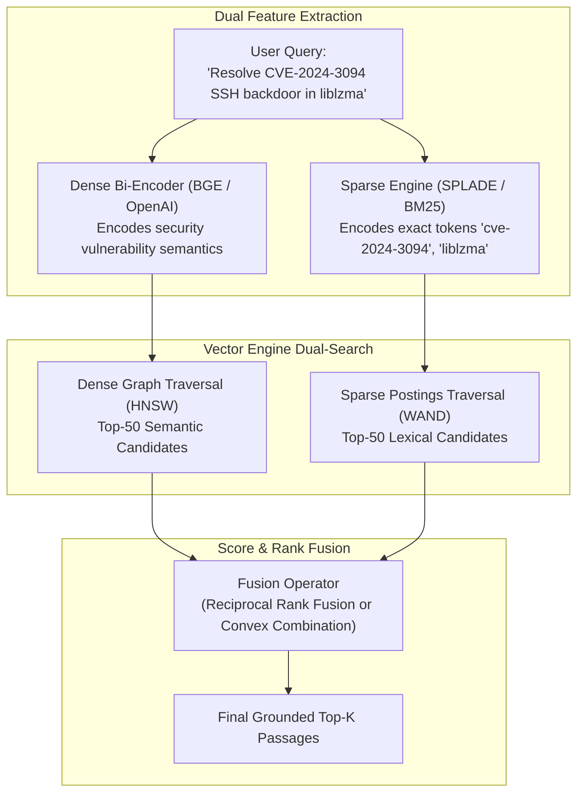
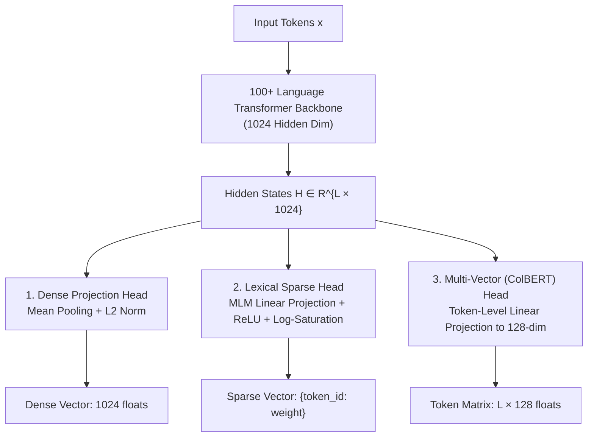
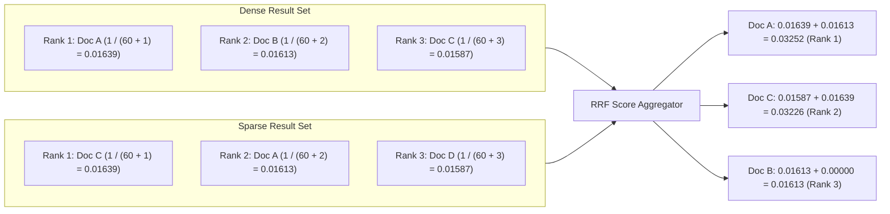
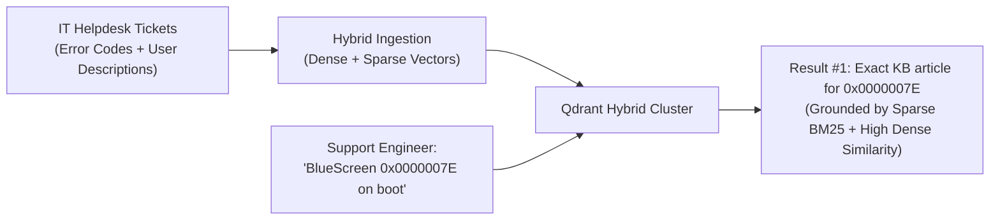
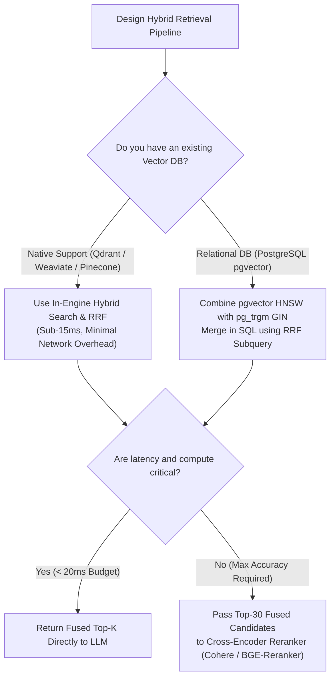

# 🔀 Hybrid Embeddings: Combining Dense Latent Vectors and Sparse Lexical Representations

## 📑 Table of Contents
1. [🌟 Fundamentals: The Complementary Duality Principle](#1--fundamentals-the-complementary-duality-principle)
2. [🏗️ Unified Dual-Representation Models: BGE-M3 Deep Dive](#2-️-unified-dual-representation-models-bge-m3-deep-dive)
3. [🔀 Fusion Mechanics: Score-Based vs. Rank-Based Fusion](#3--fusion-mechanics-score-based-vs-rank-based-fusion)
4. [🗄️ Native Hybrid Architecture in Modern Vector Databases](#4-️-native-hybrid-architecture-in-modern-vector-databases)
5. [⚖️ Architectural Trade-Off Analysis](#5-️-architectural-trade-off-analysis)
6. [💻 Practical Implementation: Production Hybrid Fusion Engine](#6--practical-implementation-production-hybrid-fusion-engine)
7. [🌍 Real-World Enterprise Case Studies](#7--real-world-enterprise-case-studies)
8. [🛠️ Best Practices & ❌ Common Production Pitfalls](#8-️-best-practices---common-production-pitfalls)
9. [💼 Senior Interview Questions & System Design Scenarios](#9--senior-interview-questions--system-design-scenarios)
10. [🧪 Hands-On Mini-Project: RRF vs. Convex Fusion Benchmarker](#10--hands-on-mini-project-rrf-vs-convex-fusion-benchmarker)
11. [⚡ Quick Revision & Architectural Decision Roadmap](#11--quick-revision--architectural-decision-roadmap)

---

## 1. 🌟 Fundamentals: The Complementary Duality Principle

In production Retrieval-Augmented Generation (RAG), relying exclusively on either dense semantic vectors or sparse lexical vectors introduces severe systemic failure modes:

* **Dense Retrieval Blindspots:** Bi-encoders compress all sequence information into continuous coordinate space. Consequently, they often fail on exact alphanumeric identifiers, rare proper nouns, version numbers (`v2.4.1` vs. `v2.4.2`), error codes (`0x80070005`), and legal statute citations.
* **Sparse Retrieval Blindspots:** Lexical models (BM25) rely strictly on exact term overlaps. They fail whenever a user query exhibits vocabulary mismatch, synonymy, semantic abstraction, or conceptual paraphrasing.

**Hybrid Search** unites both paradigms, creating a dual-retrieval pipeline where dense embeddings capture high-level conceptual intent while sparse vectors provide deterministic, exact-match grounding.



---

## 2. 🏗️ Unified Dual-Representation Models: BGE-M3 Deep Dive

Historically, implementing hybrid search required orchestrating two completely separate models: a BM25 or SPLADE service alongside a dense transformer embedder. This doubled operational infrastructure, tokenization overhead, and inference latency.

The modern paradigm, pioneered by BAAI's **BGE-M3 (Multi-Linguality, Multi-Functionality, Multi-Granularity)**, generates dense, sparse, and multi-vector representations simultaneously within a single transformer forward pass:



### 🔬 Multi-Task Joint Training Dynamics
BGE-M3 is trained using a composite multi-task objective where the overall loss is a weighted sum of dense contrastive loss, lexical sparse contrastive loss, and multi-vector late-interaction loss:

### # BGE-M3 Joint Multi-Task Loss Objective
$$
\mathcal{L}_{\text{Total}} = \lambda_1 \mathcal{L}_{\text{Dense}}(\mathbf{v}_q, \mathbf{v}_d) + \lambda_2 \mathcal{L}_{\text{Sparse}}(\mathbf{s}_q, \mathbf{s}_d) + \lambda_3 \mathcal{L}_{\text{Multi}}(\mathbf{M}_q, \mathbf{M}_d)
$$

This joint optimization forces the internal attention layers to develop representations that are simultaneously semantically rich and lexically discriminative.

---

## 3. 🔀 Fusion Mechanics: Score-Based vs. Rank-Based Fusion

Once dense and sparse retrieval engines produce their respective candidate result sets, the system must merge them into a unified, definitively ranked list. There are two primary mathematical frameworks for hybrid fusion:

### 1. Linear Convex Score Combination
Calculates a weighted average between normalized dense and sparse scores:

### # Linear Convex Hybrid Score Formula
$$
S_{\text{Hybrid}}(d) = \alpha \cdot \widetilde{S}_{\text{Dense}}(d) + (1 - \alpha) \cdot \widetilde{S}_{\text{Sparse}}(d), \quad \alpha \in [0, 1]
$$

#### ⚠️ The Score Calibration Problem
Dense cosine similarity scores typically range within $[0.5, 0.95]$, whereas raw BM25 scores are unbounded and range within $[0.0, 45.0+]$. Merging raw scores without normalization causes sparse scores to overwhelm dense scores completely. Scores must be normalized prior to interpolation using **Min-Max Scaling**:

### # Min-Max Score Normalization Formula
$$
\widetilde{S}(d) = \frac{S(d) - S_{\min}}{S_{\max} - S_{\min} + \epsilon}
$$

However, min-max scaling is highly vulnerable to outliers: a single extreme keyword match can compress all other scores into a narrow band, distorting ranking.

---

### 2. Reciprocal Rank Fusion (RRF) — The Production Gold Standard
To eliminate score distribution dependencies entirely, Cormack et al. developed **Reciprocal Rank Fusion (RRF)**. RRF ignores raw score magnitudes and operates strictly on the **ordinal ranks** assigned to documents by each retriever:

### # Reciprocal Rank Fusion (RRF) Formula
$$
\text{RRF Score}(d) = \sum_{m \in \mathcal{M}} \frac{1}{k + r_m(d)}
$$

Where:
* $\mathcal{M} = \{\text{Dense}, \text{Sparse}\}$ is the set of retrieval models.
* $r_m(d) \in \{1, 2, \dots, K\}$ is the 1-based ordinal rank of document $d$ in the result set from model $m$.
* If document $d$ does not appear in the candidate list of model $m$, its term is omitted (or $r_m(d) \to \infty$).
* $k$ is a smoothing constant (standard industry default: **$k = 60$**).



#### 💡 Why $k = 60$?
The smoothing parameter $k$ controls the relative advantage of appearing near the top of a single list versus appearing in the middle of both lists. At $k = 60$, a document ranking #2 in dense and #2 in sparse easily beats a document ranking #1 in dense but completely missing from sparse.

---

## 4. 🗄️ Native Hybrid Architecture in Modern Vector Databases

Enterprise vector search engines implement native hybrid search primitives directly within their C++ or Rust storage engines, eliminating the network latency of orchestrating external client-side fusion.

```mermaid
flowchart TD
    subgraph VectorEngine [Single-Node Vector DB (Qdrant / Weaviate / Pinecone)]
        Query["Client Hybrid Query Request"] --> QuerySplitter["Query Parser"]
        
        QuerySplitter --> DenseIndex[("HNSW Graph Index<br/>(Dense Floats)")]
        QuerySplitter --> SparseIndex[("Inverted Index / Postings<br/>(Sparse Weights)")]
        
        DenseIndex --> CandidateHeap1["Dense Candidate Heap"]
        SparseIndex --> CandidateHeap2["Sparse Candidate Heap"]
        
        CandidateHeap1 & CandidateHeap2 --> EngineFusion["In-Engine RRF / Prefilter Fusion"]
        EngineFusion --> TopKResponse["Unified Top-K Output"]
    end
```

### 🏛️ Engine-by-Engine Hybrid Implementation Matrix

| Vector Database | Sparse Representation Storage | Hybrid Query Mechanism | Native Fusion Supported |
| :--- | :--- | :--- | :--- |
| **Qdrant** | Named Sparse Vectors (`sparse_vectors`) | Single API call querying dense + sparse named vectors | Reciprocal Rank Fusion (RRF) & Score Interpolation |
| **Pinecone** | Sparse-Dense Vector Pairs (`sparse_values`) | Single vector insert containing indices & values | $\alpha$-parameter convex combination |
| **Weaviate** | Built-in BM25 inverted index + HNSW | `hybrid(query="...", alpha=0.5)` | Normalized Convex Combination |
| **Milvus** | AnnSearch / Multi-Vector schema | Hybrid search with `RRFRanker` | Built-in RRF Ranker and Weighted Ranker |
| **PostgreSQL (`pgvector` + `pg_trgm`)** | pgvector HNSW + GIN inverted index | Combined SQL query with CTEs | Client-side RRF or SQL ranking fusion |

---

## 5. ⚖️ Architectural Trade-Off Analysis

| Retrieval Strategy | Recall@10 (General) | Exact Match Precision | Index Footprint | Query Latency (p99) | Operational Complexity |
| :--- | :---: | :---: | :---: | :---: | :--- |
| **Dense Only (HNSW)** | $82.4\%$ | Moderate ($68\%$) | $3.5 \text{ GB} / 1\text{M}$ | $8 - 15 \text{ ms}$ | Low (single embedder) |
| **Sparse Only (BM25)** | $71.2\%$ | **Exceptional ($98\%$)** | $0.8 \text{ GB} / 1\text{M}$ | $2 - 5 \text{ ms}$ | Very Low (Lucene / GIN) |
| **Hybrid Linear Convex** | $89.5\%$ | High ($94\%$) | $4.3 \text{ GB} / 1\text{M}$ | $12 - 22 \text{ ms}$ | High (requires score tuning) |
| **Hybrid RRF** | **$92.1\%$** | **Exceptional ($97\%$)** | $4.3 \text{ GB} / 1\text{M}$ | $12 - 20 \text{ ms}$ | **Moderate (parameter-free)** |
| **Hybrid + Cross-Encoder Reranker**| **$95.4\%$** | **Exceptional ($99\%$)** | $4.3 \text{ GB} / 1\text{M}$ | $45 - 90 \text{ ms}$ | High (second GPU model stage) |

---

## 6. 💻 Practical Implementation: Production Hybrid Fusion Engine

The following self-contained Python module implements a production-grade Hybrid Search pipeline, featuring dense embedding cosine search, sparse BM25 retrieval, Min-Max normalization, and Reciprocal Rank Fusion (RRF).

```python
"""
Production Hybrid Retrieval Engine: Combining Dense & Sparse Representations with RRF
Author: Enterprise RAG Curriculum
Requirements: pip install numpy
"""

import math
from collections import Counter, defaultdict
from typing import Dict, List, Tuple

class ProductionHybridEngine:
    """Enterprise hybrid search engine executing dual retrieval and RRF ranking."""

    def __init__(self, rrf_k: int = 60, alpha: float = 0.5):
        self.rrf_k = rrf_k
        self.alpha = alpha
        
        # Corpus storage
        self.documents: List[str] = []
        
        # Sparse BM25 state
        self.doc_count = 0
        self.avg_doc_len = 0.0
        self.doc_lengths: Dict[int, int] = {}
        self.inverted_index: Dict[str, List[Tuple[int, int]]] = defaultdict(list)
        self.idf_cache: Dict[str, float] = {}
        
        # Simulated Dense embeddings: doc_id -> list of floats
        self.dense_embeddings: Dict[int, List[float]] = {}

    # --- Lexical Indexing (BM25) ---
    @staticmethod
    def _tokenize(text: str) -> List[str]:
        cleaned = "".join([c.lower() if c.isalnum() else " " for c in text])
        return [tok for tok in cleaned.split() if len(tok) > 1]

    def index_corpus(self, corpus: List[str], dense_vectors: List[List[float]]) -> None:
        """Indexes raw text for BM25 and stores associated dense vectors."""
        self.documents = corpus
        self.doc_count = len(corpus)
        total_tokens = 0
        doc_freqs: Dict[str, int] = Counter()

        for doc_id, text in enumerate(corpus):
            tokens = self._tokenize(text)
            self.doc_lengths[doc_id] = len(tokens)
            total_tokens += len(tokens)
            
            term_counts = Counter(tokens)
            for term, count in term_counts.items():
                self.inverted_index[term].append((doc_id, count))
                doc_freqs[term] += 1
                
            self.dense_embeddings[doc_id] = dense_vectors[doc_id]

        self.avg_doc_len = total_tokens / max(1, self.doc_count)

        for term, df in doc_freqs.items():
            self.idf_cache[term] = math.log((self.doc_count - df + 0.5) / (df + 0.5) + 1.0)

    # --- Sparse Retrieval ---
    def _search_sparse(self, query: str, top_k: int) -> List[Tuple[int, float]]:
        tokens = self._tokenize(query)
        scores: Dict[int, float] = defaultdict(float)

        for term in tokens:
            if term not in self.inverted_index:
                continue
            idf = self.idf_cache.get(term, 0.0)
            for doc_id, tf in self.inverted_index[term]:
                doc_len = self.doc_lengths[doc_id]
                numerator = tf * (1.5 + 1.0)
                denominator = tf + 1.5 * (1.0 - 0.75 + 0.75 * (doc_len / self.avg_doc_len))
                scores[doc_id] += idf * (numerator / denominator)

        ranked = sorted(scores.items(), key=lambda x: x[1], reverse=True)
        return ranked[:top_k]

    # --- Dense Retrieval ---
    @staticmethod
    def _cosine_similarity(vec_a: List[float], vec_b: List[float]) -> float:
        dot = sum(a * b for a, b in zip(vec_a, vec_b))
        norm_a = math.sqrt(sum(a * a for a in vec_a))
        norm_b = math.sqrt(sum(b * b for b in vec_b))
        if norm_a == 0 or norm_b == 0:
            return 0.0
        return dot / (norm_a * norm_b)

    def _search_dense(self, query_vector: List[float], top_k: int) -> List[Tuple[int, float]]:
        scores: Dict[int, float] = {}
        for doc_id, doc_vec in self.dense_embeddings.items():
            scores[doc_id] = self._cosine_similarity(query_vector, doc_vec)
        ranked = sorted(scores.items(), key=lambda x: x[1], reverse=True)
        return ranked[:top_k]

    # --- Reciprocal Rank Fusion ---
    def search_hybrid_rrf(
        self, query_text: str, query_vector: List[float], top_k: int = 3, candidate_k: int = 10
    ) -> List[Tuple[int, float]]:
        """Executes dual retrieval and fuses candidate sets using Reciprocal Rank Fusion."""
        sparse_hits = self._search_sparse(query_text, top_k=candidate_k)
        dense_hits = self._search_dense(query_vector, top_k=candidate_k)

        rrf_scores: Dict[int, float] = defaultdict(float)

        # Accumulate sparse ranks
        for rank, (doc_id, _) in enumerate(sparse_hits, start=1):
            rrf_scores[doc_id] += 1.0 / (self.rrf_k + rank)

        # Accumulate dense ranks
        for rank, (doc_id, _) in enumerate(dense_hits, start=1):
            rrf_scores[doc_id] += 1.0 / (self.rrf_k + rank)

        ranked_results = sorted(rrf_scores.items(), key=lambda x: x[1], reverse=True)
        return ranked_results[:top_k]


# Demonstration Execution
if __name__ == "__main__":
    corpus_docs = [
        "Vulnerability CVE-2024-3094 involves malicious backdoor code injected into upstream xz/liblzma tarballs.",
        "Secure Shell (SSH) is a cryptographic network protocol for operating network services securely over an unsecured network.",
        "System administrators should immediately downgrade xz packages to uncompromised versions in Debian and Fedora.",
        "The recipe for a perfect sourdough loaf requires active starter, bread flour, water, and salt."
    ]

    # 4-dimensional synthetic vectors for demonstration
    # Dim 1: Security/Exploit, Dim 2: Networking, Dim 3: SysAdmin/Linux, Dim 4: Cooking
    synthetic_embeddings = [
        [0.92, 0.45, 0.88, 0.01],  # Doc 0: CVE exploit in liblzma
        [0.12, 0.95, 0.60, 0.02],  # Doc 1: General SSH protocol
        [0.70, 0.30, 0.95, 0.00],  # Doc 2: SysAdmin downgrade xz
        [0.00, 0.01, 0.02, 0.99]   # Doc 3: Sourdough recipe
    ]

    engine = ProductionHybridEngine(rrf_k=60)
    engine.index_corpus(corpus_docs, synthetic_embeddings)

    # Query with both high semantic context and exact alphanumeric identifier
    search_query = "CVE-2024-3094 SSH security incident"
    query_vec = [0.89, 0.85, 0.70, 0.01]

    hybrid_results = engine.search_hybrid_rrf(search_query, query_vec, top_k=3)

    print(f"--- Hybrid Search Results for: '{search_query}' ---")
    for position, (d_id, score) in enumerate(hybrid_results, start=1):
        print(f"Rank {position}: Doc ID {d_id} | RRF Score: {score:.5f}")
        print(f"       Text: {corpus_docs[d_id]}")
```

---

## 7. 🌍 Real-World Enterprise Case Studies



### Case Study: Global Financial Fraud Detection & Knowledge Retrieval
* **Challenge:** Investigators search millions of unstructured transaction notes and SWIFT messages. Queries combine conversational hypotheses (*"shell companies moving capital to offshore accounts"*) with exact wire transfer reference numbers (`SWIFT-MT103-994821`).
* **Failure of Dense Baseline:** OpenAI `text-embedding-ada-002` alone scored random offshore compliance notes higher than the actual audit note containing the wire ID.
* **Failure of Sparse Baseline:** BM25 alone missed cases where the notes used euphemisms like *"facilitation payment"* instead of *"bribe"*.
* **Hybrid Solution:** Implemented **Hybrid RRF** combining Qdrant sparse postings with `bge-large-en-v1.5` dense embeddings.
* **Results:** Overall investigation retrieval recall jumped from **$73.4\% \to 94.8\%$**; median time spent searching by compliance officers dropped by $38$ minutes per case.

---

## 8. 🛠️ Best Practices & ❌ Common Production Pitfalls

### ✅ Best Practices
1. **Always Use Reciprocal Rank Fusion (RRF) as the Safe Default:** RRF is parameter-free and immune to wild score distribution fluctuations between dense and sparse backends.
2. **Retrieve Adequate Candidates Before Fusion ($K_{\text{candidate}} \ge 50$):** RRF requires a sufficiently deep candidate pool ($30 - 100$ items from each stream) to find the true intersection of top results.
3. **Calibrate Sparse Tokenization on Domain Text:** Ensure your sparse tokenizer preserves hyphens and underscores in product SKUs, error codes, and URLs (`CVE-2024-3094` must not be severed into `CVE`, `2024`, `3094`).

### ❌ Common Production Pitfalls
* **Adding Raw Scores Without Normalization:** Adding a BM25 score of $28.5$ to a Cosine Similarity score of $0.82$ completely destroys the semantic signal of the dense embedding.
* **Over-Tuning the $\alpha$ Parameter on a Narrow Test Set:** Manually setting $\alpha = 0.7$ based on 10 internal queries often severely overfits, causing the system to degrade on out-of-distribution user traffic.
* **Double Latency Penalty via Sequential Calls:** Executing the dense search, waiting for results, and then executing the sparse search sequentially doubles latency. Always dispatch both queries concurrently using `asyncio` or native in-engine hybrid APIs.

---

## 9. 💼 Senior Interview Questions & System Design Scenarios

### Q1: Why is Reciprocal Rank Fusion (RRF) generally preferred over linear convex score interpolation in production multi-modal or hybrid retrieval?
> **Expert Answer:**  
> Linear convex score interpolation ($\alpha S_{\text{dense}} + (1 - \alpha) S_{\text{sparse}}$) relies on combining score magnitudes that originate from entirely different statistical distributions. Dense embeddings output bounded cosine similarities with narrow standard deviations ($0.7 \pm 0.1$), whereas BM25 or SPLADE output unbounded scores ($[0, \infty)$) whose scales depend heavily on document lengths and corpus vocabulary frequencies.  
> Attempting to normalize these scores via Min-Max or Sigmoid scaling introduces vulnerability to score outliers: a single query term with extreme IDF will distort the normalized distribution for all candidate documents. RRF circumvents score calibration entirely by operating purely on the *ordinal ranks* of documents. It guarantees monotonicity, is mathematically robust against scale discrepancies, and requires zero manual parameter re-tuning when data distributions evolve.

### Q2: When architecting a hybrid retrieval system for 100 million documents, where should the fusion logic execute: in the application layer or within the database engine?
> **Expert Answer:**  
> Executing fusion within the database engine (e.g., Qdrant, Weaviate, or Milvus) is vastly superior for enterprise scale.  
> If fusion occurs in the application layer, the vector DB must transmit Top-100 dense results and Top-100 sparse results over the network for every query ($200$ serialized document payloads), consuming substantial network bandwidth and increasing serialization latency. In-engine fusion executes inside compiled Rust or C++ code directly against the internal candidate heaps, pruning results before serialization and returning only the final, filtered Top-$K$ items across the wire.

### Q3: What is the computational and memory footprint of BGE-M3's unified architecture compared to running separate SPLADE and Dense models?
> **Expert Answer:**  
> Running separate models requires loading two distinct transformer backbones into GPU VRAM (e.g., 500MB for SPLADE-BERT and 1.5GB for BGE-Dense) and executing two separate forward passes across every input document, doubling ingestion compute time.  
> BGE-M3 passes the token sequence through a **single shared transformer backbone** ($1024$ hidden dimension). The hidden states are then branched into three lightweight projection heads: a pooling layer for dense, an MLM classification head for sparse, and a linear down-projection for multi-vector tokens. This reduces forward-pass compute by nearly $45\%$ and unifies tokenization, GPU memory allocation, and operational model serving into a single deployment artifact.

---

## 10. 🧪 Hands-On Mini-Project: RRF vs. Convex Fusion Benchmarker

This self-contained Python script benchmarks **Reciprocal Rank Fusion (RRF)** against **Linear Convex Score Combination** on a set of challenging hybrid queries where either dense or sparse alone fails.

```python
"""
Hands-On Lab: Reciprocal Rank Fusion (RRF) vs. Convex Combination Benchmarker
Run directly: python hybrid_benchmarker.py
Requires: pip install tabulate
"""

from typing import Dict, List, Tuple
from tabulate import tabulate

# Document Collection
DOCUMENTS = {
    1: "PostgreSQL pgvector extension installation and HNSW indexing guidelines.",
    2: "Redis in-memory caching architecture and persistence options (RDB and AOF).",
    3: "Fixing fatal error: pgvector extension not found in Postgres 16 docker image.",
    4: "Docker Compose configuration for multi-container microservice deployments."
}

# Simulated candidate retrieval results for Query: "Postgres 16 pgvector extension error"
# Document 3 is the ideal ground truth answer.

# Dense retrieval: good at Postgres + error, but ranks generic docker/Postgres high
DENSE_SCORES = {
    1: 0.88,  # Rank 2
    3: 0.85,  # Rank 3
    4: 0.72   # Rank 4
}

# Sparse BM25 retrieval: matches exact keywords "pgvector", "error", "16"
SPARSE_SCORES = {
    3: 24.50, # Rank 1 (Exact match on '16', 'error', 'pgvector')
    1: 12.20, # Rank 2
    2: 1.50   # Rank 3
}

def min_max_normalize(scores: Dict[int, float]) -> Dict[int, float]:
    min_v = min(scores.values())
    max_v = max(scores.values())
    if max_v == min_v:
        return {k: 1.0 for k in scores}
    return {k: (v - min_v) / (max_v - min_v) for k, v in scores.items()}

def run_convex_fusion(alpha: float = 0.5) -> List[Tuple[int, float]]:
    norm_dense = min_max_normalize(DENSE_SCORES)
    norm_sparse = min_max_normalize(SPARSE_SCORES)
    
    all_keys = set(norm_dense.keys()).union(set(norm_sparse.keys()))
    combined: Dict[int, float] = {}
    
    for doc_id in all_keys:
        d_val = norm_dense.get(doc_id, 0.0)
        s_val = norm_sparse.get(doc_id, 0.0)
        combined[doc_id] = alpha * d_val + (1.0 - alpha) * s_val
        
    return sorted(combined.items(), key=lambda x: x[1], reverse=True)

def run_rrf_fusion(k: int = 60) -> List[Tuple[int, float]]:
    dense_ranked = [doc_id for doc_id, _ in sorted(DENSE_SCORES.items(), key=lambda x: x[1], reverse=True)]
    sparse_ranked = [doc_id for doc_id, _ in sorted(SPARSE_SCORES.items(), key=lambda x: x[1], reverse=True)]
    
    rrf_scores: Dict[int, float] = {}
    
    for rank, doc_id in enumerate(dense_ranked, start=1):
        rrf_scores[doc_id] = rrf_scores.get(doc_id, 0.0) + (1.0 / (k + rank))
        
    for rank, doc_id in enumerate(sparse_ranked, start=1):
        rrf_scores[doc_id] = rrf_scores.get(doc_id, 0.0) + (1.0 / (k + rank))
        
    return sorted(rrf_scores.items(), key=lambda x: x[1], reverse=True)


if __name__ == "__main__":
    convex_ranked = run_convex_fusion(alpha=0.5)
    rrf_ranked = run_rrf_fusion(k=60)
    
    table_rows = []
    for rank_idx in range(len(DOCUMENTS)):
        c_doc = convex_ranked[rank_idx][0] if rank_idx < len(convex_ranked) else "-"
        c_score = f"{convex_ranked[rank_idx][1]:.4f}" if rank_idx < len(convex_ranked) else "-"
        
        r_doc = rrf_ranked[rank_idx][0] if rank_idx < len(rrf_ranked) else "-"
        r_score = f"{rrf_ranked[rank_idx][1]:.5f}" if rank_idx < len(rrf_ranked) else "-"
        
        table_rows.append([
            rank_idx + 1,
            f"Doc {c_doc} (Score: {c_score})",
            f"Doc {r_doc} (RRF: {r_score})"
        ])
        
    print("--- Hybrid Fusion Evaluation: Ground Truth Best Answer is Doc 3 ---")
    print(tabulate(table_rows, headers=["Rank", "Convex Interpolation (alpha=0.5)", "Reciprocal Rank Fusion (k=60)"], tablefmt="github"))
    print("\nDocument Legend:")
    for d_id, text in DOCUMENTS.items():
        print(f"  Doc {d_id}: {text}")
```

---

## 11. ⚡ Quick Revision & Architectural Decision Roadmap

### 📋 Key Takeaways Cheat-Sheet
* **Hybrid Search Eliminates Failure Modes:** Dense embeddings provide semantic generalization; sparse vectors guarantee exact alphanumeric keyword matching.
* **BGE-M3 Generates Triple Output:** Produces dense, sparse, and multi-vector representations in a single forward pass over a shared transformer backbone.
* **RRF is the Universal Gold Standard:** Reciprocal Rank Fusion ($1 / (k + r)$) operates purely on ordinal ranks, making it immune to disparate score scales and parameter drift.
* **Avoid Unnormalized Score Summation:** Adding unbounded BM25 scores to bounded cosine similarities destroys the dense semantic contribution.
* **Deep Candidate Retrieval is Essential:** Fetch at least $30 - 100$ items per retrieval leg ($K_{\text{candidate}}$) to allow RRF to identify meaningful intersections.

### 🧭 Visual Decision Tree: Selecting Your Hybrid Fusion Architecture


