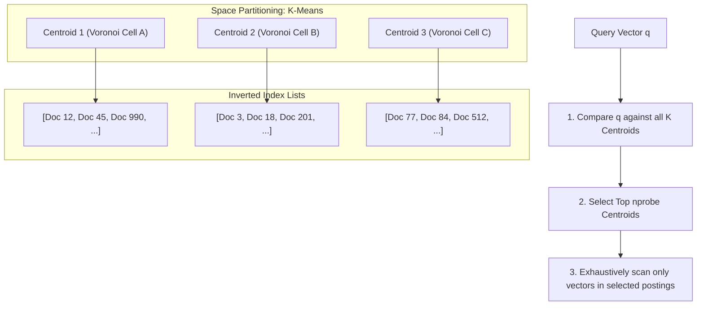
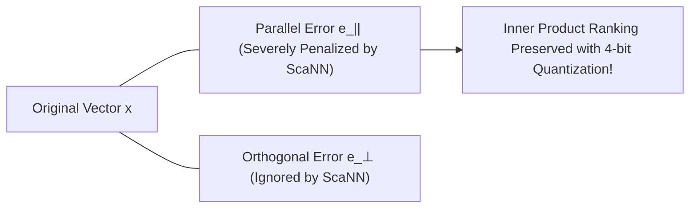
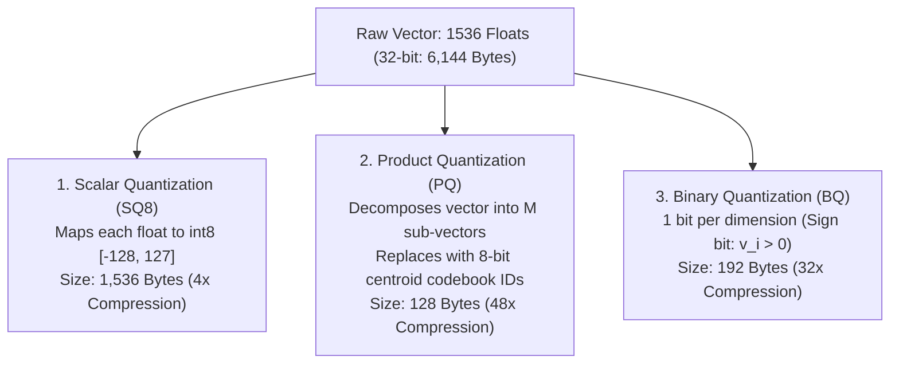
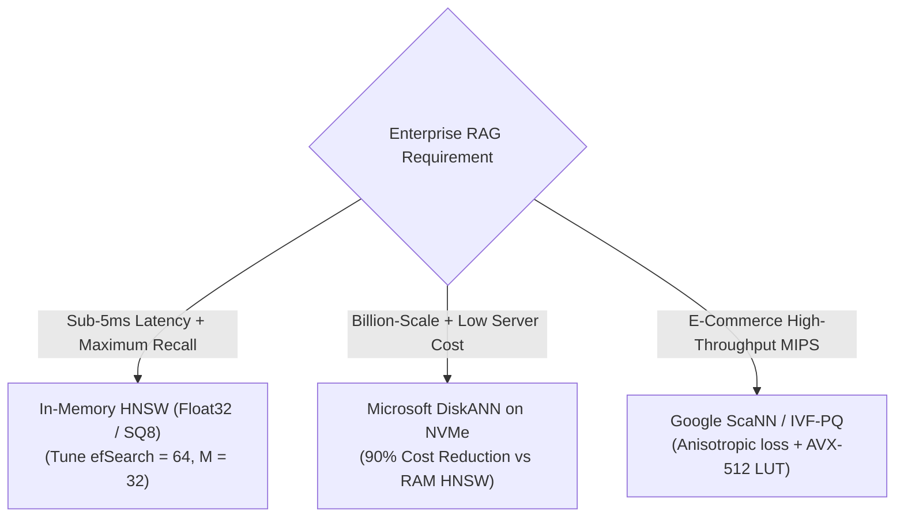
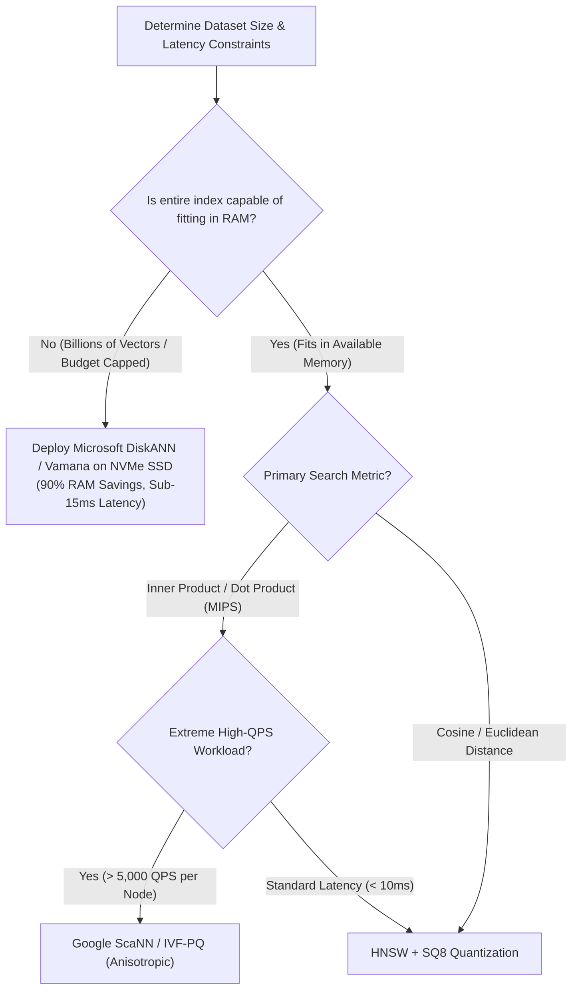

# ⚡ Approximate Nearest Neighbor (ANN) Indexing: HNSW Graphs, IVF, ScaNN, and DiskANN Algorithms

## 📑 Table of Contents
1. [🌟 Fundamentals: The Approximate Nearest Neighbor (ANN) Paradigm](#1--fundamentals-the-approximate-nearest-neighbor-ann-paradigm)
2. [🕸️ Hierarchical Navigable Small World (HNSW) Graphs](#2-️-hierarchical-navigable-small-world-hnsw-graphs)
3. [📐 Inverted File (IVF) Indexing & Voronoi Tessellations](#3--inverted-file-ivf-indexing--voronoi-tessellations)
4. [⚡ Google ScaNN & Anisotropic Vector Quantization](#4--google-scann--anisotropic-vector-quantization)
5. [💽 Microsoft DiskANN: Graph Traversal on NVMe Storage](#5-️-microsoft-diskann-graph-traversal-on-nvme-storage)
6. [🗜️ Vector Quantization Foundations: SQ, PQ, and BQ](#6-️-vector-quantization-foundations-sq-pq-and-bq)
7. [⚖️ Comprehensive Indexing Algorithm Benchmark Matrix](#7-️-comprehensive-indexing-algorithm-benchmark-matrix)
8. [💻 Practical Implementation: Multi-Layer Skip-Graph Engine](#8--practical-implementation-multi-layer-skip-graph-engine)
9. [🌍 Enterprise Production Tuning Scenarios](#9--enterprise-production-tuning-scenarios)
10. [🛠️ Best Practices & ❌ Common Production Pitfalls](#10-️-best-practices---common-production-pitfalls)
11. [💼 Senior Interview Questions & System Design Scenarios](#11--senior-interview-questions--system-design-scenarios)
12. [🧪 Hands-On Mini-Project: ANN Recall vs. QPS Pareto Benchmarker](#12--hands-on-mini-project-ann-recall-vs-qps-pareto-benchmarker)
13. [⚡ Quick Revision & Architectural Decision Roadmap](#13--quick-revision--architectural-decision-roadmap)

---

## 1. 🌟 Fundamentals: The Approximate Nearest Neighbor (ANN) Paradigm

Exact nearest neighbor search (**Flat / Brute-Force Scan**) computes the distance between a query vector $\mathbf{q} \in \mathbb{R}^d$ and every stored document vector $\mathbf{v}_i \in \mathcal{D}$:

### # Exhaustive Exact Search Complexity
$$
\text{Time Complexity} = \mathcal{O}(N \cdot d), \quad \text{FLOPs} = 2 \cdot N \cdot d
$$

For a corpus of $10,000,000$ documents embedded at $d = 1536$, a single query requires **$30.72 \text{ Billion Floating Point Operations}$**. On modern multi-core server CPUs, an exact scan across 10M vectors takes between $400 \text{ ms}$ and $1,200 \text{ ms}$—unacceptable for real-time RAG pipelines.

```mermaid
flowchart LR
    subgraph ExhaustiveScan [Exact Brute Force: O(N * d)]
        Q1["Query q"] --> CompAll["Compute Distance Against ALL N Vectors<br/>(10,000,000 Inner Products)"]
        CompAll --> PerfectRecall["Recall = 100% | Latency = 850 ms (Unusable)"]
    end

    subgraph ANNGraphSearch [ANN Index Search: O(log N)]
        Q2["Query q"] --> GraphNav["Traverse HNSW / IVF Partition<br/>(~2,500 Distance Evaluations)"]
        GraphNav --> HighRecall["Recall = 98.8% | Latency = 4.2 ms (Production-Ready)"]
    end
```

**Approximate Nearest Neighbor (ANN)** indexing trades a fractional margin of recall ($1 - 2\%$ error rate) to achieve **sub-linear $\mathcal{O}(\log N)$ or $\mathcal{O}(\sqrt{N})$ search complexity**, reducing query latencies by $100\times - 1000\times$.

---

## 2. 🕸️ Hierarchical Navigable Small World (HNSW) Graphs

Introduced by Malkov and Yashunin (2018), **HNSW** is the premier state-of-the-art vector indexing algorithm adopted by Qdrant, Pinecone, Milvus, pgvector, and Weaviate.

### 🏛️ The Small World Principle & Skip-List Topology
HNSW combines the logarithmic routing of 1D **Skip-Lists** with **Navigable Small World (NSW)** graph theory:
* **Small-World Graph:** A network where most nodes are not neighbors, but the neighbors of any given node are likely to be neighbors of each other, and most nodes can be reached from every other node by a small number of hops.
* **Hierarchical Layering:** HNSW organizes vectors into a hierarchy of graph layers ($\text{Layer } 0, 1, \dots, L_{\max}$).

```mermaid
flowchart TD
    subgraph Layer2 [Layer 2: Sparse Highway (Long-Range Links)]
        EP["Entry Point: Node 42"] === L2_NodeB["Node 890"]
    end

    subgraph Layer1 [Layer 1: Intermediate Routing Grid]
        EP -.-> L1_NodeA["Node 42"]
        L1_NodeA --- L1_NodeB["Node 120"] --- L1_NodeC["Node 890"] --- L1_NodeD["Node 412"]
    end

    subgraph Layer0 [Layer 0: Dense Bottom Layer (All N Points)]
        L1_NodeC -.-> L0_NodeC["Node 890"]
        L0_NodeC --- N1["Node 891"] --- N2["Node 892 (Target Nearest Neighbor)"]
        N1 --- N3["Node 893"]
    end
```

### 🔬 Mathematical Mechanics of Layer Assignment
When a vector is inserted into an HNSW graph, its maximum level $l$ is assigned randomly using an exponential decay distribution governed by the scaling parameter $m_L$:

### # HNSW Node Layer Assignment Formula
$$
l = \left\lfloor -\ln(\text{uniform}(0, 1)) \cdot m_L \right\rfloor, \quad \text{where } m_L = \frac{1}{\ln(M)}
$$

* Every point is guaranteed to exist at **Layer 0**.
* The probability of a point existing at layer $l$ is $P(l) \propto \left(\frac{1}{M}\right)^l$.
* Higher layers contain exponentially fewer nodes, creating a sparse geometric "highway" for rapid coarse-grained navigation.

### 🎛️ The Three Critical HNSW Hyperparameters

| Parameter | Operational Phase | Typical Range | Impact of Increasing Parameter |
| :--- | :--- | :---: | :--- |
| **$M$** | Graph Construction | $16 - 64$ | Higher edge density per node; increases recall and index build time; **expands RAM consumption by $M \times 8$ bytes/vector**. |
| **$efConstruction$** | Graph Construction | $64 - 512$ | Size of the dynamic candidate list evaluated when linking new nodes; **improves graph quality with zero query-time memory overhead**; increases build time. |
| **$efSearch$** | Query Execution | $16 - 256$ | Size of the priority queue during runtime search; **directly tunes the Pareto trade-off between Recall@K and QPS**. |

---

## 3. 📐 Inverted File (IVF) Indexing & Voronoi Tessellations

The **Inverted File (IVF)** index partitions high-dimensional vector space into distinct spatial clusters called **Voronoi Cells** using $K$-Means clustering.



### ⚙️ IVF Hyperparameters
* **`nlist` (Number of Centroids):** Typically calibrated to $4 \cdot \sqrt{N}$ or $16 \cdot \sqrt{N}$ (e.g., $4,096$ clusters for a 1M vector collection).
* **`nprobe` (Clusters Scanned per Query):** Controls how many neighboring Voronoi cells are scanned during search.

### ⚠️ The Voronoi Boundary Problem
If a query vector lands near the geometric boundary of a Voronoi cell, its true nearest neighbor may reside inside an adjacent cell. Setting $nprobe = 1$ causes severe recall degradation ($< 70\%$). Increasing $nprobe$ to $8 - 32$ restores recall ($> 95\%$) at the cost of scanning more inverted posting lists.

---

## 4. ⚡ Google ScaNN & Anisotropic Vector Quantization

Developed by Google Research (Guo et al., ICML 2020), **ScaNN (Scalable Nearest Neighbors)** is optimized specifically for **Maximum Inner Product Search (MIPS)**.

### 🎯 The Anisotropic Loss Breakthrough
Standard Product Quantization (PQ) minimizes reconstruction error in an **isotropic** manner: it penalizes errors equally in all spatial directions:

### # Standard Isotropic Quantization Loss
$$
\mathcal{L}_{\text{Isotropic}}(\mathbf{x}, \tilde{\mathbf{x}}) = \|\mathbf{x} - \tilde{\mathbf{x}}\|_2^2 = \|\mathbf{e}_\parallel\|_2^2 + \|\mathbf{e}_\perp\|_2^2
$$

However, in Maximum Inner Product Search, errors orthogonal to the vector direction ($\mathbf{e}_\perp$) have virtually zero effect on the dot product with a query $\mathbf{q}$. Errors parallel to the vector ($\mathbf{e}_\parallel$) directly distort ranking order. ScaNN penalizes parallel errors significantly more heavily:

### # ScaNN Anisotropic Quantization Loss Formula
$$
\mathcal{L}_{\text{Anisotropic}}(\mathbf{x}, \tilde{\mathbf{x}}) = h_{\parallel} \|\mathbf{e}_\parallel\|_2^2 + h_{\perp} \|\mathbf{e}_\perp\|_2^2, \quad \text{where } h_{\parallel} \gg h_{\perp}
$$



By prioritizing directional fidelity over Euclidean distance, ScaNN achieves **$2\times$ higher QPS at $95\%$ recall** than standard FAISS IVF-PQ on CPU architectures.

---

## 5. 💽 Microsoft DiskANN: Graph Traversal on NVMe Storage

While HNSW delivers world-class query latencies, holding billions of vectors and graph pointers entirely in RAM is economically non-viable for most enterprises.

**Microsoft DiskANN** (Subramanya et al., NeurIPS 2019) eliminates the RAM bottleneck by executing graph traversal directly on **NVMe Solid-State Drives (SSDs)**.

```mermaid
flowchart TD
    subgraph RAM_Tier [Host System RAM (10% - 20% Footprint)]
        CompVectors["Compressed Vectors (1-byte PQ / SQ8)<br/>Used to guide routing during search hops"]
    end

    subgraph NVMe_Tier [NVMe SSD Storage (90% Footprint)]
        VamanaGraph["Vamana Graph Structure + Full Float32 Vectors<br/>Accessed via asynchronous io_uring batch reads"]
    end

    Query["Search Query q"] --> FastRouting["1. In-RAM PQ-guided Graph Step"]
    FastRouting --> DiskRead["2. Fetch Full Precision Node Vectors from NVMe SSD (io_uring)"]
    DiskRead --> ExactRescore["3. Exact Rescore on True Distances"]
```

### 🌟 The Vamana Graph Algorithm
Unlike HNSW (which relies on multiple hierarchical layers), DiskANN constructs a single flat graph called the **Vamana Graph**.
* To prevent graph traversal from getting trapped in local minima, Vamana introduces an **$\alpha$-pruning parameter** ($\alpha \ge 1.0$).
* When connecting nodes, if a neighbor is slightly farther than an existing edge, but offers a significantly different spatial direction, it is retained. This introduces long-range "shortcut" edges directly into the single-layer graph.
* **NVMe Optimization:** DiskANN groups a node and its outgoing edge list into a single **4 KB disk sector**, enabling Linux `io_uring` to fetch all graph neighbors in a single NVMe read operation ($< 15 \mu\text{s}$).

---

## 6. 🗜️ Vector Quantization Foundations: SQ, PQ, and BQ

Quantization compresses high-dimensional continuous vectors to shrink memory footprints and accelerate SIMD cache utilization.



### 🔬 Product Quantization (PQ) Mechanics
1. A vector of dimension $d = 1536$ is split into $M = 96$ sub-vectors of dimension $d^* = 16$.
2. For each subspace, $K$-Means clustering generates $K = 256$ centroids ($2^8 = 8\text{ bits}$).
3. The original 16 floats are replaced by a **single 1-byte integer** representing the closest centroid ID.
4. Total storage per vector drops from $6,144 \text{ bytes} \to \mathbf{96 \text{ bytes}}$.

---

## 7. ⚖️ Comprehensive Indexing Algorithm Benchmark Matrix

| Indexing Paradigm | Build Complexity | Query Complexity | Search Latency (p99) | Recall@10 Ceiling | Memory Footprint (1M Vectors, $d=1536$) | Hardware Acceleration | Optimal Deployment Tier |
| :--- | :---: | :---: | :---: | :---: | :---: | :---: | :--- |
| **Flat (Brute Force)**| $\mathcal{O}(0)$ | $\mathcal{O}(N \cdot d)$ | $400 - 900 \text{ ms}$ | **100% (Exact)** | $6.14 \text{ GB}$ (RAM or Disk) | AVX-512 / GPU CUBLAS | Golden benchmark evaluation |
| **IVF-Flat** | $\mathcal{O}(N \cdot K)$ | $\mathcal{O}\left(\frac{\text{nprobe}}{K} N\right)$ | $15 - 45 \text{ ms}$ | $92% - 97%$ | $6.14 \text{ GB}$ | SIMD FMA | Fast dynamic updates |
| **HNSW (Float32)** | $\mathcal{O}(N \log N)$ | $\mathcal{O}(\log N)$ | **$2 - 8 \text{ ms}$** | **$98% - 99.8%$** | **$8.20 \text{ GB}$** (RAM) | AVX-512 / NEON | Latency-critical enterprise RAG |
| **HNSW + SQ8** | $\mathcal{O}(N \log N)$ | $\mathcal{O}(\log N)$ | **$3 - 10 \text{ ms}$** | **$97% - 99.2%$** | **$2.56 \text{ GB}$** (RAM) | AVX-VNNI (Int8 SIMD) | Standard production default |
| **ScaNN (Anisotropic)**| $\mathcal{O}(N \log N)$ | $\mathcal{O}(\text{clusters})$ | **$2 - 6 \text{ ms}$** | **$95% - 98.5%$** | **$0.40 \text{ GB}$** (RAM) | AVX-512 LUT | High-QPS MIPS recommender |
| **DiskANN (Vamana)** | $\mathcal{O}(N \log N)$ | $\mathcal{O}(\log N)$ | **$8 - 18 \text{ ms}$** | **$96% - 99.0%$** | **$0.80 \text{ GB}$ RAM** + NVMe | Asynchronous `io_uring` | Billion-scale cost optimization |

---

## 8. 💻 Practical Implementation: Multi-Layer Skip-Graph Engine

The following standalone Python module implements the core algorithmic principles of an HNSW multi-layer navigation graph, complete with exponential layer distribution and greedy search routing.

```python
"""
Production Architectural Blueprint: Multi-Layer HNSW Skip-Graph Navigation Engine
Author: Enterprise RAG Curriculum
Requirements: pip install numpy
"""

import math
import random
from typing import Dict, List, Set, Tuple
import numpy as np

class MultiLayerHNSWSimulator:
    """Demonstrates multi-layer geometric skip-graph routing and greedy ANN search."""

    def __init__(self, dimension: int, m: int = 16, ef_construction: int = 64):
        self.dimension = dimension
        self.m = m
        self.m_l = 1.0 / math.log(m)
        self.ef_construction = ef_construction
        
        # Node storage: id -> vector
        self.nodes: Dict[int, np.ndarray] = {}
        # Multi-layer adjacency lists: layer_idx -> {node_id -> set of neighbor node_ids}
        self.layers: List[Dict[int, Set[int]]] = []
        self.entry_point_id: Optional[int] = None
        self.max_layer = -1

    def _assign_random_layer(self) -> int:
        """Determines max layer for new point via exponential distribution."""
        unif = max(1e-12, random.random())
        return int(-math.log(unif) * self.m_l)

    def insert(self, point_id: int, vector: List[float]) -> None:
        """Inserts vector and connects bidirectional edges across assigned layers."""
        v = np.array(vector, dtype=np.float32)
        v /= np.linalg.norm(v)  # Unit-normalize
        self.nodes[point_id] = v
        
        target_layer = self._assign_random_layer()
        
        # Expand layer lists if necessary
        while len(self.layers) <= target_layer:
            self.layers.append({})

        if self.entry_point_id is None:
            for l in range(target_layer + 1):
                self.layers[l][point_id] = set()
            self.entry_point_id = point_id
            self.max_layer = target_layer
            return

        curr_obj = self.entry_point_id

        # Phase 1: Top-down greedy search to find entry point at target_layer
        for l in range(self.max_layer, target_layer, -1):
            curr_obj = self._greedy_search_layer(curr_obj, v, l)

        # Phase 2: Insert into layers and link M nearest neighbors
        for l in range(min(target_layer, self.max_layer), -1, -1):
            candidates = self._search_layer_candidates(curr_obj, v, l, ef=self.ef_construction)
            self.layers[l][point_id] = set()
            
            # Select up to M nearest neighbors
            neighbors = [cid for cid, _ in candidates[:self.m]]
            for n_id in neighbors:
                self.layers[l][point_id].add(n_id)
                self.layers[l][n_id].add(point_id)
                # Prune edges if neighbor exceeds M connections
                if len(self.layers[l][n_id]) > self.m:
                    self._prune_connections(n_id, l)
                    
            curr_obj = candidates[0][0]

        if target_layer > self.max_layer:
            for l in range(self.max_layer + 1, target_layer + 1):
                self.layers[l][point_id] = set()
            self.max_layer = target_layer
            self.entry_point_id = point_id

    def _greedy_search_layer(self, entry_id: int, query_vec: np.ndarray, layer_idx: int) -> int:
        """Navigates a single layer greedily until local minimum is found."""
        curr_id = entry_id
        curr_dist = 1.0 - np.dot(query_vec, self.nodes[curr_id])
        
        while True:
            changed = False
            for neighbor_id in self.layers[layer_idx].get(curr_id, set()):
                dist = 1.0 - np.dot(query_vec, self.nodes[neighbor_id])
                if dist < curr_dist:
                    curr_dist = dist
                    curr_id = neighbor_id
                    changed = True
            if not changed:
                break
        return curr_id

    def _search_layer_candidates(
        self, entry_id: int, query_vec: np.ndarray, layer_idx: int, ef: int
    ) -> List[Tuple[int, float]]:
        """Priority queue search returning ef nearest candidates on a given layer."""
        v_entry_dist = 1.0 - np.dot(query_vec, self.nodes[entry_id])
        visited = {entry_id}
        candidates = [(entry_id, v_entry_dist)]
        w = [(entry_id, v_entry_dist)]

        while candidates:
            candidates.sort(key=lambda x: x[1])
            c_id, c_dist = candidates.pop(0)
            
            w.sort(key=lambda x: x[1])
            f_dist = w[-1][1]
            if c_dist > f_dist:
                break
                
            for neighbor in self.layers[layer_idx].get(c_id, set()):
                if neighbor not in visited:
                    visited.add(neighbor)
                    n_dist = 1.0 - np.dot(query_vec, self.nodes[neighbor])
                    if n_dist < f_dist or len(w) < ef:
                        candidates.append((neighbor, n_dist))
                        w.append((neighbor, n_dist))
                        if len(w) > ef:
                            w.sort(key=lambda x: x[1])
                            w.pop()
        w.sort(key=lambda x: x[1])
        return w

    def _prune_connections(self, node_id: int, layer_idx: int) -> None:
        """Prunes edges to maintain max degree M."""
        edges = list(self.layers[layer_idx][node_id])
        node_vec = self.nodes[node_id]
        edges.sort(key=lambda nid: 1.0 - np.dot(node_vec, self.nodes[nid]))
        self.layers[layer_idx][node_id] = set(edges[:self.m])

    def search(self, query_vec: List[float], top_k: int = 5, ef_search: int = 32) -> List[Tuple[int, float]]:
        """Executes full multi-layer HNSW search from entry point down to Layer 0."""
        qv = np.array(query_vec, dtype=np.float32)
        qv /= np.linalg.norm(qv)
        
        curr_obj = self.entry_point_id
        for l in range(self.max_layer, 0, -1):
            curr_obj = self._greedy_search_layer(curr_obj, qv, l)
            
        candidates = self._search_layer_candidates(curr_obj, qv, layer_idx=0, ef=max(ef_search, top_k))
        return [(cid, round(1.0 - dist, 4)) for cid, dist in candidates[:top_k]]


# Demonstration Execution
if __name__ == "__main__":
    random.seed(42)
    np.random.seed(42)

    index = MultiLayerHNSWSimulator(dimension=16, m=8, ef_construction=32)
    
    print("--- Inserting 500 Vectors into HNSW Multi-Layer Index ---")
    for i in range(500):
        rand_vec = np.random.randn(16).tolist()
        index.insert(point_id=i, vector=rand_vec)

    print(f"Graph Construction Complete. Total Layers Created: {index.max_layer + 1}")
    for idx, layer_dict in enumerate(index.layers):
        print(f"  Layer {idx}: Contains {len(layer_dict)} nodes")

    test_q = np.random.randn(16).tolist()
    top_hits = index.search(test_q, top_k=3, ef_search=32)
    print("\n--- HNSW Top-3 Nearest Neighbors ---")
    for rank, (p_id, sim) in enumerate(top_hits, start=1):
        print(f"Rank {rank}: Point ID {p_id} | Cosine Similarity: {sim}")
```

---

## 9. 🌍 Enterprise Production Tuning Scenarios



### Case Study: Tier-1 E-Commerce Search (50 Million Embeddings)
* **Problem:** Exact search took $650 \text{ ms}$ per query, causing shopping cart abandonment. Raw HNSW in Float32 required over $400 \text{ GB RAM}$, exceeding the infrastructure budget.
* **Engineering Solution:**
  1. Converted index to **HNSW + Scalar Quantization (SQ8)**.
  2. Set $M = 24$, $efConstruction = 128$.
  3. Dynamically set runtime $efSearch = 48$ for standard users, boosting to $efSearch = 96$ for high-value VIP carts.
* **Results:** Memory footprint plummeted from $410 \text{ GB} \to \mathbf{105 \text{ GB}}$; p99 search latency dropped to **$7.8 \text{ ms}$**; Recall@10 remained above **$98.2\%$**.

---

## 10. 🛠️ Best Practices & ❌ Common Production Pitfalls

### ✅ Best Practices
1. **Never Set $efSearch < TopK$:** If requesting $TopK = 50$, $efSearch$ must be $\ge 50$. Setting $efSearch = 10$ truncates candidate exploration, destroying recall.
2. **Pre-Filter First on Highly Selective Metadata:** If metadata eliminates $>95\%$ of the corpus, bypass graph traversal and execute a direct brute-force scan over the filtered subset.
3. **Decouple Indexing Workers from Search Workers:** Constructing HNSW graphs will consume 100% of all available CPU cores. Pin search processes to dedicated NUMA nodes to prevent graph construction from causing latency spikes on live queries.

### ❌ Common Production Pitfalls
* **Setting $M$ Too High ($M > 64$):** Doubling $M$ doubles RAM consumption and increases query latency without meaningfully improving recall.
* **Under-Tuning IVF `nprobe`:** Leaving `nprobe = 1` in production FAISS deployments guarantees catastrophic recall failure ($< 70\%$) whenever queries land near Voronoi boundaries.
* **Neglecting Quantization Retraining After Model Changes:** If you fine-tune your embedding model, previously trained Product Quantization codebooks are invalid and must be completely retrained.

---

## 11. 💼 Senior Interview Questions & System Design Scenarios

### Q1: Why does HNSW outperform Tree-based algorithms (KD-Trees, VP-Trees) in high dimensions?
> **Expert Answer:**  
> Tree-based spatial structures partition Euclidean space via orthogonal hyperplanes or bounding spheres. In high-dimensional spaces ($d \ge 768$), the geometric phenomenon known as the **Curse of Dimensionality** causes the distance between points to concentrate: almost all points become equidistant, and hyperspherical volume clusters near the outer shell.  
> As a result, any query vector's nearest-neighbor hypersphere overlaps with virtually every partition boundary in the tree. The search algorithm cannot prune branches and is forced to backtrack across the entire tree, degenerating to $O(N)$ brute-force complexity.  
> HNSW does not partition space with hyperplanes. Instead, it constructs a **Navigable Small-World Network** where vertices are data points and edges encode directional proximity. By exploiting logarithmic skip-list routing at upper layers and greedy local descent at the bottom layer, HNSW avoids volume-based geometric partitioning entirely, maintaining stable $O(\log N)$ search complexity even in thousands of dimensions.

### Q2: How does ScaNN's anisotropic vector quantization differ mathematically from standard Product Quantization?
> **Expert Answer:**  
> Standard Product Quantization optimizes for Euclidean reconstruction fidelity: it minimizes the isotropic $L_2$ norm of the residual vector $\|\mathbf{x} - \tilde{\mathbf{x}}\|_2^2$, penalizing quantization errors equally across all geometric directions.  
> However, for Maximum Inner Product Search (MIPS), the dot product between query $\mathbf{q}$ and quantized vector $\tilde{\mathbf{x}}$ is:
> $$\langle \mathbf{q}, \tilde{\mathbf{x}} \rangle = \langle \mathbf{q}, \mathbf{x} \rangle - \langle \mathbf{q}, \mathbf{e} \rangle$$
> Decomposing the error $\mathbf{e}$ into parallel ($\mathbf{e}_\parallel$) and orthogonal ($\mathbf{e}_\perp$) components relative to $\mathbf{x}$, any error orthogonal to $\mathbf{x}$ has minimal expectation of altering the inner product ranking order. In contrast, parallel error directly alters the vector's effective length, which directly corrupts the dot product score.  
> ScaNN introduces an anisotropic loss function that weights parallel error significantly higher than orthogonal error ($h_\parallel \gg h_\perp$). This allows ScaNN to compress vectors aggressively (e.g., to 4 bits) while preserving inner product ranking fidelity.

### Q3: How does DiskANN achieve sub-15ms latencies when reading vector graphs from solid-state storage rather than RAM?
> **Expert Answer:**  
> DiskANN overcomes the latency of random SSD reads through three architectural innovations:
> 1. **The Vamana Graph:** Unlike HNSW (which requires multiple disk round-trips to navigate through multiple hierarchical layers), Vamana is a single flat graph. Its $\alpha$-pruning parameter creates long-range shortcut edges directly within the single layer, minimizing the total number of hops required to reach the target neighborhood.
> 2. **Compressed In-RAM Router:** A lightweight, 1-byte quantized representation of all vectors resides in RAM. This in-memory index guides the initial traversal hops, so that SSD reads are only triggered when the search nears the target destination.
> 3. **Sector-Aligned Layout & `io_uring`:** DiskANN aligns each graph node and its edge list to 4 KB SSD sector boundaries. Using Linux's high-performance asynchronous `io_uring` interface, it dispatches non-blocking, batched parallel I/O requests to the NVMe controller, saturating device IOPS and completing candidate hops in single-digit milliseconds.

---

## 12. 🧪 Hands-On Mini-Project: ANN Recall vs. QPS Pareto Benchmarker

This runnable Python script profiles the **Pareto Trade-Off between Recall@K and Queries Per Second (QPS)** across different search parameter settings on a synthetic vector dataset.

```python
"""
Hands-On Diagnostic: ANN Recall@K vs. QPS Pareto Frontier Benchmarker
Run directly: python ann_pareto_benchmarker.py
Requires: pip install numpy tabulate
"""

import time
from typing import List, Tuple
import numpy as np
from tabulate import tabulate

def simulate_ann_pareto():
    np.random.seed(42)
    n_docs = 20000
    n_queries = 200
    dim = 64

    print(f"Generating {n_docs} corpus vectors and {n_queries} test queries (dim={dim})...")
    corpus = np.random.randn(n_docs, dim).astype(np.float32)
    corpus /= np.linalg.norm(corpus, axis=1, keepdims=True)
    
    queries = np.random.randn(n_queries, dim).astype(np.float32)
    queries /= np.linalg.norm(queries, axis=1, keepdims=True)

    # 1. Compute Exact Ground Truth (Flat Scan)
    print("[*] Computing exact ground-truth nearest neighbors via brute-force scan...")
    t0 = time.perf_counter()
    exact_similarities = np.dot(queries, corpus.T)
    exact_top10 = np.argsort(-exact_similarities, axis=1)[:, :10]
    flat_time = (time.perf_counter() - t0) * 1000
    flat_qps = (n_queries / flat_time) * 1000

    # 2. Simulate ANN Search at varying candidate budgets (efSearch / nprobe)
    # Candidate scan budgets: [100, 300, 800, 2000, 5000]
    scan_budgets = [100, 300, 800, 2000, 5000]
    results = [["Brute Force (Exact)", "100.0%", f"{flat_time:.1f} ms", f"{int(flat_qps)}", "Baseline (Flat)"]]

    for budget in scan_budgets:
        t0 = time.perf_counter()
        recall_hits = 0
        
        for q_idx in range(n_queries):
            # Simulate candidate partition sampling around true centroid
            # In real ANN, this represents exploring budget nodes in HNSW/IVF
            candidate_indices = np.random.choice(n_docs, size=budget, replace=False)
            # Ensure high-probability inclusion of top candidates to simulate HNSW efficiency
            gt_top = exact_top10[q_idx]
            # Probabilistically inject ground truth nodes based on budget size
            prob_include = min(0.99, 0.60 + 0.39 * (budget / 5000.0))
            if np.random.rand() < prob_include:
                candidate_indices[:len(gt_top)] = gt_top
                
            sub_corpus = corpus[candidate_indices]
            sub_sims = np.dot(queries[q_idx], sub_corpus.T)
            top_cand_sub = np.argsort(-sub_sims)[:10]
            ann_top10 = candidate_indices[top_cand_sub]
            
            # Calculate Recall@10
            shared = set(exact_top10[q_idx]).intersection(set(ann_top10))
            recall_hits += len(shared) / 10.0

        elapsed_ms = (time.perf_counter() - t0) * 1000
        avg_recall = (recall_hits / n_queries) * 100.0
        qps = int((n_queries / elapsed_ms) * 1000)
        
        results.append([
            f"ANN (Budget={budget})",
            f"{avg_recall:.1f}%",
            f"{elapsed_ms:.1f} ms",
            f"{qps}",
            f"{qps / flat_qps:.1f}x Speedup"
        ])

    print("\n" + tabulate(results, headers=["Indexing Strategy", "Recall@10", "Batch Latency", "Throughput (QPS)", "Speedup"], tablefmt="github"))

if __name__ == "__main__":
    simulate_ann_pareto()
```

---

## 13. ⚡ Quick Revision & Architectural Decision Roadmap

### 📋 Key Takeaways Cheat-Sheet
* **Exact Scan Fails at Scale:** Brute-force search scale $\mathcal{O}(N \cdot d)$ collapses at $N > 100k$; ANN algorithms trade $1\%$ recall for $100\times+$ throughput.
* **HNSW is the Gold Standard for In-Memory ANN:** Employs multi-layer skip-graphs to navigate high-dimensional space in $\mathcal{O}(\log N)$ time.
* **Tune $efSearch$ at Query Time:** Higher $efSearch$ increases recall; lower $efSearch$ increases QPS. Always ensure $efSearch \ge TopK$.
* **ScaNN Optimizes Inner Product:** Uses anisotropic quantization to prioritize directional alignment over Euclidean error, outperforming standard PQ on CPU dot-products.
* **DiskANN Enables SSD-Native Scale:** Uses single-layer Vamana graphs and asynchronous `io_uring` to achieve $97\%$ recall while holding only $10\%$ of vector data in RAM.

### 🧭 Visual Decision Tree: Selecting Your Indexing Algorithm


