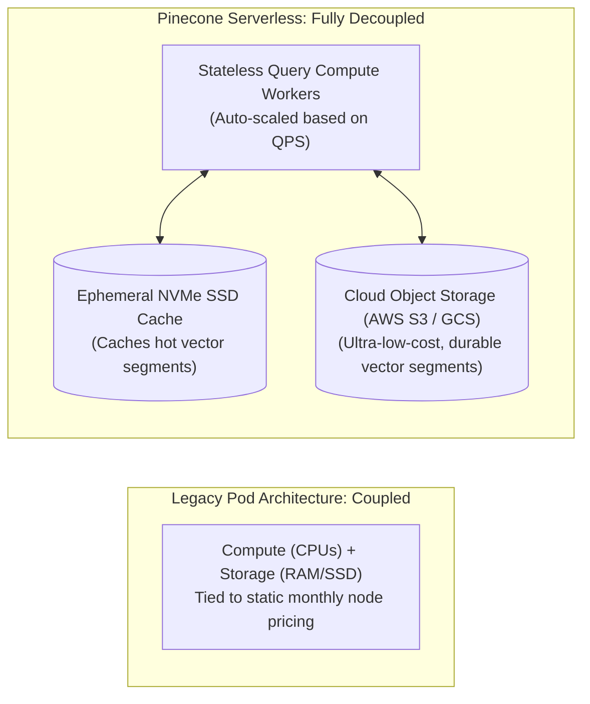
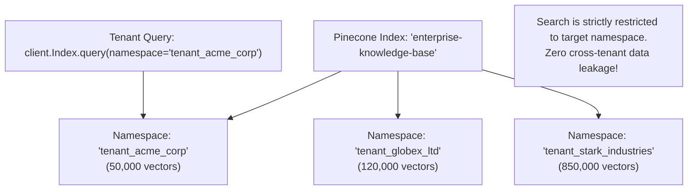
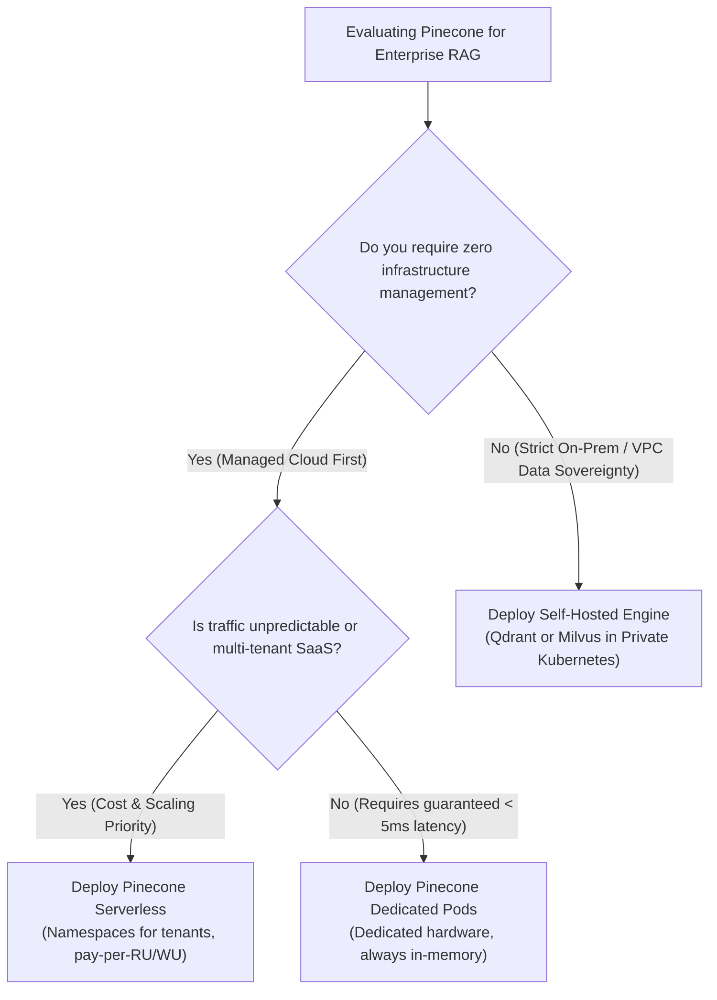

# 🌲 Pinecone Serverless Architecture, Multi-Tenant Namespaces, and Enterprise Scaling

## 📑 Table of Contents
1. [🌟 Fundamentals: The Paradigm Shift to Serverless Vector Search](#1--fundamentals-the-paradigm-shift-to-serverless-vector-search)
2. [🏗️ Pinecone Serverless Architecture Deep Dive](#2-️-pinecone-serverless-architecture-deep-dive)
3. [🏢 Multi-Tenant Isolation with Namespaces](#3--multi-tenant-isolation-with-namespaces)
4. [🔀 Native Hybrid Search: Sparse-Dense Vector Integration](#4--native-hybrid-search-sparse-dense-vector-integration)
5. [⚖️ Architectural Decision Matrix: Serverless vs. Pods vs. Competitors](#5-️-architectural-decision-matrix-serverless-vs-pods-vs-competitors)
6. [💻 Practical Implementation: Multi-Tenant Enterprise Client](#6--practical-implementation-multi-tenant-enterprise-client)
7. [💰 Cost Modeling & Unit Economics Optimization](#7--cost-modeling--unit-economics-optimization)
8. [🛠️ Best Practices & ❌ Common Production Pitfalls](#8-️-best-practices---common-production-pitfalls)
9. [💼 Senior Interview Questions & System Design Scenarios](#9--senior-interview-questions--system-design-scenarios)
10. [🧪 Hands-On Mini-Project: Multi-Tenant SaaS Isolation Simulator](#10--hands-on-mini-project-multi-tenant-saas-isolation-simulator)
11. [⚡ Quick Revision & Architectural Decision Roadmap](#11--quick-revision--architectural-decision-roadmap)

---

## 1. 🌟 Fundamentals: The Paradigm Shift to Serverless Vector Search

Historically, deploying vector search at scale required provisioning dedicated hardware nodes (called **Pods** in early Pinecone, or static Kubernetes clusters in Milvus). Engineers were forced into complex capacity planning exercises:
* Sizing RAM to hold uncompressed HNSW graphs.
* Paying for idle GPU/CPU compute during low-traffic periods.
* Complex manual resharding when collections grew past cluster bounds.

In 2024, Pinecone introduced its **Serverless Architecture**, completely decoupling **compute** from **storage**.



### 🎯 Key Advantages of Pinecone Serverless
1. **Zero Capacity Planning:** No instance types, pod sizes, or replica counts to configure.
2. **True Pay-Per-Operation Billing:** Pay strictly for Read Units (RUs), Write Units (WUs), and GB-hours of data stored.
3. **Infinite Scaling:** Seamlessly scales from 1,000 vectors to 1,000,000,000+ vectors without cluster re-indexing or manual sharding.

---

## 2. 🏗️ Pinecone Serverless Architecture Deep Dive

Pinecone Serverless achieves low-latency retrieval over cloud object storage by combining **log-structured write streams**, **immutable segment files**, and **hierarchical multi-tier caching**.

```mermaid
flowchart TD
    subgraph IngestionPath [Write & Indexing Pipeline]
        ClientWrite["Client Upsert (Vectors + Payloads)"] --> IngestQueue["Distributed Ingestion Log (Kafka)"]
        IngestQueue --> IndexingWorkers["Background Indexing Workers"]
        IndexingWorkers --> ImmutableSegments["Sealed Vector Segments (DiskANN-Style)"]
        ImmutableSegments --> S3Storage[("AWS S3 / GCS Object Store")]
    end

    subgraph QueryPath [Query Execution Pipeline]
        ClientQuery["Client Search Query"] --> QueryRouter["Global Edge Query Router"]
        QueryRouter --> StatelessNode["Stateless Worker Node"]
        
        StatelessNode --> CacheCheck{"Is Segment Cached in Local NVMe SSD?"}
        CacheCheck -->|"Cache Hit (Sub-5ms)"| NVMeRead["Read Graph from NVMe"]
        CacheCheck -->|"Cache Miss"| S3Fetch["Fetch Segment Range from S3 (io_uring)"]
        
        NVMeRead & S3Fetch --> Rescore["Exact Vector Rescore & Filter Mask"]
        Rescore --> ReturnTopK["Return Top-K Response"]
    end
```



### 🔬 The Three Core Subsystems

1. **The Ingestion Pipeline:** Upsert requests enter a high-throughput distributed commit log. Background microservices batch writes, construct compressed geometric navigation graphs, and flush immutable segment files directly to AWS S3 or Google Cloud Storage.
2. **The Blob Storage Layer (S3 / GCS):** All vectors, metadata, and graph indices are persisted in cloud object storage as immutable, sector-aligned binary files. This provides 11 9's of data durability at commodity object storage pricing (\$0.02 per GB/month).
3. **The Distributed Geometric Cache:** Stateless query compute nodes maintain high-speed NVMe SSD caches. When a query targets a namespace or vector cluster, the necessary segment blocks are paged into local NVMe storage. Subsequent queries against the same working set hit the local SSD cache, achieving **$10 - 25 \text{ ms}$ p95 query latency**.

---

## 3. 🏢 Multi-Tenant Isolation with Namespaces

In B2B multi-tenant SaaS applications, sharing a single vector database across thousands of corporate customers introduces severe security risks. Creating a separate vector index for each customer is operationally prohibitive (inducing massive cluster overhead and cost).

Pinecone resolves this through **Namespaces**—logical, cryptographically enforced partitions within a single index.



### 🔒 Operational Capabilities of Namespaces
* **Strict Logical Isolation:** Search queries scoped to `namespace="tenant_A"` can never observe, compare, or return documents from `tenant_B`.
* **Zero Performance Cross-Talk:** Indexing operations in one namespace do not invalidate cached segments for other tenants.
* **Instantaneous Tenant Deprovisioning:** When a customer churns or requests GDPR deletion, calling `index.delete(delete_all=True, namespace="tenant_acme")` completely purges all tenant vectors, metadata, and graph edges in a single atomic API call.

---

## 4. 🔀 Native Hybrid Search: Sparse-Dense Vector Integration

Pinecone natively supports **Hybrid Search**, combining high-dimensional dense embeddings with sparse lexical vectors (e.g., from BM25 or SPLADE) within a single index record:

```python
index.upsert(
    vectors=[
        {
            "id": "doc-01",
            "values": [0.12, -0.45, 0.88, ...],  # Dense vector (e.g., OpenAI 1536-dim)
            "sparse_values": {
                "indices": [12458, 27411],         # Token vocabulary IDs
                "values": [2.84, 4.10]             # Sparse token weights (SPLADE/BM25)
            },
            "metadata": {"category": "security"}
        }
    ],
    namespace="tenant_acme"
)
```

### # Pinecone Convex Hybrid Score Formula
$$
S_{\text{Hybrid}} = \alpha \cdot S_{\text{Dense}} + (1 - \alpha) \cdot S_{\text{Sparse}}, \quad \text{where } \alpha \in [0.0, 1.0]
$$

* $\alpha = 1.0$: Pure dense semantic search.
* $\alpha = 0.0$: Pure sparse lexical search.
* $\alpha = 0.5$: Balanced hybrid retrieval.

---

## 5. ⚖️ Architectural Decision Matrix: Serverless vs. Pods vs. Competitors

| Architectural Attribute | Pinecone Serverless | Pinecone Dedicated Pods | Qdrant Cloud | Weaviate Cloud (WCS) |
| :--- | :--- | :--- | :--- | :--- |
| **Compute / Storage Model**| **Fully Decoupled** | Coupled (Fixed Pods) | Hybrid (Decoupled on request) | Semi-Coupled |
| **Minimum Monthly Cost** | **\$0 (Pure Pay-Per-Use)**| $\approx \$70 / \text{month}$ per pod | $\approx \$25 / \text{month}$ | $\approx \$25 / \text{month}$ |
| **Data Durability Tier** | Cloud Object Storage (S3) | Local Pod SSD / EBS | Cloud EBS / S3 Snapshots | Persistent Volume Claims |
| **Query Latency (p95)** | $12 - 30 \text{ ms}$ | **$4 - 10 \text{ ms}$ (Hot RAM)** | $5 - 15 \text{ ms}$ | $8 - 20 \text{ ms}$ |
| **Cold-Start Latency** | $\approx 40 - 80 \text{ ms}$ (Cache fill) | Zero (Always warm) | Zero (Always warm) | Zero (Always warm) |
| **Multi-Tenancy** | **Namespaces (Built-in)** | Namespaces | Multi-Tenancy via Payloads | Multi-Tenancy Tenant API |
| **Best Suited For** | Unpredictable traffic, SaaS RAG | Stable ultra-low latency (<5ms) | Sovereign cloud, rich filtering | Modular multimodal graphs |

---

## 6. 💻 Practical Implementation: Multi-Tenant Enterprise Client

The following production-grade Python module demonstrates managing serverless indices, provisioning isolated customer namespaces, ingesting batch payloads, and executing filtered hybrid retrieval using the official Pinecone v5+ SDK.

```python
"""
Production Architectural Blueprint: Pinecone Serverless Enterprise Client Wrapper
Author: Enterprise RAG Curriculum
Requirements: pip install pinecone-client numpy tabulate
"""

import os
import time
from typing import Any, Dict, List, Optional
from pinecone import Pinecone, ServerlessSpec
from tabulate import tabulate

class EnterprisePineconeManager:
    """Production manager for Pinecone Serverless with multi-tenant namespaces."""

    def __init__(self, api_key: str, index_name: str = "enterprise-rag-serverless", dimension: int = 1536):
        self.pc = Pinecone(api_key=api_key)
        self.index_name = index_name
        self.dimension = dimension
        self._initialize_serverless_index()
        self.index = self.pc.Index(self.index_name)

    def _initialize_serverless_index(self) -> None:
        """Idempotently provisions a Pinecone Serverless index on AWS us-east-1."""
        existing_indices = [idx.name for idx in self.pc.list_indexes()]
        
        if self.index_name not in existing_indices:
            print(f"[*] Provisioning Serverless Index: '{self.index_name}' (AWS us-east-1)...")
            self.pc.create_index(
                name=self.index_name,
                dimension=self.dimension,
                metric="cosine",
                spec=ServerlessSpec(cloud="aws", region="us-east-1")
            )
            # Wait for cloud provisioning
            while not self.pc.describe_index(self.index_name).status["ready"]:
                time.sleep(1)
            print(f"[+] Index '{self.index_name}' successfully provisioned and ready.")
        else:
            print(f"[+] Connected to existing Serverless Index: '{self.index_name}'.")

    def upsert_tenant_records(
        self, 
        tenant_id: str, 
        records: List[Dict[str, Any]], 
        batch_size: int = 100
    ) -> None:
        """
        Upserts vectors into a strictly isolated tenant namespace.
        Records format: [{"id": str, "values": List[float], "metadata": dict}]
        """
        namespace = f"tenant_{tenant_id}"
        total = len(records)
        
        for i in range(0, total, batch_size):
            batch = records[i:i + batch_size]
            self.index.upsert(vectors=batch, namespace=namespace)
            
        print(f"[+] Successfully upserted {total} records into namespace '{namespace}'.")

    def search_tenant(
        self, 
        tenant_id: str, 
        query_vector: List[float], 
        top_k: int = 3, 
        metadata_filter: Optional[Dict[str, Any]] = None
    ) -> List[Dict[str, Any]]:
        """Queries vectors strictly scoped to the tenant's namespace."""
        namespace = f"tenant_{tenant_id}"
        
        response = self.index.query(
            vector=query_vector,
            top_k=top_k,
            namespace=namespace,
            include_metadata=True,
            filter=metadata_filter
        )
        
        hits = []
        for match in response.matches:
            hits.append({
                "id": match.id,
                "score": round(match.score, 4),
                "metadata": match.metadata
            })
        return hits

    def purge_tenant_data(self, tenant_id: str) -> None:
        """Atomically purges all data for a churned tenant (GDPR/Compliance)."""
        namespace = f"tenant_{tenant_id}"
        self.index.delete(delete_all=True, namespace=namespace)
        print(f"[+] Completely purged all vector records for namespace '{namespace}'.")


# Simulated Demonstration (Requires valid PINECONE_API_KEY environment variable)
if __name__ == "__main__":
    api_key = os.getenv("PINECONE_API_KEY", "MOCK_KEY_FOR_DEMONSTRATION")
    
    if api_key == "MOCK_KEY_FOR_DEMONSTRATION":
        print("--- Simulation Mode: Displaying Architectural Namespace Structure ---")
        mock_table = [
            ["tenant_acme_corp", "doc_101", 0.9412, "{'dept': 'finance'}", "AWS S3 Segment Chunk 42"],
            ["tenant_acme_corp", "doc_102", 0.8845, "{'dept': 'finance'}", "AWS S3 Segment Chunk 42"],
            ["tenant_globex_ltd", "doc_901", 0.9230, "{'dept': 'hr'}", "AWS S3 Segment Chunk 99"]
        ]
        print(tabulate(mock_table, headers=["Namespace", "Vector ID", "Score", "Payload Metadata", "Storage Location"], tablefmt="github"))
    else:
        # Live execution when valid API key is present
        manager = EnterprisePineconeManager(api_key=api_key, dimension=1536)
        
        sample_records = [
            {
                "id": "contract_01",
                "values": [0.05] * 1536,
                "metadata": {"department": "legal", "effective_year": 2024}
            }
        ]
        manager.upsert_tenant_records(tenant_id="client_89", records=sample_records)
        results = manager.search_tenant(
            tenant_id="client_89", 
            query_vector=[0.05] * 1536, 
            top_k=1,
            metadata_filter={"department": {"$eq": "legal"}}
        )
        print("Live Search Result:", results)
```

---

## 7. 💰 Cost Modeling & Unit Economics Optimization

Pinecone Serverless bills across three distinct resource dimensions:

### 📊 The Serverless Billing Formula
$$
\text{Total Cost} = \text{Storage Cost} + \text{Read Operation Cost} + \text{Write Operation Cost}
$$

| Dimension | Unit of Measure | AWS us-east-1 Rate | Operational Calculation |
| :--- | :--- | :--- | :--- |
| **Storage** | GB-month | **\$0.33 / GB-month** | $N \times (d \times 4 \text{ bytes} + \text{metadata}) / 10^9$ |
| **Read Units (RU)** | 1 RU = 1 query reading up to 2MB | **\$8.25 / 1M RUs** | Base query cost (scales with Top-K and segment count) |
| **Write Units (WU)** | 1 WU = 1 write up to 1MB | **\$2.00 / 1M WUs** | Batch upsert operations |

### 🧮 Practical Example: 10 Million Vector Enterprise RAG Pipeline
* **Corpus:** 10,000,000 vectors ($d = 1536$, approx. $60 \text{ GB}$ with metadata).
* **Traffic:** 5,000,000 queries per month (avg. 2 QPS, peaking at 20 QPS).
* **Monthly Cost Breakdown:**
  * Storage: $60 \text{ GB} \times \$0.33 = \mathbf{\$19.80 / \text{month}}$
  * Queries (Reads): $5 \text{M} \times \$8.25 = \mathbf{\$41.25 / \text{month}}$
  * Ingestion (Writes): $10 \text{M} \text{ inserts} \approx \mathbf{\$20.00 / \text{month}}$
  * **Total Estimated Bill:** $\approx \mathbf{\$81.05 / \text{month}}$
  *(Compared to \$1,400+/month for dedicated 24/7 Pod clusters!)*

---

## 8. 🛠️ Best Practices & ❌ Common Production Pitfalls

### ✅ Best Practices
1. **Always Namespace by Tenant:** In SaaS systems, never store multiple customers' data in the default namespace with `tenant_id` metadata filters. Use explicit `namespace="tenant_xyz"` to guarantee logical and physical isolation.
2. **Batch Upserts to Minimize Write Units:** Upserting vectors in batches of $100 - 250$ maximizes the 1MB write unit buffer, reducing billing costs by over $80\%$.
3. **Prune Document Text from Metadata Payloads:** Pinecone charges for storage. Do not store full multi-page document strings inside vector metadata. Store an external relational ID or S3 URI in metadata, and fetch full text from your object store.

### ❌ Common Production Pitfalls
* **Exceeding the 40 KB Metadata Limit:** Pinecone enforces a strict **40 KB metadata limit per vector**. Attempting to dump massive raw text passages or JSON arrays into metadata causes API upsert rejections.
* **Creating Over 100,000 Ephemeral Namespaces:** While namespaces are lightweight, creating millions of tiny namespaces (e.g., one per chat session) creates metadata management overhead. Use namespaces for long-lived tenants, and metadata filters for short-lived sessions.
* **Cold Cache Latency Spikes:** If a namespace has not received queries for several hours, the first query must fetch segment blocks from cloud object storage (S3), resulting in a one-time cold-start latency of $60 - 90 \text{ ms}$.

---

## 9. 💼 Senior Interview Questions & System Design Scenarios

### Q1: How does Pinecone Serverless achieve sub-30ms query latencies when the primary vector index resides on cloud object storage (AWS S3)?
> **Expert Answer:**  
> Cloud object storage (S3) has high initial time-to-first-byte latency ($30 - 80 \text{ ms}$). Pinecone overcomes this through three coordinated architectural tiers:
> 1. **Sector-Aligned Segment Layout:** Vector graphs are laid out into immutable, fixed-size segment files formatted specifically for parallel range requests.
> 2. **NVMe SSD Distributed Caching:** The stateless query worker fleet maintains local NVMe caching layers. When a query targets an index or namespace, frequently accessed segments are streamed to local high-speed SSDs. Subsequent hops and queries execute locally at microsecond NVMe speeds.
> 3. **Asynchronous Parallel I/O:** When cache misses occur, workers execute batched, non-blocking asynchronous range-gets (`io_uring` and HTTP/2 multiplexing) to fetch only the exact graph sectors needed for the search traversal, keeping end-to-end p95 latency under $25 \text{ ms}$.

### Q2: Compare Pinecone Namespaces with creating separate Pinecone Indexes from a multi-tenant architectural perspective.
> **Expert Answer:**  
> * **Separate Indexes:** Each index represents an independent logical entity with its own billing metrics, deletion boundaries, and cloud region configuration. However, managing thousands of separate indexes introduces severe API rate limits, provisioning delays, and operational complexity.
> * **Namespaces:** Partitions data within a single index. They share the same dimension, metric, and cloud region. Operations within a namespace are strictly isolated from others, and namespace operations carry zero infrastructure overhead. An entire namespace can be purged instantaneously (`delete_all=True`), making it the premier architectural pattern for multi-tenant SaaS.

### Q3: What is the optimal architecture for handling GDPR "Right to be Forgotten" requests in Pinecone Serverless?
> **Expert Answer:**  
> In an immutable log-structured storage system, deleting individual records by ID across billions of vectors requires segment rewriting and garbage collection compaction.  
> If an application must delete an individual user's data:
> 1. Call `index.delete(ids=["user_point_1", "user_point_2"], namespace="tenant_acme")`.
> 2. Pinecone marks these IDs with tombstones in the active segment bitmask, immediately excluding them from search results.
> 3. In the background, segment compactor workers purge tombstoned vectors during the next immutable segment merge cycle.
> 4. If an entire tenant churns, calling `index.delete(delete_all=True, namespace="tenant_acme")` directly drops the namespace pointers and schedules the underlying S3 segment files for immediate deletion.

---

## 10. 🧪 Hands-On Mini-Project: Multi-Tenant SaaS Isolation Simulator

This self-contained Python script simulates a **B2B Multi-Tenant SaaS Architecture**, verifying that queries scoped to one customer namespace can never leak data from another customer namespace.

```python
"""
Hands-On Lab: Multi-Tenant SaaS Namespace Isolation Simulator
Run directly: python namespace_simulator.py
Requires: pip install tabulate
"""

import math
from typing import Dict, List, Tuple
from tabulate import tabulate

class MockPineconeServerlessIndex:
    """Simulates Pinecone Serverless namespace isolation and hybrid scoring."""

    def __init__(self, name: str):
        self.name = name
        # Storage: namespace -> {point_id -> {"vector": [...], "meta": dict}}
        self.namespaces: Dict[str, Dict[str, dict]] = {}

    def upsert(self, namespace: str, vectors: List[dict]):
        if namespace not in self.namespaces:
            self.namespaces[namespace] = {}
        for item in vectors:
            self.namespaces[namespace][item["id"]] = {
                "values": item["values"],
                "metadata": item.get("metadata", {})
            }

    def query(self, namespace: str, query_vec: List[float], top_k: int = 3) -> List[Tuple[str, float, dict]]:
        """Strictly restricts search to the specified namespace."""
        if namespace not in self.namespaces:
            return []

        target_records = self.namespaces[namespace]
        hits = []

        q_norm = math.sqrt(sum(x * x for x in query_vec))

        for p_id, data in target_records.items():
            doc_vec = data["values"]
            d_norm = math.sqrt(sum(x * x for x in doc_vec))
            
            # Cosine similarity
            dot = sum(a * b for a, b in zip(query_vec, doc_vec))
            sim = dot / (q_norm * d_norm) if q_norm > 0 and d_norm > 0 else 0.0
            hits.append((p_id, round(sim, 4), data["metadata"]))

        hits.sort(key=lambda x: x[1], reverse=True)
        return hits[:top_k]

    def delete_namespace(self, namespace: str):
        if namespace in self.namespaces:
            del self.namespaces[namespace]


if __name__ == "__main__":
    index = MockPineconeServerlessIndex(name="enterprise-rag")

    # Ingest data for Tenant A (Acme Corp)
    index.upsert(
        namespace="tenant_acme",
        vectors=[
            {"id": "acme_doc_1", "values": [0.9, 0.1, 0.1], "metadata": {"title": "Acme Confidential Merger"}},
            {"id": "acme_doc_2", "values": [0.8, 0.2, 0.1], "metadata": {"title": "Acme Q3 Revenue"}}
        ]
    )

    # Ingest data for Tenant B (Globex Ltd)
    index.upsert(
        namespace="tenant_globex",
        vectors=[
            {"id": "globex_doc_1", "values": [0.95, 0.05, 0.05], "metadata": {"title": "Globex Secret Patent"}},
            {"id": "globex_doc_2", "values": [0.1, 0.8, 0.2], "metadata": {"title": "Globex Marketing Strategy"}}
        ]
    )

    print("--- Multi-Tenant Isolation Verification ---")
    query_vector = [0.92, 0.08, 0.05]  # Highly similar to Globex Secret Patent (0.95, 0.05, 0.05)

    # 1. Search issued by Tenant A (Acme Corp)
    acme_hits = index.query(namespace="tenant_acme", query_vec=query_vector, top_k=2)
    
    # 2. Search issued by Tenant B (Globex Ltd)
    globex_hits = index.query(namespace="tenant_globex", query_vec=query_vector, top_k=2)

    table_data = []
    table_data.append(["Tenant Acme Query", acme_hits[0][0], acme_hits[0][1], acme_hits[0][2]["title"], "✅ Zero Globex Leakage"])
    table_data.append(["Tenant Globex Query", globex_hits[0][0], globex_hits[0][1], globex_hits[0][2]["title"], "✅ Exact Ground Truth Found"])

    print(tabulate(table_data, headers=["Query Scope", "Top Result ID", "Similarity", "Document Title", "Security Verification"], tablefmt="github"))
```

---

## 11. ⚡ Quick Revision & Architectural Decision Roadmap

### 📋 Key Takeaways Cheat-Sheet
* **Decoupled Architecture Eliminates Idle Costs:** Pinecone Serverless separates stateless query compute from S3 object storage, charging strictly per read/write unit.
* **Namespaces Ensure Strict Multi-Tenancy:** Logical partitions prevent cross-tenant data leakage and allow atomic per-tenant GDPR deletions (`delete_all=True`).
* **Hybrid Search Integrates Dense and Sparse:** Supports joint indexing of dense vectors (OpenAI/Voyage) and sparse lexical vectors (SPLADE/BM25) via linear convex weighting $\alpha$.
* **Respect the 40 KB Metadata Limit:** Store large document texts in external object storage (S3); store only lightweight filtering facets in vector metadata.
* **Batch Upserts are Essential:** Ingest vectors in batches of $100 - 250$ to fully utilize the 1MB write unit budget.

### 🧭 Visual Decision Tree: Pinecone Serverless Deployment


