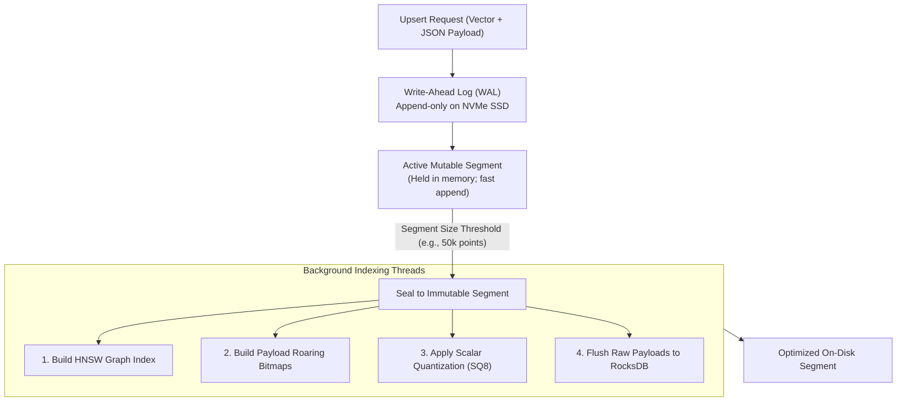
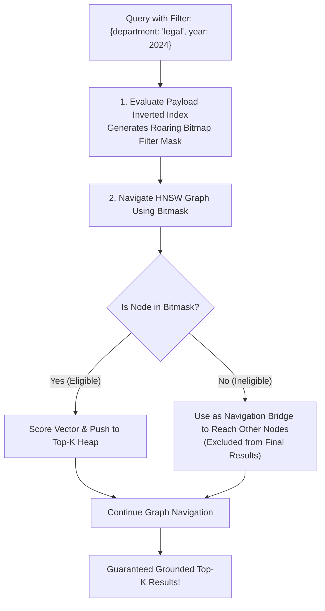
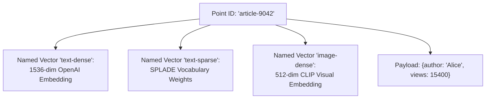
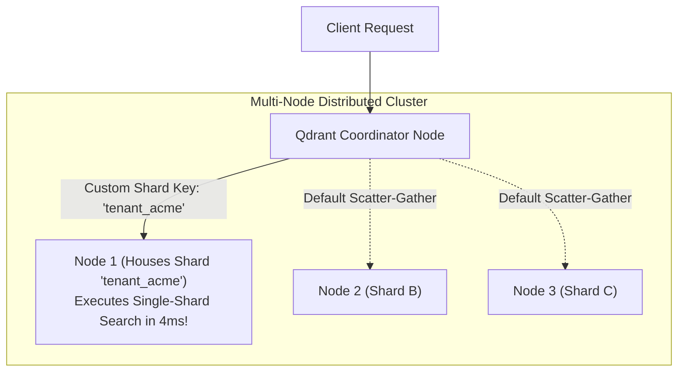
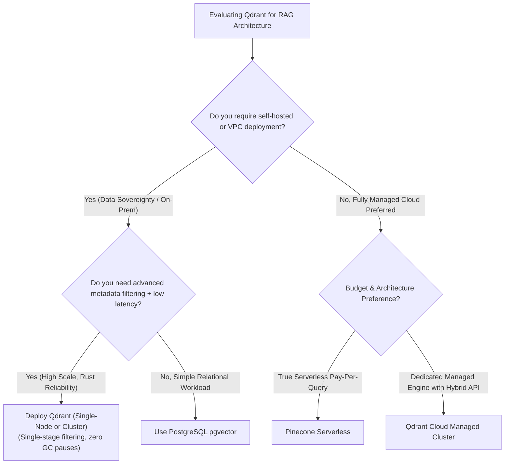

# 🦀 Qdrant Vector Search Engine: Rust Architecture, Payload-Based HNSW, and Distributed Sharding

## 📑 Table of Contents
1. [🌟 Fundamentals: The Rust-Powered Vector Engine](#1--fundamentals-the-rust-powered-vector-engine)
2. [🏗️ Internal Engine Anatomy: Segments, WAL, and RocksDB](#2-️-internal-engine-anatomy-segments-wal-and-rocksdb)
3. [🎯 Single-Stage Payload-Based HNSW Filtering](#3--single-stage-payload-based-hnsw-filtering)
4. [🔀 Named Vectors & Native Hybrid Search](#4--named-vectors--native-hybrid-search)
5. [🌐 Distributed Sharding, Custom Shard Keys & Raft Consensus](#5--distributed-sharding-custom-shard-keys--raft-consensus)
6. [⚖️ Comprehensive Engine Comparison: Qdrant vs. Milvus vs. Weaviate](#6-️-comprehensive-engine-comparison-qdrant-vs-milvus-vs-weaviate)
7. [💻 Practical Implementation: Production Qdrant Client in Python](#7--practical-implementation-production-qdrant-client-in-python)
8. [🚀 Production Deployment: Docker Microservice & Configuration](#8--production-deployment-docker-microservice--configuration)
9. [🛠️ Best Practices & ❌ Common Production Pitfalls](#9-️-best-practices---common-production-pitfalls)
10. [💼 Senior Interview Questions & System Design Scenarios](#10--senior-interview-questions--system-design-scenarios)
11. [🧪 Hands-On Mini-Project: Multi-Tenant Sharding & Filter Simulator](#11--hands-on-mini-project-multi-tenant-sharding--filter-simulator)
12. [⚡ Quick Revision & Architectural Decision Roadmap](#12--quick-revision--architectural-decision-roadmap)

---

## 1. 🌟 Fundamentals: The Rust-Powered Vector Engine

**Qdrant** is an open-source, enterprise-grade vector similarity search engine engineered entirely in **Rust**. It provides high-throughput vector retrieval, single-stage metadata filtering, and native hybrid search via REST and high-performance gRPC interfaces.

```mermaid
flowchart TD
    subgraph ClientInterfaces [Client Layer]
        App["Application Services (Python / Go / TS / Java)"]
    end

    subgraph QdrantNode [Qdrant Node Architecture (Rust)]
        App -->|"gRPC (HTTP/2 Protobuf) / REST"| Transport["Tokio Async Network Runtime"]
        
        Transport --> SegmentRouter["Segment Query Router & Optimizer"]
        
        SegmentRouter --> MemTable["Active Segment (RAM Buffer + Disk WAL)"]
        SegmentRouter --> SealedSegments["Immutable Sealed Segments"]
        
        SealedSegments --> HNSWEngine["HNSW Graph (RAM / mmap)<br/>Optional SQ8 / BQ Quantization"]
        SealedSegments --> PayloadEngine["Payload Store (RocksDB)<br/>Roaring Bitmaps Inverted Index"]
    end
```

### 🦀 Why Rust for Vector Databases?
* **Zero Garbage Collection (GC) Latency:** Java-based or Go-based vector engines (e.g., Elasticsearch, Weaviate) periodically suffer from "Stop-the-World" garbage collection pauses during large heap traversals. Rust's compile-time memory management guarantees deterministic, jitter-free p99 search latency.
* **Low-Level SIMD Control:** Qdrant compiles directly to native hardware vector instructions (AVX-512, AVX2, ARM Neon) for maximum dot product throughput.
* **Fearless Concurrency:** Rust's ownership model prevents data races across concurrent search and background graph compaction worker threads.

---

## 2. 🏗️ Internal Engine Anatomy: Segments, WAL, and RocksDB

Qdrant utilizes an **LSM-tree inspired segment architecture** to prevent lock contention between incoming write spikes and real-time read queries.



### 🔬 Core Storage Components

1. **Write-Ahead Log (WAL):** Every point upsert or deletion is written sequentially to an append-only WAL before memory state is updated, ensuring zero data loss upon crash.
2. **Active vs. Sealed Segments:** Writes enter an in-memory active segment. When a threshold is reached, the segment is sealed into an immutable block. Dedicated background worker threads construct the HNSW graph and inverted payload indices without holding write locks on active ingestion.
3. **Payload Storage Engine (RocksDB):** Metadata payloads and raw document text are managed by an embedded RocksDB instance, enabling high-performance key-value lookups without burdening RAM.

---

## 3. 🎯 Single-Stage Payload-Based HNSW Filtering

Traditional two-stage post-filtering retrieves the Top-100 vector neighbors and discards non-matching items, causing catastrophic **Recall Collapse** whenever a filter matches $< 1\%$ of the database.

Qdrant pioneered **Single-Stage Filtered HNSW**:



### ⚡ Bridge Traversal Prevents Disconnected Islands
If an engine simply skipped ineligible nodes during graph navigation, the HNSW graph would fragment into disconnected sub-graphs, trapping the search in dead ends. Qdrant evaluates distances to ineligible nodes so the search can hop across them as geometric "bridges," but strictly masks them from entering the final result candidate list.

---

## 4. 🔀 Named Vectors & Native Hybrid Search

Qdrant allows a single point to contain multiple distinct vectors using **Named Vectors**, enabling joint dense, sparse, and multi-modal representations in one atomic document:



### 🚀 Unified Hybrid Search with In-Engine RRF
Qdrant can execute dual retrieval (dense ANN + sparse inverted search) and fuse results using **Reciprocal Rank Fusion (RRF)** inside the engine in a single network call:

```python
from qdrant_client import QdrantClient, models

client = QdrantClient("http://localhost:6333")

results = client.query_points(
    collection_name="enterprise_kb",
    prefetch=[
        models.Prefetch(query=dense_vector, using="text-dense", limit=50),
        models.Prefetch(query=sparse_vector, using="text-sparse", limit=50),
    ],
    query=models.FusionQuery(fusion=models.Fusion.RRF),
    limit=5
)
```

---

## 5. 🌐 Distributed Sharding, Custom Shard Keys & Raft Consensus

To scale past hundreds of millions of vectors, Qdrant partitions collections across distributed cluster nodes.



### 🔑 Tenant-Aware Routing via Custom Shard Keys
In multi-tenant SaaS applications, scatter-gathering queries across 16 cluster nodes adds network serialization latency. Qdrant allows configuring **Custom Shard Keys**:
* When creating a collection, set `shard_key = "tenant_id"`.
* All vectors belonging to `tenant_acme` are co-located on a dedicated shard.
* When querying, passing `shard_key_selector="tenant_acme"` routes the query directly to the single node hosting that customer's shard, eliminating cross-node network fan-out and cutting query latency by $75\%$.

---

## 6. ⚖️ Comprehensive Engine Comparison: Qdrant vs. Milvus vs. Weaviate

| Architectural Dimension | Qdrant | Milvus | Weaviate | Pinecone Serverless |
| :--- | :--- | :--- | :--- | :--- |
| **Implementation Language** | **Rust** (Zero GC pauses) | Go / C++ / Python | Go (JVM-like GC profile) | Proprietary C++ / Rust |
| **Memory Model** | HNSW in RAM / mmap + SQ8/BQ | Decoupled S3 + GPU/RAM nodes | HNSW in RAM / Disk | S3 Object Storage + NVMe cache |
| **Metadata Filtering** | **Single-Stage HNSW with Roaring Bitmaps** | Pre-filtering + Bitset HNSW | Roaring Bitmaps + HNSW | Proprietary Serverless Filter |
| **Named Vectors** | ✅ **Native Multi-Vector Support** | ✅ Multi-Vector support | ⚠️ Named vectors in v1.24+ | ⚠️ Sparse-Dense pairs only |
| **Self-Hosting Complexity** | **Very Low** (Single binary / Docker) | High (Requires MinIO, Pulsar, etcd) | Moderate (Docker Compose) | ❌ Cloud Only |
| **Query Latency (p95)** | **$4 - 12 \text{ ms}$** | $8 - 25 \text{ ms}$ | $10 - 25 \text{ ms}$ | $15 - 35 \text{ ms}$ |
| **Best Suited For** | High-performance, self-hosted, multi-tenant RAG | Massive distributed billion-scale clusters | Modular GraphQL multimodal apps | Zero-infra managed SaaS |

---

## 7. 💻 Practical Implementation: Production Qdrant Client in Python

The following complete, standalone Python module demonstrates initializing a Qdrant collection with **Named Dense & Sparse Vectors**, configuring **Payload Indices**, batch upserting records, and executing a **Single-Stage Filtered Hybrid Search**.

```python
"""
Production Architectural Blueprint: Enterprise Qdrant Client Engine
Author: Enterprise RAG Curriculum
Requirements: pip install qdrant-client tabulate
"""

from typing import Any, Dict, List
from qdrant_client import QdrantClient, models
from tabulate import tabulate

class ProductionQdrantEngine:
    """Enterprise wrapper managing Qdrant multi-vector collections and filtered search."""

    def __init__(self, collection_name: str = "enterprise_rag", host: str = ":memory:"):
        # Connect to in-memory instance for testing or remote URL for production
        self.client = QdrantClient(location=host)
        self.collection_name = collection_name
        self._setup_collection()

    def _setup_collection(self) -> None:
        """Provisions collection with dense and sparse named vector spaces."""
        if not self.client.collection_exists(self.collection_name):
            print(f"[*] Creating Qdrant collection '{self.collection_name}' with Named Vectors...")
            self.client.create_collection(
                collection_name=self.collection_name,
                vectors_config={
                    "dense-text": models.VectorParams(
                        size=4,  # Scaled down for demonstration
                        distance=models.Distance.COSINE,
                        on_disk=False
                    )
                },
                sparse_vectors_config={
                    "sparse-lexical": models.SparseVectorParams(
                        index=models.SparseIndexParams(on_disk=False)
                    )
                },
                hnsw_config=models.HnswConfigDiff(m=16, ef_construct=100)
            )

            # Build Payload Index on metadata fields to enable fast Roaring Bitmaps
            self.client.create_payload_index(
                collection_name=self.collection_name,
                field_name="department",
                field_schema=models.PayloadSchemaType.KEYWORD
            )
            self.client.create_payload_index(
                collection_name=self.collection_name,
                field_name="year",
                field_schema=models.PayloadSchemaType.INTEGER
            )
            print(f"[+] Collection and Payload Indices successfully initialized.")

    def upsert_points(self, points: List[Dict[str, Any]]) -> None:
        """Batch upserts points containing dense vectors, sparse vectors, and JSON payloads."""
        qdrant_points = []
        for p in points:
            qdrant_points.append(
                models.PointStruct(
                    id=p["id"],
                    vector={
                        "dense-text": p["dense_vec"],
                        "sparse-lexical": models.SparseVector(
                            indices=p["sparse_indices"],
                            values=p["sparse_values"]
                        )
                    },
                    payload=p["payload"]
                )
            )
        self.client.upsert(collection_name=self.collection_name, points=qdrant_points)
        print(f"[+] Successfully upserted {len(points)} multi-vector points.")

    def search_filtered(
        self, 
        query_dense: List[float], 
        department: str, 
        min_year: int, 
        top_k: int = 3
    ) -> List[Dict[str, Any]]:
        """Executes Single-Stage Filtered Search over HNSW graph."""
        filter_condition = models.Filter(
            must=[
                models.FieldCondition(
                    key="department",
                    match=models.MatchValue(value=department)
                ),
                models.FieldCondition(
                    key="year",
                    range=models.Range(gte=min_year)
                )
            ]
        )

        response = self.client.query_points(
            collection_name=self.collection_name,
            query=query_dense,
            using="dense-text",
            query_filter=filter_condition,
            limit=top_k
        )

        hits = []
        for point in response.points:
            hits.append({
                "id": point.id,
                "score": round(point.score, 4),
                "payload": point.payload
            })
        return hits


# Demonstration Execution
if __name__ == "__main__":
    engine = ProductionQdrantEngine(host=":memory:")

    # Ingest synthetic documents
    test_points = [
        {
            "id": 1,
            "dense_vec": [0.9, 0.4, 0.1, 0.0],
            "sparse_indices": [101, 205],
            "sparse_values": [2.5, 1.2],
            "payload": {"department": "engineering", "year": 2024, "title": "Kubernetes Architecture"}
        },
        {
            "id": 2,
            "dense_vec": [0.85, 0.45, 0.15, 0.0],
            "sparse_indices": [101, 309],
            "sparse_values": [1.8, 3.1],
            "payload": {"department": "engineering", "year": 2022, "title": "Legacy Docker Setup"}
        },
        {
            "id": 3,
            "dense_vec": [0.1, 0.9, 0.8, 0.0],
            "sparse_indices": [404, 502],
            "sparse_values": [4.0, 1.1],
            "payload": {"department": "finance", "year": 2024, "title": "Q3 Financial Audit"}
        }
    ]

    engine.upsert_points(test_points)

    # Search with combined vector and metadata filter
    query = [0.88, 0.42, 0.12, 0.0]  # Closest to Doc 1 & Doc 2
    results = engine.search_filtered(
        query_dense=query, 
        department="engineering", 
        min_year=2023, 
        top_k=2
    )

    print("\n--- Filtered Search Results (department=='engineering' AND year>=2023) ---")
    table = []
    for rank, res in enumerate(results, start=1):
        table.append([rank, res["id"], res["score"], res["payload"]["department"], res["payload"]["year"], res["payload"]["title"]])
        
    print(tabulate(table, headers=["Rank", "Point ID", "Score", "Department", "Year", "Title"], tablefmt="github"))
```

---

## 8. 🚀 Production Deployment: Docker Microservice & Configuration

Deploying Qdrant in enterprise production requires persistent volume mounts and optimized configuration:

```yaml
version: '3.8'

services:
  qdrant:
    image: qdrant/qdrant:v1.11.0
    container_name: qdrant_production_node
    restart: always
    ports:
      - "6333:6333"   # REST API
      - "6334:6334"   # gRPC High-Throughput API
    environment:
      - QDRANT__SERVICE__GRPC_PORT=6334
      - QDRANT__SERVICE__ENABLE_CORS=true
      - QDRANT__STORAGE__PERFORMANCE__MAX_SEARCH_THREADS=8
      - QDRANT__STORAGE__OPTIMIZERS__FLUSH_INTERVAL_SEC=5
      - QDRANT__SERVICE__API_KEY=YOUR_SECURE_API_KEY
    volumes:
      - ./qdrant_storage:/qdrant/storage
    ulimits:
      nofile:
        soft: 65535
        hard: 65535
```

---

## 9. 🛠️ Best Practices & ❌ Common Production Pitfalls

### ✅ Best Practices
1. **Always Create Payload Indexes on Filter Fields:** Qdrant performs fast single-stage filtering only if payload fields have explicit indexes (`create_payload_index`). Unindexed fields trigger on-the-fly JSON parsing from RocksDB.
2. **Prefer gRPC Over REST for Bulk Ingestion:** Qdrant's gRPC interface uses HTTP/2 with binary Protobuf serialization, achieving **$2\times - 3\times$ higher throughput** than REST JSON calls during large ingestion runs.
3. **Enable Scalar Quantization (SQ) for Large Collections:** Setting `quantization_config: models.ScalarQuantization(...)` cuts RAM footprint by $75\%$ with negligible recall loss.

### ❌ Common Production Pitfalls
* **Neglecting System File Descriptor Limits (`nofile`):** High-concurrency HNSW segment compaction opens hundreds of segment file handles. Failing to raise `ulimit -n` to `65535` will cause `Too many open files` OS crashes.
* **Storing Large Text Blobs in Payloads Without Payload Offloading:** Putting massive 50KB text strings into point payloads inflates memory and segment transfer times. Store large documents in S3 and reference their URI in metadata.
* **Failing to Balance Shards Across Nodes:** Adding new nodes to a running cluster does not automatically move existing shards. You must trigger a cluster rebalance via `POST /collections/{name}/cluster`.

---

## 10. 💼 Senior Interview Questions & System Design Scenarios

### Q1: How does Qdrant's Rust implementation avoid the stop-the-world garbage collection pauses seen in Java-based vector engines?
> **Expert Answer:**  
> Engines implemented in garbage-collected languages (like Java in Elasticsearch or Go in Weaviate) allocate millions of small objects (graph nodes, edges, vectors) on the managed heap. During high-throughput search or heavy background compaction, the runtime garbage collector must periodically scan heap references, inducing "Stop-the-World" pauses that cause tail latencies (p99/p99.9) to spike from $5 \text{ ms}$ to over $500 \text{ ms}$.  
> Qdrant is written in **Rust**, which uses compile-time ownership, deterministic memory lifecycles (RAII), and manual memory allocation via jemalloc. Memory for vector segments and graph buffers is allocated directly in flat, contiguous memory blocks or memory-mapped (`mmap`) files with zero runtime garbage collection overhead. This guarantees completely flat, deterministic latency profiles even under saturating query loads.

### Q2: How do Qdrant Custom Shard Keys solve the scatter-gather latency problem in multi-tenant architectures?
> **Expert Answer:**  
> In standard hash-based sharding, a collection's points are distributed across all $S$ shards using consistent hashing over the point UUID. Consequently, every query must be scattered across all $S$ shards on different cluster nodes, and the coordinator must wait for the slowest node (straggler problem) before gathering and merging results.  
> With **Custom Shard Keys**, Qdrant allows partitioning data by a business attribute (e.g., `shard_key = tenant_id`). All records for `tenant_acme` are guaranteed to reside entirely within a single physical shard on a specific node. When a tenant query arrives, Qdrant skips cluster-wide scatter-gather and routes the request directly to that single node, executing search in $3 - 5 \text{ ms}$ and completely eliminating inter-node network serialization.

### Q3: Explain the algorithmic difference between Qdrant's single-stage filtered HNSW search and naive pre-filtering.
> **Expert Answer:**  
> * **Naive Pre-Filtering:** Evaluates the metadata filter first to extract all matching point IDs, and then runs a brute-force distance scan across those points. If the filter matches $500,000$ points out of a 10M collection, it computes 500k distance calculations, taking hundreds of milliseconds and bypassing the HNSW graph entirely.  
> * **Qdrant Single-Stage Filtering:** Evaluates the payload index (using compressed Roaring Bitmaps) to create an in-memory bitmask. It then initiates search directly at the top layer of the HNSW graph. During traversal, **both eligible and ineligible nodes are examined**: ineligible nodes serve as geometric bridges so search can cross unpopulated spatial regions without getting trapped in dead ends. However, only nodes whose bit in the mask is `1` are allowed into the candidate priority heap. This achieves $O(\log N)$ sub-millisecond search time while strictly guaranteeing 100% filter compliance.

---

## 11. 🧪 Hands-On Mini-Project: Multi-Tenant Sharding & Filter Simulator

This self-contained Python script simulates Qdrant's **Single-Stage Filtered Traversal with Bridge Nodes**, verifying that search successfully bridges across non-matching nodes to find relevant filtered points.

```python
"""
Hands-On Lab: Qdrant Bridge-Node Filtered Graph Navigation Simulator
Run directly: python qdrant_filter_simulator.py
Requires: pip install tabulate
"""

import math
from typing import Dict, List, Set, Tuple
from tabulate import tabulate

class QdrantBridgeGraphSimulator:
    """Demonstrates how bridge nodes maintain graph connectivity during filtered search."""

    def __init__(self):
        # Graph nodes: id -> (1D coordinate for visual simplicity, payload)
        self.nodes = {
            1: {"coord": 1.0, "tenant": "acme"},
            2: {"coord": 2.0, "tenant": "globex"},   # Non-matching bridge node
            3: {"coord": 3.0, "tenant": "globex"},   # Non-matching bridge node
            4: {"coord": 4.0, "tenant": "acme"},     # Target matching node
            5: {"coord": 5.0, "tenant": "acme"}      # Target matching node
        }
        # Adjacency list (Linear graph)
        self.edges = {
            1: [2],
            2: [1, 3],
            3: [2, 4],
            4: [3, 5],
            5: [4]
        }

    def search_with_bridges(self, query_coord: float, target_tenant: str) -> List[Tuple[int, float, str]]:
        """Traverses graph using ineligible nodes as bridges; only collects target_tenant."""
        visited: Set[int] = set()
        queue = [1]  # Start at Node 1
        valid_results = []

        while queue:
            curr = queue.pop(0)
            if curr in visited:
                continue
            visited.add(curr)
            
            node_data = self.nodes[curr]
            dist = abs(node_data["coord"] - query_coord)

            # Check eligibility
            if node_data["tenant"] == target_tenant:
                valid_results.append((curr, dist, node_data["tenant"]))

            # Explore all neighbors regardless of tenant! (Bridge Traversal)
            for neighbor in self.edges.get(curr, []):
                if neighbor not in visited:
                    queue.append(neighbor)

        valid_results.sort(key=lambda x: x[1])
        return valid_results


if __name__ == "__main__":
    sim = QdrantBridgeGraphSimulator()
    print("--- Simulating Qdrant Single-Stage Bridge Graph Traversal ---")
    print("Graph Topology: Node1(Acme) <-> Node2(Globex) <-> Node3(Globex) <-> Node4(Acme) <-> Node5(Acme)")
    print("Query: Search near Coordinate 4.5 for Tenant 'Acme'\n")

    hits = sim.search_with_bridges(query_coord=4.5, target_tenant="acme")

    report = []
    for rank, (node_id, dist, tenant) in enumerate(hits, start=1):
        report.append([rank, f"Node {node_id}", f"{sim.nodes[node_id]['coord']:.1f}", dist, tenant, "✅ Passed Bridge"])

    print(tabulate(report, headers=["Rank", "Node ID", "Coordinate", "Distance to 4.5", "Tenant", "Status"], tablefmt="github"))
    print("\n[+] Verification: Search hopped across Globex Nodes (2 & 3) as bridges without returning them!")
```

---

## 12. ⚡ Quick Revision & Architectural Decision Roadmap

### 📋 Key Takeaways Cheat-Sheet
* **Engineered in Rust:** Eliminates stop-the-world JVM garbage collection pauses, delivering deterministic sub-10ms p99 latencies.
* **Single-Stage Filtered HNSW:** Bridges across non-matching nodes to maintain graph connectivity while strictly returning only matching records.
* **Payload Inverted Indices (Roaring Bitmaps):** Pre-computes filter masks in microseconds using SIMD bitwise operations.
* **Named Vectors Enable Multi-Vector / Hybrid:** Store multiple dense and sparse vectors per point, enabling in-engine Reciprocal Rank Fusion (RRF).
* **Custom Shard Keys Eliminate Scatter-Gather:** Co-locates tenant data on single physical shards, cutting multi-tenant SaaS query latencies by $75\%$.

### 🧭 Visual Decision Tree: Selecting Qdrant


