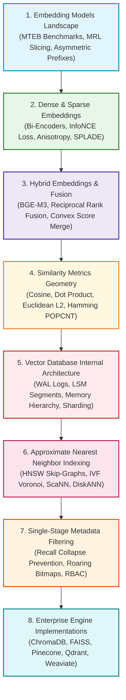
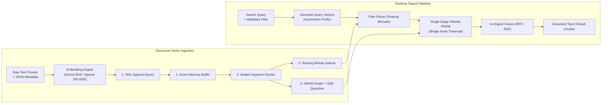

# 🗄️ Module 03: Embeddings and Vector Databases Curriculum Navigator

Welcome to **Module 03: Embeddings and Vector Databases** of the enterprise RAG Engineering curriculum. This module covers the representation learning, geometric metric spaces, approximate nearest neighbor (ANN) indexing algorithms, and vector database storage engines that power modern Retrieval-Augmented Generation.

Downstream neural rerankers and generative LLMs cannot synthesize answers from knowledge that was never retrieved or that was corrupted during spatial vector encoding. In this module, you will master the mathematical and systems engineering principles required to select embedding models, navigate high-dimensional latent spaces, design hybrid search engines combining dense semantics with sparse lexical precision, and architect enterprise vector databases capable of serving millions of queries across billions of documents.

---

## 📑 Module Curriculum & Guide Index

| Document | Focus Area | Key Concepts Covered |
| :--- | :--- | :--- |
| [**Embedding Models Landscape**](Embedding-Models.md) | **Model Evaluation & Selection** | MTEB retrieval benchmarks ($\text{NDCG}@10$), commercial vs. open-weight models (OpenAI, Voyage, Cohere, BGE, E5), Matryoshka Representation Learning (MRL), asymmetric task prefixes, and attention dilution. |
| [**Dense Vector Embeddings**](Dense-Embeddings.md) | **Latent Space Topology** | Bi-encoder architecture, masked mean pooling, unit hypersphere normalization, contrastive learning (InfoNCE loss), negative mining, representation degeneration (the Anisotropy problem), and vector quantization. |
| [**Sparse Embeddings & SPLADE**](Sparse-Embeddings.md) | **Learned Lexical Sparsity** | High-dimensional vocabulary spaces ($\mathbb{R}^{|\mathcal{V}|}$), BM25 term weighting, neural term expansion via SPLADE MLM heads, log-saturation activation, FLOPs sparsity loss, and WAND dynamic pruning. |
| [**Hybrid Embeddings & Fusion**](Hybrid-Embeddings.md) | **Dual-Channel Retrieval** | Complementary duality principle, BGE-M3 multi-task architecture, linear convex combination, Reciprocal Rank Fusion (RRF), native in-engine hybrid architectures, and two-stage cross-encoder reranking. |
| [**Similarity Metrics Deep Dive**](Similarity-Metrics.md) | **Metric Space Geometry** | Formal metric axioms, Cosine Similarity, Inner Product (MIPS), Euclidean ($L_2$) distance, unit hypersphere rank invariance identity, and 1-bit Hamming distance via CPU `POPCNT` instructions. |
| [**Vector Database Concepts**](Vector-Database-Concepts.md) | **Internal Engine Anatomy** | Curse of dimensionality, Write-Ahead Log (WAL) durability, LSM-inspired immutable segment compaction, HNSW RAM vs. disk storage engines, distributed sharding, and Raft consensus replication. |
| [**ANN Indexing Algorithms**](Indexing.md) | **Sublinear Graph Traversal** | Hierarchical Navigable Small World (HNSW) graphs, IVF Voronoi tessellations, Google ScaNN anisotropic quantization, Microsoft DiskANN Vamana graphs on NVMe SSDs, and Scalar/Product Quantization (SQ8/PQ). |
| [**Metadata Filtering**](Metadata-Filtering.md) | **Faceted Vector Retrieval** | The Post-Filtering Recall Collapse failure, single-stage filtered HNSW with bridge node traversal, filter selectivity ($\sigma$), Roaring Bitmap SIMD intersections, and multi-tenant RBAC enforcement. |
| [**ChromaDB Deep Dive**](ChromaDB/README.md) | **Embedded Local RAG** | Developer-friendly embedded vector storage, SQLite metadata store + `hnswlib` C++ engine, persistent collections, CRUD operations, where clause filtering, and Docker microservice deployment. |
| [**Meta FAISS Deep Dive**](FAISS/README.md) | **GPU Acceleration & Algorithms** | Algorithmic vector similarity library, `IndexFlat`, `IndexIVF`, `IndexHNSW`, `IndexIVFPQ`, multi-GPU sharding, Asymmetric Distance Computation (ADC), and the `IndexFactory` string DSL. |
| [**Pinecone Serverless**](Pinecone/README.md) | **Managed Cloud Architecture** | Decoupled query compute from S3 object storage, multi-tenant logical namespaces, native sparse-dense hybrid search, unit economics cost modeling (RUs/WUs), and enterprise GDPR purge workflows. |
| [**Qdrant Vector Engine**](Qdrant/README.md) | **Rust Performance & Payloads** | Rust memory safety without GC pauses, segment storage model, single-stage payload-based HNSW filtering, Named Vectors, custom tenant shard keys, and gRPC high-throughput API. |
| [**Weaviate Vector Database**](Weaviate/README.md) | **Schema-Driven Multi-Modal** | Go-based LSM storage engine, modern Python v4 gRPC SDK, modular ML pipeline (text2vec, generative RAG), multi-modal search (CLIP/ImageBind), and Relative Score Fusion (RSF). |

---

## 🗺️ Module Learning Roadmap



---

## 🎯 What You Will Master in This Module

1. **Embedding Model Selection & MTEB Metrics:** Evaluate models using $\text{NDCG}@10$ across the BEIR benchmark suite rather than marketing claims, and deploy Matryoshka Representation Learning (MRL) to cut storage and memory costs by up to $66\%$ with minimal recall loss.
2. **Latent Space Topology & Contrastive Dynamics:** Understand how InfoNCE loss acts as a geometric repulsive force to eliminate the Anisotropy Problem (representation collapse), and implement attention-masked mean pooling.
3. **Learned Lexical Sparsity with SPLADE:** Master high-dimensional sparse representations ($\mathbb{R}^{|\mathcal{V}|}$) that eliminate dense retrieval failures on exact alphanumeric serial numbers, SKU codes, and rare medical/legal entities while leveraging WAND dynamic pruning.
4. **Production Hybrid Fusion:** Architect dual-channel retrieval engines combining dense semantics and sparse keyword precision, utilizing parameter-free **Reciprocal Rank Fusion (RRF)** to prevent score scale distortions.
5. **Metric Space Hardware Optimization:** Exploit the unit hypersphere equivalence identity to replace expensive Cosine Similarity calculations with fast CPU AVX-512 Fused Multiply-Add (FMA) Dot Products, tripling query throughput.
6. **LSM Vector Storage Engines & WAL Durability:** Architect crash-resilient vector database systems using append-only Write-Ahead Logs (WAL) and immutable segment compaction.
7. **Sublinear Graph Traversal (HNSW, ScaNN, DiskANN):** Calibrate $M$, $efConstruction$, and $efSearch$ parameters on multi-layer HNSW graphs, apply ScaNN anisotropic quantization for MIPS, and deploy Microsoft DiskANN to search billion-scale datasets directly from NVMe SSDs.
8. **Single-Stage Filtered Traversal & RBAC:** Prevent catastrophic Post-Filtering Recall Collapse by implementing single-stage filtered HNSW with bridge node traversal and SIMD-accelerated Roaring Bitmaps.
9. **Engine Specialization & Selection:** Select, deploy, and tune the right vector database—from embedded local SQLite-backed ChromaDB and GPU-accelerated FAISS to cloud-native Pinecone Serverless, high-performance Rust-based Qdrant, and multi-modal Weaviate.

---

## 🏗️ The End-to-End Vector Storage & Retrieval Architecture



---

## ⚖️ Vector Database Master Selection Decision Matrix

| Engine | Primary Language | Deployment Model | Indexing Algorithms | Metadata Filtering Strategy | Quantization Support | Best Enterprise Use Case |
| :--- | :--- | :--- | :--- | :--- | :--- | :--- |
| **Qdrant** | **Rust** | Self-Hosted Docker / K8s / Cloud | HNSW, Inverted Sparse | **Single-Stage Filtered HNSW** (Roaring Bitmaps) | Scalar (SQ8) & Binary (BQ) | High-performance, self-hosted, multi-tenant enterprise RAG with zero GC pauses. |
| **Pinecone** | Proprietary C++ / Rust | Fully Managed Serverless Cloud | DiskANN-inspired Proprietary | Namespace-isolated + Serverless Bitmask | Proprietary Cloud Quantization | Zero-infrastructure operational model with pay-per-read/write billing and strict multi-tenant SaaS namespaces. |
| **Weaviate** | **Go** | Self-Hosted Docker / K8s / Cloud | HNSW, Flat, Dynamic | LSM Inverted Index + HNSW Filter | Product (PQ) & Binary (BQ) | All-in-one AI platform requiring in-database ML vectorizers, generative RAG, GraphQL, and multi-modal CLIP search. |
| **Meta FAISS** | **C++ / CUDA** | In-Process Library (CPU / GPU) | Flat, IVF, HNSW, PQ, SQ | External ID filtering (No native payloads) | Product (PQ), SQ8, OPQ | Ultra-high-throughput offline batch processing, GPU clustering, and custom embedded ML pipelines. |
| **ChromaDB** | **Python / C++** | Embedded In-Process / Docker | HNSW (`hnswlib`) | Pre-filtering via SQLite B-Trees | Manual external quantization | Rapid local prototyping, hackathons, desktop CLI apps, and datasets under 1M vectors. |
| **PostgreSQL (`pgvector`)** | **C** | Relational Extension in Postgres | HNSW, IVFFlat | Relational SQL `WHERE` clauses | Half-precision (`halfvec`) & binary | Applications with existing PostgreSQL infrastructure requiring strict relational ACID transactions. |
| **Milvus** | **Go / C++** | Distributed Cloud-Native (K8s) | HNSW, IVF, ScaNN, DiskANN | Bitset Pre-Filtering | SQ8, PQ, ScaNN | Massive, horizontally sharded billion-scale vector deployments on enterprise Kubernetes clusters. |

---

## 🛠️ Prerequisites & Environment Setup

All code implementations across Module 03 are tested on Python 3.10+ and require the following dependencies:

### 1. Install Core Vector Processing & Client Libraries
```bash
pip install numpy torch sentence-transformers openai voyageai cohere chromadb faiss-cpu qdrant-client weaviate-client pinecone-client tabulate
```

### 2. Optional: GPU Acceleration (Linux / Windows with CUDA)
For GPU-accelerated FAISS pipelines, replace `faiss-cpu` with:
```bash
pip install faiss-gpu
```

### 3. Quick Verification Script
Verify that your Python environment has access to vector computation and client libraries:
```python
import numpy as np
import faiss
import chromadb
import qdrant_client
import weaviate

print("✅ All Module 03 Vector Libraries Successfully Verified!")
```
