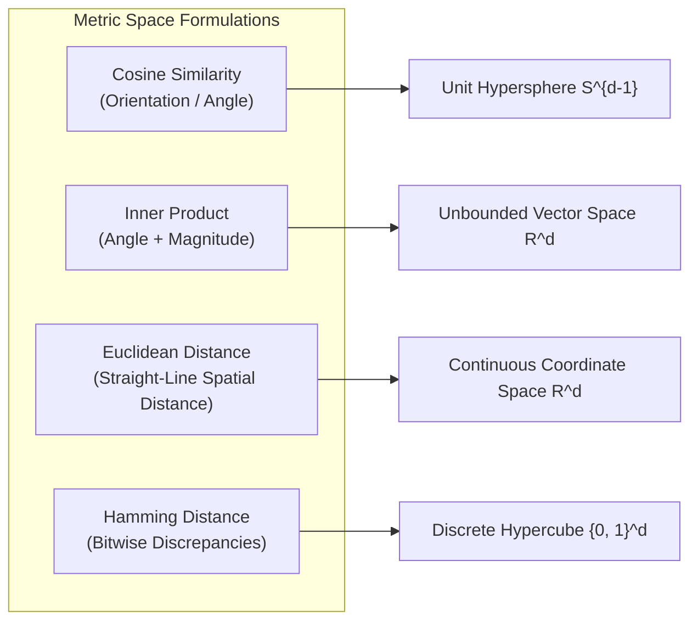
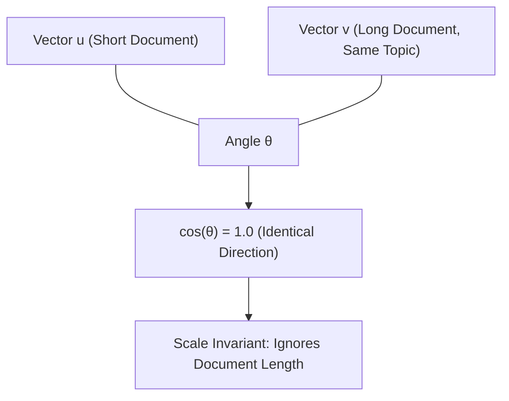
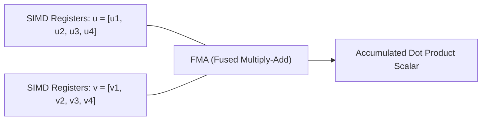
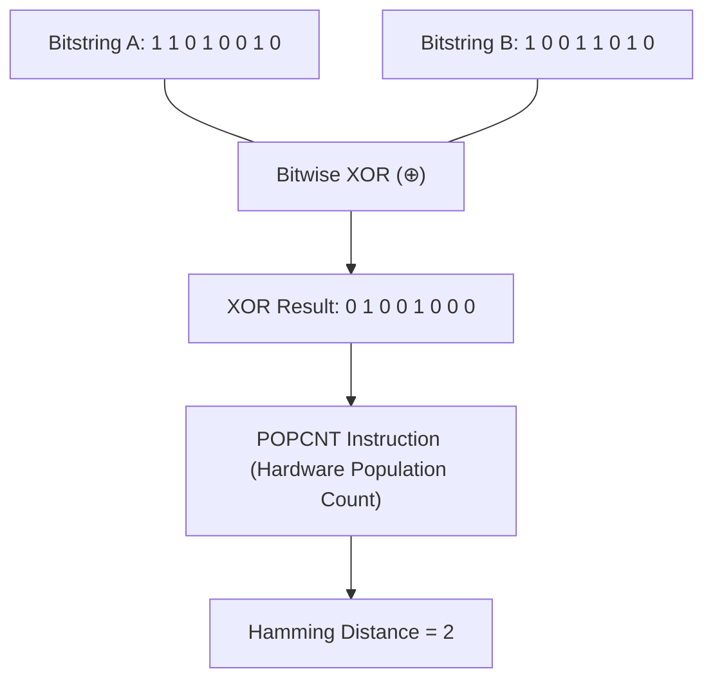
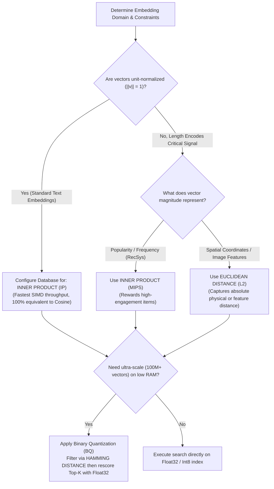

# 📐 Similarity Metrics Deep Dive: Cosine, Inner Product, L2 Distance, and Hamming Space

## 📑 Table of Contents
1. [🌟 Fundamentals: Geometric Metric Spaces & Distance Axioms](#1--fundamentals-geometric-metric-spaces--distance-axioms)
2. [📐 Cosine Similarity & Angular Distance](#2--cosine-similarity--angular-distance)
3. [⚡ Inner Product (Dot Product) & MIPS](#3--inner-product-dot-product--mips)
4. [📏 Euclidean Distance (L2) & Manhattan Distance (L1)](#4--euclidean-distance-l2--manhattan-distance-l1)
5. [🔲 Hamming Distance & Binary Quantization Space](#5--hamming-distance--binary-quantization-space)
6. [⚖️ Comprehensive Similarity Metric Comparison](#6-️-comprehensive-similarity-metric-comparison)
7. [💻 Practical Implementation: High-Performance Metric Benchmark](#7--practical-implementation-high-performance-metric-benchmark)
8. [🗄️ Vector Database Index Configuration Matrix](#8-️-vector-database-index-configuration-matrix)
9. [🛠️ Best Practices & ❌ Common Production Pitfalls](#9-️-best-practices---common-production-pitfalls)
10. [💼 Senior Interview Questions & System Design Scenarios](#10--senior-interview-questions--system-design-scenarios)
11. [🧪 Hands-On Mini-Project: Metric Rank Invariance & Latency Profiler](#11--hands-on-mini-project-metric-rank-invariance--latency-profiler)
12. [⚡ Quick Revision & Architectural Decision Roadmap](#12--quick-revision--architectural-decision-roadmap)

---

## 1. 🌟 Fundamentals: Geometric Metric Spaces & Distance Axioms

In vector databases and Retrieval-Augmented Generation (RAG), the **similarity metric** defines the topological structure of the latent space. It determines which documents are considered "neighbors" to a user query.

Mathematically, a distance function $D(\mathbf{u}, \mathbf{v})$ measures dissimilarity, whereas a similarity function $S(\mathbf{u}, \mathbf{v})$ measures proximity. 



### 🔬 The Four Formal Metric Space Axioms
For a distance function $D: \mathcal{X} \times \mathcal{X} \to \mathbb{R}$ to qualify as a formal **metric**, it must satisfy four strict mathematical conditions:

1. **Non-Negativity:** $D(\mathbf{u}, \mathbf{v}) \ge 0$
2. **Identity of Indiscernibles:** $D(\mathbf{u}, \mathbf{v}) = 0 \iff \mathbf{u} = \mathbf{v}$
3. **Symmetry:** $D(\mathbf{u}, \mathbf{v}) = D(\mathbf{v}, \mathbf{u})$
4. **Triangle Inequality:** $D(\mathbf{u}, \mathbf{w}) \le D(\mathbf{u}, \mathbf{v}) + D(\mathbf{v}, \mathbf{w})$

> [!IMPORTANT]
> **Cosine Similarity is NOT a true metric!** It violates the triangle inequality and identity of indiscernibles. However, its angular transformation—**Angular Distance**—is a mathematically valid metric.

---

## 2. 📐 Cosine Similarity & Angular Distance

Cosine similarity measures the **cosine of the angle $\theta$** between two non-zero vectors in an inner product space, disregarding their magnitude:

### # Cosine Similarity Formula
$$
S_{\text{Cosine}}(\mathbf{u}, \mathbf{v}) = \cos(\theta) = \frac{\mathbf{u} \cdot \mathbf{v}}{\|\mathbf{u}\|_2 \|\mathbf{v}\|_2} = \frac{\sum_{i=1}^d u_i v_i}{\sqrt{\sum_{i=1}^d u_i^2} \sqrt{\sum_{i=1}^d v_i^2}}
$$



### 🎯 Key Properties & Angular Metric Conversion
* **Range:** $[-1.0, 1.0]$. For dense text embeddings (e.g., OpenAI, BGE), values typically cluster within $[0.0, 1.0]$ due to ReLU/GELU activations in transformer feedforward layers.
* **Scale Invariance:** Multiplying vector $\mathbf{u}$ by scalar $\alpha > 0$ yields identical cosine similarity:
  $$S_{\text{Cosine}}(\alpha \mathbf{u}, \mathbf{v}) = S_{\text{Cosine}}(\mathbf{u}, \mathbf{v})$$
  This makes Cosine Similarity ideal when document chunks vary in length.
* **Angular Distance:** Converts cosine similarity into a strict metric satisfying the triangle inequality:

### # Angular Distance Formula
$$
D_{\text{Angular}}(\mathbf{u}, \mathbf{v}) = \frac{\arccos(S_{\text{Cosine}}(\mathbf{u}, \mathbf{v}))}{\pi} \in [0, 1]
$$

---

## 3. ⚡ Inner Product (Dot Product) & MIPS

The **Inner Product** (or Dot Product) computes the sum of the element-wise products of two vectors:

### # Inner Product (Dot Product) Formula
$$
S_{\text{IP}}(\mathbf{u}, \mathbf{v}) = \langle \mathbf{u}, \mathbf{v} \rangle = \sum_{i=1}^d u_i v_i = \|\mathbf{u}\|_2 \|\mathbf{v}\|_2 \cos(\theta)
$$



### 🏎️ Hardware Acceleration & MIPS
* **Range:** $(-\infty, +\infty)$.
* **Computational Efficiency:** Dot product requires zero square roots or floating-point divisions. It executes directly via CPU **Fused Multiply-Add (FMA)** instructions in AVX-512, AVX2, or ARM NEON, achieving the highest possible FLOP throughput.
* **Maximum Inner Product Search (MIPS):** Widely used in recommendation systems where vector magnitude encodes item popularity or user engagement level.

---

## 4. 📏 Euclidean Distance (L2) & Manhattan Distance (L1)

### Euclidean Distance ($L_2$ Norm)
Euclidean distance calculates the straight-line geometric distance between two points in Cartesian space:

### # Euclidean Distance Formula
$$
D_{L_2}(\mathbf{u}, \mathbf{v}) = \|\mathbf{u} - \mathbf{v}\|_2 = \sqrt{\sum_{i=1}^d (u_i - v_i)^2}
$$

### 🌟 The Unit Hypersphere Equivalence Identity
When vectors are **unit-normalized** ($\|\mathbf{u}\|_2 = \|\mathbf{v}\|_2 = 1.0$), Euclidean Distance and Cosine Similarity become strictly monotonically equivalent:

### # Euclidean to Cosine Identity Formula
$$
\|\mathbf{u} - \mathbf{v}\|_2^2 = \|\mathbf{u}\|_2^2 + \|\mathbf{v}\|_2^2 - 2(\mathbf{u} \cdot \mathbf{v}) = 1 + 1 - 2\cos(\theta) = 2 - 2 S_{\text{Cosine}}(\mathbf{u}, \mathbf{v})
$$

Taking the square root:

### # Monotonic Metric Relation on S^{d-1}
$$
D_{L_2}(\mathbf{u}, \mathbf{v}) = \sqrt{2 - 2 S_{\text{Cosine}}(\mathbf{u}, \mathbf{v})}
$$

> [!TIP]
> **Architectural Takeaway:** On unit-normalized vectors:
> $$\arg\min_{\mathbf{v}} D_{L_2}(\mathbf{u}, \mathbf{v}) \equiv \arg\max_{\mathbf{v}} S_{\text{Cosine}}(\mathbf{u}, \mathbf{v}) \equiv \arg\max_{\mathbf{v}} S_{\text{IP}}(\mathbf{u}, \mathbf{v})$$
> All three metrics produce the **exact same ranking order**!

---

## 5. 🔲 Hamming Distance & Binary Quantization Space

In high-throughput systems processing billions of embeddings, floating-point vectors are quantized into binary representations via **Binary Quantization (BQ)**:

### # 1-Bit Sign Quantization
$$
b_i = \begin{cases} 1 & \text{if } v_i > 0 \\ 0 & \text{if } v_i \le 0 \end{cases}
$$

In this binary space $\mathbb{H}^d = \{0, 1\}^d$, distance is measured using **Hamming Distance**—the count of bitwise coordinate positions where the two bitstrings differ:

### # Hamming Distance Formula
$$
D_{\text{Hamming}}(\mathbf{a}, \mathbf{b}) = \sum_{i=1}^d (\mathbf{a}_i \oplus \mathbf{b}_i) = \text{POPCNT}(\mathbf{a} \oplus \mathbf{b})
$$



### ⚡ Hardware Performance
Hamming distance does not use the floating-point unit (FPU). Instead, it runs on standard integer ALUs using dedicated x86 `POPCNT` or ARM `VCNT` hardware instructions. A single modern CPU core can evaluate over **1 billion Hamming comparisons per second**, accelerating candidate pre-filtering by $30 - 50\times$.

---

## 6. ⚖️ Comprehensive Similarity Metric Comparison

| Metric / Space | Mathematical Formula | Output Range | Satisfies Metric Axioms? | Scale Invariant? | Hardware Acceleration | Primary Enterprise Use Case |
| :--- | :--- | :---: | :---: | :---: | :--- | :--- |
| **Cosine Similarity** | $\frac{\mathbf{u} \cdot \mathbf{v}}{\|\mathbf{u}\|_2 \|\mathbf{v}\|_2}$ | $[-1.0, 1.0]$ | ❌ No (Triangle Ineq. fails) | ✅ Yes | Moderate (sqrt + div) | Natural language text & semantic document retrieval |
| **Inner Product (IP)**| $\sum_{i=1}^d u_i v_i$ | $(-\infty, +\infty)$ | ❌ No (Identity fails) | ❌ No | **Fastest (AVX-512 FMA)** | Normalized text embeddings & recommender MIPS |
| **Euclidean ($L_2$)** | $\sqrt{\sum_{i=1}^d (u_i - v_i)^2}$ | $[0.0, +\infty)$ | ✅ Yes (Full Metric) | ❌ No | Fast (SIMD vector sub + mul) | Computer vision, audio, clustering, & k-means |
| **Manhattan ($L_1$)** | $\sum_{i=1}^d \|u_i - v_i\|$ | $[0.0, +\infty)$ | ✅ Yes (Full Metric) | ❌ No | Fast (SIMD abs diff) | High-dimensional sparse spaces & anomaly detection |
| **Hamming ($L_0$)** | $\text{POPCNT}(\mathbf{a} \oplus \mathbf{b})$ | $[0, d]$ (integer) | ✅ Yes (Discrete Metric) | ❌ No | **Ultra-Fast (Hardware ALU)** | 1-bit binary quantized embeddings & fast pre-ranking |

---

## 7. 💻 Practical Implementation: High-Performance Metric Benchmark

The following production Python module implements and benchmarks Cosine Similarity, Dot Product, Euclidean Distance, and Hamming Distance using vectorized NumPy routines.

```python
"""
Production Distance Metric Engine & Performance Profiler
Author: Enterprise RAG Curriculum
Requirements: pip install numpy tabulate
"""

import time
from typing import Dict, List, Tuple
import numpy as np
import numpy.typing as npt
from tabulate import tabulate

class VectorMetricEngine:
    """High-performance vectorized similarity and distance computation engine."""

    @staticmethod
    def unit_normalize(vectors: npt.NDArray[np.float32]) -> npt.NDArray[np.float32]:
        """Projects continuous vectors onto the unit hypersphere S^{d-1}."""
        norms = np.linalg.norm(vectors, axis=1, keepdims=True)
        return vectors / np.maximum(norms, 1e-12)

    @staticmethod
    def cosine_similarity_matrix(queries: npt.NDArray[np.float32], corpus: npt.NDArray[np.float32]) -> npt.NDArray[np.float32]:
        """Calculates cosine similarity with explicit on-the-fly norm normalization."""
        q_norm = queries / np.maximum(np.linalg.norm(queries, axis=1, keepdims=True), 1e-12)
        c_norm = corpus / np.maximum(np.linalg.norm(corpus, axis=1, keepdims=True), 1e-12)
        return np.dot(q_norm, c_norm.T)

    @staticmethod
    def dot_product_matrix(queries: npt.NDArray[np.float32], corpus: npt.NDArray[np.float32]) -> npt.NDArray[np.float32]:
        """Computes pure inner product (Fastest SIMD path for pre-normalized vectors)."""
        return np.dot(queries, corpus.T)

    @staticmethod
    def euclidean_distance_matrix(queries: npt.NDArray[np.float32], corpus: npt.NDArray[np.float32]) -> npt.NDArray[np.float32]:
        """Vectorized L2 distance: ||q - c||^2 = ||q||^2 + ||c||^2 - 2(q . c)."""
        q_sq = np.sum(queries**2, axis=1, keepdims=True)
        c_sq = np.sum(corpus**2, axis=1, keepdims=True)
        # Numerical stability clamp to zero
        dist_sq = np.maximum(q_sq + c_sq.T - 2 * np.dot(queries, corpus.T), 0.0)
        return np.sqrt(dist_sq)

    @staticmethod
    def binary_quantize(vectors: npt.NDArray[np.float32]) -> npt.NDArray[np.uint8]:
        """Converts float vectors into packed 1-bit binary arrays."""
        # 1 if positive else 0, packed into 8-bit uint8 bytes
        bits = vectors > 0
        return np.packbits(bits, axis=1)

    @staticmethod
    def hamming_distance_matrix(queries_bin: npt.NDArray[np.uint8], corpus_bin: npt.NDArray[np.uint8]) -> npt.NDArray[np.int32]:
        """Calculates Hamming distance via bitwise XOR and population count."""
        # Broadcast XOR across query and corpus matrices
        xor_result = np.bitwise_xor(queries_bin[:, np.newaxis, :], corpus_bin[np.newaxis, :, :])
        # Vectorized bit-count lookups
        bit_counts = np.unpackbits(xor_result, axis=-1).sum(axis=-1)
        return bit_counts


# Benchmarking Execution
if __name__ == "__main__":
    np.random.seed(42)
    n_corpus = 10000
    n_queries = 100
    dim = 768

    print(f"Generating {n_corpus} corpus vectors and {n_queries} queries (dim={dim})...")
    raw_corpus = np.random.randn(n_corpus, dim).astype(np.float32)
    raw_queries = np.random.randn(n_queries, dim).astype(np.float32)

    # Normalize vectors for fair inner-product equivalence testing
    engine = VectorMetricEngine()
    norm_corpus = engine.unit_normalize(raw_corpus)
    norm_queries = engine.unit_normalize(raw_queries)

    bin_corpus = engine.binary_quantize(norm_corpus)
    bin_queries = engine.binary_quantize(norm_queries)

    benchmarks = []

    # 1. Dot Product (Pre-normalized)
    t0 = time.perf_counter()
    _ = engine.dot_product_matrix(norm_queries, norm_corpus)
    t_dot = (time.perf_counter() - t0) * 1000

    # 2. Raw Cosine Similarity (with dynamic norm computation)
    t0 = time.perf_counter()
    _ = engine.cosine_similarity_matrix(raw_queries, raw_corpus)
    t_cos = (time.perf_counter() - t0) * 1000

    # 3. Euclidean L2 Distance
    t0 = time.perf_counter()
    _ = engine.euclidean_distance_matrix(norm_queries, norm_corpus)
    t_l2 = (time.perf_counter() - t0) * 1000

    # 4. Hamming Distance (Binary Quantized)
    t0 = time.perf_counter()
    _ = engine.hamming_distance_matrix(bin_queries, bin_corpus)
    t_ham = (time.perf_counter() - t0) * 1000

    benchmarks.append(["Dot Product (Pre-Normalized)", f"{t_dot:.2f} ms", "1.00x (Baseline)", "Float32 FMA"])
    benchmarks.append(["Cosine Similarity (Dynamic Norm)", f"{t_cos:.2f} ms", f"{t_cos/t_dot:.2f}x Slower", "Float32 Sqrt/Div"])
    benchmarks.append(["Euclidean Distance (L2)", f"{t_l2:.2f} ms", f"{t_l2/t_dot:.2f}x Slower", "Float32 Sqrt"])
    benchmarks.append(["Hamming Distance (Binary)", f"{t_ham:.2f} ms", "Hardware Dependent", "Bitwise XOR / Popcnt"])

    print("\n" + tabulate(benchmarks, headers=["Metric Strategy", "Total Latency (100x10k)", "Relative Speed", "Hardware Engine"], tablefmt="github"))
```

---

## 8. 🗄️ Vector Database Index Configuration Matrix

| Vector Database | Cosine Configuration | Dot Product Configuration | Euclidean (L2) Configuration | Recommendation for Text RAG |
| :--- | :--- | :--- | :--- | :--- |
| **Qdrant** | `Distance::Cosine` | `Distance::Dot` | `Distance::Euclid` | **`Distance::Dot`** (Pre-normalize vectors upon insert) |
| **Pinecone** | `metric="cosine"` | `metric="dotproduct"` | `metric="euclidean"` | **`metric="dotproduct"`** (Pre-normalize for lower latency) |
| **Weaviate** | `distanceMetric: "cosine"` | `distanceMetric: "dot"` | `distanceMetric: "l2-squared"` | **`"dot"`** |
| **FAISS** | `IndexFlatIP` (after `normalize_L2`) | `IndexFlatIP` | `IndexFlatL2` | **`IndexFlatIP`** with pre-normalized vectors |
| **Milvus** | `metric_type: "COSINE"` | `metric_type: "IP"` | `metric_type: "L2"` | **`"IP"`** |
| **pgvector** | `<=>` (cosine distance) | `<#>` (negative inner product) | `<->` (L2 distance) | **`<#>`** with normalized vectors |

---

## 9. 🛠️ Best Practices & ❌ Common Production Pitfalls

### ✅ Best Practices
1. **The Golden Rule of Vector DBs:** Always unit-normalize embeddings at creation time ($\|\mathbf{v}\|_2 = 1.0$) and configure your database index for **Dot Product / Inner Product**. This guarantees identical ranking to Cosine Similarity while running up to $3\times$ faster on modern CPU/GPU hardware.
2. **Handle Negative Dot Products in Application Logic:** Remember that inner products of unit-normalized vectors range from $[-1.0, 1.0]$. If your downstream score fusion requires positive values, map scores via:
   $$S_{\text{scaled}} = \frac{S_{\text{IP}} + 1}{2}$$
3. **Use L2 Distance Squared in Custom Implementations:** When calculating nearest neighbors in Euclidean space, never compute the expensive `sqrt()` operation. Minimizing $\|\mathbf{u} - \mathbf{v}\|_2^2$ produces the exact same rank order as minimizing $\|\mathbf{u} - \mathbf{v}\|_2$.

### ❌ Common Production Pitfalls
* **Indexing Unnormalized Vectors with Dot Product:** Querying unnormalized vectors with Inner Product causes the longest documents (highest norms) to artificially dominate search results, regardless of topical relevance.
* **The "Cosine on Normalized Vectors" Waste:** Configuring a database for Cosine metric when vectors are already normalized forces the database to redundantly recalculate the vector norm ($\|\mathbf{v}\| = 1.0$) on every query comparison, burning CPU cycles.
* **Overlooking PostgreSQL pgvector Negative Dot Products:** In `pgvector`, the `<#>` operator returns the *negative* inner product (because PostgreSQL indexes minimize distances rather than maximize similarities). Forgetting to multiply by $-1$ results in reverse ranking!

---

## 10. 💼 Senior Interview Questions & System Design Scenarios

### Q1: Prove mathematically that for unit-normalized vectors, minimizing Euclidean Distance is identical to maximizing Inner Product.
> **Expert Answer:**  
> Let $\mathbf{u}, \mathbf{v} \in \mathbb{R}^d$ be two vectors constrained to the unit hypersphere such that $\|\mathbf{u}\|_2 = 1$ and $\|\mathbf{v}\|_2 = 1$.  
> The squared Euclidean distance is given by:
> $$D_{L_2}^2(\mathbf{u}, \mathbf{v}) = \|\mathbf{u} - \mathbf{v}\|_2^2 = \sum_{i=1}^d (u_i - v_i)^2 = \sum_{i=1}^d u_i^2 + \sum_{i=1}^d v_i^2 - 2 \sum_{i=1}^d u_i v_i$$
> Since $\|\mathbf{u}\|_2^2 = 1$ and $\|\mathbf{v}\|_2^2 = 1$, this simplifies to:
> $$D_{L_2}^2(\mathbf{u}, \mathbf{v}) = 1 + 1 - 2\langle \mathbf{u}, \mathbf{v} \rangle = 2 - 2\langle \mathbf{u}, \mathbf{v} \rangle$$
> Since $2$ is a constant and $-2$ is a negative monotonic scalar, minimizing $D_{L_2}^2(\mathbf{u}, \mathbf{v})$ is mathematically equivalent to maximizing $\langle \mathbf{u}, \mathbf{v} \rangle$. Because the square root function is strictly monotonic for non-negative numbers, minimizing Euclidean distance $D_{L_2}(\mathbf{u}, \mathbf{v})$ produces the identical nearest-neighbor ranking as maximizing Inner Product.

### Q2: Why does Cosine Similarity fail to satisfy the Triangle Inequality? Provide a geometric counterexample.
> **Expert Answer:**  
> The Triangle Inequality requires that $D(A, C) \le D(A, B) + D(B, C)$.  
> When converting Cosine Similarity to a distance via $D_{\text{cos}}(u, v) = 1 - \cos(\theta)$:
> Consider three 2D vectors in a plane:
> * Vector $A = (1, 0)$ (Angle $0^\circ$)
> * Vector $B = \left(\frac{\sqrt{3}}{2}, \frac{1}{2}\right)$ (Angle $30^\circ$)
> * Vector $C = (0, 1)$ (Angle $90^\circ$)
> 
> Calculating distances:
> * $D(A, B) = 1 - \cos(30^\circ) = 1 - \frac{\sqrt{3}}{2} \approx 0.134$
> * $D(B, C) = 1 - \cos(60^\circ) = 1 - 0.5 = 0.500$
> * $D(A, C) = 1 - \cos(90^\circ) = 1 - 0 = 1.000$
> 
> Checking the triangle inequality:
> $$D(A, C) \le D(A, B) + D(B, C) \implies 1.000 \le 0.134 + 0.500 = 0.634 \quad \text{(FALSE!)}$$
> Since $1.000 > 0.634$, the triangle inequality is violated. Consequently, tree-based indexing algorithms that rely on the triangle inequality (such as VP-Trees or Ball-Trees) cannot be used directly with cosine distance.

### Q3: How does Binary Quantization with Hamming Distance achieve a 32x memory reduction, and how is it used in multi-stage retrieval?
> **Expert Answer:**  
> A standard 32-bit floating-point vector of dimension $d = 1536$ requires $1536 \times 4 \text{ bytes} = 6,144 \text{ bytes}$.  
> Under Binary Quantization (1-bit BQ), each continuous float $v_i$ is mapped to a single bit: $1$ if $v_i > 0$, else $0$. The entire 1536-dimensional vector is packed into $1536 \text{ bits} / 8 = 192 \text{ bytes}$, achieving an exact **$32\times$ memory compression ratio**.  
> In multi-stage retrieval:
> 1. **Stage 1 (Binary Filter):** The entire billion-vector index resides in RAM as packed bitstrings. The query is binarized, and the system executes hardware-accelerated `POPCNT(q \oplus d)` over all candidates in sub-milliseconds, retrieving the Top-1000 candidates with minimal memory bandwidth pressure.
> 2. **Stage 2 (Full Rescore):** The system fetches the original uncompressed Float32 or Int8 vectors for only those Top-1000 candidates from NVMe SSD storage and computes exact Dot Products to establish the final Top-10 ranking, achieving $98\%$ of full-precision recall at $5\%$ of the RAM cost.

---

## 11. 🧪 Hands-On Mini-Project: Metric Rank Invariance & Latency Profiler

This self-contained Python script empirically proves that **Cosine Similarity, Dot Product, and Euclidean Distance produce 100% identical rankings** on unit-normalized vectors, and profiles query latency.

```python
"""
Hands-On Verification: Distance Metric Rank Invariance Profiler
Run directly: python metric_invariance.py
Requires: pip install numpy tabulate
"""

import time
import numpy as np
from tabulate import tabulate

def verify_rank_invariance(n_docs: int = 5000, dim: int = 512):
    # 1. Generate random synthetic documents and a query
    corpus = np.random.randn(n_docs, dim).astype(np.float32)
    query = np.random.randn(dim).astype(np.float32)

    # 2. Project onto the Unit Hypersphere S^{d-1}
    corpus_norm = corpus / np.linalg.norm(corpus, axis=1, keepdims=True)
    query_norm = query / np.linalg.norm(query)

    # 3. Compute Scores
    # Metric A: Dot Product (Higher is closer)
    t0 = time.perf_counter()
    scores_ip = np.dot(corpus_norm, query_norm)
    t_ip = (time.perf_counter() - t0) * 1000

    # Metric B: Cosine Similarity (Higher is closer)
    t0 = time.perf_counter()
    scores_cos = np.dot(corpus_norm, query_norm) / (np.linalg.norm(corpus_norm, axis=1) * np.linalg.norm(query_norm))
    t_cos = (time.perf_counter() - t0) * 1000

    # Metric C: Euclidean L2 Distance (Lower is closer)
    t0 = time.perf_counter()
    diffs = corpus_norm - query_norm
    dists_l2 = np.linalg.norm(diffs, axis=1)
    t_l2 = (time.perf_counter() - t0) * 1000

    # 4. Extract Top-10 Rankings
    rank_ip = np.argsort(-scores_ip)[:10]      # Descending
    rank_cos = np.argsort(-scores_cos)[:10]    # Descending
    rank_l2 = np.argsort(dists_l2)[:10]        # Ascending

    # 5. Check Identity of Rankings
    is_identical = np.array_equal(rank_ip, rank_cos) and np.array_equal(rank_ip, rank_l2)

    print("--- Metric Rank Invariance Test (On Unit-Normalized Vectors) ---")
    print(f"Ranking Identity Across All Three Metrics: {'✅ 100% IDENTICAL' if is_identical else '❌ DISCREPANCY DETECTED'}\n")

    table_data = []
    for rank in range(10):
        table_data.append([
            rank + 1,
            f"Doc {rank_ip[rank]} (IP: {scores_ip[rank_ip[rank]]:.4f})",
            f"Doc {rank_cos[rank]} (Cos: {scores_cos[rank_cos[rank]]:.4f})",
            f"Doc {rank_l2[rank]} (L2: {dists_l2[rank_l2[rank]]:.4f})"
        ])

    print(tabulate(table_data, headers=["Rank", "Inner Product", "Cosine Similarity", "Euclidean Distance"], tablefmt="github"))
    
    print("\n--- Latency Comparison (1 x 5,000 Comparisons) ---")
    print(f"Inner Product:      {t_ip:.3f} ms (Fastest SIMD FMA)")
    print(f"Cosine Similarity:  {t_cos:.3f} ms ({t_cos / t_ip:.2f}x slower due to redundant norm calls)")
    print(f"Euclidean Distance: {t_l2:.3f} ms ({t_l2 / t_ip:.2f}x slower due to vector subtractions)")

if __name__ == "__main__":
    np.random.seed(42)
    verify_rank_invariance()
```

---

## 12. ⚡ Quick Revision & Architectural Decision Roadmap

### 📋 Key Takeaways Cheat-Sheet
* **The Normalization Shortcut:** Unit normalize all vectors on ingestion. This guarantees that **Euclidean Distance, Cosine Similarity, and Inner Product produce the exact same rank order**.
* **Inner Product is the Speed Champion:** Always configure vector DBs for **Inner Product / Dot Product** over Cosine Similarity to bypass expensive square root and division instructions.
* **Cosine Ignores Scale; Inner Product Rewards Magnitude:** Cosine similarity compares orientation only. Unnormalized Inner Product amplifies high-magnitude vectors, making it ideal for recommendation engines.
* **Cosine Violates Metric Axioms:** Cosine distance is not a formal mathematical metric because it fails the triangle inequality; Angular Distance restores metric properties.
* **Hamming Space Enables Extreme Scale:** 1-bit Binary Quantization compresses vectors by $32\times$ and enables billions of comparisons per second using CPU `POPCNT` instructions.

### 🧭 Visual Decision Tree: Selecting Similarity Metrics


