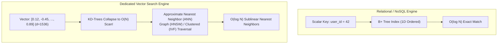
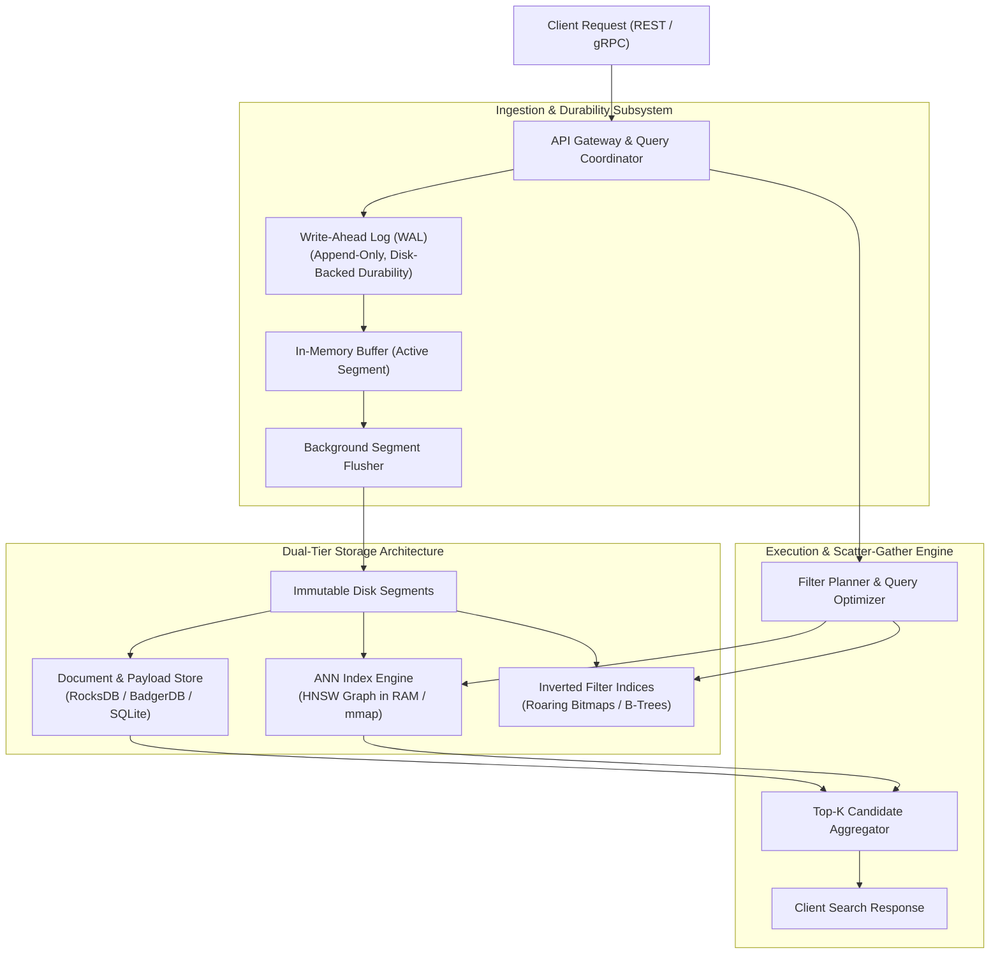
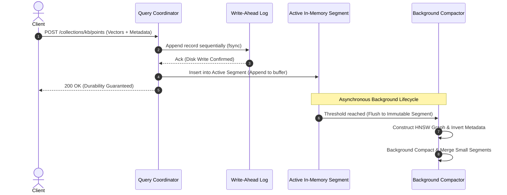
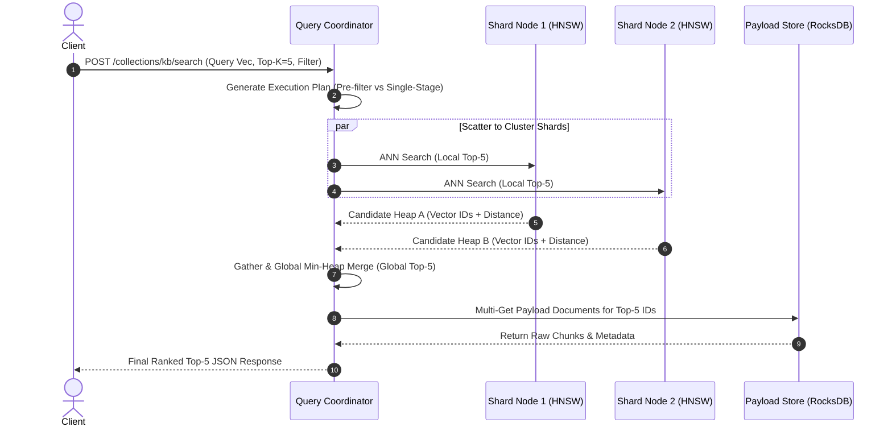
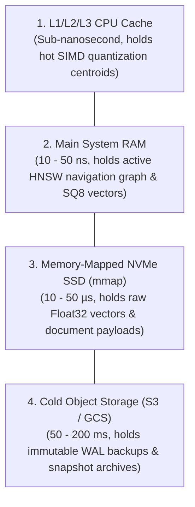
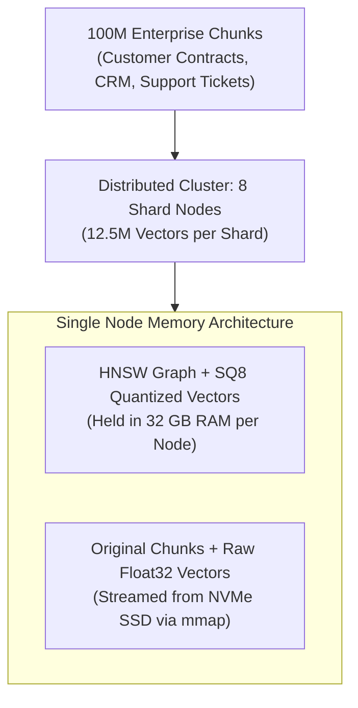
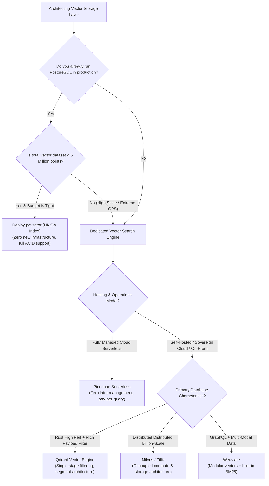

# 🏗️ Vector Database Architecture: Storage Engines, WAL, Inverted Lists, and Distributed Scaling

## 📑 Table of Contents
1. [🌟 Fundamentals: The Architectural Imperative of Vector Databases](#1--fundamentals-the-architectural-imperative-of-vector-databases)
2. [🧱 Core Subsystems of a Production Vector Database](#2-️-core-subsystems-of-a-production-vector-database)
3. [🔄 Lifecycle Execution Flows: The Write Path vs. Read Path](#3--lifecycle-execution-flows-the-write-path-vs-read-path)
4. [💾 Memory Hierarchy & Storage Engine Design](#4--memory-hierarchy--storage-engine-design)
5. [🌐 Distributed Scaling: Sharding, Replication & Raft Consensus](#5--distributed-scaling-sharding-replication--raft-consensus)
6. [⚖️ Architectural Decision Matrix: Dedicated Vector DBs vs. Extensions](#6-️-architectural-decision-matrix-dedicated-vector-dbs-vs-extensions)
7. [💻 Practical Implementation: WAL-Backed Vector Engine in Python](#7--practical-implementation-wal-backed-vector-engine-in-python)
8. [🌍 Real-World Enterprise Scaling Scenarios](#8--real-world-enterprise-scaling-scenarios)
9. [🛠️ Best Practices & ❌ Common Production Pitfalls](#9-️-best-practices---common-production-pitfalls)
10. [💼 Senior Interview Questions & System Design Scenarios](#10--senior-interview-questions--system-design-scenarios)
11. [🧪 Hands-On Mini-Project: Crash-Resilient Vector WAL & Recovery Simulator](#11--hands-on-mini-project-crash-resilient-vector-wal--recovery-simulator)
12. [⚡ Quick Revision & Architectural Decision Roadmap](#12--quick-revision--architectural-decision-roadmap)

---

## 1. 🌟 Fundamentals: The Architectural Imperative of Vector Databases

Traditional relational (RDBMS) and document databases organize data around one-dimensional orderings. Indices like B-Trees and B+ Trees sort records along scalar keys (e.g., timestamps, integers, strings), achieving exact $O(\log N)$ point lookups and range scans.

However, in high-dimensional vector spaces ($d \in [256, 1536]$), scalar sorting is impossible. Classical spatial indices (such as KD-Trees, R-Trees, and Quad-Trees) suffer from the **Curse of Dimensionality**: as dimensionality grows beyond $d \approx 10$, the volume of hyperspherical space expands exponentially. In high dimensions, the distance between any query and its nearest neighbor converges toward the distance to its farthest neighbor:

### # Curse of Dimensionality Distance Convergence
$$
\lim_{d \to \infty} \frac{D_{\max} - D_{\min}}{D_{\min}} \to 0
$$

Consequently, traditional tree partition boundaries fail, and search collapses into an exhaustive, CPU-saturating $O(N \cdot d)$ linear scan across the entire dataset.



**Vector Databases** resolve this fundamental geometric barrier by trading exactness for sublinear retrieval latency, utilizing **Approximate Nearest Neighbor (ANN)** graph structures, quantization compression, and specialized storage engines.

---

## 2. 🧱 Core Subsystems of a Production Vector Database

A production-grade vector database (such as Qdrant, Milvus, or Weaviate) is an engineered convergence of distributed systems, storage engines, and high-performance linear algebra kernels.



### 🏛️ The Five Core Subsystems

1. **Write-Ahead Log (WAL):** An append-only log persisted directly to disk via `fsync`. Every insert, update, and delete is recorded sequentially before in-memory structures are modified, guaranteeing ACID durability across power failures.
2. **Segment Storage Engine (LSM-Inspired):** Rather than mutating massive vector indices in place (which is computationally prohibitive for graph structures), data is partitioned into **immutable segments**. New records enter a mutable in-memory segment; when full, segments are sealed, flushed to disk, and periodically merged via background compaction.
3. **ANN Graph Engine:** Constructs high-dimensional navigation networks (e.g., Hierarchical Navigable Small World graphs). The graph is held in RAM or memory-mapped (`mmap`) storage for microsecond pointer traversal.
4. **Document & Payload Store:** An embedded key-value storage engine (commonly RocksDB or SQLite) that retains the raw document chunks, JSON metadata attributes, and cryptographic hashes.
5. **Inverted Payload Filter Indices:** Specialized secondary indices (e.g., Roaring Bitmaps or B-Trees) built over JSON metadata fields (e.g., `user_id`, `created_at`, `category`) to power fast pre-filtering.

---

## 3. 🔄 Lifecycle Execution Flows: The Write Path vs. Read Path

### 📥 The Write Path (Upsert Lifecycle)



1. **Validation & Batching:** The coordinator receives batches of vectors, validates dimensionality, and checks JSON payload schemas.
2. **WAL Serialization:** The payload and vector floats are written sequentially to the WAL. Once the operating system flushes the disk write, the transaction is durable.
3. **In-Memory Buffering:** Vectors enter an unindexed active segment, immediately visible to brute-force scans.
4. **Asynchronous Index Construction:** When the active segment reaches a threshold (e.g., 50,000 vectors), it is sealed into an immutable segment. A dedicated background thread pool constructs the ANN graph index without blocking concurrent queries.

---

### 📤 The Read Path (Search Lifecycle)



1. **Scatter-Gather Coordination:** The coordinator identifies which distributed shards house the target collection and scatters the search query across cluster nodes simultaneously.
2. **Graph Traversal & Filter Masking:** Each shard evaluates metadata constraints (using payload bitmasks) and navigates its local HNSW graph to find the nearest $K$ vector IDs.
3. **Global Merge:** Shard candidate heaps return to the coordinator, which executes a $K$-way min-heap merge.
4. **Hydration:** Raw text chunks and metadata payloads are fetched from the document store only for the final Top-$K$ items, minimizing network bandwidth and I/O.

---

## 4. 💾 Memory Hierarchy & Storage Engine Design

The dominant operational bottleneck in vector database deployment is **RAM consumption**. Unlike relational databases where the working set can be cached and the rest left on disk, graph traversal over unindexed disks induces random I/O thrashing that degrades search performance by $100\times$.

### 📊 The Vector Database Memory Equation

For an HNSW index, the required RAM footprint per vector is calculated as:

### # HNSW Memory Footprint Formula
$$
\text{RAM}_{\text{HNSW}} = N \cdot \left[ \underbrace{(d \cdot 4)}_{\text{Float32 Vector}} + \underbrace{(M \cdot 8)}_{\text{Graph Edges}} + \underbrace{16}_{\text{Node Overhead}} \right] \text{ bytes}
$$

Where:
* $N$ is total vector count.
* $d$ is vector dimensionality (e.g., $1536$).
* $M$ is the number of bidirectional connections per graph node (typically $16 - 64$).
* Each edge pointer consumes 8 bytes (64-bit address).



### 🗄️ Storage Optimization Architectures

1. **RAM-Only Deployment:** Entire HNSW graph, vectors, and payloads sit in memory. Delivers sub-5ms query latencies, but costs thousands of dollars per month for billion-scale collections.
2. **Hybrid mmap (Memory-Mapped) Architecture:** The HNSW graph pointers and Int8 quantized vectors reside in RAM, while raw Float32 vectors and payloads remain on NVMe disk via `mmap`. The OS kernel dynamically manages paging, reducing RAM costs by $70\%$.
3. **DiskANN (Graph on Solid-State Storage):** Stores the entire graph directly on NVMe SSDs, using asynchronous I/O (`io_uring`) and compressed posting lists to achieve 95% recall with minimal RAM footprint.

---

## 5. 🌐 Distributed Scaling: Sharding, Replication & Raft Consensus

To scale past hundreds of millions of vectors and support thousands of queries per second (QPS), vector databases partition data across a distributed cluster.

```mermaid
flowchart TD
    Client["Client Traffic"] --> LoadBalancer["Layer 7 Load Balancer"]
    
    subgraph ClusterRaft [Cluster Consensus & Metadata State]
        LeaderNode["Consensus Leader (Raft)"] <--> Follower1["Consensus Peer"]
        LeaderNode <--> Follower2["Consensus Peer"]
    end

    subgraph DataShards [Distributed Data Partitioning]
        subgraph ShardGroup1 [Shard 1 (Docs 0 - 5M)]
            S1_Primary["Primary Replica (Node A)"]
            S1_Replica["Read Replica (Node B)"]
        end

        subgraph ShardGroup2 [Shard 2 (Docs 5M - 10M)]
            S2_Primary["Primary Replica (Node C)"]
            S2_Replica["Read Replica (Node D)"]
        end
    end

    LoadBalancer --> S1_Primary & S1_Replica & S2_Primary & S2_Replica
```

### 🗂️ Distributed Partitioning Strategies

1. **Hash-Based Sharding:** Vectors are assigned to shards via consistent hashing over their UUID:
   $$\text{Shard ID} = \text{MurmurHash3}(\text{ID}) \pmod{\text{Total Shards}}$$
   Balances write traffic and memory footprint evenly across all nodes, but every query must scatter-gather across all shards.
2. **Tenant-Based Routing (Namespace Partitioning):** All vectors for a specific enterprise client or organization are co-located within a dedicated shard:
   $$\text{Shard ID} = \text{CRC32}(\text{tenant\_id}) \pmod{\text{Tenant Shards}}$$
   Enables isolated, single-shard search execution, reducing query fan-out network traffic by $90\%$.

### 🔄 Consensus & Replication (Raft Engine)
Vector databases (e.g., Qdrant, Milvus) utilize the **Raft Consensus Protocol** to govern cluster topology, collection schemas, and WAL synchronization:
* **Primary Replicas:** Accept writes, serialize entries to their local WAL, and replicate log entries across follower replicas before returning confirmation.
* **Read Replicas:** Serve concurrent search requests horizontally, scaling QPS linearly with the number of provisioned replica nodes.

---

## 6. ⚖️ Architectural Decision Matrix: Dedicated Vector DBs vs. Extensions

| Architectural Dimension | Dedicated Vector DBs (Qdrant / Milvus / Pinecone) | Relational Extensions (PostgreSQL `pgvector`) | Search Engine Extensions (Elasticsearch / OpenSearch) | In-Memory Stores (Redis / Dragonfly) |
| :--- | :--- | :--- | :--- | :--- |
| **Primary Index Engine** | Native Rust/C++ HNSW, IVF, DiskANN | C-based HNSW & IVFFlat in Postgres engine | Lucene HNSW | In-memory HNSW / Flat |
| **Max Scale (Vectors)** | Billions (Distributed Multi-Node) | Tens of Millions (Single instance bound) | Hundreds of Millions | Millions (Constrained by RAM) |
| **Metadata Filtering** | **Single-Stage Pre-Filtering** with Bitmaps | Relational SQL `WHERE` + HNSW index scan | Lucene Inverted Index + HNSW Filter | In-memory tag indexes |
| **Transaction Semantics** | Eventual Consistency / Soft-commit | **Full ACID Transactions** | Near-Real-Time (NRT) Refresh | In-memory ACID (AOF durability) |
| **Operational Overhead** | Moderate (Additional cluster to manage) | **Zero** (Leverage existing Postgres DB) | High (JVM orchestration, Lucene tuning) | Low to Moderate |
| **Best Suited For** | High-scale, latency-critical RAG ($>5\text{M}$ vectors) | Early-stage MVPs, strict ACID requirements | Unified enterprise logging, text + vector search | Caching, session memory, real-time RecSys |

---

## 7. 💻 Practical Implementation: WAL-Backed Vector Engine in Python

The following complete, runnable Python module demonstrates the foundational primitives of an enterprise vector database: an append-only Write-Ahead Log (WAL), crash recovery replay, in-memory segment buffering, and metadata-filtered search.

```python
"""
Production Architectural Blueprint: Crash-Resilient WAL-Backed Vector Store
Author: Enterprise RAG Curriculum
Requirements: pip install numpy
"""

import json
import os
import struct
from typing import Any, Dict, List, Optional, Tuple
import numpy as np

class WALBackedVectorEngine:
    """Demonstrates WAL append logging, crash recovery, and segment search."""

    def __init__(self, wal_path: str, dimension: int):
        self.wal_path = wal_path
        self.dimension = dimension
        self.memory_vectors: Dict[int, np.ndarray] = {}
        self.payload_store: Dict[int, Dict[str, Any]] = {}
        
        # Open or recover from WAL
        self._recover_and_initialize()

    def _recover_and_initialize(self) -> None:
        """Replays WAL entries from disk to reconstruct memory state after crash."""
        if not os.path.exists(self.wal_path):
            self.wal_file = open(self.wal_path, "a+b")
            return

        print(f"[*] Recovering vector database state from WAL: {self.wal_path}...")
        self.wal_file = open(self.wal_path, "a+b")
        self.wal_file.seek(0)
        
        recovered_count = 0
        while True:
            # Read record header: Record_Length (4 bytes unsigned int)
            header = self.wal_file.read(4)
            if not header or len(header) < 4:
                break
            record_len = struct.unpack(">I", header)[0]
            record_bytes = self.wal_file.read(record_len)
            
            # Deserialize JSON transaction record
            entry = json.loads(record_bytes.decode("utf-8"))
            point_id = entry["id"]
            vector_data = np.array(entry["vector"], dtype=np.float32)
            payload = entry["payload"]
            
            # Populate in-memory state
            self.memory_vectors[point_id] = vector_data
            self.payload_store[point_id] = payload
            recovered_count += 1
            
        print(f"[+] Crash recovery complete. Replayed {recovered_count} point records.")

    def upsert(self, point_id: int, vector: List[float], payload: Dict[str, Any]) -> None:
        """Appends record to WAL, flushes to disk, and updates active memory segment."""
        if len(vector) != self.dimension:
            raise ValueError(f"Vector dimension mismatch. Expected {self.dimension}, got {len(vector)}")

        # 1. Format WAL record
        record_dict = {"id": point_id, "vector": vector, "payload": payload}
        record_bytes = json.dumps(record_dict).encode("utf-8")
        
        # 2. Write 4-byte big-endian length prefix followed by payload
        length_prefix = struct.pack(">I", len(record_bytes))
        self.wal_file.write(length_prefix + record_bytes)
        
        # 3. Force OS flush to physical disk (fsync for ACID durability)
        self.wal_file.flush()
        os.fsync(self.wal_file.fileno())

        # 4. Commit to in-memory index segment
        self.memory_vectors[point_id] = np.array(vector, dtype=np.float32)
        self.payload_store[point_id] = payload

    def search(
        self, 
        query_vector: List[float], 
        top_k: int = 3, 
        filter_fn: Optional[Any] = None
    ) -> List[Tuple[int, float, Dict[str, Any]]]:
        """Executes filtered cosine search across in-memory vector segments."""
        q_vec = np.array(query_vector, dtype=np.float32)
        q_norm = np.linalg.norm(q_vec)
        if q_norm > 0:
            q_vec /= q_norm

        results = []
        for point_id, doc_vec in self.memory_vectors.items():
            # Check metadata filter predicate
            payload = self.payload_store.get(point_id, {})
            if filter_fn and not filter_fn(payload):
                continue
                
            # Compute cosine similarity
            d_norm = np.linalg.norm(doc_vec)
            sim = float(np.dot(q_vec, doc_vec) / (d_norm if d_norm > 0 else 1.0))
            results.append((point_id, sim, payload))

        # Sort descending by similarity
        results.sort(key=lambda x: x[1], reverse=True)
        return results[:top_k]

    def close(self) -> None:
        """Closes underlying WAL file handle."""
        if self.wal_file:
            self.wal_file.close()


# Demonstration Execution
if __name__ == "__main__":
    demo_wal = "demo_vector_store.wal"
    if os.path.exists(demo_wal):
        os.remove(demo_wal)

    print("--- 1. Initializing Clean Vector Engine ---")
    engine = WALBackedVectorEngine(wal_path=demo_wal, dimension=4)

    # Insert sample points
    engine.upsert(
        point_id=101, 
        vector=[0.1, 0.9, 0.2, 0.0], 
        payload={"category": "database", "author": "Alice"}
    )
    engine.upsert(
        point_id=102, 
        vector=[0.8, 0.2, 0.1, 0.0], 
        payload={"category": "devops", "author": "Bob"}
    )
    engine.upsert(
        point_id=103, 
        vector=[0.2, 0.85, 0.15, 0.0], 
        payload={"category": "database", "author": "Charlie"}
    )

    print("\n--- 2. Querying with Metadata Filter (category == 'database') ---")
    query = [0.15, 0.88, 0.18, 0.0]
    hits = engine.search(query, top_k=2, filter_fn=lambda p: p.get("category") == "database")
    for hit_id, score, meta in hits:
        print(f"Hit ID: {hit_id} | Cosine Sim: {score:.4f} | Metadata: {meta}")

    # Simulate sudden crash by closing engine unceremoniously
    print("\n--- 3. Simulating Process Crash & Restart ---")
    engine.close()

    # Re-initialize new engine pointing to same WAL file
    recovered_engine = WALBackedVectorEngine(wal_path=demo_wal, dimension=4)
    recovered_hits = recovered_engine.search(query, top_k=2, filter_fn=lambda p: p.get("category") == "database")
    print(f"Recovered Search Top Result ID: {recovered_hits[0][0]} (Score: {recovered_hits[0][1]:.4f})")

    recovered_engine.close()
    if os.path.exists(demo_wal):
        os.remove(demo_wal)
```

---

## 8. 🌍 Real-World Enterprise Scaling Scenarios



### Case Study: Global SaaS Platform (100 Million Chunks)
* **Challenge:** Scale customer documentation retrieval to 100M passages with a strict budget constraint of under \$2,500/month infrastructure cost, maintaining sub-30ms p95 latency.
* **Naive Architecture Failure:** A full Float32 unquantized HNSW index would require:
  $$100\text{M} \times (1536 \times 4 + 32 \times 8 + 16) \approx \mathbf{640 \text{ GB RAM}}$$
  Running 640 GB of cloud RAM across redundant clusters exceeded \$8,000/month.
* **Engineered Vector DB Solution:**
  1. Deployed an 8-node **Qdrant** cluster using **Scalar Quantization (Int8)** on the vectors.
  2. Enabled `mmap` disk storage for raw vectors and payloads, keeping only the HNSW graph edges and quantized centroids in RAM.
  3. Partitioned collections by tenant workspace ID, directing searches to single shards.
* **Outcome:** Cluster RAM requirement plummeted from $640 \text{ GB} \to \mathbf{128 \text{ GB}}$; p95 query latency clocked in at **$18.4 \text{ ms}$**; monthly cloud bill dropped to \$1,850.

---

## 9. 🛠️ Best Practices & ❌ Common Production Pitfalls

### ✅ Best Practices
1. **Always Batch Upsert Operations:** Inserting vectors one-by-one causes continuous disk write synchronization and locks the graph builder. Always insert in batches of **$256$ to $1,024$ points**.
2. **Tune Indexing Threads Separately from Search Threads:** Graph construction is CPU-bound. If indexing threads share cores with query handlers, background segment compaction will cause severe search latency spikes.
3. **Set Realistic WAL Flush Intervals:** In high-throughput ingestion pipelines, syncing to disk on every single batch can bottleneck throughput. Set `flush_interval_sec: 1.0` if your system can tolerate 1 second of replay buffer loss during an ungraceful hardware failure.

### ❌ Common Production Pitfalls
* **Ignoring HNSW Graph Memory Overhead:** Budgeting RAM purely for the vector floats ($N \cdot d \cdot 4$) and forgetting that HNSW graph connectivity pointers ($M \cdot 8$) add an additional $30 - 50\%$ memory overhead.
* **Over-Sharding Small Collections:** Creating 16 shards for a collection containing only 50,000 vectors adds severe network scatter-gather overhead, running slower than a single CPU thread.
* **Failing to Reclaim Deleted Space:** Deleting points in HNSW simply marks nodes as deleted (tombstoning). Without triggering periodic background compaction/vacuuming, memory remains allocated forever.

---

## 10. 💼 Senior Interview Questions & System Design Scenarios

### Q1: Why do B-Trees and spatial R-Trees collapse in high-dimensional vector spaces, whereas HNSW graphs maintain sublinear performance?
> **Expert Answer:**  
> Spatial search in tree-based indices relies on recursive geometric space partitioning (hypercubes or bounding boxes). In low dimensions ($d \le 3$), a bounding box cleanly isolates candidate subsets.  
> However, due to the **Curse of Dimensionality**, the volume of a hypersphere scales exponentially with dimension. As $d \to 1536$, the probability of a query vector falling near a partition boundary approaches $100\%$. The search algorithm is forced to backtrack across virtually every branch of the tree, degenerating to $O(N)$ exhaustive scan.  
> HNSW (Hierarchical Navigable Small World) does not partition Euclidean space with boxes. Instead, it constructs a multi-layer graph exhibiting **Small-World Network Topology** (high local clustering combined with short average path lengths via long-range skip edges). Search navigates the graph using greedy local routing, traversing from coarse upper layers down to dense ground layers in $O(\log N)$ expected time, independent of spatial volume distribution.

### Q2: How does an LSM-style segment architecture ensure high search throughput during massive vector ingestions?
> **Expert Answer:**  
> Modifying a unified HNSW graph in place during high-concurrency writes causes extensive write-lock contention across graph nodes, degrading search throughput.  
> Modern vector databases resolve this by adopting **Log-Structured Merge (LSM) Segment Architecture**:
> 1. Writes are appended sequentially to a WAL and buffered in a mutable in-memory segment.
> 2. When the buffer reaches capacity, it is frozen into an **immutable on-disk segment**, and a background worker builds its HNSW graph.
> 3. Queries concurrently search existing immutable segments without locking.
> 4. Background compaction asynchronously merges small segments into larger, optimized segments, garbage-collecting tombstoned records without interfering with active read operations.

### Q3: In a multi-tenant enterprise system with 50,000 corporate customers, would you use separate collections per customer or a single shared collection with metadata filtering?
> **Expert Answer:**  
> A shared collection with metadata filtering is almost always superior:
> * **Separate Collections per Customer:** Each collection maintains its own WAL, memory buffers, segment file descriptors, and HNSW graph threads. Provisioning 50,000 separate collections causes resource exhaustion: the operating system exhausts file descriptor limits, and the database runs out of RAM simply maintaining empty graph metadata headers.
> * **Shared Multi-Tenant Collection:** All vectors reside in a unified sharded index, partitioned by a `tenant_id` payload field. When combined with **Single-Stage Pre-Filtered HNSW** or tenant-aware routing, the database restricts graph traversal exclusively to points matching the authenticated `tenant_id`. This maximizes memory density and hardware utilization while enforcing strict cryptographic and logical multi-tenant isolation.

---

## 11. 🧪 Hands-On Mini-Project: Crash-Resilient Vector WAL & Recovery Simulator

This self-contained Python script benchmarks write throughput, simulates a mid-operation process termination, and validates that **100% of data is recovered intact from the Write-Ahead Log**.

```python
"""
Hands-On Lab: Write-Ahead Log (WAL) Durability & Crash Recovery Simulator
Run directly: python wal_simulator.py
Requires: pip install tabulate
"""

import json
import os
import struct
import time
from tabulate import tabulate

WAL_FILE = "recovery_test.wal"

def simulate_ingestion(n_records: int = 1000):
    if os.path.exists(WAL_FILE):
        os.remove(WAL_FILE)
        
    print(f"[*] Appending {n_records} transactions with synchronous fsync durability...")
    t0 = time.perf_counter()
    
    with open(WAL_FILE, "wb") as f:
        for i in range(n_records):
            record = {
                "id": i,
                "vector": [round(0.1 * (i % 10), 3)] * 8,
                "meta": {"tenant": f"org_{i % 5}", "doc": f"doc_{i}"}
            }
            raw = json.dumps(record).encode("utf-8")
            # Write 4-byte big-endian length + payload
            f.write(struct.pack(">I", len(raw)) + raw)
            # Sync to disk
            f.flush()
            os.fsync(f.fileno())
            
    total_time = (time.perf_counter() - t0) * 1000
    file_size_kb = os.path.getsize(WAL_FILE) / 1024
    print(f"[+] Ingestion complete in {total_time:.2f} ms ({total_time / n_records:.3f} ms/op). WAL Size: {file_size_kb:.2f} KB")

def simulate_recovery():
    print("[*] Simulating cold startup after ungraceful crash...")
    t0 = time.perf_counter()
    
    recovered_points = {}
    with open(WAL_FILE, "rb") as f:
        while True:
            header = f.read(4)
            if not header or len(header) < 4:
                break
            length = struct.unpack(">I", header)[0]
            data = f.read(length)
            entry = json.loads(data.decode("utf-8"))
            recovered_points[entry["id"]] = entry
            
    recovery_time = (time.perf_counter() - t0) * 1000
    print(f"[+] Successfully recovered {len(recovered_points)} records in {recovery_time:.2f} ms!")
    return len(recovered_points), recovery_time

if __name__ == "__main__":
    count = 2000
    simulate_ingestion(n_records=count)
    rec_count, rec_time = simulate_recovery()
    
    results = [
        ["Total Ingested Records", count],
        ["Total Recovered Records", rec_count],
        ["Data Loss Rate", f"{((count - rec_count) / count) * 100.0:.1f}% (Zero Loss)"],
        ["Crash Recovery Duration", f"{rec_time:.2f} ms"]
    ]
    
    print("\n" + tabulate(results, headers=["Recovery Metric", "Observed Value"], tablefmt="github"))
    
    if os.path.exists(WAL_FILE):
        os.remove(WAL_FILE)
```

---

## 12. ⚡ Quick Revision & Architectural Decision Roadmap

### 📋 Key Takeaways Cheat-Sheet
* **Curse of Dimensionality Nullifies B-Trees:** In spaces where $d > 10$, spatial bounding boxes collapse, forcing modern vector DBs to employ Approximate Nearest Neighbor (ANN) graphs like HNSW.
* **WAL Guarantees Durability:** The Write-Ahead Log logs transactions sequentially with disk `fsync` before in-memory segments are updated, ensuring zero data loss upon crash.
* **LSM Segment Compaction Prevents Lock Contention:** Writes enter mutable in-memory buffers; full buffers are flushed to immutable disk segments, which are merged asynchronously.
* **HNSW Graph Overhead is Significant:** Graph connectivity edges ($M \cdot 8$ bytes/vector) consume an additional $30 - 50\%$ RAM on top of the raw vector floats.
* **Scalar Quantization is the Primary Cost Lever:** Quantizing vectors from Float32 to Int8 reduces vector memory consumption by $75\%$ with negligible ($<1.5\%$) recall impact.

### 🧭 Visual Decision Tree: Selecting Your Vector Database Architecture


