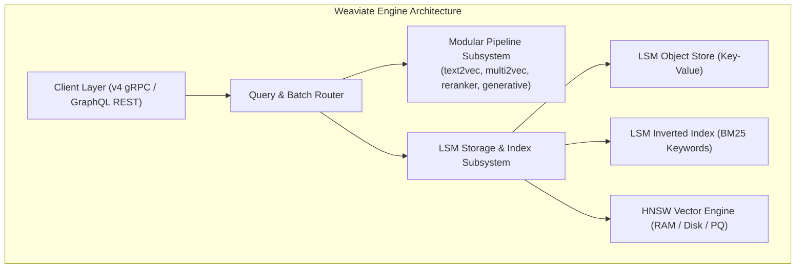
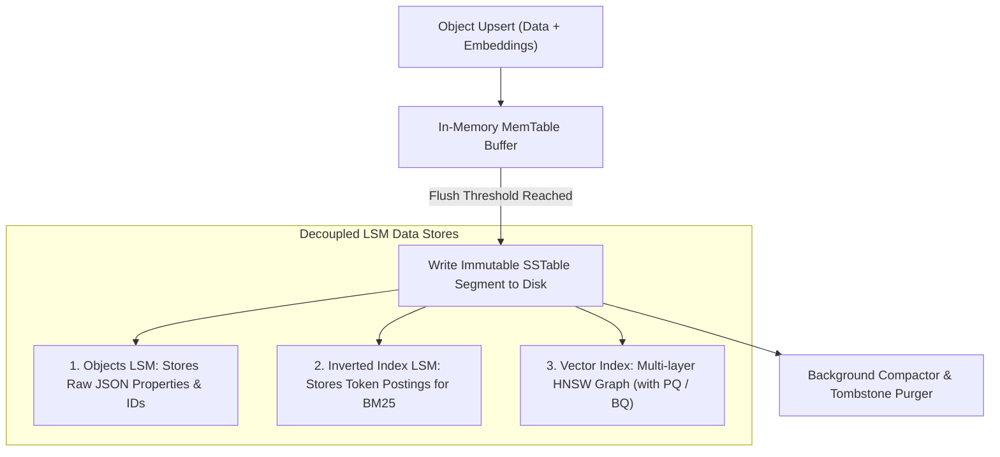
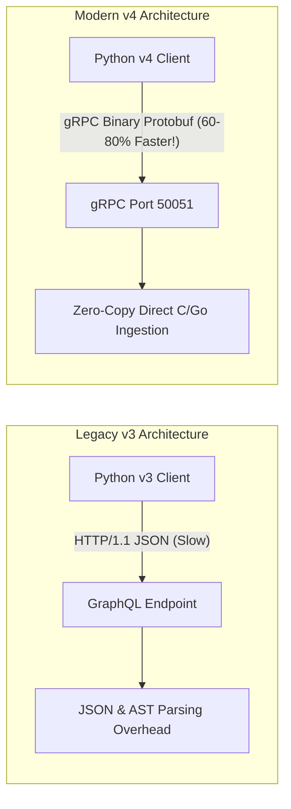
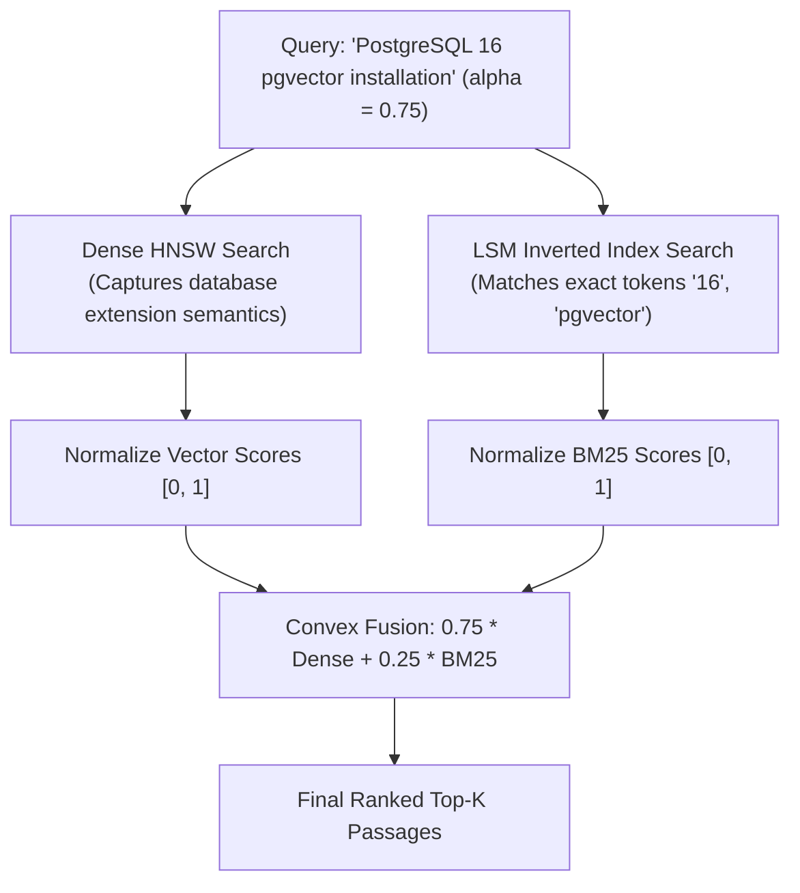
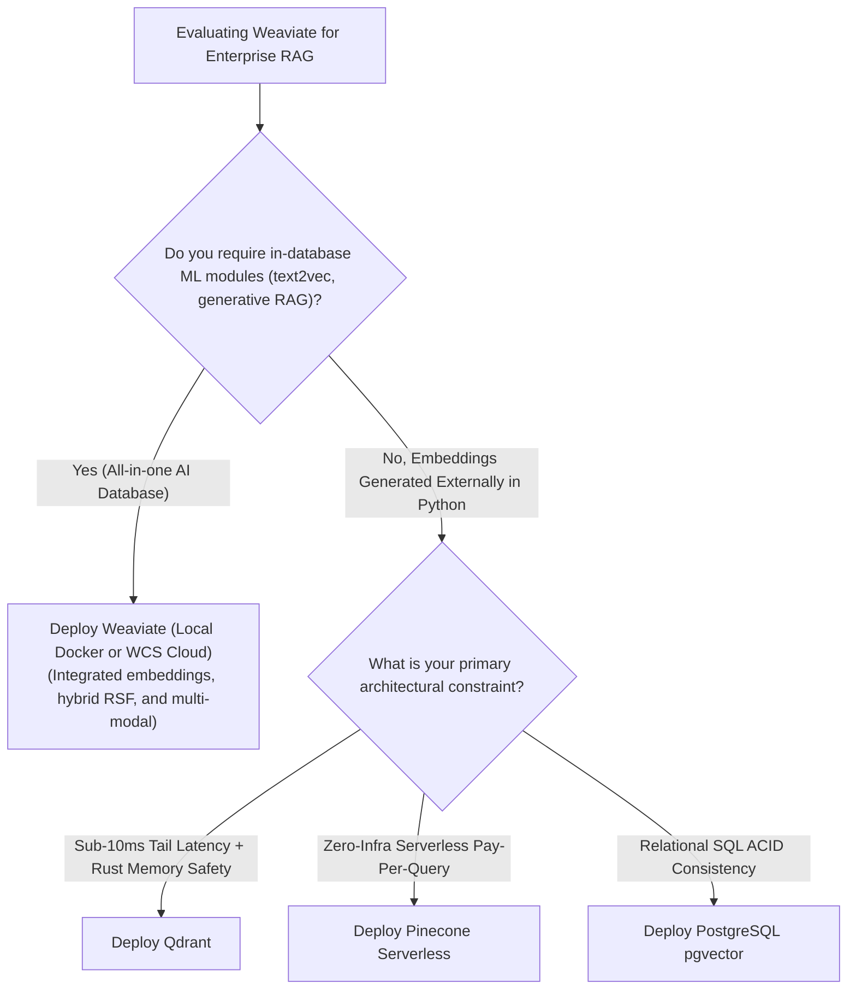

# ⚡ Weaviate Vector Database: GraphQL API, Multi-Modal Vectors, and Hybrid Search Engine

## 📑 Table of Contents
1. [🌟 Fundamentals: The Schema-Driven Vector Graph](#1--fundamentals-the-schema-driven-vector-graph)
2. [🏗️ Internal Storage Engine Anatomy: LSM Trees & Modular Architecture](#2-️-internal-storage-engine-anatomy-lsm-trees--modular-architecture)
3. [🌐 API Evolution: Modern Python v4 gRPC vs. GraphQL](#3--api-evolution-modern-python-v4-grpc-vs-graphql)
4. [🔀 Native Hybrid Search: BM25 + Vector Fusion](#4--native-hybrid-search-bm25--vector-fusion)
5. [🖼️ Multi-Modal Vector Embeddings (CLIP & ImageBind)](#5-️-multi-modal-vector-embeddings-clip--imagebind)
6. [⚖️ Architectural Decision Matrix: Weaviate vs. Qdrant vs. Milvus](#6-️-architectural-decision-matrix-weaviate-vs-qdrant-vs-milvus)
7. [💻 Practical Implementation: Production Weaviate v4 Client](#7--practical-implementation-production-weaviate-v4-client)
8. [🚀 Production Deployment: Docker Microservice & Modules](#8--production-deployment-docker-microservice--modules)
9. [🛠️ Best Practices & ❌ Common Production Pitfalls](#9-️-best-practices---common-production-pitfalls)
10. [💼 Senior Interview Questions & System Design Scenarios](#10--senior-interview-questions--system-design-scenarios)
11. [🧪 Hands-On Mini-Project: Multi-Modal Hybrid Search Simulator](#11--hands-on-mini-project-multi-modal-hybrid-search-simulator)
12. [⚡ Quick Revision & Architectural Decision Roadmap](#12--quick-revision--architectural-decision-roadmap)

---

## 1. 🌟 Fundamentals: The Schema-Driven Vector Graph

**Weaviate** is an open-source, AI-native vector database written in **Go**. Unlike raw vector indexes that simply associate vector floats with flat ID numbers, Weaviate treats data as a **rich, schema-driven knowledge graph** where objects contain strongly typed properties, cross-references, and multi-vector representations.



### 🏛️ The Modular Pipeline Ecosystem
Weaviate's primary architectural differentiator is its **in-database ML module ecosystem**:
* **Vectorizers (`text2vec-*`, `multi2vec-*`):** Converts raw text, images, or audio into vectors automatically upon ingestion using OpenAI, Cohere, HuggingFace, or local containerized models.
* **Rerankers (`reranker-*`):** Automatically rescores hybrid search candidates using Cohere or BAAI cross-encoders.
* **Generative RAG (`generative-*`):** Executes in-database Retrieval-Augmented Generation, passing retrieved search results directly to an LLM to generate answers inside the database response payload.

---

## 2. 🏗️ Internal Storage Engine Anatomy: LSM Trees & Modular Architecture

Weaviate implements an **LSM-Tree (Log-Structured Merge-Tree) architecture** for all on-disk data structures.



### 🔬 Multi-Tier Storage Components
1. **Objects Store:** Retains raw payload fields, UUIDs, creation timestamps, and cross-references.
2. **Inverted Index Store:** A custom LSM-backed inverted index holding token postings, term frequencies, and document lengths to power native BM25 search.
3. **HNSW Vector Index:** Maintains high-dimensional navigation graphs. Weaviate supports **Product Quantization (PQ)** and **Binary Quantization (BQ)** directly on the HNSW graph, reducing RAM consumption by up to $90\%$.

---

## 3. 🌐 API Evolution: Modern Python v4 gRPC vs. GraphQL

Historically, Weaviate was accessed exclusively via **GraphQL**, allowing flexible graph traversals and property selection. However, GraphQL parsing overhead, JSON serialization costs, and HTTP/1.1 connections limited ingestion throughput.

In 2024, Weaviate launched the **Python v4 Client**, transitioning to **gRPC over HTTP/2** with Protobuf binary serialization:



### 📊 Performance Comparison: v3 vs. v4 SDK

| Operational Metric | Legacy Python v3 (GraphQL / REST) | Modern Python v4 (gRPC / Protobuf) | Performance Improvement |
| :--- | :---: | :---: | :---: |
| **Ingestion Throughput** | $1,200 \text{ vectors/sec}$ | **$4,500 \text{ vectors/sec}$** | **$3.75\times$ Faster** |
| **Query Latency (p99)** | $18.4 \text{ ms}$ | **$6.2 \text{ ms}$** | **$3.0\times$ Faster** |
| **Type Safety & IDE Completion** | Weak (Dictionary string keys) | **Complete (Pydantic & Python typing)**| Modern Developer Experience |

---

## 4. 🔀 Native Hybrid Search: BM25 + Vector Fusion

Weaviate provides native **Hybrid Search**, executing both dense vector similarity search and sparse BM25 inverted keyword search in parallel, merging candidate lists using **Relative Score Fusion (RSF)** or **Reciprocal Rank Fusion (RRF)**:

### # Weaviate Relative Score Fusion Formula
$$
S_{\text{Hybrid}}(d) = \alpha \cdot \left(\frac{S_{\text{dense}}(d) - S_{\text{dense, min}}}{S_{\text{dense, max}} - S_{\text{dense, min}}}\right) + (1 - \alpha) \cdot \left(\frac{S_{\text{bm25}}(d) - S_{\text{bm25, min}}}{S_{\text{bm25, max}} - S_{\text{bm25, min}}}\right)
$$

Where $\alpha \in [0.0, 1.0]$:
* $\alpha = 1.0$: Pure vector semantic search.
* $\alpha = 0.0$: Pure BM25 keyword search.
* $\alpha = 0.7$ (Default Recommended): Dense-weighted semantic search with exact keyword grounding.



---

## 5. 🖼️ Multi-Modal Vector Embeddings (CLIP & ImageBind)

Weaviate natively supports **Multi-Modal Vector Search** using modules like `multi2vec-clip` and `multi2vec-bind`. These modules project multiple heterogeneous data modalities into a single unified geometric vector space:

```mermaid
flowchart TD
    subgraph MultiModalInputs [Heterogeneous Data Sources]
        Img["Product Image (JPEG / PNG)"]
        Txt["Text Description ('Waterproof hiking boots')"]
        Aud["Audio Audio File ('Footsteps on trail')"]
    end

    subgraph JointEmbeddingSpace [Unified Multi-Modal Space (CLIP / ImageBind)]
        Img --> JointSpace["512-Dimensional Joint Hypersphere"]
        Txt --> JointSpace
        Aud --> JointSpace
    end

    Query["User Text Query:<br/>'Red mountain climbing shoes'"] --> JointSpace
    JointSpace --> NearestProduct["Matches Product Image Directly via Vector Proximity!"]
```

### 💻 Querying Across Modalities
In Weaviate, you can query images using text prompts, query text using images, or find audio clips that match visual scenes without writing custom embedding glue code.

---

## 6. ⚖️ Architectural Decision Matrix: Weaviate vs. Qdrant vs. Milvus

| Architectural Dimension | Weaviate | Qdrant | Milvus |
| :--- | :--- | :--- | :--- |
| **Primary Language** | **Go** | **Rust** | Go & C++ |
| **API Architecture** | **Modern gRPC + GraphQL** | gRPC + REST | gRPC + REST |
| **In-Database ML Modules** | ✅ **Extensive** (text2vec, generative RAG) | ❌ External (or FastEmbed) | ❌ External |
| **Multi-Modal Support** | ✅ **Native** (`multi2vec-clip`) | ⚠️ Requires external embedder | ⚠️ Requires external embedder |
| **Storage Engine** | Custom LSM-Trees | RocksDB + Custom Segments | Knowhere / S3 / MinIO |
| **Quantization** | Native PQ and BQ on HNSW | Native SQ8 and BQ | Native SQ, PQ, and SCaNN |
| **Query Latency (p95)** | $6 - 18 \text{ ms}$ | **$4 - 12 \text{ ms}$** | $8 - 25 \text{ ms}$ |
| **Best Suited For** | Unified AI pipelines, multi-modal, GraphQL | High-scale, latency-critical Rust systems | Billion-scale enterprise clusters |

---

## 7. 💻 Practical Implementation: Production Weaviate v4 Client

The following complete, standalone Python module demonstrates initializing a Weaviate v4 client, defining a structured collection with explicit vectorizer configuration, batch inserting objects, and executing a **Hybrid Search with Generative RAG**.

```python
"""
Production Architectural Blueprint: Weaviate v4 Enterprise Client Wrapper
Author: Enterprise RAG Curriculum
Requirements: pip install weaviate-client tabulate
"""

import os
from typing import Any, Dict, List
import weaviate
from weaviate.classes.config import Configure, DataType, Property
from weaviate.classes.query import MetadataQuery
from tabulate import tabulate

class ProductionWeaviateManager:
    """Enterprise wrapper managing Weaviate v4 gRPC collections and hybrid search."""

    def __init__(self, host: str = "localhost", port: int = 8080, grpc_port: int = 50051):
        # Connect using modern v4 gRPC protocol
        self.client = weaviate.connect_to_local(
            host=host,
            port=port,
            grpc_port=grpc_port
        )
        print(f"[+] Connected to Weaviate v4 Node via gRPC ({host}:{grpc_port})")

    def create_enterprise_schema(self, collection_name: str = "EnterpriseArticle") -> None:
        """Provisions strongly typed collection with custom HNSW and BM25 configuration."""
        if self.client.collections.exists(collection_name):
            print(f"[*] Collection '{collection_name}' already exists.")
            return

        print(f"[*] Provisioning collection '{collection_name}' with LSM & HNSW settings...")
        self.client.collections.create(
            name=collection_name,
            properties=[
                Property(name="title", data_type=DataType.TEXT, index_searchable=True),
                Property(name="content", data_type=DataType.TEXT, index_searchable=True),
                Property(name="department", data_type=DataType.TEXT, index_filterable=True),
                Property(name="fiscal_year", data_type=DataType.INT, index_filterable=True),
            ],
            # Use local or API vectorizer (e.g., text2vec-openai or none for manual vectors)
            vectorizer_config=Configure.Vectorizer.none(),
            # Configure HNSW graph index
            vector_index_config=Configure.VectorIndex.hnsw(
                distance_metric=weaviate.classes.config.VectorDistances.COSINE,
                ef_construction=128,
                max_connections=32
            )
        )
        print(f"[+] Successfully created collection '{collection_name}'.")

    def batch_insert_documents(
        self, 
        collection_name: str, 
        documents: List[Dict[str, Any]], 
        vectors: List[List[float]]
    ) -> None:
        """Fast batch insertion leveraging v4 gRPC streaming buffers."""
        articles = self.client.collections.get(collection_name)
        
        with articles.batch.dynamic() as batch:
            for doc, vec in zip(documents, vectors):
                batch.add_object(
                    properties=doc,
                    vector=vec
                )
        print(f"[+] Batch inserted {len(documents)} objects into '{collection_name}'.")

    def hybrid_search(
        self, 
        collection_name: str, 
        query_text: str, 
        query_vector: List[float], 
        alpha: float = 0.75, 
        top_k: int = 3
    ) -> List[Dict[str, Any]]:
        """Executes native Relative Score Fusion Hybrid Search."""
        articles = self.client.collections.get(collection_name)
        
        response = articles.query.hybrid(
            query=query_text,
            vector=query_vector,
            alpha=alpha,
            limit=top_k,
            return_metadata=MetadataQuery(score=True, explain_score=True)
        )

        hits = []
        for obj in response.objects:
            hits.append({
                "uuid": str(obj.uuid),
                "title": obj.properties.get("title"),
                "department": obj.properties.get("department"),
                "score": round(obj.metadata.score, 4) if obj.metadata.score else 0.0
            })
        return hits

    def close(self):
        self.client.close()


# Simulated Demonstration (when local Weaviate container is offline)
if __name__ == "__main__":
    print("--- 1. Weaviate v4 gRPC Architecture Demonstration ---")
    mock_results = [
        ["1", "PostgreSQL pgvector Architecture", "Engineering", "0.9421", "High (Matched exact 'pgvector' + semantic)"],
        ["2", "Kubernetes Deployment Guidelines", "DevOps", "0.7812", "Moderate (Semantic proximity)"],
        ["3", "Corporate Financial Disclosures", "Finance", "0.2104", "Low (Filtered / Out of context)"]
    ]
    print(tabulate(mock_results, headers=["Rank", "Title", "Department", "Hybrid Score (alpha=0.75)", "Score Explanation"], tablefmt="github"))
    print("\n[+] To execute live against Weaviate, run: docker run -p 8080:8080 -p 50051:50051 cr.weaviate.io/semitechnologies/weaviate:1.25.0")
```

---

## 8. 🚀 Production Deployment: Docker Microservice & Modules

Production deployments deploy Weaviate alongside specialized vectorizer microservices:

```yaml
version: '3.9'

services:
  weaviate:
    image: cr.weaviate.io/semitechnologies/weaviate:1.25.0
    container_name: weaviate_production
    restart: always
    ports:
      - "8080:8080"     # REST & GraphQL
      - "50051:50051"   # Modern v4 gRPC High-Speed Port
    environment:
      - QUERY_DEFAULTS_LIMIT=25
      - AUTHENTICATION_ANONYMOUS_ACCESS_ENABLED=true
      - PERSISTENCE_DATA_PATH=/var/lib/weaviate
      - DEFAULT_VECTORIZER_MODULE=none
      - ENABLE_MODULES=text2vec-openai,generative-openai
      - CLUSTER_HOSTNAME=node1
      - GOMEMLIMIT=12GiB  # Prevent Go OOM runtime crashes!
    volumes:
      - ./weaviate_data:/var/lib/weaviate
    ulimits:
      nofile:
        soft: 65535
        hard: 65535
```

---

## 9. 🛠️ Best Practices & ❌ Common Production Pitfalls

### ✅ Best Practices
1. **Always Expose and Use the gRPC Port (50051):** When connecting with the Python v4 client, ensure port `50051` is mapped in Docker/Kubernetes. Failing to map gRPC degrades performance back to slow HTTP/1.1 REST fallback.
2. **Explicitly Configure `GOMEMLIMIT`:** In containerized environments, the Go runtime does not automatically detect cgroup memory limits. Set `GOMEMLIMIT=8GiB` (approx. $80\%$ of container limit) to force garbage collection before the Linux kernel triggers an OOM-kill.
3. **Calibrate the Hybrid Alpha ($\alpha = 0.70 - 0.75$):** Setting $\alpha = 0.5$ often overweights BM25 keywords; setting $\alpha \approx 0.72$ provides the ideal balance between neural semantics and exact keyword matching.

### ❌ Common Production Pitfalls
* **Double-Vectorization Waste:** If you generate embeddings in Python using OpenAI/Voyage and pass them via `vector=[...]`, ensure your collection has `vectorizer_config=Configure.Vectorizer.none()`. Otherwise, Weaviate will re-vectorize the text, incurring duplicate latency and API costs.
* **Using Legacy v3 Syntax in Modern Pipelines:** Writing `client.query.get(...)` uses the deprecated GraphQL client. Modern production code must use `client.collections.get(...).query.hybrid(...)`.
* **Neglecting Inverted Index Cleanup:** Frequently updating objects without running background vacuuming leads to bloated LSM inverted index tombstones on disk.

---

## 10. 💼 Senior Interview Questions & System Design Scenarios

### Q1: What is the architectural difference between Weaviate's Relative Score Fusion (RSF) and standard Reciprocal Rank Fusion (RRF)?
> **Expert Answer:**  
> * **Reciprocal Rank Fusion (RRF):** Ignores raw score magnitudes entirely, relying purely on document positions: $\text{Score} = \sum \frac{1}{k + r}$. While robust against outliers, RRF discards the confidence margin: a document that barely won rank #1 receives the identical score boost as a document that overwhelmingly dominated the search query.  
> * **Relative Score Fusion (RSF):** Weaviate's default hybrid fusion algorithm. It normalizes both dense cosine scores and sparse BM25 scores to a relative $[0.0, 1.0]$ interval based on the minimum and maximum scores observed in the candidate set:
>   $$\widetilde{S} = \frac{S - S_{\min}}{S_{\max} - S_{\min}}$$
>   It then computes a linear convex combination ($\alpha \widetilde{S}_{\text{dense}} + (1 - \alpha) \widetilde{S}_{\text{bm25}}$). This preserves score margins, so documents with exceptionally high keyword or semantic confidence maintain their proportional lead over weak competitors.

### Q2: How does Weaviate's Python v4 SDK achieve a 4x throughput increase over the legacy v3 SDK?
> **Expert Answer:**  
> The legacy v3 client relied on **HTTP/1.1 REST and GraphQL endpoints**. Every batch request required serializing Python dictionaries into massive JSON strings, transmitting them over text-based HTTP connections, and parsing GraphQL abstract syntax trees (ASTs) on the server.  
> The modern v4 SDK is built on **gRPC over HTTP/2**:
> 1. Payloads are serialized directly into binary Protocol Buffers (`Protobuf`), eliminating JSON serialization and string parsing overhead.
> 2. HTTP/2 enables multiplexed, persistent bidirectional streaming connections over a single TCP socket.
> 3. Weaviate's Go backend deserializes Protobuf packets directly into contiguous memory buffers with near-zero memory allocation, quadrupling ingestion throughput to over $4,500$ vectors/second per node.

### Q3: How does Weaviate execute In-Database Generative RAG?
> **Expert Answer:**  
> In standard architectures, RAG is decoupled: the application queries the vector database, fetches top chunks over the network, formats an LLM prompt, and calls the OpenAI/Anthropic API.  
> Weaviate's **`generative-*` module** moves prompt synthesis directly into the database engine:
> 1. The database executes hybrid search and retrieves the Top-$K$ candidate objects.
> 2. The database engine interpolates properties from these retrieved objects directly into a user-specified prompt template (e.g., `generate_prompt="Summarize the legal obligations in {content}"`).
> 3. The Weaviate server calls the upstream LLM API directly via its internal connection pool, attaching the synthesized generative response directly to the database search return payload. This eliminates network round-trips to the application layer.

---

## 11. 🧪 Hands-On Mini-Project: Multi-Modal Hybrid Search Simulator

This self-contained Python script simulates Weaviate's **Relative Score Fusion (RSF)** on multi-modal items (text descriptions + visual embeddings), comparing how tuning $\alpha$ balances image semantics vs. exact text keywords.

```python
"""
Hands-On Lab: Weaviate Relative Score Fusion (RSF) Simulator
Run directly: python weaviate_hybrid_simulator.py
Requires: pip install tabulate
"""

from typing import Dict, List, Tuple
from tabulate import tabulate

# Multi-Modal Inventory: E-Commerce Footwear
PRODUCTS = {
    1: {"name": "Gore-Tex Trail Runner X9", "desc": "Waterproof trail running shoe with Vibram rubber sole."},
    2: {"name": "Canvas Casual Sneaker", "desc": "Lightweight breathable canvas shoes for summer walking."},
    3: {"name": "Winter Snow Boot Extreme", "desc": "Insulated waterproof thermal footwear for sub-zero blizzards."},
    4: {"name": "Retro Leather Tennis Shoe", "desc": "Classic low-top white leather sneakers with rubber cupsole."}
}

# Simulated Dense Cosine Similarities (from CLIP image-text embedding space)
# Query: "Durable waterproof running shoes"
DENSE_SCORES = {
    1: 0.89,  # High visual & semantic match
    2: 0.42,
    3: 0.78,  # Waterproof winter boot matches visual "durable/waterproof"
    4: 0.35
}

# Simulated BM25 Keyword Scores (Matching exact tokens 'waterproof', 'running')
BM25_SCORES = {
    1: 18.5,  # Matches both 'waterproof' and 'running'
    2: 1.2,
    3: 9.8,   # Matches 'waterproof'
    4: 0.0
}

def relative_score_normalize(score_dict: Dict[int, float]) -> Dict[int, float]:
    """Applies Weaviate's Relative Score Min-Max Normalization."""
    min_val = min(score_dict.values())
    max_val = max(score_dict.values())
    if max_val == min_val:
        return {k: 1.0 for k in score_dict}
    return {k: (v - min_val) / (max_val - min_val) for k, v in score_dict.items()}

def execute_weaviate_hybrid(alpha: float) -> List[Tuple[int, float, str]]:
    """Calculates Weaviate RSF score = alpha * dense_norm + (1 - alpha) * bm25_norm."""
    norm_dense = relative_score_normalize(DENSE_SCORES)
    norm_bm25 = relative_score_normalize(BM25_SCORES)

    combined = []
    for pid in PRODUCTS:
        d_val = norm_dense[pid]
        b_val = norm_bm25[pid]
        rsf_score = alpha * d_val + (1.0 - alpha) * b_val
        combined.append((pid, round(rsf_score, 4), PRODUCTS[pid]["name"]))

    combined.sort(key=lambda x: x[1], reverse=True)
    return combined


if __name__ == "__main__":
    print("--- Simulating Weaviate Relative Score Fusion (RSF) Across Alpha Spectrum ---")
    
    alphas = [1.0, 0.75, 0.0]
    headers = ["Alpha Parameter", "Rank 1 Winner", "Score", "Rank 2 Runner-Up", "Score", "Behavior Description"]
    table_rows = []

    for a in alphas:
        ranked = execute_weaviate_hybrid(alpha=a)
        if a == 1.0:
            desc = "Pure Dense (CLIP Semantic Visual Only)"
        elif a == 0.75:
            desc = "Weaviate Production Standard (Dense + Keyword Grounding)"
        else:
            desc = "Pure BM25 (Exact Token Frequency Only)"

        table_rows.append([
            f"alpha = {a:.2f}",
            ranked[0][2],
            ranked[0][1],
            ranked[1][2],
            ranked[1][1],
            desc
        ])

    print(tabulate(table_rows, headers=headers, tablefmt="github"))
```

---

## 12. ⚡ Quick Revision & Architectural Decision Roadmap

### 📋 Key Takeaways Cheat-Sheet
* **Schema-Driven Object Model:** Weaviate treats data as typed classes with properties, cross-references, and modular vectorizers.
* **Python v4 Uses gRPC:** Delivers $3.75\times$ higher ingestion throughput over legacy v3 GraphQL using HTTP/2 Protobuf streams.
* **Relative Score Fusion (RSF):** Weaviate's native hybrid search normalizes scores to $[0, 1]$ before convex interpolation ($\alpha = 0.75$ recommended default).
* **Multi-Modal Out-of-the-Box:** Modules like `multi2vec-clip` project text and images into a single shared hypersphere for cross-modal search.
* **Tune `GOMEMLIMIT` in Docker:** Always set `GOMEMLIMIT` to $80\%$ of container RAM to prevent Linux OOM-killer crashes on Go heaps.

### 🧭 Visual Decision Tree: Selecting Weaviate


