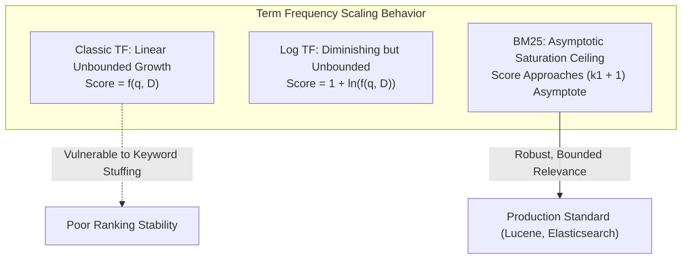
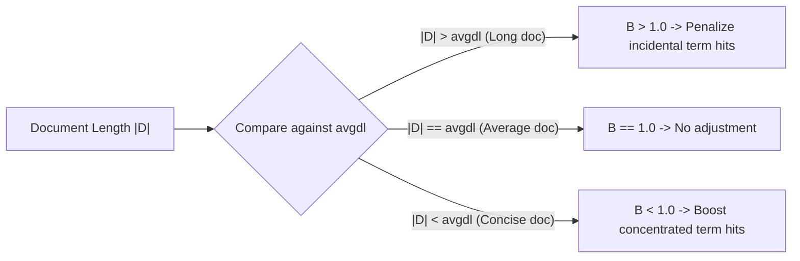
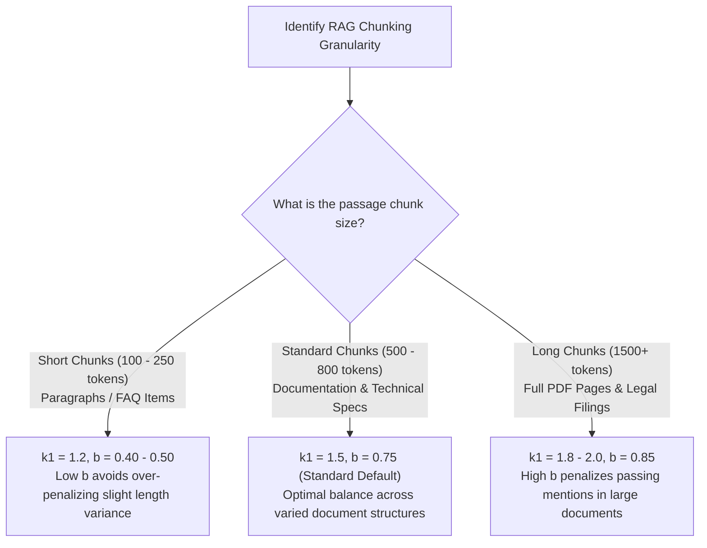
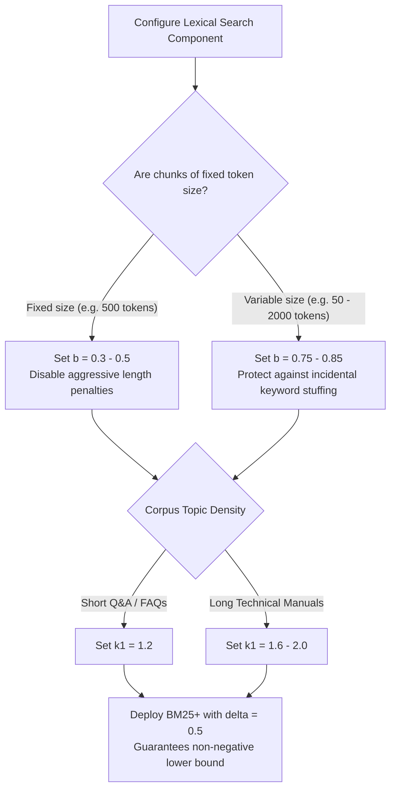

# 📊 BM25 Lexical Ranking Algorithm: Mathematical Foundations, Hyperparameter Tuning, and Production Implementation

## 📑 Table of Contents
1. [🌟 Fundamentals: The Evolution from TF-IDF to Okapi BM25](#1--fundamentals-the-evolution-from-tf-idf-to-okapi-bm25)
2. [🔬 Deep Mathematical Foundations: Derivation & Mechanics](#2--deep-mathematical-foundations-derivation--mechanics)
3. [🎛️ Hyperparameter Calibration & The Geometry of (k1, b)](#3-️-hyperparameter-calibration--the-geometry-of-k1-b)
4. [🧬 The BM25 Family: BM25Okapi, BM25+, BM25L, and Lucene BM25](#4--the-bm25-family-bm25okapi-bm25-bm25l-and-lucene-bm25)
5. [⚖️ Comparative Matrix: TF-IDF vs. BM25 vs. Dense Vector vs. SPLADE](#5-️-comparative-matrix-tf-idf-vs-bm25-vs-dense-vector-vs-splade)
6. [💻 Practical Implementation: High-Performance BM25+ Engine](#6--practical-implementation-high-performance-bm25-engine)
7. [🌍 Real-World Enterprise Production Scenarios](#7--real-world-enterprise-production-scenarios)
8. [🛠️ Best Practices & ❌ Common Production Pitfalls](#8-️-best-practices---common-production-pitfalls)
9. [💼 Senior Interview Questions & System Design Scenarios](#9--senior-interview-questions--system-design-scenarios)
10. [🧪 Hands-On Mini-Project: BM25 Hyperparameter Sensitivity Grid Search](#10--hands-on-mini-project-bm25-hyperparameter-sensitivity-grid-search)
11. [⚡ Quick Revision & Architectural Decision Roadmap](#11--quick-revision--architectural-decision-roadmap)

---

## 1. 🌟 Fundamentals: The Evolution from TF-IDF to Okapi BM25

Developed by Stephen Robertson, Karen Spärck Jones, and colleagues at City University London in the 1990s, **Okapi BM25 (Best Matching 25)** is the industry standard probabilistic ranking function for lexical search.

While classic TF-IDF laid the groundwork for modern Information Retrieval, it suffered from two catastrophic structural flaws:
1. **Unbounded Term Frequency:** In standard TF-IDF, if a document artificially repeats a query term 100 times, its score increases linearly (or unbounded logarithmically), easily overriding shorter, highly relevant documents.
2. **Aggressive Length Penalties:** TF-IDF divides by raw document length $|D|$, unfairly punishing long, multi-topic, or comprehensive documents that naturally contain more total words.

BM25 resolves both issues by introducing a **non-linear term frequency saturation curve** and **corpus-relative document length normalization**.



---

## 2. 🔬 Deep Mathematical Foundations: Derivation & Mechanics

Given a query $Q = \{q_1, q_2, \dots, q_m\}$ and a document $D$ within a corpus $\mathcal{C}$ of size $N$, the **BM25 score** is defined as:

### # Primary BM25 Ranking Formula
$$
\text{Score}_{\text{BM25}}(D, Q) = \sum_{i=1}^{|Q|} \text{IDF}(q_i) \cdot \frac{f(q_i, D) \cdot (k_1 + 1)}{f(q_i, D) + k_1 \cdot \left(1 - b + b \cdot \frac{|D|}{\text{avgdl}}\right)}
$$

---

### 📐 1. The Robertson-Spärck Jones IDF Formulation
BM25 calculates the Inverse Document Frequency of term $q_i$ as:

### # BM25 Inverse Document Frequency (IDF)
$$
\text{IDF}(q_i) = \ln\left( \frac{N - n(q_i) + 0.5}{n(q_i) + 0.5} + 1 \right)
$$
Where:
* $N$: Total number of documents in the collection.
* $n(q_i)$: Number of documents containing the query term $q_i$.
* $+0.5$ and $+1.0$: Smoothing constants preventing division-by-zero and ensuring non-negative IDF values even when $n(q_i) > N / 2$.

---

### 📐 2. Non-Linear Term Frequency Saturation
The second factor in the BM25 formula represents the saturated term frequency:
$$
S(f) = \frac{f \cdot (k_1 + 1)}{f + K} \quad \text{where } K = k_1 \cdot \left(1 - b + b \cdot \frac{|D|}{\text{avgdl}}\right)
$$
* As $f \to \infty$, the term $S(f) \to (k_1 + 1)$.
* The parameter $k_1$ dictates **how rapidly the score approaches this upper asymptote**. A term appearing 10 times does not score $10\times$ more than a term appearing once; it scores roughly $1.5\times$ to $2\times$ more.

---

### 📐 3. Corpus-Relative Length Normalization
The term length penalty ratio is:
$$
B = 1 - b + b \cdot \left(\frac{|D|}{\text{avgdl}}\right)
$$
* If $|D| = \text{avgdl}$, then $B = 1 - b + b(1) = 1.0$. The document receives zero penalty or boost.
* If $|D| > \text{avgdl}$, then $B > 1.0$, which enlarges the denominator and decreases the term's contribution.
* If $|D| < \text{avgdl}$, then $B < 1.0$, which reduces the denominator and gives a score boost to concise passages.
* The parameter $b$ controls the **strength** of this normalization:
  * When $b = 1.0$: Full length normalization (proportional to document length).
  * When $b = 0.0$: Zero length normalization (document length has no effect).



---

## 3. 🎛️ Hyperparameter Calibration & The Geometry of (k1, b)

The two free hyperparameters $k_1$ and $b$ govern BM25's behavior:

| Hyperparameter | Typical Range | Default | Algorithmic Impact |
| :--- | :---: | :---: | :--- |
| **$k_1$** | $[1.2, 2.0]$ | $1.2$ (Lucene) / $1.5$ (TREC) | Controls term frequency saturation limit. Higher $k_1$ gives more weight to repeated term occurrences. |
| **$b$** | $[0.5, 0.85]$ | $0.75$ | Controls degree of document length penalization. Higher $b$ penalizes long documents more severely. |

### Calibration Matrix for RAG Chunk Sizes:



---

## 4. 🧬 The BM25 Family: BM25Okapi, BM25+, BM25L, and Lucene BM25

Over the decades, multiple variations of BM25 were engineered to solve specific edge cases:

### 1. BM25Okapi (The Canonical Version)
The classic formula derived in Section 2.
* **The Long Document Vulnerability:** In BM25Okapi, for extremely long documents ($|D| \gg \text{avgdl}$), the denominator grows so large that a document containing multiple query terms can score *lower* than a short document containing only one term.

### 2. BM25+ (Lv & Zhai, 2011)
Introduces a lower-bound pseudo-frequency offset $\delta > 0$ (typically $\delta = 1.0$ or $0.5$):
$$
\text{Score}_{\text{BM25+}}(D, Q) = \sum_{i=1}^{|Q|} \text{IDF}(q_i) \cdot \left[ \frac{f(q_i, D) \cdot (k_1 + 1)}{f(q_i, D) + k_1 \cdot \left(1 - b + b \frac{|D|}{\text{avgdl}}\right)} + \delta \right]
$$
* **Impact:** Guarantees that any document containing a query term receives at least $\delta \cdot \text{IDF}(q_i)$ points, completely preventing over-penalization of long documents.

### 3. Lucene BM25 (Elasticsearch / OpenSearch Default)
Lucene implements a smoothed variant of Robertson's IDF:
$$
\text{IDF}_{\text{Lucene}}(q_i) = \ln\left( 1 + \frac{N - n(q_i) + 0.5}{n(q_i) + 0.5} \right)
$$
This ensures the IDF never falls below zero, even for terms present in $99\%$ of the corpus.

---

## 5. ⚖️ Comparative Matrix: TF-IDF vs. BM25 vs. Dense Vector vs. SPLADE

| Dimension | TF-IDF | BM25 / BM25+ | Dense Vector Search | Learned Sparse (SPLADE) |
| :--- | :--- | :--- | :--- | :--- |
| **Model Type** | Unbounded Sparse | Saturated Sparse | Dense Neural Continuous | Neural Sparse Inverted |
| **Index Size** | Very Small ($10\%$) | Very Small ($15\%$) | Medium to High ($150\%$) | Medium ($30\% - 50\%$) |
| **Exact Identifier Match** | Yes | **Yes (Flawless)** | Poor | Excellent |
| **Synonym Generalization** | Zero | Zero | **High** | Moderate to High |
| **Term Frequency Saturation**| No | **Yes (Asymptotic)** | N/A (Latent) | Soft Neural Saturation |
| **Document Length Robustness**| Fragile | **Excellent (Tuned by $b$)**| Built into Chunking | Learned via BERT |
| **Query Latency** | $< 1\text{ ms}$ | **$1 - 3\text{ ms}$** | $5 - 20\text{ ms}$ | $3 - 8\text{ ms}$ |

---

## 6. 💻 Practical Implementation: High-Performance BM25+ Engine

Here is a pure-Python, zero-dependency, vector-ready implementation of **BM25+** featuring token caching, customizable hyperparameters, and batch query ranking:

```python
"""
bm25_plus_engine.py
Production-grade, zero-dependency BM25+ Lexical Search Engine.
Implements the Lv & Zhai (2011) lower-bound delta correction to eliminate long document penalty collapse.
"""

import math
import re
from typing import List, Dict, Any, Tuple
from collections import Counter


class BM25PlusEngine:
    """
    High-performance in-memory BM25+ ranking engine.
    """

    def __init__(self, k1: float = 1.5, b: float = 0.75, delta: float = 0.5):
        self.k1 = k1
        self.b = b
        self.delta = delta

        self.corpus_size: int = 0
        self.avg_doc_len: float = 0.0
        self.doc_ids: List[str] = []
        self.doc_lengths: List[int] = []
        self.doc_token_counts: List[Counter] = []
        self.raw_documents: Dict[str, str] = {}

        # Inverted index structures: term -> document frequency df
        self.df: Dict[str, int] = Counter()
        self.idf: Dict[str, float] = {}
        self._tokenizer_regex = re.compile(r"\b[a-zA-Z0-9_-]+\b")

    def _tokenize(self, text: str) -> List[str]:
        return [t.lower() for t in self._tokenizer_regex.findall(text)]

    def index_documents(self, documents: List[Dict[str, str]]) -> None:
        """
        Indexes a list of documents. Expects dicts with 'id' and 'text'.
        """
        self.corpus_size = len(documents)
        total_len = 0

        for doc in documents:
            doc_id = doc["id"]
            text = doc["text"]
            tokens = self._tokenize(text)
            doc_len = len(tokens)

            self.doc_ids.append(doc_id)
            self.raw_documents[doc_id] = text
            self.doc_lengths.append(doc_len)
            total_len += doc_len

            counts = Counter(tokens)
            self.doc_token_counts.append(counts)

            # Update document frequencies
            for term in counts.keys():
                self.df[term] += 1

        self.avg_doc_len = total_len / self.corpus_size if self.corpus_size > 0 else 0.0
        self._compute_idfs()

    def _compute_idfs(self) -> None:
        """
        Precomputes RSJ IDF scores with Lucene-style non-negative smoothing.
        """
        N = self.corpus_size
        for term, df_val in self.df.items():
            # Lucene-style non-negative IDF formula
            self.idf[term] = math.log(1.0 + (N - df_val + 0.5) / (df_val + 0.5))

    def score_query(self, query: str, top_k: int = 5) -> List[Tuple[str, float]]:
        """
        Computes BM25+ relevance score for a given query string against all indexed documents.
        Returns list of (doc_id, score) sorted descending.
        """
        query_tokens = self._tokenize(query)
        if not query_tokens or self.corpus_size == 0:
            return []

        # Only evaluate terms present in vocabulary
        valid_terms = [t for t in query_tokens if t in self.idf]
        if not valid_terms:
            return []

        scores: List[float] = [0.0] * self.corpus_size

        for term in valid_terms:
            idf_val = self.idf[term]

            for doc_idx in range(self.corpus_size):
                tf = self.doc_token_counts[doc_idx].get(term, 0)
                if tf == 0:
                    continue

                doc_len = self.doc_lengths[doc_idx]
                len_norm = 1.0 - self.b + self.b * (doc_len / self.avg_doc_len)
                
                # BM25+ formula incorporating delta lower-bound
                tf_component = (tf * (self.k1 + 1.0)) / (tf + self.k1 * len_norm) + self.delta
                scores[doc_idx] += idf_val * tf_component

        # Rank results
        ranked_indices = sorted(
            [i for i in range(self.corpus_size) if scores[i] > 0.0],
            key=lambda idx: scores[idx],
            reverse=True,
        )[:top_k]

        return [(self.doc_ids[idx], round(scores[idx], 4)) for idx in ranked_indices]


# --- Demonstration & Self-Test ---
if __name__ == "__main__":
    docs = [
        {"id": "doc_1", "text": "PostgreSQL database connection pooling with PgBouncer service."},
        {"id": "doc_2", "text": "PostgreSQL replication, high availability, and automated failover mechanics."},
        {"id": "doc_3", "text": "Docker multi-stage container build and Kubernetes orchestration guide."},
        {"id": "doc_4", "text": "PgBouncer connection pooling benchmark under high concurrent transactions."},
    ]

    engine = BM25PlusEngine(k1=1.5, b=0.75, delta=0.5)
    engine.index_documents(docs)

    test_query = "pgbouncer connection pooling"
    results = engine.score_query(test_query, top_k=3)

    print(f"=== BM25+ Query: '{test_query}' ===")
    for rank, (doc_id, score) in enumerate(results, start=1):
        print(f"Rank {rank} | Score: {score:.4f} | [{doc_id}] {engine.raw_documents[doc_id]}")
```

---

## 7. 🌍 Real-World Enterprise Production Scenarios

### Scenario A: Legal Discovery & Statutory Research
* **Context:** A paralegal searches for the specific statute section `"Rule 11(b)(2) frivolous claims sanctions"`.
* **Behavior:** 
  * A dense semantic retriever matches any litigation claim discussing court sanctions in general.
  * BM25+ identifies the rare, highly discriminative tokens `"Rule"`, `"11"`, `"b"`, and `"2"`. Because their IDF is massive, candidate documents containing these precise tokens immediately rise to the #1 rank.

### Scenario B: Cloud Infrastructure Incident Runbooks
* **Context:** Site Reliability Engineers (SREs) paste a Kubernetes error log: `"CrashLoopBackOff ExitCode: 137 OOMKilled"`.
* **Behavior:**
  * BM25 isolates the exact tokens `"137"` and `"OOMKilled"`.
  * The memory runbook with the corresponding resolution is returned in $2\text{ ms}$, whereas dense embeddings smooth the numerical code `137` into generic Linux kernel articles.

---

## 8. 🛠️ Best Practices & ❌ Common Production Pitfalls

### ✅ Best Practices
1. **Use BM25+ for Varied Document Lengths:** If your RAG corpus contains mixed chunk lengths (e.g., 50-word tables alongside 800-word prose), use BM25+ with $\delta = 0.5$ to prevent long chunks from suffering total score collapse.
2. **Synchronize Tokenizers with Downstream Models:** Ensure your BM25 tokenization matches your generation parser (e.g., preserving snake_case and hyphens for technical keywords).
3. **Cache Document Lengths & IDF Tables:** Recomputing corpus statistics at query time kills throughput. Maintain pre-aggregated metadata in an inverted index storage format.

### ❌ Common Production Pitfalls
* **Pitfall 1: Leaving default $b = 0.75$ on pre-chunked fixed-size windows.**  
  *Consequence:* If all chunks are fixed at exactly 500 tokens by a recursive character splitter, $|D| \approx \text{avgdl}$ for every document. Setting $b = 0.75$ wastes computation; set $b = 0.0$ or $b = 0.3$ to optimize for pure term frequency.
* **Pitfall 2: Using standard BM25 on negative IDF values.**  
  *Consequence:* In classical BM25, if a term appears in $> 50\%$ of documents, $(N - n + 0.5) / (n + 0.5) < 1$, resulting in a negative IDF. Documents containing that term will actually lose points! Always enforce Lucene-style non-negative IDF smoothing.

---

## 9. 💼 Senior Interview Questions & System Design Scenarios

### Q1: What is the physical significance of $k_1$ and $b$ in BM25, and how does varying them alter the ranking curve?
**Answer:**  
* **$k_1$ (Frequency Saturation Controller):** $k_1$ acts as a dampening factor on term repetition. Mathematically, as $f \to \infty$, the term frequency multiplier approaches $(k_1 + 1)$. If $k_1 = 0$, term frequency is completely ignored, and the function degenerates into a binary presence/absence indicator. If $k_1$ is set very high (e.g., $k_1 = 100$), BM25 degenerates into linear TF-IDF where repeated words dominate without bound. In practice, $k_1 \in [1.2, 2.0]$ guarantees that the 2nd and 3rd mentions of a term add value, but the 20th mention adds negligible incremental score.
* **$b$ (Length Penalty Controller):** $b \in [0, 1]$ modulates the impact of document length relative to $\text{avgdl}$. At $b = 0$, length normalization is disabled entirely (a 10,000-word document and a 10-word document are treated identically). At $b = 1$, the term frequency is fully divided by the relative document length. Higher $b$ is required when long documents represent "fluff" or multi-topic aggregation, whereas lower $b$ is chosen when long documents are detailed technical explanations.

### Q2: Why does pure BM25 struggle with semantic synonymy, and what modern sparse architectures address this without dense vector graphs?
**Answer:**  
BM25 relies on exact lexical string overlap. If a query uses `"automobile"` and a document uses `"car"`, their intersection is $\emptyset$, yielding a score of 0.  
**Modern Sparse Architecture (SPLADE - Sparse Lexical and Expansion Model):**  
SPLADE uses a masked language model (BERT) to expand the query and document into a sparse vector over the entire vocabulary $\mathcal{V}$ ($30,522$ dimensions). When BERT reads `"automobile"`, it activates non-zero weights for related tokens like `"car"`, `"vehicle"`, and `"engine"`. Because the representation remains sparse (only a few hundred non-zero terms per document), it can be stored in a standard inverted index and retrieved via traditional BM25-like inverted postings intersections while preserving semantic generalization.

---

## 10. 🧪 Hands-On Mini-Project: BM25 Hyperparameter Sensitivity Grid Search

Evaluate how changing $k_1$ and $b$ affects the ranking of short vs. long documents:

```python
"""
mini_project_bm25_tuning.py
Simulates ranking shifts across multiple (k1, b) parameter pairs.
"""

from bm25_plus_engine import BM25PlusEngine

docs = [
    {"id": "short_dense", "text": "PostgreSQL connection pooling. High performance database connections."},
    {"id": "long_diluted", "text": "PostgreSQL connection pooling is discussed here along with an extensive fifty page guide on frontend UI components, styling, CSS grids, react router, state management, and server side rendering."},
]

test_configs = [
    ("Default Lucene", 1.2, 0.75),
    ("Zero Length Penalty (b=0)", 1.2, 0.0),
    ("Heavy Length Penalty (b=0.9)", 1.2, 0.9),
    ("High Frequency Saturation (k1=3.0)", 3.0, 0.75),
]

query = "postgresql connection pooling"

print(f"=== BM25 Parameter Sensitivity Test for Query: '{query}' ===")
for name, k1_val, b_val in test_configs:
    engine = BM25PlusEngine(k1=k1_val, b=b_val, delta=0.5)
    engine.index_documents(docs)
    ranked = engine.score_query(query)
    print(f"\nConfiguration: {name} (k1={k1_val}, b={b_val})")
    for doc_id, score in ranked:
        print(f"  [{doc_id}] Score: {score:.4f}")
```

---

## 11. ⚡ Quick Revision & Architectural Decision Roadmap



* **Core Axiom:** BM25 combines asymptotic term frequency saturation with corpus-relative length normalization, making it vastly superior to naive TF-IDF.
* **Golden Rule:** Always deploy BM25+ with non-negative IDF smoothing to prevent catastrophic long-document score collapse in heterogeneous RAG knowledge bases.
