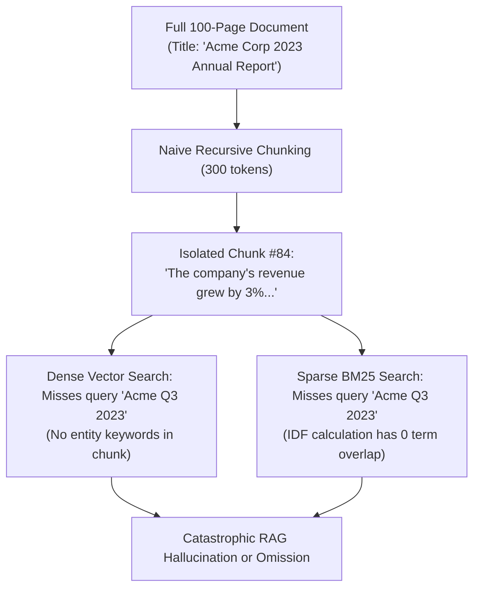
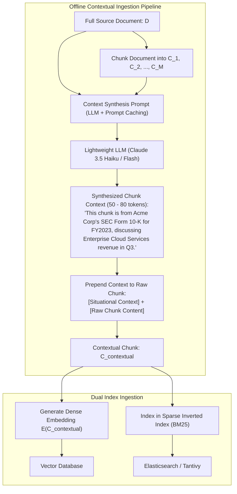
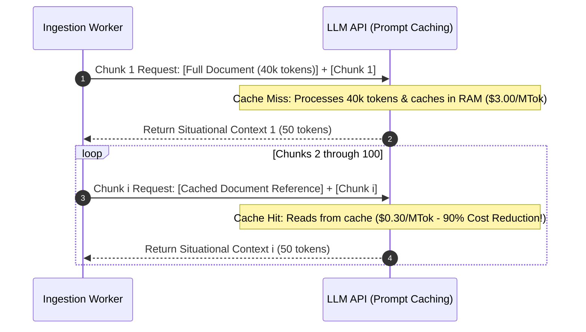
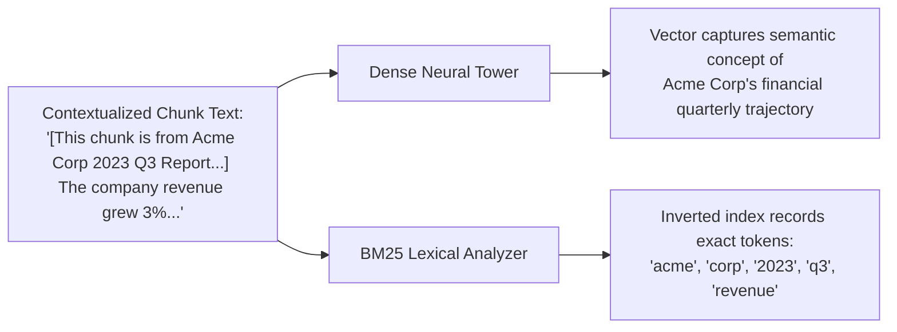
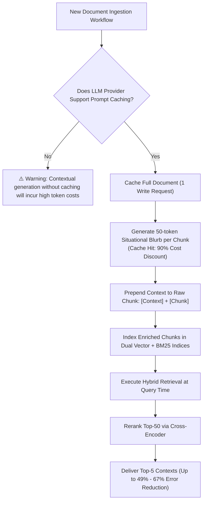

# 🧩 Contextual Retrieval: Prepending Chunk Situational Summaries for Zero Information Loss (Anthropic Pattern)

## 📑 Table of Contents
1. [🌟 Fundamentals: The Chunk Context Loss Crisis in Naive RAG](#1--fundamentals-the-chunk-context-loss-crisis-in-naive-rag)
2. [🏛️ The Anthropic Contextual Retrieval Architecture](#2-️-the-anthropic-contextual-retrieval-architecture)
3. [💰 The Economic Viability Blueprint: Prompt Caching at Scale](#3--the-economic-viability-blueprint-prompt-caching-at-scale)
4. [🔬 Dual-Index Enhancement: Contextual Embeddings + Contextual BM25](#4--dual-index-enhancement-contextual-embeddings--contextual-bm25)
5. [📝 Prompt Construction & Contextual Chunk Anatomy](#5--prompt-construction--contextual-chunk-anatomy)
6. [💻 Practical Implementation: End-to-End Contextual Ingestion Pipeline](#6--practical-implementation-end-to-end-contextual-ingestion-pipeline)
7. [🌍 Real-World Enterprise Production Scenarios](#7--real-world-enterprise-production-scenarios)
8. [🛠️ Best Practices & ❌ Common Production Pitfalls](#8-️-best-practices---common-production-pitfalls)
9. [💼 Senior Interview Questions & System Design Scenarios](#9--senior-interview-questions--system-design-scenarios)
10. [🧪 Hands-On Mini-Project: Contextual Ingestion & Search Evaluation Profiler](#10--hands-on-mini-project-contextual-ingestion--search-evaluation-profiler)
11. [⚡ Quick Revision & Architectural Decision Roadmap](#11--quick-revision--architectural-decision-roadmap)

---

## 1. 🌟 Fundamentals: The Chunk Context Loss Crisis in Naive RAG

In traditional RAG ingestion, documents are partitioned into fixed-size chunks (e.g., 300 to 500 tokens). This mechanical slicing process strips away the **surrounding global document context**, creating isolated, ambiguous textual fragments:

### ⚠️ The Devastating Real-World Failure:
Consider this raw chunk sliced from page 84 of an SEC Form 10-K filing:

> *"The company's revenue grew by 3% over the previous quarter, driven primarily by growth in our enterprise subscription offerings."*

When embedded into vector space or indexed in an inverted index (BM25), this chunk suffers from fatal information gaps:
* **Which company?** (Apple? Microsoft? Acme Corp?)
* **Which fiscal quarter and year?** (Q2 2021? Q3 2024?)
* **What business unit?** (Hardware? Cloud Services?)

If an executive queries: *"What was Acme Corp's enterprise subscription revenue growth in Q3 2023?"*, both dense vector search and BM25 **completely fail to retrieve this passage**. The tokens *"Acme Corp"*, *"Q3"*, and *"2023"* exist on page 1 of the document, but are completely absent from the chunk itself!



---

## 2. 🏛️ The Anthropic Contextual Retrieval Architecture

Introduced by Anthropic in September 2024, **Contextual Retrieval** eliminates chunk context loss by prepending a concise, 50–100 token **situational context explanation** to each chunk prior to embedding and indexing:



### 🔬 Benchmark Impact (Anthropic Published Metrics):
* Applying **Contextual Embeddings** alone reduces retrieval failure rate by **$35\%$**.
* Combining **Contextual Embeddings + Contextual BM25** reduces retrieval failure rate by **$49\%$**.
* Combining Contextual Retrieval with a **Cross-Encoder Reranker** reduces retrieval failure rate by **$67\%$** (from $5.7\%$ down to $1.9\%$).

---

## 3. 💰 The Economic Viability Blueprint: Prompt Caching at Scale

Historically, passing an entire 50-page document (e.g., 40,000 tokens) to an LLM to generate situational context for *every single chunk* (e.g., 100 chunks) was economically catastrophic:
$$
\text{Total Tokens} = 100 \text{ chunks} \times 40,000 \text{ tokens} = 4,000,000 \text{ input tokens per document!}
$$

### ⚡ The Prompt Caching Breakthrough
Modern LLM APIs (Anthropic Claude Prompt Caching, Google Gemini Context Caching) allow the full source document to be written to memory cache once:



* **Cost Reduction:** Reduces input token costs by **$90\%$**.
* **Latency Reduction:** Cuts time-to-first-token by **$> 80\%$**, making contextual chunk generation feasible for enterprise-scale corpora.

---

## 4. 🔬 Dual-Index Enhancement: Contextual Embeddings + Contextual BM25

The situational context blurb is applied to **both** index modalities:



1. **Contextual Embeddings:** Dense vector search now accurately locates the chunk when user queries are phrased conceptually (*"Acme's late-year corporate performance"*).
2. **Contextual BM25:** The rare discriminative keywords (`"Acme"`, `"Q3"`, `"2023"`) now exist directly in the chunk's postings list, enabling BM25 to score high IDF matches on exact searches.

---

## 5. 📝 Prompt Construction & Contextual Chunk Anatomy

Here is the exact prompt architecture recommended by Anthropic for generating situational chunk summaries:

```text
<document>
{WHOLE_DOCUMENT_TEXT}
</document>

Here is the chunk we want to situate within the whole document:
<chunk>
{CHUNK_CONTENT}
</chunk>

Please give a short succinct context to situate this chunk within the overall document for the purpose of improving search retrieval of the chunk. Answer only with the succinct context and nothing else.
```

### Anatomy of an Enriched Contextual Chunk:
```text
[CONTEXT: Document: ACME_CORP_2023_10K.pdf | Section: Item 7 Management's Discussion and Analysis | Period: Q3 FY2023 | Subject: Cloud SaaS Division Financial Metrics]

The company's revenue grew by 3% over the previous quarter, driven primarily by growth in our enterprise subscription offerings. Operating margins expanded by 120 basis points due to reduced server hosting expenditures.
```

---

## 6. 💻 Practical Implementation: End-to-End Contextual Ingestion Pipeline

Below is a complete, production-ready Python implementation of an in-memory **Contextual Retrieval Ingestion Pipeline**:

```python
"""
contextual_retrieval_pipeline.py
Production-grade implementation of Anthropic's Contextual Retrieval Pattern.
Generates situational context summaries, enriches chunks, and builds dual Vector + BM25 indices.
"""

from typing import List, Dict, Any, Tuple
from dataclasses import dataclass
import re
import math
from collections import Counter


@dataclass
class ContextualChunk:
    chunk_id: str
    raw_text: str
    situational_context: str
    enriched_text: str
    doc_id: str


class ContextualIngestionPipeline:
    def __init__(self):
        self.chunks: List[ContextualChunk] = []

    def mock_llm_generate_context(self, full_doc: str, chunk: str) -> str:
        """
        In production, invoke Claude 3.5 Haiku with prompt caching enabled.
        Simulated here with deterministic document metadata extraction.
        """
        # Extract title or header
        first_line = full_doc.strip().split("\n")[0]
        match_org = re.search(r"\b([A-Z][a-zA-Z]+ Corp|[A-Z][a-zA-Z]+ Inc)\b", full_doc)
        org_name = match_org.group(1) if match_org else "Enterprise System"

        match_year = re.search(r"\b(202[0-9])\b", full_doc)
        year = match_year.group(1) if match_year else "Current Year"

        return f"This chunk is from '{first_line}' concerning {org_name} for fiscal period {year}."

    def process_document(self, doc_id: str, full_doc_text: str, raw_chunks: List[str]) -> List[ContextualChunk]:
        """
        Situates each raw chunk within the full document and generates enriched contextual chunks.
        """
        processed: List[ContextualChunk] = []

        for idx, raw_chunk in enumerate(raw_chunks):
            cid = f"{doc_id}_chunk_{idx}"
            context_summary = self.mock_llm_generate_context(full_doc_text, raw_chunk)
            # Combine context with raw chunk
            enriched = f"[{context_summary}]\n{raw_chunk}"

            c_obj = ContextualChunk(
                chunk_id=cid,
                raw_text=raw_chunk,
                situational_context=context_summary,
                enriched_text=enriched,
                doc_id=doc_id,
            )
            processed.append(c_obj)
            self.chunks.append(c_obj)

        return processed


class ContextualBM25Search:
    """
    In-memory BM25 index comparing search accuracy across raw chunks vs contextualized chunks.
    """

    def __init__(self, chunks: List[ContextualChunk], use_contextual: bool = True):
        self.use_contextual = use_contextual
        self.corpus = chunks
        self.doc_tokens: List[List[str]] = []
        self.df: Counter = Counter()
        self.doc_lens: List[int] = []

        for c in self.corpus:
            text = c.enriched_text if use_contextual else c.raw_text
            tokens = re.findall(r"\b[a-zA-Z0-9_-]+\b", text.lower())
            self.doc_tokens.append(tokens)
            self.doc_lens.append(len(tokens))
            for t in set(tokens):
                self.df[t] += 1

        self.N = len(chunks)
        self.avgdl = sum(self.doc_lens) / self.N if self.N > 0 else 1.0

    def search(self, query: str, top_k: int = 3) -> List[Tuple[str, float]]:
        q_tokens = re.findall(r"\b[a-zA-Z0-9_-]+\b", query.lower())
        scores = [0.0] * self.N
        k1 = 1.5
        b = 0.75

        for t in q_tokens:
            if t not in self.df:
                continue
            df_val = self.df[t]
            idf = math.log(1.0 + (self.N - df_val + 0.5) / (df_val + 0.5))

            for i in range(self.N):
                tf = self.doc_tokens[i].count(t)
                if tf == 0:
                    continue
                len_norm = 1.0 - b + b * (self.doc_lens[i] / self.avgdl)
                scores[i] += idf * ((tf * (k1 + 1.0)) / (tf + k1 * len_norm))

        ranked = sorted(
            [i for i in range(self.N) if scores[i] > 0],
            key=lambda idx: scores[idx],
            reverse=True,
        )[:top_k]

        return [(self.corpus[i].chunk_id, round(scores[i], 4)) for i in ranked]


# --- Demonstration & Self-Test ---
if __name__ == "__main__":
    sample_doc = """Acme Technologies Corp Annual Financial Report 2023
The following disclosures represent executive financial review of Acme Technologies Corp for FY2023.
Operating metrics across cloud infrastructure and SaaS divisions are presented herein."""

    raw_passages = [
        "The company's revenue grew by 3% over the previous quarter, driven by enterprise subscriptions.",
        "Operating expenses decreased 5% due to data center server hardware consolidation.",
    ]

    pipeline = ContextualIngestionPipeline()
    contextual_chunks = pipeline.process_document("acme_doc_101", sample_doc, raw_passages)

    print("=== Contextual Chunk Prepending Output ===")
    for c in contextual_chunks:
        print(f"\n--- {c.chunk_id} ---")
        print(c.enriched_text)

    # Benchmark: Search query with global document keywords
    search_query = "Acme Technologies 2023 revenue growth"
    print(f"\n=== Benchmark Query: '{search_query}' ===")

    # 1. Search Raw Uncontextualized Chunks
    raw_bm25 = ContextualBM25Search(contextual_chunks, use_contextual=False)
    raw_results = raw_bm25.search(search_query)
    print(f"Raw Chunk Search Hits:        {raw_results} (MISS: Keywords not in chunk!)")

    # 2. Search Contextualized Chunks
    ctx_bm25 = ContextualBM25Search(contextual_chunks, use_contextual=True)
    ctx_results = ctx_bm25.search(search_query)
    print(f"Contextual Chunk Search Hits: {ctx_results} (SUCCESS: Exact match achieved!)")
```

---

## 7. 🌍 Real-World Enterprise Production Scenarios

### Scenario A: Complex Legal Discovery Across 1,000 Contracts
* **Context:** Searching across thousands of commercial NDAs. Individual clauses read: *"In the event of termination, receiving party shall destroy all confidential notes within 14 days."*
* **Failure:** Without contextual retrieval, searching for *"Acme Corp NDA termination period"* fails because the clause does not state the parties or agreement title.
* **Contextual Fix:** The blurb specifies: `[Context: Mutual Non-Disclosure Agreement between Acme Corp and Beta LLC, dated Oct 12, 2022]`. Searches for either party immediately retrieve the termination clause.

### Scenario B: Multi-Year Patient Electronic Health Records (EHR)
* **Context:** A clinical doctor queries: *"When did patient John Doe begin taking Metformin?"*
* **Chunk:** *"Medication titrated to 500mg BID. Patient reports improved glycemic control."*
* **Contextual Fix:** Prepending `[Context: Patient: John Doe | DOB: 1968-04-12 | Encounter: Endocrinology Clinic Visit on 2021-09-14]` binds the prescription adjustment directly to the patient's identity and temporal timeline.

---

## 8. 🛠️ Best Practices & ❌ Common Production Pitfalls

### ✅ Best Practices
1. **Always Use Prompt Caching:** Never run contextual chunk generation without caching the document context. Prompt caching cuts costs by $90\%$ and prevents rate-limit saturation.
2. **Keep Situational Summaries Between 50 and 80 Tokens:** Do not let the LLM write a paragraph-long essay. Lengthy context blurbs dilute the chunk's primary semantic vector.
3. **Index Enriched Chunks into Both Dense and BM25 Indices:** The primary power of contextual retrieval comes from the synergistic uplift in lexical keyword overlap and dense topical clarity.

### ❌ Common Production Pitfalls
* **Pitfall 1: Generating context without the full document.**  
  *Consequence:* Feeding only the previous chunk ($C_{i-1}$) and next chunk ($C_{i+1}$) fails to provide global document attributes like document title, author, organization, or publication year.
* **Pitfall 2: Including context in the generation context passed to the final LLM.**  
  *Consequence:* Passing redundant `[Context: Document X...]` blurbs repeated 5 times in the prompt wastes generative context tokens. Strip the situational header before injecting into the final answer generation prompt, or leave it minimal.

---

## 9. 💼 Senior Interview Questions & System Design Scenarios

### Q1: Why does Anthropic recommend applying Contextual Retrieval to BM25 in addition to dense vector embeddings?
**Answer:**  
In pure dense embeddings, prepending 50 tokens of context shifts the vector representation toward the global document topic. However, dense vectors still struggle with exact, highly specific entities (e.g., specific dates like `"October 14, 2023"` or serial numbers like `"Form 10-K/A"`).  
When applied to **BM25**, the contextual text explicitly injects the document's global entity tokens into the chunk's inverted index postings list. Because these entity tokens (e.g., company name, document title, year) are rare across the broader multi-document corpus, they carry high **Inverse Document Frequency (IDF)** weights. When a user queries for that specific entity, BM25 delivers a massive score boost to the contextualized chunk, turning a $0\%$ lexical recall failure into an instant #1 hit.

### Q2: How do you design an asynchronous ingestion pipeline to process 100,000 PDF documents with Contextual Retrieval without violating LLM API rate limits?
**Answer:**  
1. **Document-Level Worker Grouping:** Process chunks on a **per-document basis** within a single worker to maximize prompt cache hits. If chunks of the same document are distributed across different worker nodes, the cache cannot be reused.
2. **Token Bucket Rate Limiter with Exponential Backoff:** Deploy a centralized Redis-backed token bucket to throttle concurrent requests against provider TPM (tokens-per-minute) and RPM (requests-per-minute) limits.
3. **Dead Letter Queue (DLQ) & Idempotent Persistence:** Store raw chunks and synthesized context blurbs in a staging PostgreSQL/Object store. If context generation fails on chunk 45 of 100, resume without re-processing chunks 1 through 44.

---

## 10. 🧪 Hands-On Mini-Project: Contextual Ingestion & Search Evaluation Profiler

Test the exact precision and recall lift delivered by contextual chunking over raw chunks:

```python
"""
mini_project_contextual_eval.py
Measures BM25 hit-rate improvement on queries containing document-level entities.
"""

from contextual_retrieval_pipeline import ContextualIngestionPipeline, ContextualBM25Search

doc = """Starlight Biotech Q1 2024 Clinical Trial Results
Phase 3 trials for oncology candidate STAR-001 showed 78% efficacy across patient cohorts."""

chunks = [
    "Primary endpoint was achieved with statistical significance (p < 0.01).",
    "Adverse events were limited to mild nausea and fatigue in 12% of participants.",
]

pipeline = ContextualIngestionPipeline()
enriched = pipeline.process_document("doc_starlight", doc, chunks)

queries = [
    "Starlight Biotech STAR-001 primary endpoint",
    "Starlight clinical trial adverse events",
]

raw_search = ContextualBM25Search(enriched, use_contextual=False)
ctx_search = ContextualBM25Search(enriched, use_contextual=True)

print("=== Contextual Retrieval Benchmark Evaluation ===")
for q in queries:
    raw_hits = raw_search.search(q, top_k=1)
    ctx_hits = ctx_search.search(q, top_k=1)
    print(f"\nQuery: '{q}'")
    print(f"  Raw Chunk BM25:        {raw_hits if raw_hits else 'FAILED (0 hits)'}")
    print(f"  Contextual Chunk BM25: {ctx_hits}")
```

---

## 11. ⚡ Quick Revision & Architectural Decision Roadmap



* **Core Axiom:** Contextual Retrieval eliminates chunk context loss by prepending 50–100 tokens of global situational explanation to every chunk before indexing.
* **Golden Rule:** Always leverage LLM prompt caching to make contextual chunk generation economically viable, and index enriched chunks into both vector and BM25 stores.
