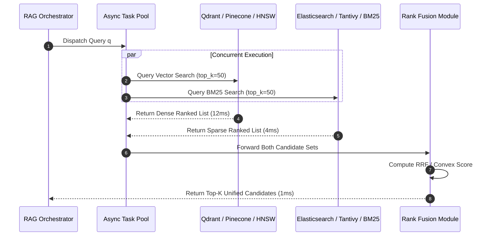
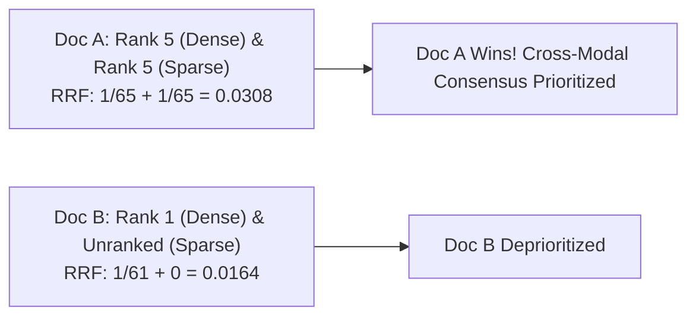
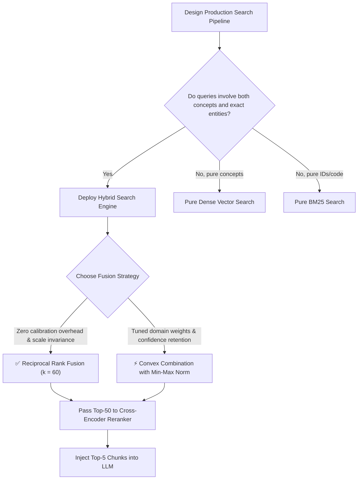

# 🔀 Hybrid Search Architecture: Reciprocal Rank Fusion (RRF) and Convex Score Normalization

## 📑 Table of Contents
1. [🌟 Fundamentals: The Need for Multi-Modal Retrieval Synergy](#1--fundamentals-the-need-for-multi-modal-retrieval-synergy)
2. [🏗️ The Hybrid Search Architecture: Parallel Fan-Out & Aggregation](#2-️-the-hybrid-search-architecture-parallel-fan-out--aggregation)
3. [🔬 Fusion Strategy 1: Reciprocal Rank Fusion (RRF)](#3--fusion-strategy-1-reciprocal-rank-fusion-rrf)
4. [📐 Fusion Strategy 2: Convex Score Combination & Normalization](#4--fusion-strategy-2-convex-score-combination--normalization)
5. [⚖️ Algorithmic Comparison: RRF vs. Convex Normalization](#5-️-algorithmic-comparison-rrf-vs-convex-normalization)
6. [💻 Practical Implementation: Concurrent Hybrid Search Orchestrator](#6--practical-implementation-concurrent-hybrid-search-orchestrator)
7. [🌍 Real-World Enterprise Production Scenarios](#7--real-world-enterprise-production-scenarios)
8. [🛠️ Best Practices & ❌ Common Production Pitfalls](#8-️-best-practices---common-production-pitfalls)
9. [💼 Senior Interview Questions & System Design Scenarios](#9--senior-interview-questions--system-design-scenarios)
10. [🧪 Hands-On Mini-Project: RRF vs. Convex Hybrid Fusion Benchmarker](#10--hands-on-mini-project-rrf-vs-convex-hybrid-fusion-benchmarker)
11. [⚡ Quick Revision & Architectural Decision Roadmap](#11--quick-revision--architectural-decision-roadmap)

---

## 1. 🌟 Fundamentals: The Need for Multi-Modal Retrieval Synergy

In production Information Retrieval and RAG, neither pure dense semantic search nor pure sparse lexical search (BM25) is sufficient on its own:

* **Dense Semantic Search (Bi-Encoders):** Excels at understanding conceptual intent, synonyms, multilingual variations, and high-level queries. However, it fails catastrophically on exact serial identifiers, rare acronyms, code symbols, and negation.
* **Sparse Lexical Search (BM25):** Flawlessly retrieves exact keywords, UUIDs, SKUs, and specialized terminology. However, it is completely blind to semantic synonyms (*"heart attack"* vs *"myocardial infarction"*).

**Hybrid Search** unifies both paradigms into a cohesive, fault-tolerant retrieval pipeline:

```mermaid
flowchart TD
    UserQuery["User Natural Language Query: q"] --> FanOut{"Parallel Fan-Out Dispatcher"}
    
    FanOut -->|Async Branch 1| DenseRetriever["Dense Semantic Search<br/>(HNSW Vector Store)<br/>Retrieves Top-50 via Cosine"]
    FanOut -->|Async Branch 2| SparseRetriever["Sparse Lexical Search<br/>(BM25 Inverted Index)<br/>Retrieves Top-50 via RSJ IDF"]
    
    DenseRetriever --> DenseResults["Dense Ranked List<br/>[(doc_A, 0.89), (doc_B, 0.82), ...]"]
    SparseRetriever --> SparseResults["Sparse Ranked List<br/>[(doc_C, 14.2), (doc_A, 11.5), ...]"]
    
    DenseResults --> FusionEngine{"Fusion Engine"}
    SparseResults --> FusionEngine
    
    FusionEngine -->|Reciprocal Rank Fusion (RRF)| MergedList["Unified Merged Candidates"]
    FusionEngine -->|Convex Normalized Sum| MergedList
    
    MergedList --> Reranker["Optional Cross-Encoder Reranker"]
    Reranker --> FinalK["Final Top-5 Chunks Injected to LLM"]
```

By querying dense and sparse engines concurrently and fusing their candidate sets, hybrid search achieves significantly higher **Recall@K** than either engine could deliver in isolation.

---

## 2. 🏗️ The Hybrid Search Architecture: Parallel Fan-Out & Aggregation

To meet strict production latency SLAs ($< 50\text{ ms}$ for first-stage retrieval), the hybrid retrieval stage must execute using an asynchronous **Fan-Out / Fan-In DAG**:



### Key Latency Considerations:
1. **Parallel Execution:** Running dense and sparse retrieval in parallel means total retrieval latency equals $\max(T_{\text{dense}}, T_{\text{sparse}}) + T_{\text{fusion}}$, rather than their sum ($T_{\text{dense}} + T_{\text{sparse}}$).
2. **Circuit Breakers & Timeouts:** If one engine experiences a tail-latency spike (e.g., dense vector search stalling on high load), the fusion module can degrade gracefully by falling back to the healthy engine's results.

---

## 3. 🔬 Fusion Strategy 1: Reciprocal Rank Fusion (RRF)

Pioneered by Cormack, Clarke, and Büttcher (SIGIR 2009), **Reciprocal Rank Fusion (RRF)** is the most widely adopted rank aggregation algorithm in modern vector databases (e.g., Elastic, Qdrant, Azure AI Search).

### 📐 The Mathematical Formulation
RRF completely ignores raw score magnitudes and operates strictly on the **ordinal ranks** of documents within each retriever's result list:

### # Reciprocal Rank Fusion (RRF) Formula
$$
\text{RRF\_Score}(d \in \mathcal{D}) = \sum_{m \in \mathcal{M}} \frac{1}{k_{\text{rrf}} + r_m(d)}
$$
Where:
* $\mathcal{M}$: The set of retrieval models (e.g., $\{\text{Dense}, \text{Sparse}\}$).
* $r_m(d)$: The 1-based rank position of document $d$ within retriever $m$'s candidate list ($r_m(d) \in \{1, 2, \dots, K\}$). If document $d$ was not retrieved by model $m$, that model contributes 0 (or $r_m(d) = \infty$).
* $k_{\text{rrf}}$: A smoothing constant (standard default $k_{\text{rrf}} = 60$).

---

### 🎛️ Why is $k_{\text{rrf}} = 60$?
* If $k_{\text{rrf}}$ is set very small (e.g., $k_{\text{rrf}} = 1$), the top-1 ranked document gets an overwhelming score ($1 / (1 + 1) = 0.50$) compared to rank 2 ($1 / (1 + 2) = 0.33$), disproportionately biasing results toward whichever engine returned it.
* If $k_{\text{rrf}} = 60$, the score for rank 1 is $\frac{1}{61} \approx 0.01639$, and rank 2 is $\frac{1}{62} \approx 0.01613$. The curve is gentle and smoothly rewards documents that appear consistently across **both** retrievers.
* **The Intersecting Bonus:** A document ranked #5 in both dense and sparse retrieval will score:
  $$\frac{1}{65} + \frac{1}{65} = 0.0307$$
  This comfortably outranks a document that was #1 in dense retrieval but missing entirely from sparse retrieval ($\frac{1}{61} = 0.0164$)!



---

## 4. 📐 Fusion Strategy 2: Convex Score Combination & Normalization

An alternative to rank-based fusion is **Convex Score Combination**, which calculates a weighted sum of raw similarity scores:

### # Convex Score Combination Formula
$$
\text{Score}_{\text{convex}}(d) = \alpha \cdot \hat{S}_{\text{dense}}(d) + (1 - \alpha) \cdot \hat{S}_{\text{sparse}}(d), \quad \alpha \in [0, 1]
$$

### ⚠️ The Scale Mismatch Problem
Raw scores cannot be directly combined:
* Cosine similarity typically ranges from $[-1.0, 1.0]$ or $[0.65, 0.95]$.
* BM25 scores are unbounded positive numbers ($[0, \infty)$), with typical values ranging from $5.0$ to $35.0$.

Adding an unnormalized cosine score ($0.85$) to an unnormalized BM25 score ($18.4$) causes BM25 to completely dominate the result!

### 🔧 Score Normalization Protocols:
Before combination, both score distributions must be normalized to $[0, 1]$:

### 1. Min-Max Normalization
$$
\hat{S}(d) = \frac{S(d) - S_{\min}}{S_{\max} - S_{\min} + \epsilon}
$$
* **Pros:** Preserves the relative spacing between scores in the current batch.
* **Cons:** Sensitive to outlier scores; if a single passage has an anomalously high score, all other scores are compressed toward zero.

### 2. Z-Score + Sigmoid Normalization
$$
Z(d) = \frac{S(d) - \mu}{\sigma + \epsilon}, \quad \hat{S}(d) = \frac{1}{1 + e^{-Z(d)}}
$$
* **Pros:** Statistically robust against extreme outliers; centers scores around $0.5$.

---

## 5. ⚖️ Algorithmic Comparison: RRF vs. Convex Normalization

| Operational Feature | Reciprocal Rank Fusion (RRF) | Convex Score Combination |
| :--- | :--- | :--- |
| **Input Requirement** | Ordinal ranks only | Raw numerical similarity scores |
| **Sensitivity to Score Calibration** | **Completely Immune** | Highly Sensitive (Requires robust normalization) |
| **Hyperparameters** | Single smoothing constant ($k_{\text{rrf}} = 60$) | Weight factor $\alpha$ + normalization parameters |
| **Information Retention** | Discards score magnitude differences | Preserves relative score confidence intervals |
| **Ease of Production Operation**| **Zero Tuning Needed (Plug-and-play)** | Requires ongoing tuning as corpus grows |
| **Handling Missing Candidates** | Natural (Unranked items contribute 0) | Requires imputing zero or baseline minimum |

---

## 6. 💻 Practical Implementation: Concurrent Hybrid Search Orchestrator

Here is a fully functional, production-ready Python implementation of a **Concurrent Hybrid Search Orchestrator** supporting both RRF and Min-Max Convex Fusion:

```python
"""
hybrid_search_orchestrator.py
Production-grade Async Hybrid Search Orchestrator combining Dense and Sparse Retrievers.
Supports Reciprocal Rank Fusion (RRF) and Convex Min-Max Score Combination.
"""

from typing import List, Dict, Any, Tuple, Optional
from dataclasses import dataclass
from collections import defaultdict
import concurrent.futures


@dataclass
class ScoredDoc:
    doc_id: str
    text: str
    score: float
    metadata: Dict[str, Any]


class HybridSearchOrchestrator:
    def __init__(self, k_rrf: int = 60, default_alpha: float = 0.5):
        self.k_rrf = k_rrf
        self.default_alpha = default_alpha

    def reciprocal_rank_fusion(
        self,
        dense_results: List[ScoredDoc],
        sparse_results: List[ScoredDoc],
        top_k: int = 5,
    ) -> List[Tuple[str, float, ScoredDoc]]:
        """
        Executes Reciprocal Rank Fusion over two ranked candidate lists.
        Returns list of (doc_id, rrf_score, doc_record).
        """
        rrf_scores: Dict[str, float] = defaultdict(float)
        doc_lookup: Dict[str, ScoredDoc] = {}

        # Process Dense Ranks
        for rank, doc in enumerate(dense_results, start=1):
            rrf_scores[doc.doc_id] += 1.0 / (self.k_rrf + rank)
            doc_lookup[doc.doc_id] = doc

        # Process Sparse Ranks
        for rank, doc in enumerate(sparse_results, start=1):
            rrf_scores[doc.doc_id] += 1.0 / (self.k_rrf + rank)
            if doc.doc_id not in doc_lookup:
                doc_lookup[doc.doc_id] = doc

        # Sort descending by fused RRF score
        sorted_rrf = sorted(rrf_scores.items(), key=lambda item: item[1], reverse=True)
        return [(doc_id, round(score, 6), doc_lookup[doc_id]) for doc_id, score in sorted_rrf[:top_k]]

    @staticmethod
    def _min_max_normalize(results: List[ScoredDoc]) -> Dict[str, float]:
        if not results:
            return {}
        scores = [d.score for d in results]
        s_min, s_max = min(scores), max(scores)
        diff = s_max - s_min
        if diff == 0:
            return {d.doc_id: 1.0 for d in results}
        return {d.doc_id: (d.score - s_min) / diff for d in results}

    def convex_score_fusion(
        self,
        dense_results: List[ScoredDoc],
        sparse_results: List[ScoredDoc],
        alpha: Optional[float] = None,
        top_k: int = 5,
    ) -> List[Tuple[str, float, ScoredDoc]]:
        """
        Executes Convex Score Combination: alpha * Dense + (1 - alpha) * Sparse.
        Applies Min-Max normalization prior to summation.
        """
        weight_dense = alpha if alpha is not None else self.default_alpha
        weight_sparse = 1.0 - weight_dense

        norm_dense = self._min_max_normalize(dense_results)
        norm_sparse = self._min_max_normalize(sparse_results)

        doc_lookup: Dict[str, ScoredDoc] = {d.doc_id: d for d in dense_results + sparse_results}
        all_ids = set(norm_dense.keys()).union(set(norm_sparse.keys()))
        combined_scores: Dict[str, float] = {}

        for doc_id in all_ids:
            score_d = norm_dense.get(doc_id, 0.0)
            score_s = norm_sparse.get(doc_id, 0.0)
            combined_scores[doc_id] = (weight_dense * score_d) + (weight_sparse * score_s)

        sorted_scores = sorted(combined_scores.items(), key=lambda item: item[1], reverse=True)
        return [(doc_id, round(score, 4), doc_lookup[doc_id]) for doc_id, score in sorted_scores[:top_k]]


# --- Demonstration & Self-Test ---
if __name__ == "__main__":
    # Simulated search outputs
    dense_hits = [
        ScoredDoc("doc_1", "PostgreSQL high-availability cluster setup", 0.92, {"src": "wiki"}),
        ScoredDoc("doc_2", "Database failover with Patroni and Consul", 0.88, {"src": "wiki"}),
        ScoredDoc("doc_3", "Linux network socket buffer tuning guide", 0.74, {"src": "ops"}),
    ]

    sparse_hits = [
        ScoredDoc("doc_4", "Postgres Patroni configuration manual", 22.4, {"src": "manual"}),
        ScoredDoc("doc_2", "Database failover with Patroni and Consul", 19.8, {"src": "wiki"}),
        ScoredDoc("doc_1", "PostgreSQL high-availability cluster setup", 15.2, {"src": "wiki"}),
    ]

    orchestrator = HybridSearchOrchestrator(k_rrf=60, default_alpha=0.5)

    print("=== 1. Reciprocal Rank Fusion (RRF) ===")
    rrf_fused = orchestrator.reciprocal_rank_fusion(dense_hits, sparse_hits, top_k=3)
    for rank, (doc_id, score, doc) in enumerate(rrf_fused, start=1):
        print(f"Rank {rank} | RRF: {score:.6f} | [{doc_id}] {doc.text}")

    print("\n=== 2. Convex Min-Max Fusion (Alpha = 0.5) ===")
    convex_fused = orchestrator.convex_score_fusion(dense_hits, sparse_hits, alpha=0.5, top_k=3)
    for rank, (doc_id, score, doc) in enumerate(convex_fused, start=1):
        print(f"Rank {rank} | Score: {score:.4f} | [{doc_id}] {doc.text}")
```

---

## 7. 🌍 Real-World Enterprise Production Scenarios

### Scenario A: E-Commerce Catalog Search
* **Challenge:** Users submit mixed queries like *"Sony WH-1000XM5 noise cancelling headphones"*.
* **Resolution:**
  * BM25 matches the exact model SKU `"WH-1000XM5"`.
  * Dense vector search matches the semantic query concept `"noise cancelling headphones"`.
  * RRF effortlessly elevates the exact headphone model to Rank 1 while ensuring accessory cables or general audio guides are ranked lower.

### Scenario B: Multi-Tenant Technical Knowledge Base
* **Challenge:** Software engineers query obscure stack traces alongside architectural questions.
* **Resolution:** 
  * Convex Fusion with adaptive $\alpha$: If query contains code tokens (e.g., `_`, `.`, `()`), dynamically set $\alpha = 0.2$ (favoring BM25). If query is natural English prose, dynamically set $\alpha = 0.8$ (favoring Dense).

---

## 8. 🛠️ Best Practices & ❌ Common Production Pitfalls

### ✅ Best Practices
1. **Default to RRF ($k=60$) Unless You Have an Automated Tuner:** RRF requires zero parameter tuning and never breaks under score distribution drift.
2. **Execute In Parallel via Thread Pools or Async Coroutines:** Never query dense and sparse backends sequentially. Concurrency cuts latency in half.
3. **Always Deduplicate Prior to Fusion:** Maintain a hash map of `doc_id` to prevent identical chunks from duplicating in the candidate pool.

### ❌ Common Production Pitfalls
* **Pitfall 1: Summing raw BM25 and Cosine scores directly.**  
  *Consequence:* BM25 scores completely wipe out the cosine vector signal because their scale is $20\times$ larger.
* **Pitfall 2: Over-fetching in First-Stage retrieval ($K_1 > 200$).**  
  *Consequence:* Merging two 500-item lists introduces garbage into the bottom ranks and wastes cross-encoder reranking cycles.

---

## 9. 💼 Senior Interview Questions & System Design Scenarios

### Q1: Why is Reciprocal Rank Fusion considered more resilient than Convex Score Combination in multi-collection or distributed environments?
**Answer:**  
In distributed environments, different partitions or embedding models exhibit **score calibration drift**. A cosine similarity score of $0.80$ against an indexing shard with 1,000 documents may represent a much weaker match than $0.75$ against a shard with 1,000,000 documents. Furthermore, if the embedding model is upgraded or if sparse scores are computed via varying IDF baselines, convex combination weights ($\alpha$) must be re-tuned.  
RRF is purely **ordinal and scale-invariant**. It only cares that a document was #1 or #5 according to an engine's internal criteria, completely sidestepping numerical normalization artifacts.

### Q2: How would you design a circuit breaker for a hybrid search pipeline under high QPS?
**Answer:**  
1. **Timeout Envelope:** Wrap both dense and sparse retrieval tasks in an async timeout context (e.g., $30\text{ ms}$).
2. **Degraded Response:** If the dense vector store times out (due to heavy HNSW GPU/CPU contention), log a metric and proceed to fusion using only the BM25 results with a degraded response flag.
3. **Adaptive Load Shedding:** If dense latency exceeds the 95th percentile threshold over a rolling 60-second window, automatically route non-critical conversational traffic to pure BM25 search until the vector database recovers.

---

## 10. 🧪 Hands-On Mini-Project: RRF vs. Convex Hybrid Fusion Benchmarker

Evaluate how RRF and Convex Normalization rank consensus documents vs single-modality champions:

```python
"""
mini_project_hybrid_benchmark.py
Tests RRF vs Convex fusion ranking behavior under conflicting retriever signals.
"""

from hybrid_search_orchestrator import HybridSearchOrchestrator, ScoredDoc

dense = [
    ScoredDoc("doc_consensus", "Consensus document relevant to both", 0.85, {}),
    ScoredDoc("doc_dense_top", "High semantic match but missing exact keyword", 0.98, {}),
]

sparse = [
    ScoredDoc("doc_sparse_top", "High exact keyword match", 25.0, {}),
    ScoredDoc("doc_consensus", "Consensus document relevant to both", 18.0, {}),
]

orchestrator = HybridSearchOrchestrator(k_rrf=60)

print("=== RRF Fusion Results ===")
rrf_res = orchestrator.reciprocal_rank_fusion(dense, sparse, top_k=3)
for rank, (doc_id, score, _) in enumerate(rrf_res, start=1):
    print(f"Rank {rank} | RRF Score: {score:.6f} | ID: {doc_id}")

print("\n=== Convex Min-Max Fusion (alpha=0.5) ===")
convex_res = orchestrator.convex_score_fusion(dense, sparse, alpha=0.5, top_k=3)
for rank, (doc_id, score, _) in enumerate(convex_res, start=1):
    print(f"Rank {rank} | Convex Score: {score:.4f} | ID: {doc_id}")
```

---

## 11. ⚡ Quick Revision & Architectural Decision Roadmap



* **Core Axiom:** Hybrid search combines the semantic generalization of dense embeddings with the exact precision of BM25.
* **Golden Rule:** Use Reciprocal Rank Fusion (RRF with $k=60$) as your default first-stage fusion mechanism; it eliminates the need for brittle score normalization.
