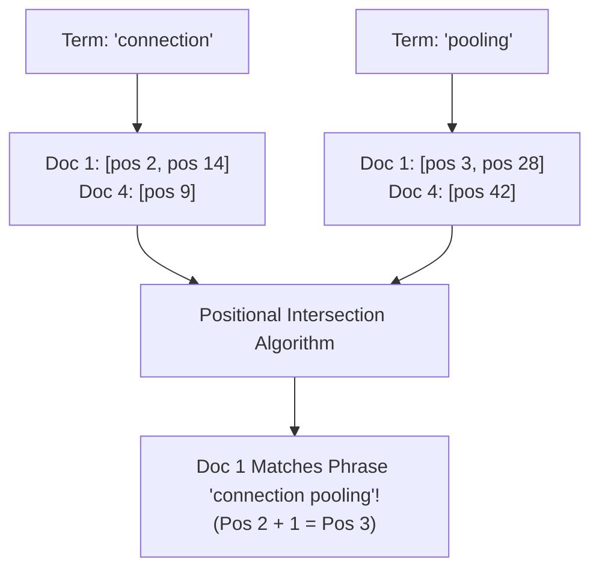
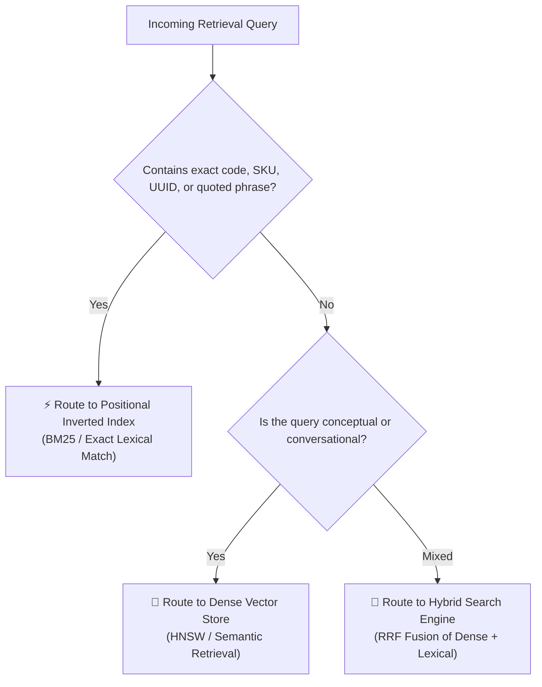

# 🔍 Keyword Retrieval: Inverted Indices, Term Frequency, and Exact Lexical Matching

## 📑 Table of Contents
1. [🌟 Fundamentals: The Power of Exact Lexical Matching](#1--fundamentals-the-power-of-exact-lexical-matching)
2. [🏛️ The Inverted Index Architecture: Postings Lists & Dictionaries](#2-️-the-inverted-index-architecture-postings-lists--dictionaries)
3. [⚙️ The Lexical Processing Pipeline: Tokenization, Stemming, and Lemmatization](#3-️-the-lexical-processing-pipeline-tokenization-stemming-and-lemmatization)
4. [🔬 Mathematical Foundations: Term Frequency & The Vector Space Model](#4--mathematical-foundations-term-frequency--the-vector-space-model)
5. [🎯 Positional Indexing, Phrase Queries, and Proximity Scoring](#5--positional-indexing-phrase-queries-and-proximity-scoring)
6. [⚖️ Inverted Indices vs. Dense Vector Stores: Architectural Trade-Offs](#6-️-inverted-indices-vs-dense-vector-stores-architectural-trade-offs)
7. [💻 Practical Implementation: Positional Inverted Index Search Engine](#7--practical-implementation-positional-inverted-index-search-engine)
8. [🌍 Real-World Enterprise Production Scenarios](#8-️-real-world-enterprise-production-scenarios)
9. [🛠️ Best Practices & ❌ Common Production Pitfalls](#9-️-best-practices---common-production-pitfalls)
10. [💼 Senior Interview Questions & System Design Scenarios](#10--senior-interview-questions--system-design-scenarios)
11. [🧪 Hands-On Mini-Project: Positional Phrase & Boolean Search Evaluator](#11--hands-on-mini-project-positional-phrase--boolean-search-evaluator)
12. [⚡ Quick Revision & Architectural Decision Roadmap](#12--quick-revision--architectural-decision-roadmap)

---

## 1. 🌟 Fundamentals: The Power of Exact Lexical Matching

In the era of deep neural representations and Large Language Models, **Keyword Retrieval (Exact Lexical Matching)** remains an indispensable cornerstone of enterprise Information Retrieval (IR) and RAG systems.

While dense semantic vectors capture high-level conceptual meaning, they inherently smooth over the fine-grained nuances of exact symbolic representations:
* **Unique Identifiers:** UUIDs, API keys, error codes (`ERR_CONNECTION_REFUSED`), product SKUs (`SKU-7701-X`), and CVE numbers (`CVE-2024-3094`).
* **Domain Specific Entities:** Chemical formulas, legal case citations (`Chevron U.S.A. v. NRDC`), and programming syntax (`__init__.py`).
* **Strict Boolean Logic:** Enforcing the absolute presence of mandatory terms (`AND`) or the complete exclusion of blacklisted words (`NOT`).

**Keyword retrieval** delivers deterministic, zero-hallucination lexical matching with microsecond query latency and minimal memory overhead.

---

## 2. 🏛️ The Inverted Index Architecture: Postings Lists & Dictionaries

The fundamental data structure powering modern search engines (e.g., Elasticsearch, Apache Lucene, OpenSearch) is the **Inverted Index**.

Instead of storing documents and listing their containing terms (forward index), an inverted index maps every unique vocabulary term to a **Postings List** of documents where that term occurs:

```mermaid
flowchart TD
    subgraph RawDocuments [Forward Document Space]
        Doc1["Doc 1: 'PostgreSQL connection pooling'"]
        Doc2["Doc 2: 'PostgreSQL backup and recovery'"]
        Doc3["Doc 3: 'Docker container pooling'"]
    end

    subgraph InvertedIndex [Inverted Index Architecture]
        subgraph TermDictionary [Vocabulary Dictionary (B-Tree / FST)]
            T1["backup"]
            T2["connection"]
            T3["container"]
            T4["docker"]
            T5["pooling"]
            T6["postgresql"]
            T7["recovery"]
        end

        subgraph PostingsLists [Postings Lists with DocIDs & Frequency]
            T1 --> P1["[Doc 2 (tf=1)]"]
            T2 --> P2["[Doc 1 (tf=1)]"]
            T3 --> P3["[Doc 3 (tf=1)]"]
            T4 --> P4["[Doc 3 (tf=1)]"]
            T5 --> P5["[Doc 1 (tf=1)] -> [Doc 3 (tf=1)]"]
            T6 --> P6["[Doc 1 (tf=1)] -> [Doc 2 (tf=1)]"]
            T7 --> P7["[Doc 2 (tf=1)]"]
        end
    end

    Doc1 --> InvertedIndex
    Doc2 --> InvertedIndex
    Doc3 --> InvertedIndex
```

### Components of an Inverted Index:
1. **Term Dictionary:** The sorted vocabulary of all unique terms across the corpus, typically structured as a **Finite State Transducer (FST)** or **B-Tree** for $O(\log |\mathcal{V}|)$ term lookups.
2. **Postings List:** A compressed sequence of records for each term containing:
   * **DocID:** The unique identifier of the containing document.
   * **Term Frequency ($tf$):** How many times the term appears in that document.
   * **Positions:** The exact 0-indexed token offsets within the document (enabling phrase and proximity queries).
   * **Payloads / Offsets:** Character start/end offsets for text highlighting.

---

## 3. ⚙️ The Lexical Processing Pipeline: Tokenization, Stemming, and Lemmatization

Before text enters an inverted index or query evaluator, it passes through an **Analysis Pipeline**:


### Key Stages:
* **Tokenization:** Splits unstructured character streams into discrete tokens (words, punctuation, symbols).
* **Case Folding & Unicode Normalization:** Converts text to lowercase and normalizes Unicode (e.g., NFKD for accented characters).
* **Stop-Word Removal:** Filters out high-frequency functional words (*"the"*, *"is"*, *"at"*, *"which"*).
* **Stemming vs. Lemmatization:**
  * **Stemming (e.g., Porter, Snowball):** Uses crude heuristic suffix-stripping rules (`"running"` $\to$ `"run"`, `"relational"` $\to$ `"relat"`). Fast, low memory, but can over-stem (`"universal"` and `"universe"` both mapping to `"univers"`).
  * **Lemmatization:** Uses morphological analysis and dictionaries to reduce a word to its canonical base lemma (`"better"` $\to$ `"good"`). More accurate, but requires significant CPU and vocabulary lookups.

---

## 4. 🔬 Mathematical Foundations: Term Frequency & The Vector Space Model

In classic lexical retrieval, documents and queries are represented as sparse vectors in an $M$-dimensional space, where $M = |\mathcal{V}|$ is the vocabulary size.

### 📐 1. Term Frequency ($tf_{t, D}$)
Measures how often term $t$ appears in document $D$:
$$
tf_{t, D} = \frac{f_{t, D}}{|D|} \quad \text{or log-normalized:} \quad 1 + \ln(f_{t, D}) \quad (\text{for } f_{t, D} > 0)
$$

### 📐 2. Inverse Document Frequency ($idf_t$)
Downweights common terms and elevates rare, information-rich words:
$$
idf_t = \ln\left( \frac{N}{df_t} \right)
$$
where $N$ is total documents in corpus, and $df_t$ is the number of documents containing term $t$.

### 📐 3. TF-IDF Score
The standard TF-IDF weight for term $t$ in document $D$ is:
$$
\text{TF-IDF}(t, D, \mathcal{C}) = tf_{t, D} \cdot idf_t
$$

The overall relevance score between query $Q$ and document $D$ is the cosine similarity of their sparse vectors:
$$
\text{Score}_{\text{TF-IDF}}(Q, D) = \sum_{t \in Q \cap D} tf_{t, Q} \cdot tf_{t, D} \cdot (idf_t)^2
$$

---

## 5. 🎯 Positional Indexing, Phrase Queries, and Proximity Scoring

Standard postings lists indicate *which* documents contain a word, but cannot answer:
1. **Phrase Queries:** Does the document contain the exact phrase `"connection pooling"`?
2. **Proximity (Slop) Queries:** Do the words `"postgres"` and `"timeout"` appear within 5 words of each other?

To support these, modern search engines utilize a **Positional Inverted Index**:



### Mathematical Proximity Scoring
When multiple query terms appear in a document, their physical distance reflects topical cohesion. The **Proximity Score** between terms $t_1$ and $t_2$ at positions $p_1$ and $p_2$ is modeled as:
$$
\text{Score}_{\text{prox}}(D) = \sum_{t_1, t_2 \in Q} \frac{1}{|p_1 - p_2|^\gamma} \quad (\text{where } \gamma \ge 1)
$$

---

## 6. ⚖️ Inverted Indices vs. Dense Vector Stores: Architectural Trade-Offs

| Operational Dimension | Inverted Index (Lexical / BM25) | Dense Vector Store (HNSW / Semantic) |
| :--- | :--- | :--- |
| **Matching Mechanism** | Exact token string matching | Latent geometric angular proximity |
| **Index Data Structure** | Inverted Postings Lists + FST | Multi-layer proximity graph (HNSW) / Voronoi (IVF) |
| **Query Latency** | **$1 - 5 \text{ ms}$** (Microsecond postings intersection) | $5 - 25 \text{ ms}$ (High-dimensional vector distance ops) |
| **Index Size on Disk** | **Compact ($10\% - 20\%$ of raw text size)** | Large ($100\% - 300\%$ of raw text size due to floats) |
| **RAM Consumption** | Low (Paged easily from NVMe disk) | **High (HNSW graphs must reside in RAM)** |
| **Exact Token Precision** | **$100\%$ Perfect** | Poor (Prone to subword scattering & false matches) |
| **Synonym & Paraphrase Handling** | None (Fails unless explicitly expanded) | **High (Naturally maps concepts to similar regions)** |
| **Multilingual Cross-Search** | None (Requires cross-lingual dictionary) | **High (Shared continuous embedding space)** |

---

## 7. 💻 Practical Implementation: Positional Inverted Index Search Engine

Here is a fully functional, self-contained Python implementation of an in-memory **Positional Inverted Index Engine** supporting boolean search (AND/OR), exact phrase queries, and term frequency scoring:

```python
"""
positional_inverted_index.py
Production-grade In-Memory Positional Inverted Index Engine.
Supports tokenization, boolean search, phrase queries, and TF-IDF scoring.
"""

import math
import re
from typing import List, Dict, Set, Tuple, Any, Optional
from collections import defaultdict


class PositionalInvertedIndex:
    def __init__(self):
        # term -> {doc_id -> list of token positions}
        self.index: Dict[str, Dict[str, List[int]]] = defaultdict(lambda: defaultdict(list))
        # doc_id -> total token count
        self.doc_lengths: Dict[str, int] = {}
        # doc_id -> raw document text
        self.documents: Dict[str, str] = {}
        # Precompiled regex for fast alphanumeric tokenization
        self._tokenizer_regex = re.compile(r"\b[a-zA-Z0-9_-]+\b")

    def _tokenize(self, text: str) -> List[str]:
        return [token.lower() for token in self._tokenizer_regex.findall(text)]

    def add_document(self, doc_id: str, text: str) -> None:
        """
        Indexes a document by recording token frequencies and exact token positions.
        """
        tokens = self._tokenize(text)
        self.documents[doc_id] = text
        self.doc_lengths[doc_id] = len(tokens)

        for pos, token in enumerate(tokens):
            self.index[token][doc_id].append(pos)

    def search_term(self, term: str) -> Dict[str, List[int]]:
        """Returns the postings mapping doc_id -> positions for a single term."""
        return self.index.get(term.lower(), {})

    def search_boolean_and(self, terms: List[str]) -> Set[str]:
        """
        Finds all doc_ids containing ALL specified terms (Boolean AND).
        """
        if not terms:
            return set()
        normalized_terms = [t.lower() for t in terms]
        candidate_sets = [set(self.index.get(t, {}).keys()) for t in normalized_terms]
        return set.intersection(*candidate_sets) if candidate_sets else set()

    def search_phrase(self, phrase: str) -> List[Tuple[str, float]]:
        """
        Executes exact phrase query matching. Tokens must appear contiguously.
        Returns list of (doc_id, score).
        """
        tokens = self._tokenize(phrase)
        if not tokens:
            return []
        if len(tokens) == 1:
            postings = self.search_term(tokens[0])
            return [(doc_id, len(pos)) for doc_id, pos in postings.items()]

        # Find docs containing all tokens first
        candidate_docs = self.search_boolean_and(tokens)
        matching_docs: List[Tuple[str, float]] = []

        for doc_id in candidate_docs:
            # Check for contiguous positional alignment
            first_positions = self.index[tokens[0]][doc_id]
            phrase_matches = 0

            for start_pos in first_positions:
                match = True
                for offset in range(1, len(tokens)):
                    expected_pos = start_pos + offset
                    if expected_pos not in self.index[tokens[offset]][doc_id]:
                        match = False
                        break
                if match:
                    phrase_matches += 1

            if phrase_matches > 0:
                # Basic TF score for phrase frequency
                score = phrase_matches / self.doc_lengths[doc_id]
                matching_docs.append((doc_id, round(score, 4)))

        return sorted(matching_docs, key=lambda x: x[1], reverse=True)

    def tf_idf_search(self, query: str, top_k: int = 5) -> List[Tuple[str, float]]:
        """
        Computes standard TF-IDF relevance across multi-term queries.
        """
        query_tokens = self._tokenize(query)
        if not query_tokens:
            return []

        N = len(self.documents)
        doc_scores: Dict[str, float] = defaultdict(float)

        for token in query_tokens:
            postings = self.index.get(token, {})
            df = len(postings)
            if df == 0:
                continue

            # Inverse Document Frequency (Robertson-Spärck Jones)
            idf = math.log((N - df + 0.5) / (df + 0.5) + 1.0)

            for doc_id, positions in postings.items():
                tf = len(positions) / self.doc_lengths[doc_id]
                doc_scores[doc_id] += tf * idf

        sorted_results = sorted(doc_scores.items(), key=lambda x: x[1], reverse=True)
        return [(doc_id, round(score, 4)) for doc_id, score in sorted_results[:top_k]]


# --- Demonstration & Self-Test ---
if __name__ == "__main__":
    idx = PositionalInvertedIndex()

    idx.add_document("doc_1", "PostgreSQL database connection pooling with PgBouncer.")
    idx.add_document("doc_2", "Database backup scheduling and disaster recovery procedures.")
    idx.add_document("doc_3", "Docker container connection pooling configuration.")
    idx.add_document("doc_4", "PostgreSQL replication and high availability with connection failover.")

    print("=== 1. Single Term Search ('connection') ===")
    res_term = idx.search_term("connection")
    for doc_id, positions in res_term.items():
        print(f"Doc: {doc_id} -> Positions: {positions}")

    print("\n=== 2. Boolean AND Search ('postgresql', 'pooling') ===")
    res_bool = idx.search_boolean_and(["postgresql", "pooling"])
    print(f"Matching Documents: {res_bool}")

    print("\n=== 3. Exact Phrase Search ('connection pooling') ===")
    res_phrase = idx.search_phrase("connection pooling")
    for doc_id, score in res_phrase:
        print(f"Phrase Match: [{doc_id}] (Score: {score:.4f}) -> {idx.documents[doc_id]}")

    print("\n=== 4. TF-IDF Multi-Term Search ('postgresql disaster recovery') ===")
    res_tfidf = idx.tf_idf_search("postgresql disaster recovery", top_k=3)
    for doc_id, score in res_tfidf:
        print(f"TF-IDF Match: [{doc_id}] (Score: {score:.4f}) -> {idx.documents[doc_id]}")
```

---

## 8. 🌍 Real-World Enterprise Production Scenarios

### Scenario A: Regulatory Audit & SEC 10-K Filings Search
* **Context:** Financial compliance officers must search for strict disclosures: `"Note 14: Commitments and Contingencies"`.
* **Why Lexical Search is Mandatory:** Dense semantic search produces false positive matches across all notes discussing generic risks or liabilities. Only a positional inverted index can guarantee an exact string match for `"Note 14"` followed immediately by `"Commitments"`.

### Scenario B: Software Documentation & API Code Search
* **Context:** Developers search for specific exception strings, e.g., `NullPointerException at AuthProvider.java:142`.
* **Why Lexical Search Wins:** An inverted index tokenizes on punctuation and symbols, allowing direct sub-millisecond retrieval of the exact source file and line citation without neural hallucination.

---

## 9. 🛠️ Best Practices & ❌ Common Production Pitfalls

### ✅ Best Practices
1. **Preserve Case-Sensitive Symbols for Code & SKUs:** Use custom analyzers (e.g., Lucene `WhitespaceAnalyzer` or `PatternCapture`) to preserve symbols like `_`, `-`, and camelCase for technical documentation.
2. **Compress Postings Lists with Delta / Varint Encoding:** Never store raw integer DocIDs. Store delta differences ($\Delta_i = \text{doc}_{i} - \text{doc}_{i-1}$) and encode them using Variable Byte or SIMD-BP128 compression to save $80\%$ RAM/disk space.
3. **Always Index Positions for Phrase Search:** Without positional offsets, verifying phrases requires loading full document texts from disk at runtime, destroying search throughput.

### ❌ Common Production Pitfalls
* **Pitfall 1: Over-aggressive stop-word filtering.**  
  *Consequence:* Stripping words like *"to"*, *"be"*, *"or"*, and *"not"* completely destroys famous queries like *"To be or not to be"* or programming idioms like *"or not"*.
* **Pitfall 2: Discarding numbers in regex tokenizers.**  
  *Consequence:* Queries searching for `"OAuth 2.0"`, `"IPv6"`, or `"Section 404"` match nothing because digits were stripped during ingestion.

---

## 10. 💼 Senior Interview Questions & System Design Scenarios

### Q1: How does a search engine efficiently compute the intersection of two postings lists?
**Answer:**  
Postings lists are stored as strictly sorted arrays of document IDs: $\mathcal{P}_1 = [2, 5, 8, 14, 21]$ and $\mathcal{P}_2 = [5, 9, 14, 30]$.
1. **Two-Pointer Linear Scan:** Initialize pointers $p_1 = 0, p_2 = 0$. Compare $\mathcal{P}_1[p_1]$ and $\mathcal{P}_2[p_2]$. If equal, emit DocID and advance both. Otherwise, advance the pointer with the smaller value. Complexity: $\mathcal{O}(L_1 + L_2)$.
2. **Skip Pointers / Skip Lists:** For asymmetric lists (where $L_1 \ll L_2$), postings lists insert skip pointers every $\sqrt{L}$ elements. The engine can "skip" forward in $\mathcal{P}_2$ over large blocks of irrelevant IDs, reducing complexity to $\mathcal{O}(L_1 \log L_2)$.
3. **SIMD Vectorized Bitmaps:** Modern engines (Lucene 9+, Tantivy) evaluate bitwise AND operations over Roaring Bitmaps at millions of IDs per millisecond using CPU AVX2 instructions.

### Q2: Why did Lucene replace the standard Vector Space Model (TF-IDF) with BM25 as its default ranking algorithm?
**Answer:**  
Standard TF-IDF has two critical algorithmic shortcomings:
1. **No Term Frequency Saturation:** In TF-IDF, score increases linearly (or unbounded logarithmically) with term repetitions. A document repeating the word `"database"` 50 times scores artificially higher than a comprehensive document mentioning it 3 times. BM25 introduces an asymptotic ceiling ($k_1$) where additional term occurrences yield diminishing returns.
2. **Crude Document Length Normalization:** TF-IDF divides by total document length, penalizing long, comprehensive documents too harshly. BM25's parameter $b$ calibrates length normalization against the corpus average ($\text{avgdl}$), distinguishing between naturally long documents and documents diluted with off-topic text.

---

## 11. 🧪 Hands-On Mini-Project: Positional Phrase & Boolean Search Evaluator

Test positional phrase matching and term-frequency scoring across a miniature legal dataset:

```python
"""
mini_project_keyword_search.py
Tests exact lexical phrases against loose keyword combinations.
"""

from positional_inverted_index import PositionalInvertedIndex

if __name__ == "__main__":
    engine = PositionalInvertedIndex()

    engine.add_document("contract_A", "The party shall provide notice within thirty days of breach.")
    engine.add_document("contract_B", "Notice of breach shall be delivered within thirty calendar days.")
    engine.add_document("contract_C", "Thirty days following notice, the contract terminates upon breach.")

    query_phrase = "thirty days"
    matches = engine.search_phrase(query_phrase)

    print(f"=== Phrase Query: '{query_phrase}' ===")
    for doc_id, score in matches:
        print(f"Found in [{doc_id}] -> {engine.documents[doc_id]}")
```

---

## 12. ⚡ Quick Revision & Architectural Decision Roadmap



* **Core Axiom:** Inverted indices provide exact, explainable, and lightning-fast lexical matching that neural embeddings cannot reliably duplicate.
* **Golden Rule:** Never discard symbol characters (`_`, `-`, `.`) from your lexical tokenizer when building search indices for technical or regulatory documents.
