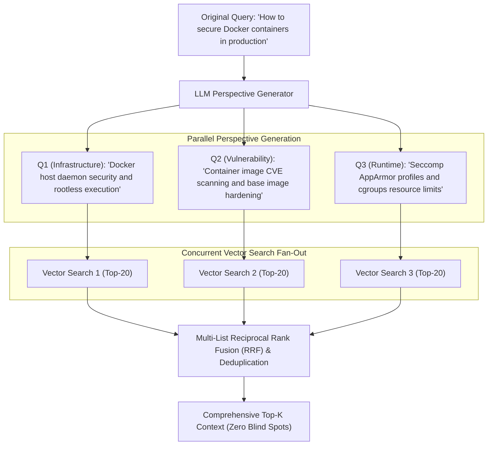
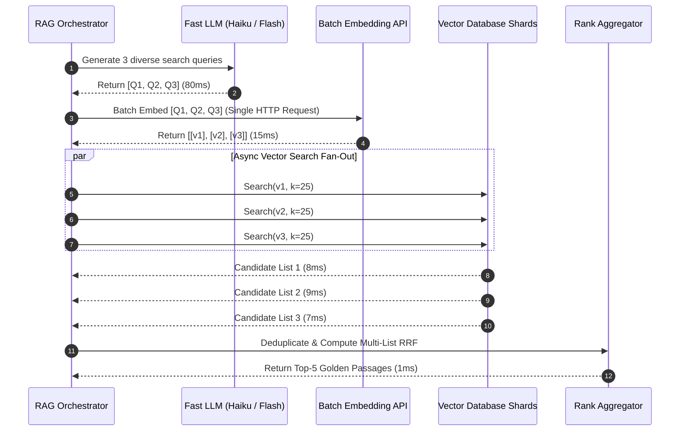
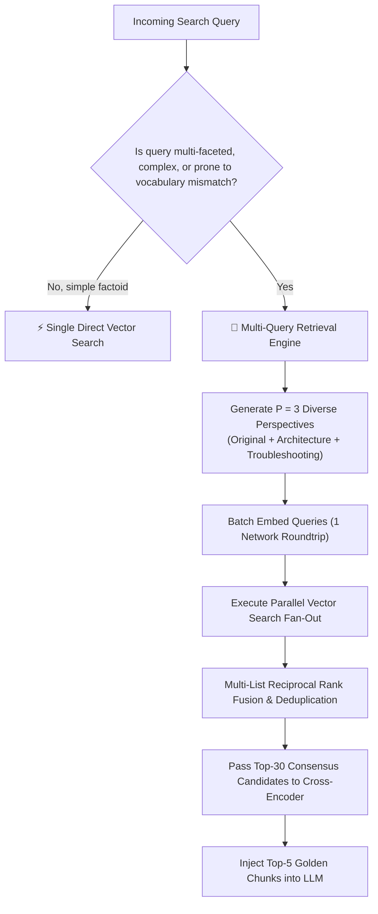

# 🔀 Multi-Query Retrieval: Perspective Generation, Parallel Search, and Ensemble Merging

## 📑 Table of Contents
1. [🌟 Fundamentals: Phrasing Sensitivity & The Single-Query Bottleneck](#1--fundamentals-phrasing-sensitivity--the-single-query-bottleneck)
2. [🎭 Multi-Perspective Generation: Paraphrasing & Facet Decomposition](#2--multi-perspective-generation-paraphrasing--facet-decomposition)
3. [⚡ Concurrent Fan-Out Retrieval Architecture](#3-️-concurrent-fan-out-retrieval-architecture)
4. [🔬 Ensemble Merging & Rank Aggregation Algorithms](#4--ensemble-merging--rank-aggregation-algorithms)
5. [⚖️ Latency, Cost, and Token Budget Trade-Offs](#5-️-latency-cost-and-token-budget-trade-offs)
6. [💻 Practical Implementation: Async Multi-Query Retrieval Engine](#6--practical-implementation-async-multi-query-retrieval-engine)
7. [🌍 Real-World Enterprise Production Scenarios](#7--real-world-enterprise-production-scenarios)
8. [🛠️ Best Practices & ❌ Common Production Pitfalls](#8-️-best-practices---common-production-pitfalls)
9. [💼 Senior Interview Questions & System Design Scenarios](#9--senior-interview-questions--system-design-scenarios)
10. [🧪 Hands-On Mini-Project: Multi-Query Fan-Out & Rank Fusion Benchmarker](#10--hands-on-mini-project-multi-query-fan-out--rank-fusion-benchmarker)
11. [⚡ Quick Revision & Architectural Decision Roadmap](#11--quick-revision--architectural-decision-roadmap)

---

## 1. 🌟 Fundamentals: Phrasing Sensitivity & The Single-Query Bottleneck

In standard RAG architectures, retrieval operates through a **single query vector**:
$$
\mathbf{q} = E(q_{\text{user}}), \quad \mathcal{S}_K = \text{Top-}K(\mathbf{q}, \mathcal{D})
$$

However, dense vector representations are acutely sensitive to the syntactic phrasing, vocabulary choice, and perspective of the user:
* A user asking: *"How do I scale web services under high traffic?"* maps to vectors clustered around autoscaling and horizontal pod scaling.
* The same user asking: *"How do I eliminate web server latency spikes during load surges?"* maps to vectors clustered around connection pooling, caching, and rate limiting.

Both prompts express the same underlying business requirement, yet an approximate nearest neighbor search yields **completely disjoint document sets**!

**Multi-Query Retrieval** solves this by prompting an LLM to generate $P$ diverse perspectives, paraphrases, or facet-specific reformulations of the original query. The system executes $P$ parallel vector searches and merges the resulting candidate lists into a unified, high-recall consensus ranking:



---

## 2. 🎭 Multi-Perspective Generation: Paraphrasing & Facet Decomposition

To maximize retrieval coverage without causing topic drift, perspective generation models employ two primary techniques:

### 1. Paraphrasing & Lexical Diversity
Rephrases the query using alternative terminology, active/passive voice, and varying technical depth:
* *Original:* *"Fix database connection pool exhaustion."*
* *Variant A:* *"PostgreSQL maximum client connections exceeded troubleshooting."*
* *Variant B:* *"PgBouncer pool size starvation and timeout resolution."*

### 2. Orthogonal Facet Decomposition (Aspect Splitting)
Splits a complex question into its prerequisite sub-facets:
* *Original:* *"Is Snowflake HIPAA compliant for clinical patient analytics?"*
* *Facet 1 (Security):* *"Snowflake Business Associate Agreement (BAA) and encryption standards."*
* *Facet 2 (Access Control):* *"Role-based access control and masking policies in Snowflake."*
* *Facet 3 (Compliance):* *"HITRUST and HIPAA certified cloud data warehouses."*

---

## 3. ⚡ Concurrent Fan-Out Retrieval Architecture

To prevent query latency from scaling linearly with $P$ ($T_{\text{total}} \neq P \times T_{\text{search}}$), production systems use **asynchronous fan-out gathering**:



---

## 4. 🔬 Ensemble Merging & Rank Aggregation Algorithms

Once $P$ candidate lists are collected ($\mathcal{S}_1, \mathcal{S}_2, \dots, \mathcal{S}_P$), they must be merged and deduplicated. Two primary algorithms are used in production:

### 📐 1. Multi-List Reciprocal Rank Fusion (RRF)
Extends standard RRF across all $P$ perspective candidate lists:

### # Multi-Perspective RRF Formula
$$
\text{RRF\_Score}(d \in \mathcal{U}) = \sum_{p=1}^P \frac{1}{k_{\text{rrf}} + r_p(d)}
$$
Where:
* $\mathcal{U} = \bigcup_{p=1}^P \mathcal{S}_p$: The union of all unique candidate documents.
* $r_p(d)$: The 1-based rank of document $d$ in the candidate list of perspective $p$. If document $d$ did not appear in list $p$, its contribution is 0.

### 📐 2. Borda Count & Frequency Voting
Ranks documents based on their **consensus frequency** across queries:
$$
\text{Score}_{\text{vote}}(d) = \sum_{p=1}^P \mathbb{I}(d \in \mathcal{S}_p) \cdot (K - r_p(d) + 1)
$$
A document retrieved by all 3 query variants automatically outranks a document retrieved by only 1 variant, rewarding multi-perspective consensus.

---

## 5. ⚖️ Latency, Cost, and Token Budget Trade-Offs

While Multi-Query Retrieval significantly improves Recall@K, it introduces structural system costs:

| Resource Dimension | Standard Single Query | Multi-Query Retrieval ($P = 3$) | Multi-Query Retrieval ($P = 5$) |
| :--- | :--- | :--- | :--- |
| **Upstream LLM Latency** | $0\text{ ms}$ (No generation) | $+80 - 150\text{ ms}$ | $+120 - 220\text{ ms}$ |
| **Embedding API Calls** | 1 vector | 3 vectors (Batchable) | 5 vectors (Batchable) |
| **Vector DB Search Operations**| 1 query | 3 concurrent queries | 5 concurrent queries |
| **Deduplicated Candidate Pool**| $25$ items | $\approx 45 - 65$ items | $\approx 70 - 110$ items |
| **Reranker Computational Cost**| Low | $2.5\times$ higher | $4\times$ higher |
| **Empirical Recall@10** | $68\% - 78\%$ | **$88\% - 94\%$** | $92\% - 96\%$ |

---

## 6. 💻 Practical Implementation: Async Multi-Query Retrieval Engine

Below is a complete, production-ready Python implementation of an asynchronous **Multi-Query Retrieval Engine** with perspective generation, batch embedding simulation, concurrent retrieval, and multi-list RRF merging:

```python
"""
multi_query_retriever.py
Production-grade Async Multi-Query Retrieval Engine.
Generates multi-perspective queries, executes concurrent vector searches, and merges via RRF.
"""

from typing import List, Dict, Any, Tuple
from dataclasses import dataclass
from collections import defaultdict
import numpy as np
import concurrent.futures


@dataclass
class RetrievedChunk:
    chunk_id: str
    text: str
    metadata: Dict[str, Any]


class MultiQueryRetrievalEngine:
    def __init__(self, k_rrf: int = 60, per_query_k: int = 15):
        self.k_rrf = k_rrf
        self.per_query_k = per_query_k

    def generate_perspectives(self, original_query: str) -> List[str]:
        """
        In production, invoke lightweight LLM (GPT-4o-mini / Haiku) with strict JSON output.
        Simulated here with deterministic perspective templates.
        """
        return [
            original_query,
            f"Technical architecture and system design considerations for {original_query}",
            f"Common errors, troubleshooting, and operational failure modes in {original_query}",
        ]

    def mock_vector_search(self, query: str, top_k: int) -> List[Tuple[RetrievedChunk, int]]:
        """
        Simulates an external vector database query returning (chunk, rank).
        """
        # Deterministic simulation based on query hash
        q_lower = query.lower()
        if "architecture" in q_lower:
            return [
                (RetrievedChunk("doc_arch_1", "High availability cluster architecture specs", {"type": "arch"}), 1),
                (RetrievedChunk("doc_shared_core", "Core service configuration and deployment guide", {"type": "core"}), 2),
                (RetrievedChunk("doc_arch_2", "Network topology and ingress load balancer setup", {"type": "arch"}), 3),
            ]
        elif "troubleshooting" in q_lower or "failure" in q_lower:
            return [
                (RetrievedChunk("doc_trouble_1", "Debugging connection timeouts and socket leaks", {"type": "ops"}), 1),
                (RetrievedChunk("doc_shared_core", "Core service configuration and deployment guide", {"type": "core"}), 2),
                (RetrievedChunk("doc_trouble_2", "Memory leak mitigation and thread dump analysis", {"type": "ops"}), 3),
            ]
        else:
            return [
                (RetrievedChunk("doc_shared_core", "Core service configuration and deployment guide", {"type": "core"}), 1),
                (RetrievedChunk("doc_basic_1", "Getting started quickstart tutorial", {"type": "guide"}), 2),
                (RetrievedChunk("doc_arch_1", "High availability cluster architecture specs", {"type": "arch"}), 3),
            ]

    def execute_multi_query_retrieval(
        self, original_query: str, final_k: int = 5
    ) -> List[Tuple[str, float, RetrievedChunk]]:
        """
        Executes parallel multi-query fan-out and merges results using RRF.
        """
        perspectives = self.generate_perspectives(original_query)
        candidate_lists: List[List[Tuple[RetrievedChunk, int]]] = []

        # Execute concurrent searches
        with concurrent.futures.ThreadPoolExecutor(max_workers=len(perspectives)) as executor:
            future_to_query = {
                executor.submit(self.mock_vector_search, q, self.per_query_k): q for q in perspectives
            }
            for future in concurrent.futures.as_completed(future_to_query):
                candidate_lists.append(future.result())

        # Multi-List Reciprocal Rank Fusion
        rrf_scores: Dict[str, float] = defaultdict(float)
        chunk_lookup: Dict[str, RetrievedChunk] = {}

        for candidates in candidate_lists:
            for chunk, rank in candidates:
                rrf_scores[chunk.chunk_id] += 1.0 / (self.k_rrf + rank)
                chunk_lookup[chunk.chunk_id] = chunk

        # Sort descending by fused score
        sorted_results = sorted(rrf_scores.items(), key=lambda item: item[1], reverse=True)
        return [(cid, round(score, 6), chunk_lookup[cid]) for cid, score in sorted_results[:final_k]]


# --- Demonstration & Self-Test ---
if __name__ == "__main__":
    engine = MultiQueryRetrievalEngine(k_rrf=60, per_query_k=5)

    user_q = "Kubernetes production cluster management"
    print(f"=== Original User Query: '{user_q}' ===")

    perspectives = engine.generate_perspectives(user_q)
    print("\nGenerated Search Perspectives:")
    for idx, p in enumerate(perspectives, start=1):
        print(f"  {idx}. {p}")

    results = engine.execute_multi_query_retrieval(user_q, final_k=4)

    print("\n=== Merged Consensus Candidates (Multi-List RRF) ===")
    for rank, (cid, score, chunk) in enumerate(results, start=1):
        print(f"Rank {rank} | RRF Score: {score:.6f} | [{cid}] {chunk.text}")
```

---

## 7. 🌍 Real-World Enterprise Production Scenarios

### Scenario A: Financial M&A Due Diligence Auditing
* **User Query:** *"What liabilities does Target Corp hold under ongoing environmental litigation?"*
* **Multi-Query Decomposition:**
  * Perspective 1: *"EPA regulatory violations and pending consent decrees Target Corp."*
  * Perspective 2: *"Superfund CERCLA hazardous waste site clean-up liabilities."*
  * Perspective 3: *"Class action water contamination toxic tort settlements."*
* **Outcome:** Single query retrieval returned only generic litigation overviews. Multi-query retrieval uncovered an obscure $45M pending toxic tort settlement buried in an SEC exhibit note.

### Scenario B: Medical Diagnostic Differential Assistant
* **User Query:** *"45-year-old presenting with acute chest pain, elevated troponin, but normal coronary angiogram."*
* **Multi-Query Decomposition:**
  * Perspective 1: *"Myocarditis differential diagnosis elevated cardiac biomarkers."*
  * Perspective 2: *"Takotsubo cardiomyopathy apical ballooning syndrome angiogram."*
  * Perspective 3: *"Coronary microvascular dysfunction and vasospasm angina."*
* **Outcome:** The retriever aggregates clinical evidence across all three plausible differential diagnoses, presenting the physician with a balanced, multi-perspective medical context.

---

## 8. 🛠️ Best Practices & ❌ Common Production Pitfalls

### ✅ Best Practices
1. **Always Batch Query Embeddings:** When passing $P=3$ perspective queries to the embedding provider (OpenAI, Cohere), send them in a single batch request: `client.embeddings.create(input=[q1, q2, q3])`. This eliminates $2\times$ network TCP overhead.
2. **Cap Perspectives at $P = 3$:** Research shows that increasing $P$ from 1 to 3 yields $> 15\%$ recall gains; increasing from 3 to 7 yields $< 2\%$ additional recall while tripling infrastructure costs.
3. **Always Include the Original Raw Query:** Never replace the original query entirely with synthetic rewrites; make the raw user utterance Perspective #1 to prevent hallucinated drift.

### ❌ Common Production Pitfalls
* **Pitfall 1: Sequential retrieval execution.**  
  *Consequence:* Running 4 vector searches in a synchronous `for` loop inflates search latency from $15\text{ ms}$ to $60\text{ ms}$.
* **Pitfall 2: Discarding the consensus frequency.**  
  *Consequence:* Using naive union (`set.union()`) without rank weighting treats a chunk found by 1 obscure query with the same importance as a chunk confirmed by all 3 queries.

---

## 9. 💼 Senior Interview Questions & System Design Scenarios

### Q1: How does Multi-Query Retrieval compare to Query Expansion via Thesaurus or Rocchio PRF?
**Answer:**  
* **Thesaurus / Lexical Expansion:** Injects individual synonymous words into a single boolean search clause (`"heart attack" OR "myocardial infarction"`). It cannot restructure sentences or change conceptual viewpoints.
* **Rocchio PRF:** Moves the query vector geometrically within the latent space toward an initial candidate cluster. It remains a single search point and can suffer negative drift if the initial hits are noisy.
* **Multi-Query Retrieval:** Operates at the **semantic discourse level**. It creates $P$ distinct vectors residing in entirely different topological neighborhoods of the vector space, retrieving independent clusters of evidence that are fused downstream. It handles multi-faceted and complex queries that a single vector point cannot geometrically encompass.

### Q2: What are the primary vector database bottlenecks when implementing high-QPS multi-query retrieval?
**Answer:**  
1. **HNSW CPU/RAM Cache Contention:** If a system handles 500 incoming QPS and $P=4$, the vector engine must process 2,000 HNSW graph traversals per second. This causes L3 CPU cache thrashing and memory bus saturation.
2. **Thread Pool Exhaustion:** If worker pools are shared between API gateways and vector workers, concurrent fan-outs can cause starvation.  
**Architectural Solution:**
* Dedicated vector search reader replica pools.
* Asymmetric first-stage $K$: Fetch only $K=10$ per perspective rather than $K=50$, keeping candidate sets tight.
* Client-side batching and connection pooling.

---

## 10. 🧪 Hands-On Mini-Project: Multi-Query Fan-Out & Rank Fusion Benchmarker

Evaluate the performance impact of multi-query perspective fusion against single-query baselines:

```python
"""
mini_project_multiquery_bench.py
Benchmarks consensus candidate emergence across multiple perspective queries.
"""

from multi_query_retriever import MultiQueryRetrievalEngine

engine = MultiQueryRetrievalEngine(k_rrf=60, per_query_k=5)

test_query = "Microservice distributed tracing and metrics"
results = engine.execute_multi_query_retrieval(test_query, final_k=3)

print("=== Multi-Query Consensus Benchmark ===")
print(f"Source Query: '{test_query}'\n")

for rank, (cid, score, chunk) in enumerate(results, start=1):
    print(f"Rank {rank} | Fused RRF: {score:.6f} | [{cid}] {chunk.text}")
```

---

## 11. ⚡ Quick Revision & Architectural Decision Roadmap



* **Core Axiom:** Multi-Query Retrieval circumvents user phrasing sensitivity by querying the vector space from multiple geometric perspectives simultaneously.
* **Golden Rule:** Cap perspectives to $P=3$ and always batch embedding requests to minimize cost and network roundtrips.
