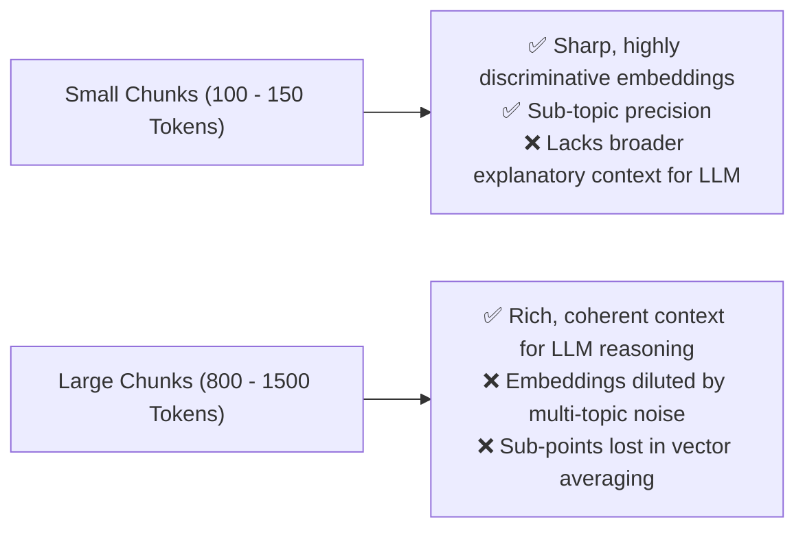
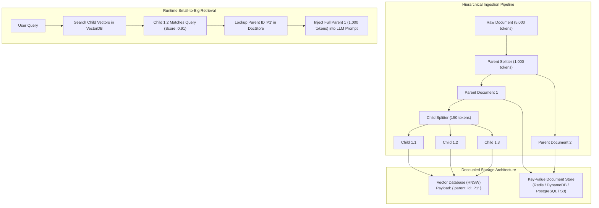
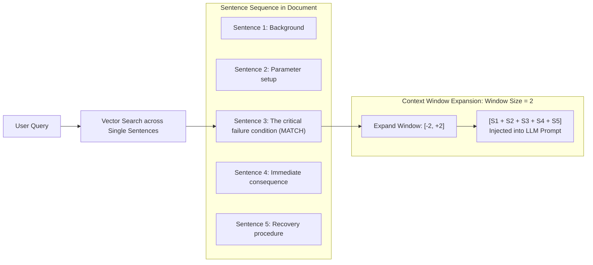
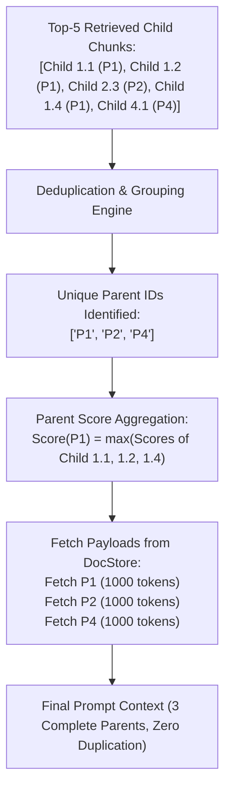
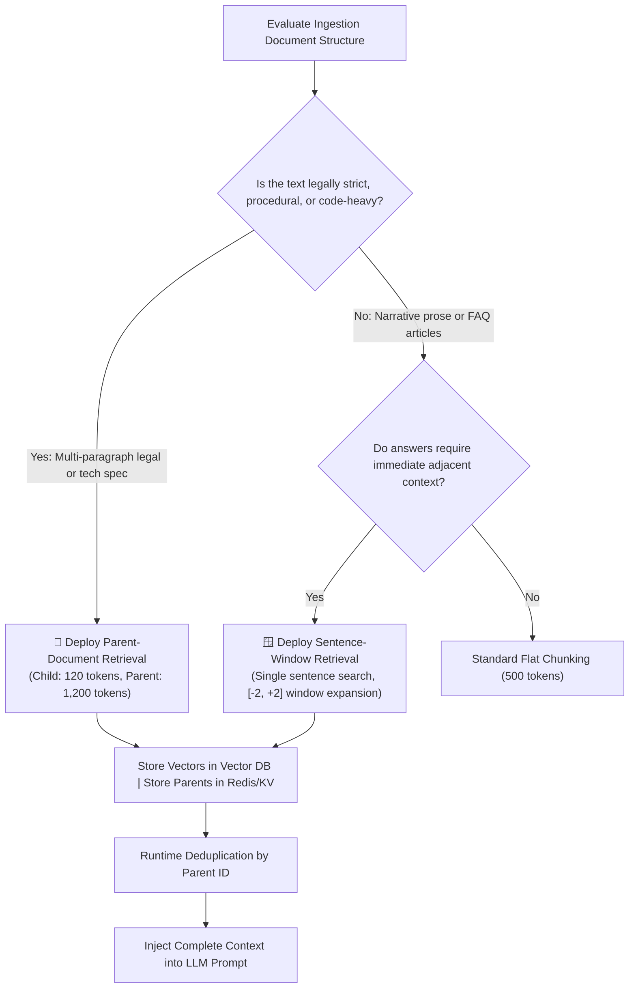

# 🌳 Parent-Document & Sentence-Window Retrieval: Decoupling Search Granularity from Context Assembly

## 📑 Table of Contents
1. [🌟 Fundamentals: The Chunk Granularity Dilemma](#1--fundamentals-the-chunk-granularity-dilemma)
2. [🏛️ Architecture 1: Parent-Document (Small-to-Big) Retrieval](#2-️-architecture-1-parent-document-small-to-big-retrieval)
3. [🪟 Architecture 2: Sentence-Window Context Expansion](#3-️-architecture-2-sentence-window-context-expansion)
4. [🗄️ Storage Decoupling: Vector Index vs. Document Store (KV)](#4-️-storage-decoupling-vector-index-vs-document-store-kv)
5. [🔬 Deduplication & Context Assembly Mechanics](#5--deduplication--context-assembly-mechanics)
6. [💻 Practical Implementation: Dual Parent-Document & Sentence-Window Engine](#6--practical-implementation-dual-parent-document--sentence-window-engine)
7. [🌍 Real-World Enterprise Production Scenarios](#7--real-world-enterprise-production-scenarios)
8. [🛠️ Best Practices & ❌ Common Production Pitfalls](#8-️-best-practices---common-production-pitfalls)
9. [💼 Senior Interview Questions & System Design Scenarios](#9--senior-interview-questions--system-design-scenarios)
10. [🧪 Hands-On Mini-Project: Small-to-Big vs. Flat Chunking Benchmark](#10--hands-on-mini-project-small-to-big-vs-flat-chunking-benchmark)
11. [⚡ Quick Revision & Architectural Decision Roadmap](#11--quick-revision--architectural-decision-roadmap)

---

## 1. 🌟 Fundamentals: The Chunk Granularity Dilemma

Every RAG architect confronts a fundamental conflict when configuring chunk sizes:



* **If chunks are too small:** The embedding matches the query with pinpoint precision, but when injected into the LLM prompt, the model hallucinates or fails because the surrounding context (qualifiers, definitions, background) was severed.
* **If chunks are too large:** The embedding averages dozens of distinct ideas into a single vector. The passage fails to retrieve when queried about a specific sub-point.

### 💡 The Solution: Decouple Search from Generation
**Parent-Document Retrieval** and **Sentence-Window Retrieval** resolve this paradox by using **different granularities for search versus generation**:
* **Search Granularity:** Compact, highly focused child chunks or individual sentences are indexed into the vector database.
* **Generation Granularity:** Once a child match is retrieved, the system resolves its pointer to fetch the larger **parent document** or expands the **surrounding sentence window** before passing context to the LLM.

---

## 2. 🏛️ Architecture 1: Parent-Document (Small-to-Big) Retrieval

In the **Parent-Document (Small-to-Big)** pattern, the ingestion pipeline splits documents hierarchically:



### Operational Steps:
1. **Parent Partitioning:** Split source documents into large, semantically coherent parent chunks (e.g., $1,000 - 2,000$ tokens).
2. **Child Partitioning:** Split each parent into small, highly granular child chunks (e.g., $100 - 200$ tokens).
3. **Decoupled Indexing:** Embed and index *only* child chunks into the vector database. Store parent documents in a fast Key-Value store keyed by `parent_id`.
4. **Assembly:** When child chunks are retrieved, the retriever groups them by `parent_id`, deduplicates, and loads the comprehensive parent texts for synthesis.

---

## 3. 🪟 Architecture 2: Sentence-Window Context Expansion

**Sentence-Window Retrieval** operates at the finest possible linguistic granularity:



### Mechanics:
* **Index:** Every individual sentence is embedded and stored with its document metadata and sequential sentence index ($i$).
* **Retrieval:** The query locates sentence $i$ with high semantic precision.
* **Expansion:** The retriever dynamically queries the document store for sentences from $[i - k]$ to $[i + k]$ (where $k$ is typically $2 - 5$ sentences). The contiguous block is reconstructed and sent to the LLM.

---

## 4. 🗄️ Storage Decoupling: Vector Index vs. Document Store (KV)

A critical architectural advantage of this paradigm is **Storage Decoupling**:

| Component | Target System | Data Stored | Characteristics |
| :--- | :--- | :--- | :--- |
| **Vector Index** | Qdrant, Pinecone, Milvus | Child vector embeddings + `parent_id` + `child_id` | Highly optimized for RAM-resident HNSW graph traversal. Minimal payload overhead. |
| **Document Store** | Redis, DynamoDB, PostgreSQL, SQLite | Full parent text payloads + markdown structure | Cost-effective disk/SSD storage. $O(1)$ key lookups via `parent_id`. |

### 📈 Storage Amplification:
If a 1,000-token parent document is split into 150-token child chunks with 25-token overlap:
$$
N_{\text{children}} \approx \frac{1000}{125} \approx 8 \text{ child vectors per parent}
$$
Vector index memory grows by $8\times$, while raw text storage in the KV store remains $1\times$.

---

## 5. 🔬 Deduplication & Context Assembly Mechanics

In a Top-10 child retrieval query, it is common for **Child 1.1**, **Child 1.2**, and **Child 1.4** to all appear in the candidate list because they all originate from the same relevant parent document:



### Dedup Protocol:
1. Extract `parent_id` from each retrieved child record.
2. Group child hits by `parent_id` and compute the parent's aggregate relevance (typically $\max(\text{child scores})$).
3. Fetch each unique parent document exactly once from the KV store.
4. Sort unique parent documents in descending order of their top child score.

---

## 6. 💻 Practical Implementation: Dual Parent-Document & Sentence-Window Engine

Here is a complete, self-contained Python implementation of a decoupled **Parent-Document and Sentence-Window Retrieval Engine**:

```python
"""
parent_document_retriever.py
Production-grade Parent-Document (Small-to-Big) and Sentence-Window Retrieval Engine.
"""

from typing import List, Dict, Any, Tuple, Optional
from dataclasses import dataclass
import re


@dataclass
class ChildChunk:
    child_id: str
    parent_id: str
    text: str
    score: float = 0.0


@dataclass
class SentenceRecord:
    doc_id: str
    sentence_idx: int
    text: str
    score: float = 0.0


class ParentDocumentRetriever:
    """
    Decoupled Small-to-Big Retrieval Engine.
    Maps fine-grained child vector search hits to complete parent documents.
    """

    def __init__(self):
        # KV DocStore: parent_id -> full text
        self.docstore: Dict[str, str] = {}
        # In-memory child index: child_id -> ChildChunk
        self.child_index: List[ChildChunk] = []

    def add_parent_document(self, parent_id: str, parent_text: str, child_size_words: int = 25) -> None:
        """
        Stores the parent document in KV store and generates child chunks.
        """
        self.docstore[parent_id] = parent_text

        words = parent_text.split()
        child_idx = 0
        step = max(1, child_size_words - 5)  # 5-word overlap

        for i in range(0, len(words), step):
            chunk_words = words[i : i + child_size_words]
            if not chunk_words:
                continue
            child_text = " ".join(chunk_words)
            cid = f"{parent_id}_c{child_idx}"
            self.child_index.append(ChildChunk(child_id=cid, parent_id=parent_id, text=child_text))
            child_idx += 1

    def mock_child_search(self, query: str, top_k: int = 4) -> List[ChildChunk]:
        """
        Simulates child vector retrieval via word overlap scoring.
        """
        q_tokens = set(query.lower().split())
        scored_children = []

        for c in self.child_index:
            c_tokens = set(c.text.lower().split())
            overlap = len(q_tokens.intersection(c_tokens))
            if overlap > 0:
                score = overlap / len(q_tokens)
                c_copy = ChildChunk(child_id=c.child_id, parent_id=c.parent_id, text=c.text, score=score)
                scored_children.append(c_copy)

        scored_children.sort(key=lambda x: x.score, reverse=True)
        return scored_children[:top_k]

    def retrieve_parents(self, query: str, top_k_children: int = 5) -> List[Tuple[str, float, str]]:
        """
        Retrieves matching children, deduplicates by parent_id, and returns full parent documents.
        Returns: [(parent_id, max_child_score, parent_full_text)]
        """
        matched_children = self.mock_child_search(query, top_k=top_k_children)
        if not matched_children:
            return []

        # Deduplicate and track max score per parent
        parent_scores: Dict[str, float] = {}
        for child in matched_children:
            pid = child.parent_id
            parent_scores[pid] = max(parent_scores.get(pid, 0.0), child.score)

        # Sort parents by score descending
        sorted_parents = sorted(parent_scores.items(), key=lambda x: x[1], reverse=True)

        results = []
        for pid, score in sorted_parents:
            parent_text = self.docstore.get(pid, "")
            results.append((pid, round(score, 4), parent_text))

        return results


class SentenceWindowRetriever:
    """
    Sentence-Window Context Expansion Engine.
    Retrieves individual sentences and reconstructs surrounding window [-k, +k].
    """

    def __init__(self, window_size: int = 2):
        self.window_size = window_size
        # doc_id -> list of sentences in sequential order
        self.doc_sentences: Dict[str, List[str]] = {}
        self.sentence_index: List[SentenceRecord] = []

    def index_document(self, doc_id: str, text: str) -> None:
        # Regex split by sentence boundaries
        raw_sentences = [s.strip() for s in re.split(r"(?<=[.!?])\s+", text) if s.strip()]
        self.doc_sentences[doc_id] = raw_sentences

        for idx, s in enumerate(raw_sentences):
            self.sentence_index.append(SentenceRecord(doc_id=doc_id, sentence_idx=idx, text=s))

    def retrieve_window(self, target_doc_id: str, sentence_idx: int) -> str:
        """
        Expands window of size k around the target sentence index.
        """
        sentences = self.doc_sentences.get(target_doc_id, [])
        if not sentences:
            return ""

        start_idx = max(0, sentence_idx - self.window_size)
        end_idx = min(len(sentences), sentence_idx + self.window_size + 1)

        window_slice = sentences[start_idx:end_idx]
        return " ".join(window_slice)


# --- Demonstration & Self-Test ---
if __name__ == "__main__":
    # 1. Parent-Document Small-to-Big Test
    parent_engine = ParentDocumentRetriever()

    parent_doc_1 = (
        "PostgreSQL Connection Pooling Architecture. PgBouncer acts as a lightweight connection pooler. "
        "When high concurrency traffic hits the database, PgBouncer maintains a pool of persistent connections, "
        "preventing connection allocation overhead and memory starvation on the primary PostgreSQL cluster."
    )
    parent_doc_2 = (
        "PostgreSQL WAL Replication and Standby Failover. Streaming replication delivers write-ahead logs to replicas. "
        "Patroni orchestrates high availability and automated leader election using distributed consensus via Consul or Raft."
    )

    parent_engine.add_parent_document("doc_pooling_01", parent_doc_1, child_size_words=12)
    parent_engine.add_parent_document("doc_replication_02", parent_doc_2, child_size_words=12)

    query = "PgBouncer persistent connections"
    retrieved_parents = parent_engine.retrieve_parents(query, top_k_children=3)

    print("=== 1. Parent-Document (Small-to-Big) Retrieval ===")
    print(f"Query: '{query}'")
    for pid, score, text in retrieved_parents:
        print(f"\n[Resolved Parent: {pid}] (Score: {score:.4f})")
        print(f"Full Context: {text}")

    # 2. Sentence-Window Context Expansion Test
    print("\n=== 2. Sentence-Window Retrieval ===")
    window_engine = SentenceWindowRetriever(window_size=1)
    full_article = (
        "Kubernetes pods are ephemeral units. "
        "When a node runs out of memory, the kubelet initiates eviction. "
        "The OOM killer selects containers based on oom_score_adj. "
        "Pod state transitions to Failed with exit code 137. "
        "The scheduler then reschedules the pod on a healthy worker node."
    )
    window_engine.index_document("k8s_guide", full_article)

    # Simulated match on Sentence 2 (OOM killer selection)
    expanded = window_engine.retrieve_window("k8s_guide", sentence_idx=2)
    print(f"Target Hit: Sentence 2 ('The OOM killer selects containers...')")
    print(f"Expanded Window [-1, +1]:\n'{expanded}'")
```

---

## 7. 🌍 Real-World Enterprise Production Scenarios

### Scenario A: Complex Commercial Contracts (Legal AI)
* **Problem:** In 200-page master vendor agreements, liability indemnity clauses span 8 paragraphs with complex cross-references (*"Subject to Section 14.2(a), Supplier's total aggregate liability shall not exceed..."*).
* **Failure of Flat Chunking:** Slicing into 200-token chunks isolates the liability ceiling from the definition of gross negligence in Section 14.2(a), leading the LLM to hallucinate liability limits.
* **Parent-Document Fix:** Child chunks (50 words) match specific terms like *"aggregate liability cap"*. On retrieval, the entire Section 14 parent document (1,500 words) is resolved and injected, giving the LLM the complete legal context.

### Scenario B: Software Architecture & Code Documentation
* **Problem:** Developers query function arguments (*"What does the timeout parameter in create_client() do?"*).
* **Sentence-Window Fix:** The vector index matches the exact line documenting the `timeout` parameter. The sentence-window retriever expands 3 sentences before and after, providing the function signature, default value, and exception types raised on timeout.

---

## 8. 🛠️ Best Practices & ❌ Common Production Pitfalls

### ✅ Best Practices
1. **Always Deduplicate by Parent ID:** Multiple child chunks from the same parent will inevitably be retrieved. Failing to deduplicate wastes token budget by passing identical parent text multiple times.
2. **Cap Retrieved Parents to 3–5 Documents:** Because parent documents are large ($1,000 - 2,000$ tokens), returning 10 parents will easily saturate a prompt context with $15,000$ tokens.
3. **Use Fast KV Stores for Parent Lookups:** Store parents in Redis, DynamoDB, or local SQLite. Vector databases should only store child embeddings and metadata pointers.

### ❌ Common Production Pitfalls
* **Pitfall 1: Storing large parent texts inside the vector database payload.**  
  *Consequence:* Storing 100,000 2KB parent texts directly in Qdrant or Pinecone payloads drastically inflates RAM requirements for the vector store. Decouple parent text into dedicated document storage.
* **Pitfall 2: Too large child chunks in Small-to-Big.**  
  *Consequence:* Setting child chunk size to 500 tokens defeats the purpose of the architecture. Keep children between 80 and 150 tokens to ensure sharp, unambiguous embeddings.

---

## 9. 💼 Senior Interview Questions & System Design Scenarios

### Q1: Compare Parent-Document Retrieval with Contextual Retrieval (Anthropic Pattern). When should each be chosen?
**Answer:**  
* **Parent-Document Retrieval (Small-to-Big):** Decouples search from generation via a **1-to-many pointer mapping**. Search operates on small child chunks ($100$ tokens); generation operates on full parent passages ($1,000$ tokens).  
  * *Pros:* No LLM generation needed at ingestion time; completely preserves the original author's full prose context.  
  * *Cons:* Requires decoupled KV storage; increases prompt token consumption because full parent documents are injected.
* **Contextual Retrieval (Anthropic Pattern):** Prepends a 50-token situational summary directly into the chunk itself, keeping search and generation granularities identical.  
  * *Pros:* Does not enlarge the context window passed to the final generator; highly compatible with standard single-index RAG pipelines.  
  * *Cons:* Incurs LLM API costs and generation latency during offline ingestion for every chunk.
* **Decision Framework:** If prompt token budget is strictly constrained and chunks must remain short, choose **Contextual Retrieval**. If documents possess deeply intertwined structural context (e.g., legal contracts, code modules) where the LLM requires full surrounding prose, choose **Parent-Document Retrieval**.

### Q2: How do you handle sentence-boundary detection for Sentence-Window Retrieval across multi-language or markdown documents?
**Answer:**  
Naive regex string splitting on `.` fails on abbreviations (*"e.g."*, *"Dr."*, *"vs."*), decimal numbers (*"3.1415"*), and markdown code blocks.  
**Production Pipeline:**
1. **Markdown / Code Isolation:** Strip code blocks (` ```python `) and tables prior to sentence splitting; treat them as atomic parent chunks.
2. **Morphological Sentence Tokenizers:** Use language-aware sentence tokenizers such as **spaCy**, **NLTK `PunktSentenceTokenizer`**, or Unicode boundary rules (UAX #29) which account for abbreviations and numerical periods.
3. **Contiguous Index Tracking:** Assign sequential integer IDs ($doc\_id, sentence\_idx$) stored in a lightweight SQLite index to enable range queries: `SELECT text FROM sentences WHERE doc_id = ? AND sentence_idx BETWEEN ? AND ?`.

---

## 10. 🧪 Hands-On Mini-Project: Small-to-Big vs. Flat Chunking Benchmark

Compare the contextual completeness of Small-to-Big retrieval vs flat chunking:

```python
"""
mini_project_parent_doc_bench.py
Demonstrates context retention differences between flat chunking and parent-doc retrieval.
"""

from parent_document_retriever import ParentDocumentRetriever

engine = ParentDocumentRetriever()

document = (
    "Enterprise Security Architecture Policy 2024. All microservice API endpoints must enforce "
    "OAuth2 Bearer tokens signed by the central Okta authorization server. "
    "Exceptions to this rule must be approved by the Chief Information Security Officer (CISO) "
    "and will expire automatically after ninety calendar days unless renewed."
)

# Ingest as parent
engine.add_parent_document("sec_policy_2024", document, child_size_words=12)

# Query searching for the exception policy
query = "CISO exceptions expiration ninety days"
parents = engine.retrieve_parents(query, top_k_children=2)

print("=== Small-to-Big Context Completeness Test ===")
print(f"Search Query: '{query}'")
for pid, score, full_text in parents:
    print(f"\nRetrieved Parent ID: {pid} (Score: {score:.4f})")
    print(f"Assembled Prompt Context:\n'{full_text}'")
```

---

## 11. ⚡ Quick Revision & Architectural Decision Roadmap



* **Core Axiom:** Decouple search granularity (small chunks for sharp vector matching) from generation granularity (large parents for rich LLM context).
* **Golden Rule:** Always deduplicate child hits by `parent_id` prior to fetching from the document store to prevent redundant context waste in LLM prompts.
