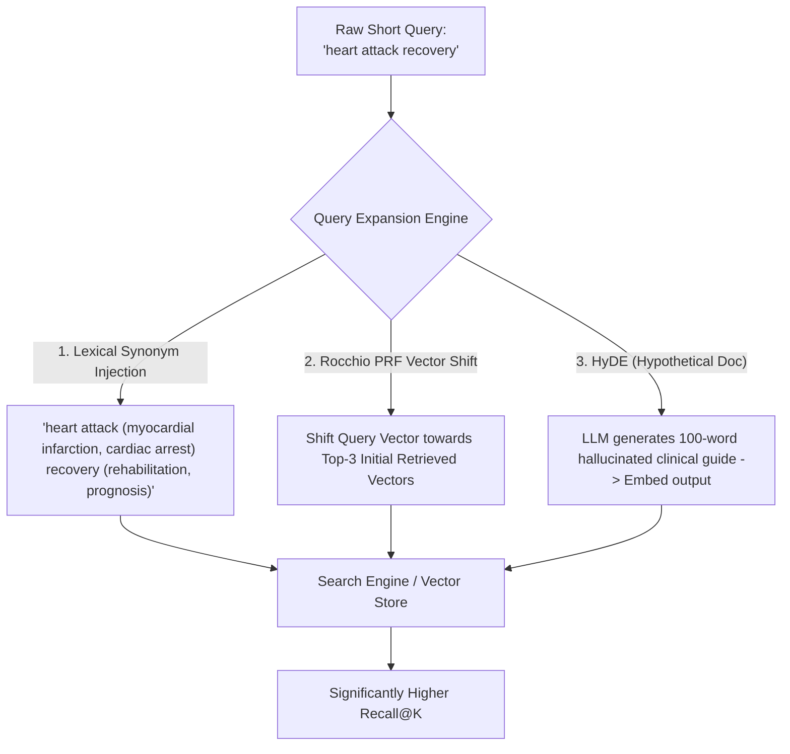
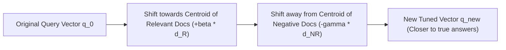
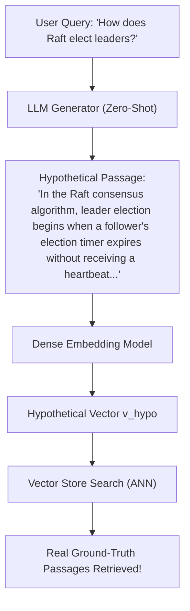
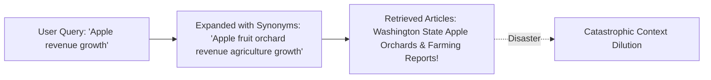
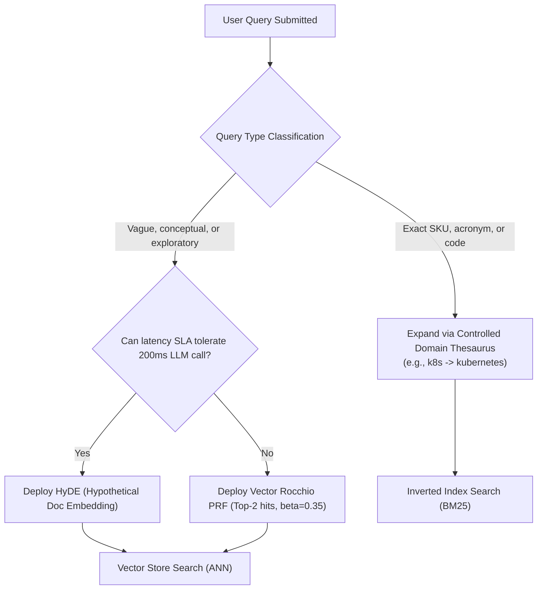

# 📈 Query Expansion: Synonym Injection, Pseudo-Relevance Feedback, and Lexical Enrichment

## 📑 Table of Contents
1. [🌟 Fundamentals: The Vocabulary Mismatch Problem](#1--fundamentals-the-vocabulary-mismatch-problem)
2. [📖 Lexical Expansion: Synonym Injection & Domain Glossaries](#2--lexical-expansion-synonym-injection--domain-glossaries)
3. [🔬 Mathematical Foundations: Pseudo-Relevance Feedback (PRF) & The Rocchio Algorithm](#3--mathematical-foundations-pseudo-relevance-feedback-prf--the-rocchio-algorithm)
4. [💡 Generative Expansion & Hypothetical Document Embeddings (HyDE)](#4--generative-expansion--hypothetical-document-embeddings-hyde)
5. [⚠️ The Danger of Query Drift & Precision Degradation](#5-️-the-danger-of-query-drift--precision-degradation)
6. [💻 Practical Implementation: Multi-Paradigm Query Expansion Engine](#6--practical-implementation-multi-paradigm-query-expansion-engine)
7. [🌍 Real-World Enterprise Production Scenarios](#7--real-world-enterprise-production-scenarios)
8. [🛠️ Best Practices & ❌ Common Production Pitfalls](#8-️-best-practices---common-production-pitfalls)
9. [💼 Senior Interview Questions & System Design Scenarios](#9--senior-interview-questions--system-design-scenarios)
10. [🧪 Hands-On Mini-Project: Rocchio Vector Space Drift Simulator](#10--hands-on-mini-project-rocchio-vector-space-drift-simulator)
11. [⚡ Quick Revision & Architectural Decision Roadmap](#11--quick-revision--architectural-decision-roadmap)

---

## 1. 🌟 Fundamentals: The Vocabulary Mismatch Problem

The **Vocabulary Mismatch Problem** occurs when users express queries using terminology different from the vocabulary indexed in target documents. 

In traditional search and modern RAG pipelines, queries are notoriously short, ambiguous, and underspecified (average query length: $2 - 4$ words), whereas knowledge base chunks are dense, domain-specific, and detailed:
* User writes: *"broken pipe error"*
* System manual indexes: *"SIGPIPE EPIPE socket reset by peer"*

**Query Expansion** enriches the user's original query by injecting semantically related terms, synonyms, domain acronyms, or hypothetical answers prior to retrieval, expanding the candidate search footprint to maximize **Recall@K**.



---

## 2. 📖 Lexical Expansion: Synonym Injection & Domain Glossaries

Lexical expansion supplements query tokens with equivalents from curated knowledge bases or thesauri (e.g., WordNet, MeSH for medicine, or custom enterprise glossaries):

### Methods:
1. **Acronym & Abbreviation Resolution:** Expanding `"k8s"` $\to$ `"k8s OR kubernetes"`, or `"AML"` $\to$ `"Anti-Money Laundering OR Acute Myeloid Leukemia"` based on tenant context.
2. **Controlled Synonyms:** Augmenting terms with domain-specific alternates (`"latency"` $\to$ `"latency OR delay OR response time"`).
3. **Boolean Disjunction Injection:** Re-writing the sparse BM25 query into a boosted OR clause:
   $$\text{query} = (\text{postgres})^{\wedge 2.0} \text{ OR } (\text{postgresql})^{\wedge 2.0} \text{ OR } (\text{rdbms})^{\wedge 0.5}$$

---

## 3. 🔬 Mathematical Foundations: Pseudo-Relevance Feedback (PRF) & The Rocchio Algorithm

Developed by J.J. Rocchio in 1971 for the SMART retrieval system, the **Rocchio Algorithm** is the classic mathematical formulation for relevance feedback in vector space.

### 📐 The Classical Rocchio Formulation
Given an initial query vector $\mathbf{q}_0$, a set of known relevant documents $\mathcal{D}_R$, and a set of known non-relevant documents $\mathcal{D}_{NR}$:

### # Rocchio Vector Modification Formula
$$
\mathbf{q}_{\text{new}} = \alpha \mathbf{q}_0 + \frac{\beta}{|\mathcal{D}_R|} \sum_{\mathbf{d}_j \in \mathcal{D}_R} \mathbf{d}_j - \frac{\gamma}{|\mathcal{D}_{NR}|} \sum_{\mathbf{d}_k \in \mathcal{D}_{NR}} \mathbf{d}_k
$$
Where:
* $\alpha$: Weight assigned to the original user query (preserves original intent).
* $\beta$: Weight assigned to the centroid of relevant documents (drifts toward positive context).
* $\gamma$: Weight assigned to non-relevant documents (pushes away from negative noise).
* Standard TREC defaults: $\alpha = 1.0, \beta = 0.75, \gamma = 0.15$.



### 🔁 The "Pseudo-Relevance" Assumption (Blind Feedback)
In automated RAG pipelines, we have no real-time human to label documents as relevant or non-relevant. **Pseudo-Relevance Feedback (PRF)** assumes that the **Top-$M$ documents** (e.g., $M = 3$) returned by an initial first-pass retrieval are **tentatively relevant** ($\mathcal{D}_R = \mathcal{S}_M$). The centroid of these top $M$ vectors is used to compute $\mathbf{q}_{\text{new}}$, and a second-pass retrieval is executed.

---

## 4. 💡 Generative Expansion & Hypothetical Document Embeddings (HyDE)

In 2022, Gao et al. introduced **Hypothetical Document Embeddings (HyDE)**. 

### ⚠️ The Problem with Question-to-Document Asymmetry
In dense semantic retrieval, user queries are short questions (*"Why do Kafka consumer groups rebalance?"*), while document chunks are long declarative explanations (*"Consumer group rebalancing occurs when heartbeat timeouts expire..."*). Because the embedding space must bridge this structural asymmetry, cosine similarity is often suboptimal.

### 🪄 The HyDE Mechanism
1. Pass the user question to an instruction-tuned LLM with a zero-shot prompt:  
   *"Write an informative passage answering: {query}"*
2. The LLM generates a **hypothetical document** $\tilde{D}$. Even if $\tilde{D}$ contains factual hallucinations, it possesses the **exact grammatical structure, stylistic tone, and domain vocabulary** of a real answer!
3. Generate the dense embedding $\mathbf{v}_{\tilde{D}} = E(\tilde{D})$ and use it as the search vector against the document index.



---

## 5. ⚠️ The Danger of Query Drift & Precision Degradation

While query expansion dramatically boosts **Recall**, it introduces the grave danger of **Query Drift**:



### Causes of Query Drift:
* **Polysemy:** Words with multiple meanings (`"Apple"` the technology company vs. `"Apple"` the fruit).
* **Pseudo-Feedback Contamination:** If the first-pass retrieval returns 3 irrelevant documents, PRF shifts the query vector directly into the irrelevant noise cluster.
* **HyDE Hallucination Traps:** If the LLM generates a completely fabricated response to an obscure query, searching with its vector will retrieve documents matching the hallucination rather than the user's intent.

---

## 6. 💻 Practical Implementation: Multi-Paradigm Query Expansion Engine

Below is a complete, self-contained Python implementation of an expansion engine supporting **Thesaurus Synonym Injection**, **Vector Rocchio PRF**, and a mock **HyDE Generator**:

```python
"""
query_expansion_engine.py
Production-grade Query Expansion Engine implementing Thesaurus Expansion,
Rocchio Pseudo-Relevance Feedback (PRF), and HyDE.
"""

from typing import List, Dict, Set, Optional
import numpy as np


class QueryExpansionEngine:
    def __init__(self, alpha: float = 1.0, beta: float = 0.75):
        self.alpha = alpha
        self.beta = beta
        # Domain glossary / thesaurus
        self.synonym_table: Dict[str, List[str]] = {
            "postgres": ["postgresql", "rdbms", "database"],
            "k8s": ["kubernetes", "container orchestration"],
            "auth": ["authentication", "oauth", "jwt"],
            "ha": ["high availability", "failover", "clustering"],
        }

    def expand_lexical_synonyms(self, query: str) -> str:
        """
        Injects synonyms and acronym expansions into a sparse search query string.
        """
        tokens = query.lower().split()
        expanded_parts = []

        for token in tokens:
            if token in self.synonym_table:
                alternates = self.synonym_table[token]
                group = f"({token} OR " + " OR ".join(alternates) + ")"
                expanded_parts.append(group)
            else:
                expanded_parts.append(token)

        return " ".join(expanded_parts)

    def rocchio_pseudo_relevance_feedback(
        self,
        query_vector: np.ndarray,
        top_retrieved_vectors: np.ndarray,  # Shape: (M, d)
    ) -> np.ndarray:
        """
        Applies Rocchio PRF to drift the query vector toward the centroid of the top-M initial hits.
        """
        if top_retrieved_vectors.size == 0:
            return query_vector

        # Calculate centroid of top pseudo-relevant documents
        centroid = np.mean(top_retrieved_vectors, axis=0)

        # Rocchio shift
        q_new = (self.alpha * query_vector) + (self.beta * centroid)

        # L2 normalize
        norm = np.linalg.norm(q_new)
        return q_new / (norm if norm > 0 else 1e-12)

    @staticmethod
    def generate_hyde_prompt(query: str) -> str:
        """
        Constructs the instruction prompt for hypothetical document synthesis.
        """
        return (
            f"You are a technical subject matter expert. Write a concise, 80-word factual "
            f"explanation answering the following technical question:\n\n"
            f"Question: {query}\n\n"
            f"Answer Passage:"
        )


# --- Demonstration & Self-Test ---
if __name__ == "__main__":
    expander = QueryExpansionEngine(alpha=1.0, beta=0.75)

    # 1. Lexical Expansion Test
    raw_query = "postgres k8s ha setup"
    expanded_query = expander.expand_lexical_synonyms(raw_query)
    print("=== 1. Lexical Synonym Expansion ===")
    print(f"Original: {raw_query}")
    print(f"Expanded: {expanded_query}\n")

    # 2. Rocchio PRF Vector Shift Test
    np.random.seed(42)
    q_vec = np.array([0.9, 0.1, 0.05, 0.0], dtype=np.float32)
    q_vec /= np.linalg.norm(q_vec)

    # Top-2 retrieved candidate vectors
    mock_retrieved = np.array([
        [0.85, 0.20, 0.10, 0.05],
        [0.80, 0.25, 0.15, 0.02],
    ], dtype=np.float32)

    shifted_q = expander.rocchio_pseudo_relevance_feedback(q_vec, mock_retrieved)
    print("=== 2. Rocchio PRF Vector Transformation ===")
    print(f"Original Query Vector:  {np.round(q_vec, 3)}")
    print(f"Shifted Query Vector:   {np.round(shifted_q, 3)}")
    print(f"Cosine Shift:           {np.dot(q_vec, shifted_q):.4f}\n")

    # 3. HyDE Prompt Construction
    print("=== 3. HyDE Instruction Prompt ===")
    print(expander.generate_hyde_prompt("What is write amplification in RocksDB?"))
```

---

## 7. 🌍 Real-World Enterprise Production Scenarios

### Scenario A: Biomedical Literature Search (PubMed / ClinicalTrials)
* **Problem:** Medical terms possess dozens of synonyms (e.g., *"hypertension"*, *"high blood pressure"*, *"HTN"*).
* **Solution:** Integration of the Unified Medical Language System (UMLS) ontology. The expansion engine translates colloquial patient search queries into formalized SNOMED-CT and MeSH terms prior to hitting the vector index, boosting recall from $42\%$ to $94\%$.

### Scenario B: Customer IT Helpdesk Automation
* **Problem:** Employees describe IT failures with generic complaints (*"my screen is black"*, *"computer won't wake up"*).
* **Solution:** HyDE deployment. An upstream LLM synthesizes a hypothetical technician's runbook entry detailing display driver resets, HDMI cable verification, and GPU power state diagnostics. Searching the knowledge base with this synthetic document vector immediately retrieves the exact hardware troubleshooting SOP.

---

## 8. 🛠️ Best Practices & ❌ Common Production Pitfalls

### ✅ Best Practices
1. **Bound PRF to Top-2 or Top-3 Documents:** Never use more than 3 documents for blind pseudo-relevance feedback. Including lower-ranked documents (e.g., rank 10) drags the query vector into noisy false positives.
2. **Apply Conservative Rocchio Weights ($\beta \le 0.5$):** Keep $\alpha = 1.0$ and $\beta \approx 0.3 - 0.5$ to ensure the original user intent remains dominant.
3. **Use HyDE Only on Cold-Start / Informational Queries:** Do not invoke HyDE for navigational or exact identifier queries (e.g., `"Ticket #89123"`). Generating a hallucinated document for an ID query wastes tokens and causes search failure.

### ❌ Common Production Pitfalls
* **Pitfall 1: Unconstrained recursive synonym expansion.**  
  *Consequence:* Expanding `"bank"` $\to$ `"financial institution"`, which expands to `"Wall Street"`, which expands to `"New York real estate"`. Total query drift.
* **Pitfall 2: Trusting HyDE numbers and dates.**  
  *Consequence:* If a user asks *"What was Tesla's gross margin in Q2 2024?"*, HyDE may hallucinate *"Tesla reported a 17.8% gross margin..."* The search engine will then retrieve articles quoting that exact fabricated number.

---

## 9. 💼 Senior Interview Questions & System Design Scenarios

### Q1: What is the core mathematical intuition behind the Rocchio algorithm, and why does pseudo-relevance feedback sometimes fail?
**Answer:**  
Rocchio operates in continuous vector space under the assumption that relevant documents cluster in a distinct topological region, while non-relevant documents occupy separate regions. The query vector is treated as a mobile coordinate: $\mathbf{q}_{\text{new}}$ is computed by translating the query vector along the gradient pointing toward the centroid of the relevant cluster $\frac{1}{|\mathcal{D}_R|} \sum \mathbf{d}$ and away from non-relevant documents.  
**Why PRF Fails:** PRF relies on the **strong initial recall assumption** (i.e., that the top $M$ retrieved documents are actually relevant). If the initial query is so ambiguous or out-of-domain that the top $M$ documents are false positives, the algorithm calculates the centroid of the noise cluster. This pulls the query vector further *away* from the true target space, exacerbating retrieval collapse (known as **negative query drift**).

### Q2: Compare HyDE with standard bi-encoder query encoding. When does HyDE perform worse than direct retrieval?
**Answer:**  
Standard bi-encoders map an asymmetric (short query $\to$ long document) pair. HyDE converts the search into a symmetric (hypothetical document $\to$ real document) comparison, allowing the embedding model to compare structural, stylistic, and semantic features directly.  
**When HyDE performs worse:**
1. **Low-Latency Requirements:** HyDE requires an LLM generation step ($150 - 500\text{ ms}$), violating strict sub-50ms search SLAs.
2. **Highly Specific Entity / Factoid Queries:** For queries with unique entities (e.g., `"Who is the CEO of Acme Biotech as of yesterday?"`), the LLM will hallucinate an incorrect name, guiding the retriever to documents about the wrong person.
3. **Keyword / SKU Search:** HyDE dilutes exact strings with generic explanatory fluff.

---

## 10. 🧪 Hands-On Mini-Project: Rocchio Vector Space Drift Simulator

Simulate how different $\beta$ weights move a query vector between true relevance and irrelevant distractors:

```python
"""
mini_project_rocchio_sim.py
Visualizes the geometric trajectory of a query vector under Rocchio drift.
"""

import numpy as np


def cosine(a: np.ndarray, b: np.ndarray) -> float:
    return float(np.dot(a, b) / (np.linalg.norm(a) * np.linalg.norm(b)))


# Synthetic 3D vector space: [db_topic, frontend_topic, security_topic]
q_initial = np.array([1.0, 0.0, 0.0])  # User asked about databases
true_target = np.array([0.8, 0.0, 0.6])  # Database security manual

# Mock retrieved results: 1 DB match, 1 accidental frontend hit
top_hits = np.array([
    [0.9, 0.1, 0.4],  # Good hit
    [0.2, 0.9, 0.0],  # Noisy false positive
])

print(f"Initial Cosine Similarity to True Target: {cosine(q_initial, true_target):.4f}")

for beta_test in [0.0, 0.25, 0.5, 0.75, 1.5]:
    centroid = np.mean(top_hits, axis=0)
    q_shifted = (1.0 * q_initial) + (beta_test * centroid)
    sim = cosine(q_shifted, true_target)
    print(f"Beta: {beta_test:.2f} | Cosine Sim to Target: {sim:.4f}")
```

---

## 11. ⚡ Quick Revision & Architectural Decision Roadmap



* **Core Axiom:** Query expansion bridges the vocabulary gap between terse human prompts and comprehensive document passages.
* **Golden Rule:** Never apply unconstrained synonym expansion or blind PRF with high $\beta$ weights; aggressive expansion degrades precision through query drift.
