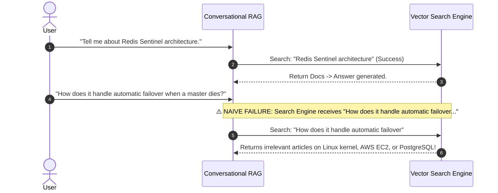
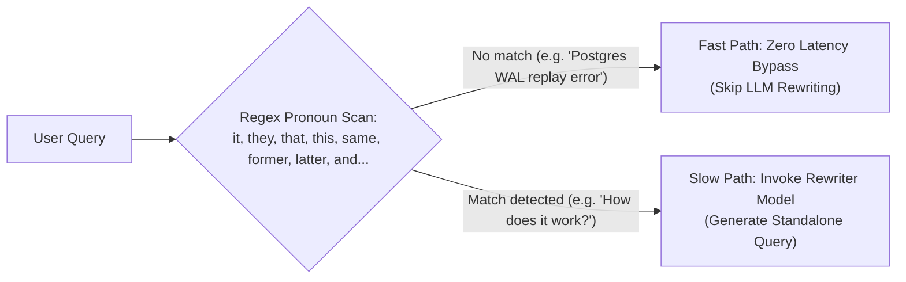
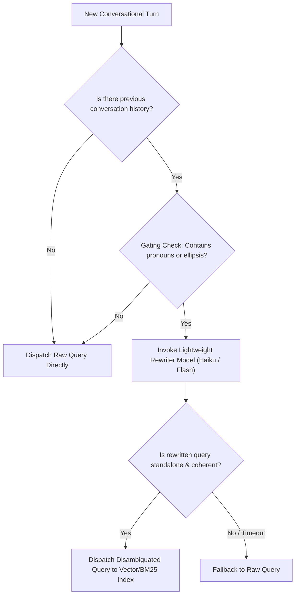

# 🔄 Contextual Query Rewriting, Pronoun Disambiguation, and History-Aware Transformation

## 📑 Table of Contents
1. [🌟 Fundamentals: The Coreference Crisis in Conversational RAG](#1--fundamentals-the-coreference-crisis-in-conversational-rag)
2. [🔍 Query Rewriting vs. Query Expansion: Key Distinctions](#2--query-rewriting-vs-query-expansion-key-distinctions)
3. [🏛️ The History-Aware Rewriting Architecture](#3-️-the-history-aware-rewriting-architecture)
4. [🧠 Linguistic Mechanics: Anaphora, Ellipsis, and Coreference Resolution](#4--linguistic-mechanics-anaphora-ellipsis-and-coreference-resolution)
5. [⚡ Latency Optimization: Gating Heuristics & Fast Classifiers](#5-️-latency-optimization-gating-heuristics--fast-classifiers)
6. [💻 Practical Implementation: Production Conversational Query Rewriter](#6--practical-implementation-production-conversational-query-rewriter)
7. [🌍 Real-World Enterprise Production Scenarios](#7--real-world-enterprise-production-scenarios)
8. [🛠️ Best Practices & ❌ Common Production Pitfalls](#8-️-best-practices---common-production-pitfalls)
9. [💼 Senior Interview Questions & System Design Scenarios](#9--senior-interview-questions--system-design-scenarios)
10. [🧪 Hands-On Mini-Project: Multi-Turn Dialogue Rewriter & Benchmark](#10--hands-on-mini-project-multi-turn-dialogue-rewriter--benchmark)
11. [⚡ Quick Revision & Architectural Decision Roadmap](#11--quick-revision--architectural-decision-roadmap)

---

## 1. 🌟 Fundamentals: The Coreference Crisis in Conversational RAG

In real-world chat interfaces, humans communicate conversationally using **anaphora** (referring back to previously mentioned entities using pronouns like *"it"*, *"they"*, *"that"*) and **ellipsis** (omitting redundant context):



If the retrieval engine receives Turn 2 in isolation, it has no idea what *"it"* refers to. Vector search collapses because the query lacks the central entity (**Redis Sentinel**).

**Contextual Query Rewriting (Query Reformulation)** transforms an ambiguous, multi-turn conversational utterance into a **fully self-contained, standalone query** that preserves complete semantic meaning without needing dialogue history.

---

## 2. 🔍 Query Rewriting vs. Query Expansion: Key Distinctions

It is common to conflate query expansion with query rewriting, but their operational objectives differ fundamentally:

| Dimension | Query Expansion | Contextual Query Rewriting |
| :--- | :--- | :--- |
| **Primary Goal** | Maximize **Recall** by injecting synonyms & related concepts. | Restore **Precision** by resolving missing entities & context. |
| **Typical Input** | Single standalone query (`"k8s setup"`). | Multi-turn conversational history + current utterance. |
| **Output Characteristics**| Longer, disjunctive query with multiple synonyms (`k8s OR kubernetes`). | Concise, disambiguated standalone question. |
| **Target Failure Mode** | Vocabulary Mismatch Problem. | Coreference, Anaphora, and Ellipsis in dialogue. |
| **Risk** | Query Drift (adding off-topic synonyms). | Over-specification or hallucinated entity substitution. |

---

## 3. 🏛️ The History-Aware Rewriting Architecture

A production-grade conversational RAG pipeline routes every user message through a **Contextual Rewriter Node** before dispatching to the retrieval engine:

```mermaid
flowchart TD
    UserUtterance["Current User Utterance:<br/>'What is the pricing model for that enterprise tier?'"] --> TurnBuffer["Sliding Dialogue History Buffer<br/>(Last N Turns)"]
    
    TurnBuffer --> GatingClassifier{"Gating Check:<br/>Does query contain anaphora/ellipsis?"}
    
    GatingClassifier -->|No (Self-Contained)| Bypass["Bypass Rewriter<br/>Send directly to Search (0ms added)"]
    GatingClassifier -->|Yes (Context-Dependent)| RewriterLLM["Lightweight Rewriter LLM<br/>(Few-Shot Prompt with CoT)"]
    
    RewriterLLM --> StandaloneQuery["Standalone Query:<br/>'What is the pricing model for Snowflake Enterprise Tier?'"]
    
    Bypass --> SearchEngine["Hybrid Search / Vector Engine"]
    StandaloneQuery --> SearchEngine
    
    SearchEngine --> RAGGen["LLM Response Generation"]
```

---

## 4. 🧠 Linguistic Mechanics: Anaphora, Ellipsis, and Coreference Resolution

Contextual query rewriting must handle three distinct linguistic phenomena:

### 1. Pronominal Anaphora (Pronoun Replacement)
* **History:** *"We are evaluating Datadog vs Prometheus for APM."*
* **Current Query:** *"Which one has lower operational overhead?"*
* **Rewritten Query:** *"Does Datadog or Prometheus have lower operational overhead for APM?"*

### 2. Ellipsis (Contextual Continuation)
* **History:** *"How do I configure mutual TLS in Istio?"*
* **Current Query:** *"And in Linkerd?"*
* **Rewritten Query:** *"How do I configure mutual TLS in Linkerd?"*

### 3. Topic Shift / Context Cleansing
* **History:** *"Tell me about the Roman Empire."*
* **Current Query:** *"How do I sort a list in Python?"*
* **Rewriter Action:** Must recognize an abrupt topic shift and **not** inject Roman history into the Python query!

---

## 5. ⚡ Latency Optimization: Gating Heuristics & Fast Classifiers

Calling a large language model on *every single* user turn adds $100 - 300\text{ ms}$ of sequential latency. Production systems implement a **Two-Tier Gating Mechanism**:



### Heuristic Rule Set for Fast-Path Bypass:
1. If the query length is $> 12$ tokens AND contains zero ambiguous determiners (`this`, `that`, `it`, `they`, `such`, `its`, `their`, `above`, `former`, `latter`), skip rewriting.
2. If the user query begins with standard interrogative self-contained phrasing (*"What is the capital of..."*, *"Define eigenvalue..."*), skip rewriting.

---

## 6. 💻 Practical Implementation: Production Conversational Query Rewriter

Below is a complete, self-contained Python implementation of an asynchronous **Conversational Query Rewriter** with dialogue history management, regex gating, and simulated few-shot standalone reformulation:

```python
"""
conversational_query_rewriter.py
Production-grade Contextual Query Rewriter with History Buffering,
Gating Heuristics, and Standalone Question Synthesis.
"""

import re
from typing import List, Dict, Optional, Tuple
from dataclasses import dataclass, field


@dataclass
class ChatTurn:
    role: str  # 'user' or 'assistant'
    content: str


class ConversationalQueryRewriter:
    def __init__(self, history_turn_limit: int = 4):
        self.history_turn_limit = history_turn_limit
        # Ambiguous pronoun regex pattern
        self._ambiguity_pattern = re.compile(
            r"\b(it|its|this|that|these|those|they|them|their|he|she|him|her|former|latter|the same|and also|what about)\b",
            re.IGNORECASE,
        )

    def is_context_dependent(self, query: str) -> bool:
        """
        Gating heuristic: Determines whether the query contains coreference triggers or ellipsis.
        """
        tokens = query.strip().split()
        # Very short queries (e.g. "and in Python?", "why?") are almost always context dependent
        if len(tokens) <= 4:
            return True
        # Check for presence of anaphoric pronouns
        return bool(self._ambiguity_pattern.search(query))

    def format_history_context(self, history: List[ChatTurn]) -> str:
        """Formats the sliding window of recent conversation turns."""
        recent_turns = history[-self.history_turn_limit :]
        lines = []
        for turn in recent_turns:
            prefix = "User" if turn.role == "user" else "Assistant"
            lines.append(f"{prefix}: {turn.content}")
        return "\n".join(lines)

    def rewrite_query(self, current_query: str, history: List[ChatTurn]) -> Tuple[str, bool]:
        """
        Rewrites the query into a standalone format if context-dependent.
        Returns (rewritten_query, was_rewritten_flag).
        """
        if not history or not self.is_context_dependent(current_query):
            # Fast-path bypass
            return current_query, False

        # In production, pass prompt to LLM (e.g. Claude 3.5 Haiku / GPT-4o-mini)
        # Here we simulate the LLM rule-based coreference transformation
        formatted_history = self.format_history_context(history)
        
        # Rule-based simulation for testing
        rewritten = self._mock_llm_reformulation(current_query, history)
        return rewritten, True

    @staticmethod
    def _mock_llm_reformulation(query: str, history: List[ChatTurn]) -> str:
        """
        Simulates few-shot LLM reformulation logic for demonstration.
        """
        # Find last mentioned subject in history
        last_subject = "the system"
        for turn in reversed(history):
            if "kafka" in turn.content.lower():
                last_subject = "Apache Kafka"
                break
            elif "redis" in turn.content.lower():
                last_subject = "Redis Sentinel"
                break
            elif "postgres" in turn.content.lower():
                last_subject = "PostgreSQL"
                break

        q_lower = query.lower()
        if "how does it work" in q_lower or "how does it handle" in q_lower:
            return query.lower().replace("it", last_subject).capitalize()
        elif "and in" in q_lower:
            # Ellipsis handling: "And in Python?" -> "How to implement {action} in Python?"
            return f"How to implement the previous configuration in {query.replace('and in', '').strip(' ?')}?"
        else:
            # Fallback pronoun replacement
            return re.sub(r"\b(it|that)\b", last_subject, query, flags=re.IGNORECASE)


# --- Demonstration & Self-Test ---
if __name__ == "__main__":
    rewriter = ConversationalQueryRewriter(history_turn_limit=4)

    dialogue_history = [
        ChatTurn("user", "We are deploying Apache Kafka for event-driven message queuing."),
        ChatTurn("assistant", "Apache Kafka is an open-source distributed event store and stream-processing platform."),
    ]

    test_queries = [
        "How does it handle consumer partition rebalancing?",  # Requires coreference rewrite
        "And in Python?",                                      # Requires ellipsis rewrite
        "What is the maximum file descriptor limit on Ubuntu Linux?", # Self-contained (should bypass)
    ]

    print("=== Conversational Query Rewriting Demonstration ===")
    for q in test_queries:
        needs_rewrite = rewriter.is_context_dependent(q)
        final_query, was_rewritten = rewriter.rewrite_query(q, dialogue_history)
        print(f"\nIncoming:     '{q}'")
        print(f"Gating Triggered: {needs_rewrite}")
        print(f"Dispatch Query:   '{final_query}' (Rewritten: {was_rewritten})")
```

---

## 7. 🌍 Real-World Enterprise Production Scenarios

### Scenario A: Complex IT Service Management (ServiceNow / Jira)
* **Turn 1:** *"I am getting error ORA-01555 snapshot too old on database shard 3."*
* **Turn 2:** *"What causes that?"*
* **Turn 3:** *"How do I increase the undo retention for it?"*
* **Rewriter Action:**
  * Turn 2 rewritten to: *"What causes Oracle database error ORA-01555 snapshot too old on database shard 3?"*
  * Turn 3 rewritten to: *"How do I increase undo_retention parameter in Oracle database for error ORA-01555?"*
  * **Result:** Vector search retrieves the exact DBA runbook rather than generic advice on increasing retention periods.

### Scenario B: HR Benefits & Policy Portal
* **Turn 1:** *"What is our parental leave policy for primary caregivers?"*
* **Turn 2:** *"Does that apply to adoptive parents as well?"*
* **Rewriter Action:**
  * Turn 2 rewritten to: *"Does the primary caregiver parental leave policy apply to adoptive parents?"*

---

## 8. 🛠️ Best Practices & ❌ Common Production Pitfalls

### ✅ Best Practices
1. **Always Return Standalone Questions:** Ensure the rewriter prompt explicitly instructs: *"Output ONLY the reformulated query. Do not answer the question or add conversational conversational pleasantries."*
2. **Implement Gating Heuristics:** Only 30–50% of conversational turns need rewriting. Regex/classifier gating saves tens of thousands of dollars in LLM API fees and cuts median latency.
3. **Cap History Window to 3–5 Turns:** Passing a 50-turn conversation history causes the rewriter to hallucinate entities from unrelated topics discussed 20 minutes earlier.

### ❌ Common Production Pitfalls
* **Pitfall 1: Answering instead of rewriting.**  
  *Consequence:* The rewriter LLM attempts to answer the user's question directly rather than outputting a search query, confusing the downstream pipeline.
* **Pitfall 2: Over-rewriting self-contained queries.**  
  *Consequence:* The user changes the subject to *"What is Python?"* and the rewriter outputs *"What is Python in relation to Apache Kafka event streaming?"*
* **Pitfall 3: Not logging the rewritten query in production telemetry.**  
  *Consequence:* When users report bad search results, debugging is impossible without knowing what modified string was sent to the vector index.

---

## 9. 💼 Senior Interview Questions & System Design Scenarios

### Q1: How do you mathematically or empirically evaluate the quality of a Contextual Query Rewriting module?
**Answer:**  
Query rewriting is an intermediate retrieval step, so evaluating it purely via lexical string metrics (BLEU/ROUGE against a human-authored rewrite) is inadequate.  
**Production Evaluation Framework:**
1. **End-to-End Retrieval Recall@K Delta:** Measure the change in retriever Recall@K when using the raw query $q_{\text{raw}}$ vs. the rewritten query $q_{\text{rewritten}}$ across a golden multi-turn dialogue benchmark:
   $$\Delta \text{Recall@K} = \text{Recall@K}(q_{\text{rewritten}}) - \text{Recall@K}(q_{\text{raw}})$$
   A successful rewriter should increase Recall@5 by $> 30\%$ on coreference turns without degrading recall on self-contained turns.
2. **Intent Preservation / Semantic Drift Rate:** Compute the cosine similarity between the embedding of the human-annotated ground-truth standalone query and the machine-rewritten query.
3. **LLM-as-a-Judge Standalone Criterion:** Prompt an evaluator model: *"Can the rewritten query be fully answered without reading the preceding conversation? (Yes/No)"*

### Q2: What is the risk of "Context Bleed" during query rewriting, and how do you mitigate it?
**Answer:**  
**Context Bleed** occurs when the rewriter erroneously carries over entities, constraints, or topics from earlier conversation turns into a new, unrelated turn after the user has pivoted topics.  
*Example:* User asks 5 questions about *"PostgreSQL replication"*, then asks *"What is the capital of France?"* The rewriter emits: *"What is the capital of France for PostgreSQL replication?"*  
**Mitigation Architecture:**
1. **Topic Shift Detection:** Calculate semantic similarity between the current turn and the history centroid. If cosine similarity is below a threshold ($\tau < 0.25$), treat the turn as a topic break and wipe the active history buffer.
2. **Instructional Guardrails:** Train or prompt the rewriter with explicit few-shot examples demonstrating sudden topic transitions: *"If the user switches topics completely, DO NOT include previous entities."*

---

## 10. 🧪 Hands-On Mini-Project: Multi-Turn Dialogue Rewriter & Benchmark

Test query rewriting across coreference, ellipsis, and topic shift turns:

```python
"""
mini_project_rewriter_bench.py
Benchmarks query rewriting across multiple conversational patterns.
"""

from conversational_query_rewriter import ConversationalQueryRewriter, ChatTurn

history = [
    ChatTurn("user", "We are setting up Redis Sentinel for high availability."),
    ChatTurn("assistant", "Redis Sentinel provides monitoring, notification, and automatic failover."),
]

test_cases = [
    ("Coreference", "How many sentinel nodes are required for quorum in it?"),
    ("Ellipsis", "And what port does it run on?"),
    ("Topic Shift", "Write a binary search algorithm in C++."),
]

rewriter = ConversationalQueryRewriter()

print("=== Conversational Query Rewriter Benchmark ===")
for category, query in test_cases:
    is_dep = rewriter.is_context_dependent(query)
    rewritten, was_rewritten = rewriter.rewrite_query(query, history)
    print(f"\n[{category}] Input: '{query}'")
    print(f"Context Dependent: {is_dep}")
    print(f"Engine Dispatch:  '{rewritten}'")
```

---

## 11. ⚡ Quick Revision & Architectural Decision Roadmap



* **Core Axiom:** Contextual query rewriting restores high precision in multi-turn dialogues by eliminating ambiguous pronouns and ellipsis.
* **Golden Rule:** Implement heuristic gating to bypass rewriting on self-contained turns, saving latency and preventing context bleed.
