# 🔍 Module 04: Retrieval Strategies Curriculum & Algorithmic Blueprint

Welcome to **Module 04: Retrieval Strategies** of the enterprise RAG Engineering curriculum. This module covers the mathematical foundations, multi-modal search architectures, query transformation paradigms, and granular context assembly mechanisms that bridge the divide between raw index storage and generative language models.

Downstream generative LLMs cannot synthesize factual answers from context they were never provided, nor can they reason effectively when their attention is polluted with dozens of irrelevant or duplicate passages. In this module, you will master the engineering principles required to design resilient, multi-stage retrieval pipelines capable of delivering surgical precision, broad topical recall, and zero information loss.

---

## 📑 Module Curriculum & Guide Index

| Document | Focus Area | Key Concepts Covered |
| :--- | :--- | :--- |
| [**Top-K Retrieval**](Top-K-Retrieval.md) | **Candidate Cutoffs & Metrics** | Precision@K, Recall@K, MRR, NDCG@K, Lost-in-the-Middle mitigation, static vs. relative margin cutoff, knee detection, and two-stage retrieval budgets ($K_1=50 \to K_2=5$). |
| [**Semantic Retrieval**](Semantic-Retrieval.md) | **Dense Vector Search** | Bi-encoder two-tower architecture, metric space geometry (Cosine, Dot Product, Euclidean $L_2$), unit-norm equivalence, query caching, and semantic search blind spots. |
| [**Keyword Retrieval**](Keyword-Retrieval.md) | **Inverted Index Mechanics** | Postings lists, term dictionaries, tokenization, stemming/lemmatization, positional indices, boolean search (AND/OR/NOT), phrase queries, and proximity scoring. |
| [**BM25 Lexical Ranking**](BM25.md) | **Probabilistic Term Weighting** | Robertson-Spärck Jones IDF, asymptotic term frequency saturation ($k_1$), corpus-relative length normalization ($b$), BM25Okapi, BM25+, BM25L, and Lucene non-negative smoothing. |
| [**Hybrid Search**](Hybrid-Search.md) | **Multi-Modal Rank Fusion** | Dual-channel parallel fan-out DAGs, Reciprocal Rank Fusion (RRF with $k=60$), convex score combination, Min-Max normalization, and circuit-breaker fault tolerance. |
| [**Metadata Retrieval**](Metadata-Retrieval.md) | **Self-Querying & Filter Synthesis** | LLM-based query decomposition, Abstract Syntax Tree (AST) compilation, dialect translation (Qdrant/Pinecone), hard tenancy injection vs. soft synthetic filters, and filter relaxation loops. |
| [**Query Expansion**](Query-Expansion.md) | **Recall Maximization** | Vocabulary mismatch resolution, domain thesaurus injection, Rocchio Pseudo-Relevance Feedback (PRF), Hypothetical Document Embeddings (HyDE), and query drift mitigation. |
| [**Query Rewriting**](Query-Rewriting.md) | **Conversational Reformulation** | Multi-turn dialogue coreference resolution, pronominal anaphora, ellipsis, sliding history buffers, regex gating heuristics, and standalone query synthesis. |
| [**Multi-Query Retrieval**](Multi-Query-Retrieval.md) | **Multi-Perspective Search** | User phrasing sensitivity, aspect decomposition, parallel query fan-out, batch embedding inference, multi-list RRF rank aggregation, and consensus voting. |
| [**Contextual Retrieval**](Contextual-Retrieval.md) | **Anthropic Context Prepending** | Mechanical chunk context loss, prepending 50-token situational summaries, Dual-Index Contextual Embeddings + BM25, and prompt caching cost reduction. |
| [**Parent-Document Retrieval**](Parent-Document-Retrieval.md) | **Decoupled Search vs Context** | Small-to-Big retrieval, small child chunks ($120$ tokens) for vector search, large parent documents ($1,200$ tokens) in KV stores, and sentence-window $[-k, +k]$ expansion. |
| [**Maximal Marginal Relevance (MMR)**](MMR-Retrieval.md) | **Diversity Optimization** | Information redundancy crisis, Carbonell & Goldstein formulation, $\lambda$ relevance vs. novelty parameter, vectorized Gram matrix precomputation, and sub-millisecond diversity reranking. |

---

## 🗺️ Module Learning Roadmap

```mermaid
flowchart TD
    M1["1. Top-K Retrieval & Evaluation Metrics<br/>(Precision@K, Recall@K, MRR, Dynamic Cutoff Thresholds)"] --> M2["2. Fundamental Search Modalities<br/>(Dense Semantic Search vs. Sparse Positional Inverted Indices)"]
    
    M2 --> M3["3. Probabilistic Lexical Ranking: BM25 & BM25+<br/>(Term Frequency Saturation, Length Penalization Tuning)"]
    M3 --> M4["4. Production Hybrid Search Architecture<br/>(Async Parallel Fan-Out, Reciprocal Rank Fusion, Convex Scoring)"]
    
    M4 --> M5["5. Metadata-Driven Retrieval & Self-Querying<br/>(Natural Language to Filter AST, Tenancy Isolation Guardrails)"]
    M5 --> M6["6. Pre-Retrieval Query Transformations<br/>(Synonym Expansion, Rocchio PRF, HyDE, Multi-Turn Rewriting)"]
    
    M6 --> M7["7. Multi-Query & Perspective Ensembles<br/>(Aspect Decomposition, Concurrent Batch Retrieval, Rank Merging)"]
    M7 --> M8["8. Granular Context Engineering<br/>(Anthropic Contextual Retrieval, Small-to-Big Parents, Sentence Windows)"]
    
    M8 --> M9["9. Post-Retrieval Diversity Optimization<br/>(Vectorized Maximal Marginal Relevance, Redundancy Elimination)"]

    style M1 fill:#e1f5fe,stroke:#0288d1,stroke-width:2px
    style M2 fill:#e8f5e9,stroke:#2e7d32,stroke-width:2px
    style M3 fill:#ede7f6,stroke:#512da8,stroke-width:2px
    style M4 fill:#fff8e1,stroke:#f57f17,stroke-width:2px
    style M5 fill:#ffebee,stroke:#c62828,stroke-width:2px
    style M6 fill:#fce4ec,stroke:#c2185b,stroke-width:2px
    style M7 fill:#fff3e0,stroke:#e65100,stroke-width:2px
    style M8 fill:#e0f7fa,stroke:#00838f,stroke-width:2px
    style M9 fill:#f1f8e9,stroke:#558b2f,stroke-width:2px
```



---

## 🎯 What You Will Master in This Module

1. **Information Retrieval (IR) Evaluation Metrics:** Quantitatively measure and profile retrieval pipelines using Precision@K, Recall@K, Mean Reciprocal Rank (MRR), and NDCG@K over empirical golden test splits.
2. **Dynamic Cutoff Thresholding:** Replace arbitrary static Top-$K$ integer truncations with adaptive relative-margin thresholds and knee/elbow drop-off detection to eliminate context pollution.
3. **Lexical Indexing Mechanics & BM25+:** Construct positional inverted indices from scratch and calibrate BM25 hyperparameters ($k_1 \in [1.2, 2.0]$ and $b \in [0.5, 0.85]$) to fit specific chunk granularities while preventing negative IDF collapse.
4. **Resilient Hybrid Search Architectures:** Deploy asynchronous fan-out retrieval engines that merge dense continuous semantics with sparse lexical matching using scale-invariant **Reciprocal Rank Fusion (RRF with $k=60$)**.
5. **Self-Querying & Filter Synthesis:** Transpile unstructured natural language queries into strict boolean metadata filters (ASTs) while enforcing cryptographic session-level multi-tenant RBAC isolation.
6. **Query Transformations (HyDE & Conversational Rewriting):** Disambiguate multi-turn conversational coreference and resolve question-document asymmetry using hypothetical document generation without suffering from query drift.
7. **Multi-Perspective Search Fan-Out:** Eliminate user phrasing sensitivity by generating orthogonal query facets and executing parallel vector search fan-outs with consensus voting.
8. **Anthropic Contextual Retrieval:** Prepend 50-token situational document summaries to raw chunks during ingestion, leveraging LLM prompt caching to slash input costs by $90\%$ while reducing retrieval failure rates by up to $49\%$.
9. **Decoupled Search vs. Generation Granularity:** Implement Parent-Document (Small-to-Big) and Sentence-Window retrievers that decouple small child search vectors ($120$ tokens) from comprehensive parent context assembly ($1,200$ tokens).
10. **Vectorized Maximal Marginal Relevance (MMR):** Eliminate near-duplicate passages and repeated boilerplates by computing sub-millisecond Gram matrix diversity penalties ($\lambda = 0.7$).

---

## 🏗️ The Production Multi-Stage Retrieval Architecture

Modern enterprise RAG systems do not rely on a single retrieval operation. They execute a multi-stage **Retrieval and Context Funnel**:

```mermaid
flowchart TD
    UserQuery["Incoming User Query (Multi-turn dialogue)"] --> QueryPreProc{"Query Pre-Processing"}
    
    QueryPreProc -->|Anaphora / Ellipsis| Rewriter["Contextual Rewriter<br/>(Disambiguate Pronouns)"]
    QueryPreProc -->|Facet / Ambiguity| MultiQ["Multi-Query Generator<br/>(P = 3 Perspectives)"]
    QueryPreProc -->|Metadata Constraints| SelfQuery["Self-Querying AST Parser<br/>(Extract Structured Filters)"]
    
    Rewriter & MultiQ & SelfQuery --> FanOut["Asynchronous Retrieval Fan-Out"]
    
    subgraph Stage1 [Stage 1: First-Pass Candidate Retrieval (K1 = 50 - 100)]
        FanOut --> DenseSearch["Dense Vector Store (HNSW)<br/>Cosine / Dot Product"]
        FanOut --> SparseSearch["Sparse Inverted Index<br/>BM25+ Okapi"]
        DenseSearch & SparseSearch --> RRF["Reciprocal Rank Fusion (RRF k=60)<br/>& Deduplication"]
    end

    RRF --> Stage2Pool["Candidate Pool (K = 50 Chunks)"]

    subgraph Stage2 [Stage 2: Precision Reranking & Diversity (K2 = 10 - 20)]
        Stage2Pool --> CrossEncoder["Cross-Encoder Reranker<br/>(Cohere Rerank / BGE-Reranker)"]
        CrossEncoder --> MMR["Vectorized MMR Selector<br/>(lambda = 0.7 Redundancy Pruning)"]
    end

    MMR --> Stage3Pool["Diverse High-Relevance Chunks (K = 3 - 5)"]

    subgraph Stage3 [Stage 3: Context Assembly & Expansion]
        Stage3Pool --> ContextResolution{"Context Resolution Strategy"}
        ContextResolution -->|Small-to-Big| ParentDoc["Fetch Complete Parent Passages from KV DocStore"]
        ContextResolution -->|Sentence Window| WindowExp["Expand Sentence Window [-2, +2]"]
        ContextResolution -->|Contextual Chunks| DirectInject["Inject Enriched Contextual Passages"]
    end

    ParentDoc & WindowExp & DirectInject --> FinalLLM["Final LLM Generation Prompt Context"]
```

---

## ⚖️ Retrieval Strategy Master Decision Matrix

| Strategy | Primary Operational Goal | Latency Overhead | Computational Cost | Best Enterprise Use Case |
| :--- | :--- | :---: | :---: | :--- |
| **Top-K with Relative Cutoff** | Eliminate prompt pollution and Lost-in-the-Middle failures. | Negligible ($< 1\text{ ms}$) | Low | All production RAG pipelines without exception. |
| **Dense Semantic Search** | Conceptual similarity, synonyms, and multilingual queries. | $5 - 15\text{ ms}$ | Medium (HNSW RAM) | General corporate wikis, knowledge bases, cross-lingual support. |
| **BM25 / Keyword Retrieval** | Exact token, code symbol, UUID, error message, and SKU matches. | **$1 - 3\text{ ms}$** | **Very Low (Disk-paged)** | Technical runbooks, legal clause citations, developer documentation. |
| **Hybrid Search (RRF)** | Unified recall across both conceptual and exact queries. | $10 - 25\text{ ms}$ | Medium | E-commerce product search, enterprise intranet, medical records. |
| **Self-Querying Retrieval** | Translate natural language into structured database filters. | $+80 - 180\text{ ms}$ (LLM) | Medium-High | SaaS multi-tenant portals, compliance auditing, financial analytics. |
| **Query Expansion / HyDE** | Bridge vocabulary mismatches on short, underspecified queries. | $+150 - 350\text{ ms}$ (LLM) | High | Customer helpdesks, exploratory research, complex conceptual search. |
| **Contextual Query Rewriting** | Disambiguate pronouns and context across multi-turn chats. | $+80 - 150\text{ ms}$ (Gated) | Medium | Multi-turn conversational assistants, support chatbots. |
| **Multi-Query Retrieval** | Overcome user phrasing bias and aspect fragmentation. | $+100 - 200\text{ ms}$ | High ($3\times$ Vector Searches) | Legal due diligence, multi-perspective policy research. |
| **Anthropic Contextual Retrieval** | Zero chunk information loss via prepended situational summaries. | **$0\text{ ms}$ at query time** | High at Ingestion (Capped by Cache) | Financial 10-K/Q filings, complex biomedical literature, regulatory code. |
| **Parent-Document Retrieval** | Decouple sharp search vectors from comprehensive context generation. | $+2 - 5\text{ ms}$ (KV lookup) | Medium (Storage amplification) | Legal contracts, complex architecture specs, multi-page policies. |
| **Sentence-Window Retrieval** | High-precision sentence search with contiguous reading context. | $+2 - 4\text{ ms}$ (KV lookup) | Medium | Academic papers, procedural step-by-step troubleshooting. |
| **Maximal Marginal Relevance** | Eliminate repetitive duplicate chunks from context window. | $+1 - 2\text{ ms}$ (Vectorized) | Low | Multi-document news summarization, incident ticket triage. |

---

## 🏛️ The Five Golden Rules of Retrieval Engineering

1. **Never Deploy Single-Modality Retrieval in Production:** Pure vector search fails on exact strings; pure BM25 fails on synonyms. Always deploy **Hybrid Search** with **Reciprocal Rank Fusion ($k=60$)** as your baseline architecture.
2. **Decouple Search Granularity from Generation Granularity:** Small chunks produce sharp embeddings; large chunks produce coherent LLM answers. Use **Parent-Document Retrieval** or **Anthropic Contextual Retrieval** to get the best of both worlds.
3. **Never Feed Unranked Raw Candidates Directly to Generative LLMs:** Employ a wide first-stage funnel ($K_1 = 50$) to capture high recall, followed by a cross-encoder reranker and dynamic cutoff thresholding to restrict prompt context to the top $3 - 5$ golden passages.
4. **Enforce Security Programmatically, Never Generatively:** In metadata-driven self-querying, never trust the LLM to output `tenant_id` or `user_role` filters. Inject hard authorization constraints directly in your application middleware.
5. **Prune Redundancy via MMR:** If your corpus contains duplicate documents, versions, or overlapping chunks, apply **Maximal Marginal Relevance ($\lambda = 0.7$)** to ensure every token in your prompt context delivers net-new information.
