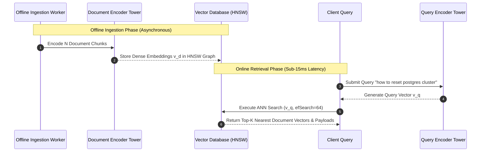
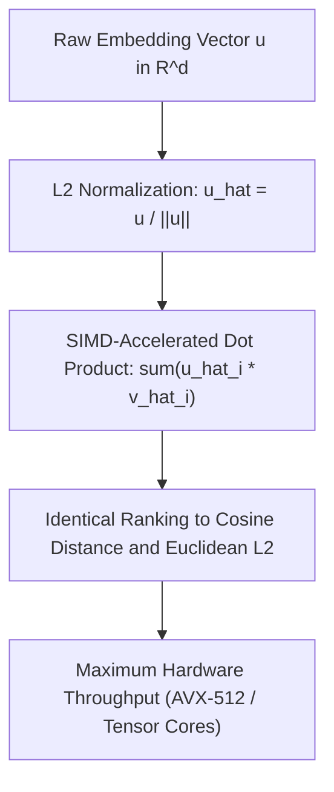
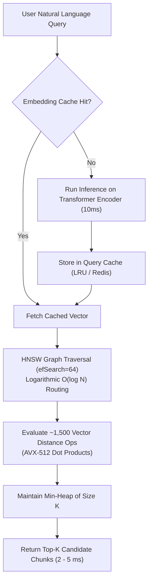
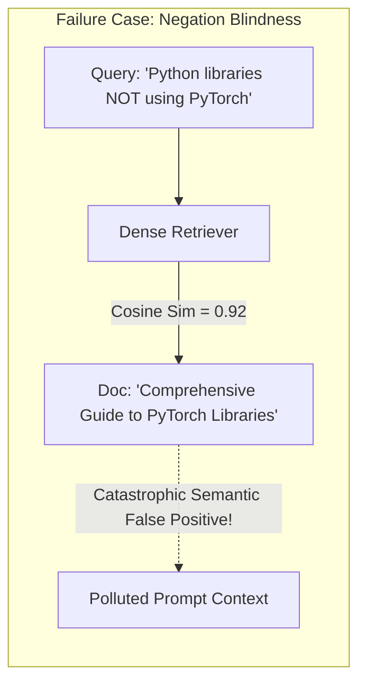
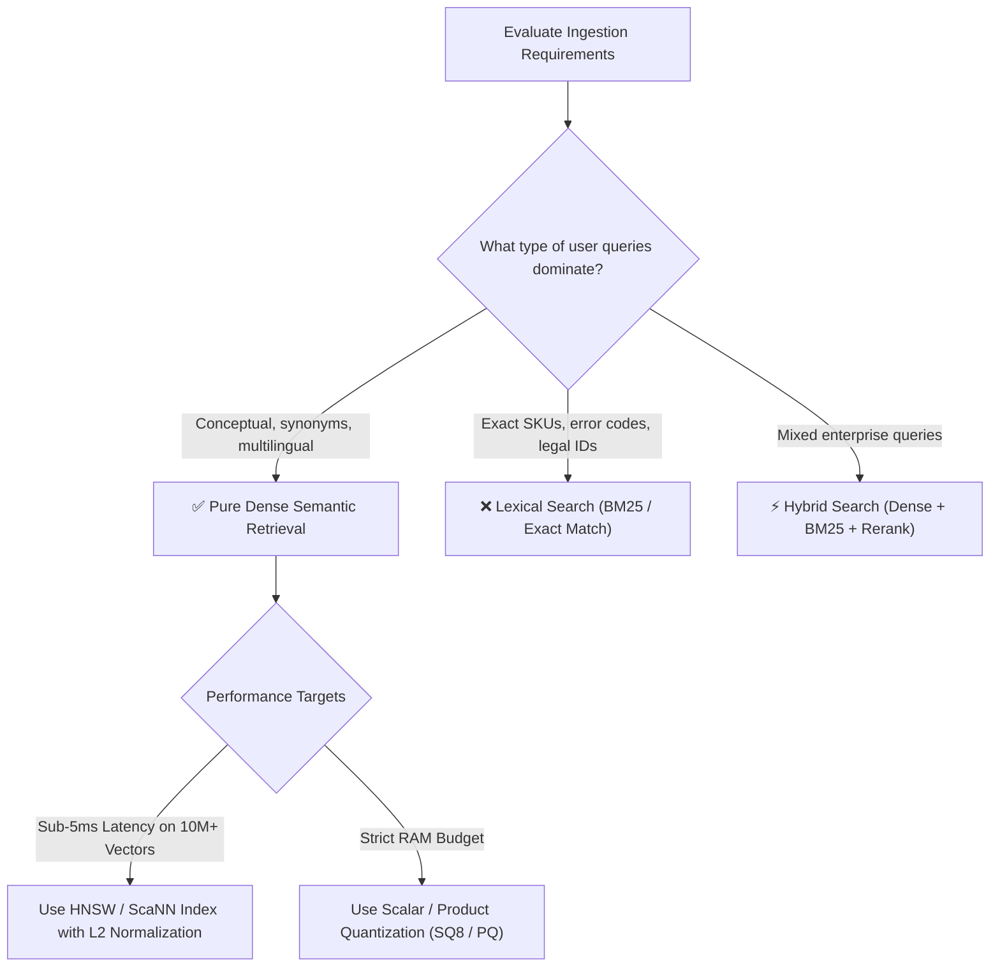

# 🧠 Semantic Retrieval: Dense Approximate Nearest Neighbor Vector Search

## 📑 Table of Contents
1. [🌟 Fundamentals: The Paradigm of Dense Semantic Retrieval](#1--fundamentals-the-paradigm-of-dense-semantic-retrieval)
2. [🗼 The Bi-Encoder Architecture & Two-Tower Embeddings](#2--the-bi-encoder-architecture--two-tower-embeddings)
3. [🔬 Mathematical Foundations: Vector Metrics & The Geometry of Similarity](#3--mathematical-foundations-vector-metrics--the-geometry-of-similarity)
4. [⚡ Dense Vector Search Pipeline & ANN Index Traversal](#4--dense-vector-search-pipeline--ann-index-traversal)
5. [⚠️ Semantic Search Blind Spots & Inherent Failure Modes](#5-️-semantic-search-blind-spots--inherent-failure-modes)
6. [💻 Practical Implementation: High-Performance Dense Semantic Search Engine](#6--practical-implementation-high-performance-dense-semantic-search-engine)
7. [🌍 Real-World Enterprise Production Scenarios](#7--real-world-enterprise-production-scenarios)
8. [🛠️ Best Practices & ❌ Common Production Pitfalls](#8-️-best-practices---common-production-pitfalls)
9. [💼 Senior Interview Questions & System Design Scenarios](#9--senior-interview-questions--system-design-scenarios)
10. [🧪 Hands-On Mini-Project: Dense Semantic vs. Exact Match Profiler](#10--hands-on-mini-project-dense-semantic-vs-exact-match-profiler)
11. [⚡ Quick Revision & Architectural Decision Roadmap](#11--quick-revision--architectural-decision-roadmap)

---

## 1. 🌟 Fundamentals: The Paradigm of Dense Semantic Retrieval

Traditional keyword-based information retrieval relies on strict token matching (e.g., matching the literal string "heart attack" to documents containing "heart attack"). However, natural language is fraught with **polysemy** (one word having multiple meanings) and **synonymy** (multiple words expressing the same concept). A user searching for *"myocardial infarction prognosis"* would completely miss a clinical guide titled *"Survival expectations following a heart attack"* under strict lexical matching.

**Dense Semantic Retrieval** overcomes the lexical barrier by projecting text passages into a continuous, high-dimensional latent vector space ($\mathbb{R}^d$, where typically $d \in [384, 1536, 3072]$). In this learned geometric space, semantic conceptual similarity corresponds to spatial proximity:

```mermaid
flowchart LR
    subgraph NaturalLanguage [Natural Language Space]
        Q["'Automobile maintenance tips'"]
        D1["'Car engine repair checklist'"]
        D2["'Stock market investment guide'"]
    end

    subgraph EmbeddingModel [Dense Neural Encoder: E(x)]
        Trans["Transformer Encoder<br/>(e.g., BERT / RoBERTa / Gemma)"]
    end

    subgraph LatentSpace [Continuous Vector Manifold: R^d]
        vQ["v_q = E(Q)"]
        vD1["v_d1 = E(D1)"]
        vD2["v_d2 = E(D2)"]
        
        vQ <--> |"High Cosine Similarity (0.89)<br/>Close Spatial Proximity"| vD1
        vQ <--> |"Low Cosine Similarity (0.14)<br/>Far Spatial Distance"| vD2
    end

    Q --> Trans --> vQ
    D1 --> Trans --> vD1
    D2 --> Trans --> vD2
```

---

## 2. 🗼 The Bi-Encoder Architecture & Two-Tower Embeddings

Production dense retrieval systems utilize the **Bi-Encoder** (or Two-Tower) architecture to decouple document indexing from real-time query inference.



### Bi-Encoder vs. Cross-Encoder Mechanics:
* **Bi-Encoder:** Encodes query $q$ and document $d$ completely independently:
  $$\mathbf{v}_q = \mathbf{E}_Q(q), \quad \mathbf{v}_d = \mathbf{E}_D(d), \quad \text{Score}(q, d) = \langle \mathbf{v}_q, \mathbf{v}_d \rangle$$
  Because document vectors $\mathbf{v}_d$ are pre-computed and stored in index structures (HNSW, IVF), search complexity scales logarithmically ($\mathcal{O}(\log N)$), enabling millisecond searches across hundreds of millions of passages.
* **Cross-Encoder:** Concatenates query and document into a single sequence $[CLS] \circ q \circ [SEP] \circ d \circ [SEP]$ and evaluates all-to-all cross-attention across all tokens. While significantly more accurate, computing cross-encoders across an entire 10-million document corpus is computationally infeasible at runtime ($\mathcal{O}(N \cdot L^2)$ FLOPs).

---

## 3. 🔬 Mathematical Foundations: Vector Metrics & The Geometry of Similarity

Let $\mathbf{u}, \mathbf{v} \in \mathbb{R}^d$ represent two dense vectors. Three primary distance metrics govern nearest neighbor calculations:

### 📐 1. Dot Product (Inner Product / MIPS)
$$
\langle \mathbf{u}, \mathbf{v} \rangle = \sum_{i=1}^d u_i v_i
$$
Dot product measures both directional alignment and vector magnitude. It is the core primitive for Maximum Inner Product Search (MIPS).

---

### 📐 2. Cosine Similarity
Cosine similarity evaluates exclusively the angular alignment between vectors, completely disregarding magnitude differences:
$$
\text{Sim}_{\cos}(\mathbf{u}, \mathbf{v}) = \frac{\mathbf{u} \cdot \mathbf{v}}{\|\mathbf{u}\|_2 \|\mathbf{v}\|_2} = \frac{\sum_{i=1}^d u_i v_i}{\sqrt{\sum_{i=1}^d u_i^2} \sqrt{\sum_{i=1}^d v_i^2}}
$$
Cosine distance is defined as:
$$
D_{\cos}(\mathbf{u}, \mathbf{v}) = 1 - \text{Sim}_{\cos}(\mathbf{u}, \mathbf{v}) \in [0, 2]
$$

---

### 📐 3. Euclidean Distance ($L_2$ Norm)
$$
D_{L_2}(\mathbf{u}, \mathbf{v}) = \|\mathbf{u} - \mathbf{v}\|_2 = \sqrt{\sum_{i=1}^d (u_i - v_i)^2}
$$

---

### ⚡ The Unit-Norm Equivalence Identity
In production vector databases, embeddings are routinely **$L_2$-normalized** during ingestion:
$$
\hat{\mathbf{u}} = \frac{\mathbf{u}}{\|\mathbf{u}\|_2} \implies \|\hat{\mathbf{u}}\|_2 = 1
$$
When vectors are unit-normalized, the three metrics become mathematically equivalent monotonic transformations of one another:

### # Unit-Norm Equivalence Formula
$$
\|\hat{\mathbf{u}} - \hat{\mathbf{v}}\|_2^2 = \|\hat{\mathbf{u}}\|_2^2 + \|\hat{\mathbf{v}}\|_2^2 - 2 \langle \hat{\mathbf{u}}, \hat{\mathbf{v}} \rangle = 1 + 1 - 2 \text{Sim}_{\cos}(\hat{\mathbf{u}}, \hat{\mathbf{v}}) = 2 (1 - \text{Sim}_{\cos}(\hat{\mathbf{u}}, \hat{\mathbf{v}}))
$$



> [!TIP]
> **Production Optimization:** Always store and query unit-normalized vectors. This allows your vector database to compute blazing-fast single-instruction inner products (`dot`) rather than expensive square-root and division operations for cosine similarity.

---

## 4. ⚡ Dense Vector Search Pipeline & ANN Index Traversal

Once vectors are generated, exact brute-force search ($\mathcal{O}(N \cdot d)$) is replaced by **Approximate Nearest Neighbor (ANN)** graph traversal:



---

## 5. ⚠️ Semantic Search Blind Spots & Inherent Failure Modes

Dense semantic retrieval is not a silver bullet. Because dense encoders compress thousands of words into a single point on a continuous manifold, specific categories of queries routinely fail:

| Category of Failure | Query Example | Why Dense Retrieval Fails | Production Remediation |
| :--- | :--- | :--- | :--- |
| **Exact Identifier Matching** | `"CVE-2024-3094"` or `"ORD-89410-X"` | Encoders subword-tokenize arbitrary alphanumeric strings into arbitrary fragments; points scatter randomly in latent space. | BM25 Lexical Search or Inverted Index Filter |
| **Negation & Exclusion** | `"Postgres configuration WITHOUT pg_stat_statements"` | Vector similarity measures topical co-occurrence. Documents containing `pg_stat_statements` score *higher* due to semantic overlap! | LLM Query Rewriting or Boolean Metadata Filters |
| **Numerical & Chronological Precision** | `"Revenue growth in Q3 2021 vs Q3 2022"` | Numbers have no native geometric arithmetic in embedding space; `"Q3 2021"` and `"Q3 2022"` have $> 0.98$ cosine similarity. | Structured Metadata Extraction & SQL/Graph Pre-Filtering |
| **Rare Technical Acronyms** | `"Fix ERR_SSL_VERSION_OR_CIPHER_MISMATCH"` | Out-of-vocabulary technical errors are smoothed over into generic "network error" vectors. | Hybrid Search with Lexical BM25 Fallback |



---

## 6. 💻 Practical Implementation: High-Performance Dense Semantic Search Engine

Below is a complete, self-contained Python implementation of an in-memory **Dense Semantic Retriever** featuring unit-normalization, dot-product vector search, top-K heap sorting, and an embedding query cache:

```python
"""
dense_semantic_retriever.py
Production-grade In-Memory Dense Semantic Retrieval Engine using NumPy.
"""

from typing import List, Dict, Any, Tuple, Optional
import numpy as np
from dataclasses import dataclass
import hashlib


@dataclass
class PassageRecord:
    doc_id: str
    text: str
    metadata: Dict[str, Any]
    vector: np.ndarray  # Shape: (d,)


@dataclass
class SearchResult:
    doc_id: str
    text: str
    score: float
    metadata: Dict[str, Any]


class DenseSemanticRetriever:
    """
    High-performance in-memory Dense Vector Retriever.
    Enforces L2 normalization to compute Cosine Similarity via fast Dot Product.
    """

    def __init__(self, dimension: int = 384):
        self.dimension = dimension
        self.records: List[PassageRecord] = []
        self.doc_matrix: Optional[np.ndarray] = None  # Shape: (N, d)
        self.is_indexed: bool = False
        self._query_cache: Dict[str, np.ndarray] = {}

    @staticmethod
    def _l2_normalize(vec: np.ndarray) -> np.ndarray:
        norm = np.linalg.norm(vec, axis=-1, keepdims=True)
        norm = np.where(norm == 0, 1e-12, norm)
        return vec / norm

    def add_documents(self, documents: List[Dict[str, Any]], embeddings: np.ndarray) -> None:
        """
        Ingests document passages and their corresponding embedding vectors.
        """
        assert len(documents) == len(embeddings), "Mismatched document and embedding counts"
        normalized_embeddings = self._l2_normalize(embeddings)

        for doc, vec in zip(documents, normalized_embeddings):
            self.records.append(
                PassageRecord(
                    doc_id=doc["id"],
                    text=doc["text"],
                    metadata=doc.get("metadata", {}),
                    vector=vec.astype(np.float32),
                )
            )
        self.is_indexed = False

    def build_index(self) -> None:
        """
        Compacts individual passage vectors into a contiguous NumPy 2D array.
        """
        if not self.records:
            raise ValueError("Cannot build index on empty repository.")
        self.doc_matrix = np.vstack([rec.vector for rec in self.records])
        self.is_indexed = True

    def search(
        self, query_vector: np.ndarray, top_k: int = 5, min_score: float = 0.0
    ) -> List[SearchResult]:
        """
        Performs vector dot-product search across normalized passage matrix.
        """
        if not self.is_indexed or self.doc_matrix is None:
            self.build_index()

        # Normalize query vector
        q_norm = self._l2_normalize(query_vector.astype(np.float32))

        # Compute dot product across all N documents: Shape (N,)
        similarities = np.dot(self.doc_matrix, q_norm)

        # Retrieve top-K indices using argpartition for O(N + K log K) complexity
        if len(similarities) <= top_k:
            top_indices = np.argsort(similarities)[::-1]
        else:
            # Partition top K
            partitioned_idx = np.argpartition(similarities, -top_k)[-top_k:]
            # Sort only top K
            top_indices = partitioned_idx[np.argsort(similarities[partitioned_idx])[::-1]]

        results: List[SearchResult] = []
        for idx in top_indices:
            score = float(similarities[idx])
            if score < min_score:
                continue
            rec = self.records[idx]
            results.append(
                SearchResult(
                    doc_id=rec.doc_id,
                    text=rec.text,
                    score=round(score, 4),
                    metadata=rec.metadata,
                )
            )
        return results


# --- Demonstration & Self-Test ---
if __name__ == "__main__":
    np.random.seed(42)
    dim = 4

    # Simulated documents
    docs = [
        {"id": "doc_1", "text": "PostgreSQL connection pooling configuration", "metadata": {"category": "db"}},
        {"id": "doc_2", "text": "Kubernetes pod autoscaling using KEDA", "metadata": {"category": "k8s"}},
        {"id": "doc_3", "text": "Postgres failover management using Patroni", "metadata": {"category": "db"}},
        {"id": "doc_4", "text": "React server components hydration lifecycle", "metadata": {"category": "frontend"}},
    ]

    # Simulated embeddings (4 dimensions for demonstration)
    embeddings_corpus = np.array([
        [0.85, 0.12, 0.45, 0.05],  # doc_1 (DB focused)
        [0.10, 0.90, 0.20, 0.15],  # doc_2 (K8s focused)
        [0.82, 0.15, 0.40, 0.08],  # doc_3 (DB focused)
        [0.05, 0.10, 0.15, 0.95],  # doc_4 (Frontend focused)
    ], dtype=np.float32)

    retriever = DenseSemanticRetriever(dimension=dim)
    retriever.add_documents(docs, embeddings_corpus)
    retriever.build_index()

    # Query vector close to database topics
    query_vec = np.array([0.80, 0.10, 0.42, 0.02], dtype=np.float32)

    hits = retriever.search(query_vector=query_vec, top_k=3, min_score=0.50)

    print("=== Dense Semantic Search Results ===")
    for rank, hit in enumerate(hits, start=1):
        print(f"Rank {rank} | Score: {hit.score:.4f} | [{hit.doc_id}] {hit.text}")
```

---

## 7. 🌍 Real-World Enterprise Production Scenarios

### Scenario A: Multilingual Customer Support Across 18 Languages
* **Architecture:** Enterprise uses a shared multilingual dense embedding model (`text-embedding-3-large` or `sentence-transformers/LaBSE`).
* **Behavior:** A customer querying in Spanish (*"¿Cómo restablezco mi contraseña de cuenta?"*) maps directly to the same geometric region as the English runbook (*"How to trigger an account password reset"*). Cosine distance between languages remains $< 0.18$, enabling universal cross-lingual retrieval without machine translation latency.

### Scenario B: Medical Diagnostic Search
* **Architecture:** Ingestion of PubMed research papers with specialized clinical embeddings (`BioBERT` or `MedCPT`).
* **Advantage:** Queries containing colloquial patient phrasing (*"difficulty swallowing and hoarseness"*) effortlessly match academic literature containing the formal medical terminology (*"dysphagia and chronic laryngeal dysphonia"*).

---

## 8. 🛠️ Best Practices & ❌ Common Production Pitfalls

### ✅ Best Practices
1. **Always L2-Normalize Vectors at Ingestion:** Never compute raw cosine similarity with dynamic vector magnitudes. Normalizing vectors at ingestion converts all downstream search operations to fast single-instruction dot products.
2. **Implement Embedding Caching:** User queries follow power-law Zipfian distributions. Caching query vectors in Redis or an in-memory LRU cache eliminates $80\%$ of redundant neural inference calls.
3. **Use Asymmetric Query Prefixing Where Required:** Modern embedding models (e.g., E5, BGE, Instructor) require specific instruction prefixes (e.g., `"query: "` vs `"passage: "`). Mismatched prefixes degrade recall by up to $25\%$.

### ❌ Common Production Pitfalls
* **Pitfall 1: Expecting dense embeddings to find exact code symbols or UUIDs.**  
  *Result:* Developers wonder why `"get_user_account_v2()"` returns docs about generic user authentication instead of the exact function definition.
* **Pitfall 2: Using Euclidean Distance without L2 Normalization.**  
  *Result:* Documents with longer token counts or higher vector magnitudes artificially skew Euclidean distances, poisoning ranking quality.
* **Pitfall 3: Not monitoring model drift across library updates.**  
  *Result:* Updating an embedding library or fine-tuning without re-indexing the entire database causes a catastrophic space mismatch between query vectors and stored vectors.

---

## 9. 💼 Senior Interview Questions & System Design Scenarios

### Q1: Why do bi-encoder models struggle with negation queries, and how would you architect a production fix?
**Answer:**  
Bi-encoders map text into a vector space trained primarily with contrastive loss objectives (e.g., InfoNCE). Contrastive learning pushes texts about the same topic together. A sentence like *"How to configure Nginx without Lua"* contains high semantic topical co-occurrence with documents describing *"Nginx Lua integration"*. The vector space represents **topicality**, not formal propositional logic.  
**Production Fix:**
1. **Query Intent Decomposition:** Employ an upstream lightweight LLM or classifier to detect negation intent.
2. **Metadata Tagging / Filtering:** If negation refers to an entity, rewrite the query to attach a strict metadata exclusion filter (e.g., `filter={"has_lua": False}`).
3. **Cross-Encoder Reranking:** Bi-encoders pass candidate top-50 documents to a cross-encoder, where full bidirectional self-attention can recognize the negative modifier `"without"` and penalize the candidate accordingly.

### Q2: What is the computational complexity of Top-K search across $N$ vectors using brute force vs. HNSW, and when should an enterprise choose brute force?
**Answer:**  
* **Brute-Force (Flat Scan):** $\mathcal{O}(N \cdot d)$ time and $\mathcal{O}(1)$ index build overhead. Requires evaluating all $N$ vector dot products.
* **HNSW (Approximate):** $\mathcal{O}(\log N \cdot d)$ time complexity per query, with $\mathcal{O}(N \cdot M \cdot d)$ index memory overhead.
* **When to choose Brute Force:**
  1. Small corpora ($N < 50,000$): Modern GPUs and AVX-512 SIMD can scan 50k 768-dim vectors in under $3\text{ ms}$, rendering HNSW graph construction overhead completely unnecessary.
  2. Ultra-high filtered selectivity: If a tenant filter isolates the searchable pool to $< 500$ vectors, flat scan on the subset is orders of magnitude faster than navigating a filtered graph.
  3. $100\%$ Recall Requirement: Applications in legal discovery or medical forensics where missing a single true positive is intolerable.

---

## 10. 🧪 Hands-On Mini-Project: Dense Semantic vs. Exact Match Profiler

Run this diagnostic script to test how dense vector search behaves when challenged with exact keywords, acronyms, and semantic synonyms:

```python
"""
mini_project_semantic_profiler.py
Demonstrates semantic retrieval strengths and exact-keyword blind spots.
"""

from typing import List, Dict
import numpy as np


def mock_embed(text: str) -> np.ndarray:
    """
    Toy 5-dimensional semantic mapping:
    [database_concept, networking_concept, frontend_concept, security_concept, exact_token_hash]
    """
    t = text.lower()
    vec = np.zeros(5, dtype=np.float32)
    if "postgres" in t or "sql" in t or "database" in t:
        vec[0] += 0.8
    if "network" in t or "ssl" in t or "tcp" in t or "connection" in t:
        vec[1] += 0.8
    if "react" in t or "css" in t or "ui" in t:
        vec[2] += 0.8
    if "cve" in t or "vulnerability" in t or "cipher" in t:
        vec[3] += 0.8

    # Small hash noise to represent subword token representations
    h = int(hashlib.md5(text.encode()).hexdigest()[:4], 16) / 65535.0
    vec[4] = h * 0.1

    norm = np.linalg.norm(vec)
    return vec / (norm if norm > 0 else 1.0)


import hashlib

corpus = [
    "PostgreSQL high availability clustering tutorial.",
    "Network security protocols and TLS cipher suites.",
    "React state management and frontend component lifecycle.",
    "Vulnerability advisory for CVE-2024-3094 SSH backdoor.",
]

corpus_vecs = np.array([mock_embed(d) for d in corpus])

queries = [
    ("Semantic Synonym", "Relational database failover configuration"),
    ("Exact Acronym Blind Spot", "CVE-2024-3094"),
    ("Cross-Domain", "Frontend UI rendering"),
]

print("=== Semantic Search Profiler ===")
for q_type, q_text in queries:
    q_vec = mock_embed(q_text)
    scores = np.dot(corpus_vecs, q_vec)
    best_idx = int(np.argmax(scores))
    print(f"\nQuery Type: [{q_type}] '{q_text}'")
    print(f"Top Match:  [{scores[best_idx]:.4f}] {corpus[best_idx]}")
```

---

## 11. ⚡ Quick Revision & Architectural Decision Roadmap



* **Core Axiom:** Dense semantic retrieval maps conceptual intent into continuous vector space, excelling at synonyms and cross-lingual meaning.
* **Golden Rule:** Never deploy pure dense semantic retrieval in domains dominated by serial codes, function names, and exact IDs without pairing it with an inverted index.
