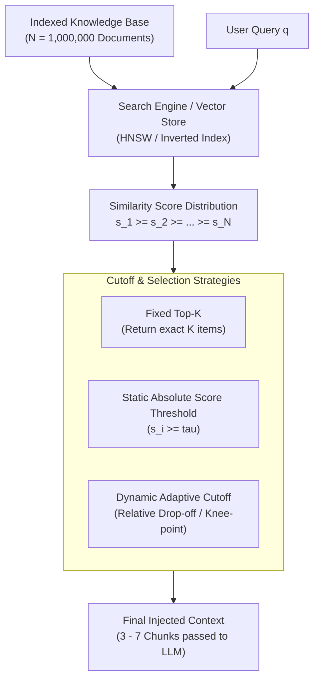
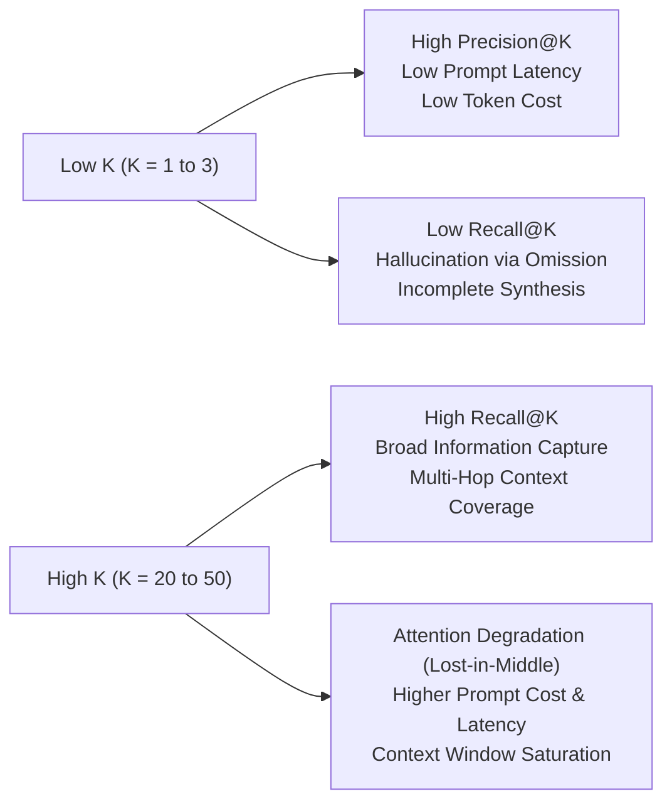
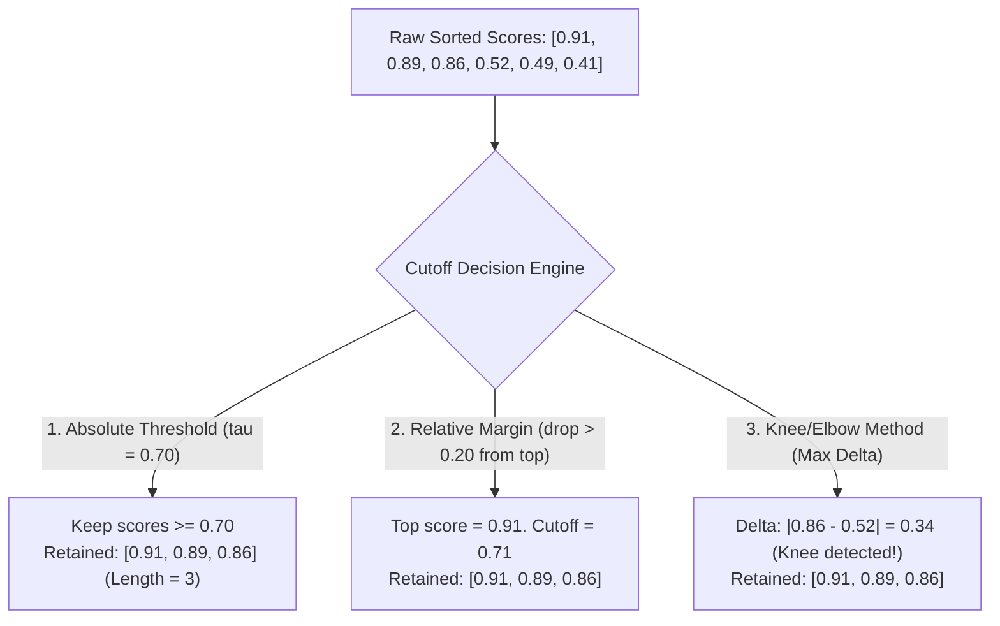
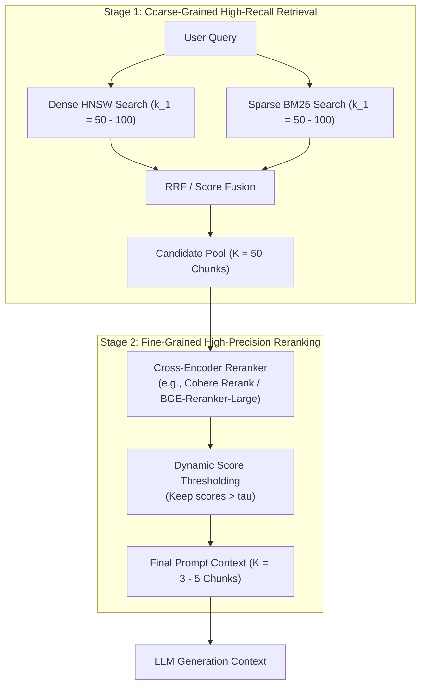
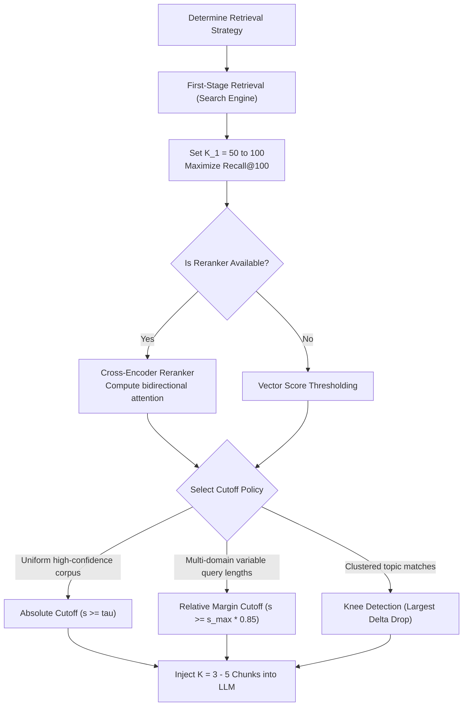

# 🎯 Top-K Retrieval: Mechanics, Cutoff Thresholds, and Precision-Recall Trade-offs

## 📑 Table of Contents
1. [🌟 Fundamentals: The Mechanics of Top-K Retrieval](#1--fundamentals-the-mechanics-of-top-k-retrieval)
2. [🔬 Mathematical Formulations & IR Evaluation Metrics](#2--mathematical-formulations--ir-evaluation-metrics)
3. [⚖️ The Precision-Recall & Context-Window Dilemma](#3-️-the-precision-recall--context-window-dilemma)
4. [📉 Dynamic Cutoff Thresholds & Adaptive Filtering](#4--dynamic-cutoff-thresholds--adaptive-filtering)
5. [🏗️ Two-Stage Retrieval Architectures: The K-Budget Funnel](#5-️-two-stage-retrieval-architectures-the-k-budget-funnel)
6. [💻 Practical Implementation: Adaptive Top-K Retrieval Engine](#6--practical-implementation-adaptive-top-k-retrieval-engine)
7. [🌍 Real-World Enterprise Production Scenarios](#7--real-world-enterprise-production-scenarios)
8. [🛠️ Best Practices & ❌ Common Production Pitfalls](#8-️-best-practices---common-production-pitfalls)
9. [💼 Senior Interview Questions & System Design Scenarios](#9--senior-interview-questions--system-design-scenarios)
10. [🧪 Hands-On Mini-Project: Pareto Threshold & Metric Profiler](#10--hands-on-mini-project-pareto-threshold--metric-profiler)
11. [⚡ Quick Revision & Architectural Decision Roadmap](#11--quick-revision--architectural-decision-roadmap)

---

## 1. 🌟 Fundamentals: The Mechanics of Top-K Retrieval

In modern Retrieval-Augmented Generation (RAG), **Top-$K$ Retrieval** is the algorithmic stage responsible for filtering a vast corpus of $N$ indexed passages down to a compact subset of $K$ candidate passages ($K \ll N$) that maximize relevance to a user query $q$.

While seemingly elementary, selecting $K$ and establishing cutoff thresholds constitutes one of the most consequential architectural decisions in production RAG systems:
* **Under-retrieval ($K$ too small):** Omits critical contextual evidence, leading to knowledge gaps, incomplete reasoning, and catastrophic model hallucinations.
* **Over-retrieval ($K$ too large):** Introduces irrelevant distractors, triggers attention dilution (**"Lost-in-the-Middle" effect**), increases latency, and unnecessarily consumes generative token budgets.



---

## 2. 🔬 Mathematical Formulations & IR Evaluation Metrics

To empirically measure and tune Top-$K$ retrieval performance, production engineering teams rely on standard Information Retrieval (IR) metrics calculated over ground-truth labeled datasets.

### 📐 1. Precision@K and Recall@K

Let $\mathcal{R}_q$ denote the set of truly relevant documents for query $q$, and let $\mathcal{S}_K(q) = \{d_1, d_2, \dots, d_K\}$ denote the ordered set of top $K$ documents returned by the retriever:

### # Precision@K Formula
$$
\text{Precision@}K = \frac{|\mathcal{S}_K(q) \cap \mathcal{R}_q|}{K}
$$

### # Recall@K Formula
$$
\text{Recall@}K = \frac{|\mathcal{S}_K(q) \cap \mathcal{R}_q|}{|\mathcal{R}_q|}
$$

* **Precision@K** measures context purity (fraction of retrieved chunks that are actually relevant).
* **Recall@K** measures context completeness (fraction of all relevant chunks that were captured).

---

### 📐 2. Mean Reciprocal Rank (MRR)
MRR evaluates where the **first** relevant passage appears in the ranked list across a set of $Q$ queries:

### # Mean Reciprocal Rank (MRR) Formula
$$
\text{MRR} = \frac{1}{|Q|} \sum_{i=1}^{|Q|} \frac{1}{\text{rank}_i}
$$
where $\text{rank}_i$ is the position of the first relevant document for query $q_i$. If no relevant document is retrieved within the top $K$, $\frac{1}{\text{rank}_i} = 0$.

---

### 📐 3. Normalized Discounted Cumulative Gain (NDCG@K)
NDCG accounts for multi-level graded relevance $rel_i \in \{0, 1, 2, 3\}$ and penalizes highly relevant documents appearing lower in the ranking:

### # Discounted Cumulative Gain (DCG@K)
$$
\text{DCG@}K = \sum_{i=1}^{K} \frac{2^{rel_i} - 1}{\log_2(i + 1)}
$$

### # Ideal DCG (IDCG@K) and NDCG@K
$$
\text{IDCG@}K = \sum_{i=1}^{|\mathcal{R}_q^*|} \frac{2^{rel_i^*} - 1}{\log_2(i + 1)}, \quad \text{NDCG@}K = \frac{\text{DCG@}K}{\text{IDCG@}K}
$$
where $\mathcal{R}_q^*$ represents the perfectly sorted permutation of relevant documents.

---

## 3. ⚖️ The Precision-Recall & Context-Window Dilemma

Selecting an optimal $K$ involves navigating a multi-dimensional engineering trade-off:



### 🧠 The "Lost-in-the-Middle" Phenomenon
Research by Liu et al. (Stanford/Berkeley, 2023) demonstrated that Transformer language models exhibit a U-shaped attention curve over input contexts:
* Information placed at the **very beginning** ($\text{Index } 0 - 1$) or the **very end** ($\text{Index } K - 1$) of the prompt context is retrieved with high fidelity.
* Information positioned in the **middle third** of a long context window suffers severe retrieval degradation (up to a $30\% - 50\%$ drop in generation accuracy).
* Therefore, indiscriminately increasing $K$ from 5 to 25 without intelligent reranking actively degrades model output quality.

| Metric / Dimension | $K = 3$ | $K = 10$ | $K = 30$ | $K = 100$ |
| :--- | :--- | :--- | :--- | :--- |
| **Typical Recall@K** | $55\% - 70\%$ | $75\% - 88\%$ | $90\% - 96\%$ | $97\% - 99\%$ |
| **Typical Precision@K** | $85\% - 95\%$ | $60\% - 75\%$ | $30\% - 45\%$ | $10\% - 18\%$ |
| **Context Token Footprint (512-token chunks)** | $\approx 1.5\text{k tokens}$ | $\approx 5.1\text{k tokens}$ | $\approx 15.4\text{k tokens}$ | $\approx 51.2\text{k tokens}$ |
| **Risk of Lost-in-the-Middle** | Negligible | Low | Moderate to High | Severe |
| **Primary Use Case** | Direct Factoid Q&A | Standard RAG Systems | Multi-Hop RAG / Reranking Pool | Comprehensive Document Summarization |

---

## 4. 📉 Dynamic Cutoff Thresholds & Adaptive Filtering

Relying purely on a static, fixed integer $K$ is brittle:
1. When a query matches 20 distinct relevant clauses, a fixed $K=5$ arbitrarily discards 15 critical facts.
2. When a query is completely out-of-domain or adversarial, a fixed $K=5$ still forces 5 completely irrelevant passages into the prompt context.

To solve this, advanced production architectures implement **Dynamic Cutoff Thresholding**:



### 1. Absolute Score Cutoff ($\tau_{\text{abs}}$)
Filters out any passage whose similarity score falls below a predetermined floor:
$$
\mathcal{S}_{\text{filtered}} = \{d_i \in \mathcal{S}_K \mid \text{score}(q, d_i) \ge \tau_{\text{abs}}\}
$$
* **Pros:** Extremely simple to implement. Prevents garbage from entering the context when no relevant documents exist.
* **Cons:** Score distributions shift drastically depending on query length, embedding model calibration, and domain distribution.

### 2. Relative Margin Cutoff ($\tau_{\text{rel}}$)
Measures the score drop relative to the top-scoring passage $s_{\max} = \text{score}(q, d_1)$:
$$
\mathcal{S}_{\text{filtered}} = \{d_i \in \mathcal{S}_K \mid \text{score}(q, d_i) \ge s_{\max} \cdot (1 - \tau_{\text{rel}})\}
$$
* **Example:** If $s_{\max} = 0.90$ and $\tau_{\text{rel}} = 0.15$, only passages with scores $\ge 0.765$ are admitted.

### 3. Knee / Elbow Detection (Maximum First-Derivative Drop)
Detects the largest discontinuity in the sorted score curve:
$$
k^* = \arg\max_{1 \le i < K} (s_i - s_{i+1})
$$
If $(s_{k^*} - s_{k^*+1}) > \theta_{\text{drop}}$, the engine truncates retrieval at rank $k^*$.

---

## 5. 🏗️ Two-Stage Retrieval Architectures: The K-Budget Funnel

Enterprise production systems do not pass raw first-stage vector search results directly to the LLM. Instead, they execute a **Two-Stage Retrieval Funnel**:



### The Architectural Budget:
1. **First-Stage $K_1$ (Candidate Generation):** Set high ($K_1 = 50 \text{ to } 100$). Uses fast $\mathcal{O}(\log N)$ vector search or inverted index traversal ($< 15\text{ ms}$). Optimizes exclusively for **Recall@100**.
2. **Second-Stage $K_2$ (Cross-Attention Reranking):** Cross-encoders evaluate full bidirectional token interactions between query and candidate. High computational complexity ($\mathcal{O}(L^2)$), so candidate pool is capped at $50$.
3. **Third-Stage $K_{\text{final}}$ (Generation Context):** Truncated to the top $3 - 5$ passages, maximizing **Precision@5** and eliminating token waste.

---

## 6. 💻 Practical Implementation: Adaptive Top-K Retrieval Engine

Here is a fully functional, production-ready Python implementation of an **Adaptive Top-K Retrieval Engine** supporting static, relative, and knee-drop dynamic thresholding:

```python
"""
adaptive_topk_retriever.py
Production-grade Top-K Retrieval Engine with Dynamic Cutoff Thresholds.
"""

from typing import List, Dict, Any, Optional, Tuple
from dataclasses import dataclass
import numpy as np


@dataclass
class RetrievedDocument:
    doc_id: str
    text: str
    score: float
    metadata: Dict[str, Any]


class AdaptiveTopKRetriever:
    """
    Executes Top-K candidate ranking with configurable dynamic cutoff strategies:
      - 'fixed': Exact integer Top-K cutoff.
      - 'absolute': Filter by absolute similarity threshold.
      - 'relative_drop': Discard candidates whose score falls beyond a percentage of top score.
      - 'knee_detection': Detect largest score cliff and truncate.
    """

    def __init__(
        self,
        default_k: int = 10,
        min_k: int = 2,
        max_k: int = 25,
        absolute_threshold: float = 0.65,
        relative_margin: float = 0.20,
        knee_drop_threshold: float = 0.15,
    ):
        self.default_k = default_k
        self.min_k = min_k
        self.max_k = max_k
        self.absolute_threshold = absolute_threshold
        self.relative_margin = relative_margin
        self.knee_drop_threshold = knee_drop_threshold

    def filter_candidates(
        self,
        candidates: List[RetrievedDocument],
        strategy: str = "relative_drop",
        custom_k: Optional[int] = None,
    ) -> List[RetrievedDocument]:
        """
        Filters and truncates candidate list according to the specified cutoff strategy.
        Assumes candidates are pre-sorted in descending order of score.
        """
        if not candidates:
            return []

        # Ensure candidates are sorted by score descending
        sorted_docs = sorted(candidates, key=lambda d: d.score, reverse=True)
        target_k = custom_k or self.default_k

        if strategy == "fixed":
            return sorted_docs[:target_k]

        elif strategy == "absolute":
            filtered = [d for d in sorted_docs if d.score >= self.absolute_threshold]
            # Enforce min_k and max_k boundaries
            if len(filtered) < self.min_k and len(sorted_docs) >= self.min_k:
                return sorted_docs[: self.min_k]
            return filtered[: self.max_k]

        elif strategy == "relative_drop":
            top_score = sorted_docs[0].score
            cutoff_score = top_score * (1.0 - self.relative_margin)
            
            filtered = [d for d in sorted_docs if d.score >= cutoff_score]
            # Bound within [min_k, max_k]
            retained_k = max(self.min_k, min(len(filtered), self.max_k))
            return sorted_docs[:retained_k]

        elif strategy == "knee_detection":
            scores = [d.score for d in sorted_docs]
            cutoff_idx = len(sorted_docs)

            # Compute score drops between adjacent elements
            for i in range(len(scores) - 1):
                drop = scores[i] - scores[i + 1]
                if drop >= self.knee_drop_threshold and (i + 1) >= self.min_k:
                    cutoff_idx = i + 1
                    break

            cutoff_idx = max(self.min_k, min(cutoff_idx, self.max_k))
            return sorted_docs[:cutoff_idx]

        else:
            raise ValueError(f"Unknown cutoff strategy: {strategy}")


# --- Demonstration & Self-Test ---
if __name__ == "__main__":
    # Simulated search engine output across 8 passages
    mock_candidates = [
        RetrievedDocument("doc_1", "PostgreSQL WAL replication setup guide.", 0.94, {"section": "infra"}),
        RetrievedDocument("doc_2", "PostgreSQL streaming standby configuration.", 0.91, {"section": "infra"}),
        RetrievedDocument("doc_3", "Postgres failover management with Patroni.", 0.88, {"section": "infra"}),
        RetrievedDocument("doc_4", "Database backup scheduling on Linux cron.", 0.62, {"section": "ops"}),
        RetrievedDocument("doc_5", "Docker container volume persistence guide.", 0.58, {"section": "docker"}),
        RetrievedDocument("doc_6", "Python SQLAlchemy connection pooling.", 0.51, {"section": "backend"}),
        RetrievedDocument("doc_7", "Redis cache eviction algorithms.", 0.35, {"section": "cache"}),
        RetrievedDocument("doc_8", "React front-end state management.", 0.12, {"section": "frontend"}),
    ]

    retriever = AdaptiveTopKRetriever(
        default_k=5,
        min_k=2,
        max_k=6,
        absolute_threshold=0.70,
        relative_margin=0.15,
        knee_drop_threshold=0.20,
    )

    print("=== Raw Retrieved Candidates ===")
    for d in mock_candidates:
        print(f"[{d.score:.2f}] {d.doc_id}: {d.text}")

    print("\n--- Strategy: Fixed Top-5 ---")
    res_fixed = retriever.filter_candidates(mock_candidates, strategy="fixed")
    for d in res_fixed:
        print(f"[{d.score:.2f}] {d.doc_id}: {d.text}")

    print("\n--- Strategy: Absolute Threshold (>= 0.70) ---")
    res_abs = retriever.filter_candidates(mock_candidates, strategy="absolute")
    for d in res_abs:
        print(f"[{d.score:.2f}] {d.doc_id}: {d.text}")

    print("\n--- Strategy: Relative Margin (within 15% of top score 0.94) ---")
    res_rel = retriever.filter_candidates(mock_candidates, strategy="relative_drop")
    for d in res_rel:
        print(f"[{d.score:.2f}] {d.doc_id}: {d.text}")

    print("\n--- Strategy: Knee Detection (Drop >= 0.20) ---")
    res_knee = retriever.filter_candidates(mock_candidates, strategy="knee_detection")
    for d in res_knee:
        print(f"[{d.score:.2f}] {d.doc_id}: {d.text}")
```

---

## 7. 🌍 Real-World Enterprise Production Scenarios

### Scenario A: Legal Compliance & Contract Analysis
* **Challenge:** Legal contracts require multi-clause synthesis across 500-page master service agreements (MSAs). Missing a single limitation-of-liability clause causes contractual breach.
* **Architectural Configuration:**
  * First-stage dense retrieval: $K_1 = 150$.
  * First-stage BM25 retrieval: $K_1 = 150$ with exact clause numbering match.
  * Cross-encoder reranker: Top-60 passed to Cohere Rerank.
  * Context Window: Top $12$ chunks injected into LLM using **Hierarchical Parent Document Assembly**.

### Scenario B: High-Throughput Customer Support Bot
* **Challenge:** Peak load of 5,000 queries per second (QPS) with an end-to-end SLA of $< 800\text{ ms}$ and strict token budget constraints.
* **Architectural Configuration:**
  * First-stage vector search: $K_1 = 15$ with strict HNSW `efSearch = 32`.
  * Cutoff Strategy: **Relative Margin** with $\tau_{\text{rel}} = 0.12$.
  * Reranking: Skipped or lightweight MiniLM cross-encoder to stay within $10\text{ ms}$ rerank latency.
  * Final Context: $K_{\text{final}} = 2 \text{ to } 3$ chunks directly injected.

---

## 8. 🛠️ Best Practices & ❌ Common Production Pitfalls

### ✅ Best Practices
1. **Always decouple First-Stage $K$ from Final Generation $K$:** Use a wide funnel for search ($K=50$) and a narrow funnel for generation ($K=3\text{--}5$).
2. **Calibrate Thresholds per Embedding Model:** Cosine similarities from OpenAI `text-embedding-3-small` (typically clustered around $0.65 - 0.85$) behave fundamentally differently from Cohere `embed-v3` or BGE embeddings. Never copy-paste arbitrary thresholds without calibration.
3. **Log Retrieval Dropouts:** Persist telemetry on every query where zero candidates met the cutoff threshold to identify knowledge base coverage blind spots.

### ❌ Common Production Pitfalls
* **Pitfall 1: Hardcoding $K=5$ across the entire platform.**  
  *Consequence:* Factual Q&A suffers from context pollution; complex multi-hop queries fail due to missing context.
* **Pitfall 2: Discarding the score distribution and using rank-only truncation.**  
  *Consequence:* If candidate #1 has a score of 0.92 and candidates #2-5 have scores of 0.21, the system injects 4 distractors that deceive the LLM.
* **Pitfall 3: Not enforcing a minimum $K$ fallback.**  
  *Consequence:* Overly aggressive absolute thresholds ($\tau = 0.85$) cause the retriever to return 0 chunks for slightly out-of-vocabulary user queries, leaving the LLM with empty prompts.

---

## 9. 💼 Senior Interview Questions & System Design Scenarios

### Q1: How do you mathematically determine the optimal $K$ for a production RAG pipeline?
**Answer:**  
You treat $K$ optimization as an empirical Pareto curve analysis across a golden evaluation dataset (consisting of $(q, \mathcal{R}_q)$ pairs).
1. Plot **Recall@K** against $K \in [1, 50]$. Recall will exhibit diminishing marginal returns (a logarithmic curve). Identify the "elbow" where increasing $K$ yields $< 0.5\%$ recall gains (e.g., $K = 25$).
2. Evaluate downstream LLM generation accuracy (e.g., via Ragas Faithfulness and Answer Relevance) against the same $K$ values. You will observe that downstream performance peaks at an intermediate value (typically $K \in [3, 7]$) and then deteriorates due to context dilution and Lost-in-the-Middle effects.
3. Establish a two-stage funnel: set First-Stage $K_{\text{retrieval}} = 25 - 50$ (capturing $95\%$ recall) and Second-Stage $K_{\text{context}} = 3 - 5$ post-reranking.

### Q2: What is the difference between static score thresholding and relative margin cutoff, and why is relative margin preferred in multi-domain retrieval?
**Answer:**  
Static thresholding enforces $s_i \ge \tau$. Its primary flaw is **score distribution drift**: dense embedding models output different average similarity scores depending on query length, query abstractness, and corpus density. A query with 3 words might average 0.65 for true positives, while a 20-word query averages 0.85. A static $\tau = 0.75$ would reject all valid answers for the short query.  
Relative margin cutoff calculates $s_i \ge s_{\max} \cdot (1 - \tau_{\text{rel}})$. Because it normalizes against the query's best-scoring match, it dynamically adapts to shifts in the score baseline, retaining candidates that cluster tightly around the top hypothesis regardless of absolute score magnitude.

---

## 10. 🧪 Hands-On Mini-Project: Pareto Threshold & Metric Profiler

Create a self-contained diagnostic script to calculate Precision@K, Recall@K, and MRR across various $K$ thresholds:

```python
"""
mini_project_topk_evaluator.py
Calculates Precision@K, Recall@K, and MRR over synthetic evaluation queries.
"""

from typing import List, Set, Dict


def evaluate_ranking(
    retrieved_ids: List[str], ground_truth_ids: Set[str], k_values: List[int]
) -> Dict[str, Dict[int, float]]:
    metrics = {"precision": {}, "recall": {}}
    total_relevant = len(ground_truth_ids)

    for k in k_values:
        sub_list = retrieved_ids[:k]
        hits = len([doc_id for doc_id in sub_list if doc_id in ground_truth_ids])

        precision = hits / k if k > 0 else 0.0
        recall = hits / total_relevant if total_relevant > 0 else 0.0

        metrics["precision"][k] = round(precision, 4)
        metrics["recall"][k] = round(recall, 4)

    return metrics


if __name__ == "__main__":
    # Test ground truth
    ground_truth = {"doc_10", "doc_42", "doc_99"}
    # Ranked output from search engine
    engine_results = ["doc_10", "doc_5", "doc_99", "doc_12", "doc_42", "doc_100", "doc_8"]

    k_test = [1, 3, 5, 7]
    scores = evaluate_ranking(engine_results, ground_truth, k_test)

    print("=== Top-K Evaluation Profiler ===")
    print(f"Ground Truth Items: {ground_truth}")
    print(f"Retrieved Ranking:  {engine_results}\n")

    for k in k_test:
        p = scores["precision"][k]
        r = scores["recall"][k]
        f1 = round(2 * (p * r) / (p + r), 4) if (p + r) > 0 else 0.0
        print(f"K={k:2d} | Precision: {p:.4f} | Recall: {r:.4f} | F1: {f1:.4f}")
```

---

## 11. ⚡ Quick Revision & Architectural Decision Roadmap



* **Core Axiom:** High First-Stage $K$ ensures candidate recall; selective dynamic cutoff ensures context purity and eliminates the Lost-in-the-Middle effect.
* **Golden Rule:** Never feed more than $5 - 7$ unranked chunks directly to an LLM prompt unless specifically building a document summarization pipeline.
