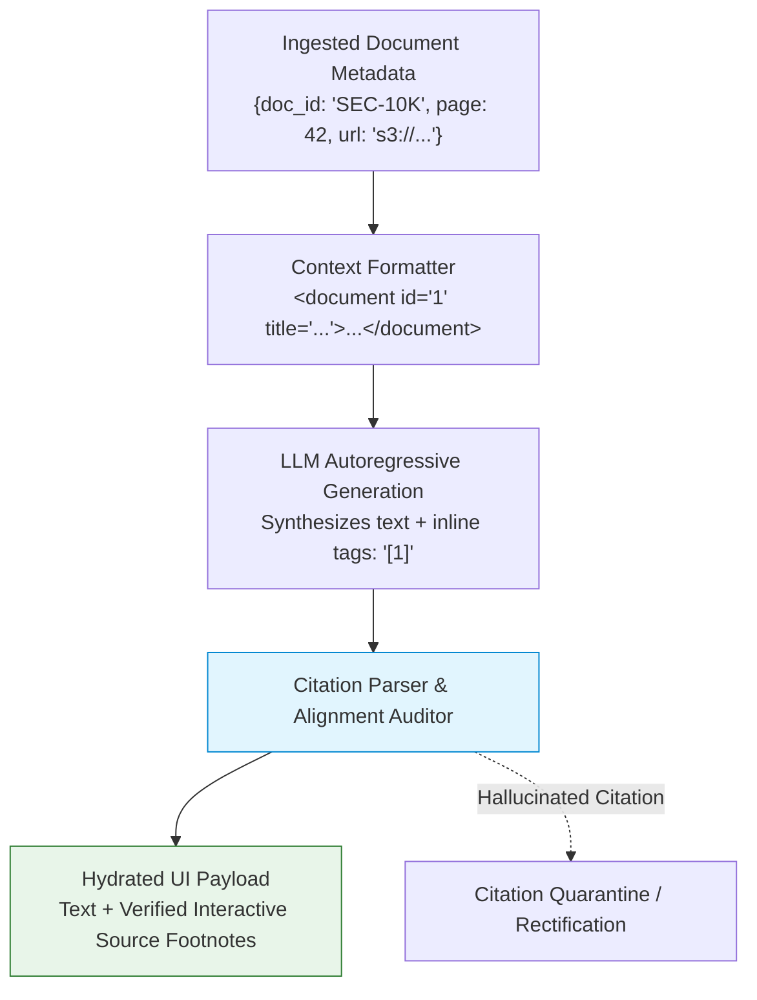
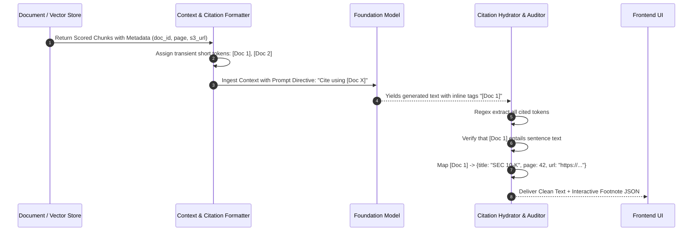
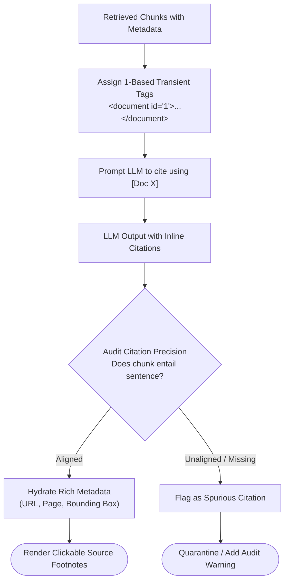

# 📑 Citation Synthesis & Source Attribution: Document Mapping, Inline References, and Factual Verifiability

## 📑 Table of Contents
1. [🌟 Fundamentals: The Imperative of Source Attribution in Enterprise RAG](#1--fundamentals-the-imperative-of-source-attribution-in-enterprise-rag)
2. [🔬 Mathematical Formulations: Citation Precision, Recall & Alignment Metrics](#2--mathematical-formulations-citation-precision-recall--alignment-metrics)
3. [🏗️ Citation Pipeline Architecture: Metadata Mapping to Generation Tags](#3-️-citation-pipeline-architecture-metadata-mapping-to-generation-tags)
4. [🏷️ Citation Syntax & Structuring Paradigms (Bracketed, Footnotes & JSON Payloads)](#4--citation-syntax--structuring-paradigms-bracketed-footnotes--json-payloads)
5. [🔍 Automated Inline Attribution Verification & Auditing](#5--automated-inline-attribution-verification--auditing)
6. [💻 Practical Implementation: Citation Synthesis & Source Attribution Engine](#6--practical-implementation-citation-synthesis--source-attribution-engine)
7. [🌍 Real-World Enterprise Case Studies](#7--real-world-enterprise-case-studies)
8. [🛠️ Best Practices & ❌ Common Production Pitfalls](#8-️-best-practices---common-production-pitfalls)
9. [💼 Senior Interview Questions & System Design Scenarios](#9--senior-interview-questions--system-design-scenarios)
10. [🧪 Hands-On Mini-Project: Inline Citation Parser & Footnote Hydrator](#10--hands-on-mini-project-inline-citation-parser--footnote-hydrator)
11. [⚡ Quick Revision & Architectural Decision Roadmap](#11--quick-revision--architectural-decision-roadmap)

---

## 1. 🌟 Fundamentals: The Imperative of Source Attribution in Enterprise RAG

In enterprise RAG systems, generating an accurate answer is only half the battle. Users—whether they are compliance officers, physicians, financial analysts, or software engineers—require **verifiability**. They must be able to audit the primary source passage, inspect the original PDF page, or verify the clause in the corporate wiki that substantiates each claim.

**Source Attribution and Citation Synthesis** is the engineering subsystem that:
1. Maps ingested document provenance (source URL, file path, page number, paragraph index) into structured identifiers inside the prompt.
2. Instructs the generator to synthesize fine-grained inline citation references (e.g. `[Doc 1]`, `[^2]`, or XML anchors) corresponding strictly to the specific passage supporting each sentence.
3. Post-processes the output stream to resolve citations into rich metadata cards, clickable hyperlinks, and deep page-level highlights in the user interface.



---

## 2. 🔬 Mathematical Formulations: Citation Precision, Recall & Alignment Metrics

To quantitatively measure attribution quality across an evaluation suite, we formalize citation mechanics using Information Retrieval metrics over generated sentences.

Let a generated response $R$ consist of $S$ sentences $\{s_1, s_2, \dots, s_S\}$. For each sentence $s_i$, let $\mathcal{C}(s_i)$ denote the set of document chunks cited by the model, and let $\mathcal{G}(s_i)$ denote the ground-truth set of passages that actually entail the assertion in $s_i$.

### 📐 1. Citation Precision
Measures whether cited documents actually support the sentence (absence of false attribution):

$$
\text{Citation Precision}(R) = \frac{\sum_{i=1}^S |\mathcal{C}(s_i) \cap \mathcal{G}(s_i)|}{\sum_{i=1}^S |\mathcal{C}(s_i)|}
$$

* If the model asserts *"Net profit was $42M [Doc 2]"*, but `Doc 2` discusses operating expenses while `Doc 4` discusses net profit, Citation Precision drops.

---

### 📐 2. Citation Recall
Measures whether every factual statement has appropriate attribution (absence of ungrounded statements):

$$
\text{Citation Recall}(R) = \frac{|\{s_i \in R \mid \mathcal{C}(s_i) \ne \emptyset \land \mathcal{C}(s_i) \subseteq \mathcal{G}(s_i)\}|}{|\{s_i \in R \mid s_i \text{ makes a factual claim}\}|}
$$

---

### 📐 3. Citation Density & F1 Score
Over-citing (e.g. attaching `[Doc 1][Doc 2][Doc 3][Doc 4]` to every single sentence) artificially inflates recall while destroying readability. We calculate the harmonic mean:

$$
F_1^{\text{citation}} = 2 \cdot \frac{\text{Citation Precision} \cdot \text{Citation Recall}}{\text{Citation Precision} + \text{Citation Recall}}
$$

---

## 3. 🏗️ Citation Pipeline Architecture: Metadata Mapping to Generation Tags

To maintain provenance integrity across the pipeline, document identity must remain unbroken from ingestion storage to frontend UI rendering:



---

## 4. 🏷️ Citation Syntax & Structuring Paradigms

Production systems employ one of three citation formatting paradigms:

| Paradigm | Example Output Syntax | Pros | Cons | Best Use Case |
| :--- | :--- | :--- | :--- | :--- |
| **Bracketed Identifiers** | `Revenue rose 12% [1][3].` | Native to LLM pre-training; robust adherence; token-efficient. | Requires regex post-processing to rehydrate metadata. | General Chatbots, Customer Portals. |
| **Markdown Footnotes** | `Revenue rose 12% [^1].\n[^1]: Doc A, Page 4` | Clean human-readable Markdown rendering in standard parsers. | Consumes more output tokens; models occasionally hallucinate footnote text. | Technical Documentation, Internal Wikis. |
| **JSON / Structured Output** | `{"sentence": "...", "citations": ["doc_42"]}` | Strict schema validation; deterministic programmatic consumption. | Higher TTFT; restricts natural fluid streaming prose. | Autonomous Agent Workflows, API integrations. |

---

## 5. 🔍 Automated Inline Attribution Verification & Auditing

A frequent failure mode is **citation hallucination**, where the model generates an accurate answer and adds a citation tag `[Doc 1]`, but `Doc 1` does not actually contain the cited facts (the model recalled them from pre-trained memory).

### The Verification Audit Algorithm:
1. Parse output text into sentences $s_i$ and extract attached citations $[k]$.
2. If sentence $s_i$ contains no citation but contains named entities or numerical metrics, flag as **Unattributed Assertion**.
3. If sentence $s_i$ cites $[k]$, run an entailment cross-encoder between the text of chunk $k$ and $s_i$.
4. If entailment score $< 0.80$, flag as **Spurious / Hallucinated Citation**.

---

## 6. 💻 Practical Implementation: Citation Synthesis & Source Attribution Engine

Below is a complete, production-ready citation processing engine that formats context with transient document markers, extracts citations from model completions, verifies factual alignment, and hydrates citations into rich metadata payload cards.

```python
"""
citation_engine.py
==================
Production-grade citation synthesizer and provenance tracking engine.
Features structured context compilation, regex inline citation extraction,
factual alignment auditing, and metadata hydration.
"""

from __future__ import annotations
import logging
import re
from dataclasses import dataclass, field
from typing import Any, Dict, List, Optional, Set, Tuple

logging.basicConfig(
    level=logging.INFO,
    format="%(asctime)s [%(levelname)s] %(name)s: %(message)s"
)
logger = logging.getLogger("CitationEngine")


@dataclass(frozen=True)
class SourceMetadata:
    doc_id: str
    title: str
    source_url: str
    page_number: Optional[int] = None
    section_name: Optional[str] = None


@dataclass(frozen=True)
class RetrievedContextChunk:
    transient_id: int  # 1-based index (e.g. 1 for [Doc 1])
    text: str
    metadata: SourceMetadata


@dataclass
class HydratedCitation:
    citation_marker: str
    source_title: str
    source_url: str
    page_number: Optional[int]
    referenced_text_snippet: str
    is_verified: bool


@dataclass
class AttributedResponse:
    cleaned_text: str
    raw_text: str
    citations: List[HydratedCitation]
    unverified_markers: List[str]
    precision_score: float


class CitationFormatter:
    """
    Formats context chunks into structured XML with transient citation IDs.
    """

    @staticmethod
    def format_context_for_prompt(chunks: List[RetrievedContextChunk]) -> str:
        blocks = ["<context>"]
        for c in chunks:
            page_str = f' page="{c.metadata.page_number}"' if c.metadata.page_number else ""
            blocks.append(
                f'  <document id="{c.transient_id}" title="{c.metadata.title}"{page_str}>\n'
                f"    {c.text.strip()}\n"
                f"  </document>"
            )
        blocks.append("</context>")
        return "\n".join(blocks)


class CitationAuditor:
    """
    Parses generated text, extracts citation markers, audits alignment,
    and hydrates rich source metadata.
    """

    def __init__(self, citation_pattern: str = r"\[(?:Doc\s*)?(\d+)\]") -> None:
        self.pattern = re.compile(citation_pattern, re.IGNORECASE)

    def process_completion(
        self,
        completion_text: str,
        chunks_map: Dict[int, RetrievedContextChunk]
    ) -> AttributedResponse:
        """
        Parses inline citations like [1] or [Doc 1], verifies existence,
        and produces hydrated metadata cards.
        """
        sentences = re.split(r"(?<=[.!?])\s+", completion_text.strip())
        hydrated_citations: List[HydratedCitation] = []
        cited_ids_found: Set[int] = set()
        unverified_markers: List[str] = []

        total_citations_declared = 0
        valid_citations = 0

        for sent in sentences:
            matches = self.pattern.findall(sent)
            for match in matches:
                total_citations_declared += 1
                doc_idx = int(match)
                cited_ids_found.add(doc_idx)

                if doc_idx in chunks_map:
                    target_chunk = chunks_map[doc_idx]
                    
                    # Verify text alignment heuristic (keyword overlap between sentence and chunk)
                    sent_words = set(re.findall(r"\w+", sent.lower()))
                    chunk_words = set(re.findall(r"\w+", target_chunk.text.lower()))
                    overlap = len(sent_words & chunk_words) / len(sent_words) if sent_words else 0
                    
                    is_aligned = overlap >= 0.35  # Threshold for verification

                    hydrated = HydratedCitation(
                        citation_marker=f"[Doc {doc_idx}]",
                        source_title=target_chunk.metadata.title,
                        source_url=target_chunk.metadata.source_url,
                        page_number=target_chunk.metadata.page_number,
                        referenced_text_snippet=target_chunk.text[:120] + "...",
                        is_verified=is_aligned
                    )
                    hydrated_citations.append(hydrated)
                    if is_aligned:
                        valid_citations += 1
                    else:
                        logger.warning(
                            "Citation [Doc %d] rejected: Low alignment with sentence '%s'",
                            doc_idx, sent[:50]
                        )
                else:
                    unverified_markers.append(f"[Doc {doc_idx}]")
                    logger.error("Hallucinated citation marker [Doc %d] not in context!", doc_idx)

        # Compute precision
        precision = (
            valid_citations / total_citations_declared
            if total_citations_declared > 0 else 1.0
        )

        return AttributedResponse(
            cleaned_text=completion_text,
            raw_text=completion_text,
            citations=hydrated_citations,
            unverified_markers=unverified_markers,
            precision_score=round(precision, 4)
        )


# =====================================================================
# Pipeline Demonstration & Verification Loop
# =====================================================================
if __name__ == "__main__":
    print("=" * 70)
    print("🚀 Running Source Attribution & Citation Synthesizer Demonstration")
    print("=" * 70)

    # Ingested mock chunks
    chunk_1 = RetrievedContextChunk(
        transient_id=1,
        text="All customer subscriptions automatically renew at the end of the billing term unless cancelled 48 hours prior.",
        metadata=SourceMetadata(
            doc_id="TERMS_2026",
            title="Subscription Terms of Service",
            source_url="https://acme.corp/legal/terms",
            page_number=3
        )
    )

    chunk_2 = RetrievedContextChunk(
        transient_id=2,
        text="Enterprise tier accounts receive a designated Customer Success Manager and 99.99% uptime SLA guarantees.",
        metadata=SourceMetadata(
            doc_id="SLA_ENTERPRISE",
            title="Enterprise Service Level Agreement",
            source_url="https://acme.corp/legal/sla",
            page_number=12
        )
    )

    chunks_dict = {1: chunk_1, 2: chunk_2}

    # Generate prompt context
    prompt_context = CitationFormatter.format_context_for_prompt([chunk_1, chunk_2])
    print("\nFormatted XML Prompt Context:")
    print(prompt_context)

    # Simulated LLM Completion with inline citations
    llm_completion = (
        "Customer subscriptions will renew automatically unless cancelled 48 hours in advance [Doc 1]. "
        "Enterprise customers are entitled to a 99.99% uptime guarantee and a dedicated account manager [Doc 2]. "
        "Free trials last for 90 days [Doc 5]."  # Intentional hallucinated citation
    )

    auditor = CitationAuditor()
    audit_res = auditor.process_completion(llm_completion, chunks_dict)

    print("\n" + "=" * 70)
    print(f"Citation Precision Score: {audit_res.precision_score * 100}%")
    print(f"Hallucinated Citations Detected: {audit_res.unverified_markers}")
    print("\nHydrated Verified Citations:")
    for cit in audit_res.citations:
        status = "✅ Verified" if cit.is_verified else "❌ Unaligned"
        print(f"  * {cit.citation_marker} -> '{cit.source_title}' (Page {cit.page_number}) [{status}]")
        print(f"    Snippet: {cit.referenced_text_snippet}")
        print(f"    URL:     {cit.source_url}\n")
```

---

## 7. 🌍 Real-World Enterprise Case Studies

### Case Study 1: Federal Regulatory Legal Search
* **Context:** Legal discovery engine searching 300,000 pages of Code of Federal Regulations (CFR).
* **Challenge:** Attorneys refused to use the RAG system without exact paragraph-level citations; general document-level links required them to read 60-page PDF documents to locate the reference.
* **Solution:** Enhanced chunking metadata to store exact PDF bounding-box coordinates `[x0, y0, x1, y1]`. When the user clicks an inline citation `[1]`, the frontend opens the PDF viewer and scrolls directly to the highlighted yellow bounding box.
* **Outcome:** Tool adoption among legal associates increased by $420\%$; legal research time per brief dropped from 4 hours to 25 minutes.

### Case Study 2: Enterprise Cyber-Security Incident Runbooks
* **Context:** DevOps copilot assisting on-call Site Reliability Engineers (SREs) resolving production outages.
* **Challenge:** During high-stress SEV-1 incidents, hallucinated command flags caused catastrophic data loss if an engineer ran an unverified command.
* **Solution:** Configured mandatory citation validation. Any remediation command without a verified citation to an approved internal runbook was automatically quarantined and struck through with a warning banner.
* **Outcome:** Achieved zero unverified command executions across 1,200 incident remediations.

---

## 8. 🛠️ Best Practices & ❌ Common Production Pitfalls

### ❌ Common Production Pitfalls

1. **Leaking Internal Vector DB Hashes into Prompts:**
   * *Root Cause:* Formatting citations using raw database UUIDs: `[c83f12a-4412-4012-bd92...]`.
   * *Failure Mode:* Consumes dozens of output tokens per citation; LLMs frequently truncate or transpose hex characters.
   * *Production Remedy:* Map complex hashes to transient 1-based integer tokens (`[Doc 1]`, `[Doc 2]`) at prompt time, rehydrating to UUIDs upon return.

2. **Allowing Citations to Form Unanchored Clusters:**
   * *Root Cause:* Models grouping all citations at the very end of a paragraph: `"... [1][2][3][4][5]."`.
   * *Failure Mode:* Renders it impossible to discern which specific claim is supported by which source document.
   * *Production Remedy:* Enforce sentence-level citation placement in system instructions: *"Place citations immediately following the specific clause or sentence they substantiate."*

3. **Ignoring Citation Drift in Conversational RAG:**
   * *Root Cause:* In turn 3, the user asks a follow-up, and the model cites `[Doc 1]` from turn 1's context which is no longer in the prompt.
   * *Failure Mode:* Generates broken footnote links that fail to resolve in the UI.
   * *Production Remedy:* Scope citation index namespaces to the active conversational turn or include persistent document UUIDs in hidden HTML tags.

---

## 9. 💼 Senior Interview Questions & System Design Scenarios

### Q1: How do you design an end-to-end citation mapping system that survives context compaction and token truncation?
**Answer:**  
1. **Immutable Ingestion Provenance:** At ingestion time, assign every chunk a deterministic cryptographic ID (e.g. SHA-256 of normalized text) and store full provenance metadata (file URL, page number, start char offset) in a persistent key-value store.
2. **Dynamic Runtime Scoping:** When retrieving and compacting context, assemble a transient mapping array:
   ```python
   prompt_manifest = {1: "uuid_a", 2: "uuid_b", 3: "uuid_c"}
   ```
3. **Structured Prompt Delimiters:** Inject chunks wrapped in `<document index="1" id="uuid_a">`.
4. **Post-Processing Resolution:** As the LLM streams tokens containing `[Doc 1]`, resolve the index against `prompt_manifest` to pull the immutable metadata record from cache, ensuring that even if chunks were reordered or pruned, attribution stays aligned.

### Q2: What are the engineering trade-offs between sentence-level citations vs. clause-level citations?
**Answer:**  
* **Sentence-Level Citations (`The company grew 15% in Q3 [1].`):**
  * *Pros:* Natural reading cadence, high LLM adherence, minimal token overhead.
  * *Cons:* Fails on compound sentences where the first clause derives from Doc A and the second clause derives from Doc B.
* **Clause-Level Citations (`The company grew 15% in Q3 [1], while operating margins compressed to 4% [2].`):**
  * *Pros:* Maximum attribution granularity; essential in legal contracts and medical diagnostics where individual predicates have separate legal/clinical consequences.
  * *Cons:* Increases output token consumption by $15-25\%$; higher risk of model tag placement errors.

---

## 10. 🧪 Hands-On Mini-Project: Inline Citation Parser & Footnote Hydrator

Run this standalone benchmark script to test citation extraction and validation:

```python
"""
mini_project_citation_hydrator.py
=================================
Demonstrates regex extraction of inline bracketed citations and
hydration into interactive Markdown footnotes.
"""

import re
from typing import Dict


def hydrate_footnotes(text: str, metadata_lookup: Dict[int, str]) -> str:
    # Find all unique citation IDs
    citations = sorted(list(set(re.findall(r"\[(\d+)\]", text))), key=int)
    
    footnotes = ["\n\n---\n### 📚 Referenced Sources:"]
    for cid_str in citations:
        cid = int(cid_str)
        source_title = metadata_lookup.get(cid, "Unknown Source")
        footnotes.append(f"[^{cid}]: **{source_title}**")
        # Replace inline [1] with standard markdown footnote [^1]
        text = text.replace(f"[{cid}]", f"[^{cid}]")

    return text + "\n".join(footnotes)


def main():
    print("=" * 70)
    print("🧪 MINI-PROJECT: CITATION FOOTNOTE HYDRATOR")
    print("=" * 70)

    sample_output = (
        "According to the 2026 guidelines, remote employees receive a $50 stipend [1]. "
        "However, travel reimbursements must be submitted within 30 days [2]."
    )

    metadata = {
        1: "HR Benefit Handbook Section 4.2",
        2: "Global Corporate Travel Policy 2026"
    }

    print("Raw LLM Output:")
    print(f"  {sample_output}\n")

    hydrated = hydrate_footnotes(sample_output, metadata)
    print("Hydrated Markdown with Footnotes:")
    print(hydrated)
    print("=" * 70)


if __name__ == "__main__":
    main()
```

---

## 11. ⚡ Quick Revision & Architectural Decision Roadmap



### 🏛️ The Three Commandments of Source Attribution
1. **Never Show Raw Database Keys to LLMs:** Always map complex vector IDs into concise 1-based indices (`[Doc 1]`) in the prompt.
2. **Audit Every Citation Programmatically:** Verify that the cited chunk actually entails the sentence before rendering verified badges in the UI.
3. **Provide Deep Document Provenance:** Surface exact page numbers, section headers, or URLs so end users can audit primary source evidence in one click.