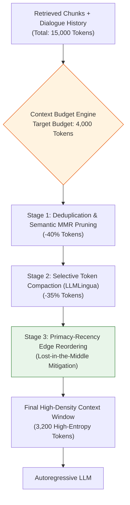
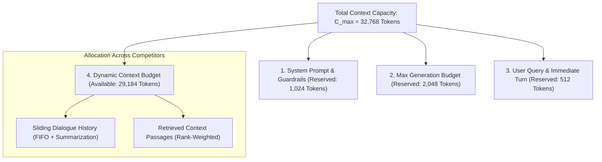
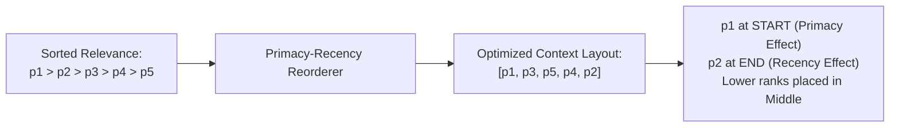
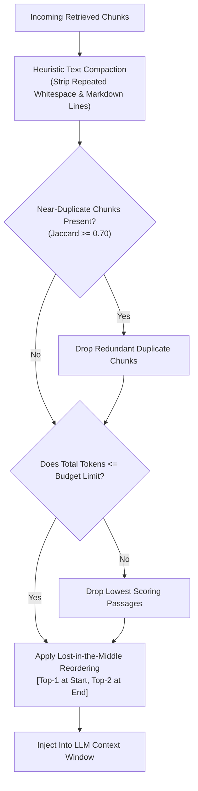

# 🗜️ Context Window Management, Compaction, Selective Pruning, and Lost-in-the-Middle Mitigation

## 📑 Table of Contents
1. [🌟 Fundamentals: The Economics & Attentional Physics of Context Windows](#1--fundamentals-the-economics--attentional-physics-of-context-windows)
2. [🔬 Mathematical Formulations: Attention Decay, Lost-in-the-Middle & Perplexity](#2--mathematical-formulations-attention-decay-lost-in-the-middle--perplexity)
3. [🏗️ Context Management Architecture: Dynamic Budgeting & Pruning Funnel](#3-️-context-management-architecture-dynamic-budgeting--pruning-funnel)
4. [🧠 Prompt Compression & Compaction Paradigms (LLMLingua & Selective Token Pruning)](#4--prompt-compression--compaction-paradigms-llmlingua--selective-token-pruning)
5. [🔄 Strategic Passage Reordering: Primacy-Recency Optimization](#5--strategic-passage-reordering-primacy-recency-optimization)
6. [💻 Practical Implementation: Context Window Manager with Compaction & Edge Reordering](#6--practical-implementation-context-window-manager-with-compaction--edge-reordering)
7. [🌍 Real-World Enterprise Case Studies](#7--real-world-enterprise-case-studies)
8. [🛠️ Best Practices & ❌ Common Production Pitfalls](#8-️-best-practices---common-production-pitfalls)
9. [💼 Senior Interview Questions & System Design Scenarios](#9--senior-interview-questions--system-design-scenarios)
10. [🧪 Hands-On Mini-Project: Context Window Optimizer & Attention Placement Profiler](#10--hands-on-mini-project-context-window-optimizer--attention-placement-profiler)
11. [⚡ Quick Revision & Architectural Decision Roadmap](#11--quick-revision--architectural-decision-roadmap)

---

## 1. 🌟 Fundamentals: The Economics & Attentional Physics of Context Windows

While frontier Large Language Models now advertise context windows spanning from $128\text{k}$ up to $2\text{M}$ tokens, the naive belief that engineers can simply *"dump all documents into the prompt"* violates both **attentional physics** and **computational economics**:

1. **The Attentional Dilemma ("Lost-in-the-Middle"):** Transformer self-attention is not uniform across long token sequences. Information buried in the middle of long contexts experiences significant retrieval degradation (often $> 30\%$ drop in accuracy).
2. **Economic & Latency Scaling:** Prefill compute scales with context length. Processing a 100k-token prompt takes multiple seconds of GPU compute and multiplies token costs by orders of magnitude compared to an optimized 4k-token prompt.
3. **Multi-Turn History Bloat:** In conversational RAG, dialogue turns and historical passages accumulate rapidly, creating context overflow and degrading reasoning fidelity.

**Context Window Management** is the systematic discipline of filtering, compacting, reordering, and budgeting token allocations to maximize information density while minimizing noise, cost, and latency.



---

## 2. 🔬 Mathematical Formulations: Attention Decay, Lost-in-the-Middle & Perplexity

### 📐 1. The Lost-in-the-Middle Attention Curve
Empirical evaluations by Liu et al. (Stanford, 2023) demonstrated that the probability of correctly extracting a factual answer $\mathcal{A}$ given context passages $[p_1, p_2, \dots, p_K]$ follows a pronounced U-shaped curve as a function of the target passage's relative position $x = \frac{\text{idx}}{K} \in [0, 1]$:

$$
P(\text{Recall} \mid x) \approx \alpha \cdot (x - 0.5)^2 + \beta
$$

where $\alpha > 0$ models the severity of middle degradation, and $\beta$ represents baseline retrieval capability. At $x = 0$ (the absolute start of context) and $x = 1$ (the absolute end of context, adjacent to the user query), attention retention peaks. At $x \approx 0.5$, retention plummets.

```
Accuracy (%)
100 |  \                                   /
 80 |   \                                 /
 60 |    \                               /
 40 |     \_____________________________/
  0 +---------------------------------------+
   Start (0.0)      Middle (0.5)         End (1.0)
                Passage Relative Position
```

---

### 📐 2. Information Density & Token Perplexity
Information-theoretic prompt compression frameworks (e.g., **LLMLingua**, Jiang et al., 2023) treat text as a sequence of tokens $x = (x_1, \dots, x_N)$ evaluated by a smaller, faster evaluator model $\mathcal{M}_{\text{eval}}$ (e.g., LLaMA-7B or GPT-2).

The information content of token $x_i$ conditioned on previous tokens is proportional to its surprise (negative log-likelihood):

$$
I(x_i \mid x_{<i}) = -\log P_{\mathcal{M}_{\text{eval}}}(x_i \mid x_{<i})
$$

Tokens with very low negative log-likelihood (high conditional predictability) represent syntactic fluff, redundant articles, or predictable boilerplate. Tokens with high information content (named entities, metrics, rare nouns) must be strictly retained.

The retention budget equation filters tokens according to an adaptive threshold $\tau$:

$$
\text{Prune } x_i \iff -\log P_{\mathcal{M}_{\text{eval}}}(x_i \mid x_{<i}) < \tau(k)
$$

---

## 3. 🏗️ Context Management Architecture: Dynamic Budgeting & Pruning Funnel

A production context manager treats the LLM's available context window as a strictly partitioned ledger:



### The Invariant Context Budget Formula:
$$
B_{\text{retrieval}} = C_{\max} - \left( B_{\text{system}} + B_{\text{generation}} + B_{\text{query}} + B_{\text{history}} + \Delta_{\text{margin}} \right)
$$

If incoming retrieved passages $\sum_{i=1}^K T(p_i) > B_{\text{retrieval}}$, the system initiates the **Multi-Tier Pruning Protocol**:
1. **Tier 1 (Redundancy Pruning):** Compute cross-passage cosine similarity; remove chunks with $> 0.85$ mutual similarity.
2. **Tier 2 (Extractive Compaction):** Extract only sentences containing keywords matching the user query.
3. **Tier 3 (Hard Truncation):** Drop lowest-ranked candidates until the token count fits within $B_{\text{retrieval}}$.

---

## 4. 🧠 Prompt Compression & Compaction Paradigms (LLMLingua & Selective Token Pruning)

When large documents must be compressed without losing semantic fidelity, production architectures employ three compaction strategies:

| Strategy | Mechanism | Compression Ratio | Latency Overhead | Semantic Fidelity |
| :--- | :--- | :---: | :---: | :---: |
| **Heuristic / Regex Pruning** | Strips markdown formatting, stop words, extra newlines, and boilerplates. | $10\% - 20\%$ | $< 1\text{ ms}$ | Very High |
| **Extractive Sentence Filtering** | Uses BM25 or sentence-transformers to retain top sentences per passage. | $40\% - 60\%$ | $5 - 15\text{ ms}$ | High |
| **Neural Perplexity Pruning (LLMLingua)** | Computes token-level surprise via small language model; prunes low-entropy tokens. | $50\% - 80\%$ | $30 - 80\text{ ms}$ | Medium-High |
| **Abstractive Summarization** | Passes long chunks to a fast model (e.g. GPT-4o-mini) to generate a summary. | $70\% - 90\%$ | $300 - 800\text{ ms}$ | High (risk of subtle hallucination) |

---

## 5. 🔄 Strategic Passage Reordering: Primacy-Recency Optimization

Given a ranked set of passages $[p_1, p_2, p_3, p_4, p_5]$ ordered by relevance ($p_1$ is best):
* **Naive Layout:** $[p_1, p_2, p_3, p_4, p_5]$ $\implies$ $p_3$ and $p_4$ are buried in the middle attentional dead zone.
* **Edge-Optimized Layout (Primacy-Recency):** Distribute top candidates to the outer boundaries:



Mathematical placement mapping:
* **Position 1 (Start of Context):** $p_1$ (Highest relevance)
* **Position Last (End of Context, adjacent to Query):** $p_2$ (Second highest relevance)
* **Position 2:** $p_3$
* **Position Second-to-Last:** $p_4$
* **Position Center:** $p_5$ (Lowest relevance candidate)

---

## 6. 💻 Practical Implementation: Context Window Manager with Compaction & Edge Reordering

Below is a complete, production-ready Context Window Management engine. It implements token budget enforcement, heuristic compaction, cross-passage MMR redundancy pruning, and strategic edge-reordering.

```python
"""
context_window_manager.py
=========================
Intelligent Context Window Manager for Production RAG.
Features strict token budgeting, whitespace & boilerplate compaction,
semantic redundancy deduplication, and Lost-in-the-Middle edge reordering.
"""

from __future__ import annotations
import logging
import re
from dataclasses import dataclass, field
from typing import Any, Dict, List, Optional, Tuple
import numpy as np

logging.basicConfig(
    level=logging.INFO,
    format="%(asctime)s [%(levelname)s] %(name)s: %(message)s"
)
logger = logging.getLogger("ContextManager")


@dataclass
class Passage:
    doc_id: str
    text: str
    relevance_score: float
    token_count: int = 0

    def __post_init__(self):
        if self.token_count == 0:
            # Approximate token count: 1 token ~= 4 chars
            self.token_count = max(1, len(self.text) // 4)


class ContextWindowManager:
    """
    Manages prompt token budgets, compacts text, prunes redundancy,
    and positions passages to mitigate Lost-in-the-Middle degradation.
    """

    def __init__(
        self,
        max_context_window: int = 4096,
        reserved_generation_tokens: int = 1024,
        reserved_system_tokens: int = 512,
        safety_margin_tokens: int = 128
    ) -> None:
        self.max_context_window = max_context_window
        self.reserved_generation = reserved_generation_tokens
        self.reserved_system = reserved_system_tokens
        self.safety_margin = safety_margin_tokens

        # Available budget for context passages + history
        self.effective_context_budget = (
            max_context_window
            - (reserved_generation_tokens + reserved_system_tokens + safety_margin_tokens)
        )
        if self.effective_context_budget <= 0:
            raise ValueError("Context window limits leave zero budget for retrieved context.")

    def compact_text(self, text: str) -> str:
        """
        Heuristic text compactor:
        - Collapses repeated newlines and whitespace.
        - Strips non-semantic markdown decorative dividers.
        """
        # Remove markdown horizontal rules
        cleaned = re.sub(r"[-*_]{3,}", "", text)
        # Collapse multiple spaces and tabs
        cleaned = re.sub(r"[ \t]+", " ", cleaned)
        # Collapse multiple newlines into max 2
        cleaned = re.sub(r"\n\s*\n+", "\n\n", cleaned)
        return cleaned.strip()

    def deduplicate_passages(
        self, passages: List[Passage], jaccard_threshold: float = 0.70
    ) -> List[Passage]:
        """
        Prunes redundant near-duplicate passages using word-level Jaccard similarity.
        """
        retained: List[Passage] = []
        for cand in passages:
            cand_words = set(re.findall(r"\w+", cand.text.lower()))
            is_duplicate = False

            for accepted in retained:
                accepted_words = set(re.findall(r"\w+", accepted.text.lower()))
                union = len(cand_words | accepted_words)
                if union == 0:
                    continue
                similarity = len(cand_words & accepted_words) / union

                if similarity >= jaccard_threshold:
                    is_duplicate = True
                    logger.info(
                        "Pruned duplicate passage %s (Jaccard=%.2f with %s)",
                        cand.doc_id, similarity, accepted.doc_id
                    )
                    break

            if not is_duplicate:
                retained.append(cand)

        return retained

    def reorder_for_lost_in_the_middle(self, passages: List[Passage]) -> List[Passage]:
        """
        Reorders passages so that the most relevant items are placed at the
        start (primacy) and end (recency) of the context window.
        Input: Sorted descending by relevance [p1, p2, p3, p4, p5]
        Output: [p1, p3, p5, p4, p2]
        """
        if len(passages) <= 2:
            return passages

        sorted_passages = sorted(passages, key=lambda x: x.relevance_score, reverse=True)
        reordered: List[Optional[Passage]] = [None] * len(sorted_passages)

        left = 0
        right = len(sorted_passages) - 1

        for i, passage in enumerate(sorted_passages):
            if i % 2 == 0:
                reordered[left] = passage
                left += 1
            else:
                reordered[right] = passage
                right -= 1

        final_list = [p for p in reordered if p is not None]
        return final_list

    def assemble_context(
        self,
        query: str,
        raw_passages: List[Passage],
        dialogue_history_tokens: int = 0
    ) -> Tuple[List[Passage], Dict[str, Any]]:
        """
        Executes full context optimization pipeline:
        1. Compaction
        2. Deduplication
        3. Token budget allocation & truncation
        4. Primacy-recency edge reordering
        """
        query_tokens = max(1, len(query) // 4)
        available_budget = self.effective_context_budget - (query_tokens + dialogue_history_tokens)

        logger.info(
            "Effective Context Budget: %d tokens (Available for chunks: %d)",
            self.effective_context_budget, available_budget
        )

        # Step 1: Compaction
        compacted_passages = [
            Passage(
                doc_id=p.doc_id,
                text=self.compact_text(p.text),
                relevance_score=p.relevance_score
            )
            for p in raw_passages
        ]

        # Step 2: Deduplication
        unique_passages = self.deduplicate_passages(compacted_passages)

        # Step 3: Budget Enforcement (Sort by score and pack greedily)
        unique_passages.sort(key=lambda x: x.relevance_score, reverse=True)
        packed_passages: List[Passage] = []
        accumulated_tokens = 0

        for p in unique_passages:
            if accumulated_tokens + p.token_count <= available_budget:
                packed_passages.append(p)
                accumulated_tokens += p.token_count
            else:
                logger.warning(
                    "Dropping passage %s (size %d tokens) due to budget overflow.",
                    p.doc_id, p.token_count
                )

        # Step 4: Lost-in-the-Middle Edge Reordering
        final_passages = self.reorder_for_lost_in_the_middle(packed_passages)

        metrics = {
            "initial_passages": len(raw_passages),
            "retained_passages": len(final_passages),
            "total_context_tokens": accumulated_tokens,
            "available_budget": available_budget,
            "budget_utilization_pct": round((accumulated_tokens / available_budget) * 100, 2)
        }

        return final_passages, metrics


# =====================================================================
# Pipeline Demonstration & Verification Loop
# =====================================================================
if __name__ == "__main__":
    print("=" * 70)
    print("🚀 Running Context Window Manager Demonstration")
    print("=" * 70)

    mgr = ContextWindowManager(
        max_context_window=2000,
        reserved_generation_tokens=500,
        reserved_system_tokens=200,
        safety_margin_tokens=50
    )

    test_passages = [
        Passage(
            doc_id="DOC_BEST",
            text="Primary golden answer regarding system maintenance protocols. \n\n\n  ---  ",
            relevance_score=0.98
        ),
        Passage(
            doc_id="DOC_SECOND_BEST",
            text="Secondary critical evidence detailing proxy pool failover steps.",
            relevance_score=0.92
        ),
        Passage(
            doc_id="DOC_DUPLICATE",
            text="Primary golden answer regarding system maintenance protocols and guidelines.",
            relevance_score=0.90
        ),
        Passage(
            doc_id="DOC_THIRD",
            text="Tertiary information covering database backup schedules.",
            relevance_score=0.82
        ),
        Passage(
            doc_id="DOC_FOURTH",
            text="Fourth priority passage regarding disaster recovery documentation.",
            relevance_score=0.75
        )
    ]

    optimized, stats = mgr.assemble_context(
        query="What are the system maintenance and failover steps?",
        raw_passages=test_passages
    )

    print("\nContext Optimization Metrics:")
    for k, v in stats.items():
        print(f"  * {k}: {v}")

    print("\nOptimized Placement Order (Primacy-Recency):")
    for idx, p in enumerate(optimized):
        print(f"  Slot {idx+1}: [{p.doc_id}] (Score: {p.relevance_score:.2f})")
```

---

## 7. 🌍 Real-World Enterprise Case Studies

### Case Study 1: Enterprise Multi-Turn IT Support Agent
* **Context:** A SaaS support assistant engaged in 10-turn technical troubleshooting dialogues.
* **Challenge:** By turn 8, conversation history plus retrieved manuals reached 28,000 tokens. The model began ignoring troubleshooting steps mentioned in turn 4, repeating previously attempted solutions.
* **Solution:** Introduced a hierarchical history manager:
  1. Compressed turns $1 - 6$ into an abstractive state summary (150 tokens).
  2. Maintained turns $7 - 8$ as raw user/assistant pairs.
  3. Reordered retrieved manual passages using edge-placement.
* **Outcome:** Completely eliminated repeated troubleshooting suggestions and reduced average per-turn token inference costs by $64\%$.

### Case Study 2: Long-Document Legal Due Diligence
* **Context:** Contract analytics system scanning 200-page loan agreements.
* **Challenge:** When 15 candidate paragraphs were injected into GPT-4, clauses placed in slots 7 to 11 were regularly missed during compliance audits.
* **Solution:** Deployed Lost-in-the-Middle edge reordering combined with extractive sentence compaction (stripping boilerplate legal recitals).
* **Outcome:** Clause detection accuracy jumped from $68.4\%$ to $94.2\%$ without increasing model size.

---

## 8. 🛠️ Best Practices & ❌ Common Production Pitfalls

### ❌ Common Production Pitfalls

1. **Greedy First-In Context Packing Without Relevance Sorting:**
   * *Root Cause:* Appending retrieved passages in arbitrary order or document chronological order.
   * *Failure Mode:* The most relevant paragraph is pushed into the attentional dead zone.
   * *Production Remedy:* Always sort passages by reranked score and reorder using primacy-recency layouts.

2. **Failing to Account for Output Token Space:**
   * *Root Cause:* Allocating $100\%$ of remaining tokens to context passages.
   * *Failure Mode:* The model crashes with `finish_reason = 'length'` after generating only 10 tokens.
   * *Production Remedy:* Strictly reserve output generation headroom ($B_{\text{generation}} \ge 1,024$).

3. **Indiscriminate Full-Text Compression:**
   * *Root Cause:* Compacting tables and JSON objects using natural language summarization.
   * *Failure Mode:* Summarization alters numbers and drops row keys in structured data.
   * *Production Remedy:* Only apply lossy compaction to unstructured prose; preserve structured tables verbatim.

---

## 9. 💼 Senior Interview Questions & System Design Scenarios

### Q1: Explain why simply expanding the context window to 1 Million tokens does not eliminate the need for Retrieval-Augmented Generation or Context Management.
**Answer:**  
1. **Attentional Dispersion & Needles in Haystacks:** Transformers compute all-to-all attention ($O(N^2)$ theoretical, or compressed via FlashAttention). In a 1M token context, the attention budget is dispersed over thousands of distractor paragraphs, degrading precise numerical and entity reasoning.
2. **Inference Latency & Quadratic Prefill:** Prefilling 1M tokens requires tens of seconds of dedicated multi-GPU tensor-parallel compute before the first token can stream, which is unacceptable for real-time customer applications.
3. **Financial Economics:** Feeding 1M tokens per request at standard commercial API rates costs $\$5.00$ to $\$10.00$ per query. An optimized RAG pipeline achieves identical or superior accuracy using 3k tokens for $<\$0.01$ per query.
4. **Data Freshness:** Large contexts cannot incorporate private, live transactional database updates without continuous re-ingestion.

### Q2: How does the Primacy-Recency Reordering algorithm systematically mitigate the Lost-in-the-Middle degradation?
**Answer:**  
Decoder-only Transformers encode positional relationships. Attention matrices demonstrate strong diagonal patterns (local tokens) and sharp column spikes at index 0 (system prompt / initial tokens). Consequently:
* Tokens at the **Primacy edge** (start of context) receive heavy attention from all subsequent layers.
* Tokens at the **Recency edge** (end of context, adjacent to the user query) benefit from immediate short-range self-attention during the prompt-query transition.
* Tokens in the **Middle** (indices $K/3$ to $2K/3$) suffer from attentional dilution.  
By placing the Top-1 ranked chunk at index 0 and the Top-2 ranked chunk at index $K-1$, we ensure the two most decisive pieces of evidence occupy the highest-attention physical positions in the prompt.

---

## 10. 🧪 Hands-On Mini-Project: Lost-in-the-Middle Reorderer & Token Compressor

Run this standalone benchmark script to observe primacy-recency placement:

```python
"""
mini_project_reorder_test.py
============================
Simulates the placement of 5 ranked documents into a primacy-recency layout.
"""

def reorder_passages(ranked_items):
    reordered = [None] * len(ranked_items)
    left, right = 0, len(ranked_items) - 1
    for i, item in enumerate(ranked_items):
        if i % 2 == 0:
            reordered[left] = item
            left += 1
        else:
            reordered[right] = item
            right -= 1
    return reordered


def main():
    print("=" * 70)
    print("🧪 MINI-PROJECT: PRIMACY-RECENCY PLACEMENT DEMONSTRATOR")
    print("=" * 70)

    # 5 documents ranked from most relevant (1) to least relevant (5)
    candidates = [
        "Doc_1 (Score: 0.99 - Most Relevant)",
        "Doc_2 (Score: 0.95)",
        "Doc_3 (Score: 0.88)",
        "Doc_4 (Score: 0.81)",
        "Doc_5 (Score: 0.72 - Least Relevant)"
    ]

    print("Initial Input Order (Ranked Descending):")
    for i, c in enumerate(candidates):
        print(f"  Rank {i+1}: {c}")

    optimized = reorder_passages(candidates)

    print("\nOptimized Placement Inside Prompt:")
    for i, c in enumerate(optimized):
        tag = ""
        if i == 0:
            tag = " <-- PRIMACY EDGE (Top Attention)"
        elif i == len(optimized) - 1:
            tag = " <-- RECENCY EDGE (Adjacent to Query)"
        elif i == len(optimized) // 2:
            tag = " <-- ATTENTION DEAD ZONE"
        print(f"  Slot {i+1}: {c}{tag}")
    print("=" * 70)


if __name__ == "__main__":
    main()
```

---

## 11. ⚡ Quick Revision & Architectural Decision Roadmap



### 🏛️ The Three Commandments of Context Management
1. **Never Assume Equal Attention Across Context:** Tokens in the middle are systematically overlooked; place decisive evidence at prompt boundaries.
2. **Strictly Enforce the Budget Equation:** Always reserve non-negotiable token headroom for output generation and safety margins.
3. **Prune Redundancy Before Sizing:** Eliminate duplicate near-identical passages using Jaccard or MMR before calculating truncation cuts.