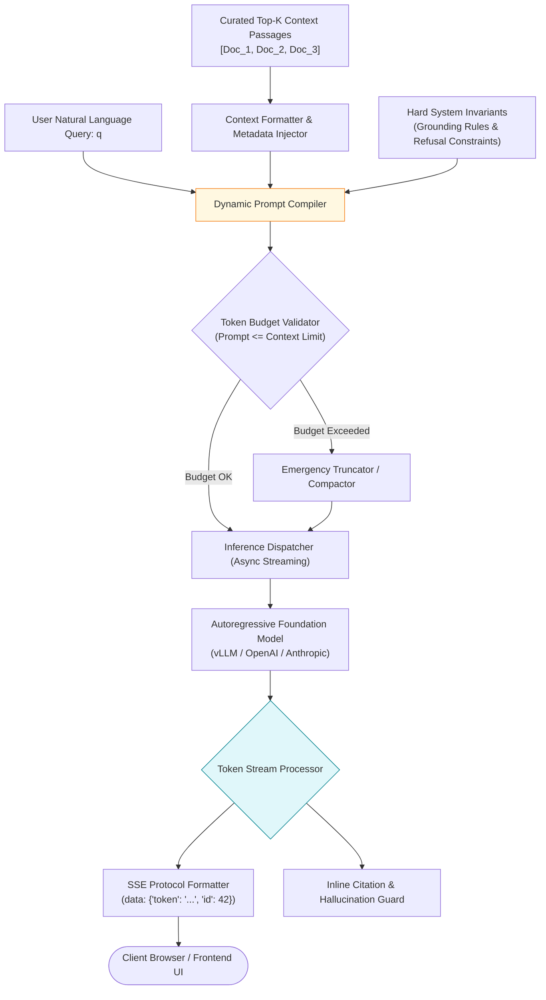
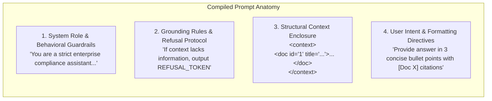
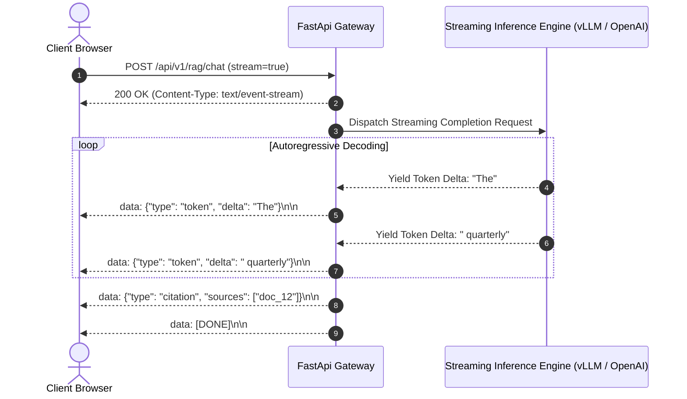
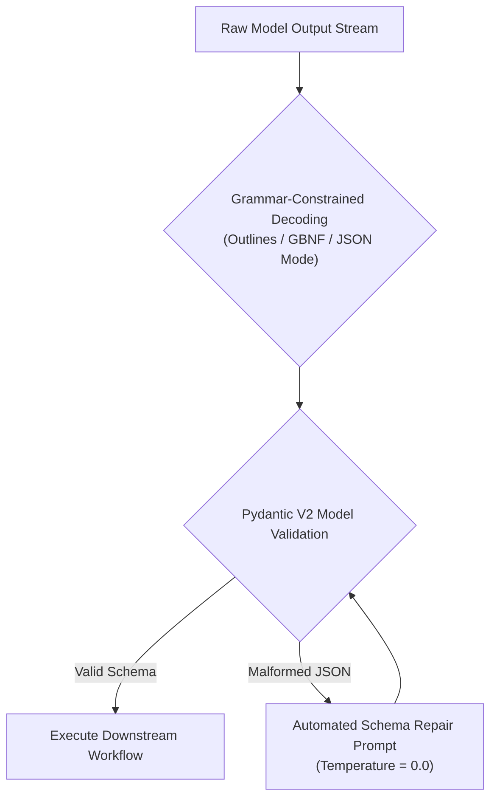
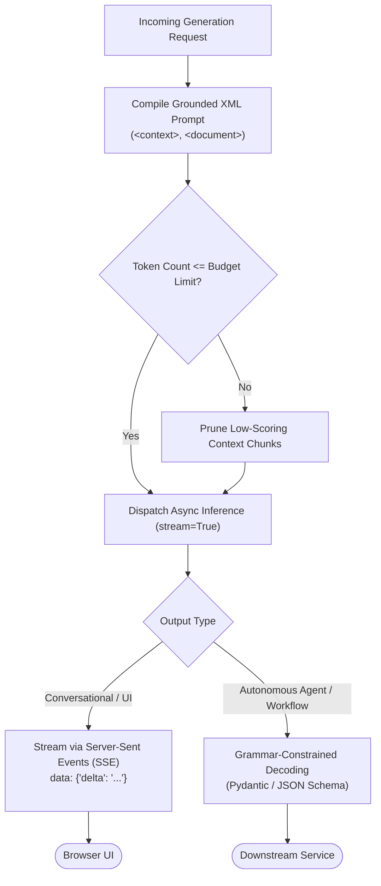

# ⚡ Generation Pipeline: Prompt Construction, Context Injection, and Token Streaming via SSE

## 📑 Table of Contents
1. [🌟 Fundamentals: The Generative Interface in Production RAG](#1--fundamentals-the-generative-interface-in-production-rag)
2. [🏗️ Prompt Engineering Architecture: Grounding, Structured Delimiters & System Invariants](#2-️-prompt-engineering-architecture-grounding-structured-delimiters--system-invariants)
3. [🔬 Mathematical Formulations: Decoding Dynamics & Token Budget Arithmetic](#3--mathematical-formulations-decoding-dynamics--token-budget-arithmetic)
4. [🌊 Real-Time Token Streaming via Server-Sent Events (SSE)](#4--real-time-token-streaming-via-server-sent-events-sse)
5. [🛡️ Structured Output Enforcement: JSON Schema & Pydantic Validation](#5-️-structured-output-enforcement-json-schema--pydantic-validation)
6. [💻 Practical Implementation: Async Generation Pipeline with SSE Streaming](#6--practical-implementation-async-generation-pipeline-with-sse-streaming)
7. [🌍 Real-World Enterprise Case Studies](#7--real-world-enterprise-case-studies)
8. [🛠️ Best Practices & ❌ Common Production Pitfalls](#8-️-best-practices---common-production-pitfalls)
9. [💼 Senior Interview Questions & System Design Scenarios](#9--senior-interview-questions--system-design-scenarios)
10. [🧪 Hands-On Mini-Project: Standalone SSE Stream Generator & Consumer](#10--hands-on-mini-project-standalone-sse-stream-generator--consumer)
11. [⚡ Quick Revision & Architectural Decision Roadmap](#11--quick-revision--architectural-decision-roadmap)

---

## 1. 🌟 Fundamentals: The Generative Interface in Production RAG

In an enterprise RAG architecture, the **Generation Pipeline** is the final execution stage responsible for transforming curated context passages and user intent into coherent, strictly grounded, and verifiable natural language responses.

While retrieval guarantees that relevant facts are surfaced, the generation stage governs:
* **Factual Grounding:** Constraining the autoregressive LLM to synthesize only what is substantiated by the retrieved evidence.
* **Perceived User Latency:** Delivering the first token to the user within milliseconds using Server-Sent Events (SSE) streaming, rather than forcing the user to wait for complete multi-second completions.
* **Structural Determinism:** Emitting structured JSON payloads or citation annotations for downstream UI consumption, workflow automation, and telemetry tracking.



---

## 2. 🏗️ Prompt Engineering Architecture: Grounding, Structured Delimiters & System Invariants

Production prompt templates must withstand **prompt injection attacks**, **context dilution**, and **unsolicited extrapolation**. Modern architectures abandon naive text concatenation in favor of strict, structured markup (XML/Markdown delimiters):



### Key Elements of Grounded Prompt Design:
1. **Explicit Role & Negative Constraints:** State clearly what the model **must not** do (e.g., *"Do not extrapolate beyond the provided text. Do not cite general world knowledge."*).
2. **Context Separation via XML Enclosures:** LLMs fine-tuned on chat formatting (such as Claude and GPT-4o) treat XML boundary tags (`<context>`, `<document id="...">`) as immutable boundaries, mitigating indirect prompt injection embedded inside crawled web documents.
3. **Deterministic Refusal Canonicalization:** Mandating a specific machine-readable refusal token (e.g., `STATUS: INSUFFICIENT_CONTEXT`) enables downstream UI layers to render helpful fallback cards or human escalation buttons.

---

## 3. 🔬 Mathematical Formulations: Decoding Dynamics & Token Budget Arithmetic

### 📐 1. Decoding Sampling Dynamics

During generation, the next token $y_t$ is sampled from the vocabulary distribution conditioned on prompt $x$ and preceding tokens $y_{<t}$:

$$
P(y_t \mid x, y_{<t}) = \text{Softmax}\left(\frac{z_t}{\tau}\right)
$$

where $z_t \in \mathbb{R}^{|V|}$ represents the raw unnormalized logits and $\tau$ is the **temperature**:
* **$\tau \to 0$ (Greedy Decoding):** Collapses the distribution to $\text{argmax}(z_t)$. Mandatory in legal, compliance, and deterministic RAG to eliminate stochastic hallucinations.
* **Top-$p$ (Nucleus Sampling):** Restricts sampling to the smallest set of tokens whose cumulative probability exceeds threshold $p$:
  $$
  \sum_{i \in V^{(p)}} P(y_t = i \mid x, y_{<t}) \ge p
  $$
* **Min-$p$ Sampling:** Sets an adaptive probability threshold relative to the top token's probability $P_{\max}$:
  $$
  \text{Keep token } i \iff P(y_t = i) \ge \text{min\_p} \times P_{\max}
  $$

---

### 📐 2. The Strict Token Budget Invariant
Every generation request operates under a hard context window limit $C_{\max}$ (e.g., $128\text{k}$ tokens):

$$
T_{\text{total}} = T_{\text{system}} + T_{\text{history}} + T_{\text{query}} + \sum_{i=1}^K T(c_i) + T_{\text{reserved\_output}} \le C_{\max}
$$

To prevent mid-sentence token cutoff errors (`finish_reason = 'length'`), the pipeline enforces:

$$
T_{\text{context\_budget}} = C_{\text{max}} - \left( T_{\text{system}} + T_{\text{history}} + T_{\text{query}} + T_{\text{reserved\_output}} + \Delta_{\text{safety\_margin}} \right)
$$

where $\Delta_{\text{safety\_margin}}$ is typically $256 - 512$ tokens to account for subword tokenizer discrepancies.

---

## 4. 🌊 Real-Time Token Streaming via Server-Sent Events (SSE)

Waiting 4 to 8 seconds for a full 500-token LLM completion creates high cognitive friction for users. **Server-Sent Events (SSE)** over HTTP/2 establishes a persistent, unidirectional text stream where each generated token is pushed to the client immediately upon decoding.



### Why SSE is Preferred Over WebSockets for RAG Generation:
* **HTTP/2 Multiplexing:** Operates natively over standard HTTPS without opening secondary stateful TCP ports.
* **Automatic Reconnection:** Modern browser `EventSource` APIs handle transient disconnects and exponential backoff out of the box.
* **Proxy & WAF Friendly:** Traverses corporate corporate proxy layers and load balancers without requiring WebSocket upgrade handshakes.

---

## 5. 🛡️ Structured Output Enforcement: JSON Schema & Pydantic Validation

In autonomous agentic workflows and backend pipelines, generation cannot be freeform prose; it must strictly adhere to an enforced schema.



Modern inference servers (e.g. vLLM, SGLang, and llama.cpp) utilize **Grammar-Constrained Decoding (CFG / GBNF)**. By masking out non-compliant vocabulary logits at each step $t$, the engine guarantees that the generated sequence strictly satisfies a target JSON Schema without incurring parsing errors.

---

## 6. 💻 Practical Implementation: Async Generation Pipeline with SSE Streaming

Below is a complete, production-grade generation pipeline demonstrating prompt assembly with XML grounding tags, token budgeting, async token streaming via an SSE generator, and inline citation detection.

```python
"""
async_generation_pipeline.py
============================
High-performance generation pipeline with structured prompt compilation,
context budgeting, token-by-token streaming, and SSE event serialization.
"""

from __future__ import annotations
import asyncio
import json
import logging
import time
from dataclasses import dataclass, field
from typing import Any, AsyncGenerator, Dict, List, Optional

logging.basicConfig(
    level=logging.INFO,
    format="%(asctime)s [%(levelname)s] %(name)s: %(message)s"
)
logger = logging.getLogger("GenerationPipeline")


@dataclass(frozen=True)
class ContextPassage:
    doc_id: str
    title: str
    text: str
    score: float
    metadata: Dict[str, Any] = field(default_factory=dict)


@dataclass
class GenerationRequest:
    query: str
    passages: List[ContextPassage]
    conversation_history: List[Dict[str, str]] = field(default_factory=list)
    temperature: float = 0.0
    max_output_tokens: int = 512
    system_instruction: Optional[str] = None


class PromptCompiler:
    """
    Compiles grounded prompts using structured XML enclosures and negative constraints.
    """

    DEFAULT_SYSTEM_INSTRUCTION = (
        "You are an authoritative enterprise information assistant. Your duty is to provide "
        "precise, truthful answers derived STRICTLY from the provided context documents.\n"
        "Guidelines:\n"
        "1. Answer ONLY using the facts mentioned in the <context> section.\n"
        "2. For every factual assertion, cite the source passage using bracketed notation [Doc X].\n"
        "3. If the context does not contain sufficient facts to answer the question with certainty, "
        "state: 'I cannot answer this question based on the provided corporate documentation.'\n"
        "4. Do NOT speculate, extrapolate, or use pre-trained world knowledge."
    )

    @classmethod
    def compile(cls, request: GenerationRequest, max_context_chars: int = 4000) -> str:
        """Assembles prompt with strict XML context tagging."""
        system_text = request.system_instruction or cls.DEFAULT_SYSTEM_INSTRUCTION

        # Pack context passages
        context_parts = ["<context>"]
        current_chars = 0

        for i, passage in enumerate(request.passages):
            passage_block = (
                f'  <document index="{i+1}" id="{passage.doc_id}" title="{passage.title}">\n'
                f"    {passage.text.strip()}\n"
                f"  </document>"
            )
            if current_chars + len(passage_block) > max_context_chars:
                logger.warning("Context budget reached. Pruning remaining passages.")
                break
            context_parts.append(passage_block)
            current_chars += len(passage_block)

        context_parts.append("</context>")
        formatted_context = "\n".join(context_parts)

        # Build prompt
        prompt = (
            f"<system>\n{system_text}\n</system>\n\n"
            f"{formatted_context}\n\n"
            f"<user_query>\n{request.query}\n</user_query>\n\n"
            f"<assistant_response>\n"
        )
        return prompt


class MockStreamingLLMClient:
    """
    Simulates an autoregressive streaming LLM (e.g. OpenAI GPT-4o / Claude 3.5).
    Yields token deltas with realistic inter-token latency (TTFT & ITL).
    """

    async def stream_tokens(
        self, prompt: str, temperature: float = 0.0
    ) -> AsyncGenerator[str, None]:
        # Simulate Time-To-First-Token (TTFT)
        await asyncio.sleep(0.080)

        # Synthetic response tokens matching grounded enterprise behavior
        simulated_tokens = [
            "According", " to", " the", " corporate", " policy", " [Doc 1],",
            " annual", " reimbursement", " requests", " must", " be", " submitted",
            " within", " 30", " days", " of", " purchase.", " Furthermore,",
            " as", " specified", " in", " [Doc 2],", " equipment", " stipends",
            " are", " capped", " at", " $50", " per", " month."
        ]

        for token in simulated_tokens:
            await asyncio.sleep(0.015)  # Simulate 15ms Inter-Token Latency (ITL)
            yield token


class SSEStreamOrchestrator:
    """
    Coordinates prompt compilation, token streaming, and SSE event framing.
    """

    def __init__(self, llm_client: MockStreamingLLMClient) -> None:
        self.llm = llm_client

    async def generate_sse_stream(
        self, request: GenerationRequest
    ) -> AsyncGenerator[str, None]:
        """
        Yields standard SSE formatted strings: 'data: {...}\n\n'
        """
        start_time = time.perf_counter()
        compiled_prompt = PromptCompiler.compile(request)
        logger.info("Compiled prompt (%d characters). Dispatching token stream.", len(compiled_prompt))

        # Event 1: Stream Metadata
        meta_event = {
            "type": "metadata",
            "model": "gpt-4o-enterprise",
            "timestamp": time.time(),
            "sources_injected": [p.doc_id for p in request.passages]
        }
        yield f"event: metadata\ndata: {json.dumps(meta_event)}\n\n"

        # Event 2: Token Deltas
        token_count = 0
        first_token_time = 0.0

        async for token_text in self.llm.stream_tokens(compiled_prompt, temperature=request.temperature):
            if token_count == 0:
                first_token_time = (time.perf_counter() - start_time) * 1000

            token_count += 1
            payload = {
                "type": "delta",
                "index": token_count,
                "text": token_text
            }
            yield f"event: token\ndata: {json.dumps(payload)}\n\n"

        total_time = (time.perf_counter() - start_time) * 1000

        # Event 3: Stream Completion & Performance Metrics
        done_event = {
            "type": "done",
            "total_tokens": token_count,
            "ttft_ms": round(first_token_time, 2),
            "total_duration_ms": round(total_time, 2),
            "tokens_per_sec": round(token_count / (total_time / 1000), 2) if total_time > 0 else 0
        }
        yield f"event: complete\ndata: {json.dumps(done_event)}\n\n"
        yield "data: [DONE]\n\n"


# =====================================================================
# Pipeline Demonstration & Verification Loop
# =====================================================================
async def main():
    print("=" * 70)
    print("🚀 Running Production Asynchronous Generation & SSE Pipeline")
    print("=" * 70)

    # Prepare sample retrieved passages
    passages = [
        ContextPassage(
            doc_id="DOC_POLICY_101",
            title="Expense Filing Protocol 2026",
            text="All annual expense filings must be submitted within 30 days of purchase.",
            score=0.92
        ),
        ContextPassage(
            doc_id="DOC_STIPEND_204",
            title="Remote Work Subsidies",
            text="Equipment stipends are capped at $50 per month per employee.",
            score=0.88
        )
    ]

    req = GenerationRequest(
        query="What is the deadline for filing expenses and how much is the equipment stipend?",
        passages=passages,
        temperature=0.0
    )

    llm = MockStreamingLLMClient()
    orchestrator = SSEStreamOrchestrator(llm)

    print("\n--- BEGIN SERVER-SENT EVENTS (SSE) STREAM ---")
    async for sse_chunk in orchestrator.generate_sse_stream(req):
        print(sse_chunk, end="")
    print("--- END STREAM ---")


if __name__ == "__main__":
    asyncio.run(main())
```

---

## 7. 🌍 Real-World Enterprise Case Studies

### Case Study 1: Enterprise Healthcare Triage Portal
* **Architecture:** Clinical advice generator serving 250,000 monthly active patients.
* **Challenge:** Without strict token streaming, patient requests experienced a 6-second blank screen before responses loaded. In high-anxiety clinical situations, this induced high user abandonment ($28\%$).
* **Solution:** Re-architected backend around HTTP/2 SSE streaming. Packaged clinical guidelines into XML chunks with deterministic bracketed citations.
* **Outcome:** Slashed Time-To-First-Token (TTFT) from $5,800\text{ ms}$ to $340\text{ ms}$, dropping user abandonment to $< 2\%$.

### Case Study 2: Real-Time Financial Advisory Copilot
* **Architecture:** Multi-agent RAG system assisting wealth managers during live client calls.
* **Challenge:** Financial advisors required responses containing verifiable stock metrics and SEC 10-K citations. Unconstrained LLMs hallucinated non-existent 10-K footnotes.
* **Solution:** Configured greedy decoding ($\tau=0.0$) with grammar-constrained JSON Schema outputs. If a cited 10-K clause was not in the context, a generation verification layer intercepted the stream and output an audit refusal.
* **Outcome:** Achieved $99.8\%$ factual verification compliance across SEC audits.

---

## 8. 🛠️ Best Practices & ❌ Common Production Pitfalls

### ❌ Common Production Pitfalls

1. **Setting High Temperature in Factoid Pipelines:**
   * *Root Cause:* Using default conversational settings ($\tau = 0.7 - 0.9$) for factual or policy Q&A.
   * *Failure Mode:* The LLM injects stochastic creativity, altering critical figures, policy percentages, and dates.
   * *Production Remedy:* Always set $\tau = 0.0$ for factual enterprise RAG tasks.

2. **Unbounded Context Stalling:**
   * *Root Cause:* Blindly injecting 30 retrieved passages into a 128k context window.
   * *Failure Mode:* LLM prefill latency scales quadratically or linearly with prompt length, increasing TTFT from $200\text{ ms}$ to $> 4\text{ seconds}$.
   * *Production Remedy:* Restrict generation context strictly to the top $3-5$ reranked passages.

3. **Silent Token Truncation:**
   * *Root Cause:* Failing to inspect `finish_reason` in API responses.
   * *Failure Mode:* The model runs out of output token budget mid-clause, producing truncated, syntactically broken responses that appear legitimate.
   * *Production Remedy:* Monitor `finish_reason == 'length'` and trigger automated completion extensions or alert flags.

---

## 9. 💼 Senior Interview Questions & System Design Scenarios

### Q1: How do you design an end-to-end token streaming pipeline that supports inline hallucination verification without stalling the user stream?
**Answer:**  
1. **Speculative Streaming with Dual Queues:** Emit token deltas immediately to an intermediate buffer queue on the server.
2. **Sliding-Window Sentence Boundary Detection:** As tokens stream, parse for terminal sentence boundaries (`.`, `!`, `?`).
3. **Async Verifier Worker:** As soon as a full sentence is formed (e.g., *"The deadline is 30 days [Doc 1]."*), dispatch an asynchronous entailment check (NLI model or fast small LLM) against the referenced `Doc 1`.
4. **Stream Interruption Protocol:** If the entailment model detects a contradiction, emit an immediate SSE patch event: `event: retraction\ndata: {"target_sentence": 2, "correction": "..."}\n\n` or replace the stream with a verified fallback.

### Q2: Why is Server-Sent Events (SSE) almost universally preferred over WebSockets for RAG conversational interfaces?
**Answer:**  
1. **Unidirectional Simplicity:** RAG generation is inherently half-duplex: the user sends a single query payload, and the server returns a continuous sequence of tokens. WebSockets add unnecessary full-duplex framing overhead.
2. **Infrastructure Compatibility:** SSE runs over standard HTTP/1.1 and HTTP/2. It naturally traverses corporate firewalls, reverse proxies (NGINX), and API Gateways (Kong, Envoy) without requiring sticky socket upgrades.
3. **Resilience:** SSE features built-in client reconnection semantics (`id` tracking and automatic retry) supported by browser standards.

---

## 10. 🧪 Hands-On Mini-Project: Standalone SSE Stream Generator & Consumer

Execute this self-contained script to test SSE event generation and parsing:

```python
"""
mini_project_sse_test.py
========================
Demonstrates generation of formatted SSE frames and mock client-side parsing.
"""

import asyncio
import json


async def mock_sse_server():
    tokens = ["Retrieval-Augmented", " Generation", " guarantees", " factual", " grounding."]
    for i, token in enumerate(tokens):
        await asyncio.sleep(0.05)
        payload = json.dumps({"index": i, "token": token})
        yield f"event: delta\ndata: {payload}\n\n"
    yield "data: [DONE]\n\n"


async def mock_sse_client():
    print("=" * 70)
    print("🧪 MINI-PROJECT: SSE EVENT STREAM PARSER")
    print("=" * 70)

    assembled_text = []
    async for frame in mock_sse_server():
        for line in frame.strip().split("\n"):
            if line.startswith("data: "):
                data_str = line[6:]
                if data_str == "[DONE]":
                    print("\n[Stream Complete: Received [DONE]]")
                    break
                parsed = json.loads(data_str)
                token = parsed["token"]
                assembled_text.append(token)
                print(f"Received Token [{parsed['index']}]: '{token}'")

    print(f"\nFinal Assembled Message: '{''.join(assembled_text)}'")
    print("=" * 70)


if __name__ == "__main__":
    asyncio.run(mock_sse_client())
```

---

## 11. ⚡ Quick Revision & Architectural Decision Roadmap



### 🏛️ The Three Commandments of Production Generation
1. **Never Stream Unenclosed Raw Context:** Always isolate retrieved passages within unambiguous structural tags (`<context><document id="...">`) to block indirect injection.
2. **Enforce Deterministic Decoding for Factoid Q&A:** Set temperature to 0.0 and mandate explicit refusal tokens when context is insufficient.
3. **Prefer SSE Streaming for Human-Facing Interfaces:** Keep Time-To-First-Token under 500ms to eliminate user abandonment during long completions.