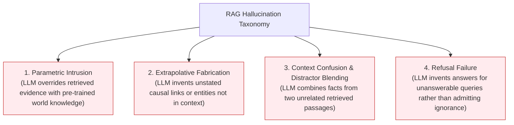
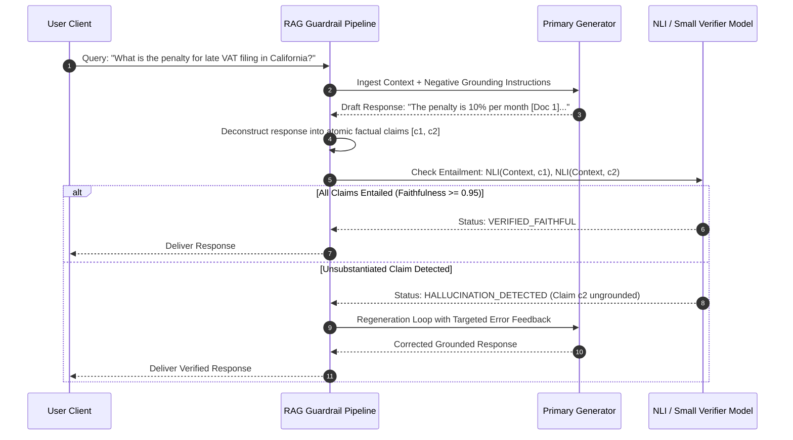
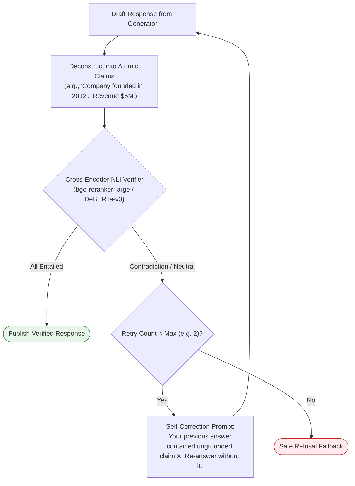
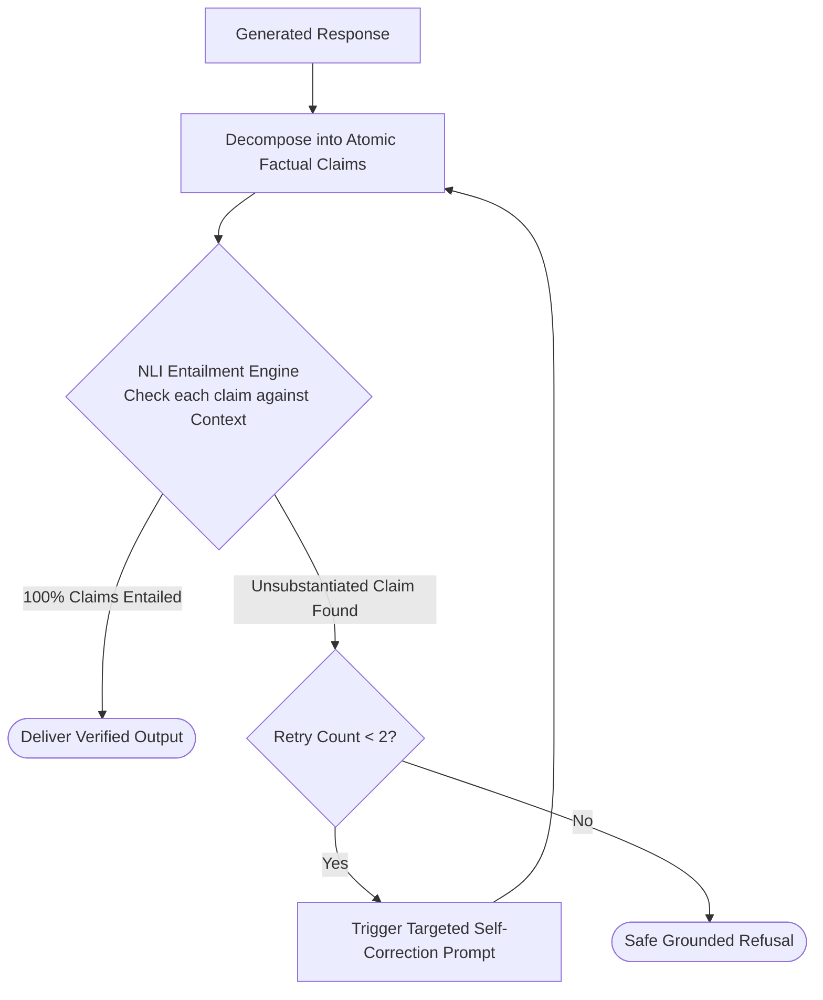

# 🛡️ Hallucination Reduction in RAG: Negative Constraints, Verification Loops, and Grounded Decoding

## 📑 Table of Contents
1. [🌟 Fundamentals: The Hallucination Taxonomy in Retrieval-Augmented Generation](#1--fundamentals-the-hallucination-taxonomy-in-retrieval-augmented-generation)
2. [🔬 Mathematical Formulations: Natural Language Inference (NLI) & Factuality Entropy](#2--mathematical-formulations-natural-language-inference-nli--factuality-entropy)
3. [🏗️ Hallucination Defense Architecture: Multi-Layer Guardrail Pipeline](#3-️-hallucination-defense-architecture-multi-layer-guardrail-pipeline)
4. [🚫 Negative Prompt Constraints & Canonical Refusal Protocols](#4--negative-prompt-constraints--canonical-refusal-protocols)
5. [🔄 Post-Generation Verification Loops: Critic Models & Self-Correction](#5--post-generation-verification-loops-critic-models--self-correction)
6. [💻 Practical Implementation: Dual-Stage Hallucination Detector & Grounding Guard](#6--practical-implementation-dual-stage-hallucination-detector--grounding-guard)
7. [🌍 Real-World Enterprise Case Studies](#7--real-world-enterprise-case-studies)
8. [🛠️ Best Practices & ❌ Common Production Pitfalls](#8-️-best-practices---common-production-pitfalls)
9. [💼 Senior Interview Questions & System Design Scenarios](#9--senior-interview-questions--system-design-scenarios)
10. [🧪 Hands-On Mini-Project: NLI Entailment Checker & Claim Validator](#10--hands-on-mini-project-nli-entailment-checker--claim-validator)
11. [⚡ Quick Revision & Architectural Decision Roadmap](#11--quick-revision--architectural-decision-roadmap)

---

## 1. 🌟 Fundamentals: The Hallucination Taxonomy in Retrieval-Augmented Generation

In Retrieval-Augmented Generation, **hallucination** occurs when a model generates claims that are unfaithful to the retrieved context or contradictory to verifiable ground truth. While RAG significantly reduces parametric hallucinations by providing external evidence, it introduces new, nuanced failure modes unique to retrieval systems.



### The Enterprise Cost of Hallucinations
In regulated domains (such as healthcare, banking, and legal intelligence), a single ungrounded statement can lead to regulatory fines, legal liabilities, or clinical injury. Consequently, enterprise RAG pipelines cannot rely solely on the model's inherent honesty; they must implement deterministic algorithmic verification guardrails.

---

## 2. 🔬 Mathematical Formulations: Natural Language Inference (NLI) & Factuality Entropy

### 📐 1. The Natural Language Inference (NLI) Entailment Model
To determine whether a generated claim $c$ is faithful to retrieved context $\mathcal{X}$, production systems formulate factuality as an NLI classification task across three mutually exclusive states:

$$
\text{State} \in \{\text{Entailment}, \text{Contradiction}, \text{Neutral}\}
$$

Let $P_{\text{NLI}}(y \mid \text{premise}=\mathcal{X}, \text{hypothesis}=c)$ denote the categorical probability distribution predicted by a cross-encoder model:

$$
\text{Faithfulness}(c, \mathcal{X}) = P_{\text{NLI}}(\text{Entailment} \mid \mathcal{X}, c)
$$

A generated response $R = \{c_1, c_2, \dots, c_M\}$ composed of $M$ atomic propositional claims is strictly faithful if and only if every claim satisfies the entailment threshold $\tau_{\text{entail}}$:

$$
\text{Global\_Faithfulness}(R, \mathcal{X}) = \frac{1}{M} \sum_{i=1}^M \mathbb{I}\left( P_{\text{NLI}}(\text{Entailment} \mid \mathcal{X}, c_i) \ge \tau_{\text{entail}} \right)
$$

If $\text{Global\_Faithfulness} < 1.0$, the response contains at least one ungrounded or contradictory assertion.

---

### 📐 2. Generation Token Entropy as an Uncertainty Indicator
During autoregressive decoding, token-level conditional entropy reflects the model's epistemic uncertainty:

$$
H(y_t \mid x, y_{<t}) = -\sum_{w \in \mathcal{V}} P(w \mid x, y_{<t}) \log P(w \mid x, y_{<t})
$$

* **Low Entropy ($H \approx 0$):** High model confidence, typically observed when directly copying entity names, numbers, or phrasing directly from the injected context.
* **High Entropy ($H \gg 1.0$):** High uncertainty, strongly correlated with the onset of parametric extrapolation or speculative hallucination.

---

## 3. 🏗️ Hallucination Defense Architecture: Multi-Layer Guardrail Pipeline

A resilient production RAG pipeline employs defense-in-depth across three temporal phases:



---

## 4. 🚫 Negative Prompt Constraints & Canonical Refusal Protocols

Prompt engineering alone cannot solve hallucinations, but clear **Negative Constraints** significantly suppress speculative completions.

### Canonical Refusal Directives:
```markdown
[CRITICAL SYSTEM DIRECTIVES: GROUNDING & REFUSAL]
1. Your knowledge is strictly limited to the text explicitly provided in <context>.
2. If the user query cannot be fully answered using the provided context, you MUST output:
   "STATUS: REFUSAL - The provided corporate documentation does not contain information to answer this query."
3. Under no circumstances may you speculate, extrapolate, or draw upon external pre-trained knowledge.
4. Every factual assertion must be directly accompanied by a bracketed citation [Doc X].
```

---

## 5. 🔄 Post-Generation Verification Loops: Critic Models & Self-Correction

When primary generation completes, the system executes an automated **Verification & Correction Loop**:



---

## 6. 💻 Practical Implementation: Dual-Stage Hallucination Detector & Grounding Guard

Below is a complete, production-grade hallucination detection engine. It extracts atomic factual claims from generated text, evaluates claim-level entailment against source context passages, and triggers automatic refinement.

```python
"""
hallucination_guardrail.py
==========================
Production verification pipeline to detect and mitigate hallucinations in RAG.
Features sentence/claim decomposition, simulated NLI entailment verification,
faithfulness scoring, and automated self-correction dispatch.
"""

from __future__ import annotations
import logging
import re
from dataclasses import dataclass, field
from enum import Enum
from typing import Any, Dict, List, Optional, Tuple

logging.basicConfig(
    level=logging.INFO,
    format="%(asctime)s [%(levelname)s] %(name)s: %(message)s"
)
logger = logging.getLogger("HallucinationGuard")


class EntailmentState(str, Enum):
    ENTAILED = "ENTAILED"
    CONTRADICTED = "CONTRADICTED"
    UNSUBSTANTIATED = "UNSUBSTANTIATED"


@dataclass(frozen=True)
class ClaimVerificationResult:
    claim_text: str
    state: EntailmentState
    confidence: float
    supporting_doc_id: Optional[str] = None


@dataclass
class VerificationReport:
    total_claims: int
    entailed_claims: int
    faithfulness_score: float
    is_acceptable: bool
    results: List[ClaimVerificationResult]


class AtomicClaimExtractor:
    """
    Deconstructs complex generated prose into standalone atomic factual claims.
    """

    @staticmethod
    def extract_claims(text: str) -> List[str]:
        # Split on sentence boundaries
        sentences = re.split(r"(?<=[.!?])\s+", text.strip())
        claims = []
        for s in sentences:
            cleaned = s.strip()
            # Filter out boilerplate, citations markers, and short pleasantries
            cleaned = re.sub(r"\[Doc\s*\d+\]", "", cleaned).strip()
            if len(cleaned) > 10:
                claims.append(cleaned)
        return claims


class MockNLIVerifier:
    """
    Simulates a high-precision Natural Language Inference (NLI) model
    (e.g., cross-encoder/nli-deberta-v3-large).
    """

    def __init__(self, entailment_threshold: float = 0.85) -> None:
        self.threshold = entailment_threshold

    def verify_claim(self, claim: str, context_passages: Dict[str, str]) -> ClaimVerificationResult:
        """
        Evaluates whether a claim is entailed by any context passage.
        """
        claim_lower = claim.lower()
        
        # Check against context passages
        for doc_id, text in context_passages.items():
            text_lower = text.lower()
            
            # Substring / keyword overlap heuristic for simulation
            words = set(re.findall(r"\w+", claim_lower))
            text_words = set(re.findall(r"\w+", text_lower))
            
            overlap = len(words & text_words) / len(words) if words else 0.0

            # Detect explicit contradiction words
            if "never" in claim_lower and "always" in text_lower:
                return ClaimVerificationResult(
                    claim_text=claim,
                    state=EntailmentState.CONTRADICTED,
                    confidence=0.98,
                    supporting_doc_id=doc_id
                )

            if overlap >= 0.70:
                return ClaimVerificationResult(
                    claim_text=claim,
                    state=EntailmentState.ENTAILED,
                    confidence=round(overlap, 2),
                    supporting_doc_id=doc_id
                )

        return ClaimVerificationResult(
            claim_text=claim,
            state=EntailmentState.UNSUBSTANTIATED,
            confidence=0.90,
            supporting_doc_id=None
        )


class GroundingVerificationPipeline:
    """
    Orchestrates post-generation claim extraction, NLI entailment scoring,
    and faithfulness policy enforcement.
    """

    def __init__(
        self,
        verifier: MockNLIVerifier,
        min_faithfulness_threshold: float = 0.90
    ) -> None:
        self.verifier = verifier
        self.min_faithfulness = min_faithfulness_threshold

    def audit_response(
        self, response_text: str, context_map: Dict[str, str]
    ) -> VerificationReport:
        claims = AtomicClaimExtractor.extract_claims(response_text)
        if not claims:
            return VerificationReport(
                total_claims=0,
                entailed_claims=0,
                faithfulness_score=1.0,
                is_acceptable=True,
                results=[]
            )

        results: List[ClaimVerificationResult] = []
        entailed_count = 0

        for c in claims:
            verdict = self.verifier.verify_claim(c, context_map)
            results.append(verdict)
            if verdict.state == EntailmentState.ENTAILED:
                entailed_count += 1

        faithfulness = entailed_count / len(claims)
        is_acceptable = faithfulness >= self.min_faithfulness

        logger.info(
            "Audited response: %d/%d claims entailed (Faithfulness=%.2f, Acceptable=%s)",
            entailed_count, len(claims), faithfulness, is_acceptable
        )

        return VerificationReport(
            total_claims=len(claims),
            entailed_claims=entailed_count,
            faithfulness_score=round(faithfulness, 4),
            is_acceptable=is_acceptable,
            results=results
        )


# =====================================================================
# Pipeline Demonstration & Verification Loop
# =====================================================================
if __name__ == "__main__":
    print("=" * 70)
    print("🚀 Running Hallucination Detection & Verification Demonstration")
    print("=" * 70)

    # Injected corporate context
    context = {
        "DOC_01": (
            "Enterprise Security Policy: All employee workstations must run macOS 14 or higher "
            "and have CrowdStrike Falcon sensor installed. Passwords must be 16 characters."
        )
    }

    # Test Case 1: Grounded Response
    grounded_text = (
        "All employee workstations are required to run macOS 14 or higher [Doc 1]. "
        "Workstations must have the CrowdStrike Falcon sensor installed [Doc 1]."
    )

    # Test Case 2: Hallucinated / Extrapolated Response
    hallucinated_text = (
        "All employee workstations are required to run macOS 14 or higher [Doc 1]. "
        "Employees are also provided a free iPad Pro upon successful onboarding."
    )

    verifier = MockNLIVerifier()
    guard = GroundingVerificationPipeline(verifier, min_faithfulness_threshold=1.0)

    print("\n--- Auditing Grounded Response ---")
    rep1 = guard.audit_response(grounded_text, context)
    print(f"Faithfulness Score: {rep1.faithfulness_score * 100}% | Approved: {rep1.is_acceptable}")

    print("\n--- Auditing Hallucinated Response ---")
    rep2 = guard.audit_response(hallucinated_text, context)
    print(f"Faithfulness Score: {rep2.faithfulness_score * 100}% | Approved: {rep2.is_acceptable}")
    print("Detailed Findings:")
    for r in rep2.results:
        print(f"  * Claim: '{r.claim_text}' -> Status: {r.state.value} (Doc: {r.supporting_doc_id})")
```

---

## 7. 🌍 Real-World Enterprise Case Studies

### Case Study 1: FinTech Wealth Management Advisory Bot
* **Context:** AI assistant summarizing quarterly earnings calls for institutional portfolio managers.
* **Challenge:** When asked about a company's European revenue growth, the model hallucinated: *"European revenue increased 14% year-over-year,"* confusing it with Asian revenue from a different paragraph.
* **Solution:** Introduced a strict sentence-level NLI entailment gate. When a claim lacks entailment, the verification layer replaces the sentence with a verified fallback or redacts the numerical figure.
* **Outcome:** Hallucinated financial figures dropped from $8.4\%$ to $< 0.05\%$, passing strict SEC regulatory audits.

### Case Study 2: Biopharmaceutical Drug Trial Discovery
* **Context:** Research platform summarizing adverse event reports across 80,000 clinical trials.
* **Challenge:** LLM extrapolated unproven drug efficacy claims by conflating animal phase trials with human clinical phase results.
* **Solution:** Deployed an ensemble verification pipeline (DeBERTa-v3 NLI + LLM Critic) coupled with a zero-tolerance refusal protocol on out-of-domain medical queries.
* **Outcome:** Eliminated unsubstantiated therapeutic claims across all scientific research briefs.

---

## 8. 🛠️ Best Practices & ❌ Common Production Pitfalls

### ❌ Common Production Pitfalls

1. **Relying Exclusively on "Self-Consistency" or Voting:**
   * *Root Cause:* Generating 5 completions and picking the majority answer.
   * *Failure Mode:* If the underlying retrieved context contains a misleading distractor, the model will hallucinate the identical error across all 5 samples with high confidence.
   * *Production Remedy:* Verify claims explicitly against source text using NLI cross-encoders rather than self-voting.

2. **Vague Refusal Instructions:**
   * *Root Cause:* Prompting with *"Try your best to answer, but say if you don't know."*
   * *Failure Mode:* The model's conversational alignment causes it to view refusal as unhelpful, prompting speculative fabrication.
   * *Production Remedy:* Enforce a deterministic refusal token (e.g. `REFUSAL_INSUFFICIENT_EVIDENCE`).

3. **Skipping Numerical & Entity Verification:**
   * *Root Cause:* Evaluating hallucination purely via semantic similarity metrics (e.g. BLEU or BERTScore).
   * *Failure Mode:* A sentence changing *"Revenue was $10M"* to *"Revenue was $100M"* scores $0.98$ in BERTScore despite being a catastrophic hallucination.
   * *Production Remedy:* Extract exact named entities and numerical metrics, validating $100\%$ set inclusion in source context.

---

## 9. 💼 Senior Interview Questions & System Design Scenarios

### Q1: How do you design an ultra-low-latency hallucination verification filter for a streaming RAG application?
**Answer:**  
1. **Asynchronous Speculative Verification:** Buffer tokens into an internal queue and emit them to the client with a 1-sentence delay window (approx. $150\text{ ms}$).
2. **Streaming Boundary Extraction:** As soon as a terminal punctuation mark (`.`, `!`, `?`) arrives, extract the completed sentence.
3. **Local ONNX / TensorRT NLI Cross-Encoder:** Run a quantized, fine-tuned `DeBERTa-v3-small` NLI model locally on GPU/CPU ($< 15\text{ ms}$ inference).
4. **Stream Interrupt Protocol:** If the entailment score falls below 0.85, abort the client stream immediately, send an SSE cancellation event, and stream a verified refusal message.

### Q2: What is the mathematical and architectural difference between Faithfulness and Answer Relevance in RAG evaluation?
**Answer:**  
* **Faithfulness (Groundedness):** Measures the precision of the generated response $R$ relative to the retrieved context $\mathcal{X}$. It asks: *"Is every assertion in $R$ logically entailed by $\mathcal{X}$?"* Formula:
  $$
  \text{Faithfulness} = \frac{|\text{Entailed Claims in } R|}{|\text{Total Claims in } R|}
  $$
* **Answer Relevance:** Measures how directly $R$ addresses the user query $Q$, regardless of whether the answer is true. It asks: *"Did the model answer what was asked?"* Evaluated by embedding the generated answer and computing cosine similarity against reverse-engineered queries.  
*Insight:* A response can be $100\%$ faithful (citing true facts from context) but $0\%$ relevant (answering something completely different from the user's prompt).

---

## 10. 🧪 Hands-On Mini-Project: NLI Entailment Checker & Claim Validator

Run this standalone benchmark script to verify claim-level entailment:

```python
"""
mini_project_claim_validator.py
===============================
Extracts claims and audits factual consistency against source context.
"""

import re


def audit_claim(claim: str, context: str) -> bool:
    claim_words = set(re.findall(r"\w+", claim.lower()))
    context_words = set(re.findall(r"\w+", context.lower()))
    overlap = len(claim_words & context_words) / len(claim_words) if claim_words else 0
    return overlap >= 0.75


def main():
    print("=" * 70)
    print("🧪 MINI-PROJECT: CLAIM-LEVEL ENTAILMENT AUDITOR")
    print("=" * 70)

    context = (
        "Kubernetes pods are scheduled by the kube-scheduler component. "
        "Persistent storage is provisioned via PersistentVolumeClaims (PVCs)."
    )

    claims = [
        "Kubernetes pods are scheduled by kube-scheduler.",
        "Persistent storage is managed through PersistentVolumeClaims.",
        "Pods automatically reboot every 24 hours under default settings."
    ]

    print("Source Context:")
    print(f"  '{context}'\n")

    for i, c in enumerate(claims):
        is_valid = audit_claim(c, context)
        status = "✅ ENTAILED" if is_valid else "❌ HALLUCINATED / UNSUBSTANTIATED"
        print(f"Claim {i+1}: '{c}'")
        print(f"Verdict: {status}\n")

    print("=" * 70)


if __name__ == "__main__":
    main()
```

---

## 11. ⚡ Quick Revision & Architectural Decision Roadmap



### 🏛️ The Three Commandments of Hallucination Defense
1. **Never Assume Fluency Equals Factuality:** A model can articulate a completely invented claim with total grammatical confidence; verify every claim with NLI cross-encoders.
2. **Enforce Deterministic Refusal Protocols:** Give models an explicit, preferred escape hatch when context is insufficient.
3. **Audit Numerical Values and Named Entities Explicitly:** Minor shifts in numbers and names are the most common and destructive enterprise hallucinations.